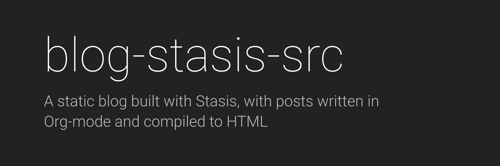
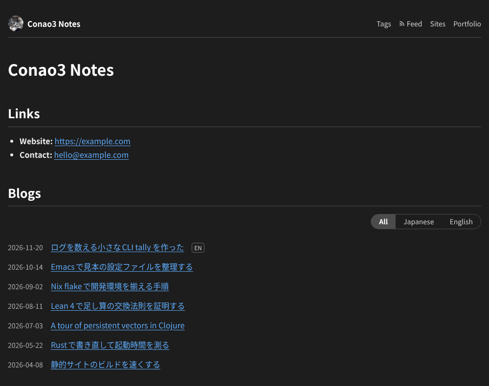
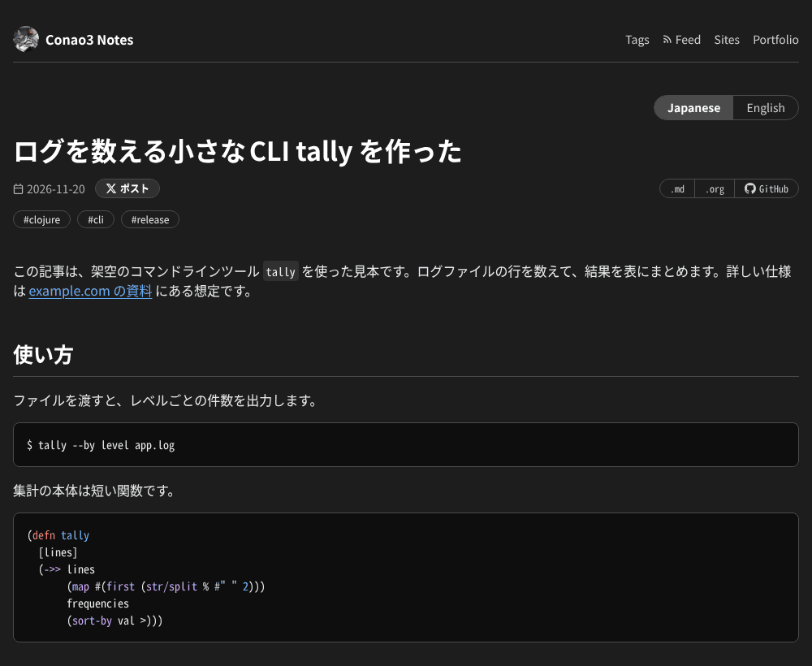
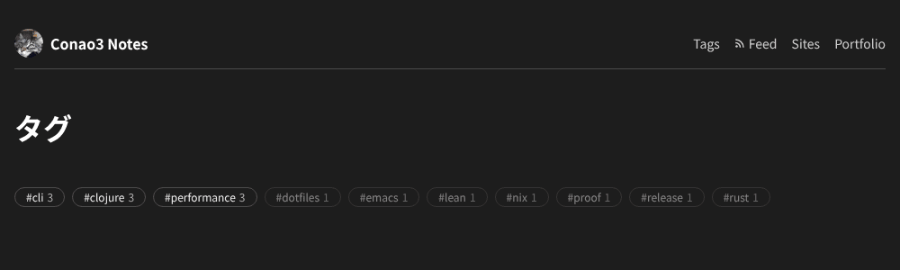

<p align="center"></p>

<p align="center"><strong>A static blog built with Stasis, with posts written in Org-mode and compiled to HTML</strong></p>

<p align="center"><a href="https://github.com/conao3/blog-stasis-src/actions/workflows/check.yml"></a> <a href="https://github.com/conao3/blog-stasis-src/stargazers"></a></p>

<p align="center"><a href="#requirements">Requirements</a> | <a href="#getting-started">Getting Started</a> | <a href="#writing-articles">Writing Articles</a> | <a href="#deployment">Deployment</a></p>

<h1>blog-stasis-src</h1>

A static blog built with [Stasis](https://github.com/magnars/stasis), a simple and flexible Clojure static site generator. Articles are written in Org-mode, exported to Markdown, and compiled into HTML.

## Requirements

- [Nix](https://nixos.org/) with flakes enabled
- Clojure
- Node.js (for Wrangler CLI)

## Getting Started

1. Enter the development environment:

   ```bash
   nix develop
   ```

2. Install Node.js dependencies:

   ```bash
   npm install
   ```

3. Start the development server:

   ```bash
   make dev
   ```

4. Open http://localhost:8080 in your browser.



The screenshots in this README show sample data.

## Project Structure

```
.
├── contents.org          # Blog articles (Org-mode source)
├── deps.edn              # Clojure dependencies
├── flake.nix             # Nix flake configuration
├── Makefile              # Development server and build tasks
├── package.json          # Node.js dependencies
├── src/
│   └── blog_clojure/
│       └── core.clj      # Main application logic
├── dev/
│   └── user.clj          # Development utilities
├── resources/
│   └── public/           # Static assets (images, etc.)
└── generated/
    ├── contents/         # Markdown files exported from Org-mode
    └── spectrum/         # Adobe Spectrum design tokens
```

## Writing Articles





1. Add a new top-level heading in `contents.org`
2. Set the required properties:
   - `export_title` - Article title
   - `export_file_name` - Output filename
   - `export_date` - Publication date
   - `export_tags` - Space-separated tags (optional, `[a-z0-9-]` only). Each tag gets a page at `/tags/<tag>` and the tag index is `/tags/`
3. Export to Markdown from Emacs: `M-x my/stasis-export`

## Building

Generate static files in the `target/` directory:

```bash
make build
```

## Deployment

The site is the Cloudflare Worker `blog-stasis-src`, which serves `target/` as static assets on the custom domain s.conao3.com (`wrangler.toml`). Deploy by running the `deploy` workflow (`.github/workflows/deploy.yml`) on `master`; it runs `make build` and then `npx wrangler deploy`.

The Worker has no script, so every request is served from the static assets and does not count toward the Workers request limit. Content negotiation is two Cloudflare Transform Rules (URL rewrites) on the `conao3.com` zone, defined in `cloudflare/request-transform.json`: a request for `/` or a post whose `Accept` header contains `text/markdown` is rewritten to the Markdown version (`<path>.md`, built from `generated/contents/`). After changing the file, apply it with `PUT /zones/<zone ID>/rulesets/phases/http_request_transform/entrypoint`. Response headers come from `resources/_headers`, which the build copies to `target/_headers`: every response has `Vary: Accept` and a `Link` header pointing to `sitemap.xml` and `llms.txt`, the top page also links to its Markdown version (posts link to theirs from the HTML `<head>`), Markdown versions link to their HTML page as canonical, `.md` and `.org` sources are served as UTF-8 text, preview pages under `/preview/` carry `X-Robots-Tag: noindex`, and images, card images and `/assets/` are cached for an hour. The build also writes `robots.txt`, `sitemap.xml`, `llms.txt`, an Atom feed (`feed.xml`, the latest 30 posts), and JSON-LD (`WebSite` and `Person` on the top page, `BlogPosting` and `BreadcrumbList` on posts, `ProfilePage` on the portfolio). Every page has a canonical URL, OGP and Twitter card tags, and the portfolio pages link each other with `hreflang`. Headings in a post body start at `h2`, so the post title is the only `h1`.

The build reads the Markdown files committed under `generated/contents/`, so a post goes live only after its exported Markdown is committed. Posts and pages marked as drafts (`Draft: true` in the Markdown header, or `:export_draft: t` in `contents.org`) appear on the dev server but are left out of the build.

## Additional Commands

### Fetch Adobe Spectrum Tokens

Download design tokens to `resources/spectrum/`:

```bash
make fetch
```
