#+options: ^:nil toc:nil

* org
#+begin_src elisp
(org-export-define-derived-backend 'stasis-md 'md
  :options-alist '((:draft "DRAFT" nil nil t) (:lang "LANG" nil nil t) (:original "ORIGINAL" nil nil t) (:tags "TAGS" nil nil split) (:updated "UPDATED" nil nil t))
  :translate-alist
  '((template . stasis-md-template)
    (link . stasis-md-link)
    (latex-fragment . stasis-md-latex)
    (latex-environment . stasis-md-latex)
    (footnote-reference . stasis-md-footnote-reference)
    (src-block . stasis-md-src-block)
    (line-break . stasis-md-line-break)
    (paragraph . stasis-md-paragraph)))

(defconst stasis-md-paragraph-break "\nSTASIS-MD-PARAGRAPH-BREAK\n")

(defun stasis-md-line-break (_line-break _contents _info)
  stasis-md-paragraph-break)

(defun stasis-md-paragraph (paragraph contents info)
  (string-replace stasis-md-paragraph-break "\n\n" (org-md-paragraph paragraph contents info)))

(defun stasis-md-template (contents info)
  (concat
   (format "Title: %s\n" (car (plist-get info :title)))
   (format "Date: %s\n" (car (plist-get info :date)))
   (if (plist-get info :updated) (format "Updated: %s\n" (plist-get info :updated)) "")
   (if (plist-get info :draft) "Draft: true\n" "")
   (if (plist-get info :lang) (format "Lang: %s\n" (plist-get info :lang)) "")
   (if (plist-get info :original) (format "Original: %s\n" (plist-get info :original)) "")
   (if (plist-get info :tags) (format "Tags: %s\n" (string-join (plist-get info :tags) " ")) "")
   "\n\n"
   contents))

(defun stasis-md-latex (element _contents _info)
  (let* ((value (string-trim (org-element-property :value element)))
         (environment (eq (org-element-type element) 'latex-environment))
         (display (or environment (string-prefix-p "$$" value) (string-prefix-p "\\[" value)))
         (tex (cond
               (environment value)
               ((string-prefix-p "$$" value) (substring value 2 -2))
               ((string-prefix-p "$" value) (substring value 1 -1))
               ((string-match-p "\\`\\\\[([]" value) (substring value 2 -2))))
         (data (and tex (base64-encode-string (encode-coding-string tex 'utf-8) t))))
    (cond
     ((not tex) value)
     (environment (format "<div class=\"math display\" data-tex=\"%s\"></div>\n" data))
     (t (format "<span class=\"math%s\" data-tex=\"%s\"></span>" (if display " display" "") data)))))

(defun stasis-md-src-block (src-block _contents info)
  (let ((language (or (org-element-property :language src-block) ""))
        (code (org-export-format-code-default src-block info))
        (longest 2)
        (start 0))
    (while (string-match "`+" code start)
      (setq longest (max longest (length (match-string 0 code)))
            start (match-end 0)))
    (let ((fence (make-string (1+ longest) ?`)))
      (format "%s%s\n%s%s" fence language code fence))))

(defun stasis-md-footnote-reference (reference contents info)
  (let* ((definition (org-export-get-footnote-definition reference info))
         (body (string-trim (org-export-data definition info)))
         (body (replace-regexp-in-string "\n\\(?:[ \t]*\n\\)+" "<br>" body))
         (body (replace-regexp-in-string "[ \t]*\n[ \t]*" " " body))
         (html (org-html-footnote-reference reference contents info)))
    (string-match "<a id=\"\\([^\"]+\\)\" class=\"footref\" href=\"[^\"]*\" role=\"doc-backlink\">\\([^<]*\\)</a>" html)
    (let ((id (match-string 1 html))
          (number (match-string 2 html)))
      (format "<span class=\"footnote\">%s<span class=\"footnote-body\" id=\"%s-body\" popover>%s</span></span>"
              (replace-match (format "<button type=\"button\" id=\"%s\" class=\"footref\" popovertarget=\"%s-body\">%s</button>" id id number) t t html)
              id body))))

(org-link-set-parameters "github")

(defconst stasis-md-github-mark
  "<svg class=\"github-card-mark\" viewBox=\"0 0 16 16\" aria-hidden=\"true\"><path d=\"M6.766 11.328c-2.063-.25-3.516-1.734-3.516-3.656 0-.781.281-1.625.75-2.188-.203-.515-.172-1.609.063-2.062.625-.078 1.468.25 1.968.703.594-.187 1.219-.281 1.985-.281.765 0 1.39.094 1.953.265.484-.437 1.344-.765 1.969-.687.218.422.25 1.515.046 2.047.5.593.766 1.39.766 2.203 0 1.922-1.453 3.375-3.547 3.64.531.344.89 1.094.89 1.954v1.625c0 .468.391.734.86.547C13.781 14.359 16 11.53 16 8.03 16 3.61 12.406 0 7.984 0 3.563 0 0 3.61 0 8.031a7.88 7.88 0 0 0 5.172 7.422c.422.156.828-.125.828-.547v-1.25c-.219.094-.5.156-.75.156-1.031 0-1.64-.562-2.078-1.609-.172-.422-.36-.672-.719-.719-.187-.015-.25-.093-.25-.187 0-.188.313-.328.625-.328.453 0 .844.281 1.25.86.313.452.64.655 1.031.655s.641-.14 1-.5c.266-.265.47-.5.657-.656\"/></svg>")

(defconst stasis-md-github-star-icon
  "<svg viewBox=\"0 0 16 16\" aria-hidden=\"true\"><path d=\"M8 .25a.75.75 0 0 1 .673.418l1.882 3.815 4.21.612a.75.75 0 0 1 .416 1.279l-3.046 2.97.719 4.192a.751.751 0 0 1-1.088.791L8 12.347l-3.766 1.98a.75.75 0 0 1-1.088-.79l.72-4.194L.818 6.374a.75.75 0 0 1 .416-1.28l4.21-.611L7.327.668A.75.75 0 0 1 8 .25Z\"/></svg>")

(defconst stasis-md-github-language-colors
  '(("Emacs Lisp" . "#c065db")
    ("Rust" . "#dea584")
    ("Shell" . "#89e051")
    ("TypeScript" . "#3178c6")))

(defun stasis-md-github-card (path desc)
  (let* ((parts (split-string path "::"))
         (repo (car parts))
         (language (cadr parts))
         (color (cdr (assoc language stasis-md-github-language-colors)))
         (owner (car (split-string repo "/")))
         (name (cadr (split-string repo "/"))))
    (concat
     (format "<div class=\"github-card\" data-repo=\"%s\"><a href=\"https://github.com/%s\">" repo repo)
     (format "<span class=\"github-card-name\">%s<span>%s/<strong>%s</strong></span></span>" stasis-md-github-mark owner name)
     (if desc
         (format "<span class=\"github-card-description\">%s</span>" (org-html-encode-plain-text (string-trim desc)))
       "")
     "<span class=\"github-card-footer\">"
     (if language
         (format "<span class=\"github-card-language\"><span class=\"github-card-language-color\"%s></span>%s</span>"
                 (if color (format " style=\"background-color: %s\"" color) "")
                 language)
       "<span></span>")
     (format "<span class=\"github-card-star\">%s<span>Star</span><span class=\"github-card-star-count\" hidden></span></span>" stasis-md-github-star-icon)
     "</span></a></div>")))

(org-link-set-parameters "tweet")

(defconst stasis-md-x-logo
  "<svg class=\"tweet-card-logo\" viewBox=\"0 0 24 24\" aria-hidden=\"true\"><path d=\"M18.244 2.25h3.308l-7.227 8.26 8.502 11.24H16.17l-5.214-6.817L4.99 21.75H1.68l7.73-8.835L1.254 2.25H8.08l4.713 6.231zm-1.161 17.52h1.833L7.084 4.126H5.117z\"/></svg>")

(defun stasis-md-tweet-time (id)
  (let ((ms (+ (ash (string-to-number id) -22) 1288834974657)))
    (seconds-to-time (/ ms 1000))))

(defun stasis-md-tweet-card (path desc)
  (let* ((parts (split-string path "::"))
         (status (car parts))
         (zone (or (cadr parts) "Asia/Tokyo"))
         (user (car (split-string status "/")))
         (id (cadr (split-string status "/")))
         (name (or (caddr parts) (if (string= user "conao_3") "conao3" user)))
         (avatar (if (string= user "conao_3")
                     "/assets/icon.jpg"
                   (let ((file (format "/img/tweet-avatar-%s.jpg" user)))
                     (and (file-exists-p (concat "resources/public" file)) file))))
         (time (stasis-md-tweet-time id))
         (images (seq-filter
                  (lambda (file) (file-exists-p (concat "resources/public" file)))
                  (mapcar (lambda (n) (format "/img/tweet-%s-%d.jpg" id n)) '(1 2 3 4)))))
    (concat
     (format "<div class=\"tweet-card\"><a href=\"https://x.com/%s/status/%s\">" user id)
     "<span class=\"tweet-card-header\">"
     (if avatar (format "" avatar) "")
     (format "<span class=\"tweet-card-author\"><strong>%s</strong><span>@%s</span></span>"
             (org-html-encode-plain-text name) user)
     stasis-md-x-logo
     "</span>"
     (if desc
         (mapconcat (lambda (line) (format "<span class=\"tweet-card-text\">%s</span>" (org-html-encode-plain-text line)))
                    (split-string (string-trim desc) "\n" t "[ \t]+")
                    "")
       "")
     (if images
         (concat (format "<span class=\"tweet-card-media\" data-count=\"%d\">" (length images))
                 (mapconcat (lambda (src) (format "" src)) images "")
                 "</span>")
       "")
     (format "<time class=\"tweet-card-time\" datetime=\"%s\">%s</time>"
             (format-time-string "%FT%T%z" time zone)
             (format-time-string "%Y-%m-%d %H:%M" time zone))
     "</a></div>")))

(org-link-set-parameters "youtube")

(defconst stasis-md-play-icon
  "<svg class=\"youtube-card-play\" viewBox=\"0 0 68 48\" aria-hidden=\"true\"><path class=\"youtube-card-play-bg\" d=\"M66.52 7.74c-.78-2.93-2.49-5.41-5.42-6.19C55.79.13 34 0 34 0S12.21.13 6.9 1.55c-2.93.78-4.63 3.26-5.42 6.19C.06 13.05 0 24 0 24s.06 10.95 1.48 16.26c.78 2.93 2.49 5.41 5.42 6.19C12.21 47.87 34 48 34 48s21.79-.13 27.1-1.55c2.93-.78 4.64-3.26 5.42-6.19C67.94 34.95 68 24 68 24s-.06-10.95-1.48-16.26z\"/><path fill=\"#fff\" d=\"M45 24 27 14v20z\"/></svg>")

(defun stasis-md-youtube-card (id desc)
  (concat
   (format "<div class=\"youtube-card\" data-id=\"%s\"><a href=\"https://www.youtube.com/watch?v=%s\">" id id)
   "<span class=\"youtube-card-thumb\">"
   (format "" id)
   stasis-md-play-icon
   "</span>"
   (if desc
       (format "<span class=\"youtube-card-title\">%s</span>" (org-html-encode-plain-text (string-trim desc)))
     "")
   "</a></div>"))

(defun stasis-md-link (link desc info)
  (let ((type (org-element-property :type link)))
    (cond
     ((string= type "github")
      (stasis-md-github-card (org-element-property :path link) desc))
     ((string= type "tweet")
      (stasis-md-tweet-card (org-element-property :path link) desc))
     ((string= type "youtube")
      (stasis-md-youtube-card (org-element-property :path link) desc))
     ((string= type "file")
      (let* ((path (org-element-property :path link))
             (new-path (file-relative-name (expand-file-name path)
                                           (file-name-directory (expand-file-name (plist-get info :output-file)))))
             (new-link (org-element-copy link)))
        (org-element-put-property new-link :path new-path)
        (org-md-link new-link desc info)))
     (t (org-md-link link desc info)))))

(defun my/stasis-export ()
  "Export each top-level heading of the current Org file to its own file."
  (interactive)
  (save-excursion
    (goto-char (point-min))
    (while (re-search-forward "^\\* " nil t)
      (org-narrow-to-subtree)
      (unless (org-in-commented-heading-p)
        (let* ((file (org-export-output-file-name ".md" 'subtree))
               (dir (and file (file-name-directory file))))
          (when file
            (message "Exporting %s..." file)
            (when (and dir (not (file-directory-p dir)))
              (make-directory dir 'parents))
            (org-export-to-file 'stasis-md file nil 'subtree))))
      (widen))))

(defun my/stasis-new (title)
  "Create a new blog post heading with properties."
  (interactive "sTitle: ")
  (let* ((random-id (mapconcat (lambda (_) (format "%x" (random 16))) (make-list 6 nil) ""))
         (date (format-time-string "%Y-%m-%d %H:%M"))
         (year (format-time-string "%Y"))
         (file-name (format "generated/contents/blog/%s/%s" year random-id)))
    (goto-char (point-max))
    (when (re-search-backward "^\\* COMMENT Local variables" nil t)
      (beginning-of-line))
    (insert (format "* %s\n:properties:\n:export_file_name: %s\n:export_date: %s\n:export_updated: %s\n:end:\n\n"
                    title file-name date date))))
#+end_src

#+RESULTS:
:results:
my/stasis-new
:end:

* Conao3 Notes
:properties:
:export_file_name: generated/contents/index.md
:export_date: 2024-12-21
:export_updated: 2024-12-21
:end:

** Links
- GitHub :: https://github.com/conao3
- X(Twitter) :: https://x.com/conao_3
- 技術書典 :: https://techbookfest.org/organization/b48gui73eygdZDs02kqB1C

* Makefileで.emacs.dの理想的なディレクトリ構造を生成する話
:properties:
:export_file_name: generated/contents/blog/2018/07b41c
:export_date: 2018-12-07
:export_updated: 2018-12-07
:export_tags: emacs make dotfiles directory-structure
:end:

** はじめに
この記事は[[https://qiita.com/advent-calendar/2018/emacs][Emacs Advent Calendar 2018 - Qiita]]の7日目の記事です。
前日はtadsanさんの「[[https://qiita.com/tadsan/items/f23d6db8efc0fcdcd225][カーソルを変更する]]」でした。

** モチベーション
「 =.emacs.d= のディレクトリ構成のベストプラクティスってなんなんだろう」と思って検索したことはEmacsのカスタマイズをする際に一度や二度あると思います。

そして +ネタかぶりしてます+ 。頻繁に語られる活発な話題と思ってもらえればと。。

- [[https://qiita.com/ytkt/items/2df2e2e93fb0a066a7de][ぼくのかんがえたさいきょうの.emacs.d - Qiita]]
- [[https://qiita.com/yynozk/items/7dce94f770e6f3f0b26c][.emacs.dを公開しました - Qiita]]
- [[http://www.sakito.com/2009/12/emacsd.html][.emacs.dの利用 - 技術的生存報告記]]

最終的に好みなディレクトリ構造をそれぞれ見つけていくと思うんですが、今回は「ぼくのかんがえたさいきょうの.emacs.dのディレクトリ構造」を提案するとともにMakeでそのディレクトリ構造を生成するMakefileを紹介します。

*** （自分にとっての）モチベーション
私はもちろん新しめのEmacsを常用しているのですが、レガシーEmacsしかインストールされていないPCを触らないといけない場面というのは訪れ、そんな状況でもそのEmacsが「程々に」動いてほしいと思っています。
その点、レガシーEmacsを見つけたらまず新しめのEmacsをインストールするという方とは考え方が違うかもしれません。

大学の計算機室のパソコンにはEmacs-22がインストールされており、もちろん管理者権限がない中、一度~/localでソースからビルドしましたがaptが行う依存解決を手でするのは大変で、軽く半日かかりました。
ただバニラEmacsはタブモードであったり、色んな所にバックアップファイルを撒き散らしたり（普段は一箇所にまとめて作成させるようにしている）などとても許容できません。
一方 =use-package= のわかりやすいDSL的設定の書き方はとても感動し、すべてのパッケージの設定を =use-package= で書いていますが、Emacs-24からしか動作しません。

これはEmacs-22でも動く =use-package= もどきを作るしかないじゃないかということで[[https://github.com/conao3/leaf.el][leaf.el]]なるパッケージを作り始めました。
標準添付テスターのertもEmacs-24からですし、パッケージマネージャのpackage.elもEmacs-23からの対応なので、それぞれEmacs-22から動作する[[https://github.com/conao3/cort.el][cort.el]]、[[https://github.com/conao3/feather.el][feather.el]]を作成することになります。
手元でレガシーEmacsの挙動を確かめるためには複数バージョンのEmacsを飼うのが一番手っ取り早いわけで、その特殊な状況の.emacs.dの構成であることを了承いただければと思います。
[[https://github.com/conao3/dotfiles/commit/fd06cea5dd040ec1fb34225a3f3202200e00801e][8月]]から試行錯誤を繰り返してようやく完成が見え始めましたので書き記す次第です。

** 他の人のディレクトリ構造の調査
*** [[https://www.gnu.org/software/emacs/manual/html_node/emacs/Init-File.html][Emacs manual]]
最も信頼できるソースですが、init.elをどこから探すか。という話題に注力していて、.emacs.dディレクトリを採用する場合のそのディレクトリ構造を示したりはしていないようです。
（ちなみにここらへんの話題についてはtadsanさんの[[https://qiita.com/tadsan/items/4f5743de21b7aa06ca35][Emacsを起動する - Qiita]]が詳しいです。）

*** [[https://www.oreilly.co.jp/books/9784873112770/][入門GNU Emacs第3版]] - O'Reilly
最も参考にしたい本ですが、2007年の本で.emacsファイルを使用することになっています。残念。

*** [[http://gihyo.jp/book/2017/978-4-7741-9235-2][Emacs実践入門]] - [[http://d.hatena.ne.jp/tomoya/][id:tomoya]]
我々のバイブル(の初版)は下記のディレクトリ構造を推薦されています。

#+begin_example
.emacs.d/
├── init.el         -> 設定ファイル
├── conf/           -> 分割設定用ディレクトリ
├── elisp/          -> Elispインストールディレクトリ
├── elpa/           -> ELPA用のディレクトリ
├── public_repos/   -> 公開レポジトリをチェックアウトするディレクトリ
├── etc/            -> etc用ディレクトリ
└── info/           -> infoファイル用ディレクトリ
#+end_example

(改訂新版で更新があったのかは手元にないので分からないです。。)

*** [[https://github.com/jwiegley/dot-emacs][jwiegley/dot-emacs]]
use-package作者、jwiegleyさんの.emacs.d。省略あり。

基本的な「パッケージの設定」はルートディレクトリ、「自作パッケージ」は =lisp/= 、
「package.elでダウンロードしたパッケージ」は =elpa/= に入れるようになっているようです。

もちろん.gitignoreしてあり、そもそも目に見えるファイルも省略してるので参考程度に。

#+begin_example
.emacs.d/
├── init.el         -> 設定ファイル
├── doc/EmacsWiki/  -> 設定ファイル
├── lisp/           -> 自作Elispインストールディレクトリ
├── elpa/           -> Elispインストールディレクトリ
└── snippets/       -> yasnippet用スニペットディレクトリ
#+end_example

** 提案するディレクトリ構造
上記調査を踏まえ、また自分の経験や他の人の知見を含め、以下のディレクトリ構造を提案します。
23.4の下などは22.1と同じ構造が繰り返されています。

#+begin_example
.
├── Makefile
├── Makefunc.mk
├── init.el
├── conf/
│   ├── 00_leaf.el
│   ├── 01_core-emacs.el
│   ├── 10_standard-elisp.el
│   ├── 20_editor.el
│   ├── 30_utility.el
│   └── 40_major-mode.el
├── site-lisp/
│   ├── cort.el/
│   ├── dash.el/
│   ├── f.el/
│   ├── feather.el/
│   ├── leaf.el/
│   ├── org-mode/
│   ├── orglyth.el/
│   ├── s.el/
│   └── use-package/
├── snippets/
├── templete/
└── local/
    ├── conao-mixed-raw.el
    ├── conao-mixed.el
    ├── 22.1/
    │   ├── build/
    │   │   ├── conao-mixed.el -> ../../conao-mixed.el
    │   │   └── conao-mixed.elc
    │   │   snippets/ -> ../../snippets/
    │   │   templete/ -> ../../templete/
    │   └── site-lisp/
    │       ├── cort.el/
    │       ├── ...
    │       └── use-pacakge/
    ├── 23.4/
    ├── 24.5/
    ├── 25.3/
    └── 26.1/
#+end_example

なお上記構造は以下の構造からmakeで自動生成します。つまり、この構成がgithubで見えることになります。

#+begin_example
.
├── Makefile
├── Makefunc.mk
├── init.el
├── conf/
│   ├── 00_leaf.el
│   ├── 01_core-emacs.el
│   ├── 10_standard-elisp.el
│   ├── 20_editor.el
│   ├── 30_utility.el
│   └── 40_major-mode.el
├── snippets/
└── templete/
#+end_example

このディレクトリ構造は以下の特徴を持っています。

- メジャーバージョンの異なる、複数のEmacsを同時に使用できる。
- 構造として最速の起動時間を実現するディレクトリ、ファイル構造。
- elpaからダウンロード、コンパイルした.elcファイルはすべて =local/[ver]/build/= 以下に置かれる。
- コンパイルが必要な場合、最小のコンパイルで完了する。

バイトコンパイル事情に詳しくありませんが、メジャーバージョンが異なるEmacsでの動作は保証されていないなどの記述をどこかで見た気がするので、 =build/= と =site-lisp/= をそれぞれのバージョンで持っています。共有できそうなsnippetやtempleteに関してはシンボリックリンクで共有します。

=conf/= の.elをまとめた =conao-mixed.el= は通常共有できませんが、そもそも複数バージョンで使われることを前提に[[https://github.com/conao3/leaf.el][leaf.el]]が開発されており、それを使って =conf/= を書いているため、共有できることになっています。
ただ、それのバイトコンパイルファイルはそれぞれのバージョンで持っている状況になっています。

** init.el
とりあえずこのディレクトリ構造の作り方は置いといて(手動でも作れるので)、この構造ができたときに、init.elはどういう記述になるのか見ます。

#+begin_src emacs-lisp
;; enable debug
(setq debug-on-error  t
      init-file-debug t)

(defun mkdir-if-missing (path &optional add-loadpath-p)
  "Missing folder, create PATH and add PATH to load-path.
Parent folder also create if no exist.
If ADD-LOADPATH-P is non-nil, add maked directory to loadpath."
  (unless (file-directory-p path) (make-directory path t))
  (when add-loadpath-p (add-to-list 'load-path path)))

;; if you run like 'emacs -q -l ~/hoge/init.el'
(progn
  (when load-file-name
    (setq user-emacs-directory
          (expand-file-name (file-name-directory load-file-name))))
  (setq user-emacs-directory
        (format "%slocal/%s.%s/"
                user-emacs-directory emacs-major-version emacs-minor-version))

  (mkdir-if-missing user-emacs-directory)
  (mkdir-if-missing (locate-user-emacs-file "build/") t))

(if (require 'conao-mixed nil t)
    (message "load conao-mixed.el")
  (message "missing conao-mixed.el..."))

(provide 'init)
;;; init.el ends here
#+end_src

localディレクトリやbuildディレクトリの存在しない場合をケアしていますが、後述のMakefileや新しいパッケージマネージャfeather.el(鋭意製作中)を使用して、それらのディレクトリの面倒を見る場合はもっと簡単に以下のように出来ます。

#+begin_src emacs-lisp
;; enable debug
(setq debug-on-error  t
      init-file-debug t)

;; if you run like 'emacs -q -l ~/hoge/init.el'
(progn
  (when load-file-name
    (setq user-emacs-directory
          (expand-file-name (file-name-directory load-file-name))))
  (setq user-emacs-directory
        (format "%slocal/%s.%s/"
                user-emacs-directory emacs-major-version emacs-minor-version)))

(if (require 'conao-mixed nil t)
    (message "load conao-mixed.el")
  (message "missing conao-mixed.el..."))

(provide 'init)
;;; init.el ends here
#+end_src

=user-emacs-directory= を現在起動中のEmacsバージョンを利用して設定し直すことで、バージョンごとにEmacsから見えるディレクトリを完全に分離できます。

[[http://peccu.hatenablog.com/entry/20130218/trial_init][お試しinit.el]]のテクニックで得られた起動時に動的に与えることのできるルートフォルダから更に =local/[ver]= とディレクトリを掘り、その場所を =user-emacs-directory= としています。

あとはbuild下のconao-mixed(後述)をrequireするだけです。

バイトコンパイルされたelに詳しくないのですが、メジャーバージョンが異なるEmacs同士で正常に実行できるか保証されていないようなので、複数バージョンのEmacsを飼う場合このような運用は必須です。

** Makefile
=make= はC++やC#で作られた超巨大建築物に対して使用するものだと思っていましたが、実は並べたコマンドを実行するだけの一般的なツールで、定型作業をジョブとして保存しておき簡単に呼び出すことが出来ます。

もちろん強力な依存関係解決能力を持っており、必要な作業を必要なだけ行うことが出来ます。またすべての依存関係を解決した後に作業に移るので、ジョブの独立性も把握でき、 =-j[d]= オプション(dは整数)を付けるだけで、最大d個のコマンドを並列に実行してくれます。

「依存関係」に注目することでmakeは本来の力を出すことが出来ます。私はそれに気づいていなかったので「ダウンロードジョブ」「コンパイルジョブ」「デプロイジョブ」のようにジョブを作ってしまっていました。これはmakeの流儀に則っていません。

大きなジョブを作成してしまうと依存関係が大きくなり、小さな粒度で再コンパイルなどができなくなります。
「仕事」で考えるのではなく「ファイル」単位で考えることが大切だと先週ぐらいに気づきました。
私のような無駄な試行錯誤をしないためにもオライリーの「[[https://github.com/jr4qpv/GNU_Make_3rd_jp][GNU Make第3版]]」は時間を作って見たほうが良いです。素晴らしいことに無料です。有志の方が各章を結合したPDFを作ってくださっています。

*** Makefunc.mkファイル
他のMakefileを編集するときの助けになりそうな関数群は、切り出してインポートする形にするほうが良いです。私はそのような関数群をMakefunc.mkというファイル名で保存して利用しています。

とりあえず貼ります。

#+begin_src makefile
#
# Makefunc.mk
#
# version: v1.8
# last update: 2018/12/04
#
# echo with color


##################################################
#
#  strings utils
#

STRCUT    = $(shell echo $1 | awk -F $2 '{print $3}')
STRCUTREV = $(shell echo $1 | awk -F $2 '{print $$(NF-$3)}')

##################################################
#
#  dictionary
#    (KEY)/(VAL) data class
#

MAKEDIC = $(join $(addsuffix /, $1), $2)
KEY2VAL = $(shell echo $1 | grep -Po '(?<=$2/)[^\s]+')
VAL2KEY = $(shell echo $1 | grep -Po '[^\s]+(?=/$2)')

##################################################
#
#  color
#

ECHO_COLOR    = printf "%b\e[%bm=== %b ===\e[m%b\n" $3 $1 $2 $4
ECHO_COLOR-   = printf "%b\e[%bm%b\e[m%b" $3 $1 $2 $4

ECHO_BLACK    = $(call ECHO_COLOR,"30",$1,$2,$3)
ECHO_RED      = $(call ECHO_COLOR,"31",$1,$2,$3)
ECHO_GREEN    = $(call ECHO_COLOR,"32",$1,$2,$3)
ECHO_YELLOW   = $(call ECHO_COLOR,"33",$1,$2,$3)
ECHO_BLUE     = $(call ECHO_COLOR,"34",$1,$2,$3)
ECHO_MAGENTA  = $(call ECHO_COLOR,"35",$1,$2,$3)
ECHO_CYAN     = $(call ECHO_COLOR,"36",$1,$2,$3)
ECHO_WHITE    = $(call ECHO_COLOR,"37",$1,$2,$3)

ECHO_BLACK-   = $(call ECHO_COLOR-,"30",$1,$2,$3)
ECHO_RED-     = $(call ECHO_COLOR-,"31",$1,$2,$3)
ECHO_GREEN-   = $(call ECHO_COLOR-,"32",$1,$2,$3)
ECHO_YELLOW-  = $(call ECHO_COLOR-,"33",$1,$2,$3)
ECHO_BLUE-    = $(call ECHO_COLOR-,"34",$1,$2,$3)
ECHO_MAGENTA- = $(call ECHO_COLOR-,"35",$1,$2,$3)
ECHO_CYAN-    = $(call ECHO_COLOR-,"36",$1,$2,$3)
ECHO_WHITE    = $(call ECHO_COLOR-,"37",$1,$2,$3)

COLOR_BLACK   = tput setaf 0
COLOR_RED     = tput setaf 1
COLOR_GREEN   = tput setaf 2
COLOR_YELLOW  = tput setaf 3
COLOR_BLUE    = tput setaf 4
COLOR_MAGENTA = tput setaf 5
COLOR_CYAN    = tput setaf 6
COLOR_WHITE   = tput setaf 7
COLOR_DEFAULT = tput sgr0

colortest:
        $(call ECHO_BLACK,   "black"  , "", "")
        $(call ECHO_RED,     "red"    , "", "")
        $(call ECHO_GREEN,   "green"  , "", "")
        $(call ECHO_YELLOW,  "yellow" , "", "")
        $(call ECHO_BLUE,    "blue"   , "", "")
        $(call ECHO_MAGENTA, "magenta", "", "")
        $(call ECHO_CYAN,    "cyan"   , "", "")
        $(call ECHO_WHOTE,   "white"  , "", "")
#+end_src

Makefunc.mkは =colortest= というジョブを含んでいます。他のプログラミング言語のように先頭でIncludeしてしまうと =colortest= が
デフォルトジョブ(単にmakeとタイプしたときに実行されるジョブ)になってしまいます。

そのため下記のようにとりあえず =all= ジョブを依存関係無しでファイル先頭で定義することで回避します。（このテクニックは前述のオライリー本に書いてありました）

#+begin_src makefile
all:

include Makefunc.mk

...
#+end_src

*** 変数定義
通常はジョブを作るときに徐々に変数定義が増えていくものなのですが、今回は料理番組のように最初に用意しておきます。

Makeの関数を使っているので、適宜「[[https://qiita.com/chibi929/items/b8c5f36434d5d3fbfa4a][Makefileの関数 - Qiita]]」を参照してください。

#+begin_src makefile
LOCALDIR    := local
LISPDIR     := site-lisp
CONFDIR     := conf
BUILDDIR    := build
SNIPPETDIR  := snippets
TEMPLETEDIR := templete

MIXRAWNAME  := conao-mixed-raw.el
MIXFILENAME := conao-mixed.el
MIXELCNAME  := $(MIXFILENAME:%.el=%.elc)
MIXRAWFILE  := $(LOCALDIR)/$(MIXRAWNAME)
MIXFILE     := $(LOCALDIR)/$(MIXFILENAME)

GITHUB      := https://github.com
REMOTE      := $(GITHUB)/conao3
REPOS       := leaf.el orglyth.el cort.el feather.el \
               org-mode f.el s.el dash.el use-package emacs-htmlize
REPODIRS    := $(addprefix $(LISPDIR)/, $(REPOS))

VERNAME_CMD := --version | head -n 1 | cut -d ' ' -f 3 | grep -oP '^\d+\.\d+'
EMACS_RAW   := $(filter-out emacs-undumped, $(shell compgen -c emacs- | xargs))
ALL_EMACS   := $(strip $(sort $(EMACS_RAW)))
EMACS_VERS  := $(foreach ver,$(ALL_EMACS),$(shell $(ver) $(VERNAME_CMD)))
EMACS_DIC   := $(call MAKEDIC,$(ALL_EMACS),$(EMACS_VERS))

CONFFILES   := $(sort $(wildcard $(CONFDIR)/*.el))

LOCALDIRS   := $(addprefix $(LOCALDIR)/,$(EMACS_VERS))

SED_MIXFILE := 's/;.*//g' -e 's/(provide .*)//g' -e '/^ *$$/d'

LOCAL_BUILDDIRS   := $(addsuffix /$(BUILDDIR),$(LOCALDIRS))
LOCAL_MIXFILES    := $(addsuffix /$(MIXFILENAME),$(LOCALDIRS))
LOCAL_LISPDIRS    := $(addsuffix /$(LISPDIR),$(LOCALDIRS))
LOCAL_SNIPPETS    := $(addsuffix /$(SNIPPETDIR),$(LOCALDIRS))
LOCAL_TEMPLETES   := $(addsuffix /$(TEMPLETEDIR),$(LOCALDIRS))
LOCAL_REPOS       := $(foreach repo,$(REPOS),$(addsuffix /$(repo),$(LOCAL_LISPDIRS)))

LOCAL_MIXELCFILES := $(addsuffix /$(MIXELCNAME),$(LOCAL_BUILDDIRS))

DIRS          := $(LOCALDIR) $(LISPDIR) $(LOCALDIRS) $(LOCAL_BUILDDIRS) $(LOCAL_LISPDIRS)

CURRENT_BRANCH = $(shell cd $1; test -d .git && git branch | grep \* | cut -d ' ' -f2)
PULL_JOBS     := $(addprefix .make-pull-,$(REPOS))

EMACS_KEY2VAL  = $(call KEY2VAL,$(EMACS_DIC),$1)
EMACS_VAL2KEY  = $(call VAL2KEY,$(EMACS_DIC),$1)
LOCAL_EMACS    = $(call EMACS_VAL2KEY,$(call STRCUTREV,$@,'/',$1))
#+end_src

*** allジョブ
さて、トップダウンで考えます。とりあえず =all= ジョブは下記のことを行うことにします。
この2つの作業が完成したら黄色文字で勝利宣言をします。

- 必要なディレクトリを作る
- なんかいっぱい作業する。(=build= ジョブ)

#+begin_src makefile
all: $(DIRS) build
        @$(call ECHO_YELLOW,"make job:all completed!!","\n","\n")

$(DIRS):
        mkdir -p $@
#+end_src

*** buildジョブ
「なんかいっぱい作業する」の中身を書きます。各作業の最終工程を書きます。

それぞれは依存してないので =-j= オプションをおいたときに他の作業を待つことなく進みます。（実際はconao-mixed.elのコンパイルはsite-lispの後にして欲しいので、conao-mixed.elcの依存関係に入れている）

- =conf/= の設定をまとめた =conao-mixed.el= のコンパイル
- レポジトリをダウンロードしたルートの =site-lisp= をローカルにコピー、コンパイル
- ローカルのsnippetsをローカルにシンボリックリンク
- ローカルのtempletesをローカルにシンボリックリンク

#+begin_src makefile
build: $(LOCAL_MIXELCFILES) $(LOCAL_REPOS) $(LOCAL_SNIPPETS) $(LOCAL_TEMPLETES)

#################### main jobs
##########
$(LOCAL_MIXELCFILES): $(LOCAL_MIXFILES) $(REPODIRS)
        @$(call ECHO_MAGENTA,"compile $@...","\n","")
        -cp $(<:%el=%elc) $@
        -ln -sf $(shell readlink $<) $(@D)/
        -$(call LOCAL_EMACS,2) -batch -f batch-byte-compile $<

$(LOCAL_MIXFILES): $(MIXFILE)
        ln -fs ../$(<F) $@

##########
define build_repo
$(addsuffix /$(LISPDIR)/$1, $(LOCALDIRS)): $(LISPDIR)/$1
        @$$(call ECHO_MAGENTA,"compile $$@...","\n","")
        -rm -rf $$@
        cp -rf $$(LISPDIR)/$$(@F) $$@
        -EMACS=$$(call LOCAL_EMACS,2) $$(MAKE) -C $$@
endef
$(foreach repo,$(REPOS),$(eval $(call build_repo,$(repo))))

##########
$(LOCAL_SNIPPETS): $(SNIPPETDIR)
        ln -s ../../$(@F) $(LOCALDIR)/$(call STRCUTREV,$@,'/',1)/

$(LOCAL_TEMPLETES): $(TEMPLETEDIR)
        ln -s ../../$(@F) $(LOCALDIR)/$(call STRCUTREV,$@,'/',1)/
#+end_src

**** LOCAL_MIXELCFILES
=LOCAL_MIXELCFILES= は =conao-mixed.el= のコンパイルによりできますが、この作業はローカルに =conao-mixed.el= が存在することと、site-lispの各ディレクトリに依存しています。

つまりsite-lispのどれかのファイルが変わったら =conao-mixed.el= は再コンパイルされるわけです！すごい！

**** LOCAL_REPOS
=LOCAL_REPOS= は =build-repo= をレポジトリの数だけfor文で回してジョブを作っています。
ジョブの中でforを使うだけじゃなくて、「ジョブを」for文で作れるのすごい！
この書き方は[[https://stackoverflow.com/questions/53450137/target-is-not-bind-to-automatic-variable-in-makefile-job-expanded-by-macro/53451319#53451319][Stack Overflow]]のおじさんに教えてもらいました。ありがとうおじさん。

**** LOCAL_SNIPPETS, LOCAL_TEMPLETES
これらはシンボリックリンクを張るだけです。

=$@= の自動変数を使っていますが、これは例えば =local/22.1/snippets= の値になり、 =$(call STRCUTREV,$@,'/',1)= は =22.1= を返すことで =ln= のコマンドが完成します。

*** 細々としたジョブ
メインの（抽象度の高い）ジョブが依存している細々としたジョブを定義します。

#+begin_src makefile
#################### support jobs
##########
$(MIXFILE): $(CONFFILES)
        cat $^ > $(MIXRAWFILE)
        cat $(MIXRAWFILE) | sed -e $(SED_MIXFILE) > $(MIXFILE)
        echo "(provide 'conao-mixed)" >> $(MIXFILE)

$(REPODIRS):
        @$(call ECHO_MAGENTA,"git clone $(REMOTE)/$(@F)","\n","")
        git clone --depth 1 $(REMOTE)/$(@F) $@

update: $(REPOS:%=.make-update-%) .make-update-.
.make-update-%:
        cd $(LISPDIR)/$*; git pull origin $(call CURRENT_BRANCH,$(LISPDIR)/$*)

clean:
        -rm -rf $(DIRS)
        @$(call ECHO_CYAN,"make job:clean completed!!","\n","\n")
#+end_src

**** MIXFILE
=conao-mixed.el= の作り方を指示しています。

=conf/= フォルダからソート済みのファイル一覧を取り出し（CONFFILESの定義参照）、全部結合した後にsedで加工し、最後に =require= できるように =(provide 'conao-mixed)= を加えます。
sedの加工は下記を行っています。

- コメント全削除
- provide文削除（重複するので）
- その上で、空白だけの行を削除

**** REPODIRS
githubから取ってきます。この書き方ではconao3が持っているレポジトリじゃないと取ってこれないので、要改善ですね。。（時間なかった）
他の方のコードを持ってくる時はforkすれば持ってこれます。
=--shallow-clone= 早いのでぜひ使ってください！

**** update
site-lispに落としてきたレポジトリの =origin pull= を自動でやります。ブランチをチェックアウトしている場合は考慮して、今のブランチを =pull= しますが、originじゃないとこが最新の場合は考慮しません。

**** clean
作業ディレクトリをMakeで作っているので、その作業ディレクトリを全削除すればクリーンしたことになります。
巻き込み事故は考慮しません。

** まとめ
=make= と叩くだけで10秒くらいで理想のディレクトリ構造を得ることが出来ます。また前述の =-j4= オプションで3秒まで短縮できます。
わらわらログが出てくるの見るのは結構楽しいものです。ぜひあなたもMakefileで.emacs.dの初期設定、管理をされてみてはどうでしょうか。
（.emacs.dより上位の.dotfilesのMakeから、このmakefileを実行することで.dotfilesのMakefileの保守性を保ちつつ見通しよく管理できます。すごい！（多段make））

** Makefile全文
切り貼りすれば復元できると思いますが、一応全文を貼っておきます。

#+begin_src makefile
all:

include Makefunc.mk

LOCALDIR    := local
LISPDIR     := site-lisp
CONFDIR     := conf
BUILDDIR    := build
SNIPPETDIR  := snippets
TEMPLETEDIR := templete

MIXRAWNAME  := conao-mixed-raw.el
MIXFILENAME := conao-mixed.el
MIXELCNAME  := $(MIXFILENAME:%.el=%.elc)
MIXRAWFILE  := $(LOCALDIR)/$(MIXRAWNAME)
MIXFILE     := $(LOCALDIR)/$(MIXFILENAME)

GITHUB      := https://github.com
REMOTE      := $(GITHUB)/conao3
REPOS       := leaf.el orglyth.el cort.el feather.el ox-qmd \
               f.el s.el dash.el use-package emacs-htmlize
REPODIRS    := $(addprefix $(LISPDIR)/, $(REPOS))

VERNAME_CMD := --version | head -n 1 | cut -d ' ' -f 3 | grep -oP '^\d+\.\d+'
EMACS_RAW   := $(filter-out emacs-undumped, $(shell compgen -c emacs- | xargs))
ALL_EMACS   := $(strip $(sort $(EMACS_RAW)))
EMACS_VERS  := $(foreach ver,$(ALL_EMACS),$(shell $(ver) $(VERNAME_CMD)))
EMACS_DIC   := $(call MAKEDIC,$(ALL_EMACS),$(EMACS_VERS))

CONFFILES   := $(sort $(wildcard $(CONFDIR)/*.el))

LOCALDIRS   := $(addprefix $(LOCALDIR)/,$(EMACS_VERS))

SED_MIXFILE := 's/;.*//g' -e 's/(provide .*)//g' -e '/^ *$$/d'

LOCAL_BUILDDIRS   := $(addsuffix /$(BUILDDIR),$(LOCALDIRS))
LOCAL_MIXFILES    := $(addsuffix /$(MIXFILENAME),$(LOCALDIRS))
LOCAL_LISPDIRS    := $(addsuffix /$(LISPDIR),$(LOCALDIRS))
LOCAL_SNIPPETS    := $(addsuffix /$(SNIPPETDIR),$(LOCALDIRS))
LOCAL_TEMPLETES   := $(addsuffix /$(TEMPLETEDIR),$(LOCALDIRS))
LOCAL_REPOS       := $(foreach repo,$(REPOS),$(addsuffix /$(repo),$(LOCAL_LISPDIRS)))

LOCAL_MIXELCFILES := $(addsuffix /$(MIXELCNAME),$(LOCAL_BUILDDIRS))

DIRS          := $(LOCALDIR) $(LISPDIR) $(LOCALDIRS) $(LOCAL_BUILDDIRS) $(LOCAL_LISPDIRS)

CURRENT_BRANCH = $(shell cd $1; test -d .git && git branch | grep \* | cut -d ' ' -f2)
PULL_JOBS     := $(addprefix .make-pull-,$(REPOS))

EMACS_KEY2VAL  = $(call KEY2VAL,$(EMACS_DIC),$1)
EMACS_VAL2KEY  = $(call VAL2KEY,$(EMACS_DIC),$1)
LOCAL_EMACS    = $(call EMACS_VAL2KEY,$(call STRCUTREV,$@,'/',$1))


##################################################

.PHONY: all test build clean
all: $(DIRS) build
        @$(call ECHO_YELLOW,"make job:all completed!!","\n","\n")

test:
        echo $(call MAKEDIC,$(ALL_EMACS),$(EMACS_VERS))
        @echo $(EMACS_DIC)
        @echo $(call VAL2KEY,$(EMACS_DIC),22.1)

$(DIRS):
        mkdir -p $@

build: $(LOCAL_MIXELCFILES) $(LOCAL_REPOS) $(LOCAL_SNIPPETS) $(LOCAL_TEMPLETES)

#################### main jobs
##########
$(LOCAL_MIXELCFILES): $(LOCAL_MIXFILES) $(REPODIRS)
        @$(call ECHO_MAGENTA,"compile $@...","\n","")
        -cp $(<:%el=%elc) $@
        -ln -sf $(shell readlink $<) $(@D)/
        -$(call LOCAL_EMACS,2) -batch -f batch-byte-compile $<

$(LOCAL_MIXFILES): $(MIXFILE)
        ln -fs ../$(<F) $@

##########
define build_repo
$(addsuffix /$(LISPDIR)/$1, $(LOCALDIRS)): $(LISPDIR)/$1
        @$$(call ECHO_MAGENTA,"compile $$@...","\n","")
        -rm -rf $$@
        cp -rf $$(LISPDIR)/$$(@F) $$@
        -EMACS=$$(call LOCAL_EMACS,2) $$(MAKE) -C $$@
endef
$(foreach repo,$(REPOS),$(eval $(call build_repo,$(repo))))

##########
$(LOCAL_SNIPPETS): $(SNIPPETDIR)
        ln -s ../../$(@F) $(LOCALDIR)/$(call STRCUTREV,$@,'/',1)/

$(LOCAL_TEMPLETES): $(TEMPLETEDIR)
        ln -s ../../$(@F) $(LOCALDIR)/$(call STRCUTREV,$@,'/',1)/

#################### support jobs
##########
$(MIXFILE): $(CONFFILES)
        cat $^ > $(MIXRAWFILE)
        cat $(MIXRAWFILE) | sed -e $(SED_MIXFILE) > $(MIXFILE)
        echo "(provide 'conao-mixed)" >> $(MIXFILE)

$(REPODIRS):
        @$(call ECHO_MAGENTA,"git clone $(REMOTE)/$(@F)","\n","")
        git clone --depth 1 $(REMOTE)/$(@F) $@

update: $(REPOS:%=.make-update-%) .make-update-.
.make-update-%:
        cd $(LISPDIR)/$*; git pull origin $(call CURRENT_BRANCH,$(LISPDIR)/$*)

clean:
        -rm -rf $(DIRS)
        @$(call ECHO_CYAN,"make job:clean completed!!","\n","\n")
#+end_src

* EmacsのパッケージもTravis CIしてbuild:passingしたい！
:properties:
:export_file_name: generated/contents/blog/2018/48bb55
:export_date: 2018-12-08
:export_updated: 2018-12-08
:export_tags: emacs emacs-lisp ci testing release cort-el leaf-el
:end:

** はじめに
この記事は[[https://qiita.com/advent-calendar/2018/emacs][Emacs Advent Calendar 2018 - Qiita]]の8日目の記事です。
前日は私の「[[https://s.conao3.com/blog/2018/07b41c][Makefileで.emacs.dの理想的なディレクトリ構造を生成する話]]」でした。

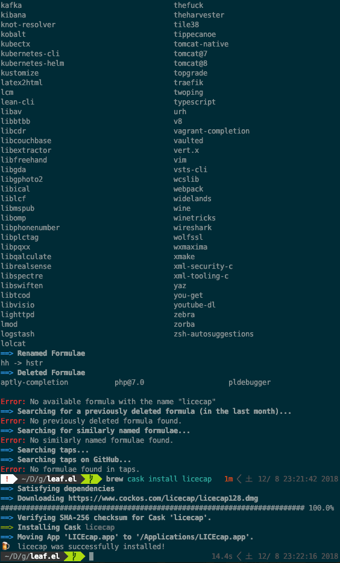

** モチベーション
「[[https://s.conao3.com/blog/2018/07b41c][Makefileで.emacs.dの理想的なディレクトリ構造を生成する話]]」で紹介したように、私はレガシーEmacsでも「程々に」動くようにしたいという動機でEmacs-22から動作する[[https://github.com/jwiegley/use-package][use-package]]と同様のDSLを提供する[[https://github.com/conao3/leaf.el][leaf.el]]を開発しています。

さて、ソフトウェアを開発する際はデグレードがよく発生します。単純なデグレードを防ぐには、あるコミットまでに達成できたケースをアップデートしたソフトでも変わらず実行できるか確かめる方法があります。

テストとマージを短い間隔で行う開発手法を「継続的インテグレーション」と呼ぶ？あまり詳しくないので避けると、とりあえずテストケースは正常に動くことが保証されたソフトが開発できます。

Travis CIを使いますが、使っているのはただ単にGitHubのトップページに「build:passing」のバッジがついてるとかっこいいなと思うからです。はい動機終わり。

なお、個人のEmacsのパッケージ等はビルドとテストにかかる時間も短いので、私は「すべてのコミットの前にターゲットバージョンですべてのテストが通る」ことを確認しています。そんなコミットする前にいちいちテストの終了を待つなんて意識高いなと思わないでください。ただ単にTravis CIでfailした履歴を残したくないだけです。

** Ertとの違い
EmacsにはEmacs-24から標準添付されているErtというユニットテストフレームワークが存在します。leaf.elは初期の段階ではErtを使用しており、Emacs-23とEmacs-22のテストはまた後で考えればいいやと思っていました。

しかしErtを使っていた時に、「[[https://travis-ci.org/conao3/leaf.el/jobs/451882801][明らかにpassするはずなのにfailする]]」「[[https://travis-ci.org/conao3/leaf.el/builds/449134718][Emacs-24だけfailする]]」「[[https://travis-ci.org/conao3/leaf.el/jobs/449134720][結局どこを直せばいいのか情報が得られない]]」などのきっかけで自分で作ることになってしまいました。

「結局どこを直せばいいのか情報が得られない」からひとつだけ出力を抜き出します。さて、このテストケースを通すためには一体何をすればいいのか、この出力からは全くと言っていいほどわかりません。

#+begin_src emacs-lisp
0.35s$ make test
/tmp/emacs/bin/emacs -Q --batch -L ./ -l leaf-tests.el -f leaf-run-tests-batch-and-exit
test with ert.
GNU Emacs 24.5.1 (x86_64-unknown-linux-gnu)
 of 2016-04-24 on testing-worker-linux-docker-199c7fe1-3369-linux-7
Running 10 tests (2018-11-01 00:33:55+0000)
Test leaf-test/:if-1 backtrace:
  pcase--u1(((match val quote (if t (progn (require (quote foo) nil ni
  pcase--u((((match val quote (if t (progn (require (quote foo) nil ni
  pcase--expand((expand-minimally (if t (progn (require (quote foo) ni
  #[385 "\301\"@\232\203 \211A@\262\232\203 \211\211AA\262\
  macroexpand((pcase (expand-minimally (if t (progn (require (quote fo
  ert--expand-should-1((should (pcase (expand-minimally (if t (progn (
  ert--expand-should((should (pcase (expand-minimally (if t (progn (re
  #[257 "\300\301D\302#\207" [ert--expand-should should #[771 "\300
  (should (pcase (expand-minimally (if t (progn (require (quote foo) n
  (match-expansion (if t (progn (require (quote foo) nil nil))) (quote
  (closure (t) nil (match-expansion (if t (progn (require (quote foo)
  #[0 "\306\307!r\211q\210\310\311\312\313\314\315!\316\"\317\320%DC
  funcall(#[0 "\306\307!r\211q\210\310\311\312\313\314\315!\316\"\31
  ert--run-test-internal([cl-struct-ert--test-execution-info [cl-struc
  #[0 "r\304 q\210\305 )\306\307\310\311\312\313!\314\"\315\316%DC\2
  funcall(#[0 "r\304 q\210\305 )\306\307\310\311\312\313!\314\"\315\
  ert-run-test([cl-struct-ert-test leaf-test/:if-1 nil (closure (t) ni
  ert-run-or-rerun-test([cl-struct-ert--stats t [[cl-struct-ert-test l
  ert-run-tests(t #[385 "\306\307\"\203D\211\211G\310U\203\211@\20
  ert-run-tests-batch(nil)
  ert-run-tests-batch-and-exit()
  leaf-run-tests-batch-and-exit()
  command-line-1(("-L" "./" "-l" "leaf-tests.el" "-f" "leaf-run-tests-
  command-line()
  normal-top-level()
Test leaf-test/:if-1 condition:
    (error "Unknown upattern `(quote (if t (progn (require (quote foo) nil nil))))'")
   FAILED   1/10  leaf-test/:if-1
#+end_src

GUIからインタラクティブにテスト実行できるのですが、テストの宣言場所までジャンプするくらいの機能だけしか発見できず、Ertを使うのは諦めてしまいました。。

私の作ったcort.elでは荒削りなものの、デバッグのきっかけになりそうな情報は与えてくれます。

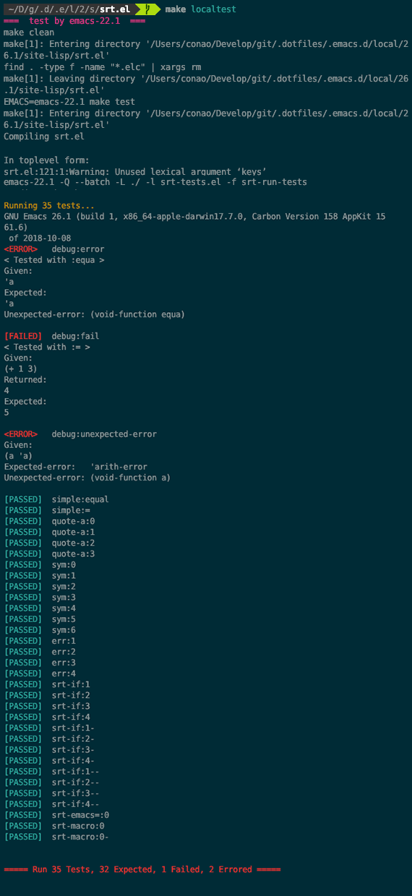

- 1つ目 =<ERROR>= となっているので「エラーが起こったのだな」とすぐ分かります。エラーの詳細は =Unexpected-error: (void-function equa)= と出力されており、よく見ると =Tested with :equa= とあります。

  つまり =(equal 'a 'a)= というテストケースを定義したつもりだったものの、 =(equa 'a 'a)= を実行しているということです。タイポですか。。

- 2つ目 =[FAILED]= となっているので、実行は出来たものの、期待する値にならなかったということです。 =(+ 1 3)= が与えられ、その返り値として =4= が返ってきた。期待する値は =5= 。
  （2つの値の比較は === で行った）という情報が得られ、すぐデバッグできます。

- 3つ目 =<ERROR>= となっているのでエラーが起こっていますが、このテストケースは後述するように「特定のエラーを期待するテストケース」です。それを示すように =Expected-error: 'arith-error= と表示されています。

  しかしその下には =Unexpected-error: (void-function a)= と表示されており、期待しないエラーが起こっていることが一目瞭然です。このテストケースにおいても、実行したS式がわかりやすく示されており、デバッグに必要な情報を得ることが出来ます。

パッケージのテストを行う時は、ほとんどの方が「-q」や「-Q」オプションを付けられていると思います。これは自分のローカル設定を読み込まず、起動を早くする側面もあると思いますが、第一には問題の切り分けをしやすくするためだと思います。

その点、cort.elは1ファイルで完結しており、ごてごてしたパッケージをパッケージマネージャでダウンロードして、、、という過程を踏む必要がありません。
基本的にはcort.elをユーザーの方のレポジトリに放り込んでもらうことを想定してます。もちろんsubmoduleで持ってもいいんですが、たかだか1ファイルにそこまでする？という思いがします。

** build:passingしたい！
とりあえず =build:passing= したい！という方もいると思うので、まずは場面設定から。

*** Makefile
昨日の記事に次いでMakefile作ります。特にやることもなく、素直に書きます。

EMACSの等号が =?== なのはタイポではなく、「外部から値を与えられた場合、その値を採用する」という意味に解釈されます。

コメントに書かれていますが、例えば単に =make check= と実行すると、 =emacs= で実行されます。 =EMACS=emacs-26.1 make check= と実行すると、 =emacs-26.1= でテストが実行されるようになります。

#+begin_src makefile
TOP       := $(dir $(lastword $(MAKEFILE_LIST)))

EMACS     ?= emacs

LOAD_PATH := -L $(TOP)
BATCH     := $(EMACS) -Q --batch $(LOAD_PATH)

ELS       := cort.el         # compiling .el list
ELCS      := $(ELS:.el=.elc)

all: build

build: $(ELCS)

%.elc: %.el
          @printf "Compiling $<\n"
          @$(BATCH) -f batch-byte-compile $<

check: build
# If byte compile for specific emacs,
# set EMACS such as `EMACS=emacs-26.1 make check`.
          $(BATCH) -l cort-tests.el -f cort-run-tests

clean:
          -find . -type f -name "*.elc" | xargs rm
#+end_src

*** .travis.yml
use-packageの.travis.ymlを多分に参考にして、このように書きます。実際よくわかってません。

#+begin_src sh
language: generic
sudo: false

env:
  global:
    - CURL="curl -fsSkL --retry 9 --retry-delay 9"
  matrix:
  - EMACS_VERSION=23.4
  - EMACS_VERSION=24.5
  - EMACS_VERSION=25.3
  - EMACS_VERSION=26.1
  - EMACS_VERSION=master
install:
  - $CURL -O https://github.com/npostavs/emacs-travis/releases/download/bins/emacs-bin-${EMACS_VERSION}.tar.gz
  - tar xf emacs-bin-${EMACS_VERSION}.tar.gz -C /
  - export EMACS=/tmp/emacs/bin/emacs

script:
  - make
  - make check
#+end_src

*** cort-test.el
cort.elが検証するテストケースをつらつら書きます。キーワードは後述するので、雰囲気を感じ取ってもらえれば。

#+begin_src emacs-lisp
;; require depends package
(require 'cort)

;; if you need temporary functions for test, define this.
(defun quote-a ()
  'a)

(defmacro sym (x)
  `',x)

;; define test cases.
(cort-deftest simple:equal
  (:equal '(a b c) '(a b c)))

(cort-deftest simple:=
  (:= 100 100))

(cort-deftest quote-a:0
  (:eq 'a 'a))

(cort-deftest quote-a:1
  (:eq (quote-a) 'a))

(cort-deftest sym:1
  (:eq (sym a) 'a))

(cort-deftest sym:4
  (:equal (sym (a b c)) '(a b c)))

(cort-deftest error-test
  (:= (+ 1 2) 5))

(cort-deftest err:1
  (:cort-error 'void-function
          (a 'a)))

(cort-deftest err:3
  (:cort-error 'arith-error
          (/ 1 0)))

(cort-deftest cort-if:2
  (:eq 'a
       ('b
        :cort-if (nil 'c)
        :cort-if (t 'a))))

(cort-deftest cort-emacs=:0
  (:= 10
      (0
       :cort-emacs> (0 10))))
;; ...cort-test.el
#+end_src

=:cort-if= や =:cort-eamcs= キーワードを除いて、結構読みやすいテストケース定義が実現できていると思います。条件分岐キーワードは慣れないと見づらいかもしれません。cort.elのテストケースでも、クオートがついているS式はその値のまま保存され、クオートのついていないS式は評価されます。

こうやってcort.elと設定ファイル2つを準備することによって、Travis CIで自動テストさせることが出来ます。Travis CIの使い方やバッジの貼り方などは他の人の記事に譲り、cort.elのシンタックスを説明したいと思います。

** シンタックス
*** はじめに
=cort-deftest= は基本的に次の構成になっています。

#+begin_src emacs-lisp
(cort-deftest TESTCASE-NAME
  (SEXP))
#+end_src

そして =(SEXP)= が =t= になることを期待します。 =TESTCASE-NAME= はわかりやすい名前をつけて貰えればと。

**** =(SEXP)= の構造
=(SEXP)= は =(:SYMBOL GIVENFORM EXPECTFORM)= になっています。

=:SYMBOL= がcort.elが解釈する特別なキーワードでない場合、 =:SYMBOL= から =:= を取った、 =(SYMBOL GIVENFORM EXPECTFORM)= を実行し、このS式が =t= を返せばpassします。

=:SYMBOL= としているのはキーワードシンボルとして認識されるので、赤色になって見やすいからです。それ以上の意味はなかったのですが、 =eq=, =eql=, =equal=, === など自分の好きな関数を比較関数として実行でき、とても自由度の高いテストケース表記ができるようになったかなと思います。

**** =FORM=
=GIVENFORM= と =EXPECTFORM= をまとめて =FORM= と記述することにします。 =FORM= は定数式、関数、マクロの形式を受け取ります。

つまり =GIVENFORM= が定数で =EXPECTFORM= が評価されるべき式を指定しても普通に動きます。混乱するのでやめたほうが良いと思いますが。。

マクロが渡された場合、展開して評価されます。まぁ普通のマクロと同じです。マクロの展開だけをテストしたい場合は =(macroexpand MACRO)= を渡せばよいです。この動作を実現する便利マクロは後述します。

*** =:cort-error= キーワード
=:cort-error= を =SYMBOL= の位置に置くとそのテストケースはエラーを期待するテストケースとなります。実際には =GIVENFORM= を実行したときに =EXPECTFORM= に指定したエラーが出ることを検証します。

=EXPECTFORM= におけるエラーの型は[[https://www.gnu.org/software/emacs/manual/html_node/elisp/Standard-Errors.html#Standard-Errors][Appendix F Standard Errors]]を参照してください。

*** =:cort-if= キーワード
=FORM= を条件式によって分岐させたい場面があると思います。たとえばあるオプションを有効にしているときのパッケージの挙動のテストなどです。

私が遭遇したのはやはりEmacs-23以前で =(macroexpand-1)= が定義できないので =EXPECTFORM= をバージョンで分岐させたいという動機でした。

さて、 =FORM= は即値（そのまま評価できる）か =:cort-if= で分岐されるべき2つ以上の値かになるわけですが、その両立にめちゃくちゃ悩んで次の文法にしました。

#+begin_src emacs-lisp
;; cort-ifを使わない場合。このテストケースはfailします。
(cort-deftest cort-if-test:1
  (:eq 'a
       'b))

;; cort-ifを使う場合。
;; cort-ifは (COND FORM-A) を受け取り、CONDがtのときFORM-AをFORMの値として採用します。
;; すべてのcort-ifのCONDがnilの場合、一番最初に書かれた値をFORMとして採用します。
(cort-deftest cort-if-test:2
  (:eq 'a
       ('b
        :cort-if (t 'a))))
#+end_src

はい。妥協です。もっと簡潔な表現を考えついたぜ！というかたはぜひ[[https://github.com/conao3/cort.el/issues][issueを書いて]]もらえると助かります。 =:corf-if= のCONDはもちろん関数やマクロが受け取れます。

また =:cort-if= は複数置くこともできます。その場合は全ての =:cort-if= のCONDがnilになった場合、一番最初のデフォルト値を採用します。

*** =:cort-emacs= キーワード
実際には下記のキーワードです。

- =:cort-emacs<=
- =:cort-emacs<==
- =:cort-emacs==
- =:cort-emacs>==
- =:cort-emacs>=

Emacsのバージョンで分岐するのはよくあるケースなので、特別なキーワードを用意しました。

#+begin_src emacs-lisp
(cort-deftest cort-emacs:a0
  (:= 10
      (0
       :cort-emacs> (0 10))))

(cort-deftest cort-emacs:a1
  (:= 10
      (0
       :cort-if ((not
                 (funcall (intern "version<") emacs-version "0"))
                10))))

;;;;;;;;;;;;;;;;;;;;;;;;;;;;;;;;;;;;;;;;;;;;;;;;;;

(cort-deftest cort-emacs:b0
  (:= 10
      (0
       :cort-emacs<= (0 10))))

(cort-deftest cort-emacs:b1
  (:= 10
      (0
       :cort-if (((funcall (intern "version<=") emacs-version "0")
                 10)))))
#+end_src

内部的には =:cort-emacs= キーワードは単なる =:cort-if= キーワードに置き換えられて実行されます。つまりcort-emacs:a0テストケースはcort-emacs:a1と同じテストケースということになります。

cort-emacs:b0もcort-emacs:b1と同じように解釈されます。 =version<= という関数があるので、その方向の比較はそのまま展開されますが、 =version>= という関数はないので、a1の方では =not= を使って等価な条件式を自動生成していますね。

** マクロでのテストケースの生成の例
*** =match-expansion=
テストケースにおいて何度も使われる部分がある場合、マクロで生成したくなると思います。例えばleaf.elというパッケージを書いていたときは、下記のようなテストケースが多発しました。

#+begin_src emacs-lisp
(cort-deftest leaf-test/:if-1
  (:equal
   (macroexpand-1 '(leaf foo :if t))
   '(if t
         (progn
           (require (quote foo))))))

(cort-deftest leaf-test/:if-2
  (:equal
   (macroexpand-1 '(leaf foo :if (and t t)))
   '(if (and t t)
         (progn
           (require (quote foo))))))

(cort-deftest leaf-test/:if-3
  (:equal
   (macroexpand-1 '(leaf foo :if nil))
   '(if nil
         (progn
           (require (quote foo))))))
#+end_src

これを見ると、 =GIVENFORM= は与えられた[[https://github.com/conao3/leaf.el][leaf.el]]を =macroexpand-1= し、 =equal= で =EXPECTFORM= と比較しています。

そこで次のようなテストケースを生成するマクロを定義することができ、これは期待通りに動きます。この例で閉じたものにするために、leaf.elの簡略版も定義します。

#+begin_src emacs-lisp
;; test target macro
(defmacro package-require (package)
  `(require ,package))

;; Macro to expand FORM and compare it with EXPECT for equal test case
(defmacro match-expansion (form expect)
  (if (fboundp 'macroexpand-1)
      `(:equal (macroexpand-1 ',form) ,expect)
    `(:equal (macroexpand ',form) ,expect)))

(cort-deftest match-expansion0
  (match-expansion
   (package-require 'use-package)
   '(require 'use-package)))

(cort-deftest match-expansion1
  (:equal (macroexpand '(package-require 'use-package))
           '(require 'use-package)))
#+end_src

この例では =match-expansion0= と =match-expansion1= は同じテストケースとして解釈されます。
=match-expansion0= のほうがテストケースに本当に必要な部分が書かれており、 =:equal= や =macroexpand= を隠蔽できているのでテストを簡単に書くことができます。

*** =leaf-match=
前述したようにEmacs-22やEmacs-23では =macroexpand-1= が定義できません。そのため必ず =:cort-emacs= キーワードでテストケースの分岐をしないといけないのですが、その指定を隠蔽できます。

#+begin_src emacs-lisp
(defmacro leaf-match (form expect)
  "Return testcase for cort.
Since `macroexpand-1' is not defined in Emacs below 23.0, use this macro.
EXPECT is (expect-default expect-24)"
  `(match-expansion
    ,form
    (,(car expect)
     :cort-if ((not (fboundp 'macroexpand-1)) ,(cadr expect)))))

(cort-deftest leaf-test/:simple-when
  (leaf-match
   (leaf foo :when t)
   ('(when t
       (progn
         (require 'foo)))
    '(if t
         (progn
           (progn
             (require 'foo)))))))

(cort-deftest leaf-test/:simple-when-without-macro
  (match-expansion
   (leaf foo :when t)
   ('(when t
       (progn
         (require 'foo)))
    :cort-if ((not (fboundp 'macroexpand-1))
              '(if t
                   (progn
                     (progn
                       (require 'foo))))))))
#+end_src

実際にはバージョンではなく、 =macoroexpand-1= が定義されているかどうかで分岐しています。このようにマクロを使って本質的なところだけを抽出して効率的にテストケースを記述できます。

** おまけ
*** 複数バージョンでのテスト
レガシーEmacsをサポートするという縛りプレイを行う時は、コマンド一発ですべてのバージョンのテストが実行できると嬉しいです。
そこで実際には下記のMakefileを使っています。

#+begin_src makefile
all:

include Makefunc.mk

TOP        := $(dir $(lastword $(MAKEFILE_LIST)))
EMACS_RAW  := $(filter-out emacs-undumped, $(shell compgen -c emacs- | xargs))
ALL_EMACS  := $(strip $(sort $(EMACS_RAW)))

EMACS      ?= emacs

LOAD_PATH  := -L $(TOP)
ARGS       := -Q --batch $(LOAD_PATH)
BATCH      := $(EMACS) $(ARGS)

ELS        := leaf.el
ELCS       := $(ELS:%.el=%.elc)

LOGFILE    := .make-test.log

##################################################

all: git-hook build

git-hook:
# cp git hooks to .git/hooks
        cp -a git-hooks/* .git/hooks/

build: $(ELCS)

%.elc: %.el
        @printf "Compiling $<\n"
        @$(BATCH) -f batch-byte-compile $<

check: # build
# If byte compile for specific emacs,
# set specify EMACS such as `EMACS=emacs-26.1 make check`.
        $(MAKE) clean --no-print-directory
        $(BATCH) -l leaf-tests.el -f cort-run-tests

allcheck: $(ALL_EMACS:%=.make-check-%)
        @echo ""
        @cat $(LOGFILE) | grep =====
        @rm $(LOGFILE)

.make-check-%:
        EMACS=$* $(MAKE) check --no-print-directory 2>&1 | tee -a $(LOGFILE)

# silent `allcheck' job
test: $(ALL_EMACS:%=.make-test-%)
        @echo ""
        @cat $(LOGFILE) | grep =====
        @rm $(LOGFILE)

.make-test-%:
        EMACS=$* $(MAKE) check --no-print-directory 2>&1 >> $(LOGFILE)

updatecort:
        cp -f ../cort.el/cort.el ./

clean:
        -find . -type f -name "*.elc" | xargs rm
#+end_src

テスト数が多くなってくると表示が煩雑になるので、通常は静かな =make test= を使っています。
あと、冒頭のアニメーションGIFは =make allcheck= と =make test= を録画したものです。

*** コミット前にテストする
僕が開発しているパッケージは「テストが通らないコミットはしない」運用になっています。

わざとレビュワーがブランチ切って通らないテストケースを書いて、コミッタがそのテストを通るように直した後マージする方法もあると思いますが、これは個人開発でテストも軽いため、この運用にしています。

さて、gitにはcommitなどの前にスクリプトを実行させることが出来て、そのスクリプトが異常終了した際にcommitなどを拒否する設定にできます。
実際には次のファイルを =pre-commit= という名前で実行権限を付けて =.git/hooks/= に配置するだけです。

#+begin_src shell
#!/bin/sh
#

make test
#+end_src

私のMakefileでは =all= ジョブでプロジェクトのルートに =git-hooks= というディレクトリがあって、その中にあるファイル群を =.git/hooks/= にコピーするようになっています。

実際この運用で多くのデグレードを未然に避けることが出来たので、条件が許す際はぜひ使ってみてもらえるといいかなと思います。

* org-publishを使ってorgでブログを書く話
:properties:
:export_file_name: generated/contents/blog/2018/611299
:export_date: 2018-12-14
:export_updated: 2018-12-14
:export_tags: emacs org-mode blog static-site orglyth-el
:end:

** はじめに
この記事は[[https://qiita.com/advent-calendar/2018/emacs][Emacs Advent Calendar 2018 - Qiita]]の14日目の記事です。
前日はtakuchalleさんの「[[https://blog.takuchalle.me/post/2018/12/13/emacs_dart_setup/][EmacsでDart開発環境をセットアップ]]」でした。

** モチベーション
私はOrg-Modeで日常のほとんどすべての文書作成を行っており、そもそも私は「Org-Modeを使うためにEmacs入門した」ほど大きな存在です。

最初にOrg-Modeの公式サイトで紹介されている[[https://www.jstatsoft.org/article/view/v046i03][論文]]から画像を引用します。

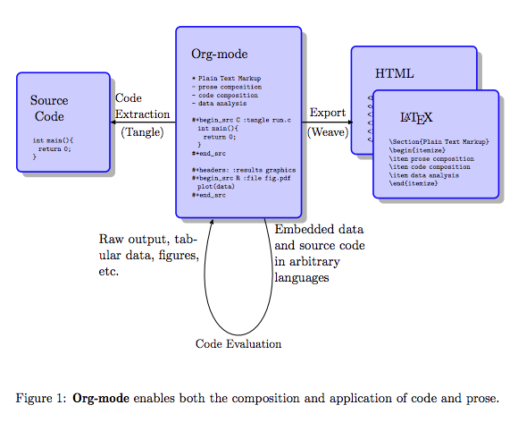

この画像の通り、Org-Modeはそれ自身が高性能なマークアップ言語でありながら、[[http://misohena.jp/blog/2017-10-26-how-to-use-code-block-of-emacs-org-mode.html][任意の言語のコード実行]]、さらには[[http://lioon.net/org-table-tutorial][表計算]]！などを用いて文書を作成し、それを[[https://orgmode.org/manual/Exporting.html][任意のフォーマットへのアウトプット]]が可能で、すべての文書のハブともいうべき存在になっています。これを万能文書と呼ぶことにします。（21フォーマットのエクスポーターが標準添付（contrib）され、MELPAにはさらに29種ものエクスポーターが登録されています）

例えば現代においてはHTMLをタグ直書きで文書を書いている人はほとんどいないと思います。なぜならHTMLタグは人間が書くには冗長すぎる他（閉じタグなど）、本質的でないメタ情報が文書中に散らばり（head, id, class）、文書の再利用性が極端に低くなるからです。

よって賢明な方ならばPHPのようなテンプレート言語で生成したり、マークダウンから[[https://pandoc.org/][pandoc]]で変換したりすると思います。これによりメタ情報部と文書部が分離でき、再利用性が上がり、保守性も向上します。

つまりHTMLとかいう冗長で扱いづらいフォーマットは動的に生成されるべきターゲットであって、人間はもっと書きやすい別のフォーマットで文書を作成するべきなのです。

一方、マークダウンには根強いファンがあり、そしてpandocにより万能文書としての機能を備えてきたように思えますが、いろいろ[[https://note.solarsolfa.net/n/n697389a6be3b][苦悩している]]ようです。

Orgユーザーからすれば、なぜそんな茨の道を進もうとしているのか理解できません。
Org文書で作成しさえすれば豊富なターゲットフォーマット、つまりWebには静的HTMLやHugo, Wordpress, Qiitaにより公開し、印刷にはLaTeXから生成したPDF、スライドにはブラウザで表示する[[https://revealjs.com/#/][Reveal.js]]や[[http://ayapin-film.sakura.ne.jp/LaTeX/Slides/Beamer-tutorial.pdf][LaTeX+Beamer]]で生成したスライド投影用のPDFを使用でき、編集時にもOrg-Modeが提供するOrg文書のための様々なコマンドが利用できます。
こんな悲しい事態にはならなくてすむのです。 +（この講義、今期末まであるの辛い。。）+

#+begin_quote
今受けてる授業大学4年間で最悪の可能性ある。環境の意味で。

数学記号変な意味でつかうし、「Wordで」作ったA4の資料を「そのまま」プロジェクターで写すから、いちいち写真撮ってデジタルズームしないと読めない。そして読めるとは限らない。つらすぎる、、 [[https://t.co/QDRQIOD6ZL][pic.twitter.com/QDRQIOD6ZL]]

— Conao (@conao_3) [[https://twitter.com/conao_3/status/1073019805936971776?ref_src=twsrc%5Etfw][2018年12月13日]]
#+end_quote

さて、あるOrg文書を変換するのはとても簡単で、例えばこの[[https://raw.githubusercontent.com/conao3/shogi-detect/master/Readme.org][Org文書]]からこの[[https://github.com/conao3/shogi-detect/blob/master/report.pdf][PDFファイル]]をコマンド1発で変換できます。（内容はやっつけなので(ry...）

上の文書には数式や表が含まれていませんが、私は電気系の学生として毎期の実験レポートをOrg文書から生成したLaTeXから変換したPDFですべてのレポートを提出しましたし、卒論を[[http://d.hatena.ne.jp/r_takaishi/20100209/1265680490][書いた人]]や[[http://akisute3.hatenablog.com/entry/2013/12/28/144918][作成入門を書かれている方]]もいます。

一方Org文書が複数に渡る場合、（最終的に1つのファイルにするならinclude文を使えばよいだけなのですが、それぞれを違うファイルとして変換したい場合）Org文書同士のリンクやOrg文書へのリンクを張るメタ的なOrg文書を生成したくなったりと途端に難しくなります。

この操作を実現するのがorg-publishです。ただ、設定に癖があるのでその設定を紹介するとともに、もっとOrg-Modeのユーザーが増えたらいいなと布教をするものです。

** マニュアル
日本語マニュアルは少々古いですが[[https://takaxp.github.io/org-ja.html#g_t_00e5_0085_00ac_00e9_0096_008b][ここ]]、英語のマニュアルは[[https://orgmode.org/manual/Publishing.html][ここ]]においてあります。

** なにがどうなるのか
=<root>/src/= 下に自由にフォルダやOrg文書を作成して配置します。そしてPublishコマンドを発行することにより =<root>/src/= 下のすべてのOrg文書を「その階層を保存した上で」 =<root>/archives/= にHTMLで書き出すことが出来ます。

#+begin_example
~/public_html/orglyth/
   ├── index.inc
   ├── index.org
   ├── archives/
   ├── parts/
   │   └── index.html
   └── src/
       ├── index.inc
       └── index.org
       ├── elisp/
       │   ├── index.inc
       │   ├── index.org
       │   ├── boolean.org
       │   └── with-temp-file.org
       └── emacs/
           ├── index.inc
           ├── index.org
           ├── install.org
           └── org-mode
               ├── index.inc
               ├── index.org
               ├── basis-syntax.org
               ├── org-list.html
               ├── org-list.org
               └── ox-publish.org
#+end_example

org-publishを使用する第一の利点として[[https://conao3.com/archives/sitemap.html][sitemapを自動生成]]させることが出来ます。

別途 =<root>= に置いた =.htaccess= の設定をすれば、例えば([[https://conao3.com/archives/blog/advent/emacs/org-publish-blog]])にアクセスすると普通にHTMLを閲覧させてarchivesの部分をsrcに変更した([[https://conao3.com/src/blog/advent/emacs/org-publish-blog]])にアクセスするとソースのOrg文書を見せることも出来ます。

#+begin_src emacs-lisp
AddDefaultCharset utf-8
AddType "text/plain" org

ErrorDocument 503 /archives/error/maintenance.html
ErrorDocument 404 /archives/error/404.html
DirectoryIndex index.html index.org

SetEnvIf REDIRECT_HTTPS (.*) HTTPS=$1
<IfModule mod_rewrite.c>
RewriteEngine on
RewriteCond %{ENV:HTTPS} !on
RewriteRule .* https://%{HTTP_HOST}%{REQUEST_URI} [R=301,L]
</IfModule>

# temporary-maintenance
# RewriteCond %{REQUEST_URI} !=/archives/error/maintenance.html
# RewriteRule ^.*$ - [R=503,L]


RewriteEngine on
RewriteCond %{REQUEST_FILENAME} !-d
RewriteCond %{REQUEST_FILENAME}\.org -f
RewriteRule ^(/src/.*)$ $1.org [L]

RewriteCond %{REQUEST_FILENAME} !-d
RewriteCond %{REQUEST_FILENAME}\.html -f
RewriteRule ^(/archives/.*)$ $1.html [L]
#+end_src

=archive= を =src= に変えてソースのOrg文書を見せることはすでに出来ているのですが、例えば =archive= を =pdf= に変えたら記事のPDFをダウンロードさせることも簡単にできると思います。

もちろん文書間リンクや画像リンクなどはいつもどおり書いたものをorg-publishがWebで表示できるように、よしなに変更してくれます。具体的には =.org= へのリンクは =.html= へのリンクに変更され、メディアはそのままターゲットディレクトリの対応するパスにコピーします。（orglyth.elでは =orglyth-html-default-resources-option= で制御してます）

** init.elの設定
私は今init.elの大改革（[[https://s.conao3.com/blog/2018/07b41c][.emacs.dの構造から見直したり]]、[[https://github.com/conao3/leaf.el][use-packageの別実装を作ったり]]（Qiita記事は21日目に予約済み）、[[https://s.conao3.com/blog/2018/48bb55][新しいテストフレームワークを作ったり]]）を行っていて、init.elの編集まで作業が追いついていないのですがとりあえずOrg-Modeに関する今の設定は以下です。

新しいパッケージマネージャ(feather.el)の開発が終わり次第、シームレスに設定できるようになりますが、現状では伝統的なパッケージ管理のように =site-lisp= にレポジトリをクローンして =load-path= を通す必要があります。

- [[https://github.com/conao3/leaf.el][leaf.el]] - Emacs-22から利用できる =use-package= の別実装
- [[https://github.com/conao3/feather.el][feather.el]](開発中) - Emacs-22から利用できる全く新しいパッケージマネージャ
- [[https://github.com/conao3/orglyth.el][orglyth.el]] - ox-*の設定集

#+begin_src emacs-lisp
(leaf org
  :init
  (leaf org-plus-contrib :ensure t :require nil)

  :setq
  ((org-directory                         . "~/Documents/org/")
   (org-default-notes-file                . "~/Documents/org/notes.org")
   (org-agenda-files                      . "~/Documents/org/notes.org")
   (org-return-follows-link               . t)
   (org-startup-indented                  . t)
   (org-indent-mode-turns-on-hiding-stars . t)
   (org-indent-indentation-per-level      . 2)
   (org-src-window-setup                  . 'other-window)
   (org-use-sub-superscripts              . '{})
   (org-image-actual-width                . nil)
   (org-highlight-latex-and-related       . '(latex script entities)))

  :config
  (leaf ob
    :setq ((org-confirm-babel-evaluate . nil))
    :config
    (leaf ob-ipython
      :when (executable-find "jupyter")
      :ensure t
      :config
      ;; depend of jypyter, ipython
      (add-hook 'org-babel-after-execute-hook 'org-display-inline-images 'append))

    (leaf ob-plantuml
      :when (executable-find "plantuml")
      :ensure t
      :setq ((org-plantuml-jar-path . plantuml-jar-path))
      :setq ((org-confirm-babel-evaluate . nil)))

    (org-babel-do-load-languages 'org-babel-load-languages
                                 '((ipython . t)
                                   (plantuml . t)
                                   (org . t)
                                   (R . t)
                                   (C . t)
                                   (emacs-lisp . t))))
  (leaf ox
    :config
    (leaf orglyth
      :config
      (leaf orglyth-html
        :setq
        ((orglyth-html-enable-option    . t)
         (orglyth-html-use-ftp          . nil)
         (orglyth-html-local-root-path  . "~/Documents/sakura/orglyth/")
         (orglyth-html-remote-root-path . "~/Documents/sakura/remote/")
         (orglyth-html-ftp-root-path    . "/ftp:conao3@conao3.com:~/www/orglyth/"))
        :config
        (orglyth-html-init)
        (orglyth-html-project-init))

      (leaf orglyth-latex
        :setq ((orglyth-latex-enable-option . t))
        :config
        (orglyth-latex-init)))))
#+end_src

この設定は拙作の[[https://github.com/conao3/leaf.el][leaf.el]]により以下に変換されます。

#+begin_src emacs-lisp
(progn
  (progn
    (progn
      (leaf-backend/:ensure-package 'org-plus-contrib 'org-plus-contrib)
      (progn)))
  (progn
    (require 'org)
    (setq org-directory "~/Documents/org/")
    (setq org-default-notes-file "~/Documents/org/notes.org")
    (setq org-agenda-files "~/Documents/org/notes.org")
    (setq org-return-follows-link t)
    (setq org-startup-indented t)
    (setq org-indent-mode-turns-on-hiding-stars t)
    (setq org-indent-indentation-per-level 2)
    (setq org-src-window-setup 'other-window)
    (setq org-use-sub-superscripts '{})
    (setq org-image-actual-width nil)
    (setq org-highlight-latex-and-related
          '(latex script entities))
    (progn
      (require 'ob)
      (setq org-confirm-babel-evaluate nil)
      (if
          (executable-find "jupyter")
          (progn
            (leaf-backend/:ensure-package 'ob-ipython 'ob-ipython)
            (progn
              (require 'ob-ipython)
              (add-hook 'org-babel-after-execute-hook 'org-display-inline-images 'append))))
      (if
          (executable-find "plantuml")
          (progn
            (leaf-backend/:ensure-package 'ob-plantuml 'ob-plantuml)
            (progn
              (require 'ob-plantuml)
              (setq org-plantuml-jar-path plantuml-jar-path)
              (setq org-confirm-babel-evaluate nil))))
      (org-babel-do-load-languages 'org-babel-load-languages
                                   '((ipython . t)
                                     (plantuml . t)
                                     (org . t)
                                     (R . t)
                                     (C . t)
                                     (emacs-lisp . t))))
    (progn
      (require 'ox)
      (progn
        (require 'orglyth)
        (progn
          (require 'orglyth-html)
          (setq orglyth-html-enable-option t)
          (setq orglyth-html-use-ftp nil)
          (setq orglyth-html-local-root-path "~/Documents/sakura/orglyth/")
          (setq orglyth-html-remote-root-path "~/Documents/sakura/remote/")
          (setq orglyth-html-ftp-root-path "/ftp:conao3@conao3.com:~/www/orglyth/")
          (orglyth-html-init)
          (orglyth-html-project-init))
        (progn
          (require 'orglyth-latex)
          (setq orglyth-latex-enable-option t)
          (orglyth-latex-init))))))
#+end_src

Orgの命名規則として =ob-*= はbabel（任意コード実行）などコードブロック関連、 =ox-*= はエクスポート関連のパッケージとなっています。

=ox= ブロックは実験レポートを日常的に書いていたこともあり、いろいろとカオスだったのですが[[https://github.com/conao3/orglyth.el][orglyth.el]]というパッケージに括りだすことでinit.elの見通しを良くすることが出来ました。

orglyth.elの設定部を抜き出すと以下になります。このように少しの変数のみを定義するのみです。後はorglyth.elに丸投げします。

- =orglyth-html-enable-option= : tの時、 =(orglyth-html-init)= をした時に関連する変数を変更します。(何を変えるかはソースを見たほうが早いです)
- =orglyth-html-use-ftp= : tの時、プロジェクト:websiteの設定がftp転送したサーバー上になります。 遅いのでnilにしてます。
- =orglyth-html-local-root-path= : ローカルのOrg文書ルートフォルダです。
- =orglyth-html-remote-root-path= : プロジェクト:websiteのターゲットフォルダです。
- =orglyth-html-ftp-root-path= : プロジェクト:websiteのターゲットフォルダです。
- =(orglyth-html-init)= : 変数の初期化
- =(orglyth-html-project-init)= : orglyth.elのプロジェクトをOrgに登録する。

#+begin_src emacs-lisp
(leaf orglyth
  :config
  (leaf orglyth-html
    :setq
    ((orglyth-html-enable-option    . t)
     (orglyth-html-use-ftp          . nil)
     (orglyth-html-local-root-path  . "~/Documents/sakura/orglyth/")
     (orglyth-html-remote-root-path . "~/Documents/sakura/remote/")
     (orglyth-html-ftp-root-path    . "/ftp:conao3@conao3.com:~/www/orglyth/"))
    :config
    (orglyth-html-init)
    (orglyth-html-project-init))

  (leaf orglyth-latex
    :setq ((orglyth-latex-enable-option . t))
    :config
    (orglyth-latex-init)))
#+end_src

=(orglyth-html-projet-init)= はpublishターゲットを複数持っていると、候補が溢れて管理しづらくなる（かもしれない）ので必要な時に登録できるようにしています。私はorg-publishを他の用途には使っていないので起動時に登録するようにしています。

** 使い方
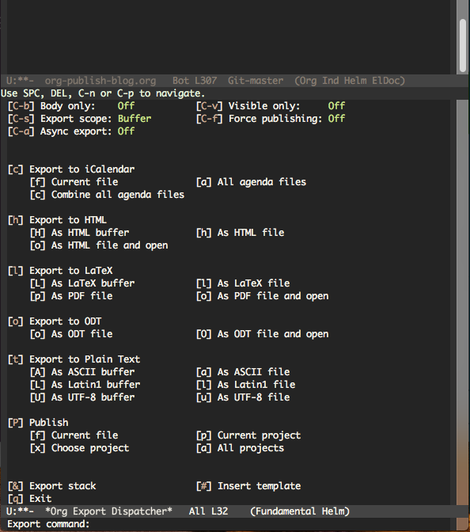
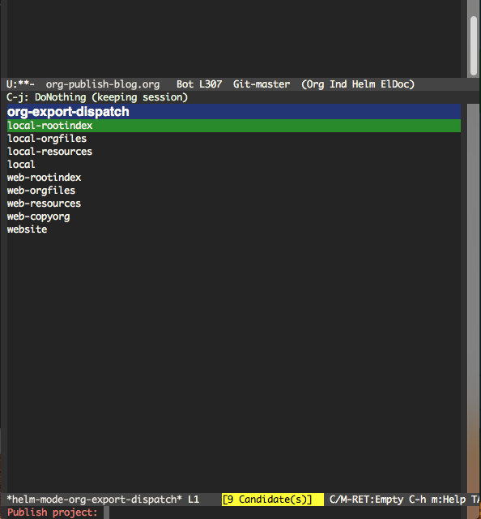

前段の設定を行うと =C-c C-e (org-export-dispatch)= を押し、ディスパッチャに入り、 =P x= を押すと登録されているプロジェクトが確認できます。

様々なプロジェクトが登録されていますが、我々が実行するのは一般的に =local= か =website= のメタプロジェクトです。

org-publishの思想から言うと =local= で変換結果を確認してその後 =website= を実行してftpで転送させたいのでしょうが、遅すぎてその間Emacsのメインスレッドがブロックされるので、実際には =local= を実行してその後ターミナルでサーバーに =rsync= しています。

** まとめ
=org-publish= により静的HTMLサイトを構築する方法を説明しました。

私はもともと =org2blog= を使ってWordpressに投稿していたのですが、過去記事が編集しづらかったり、そもそもWordpressが嫌いになってしまったりと使うのを諦めてしまいました。

最近Org-Mode界隈では =ox-hugo= を用いてブログを書くのがブームになっている([[https://pxaka.tokyo/blog/categories/hugo/][takaxp]]さんなど)ようですが、あまり日の目を見ない =org-publish= でも同様のことができることを知ってもらえればと。

Org文書変換前や変換後に任意のElisp関数を登録できたりと、とても自由度高そうなので =org-publish= でブログを書いてみるのも面白いかもしれません。

プログラマたる者、素人の方が作られた[[http://abehiroshi.la.coocan.jp/][阿部寛さんのHP]]より高速なウェブページを構築したいですよね？実際それは[[https://qiita.com/Morix1500/items/0eac072a027d478a6b83][けっこう大変らしい]]のですが、org-publishでは静的HTMLを吐くので、表示速度追求も面白いかと思います。

AMP対応してGoogleのサーバーにホスティングしてもらうのも手かもしれません。（orglyth.elで将来的に対応予定）

（ちなみに[[https://github.com/rubikitch/daily-emacs-jp][るびきちさん]]に触発されて、私もブログのソースを[[https://github.com/conao3/orglyth-src][GitHubに公開]]してます。実際、URLの =archive= を =src= に変えれば見えるんですが、一覧したいときなどに利用ください。）

* use-packageからの移行のすゝめ - leaf.elでバージョン安全なinit.elを書く
:properties:
:export_file_name: generated/contents/blog/2018/8aa938
:export_date: 2018-12-21
:export_updated: 2018-12-21
:export_tags: emacs emacs-lisp use-package package-management leaf-el feather-el
:end:

** はじめに
この記事は[[https://qiita.com/advent-calendar/2018/emacs][Emacs Advent Calendar 2018 - Qiita]]の21日目の記事です。
前日は@hyaktさんの「[[https://qiita.com/hyakt/items/f4468facec0478e06f7a][Dashboardで起動画面を素敵にしよう✨]]」でした。
翌日は@gongoさんの「[[http://gongo.hatenablog.com/entry/2018/12/22/190540][EmacsでNESエミュレータを実装している話]]」です。

[[github:conao3/leaf.el::Emacs Lisp][Flexible, declarative, and modern init.el package configuration]]

** モチベーション
私は[[https://github.com/conao3/dotfiles/commit/fd06cea5dd040ec1fb34225a3f3202200e00801e][8月]]から.emacs.d/init.elの大改革を行っており、その副産物としての成果物をEmacs Advent Calendarで共有させていただいていました。

まず「[[https://s.conao3.com/blog/2018/07b41c][.emacs.dの理想的なディレクトリ構造]]」(7日目)について考え、一番カオスになっていた「[Org-Modeのエクスポート関連の設定] ([[https://s.conao3.com/blog/2018/611299]]) - ([[https://github.com/conao3/orglyth.el][orglyth.el]])」(14日目)を見直し、「[[https://github.com/jwiegley/use-package][use-package]]の細かなストレスを解消するために作り直し - ([[https://github.com/conao3/leaf.el][leaf.el]])」(この記事(21日目))、そのサポートのために「並列パッケージダウンロードを実現するパッケージ - ([[https://github.com/conao3/feather.el][feather.el]])」と「[[https://s.conao3.com/blog/2018/48bb55][新しいElispテストフレームワーク]] - ([[https://github.com/conao3/cort.el][cort.el]])」(8日目)を開発しています。

これらのパッケージとディレクトリ構造により、私のinit.elはEmacs-22からEmacs-26までのEmacsでエラーなく動作 +し+ （する予定です（泣）feather.elの開発が間に合わなかったので、package.elに依存しているため、現状Emacs-24以上でしか動作しません。）、それらの環境は完全に分離されています。

そのためEmacs-26を常用し、いつもは各パッケージをHEADで利用している（melpaのデフォルト）が、よくわからないエラーが起こってそのハンドリングが煩わしい時、とりあえずEmacs-24に逃げて一段落するまで作業を続ける。みたいなことが出来ます。

また実行バイナリがそもそも異なり、それぞれで環境（Emacsから見える =user-emacs-directory= ）が完全に分離されているので、init.elの編集をEmacs-25で行い、その動作確認をEmacs-26を起動したり落としたりしてする。といったことが簡単にできます。

また現状考えられる最古のバージョンである、Emacs-22という化石にも対応しているため、Emacs-22でもほどほどに使うことが出来ます。

[[http://dotfiles.conao3.com/]]というURLでインストール用のシェルスクリプトをホスティングしているので、押し付けられたパソコンで実行するべきは =curl dotfiles.conao3.com | sh= というワンライナーでいつもの環境が整うことになります。（上記URLはshのMIMEタイプをhtmlにしているのでブラウザで表示できます。これもTipsとしては面白い話題かと思います。）

私のinit.elの大改革は今年中に終わらないと思います。。そして副産物の各パッケージもまだまだ発展途上ですが、開発を続けるので暇な時に覗いていただければと思います。

** 定義
この記事タイトルは煽りですが、本記事で「バージョン安全」とは「ターゲットとするそれぞれのEmacsで同一のinit.elをエラーなく実行できること」とします。そのため「ブランチなりディレクトリを分けて、Emacs-24用、Emacs-26用の異なるinit.elを用意する」方法はこの記事の範囲外です。

実際、この運用はしたことがあって、異なるブランチを見ているdotfilesフォルダを2つ用意して =-l= オプションで起動時に分ける運用をした事があるのですが、Emacs標準添付のパッケージへの設定などを2つのブランチで管理することになり、破綻してしまいました。

*** use-packageについて
[[https://github.com/jwiegley/use-package][use-package]]は素晴らしいパッケージであって、多彩なキーワードをサポートし、初心者の方が避けがちなautoloadを上手く隠蔽してくれます。 =require= ベースから =use-package= ベースにinit.elを代えるだけでEmacsの起動が早くなることもザラです。

また私にとっては、use-packageによって今までコメントで区切っていた各パッケージごとの設定が、見やすく分離されることも良い副産物でした。

#+begin_src emacs-lisp
;;;;;;;;;;;;;;;; smartparens ;;;;;;;;;;;;;;;;

(require 'smartparens)
(require 'smartparens-config)
(sp-pair "$" "$")
(sp-use-smartparens-bindings)
(smartparens-global-strict-mode t)
(show-smartparens-global-mode t)
(smartparens-global-mode t)

;;;;;;;;;;;;;;;; auto-complete ;;;;;;;;;;;;;;;;

(require 'auto-complete)
(setq ac-auto-show-menu   0
      ac-delay            0
      ac-quick-help-delay 1
      ac-menu-height      15
      ac-auto-start       1
      ac-use-menu-map     t)
#+end_src

use-package導入前は上記のように設定しており、ブロックを分かりやすくするために =require= を明示的に実行していました。しかしuse-package導入後は以下のようになります。

#+begin_src emacs-lisp
(use-package smartparens :ensure t :diminish ""
  :init (use-package markdown-mode :ensure t)
  :config
  (use-package smartparens-config)
  (sp-pair "$" "$")

  (sp-use-smartparens-bindings)
  (smartparens-global-strict-mode t)
  (show-smartparens-global-mode t)
  (smartparens-global-mode t))

(use-package auto-complete :ensure t :demand t :diminish ""
  :bind (:map ac-menu-map
              ("C-n" . ac-next)
              ("C-p" . ac-previous))
  :init
  (use-package fuzzy   :ensure t)
  (use-package pos-tip :ensure t)

  :config
  (use-package auto-complete-config)
  (ac-config-default)
  (setq ac-auto-show-menu   0
        ac-delay            0
        ac-quick-help-delay 1
        ac-menu-height      15
        ac-auto-start       1
        ac-use-menu-map     t)
#+end_src

このようにコメントや =require= 文によって明示的にブロックを区切らなくても、関連する設定群をわかりやすく見ることが出来ます。

S式を折りたたむ、[[http://syohex.hatenablog.com/entry/20110706/1309965284][hs-minor-mode]]との親和性も最高でした。全S式を折りたたむ =hs-hide-all= を実行すれば、設定しているパッケージを一覧することが出来ます。

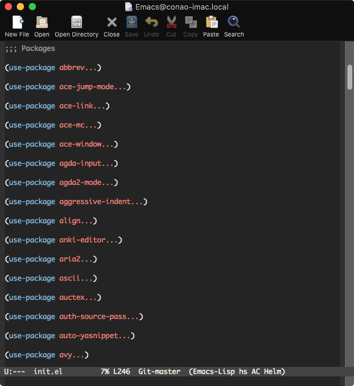

気になるパッケージを見つけたらその部分だけ表示することも可能です

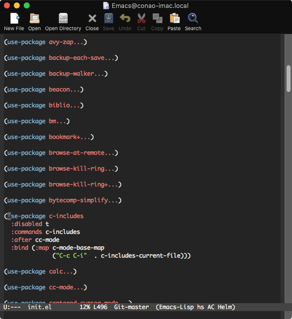

そしてuse-packageの中が長くなる場合は、折りたたむ階層を代えることで以下の表示にもでき、編集するべき箇所をすばやく見つけることができます。

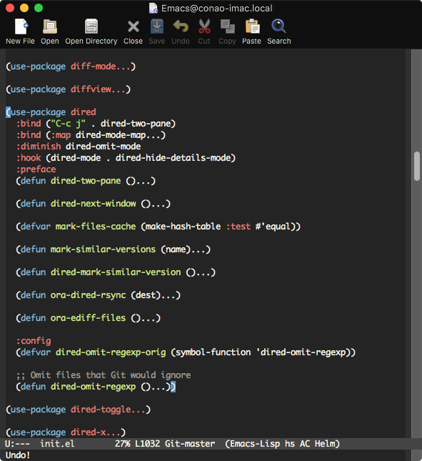

そしてuse-packageをuse-packageの中に書けることを知り、ブロックの定義のように使うようになりました。use-packageには =:no-require= キーワードがあり、指定されたパッケージを =require= しないことにできるので、自由な見出しとして利用できるのです。

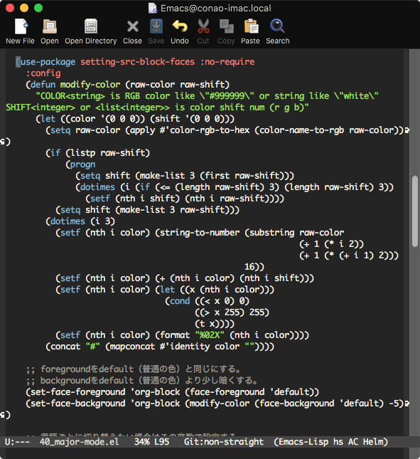

こうすることで、 =hs-hide-all= したときに見出しを目で探して、そこだけ展開して編集する。というふうに運用していました。

*** use-packageの（に付随する）問題点
このように私のinit.elはuse-packageに深く依存していて、実際その文法は大好きでした。しかし不満点は出てくるもので、それは以下のようなものです。

**** :ifや :disabledキーワードの直感に反した動作
=ob-ipython= や =migemo= のように外部コマンドに依存するパッケージは、use-packageに =:if= キーワードが用意してあるので 次のように書けます。

#+begin_src emacs-lisp
(use-package migemo
  :if (executable-find "cmigemo")
  :ensure t
  :config
  ;; depend on latest cmigemo
  ;; $ brew install cmigemo --HEAD
  (setq migemo-command "cmigemo")
  (setq migemo-options '("-q" "--emacs"))
  (setq migemo-dictionary "/usr/local/share/migemo/utf-8/migemo-dict")

  (setq migemo-user-dictionary nil)
  (setq migemo-regex-dictionary nil)
  (setq migemo-coding-system 'utf-8-unix)
  (migemo-init))

(use-package ob-ipython :ensure t
  :if (executable-find "jupyter")
  :config
  (add-hook 'org-babel-after-execute-hook 'org-display-inline-images 'append))
#+end_src

use-packageの =:if= キーワードはS式を受け取り、評価結果がnilの場合、他のキーワードをすべて無視し、そのuse-package節全体を =nil= に変換するキーワードです。そのため =ob-ipyhon= の例で言えば、 =jupyter= が見つからない時、そのすべての設定は =nil= の虚空に吸い込まれると思うし、[[https://github.com/jwiegley/use-package#prevent-loading-if-dependencies-are-missing][マニュアルにもそう書いてあります]]。

またinit.elの設定を軽く行って、動かしてみたところ動作が不安定な時、use-packageユーザーは =:disabled= キーワードを使用すると思います。このように。

#+begin_src emacs-lisp
(use-package elscreen-persist :ensure t :disabled t
    :config
    (elscreen-persist-mode 1)

    ;; desktop.el settings
    (setq desktop-files-not-to-save "")
    (setq desktop-restore-frames nil)
    (desktop-save-mode t))
#+end_src

(=:disabled= キーワードはそれが指定された瞬間にuse-package節を =nil= に変換します。つまり =:disabled= も =:disabled nil= も =:disabled t= もすべて =nil= になります。しかし私は統一性を重視して明示的に指定していました。)

しかしコマンドが見つからない状況であっても =migemo= や =jupyter= はなぜか読み込まれ、起動時にエラーになる他、 =elscreen-persist= は当時バグっておりぐちゃぐちゃなウィンドウ構成を復元してきました。

scratchバッファで =macroexpand= してもきちんと =nil= になっており、当時Elisp初心者だった私は解決できない問題としてelpaディレクトリを全削除して対処していました。
全削除してもう一度世界をやり直すと、エラーなく起動することも理解不能でした。

（今考えると =(package-initialize)= でダウンロード済みのパッケージが全て読み込まれることが原因だと分かります。
実際、 =(package-initialize t)= とするとpackage.elの初期化だけ行って各パッケージの初期化は行わないモードになります。
しかしこのオプションを使っている人はいるのでしょうか？

またpackage.elを読むと特定のパッケージのみを初期化する変数を見つけたのですが、そのドキュメントは整備されているのでしょうか。。feather.elを作る過程でpackage.elを読んでいて気づいたので、後の祭り感がすごかったです。）

**** 新しいキーワードを追加するのが困難
=use-package= はそれ自体、拡張されることをよく考えられていて、キーワードを追加することは簡単である。というのはよく語られていたと思いますが、実際そのAPIを外部から利用したものは当時[[https://github.com/quelpa/quelpa-use-package][Quelpa]]しかありませんでした。現在は[[https://github.com/raxod502/straight.el][straight.el]]もuse-package用のフロントエンドを提供していますね。

私はuse-packageに参考URLを書ける、 =:url= を追加したかったのですが、elispに親しんでなかったこともあって、1週間悩んで諦めてしまいました。（コメントは暗い文字になるので、文字列として書けたら読みやすくなるかなというアイデア）

結局 =(add-to-list 'use-package-keywords= でGitHub全体を検索して、同じことをしている人の[[https://github.com/0x7c48/emacs.d/blob/c3f020d2e38f0f13a95a426e819cdd0216b589c1/emacs-lisp/system/_use-package.el][コード]]を見つけることができました。

**** あるパッケージだけ違うディストリビューションからダウンロード出来ない
これはuse-packageというよりpackage.elの問題です。パッケージはすべて =:ensure t= でmelpaからダウンロードしていたのですが、例えば「[[https://qiita.com/zk_phi/items/e70bc4c69b5a4755edd6][{Emacs} key-chord.elを改良してキーバインドし放題になった話]]」という記事を読んで、zkさんのフォーク版の =key-chord= を使いたい！と思ったとします。

package.elはGitHubからのダウンロードができない？ので =:init= 節に =el-get= を用いてダウンロードします。

#+begin_src emacs-lisp
(use-package key-chord
  :init  (el-get-bundle zk-phi/key-chord)
  :config
  (setq key-chord-two-keys-delay 0.15
        key-chord-safety-interval-backward 0.1
        key-chord-safety-interval-forward  0.25)
  (key-chord-mode 1))
#+end_src

こんな柔軟に書けるuse-package素晴らしい！と思っても、次のパッケージの設定によって儚く壊れてしまいます。

#+begin_src emacs-lisp
(use-package use-package-chords :ensure t)
#+end_src

これは全く問題がないと思われますが、 =use-package-chords= は =key-chord= に依存しており、package.elからはインストールしていないと判断されるので、package.elによってアップストリームの =key-chord= がダウンロードされます。

zkさんの =key-chord= を読み込んでいる場合、melpaの =key-chord= は多重ロードされませんが、次回起動時 =(package-initialize)= によってmelpaの =key-chord= が読み込まれてしまいます。。

これを防ぐには、あるパッケージを別のフォーク版に代えた場合、それに依存している全パッケージを自分でel-getにより管理しなければなりません。つらい。。

何がどんなパッケージに依存しているか意識せずインストールできるpackage.elの利点が失われてしまいました。
こういう、いろいろよしなにしてくれるパッケージは抽象化されすぎていて少し変わったことをすると破綻してしまうパターンがあります。

**** use-packageに依存したinit.elをEmacs-22で読み込む（と骨抜きになる）
前段のように私のinit.elはuse-packageに深く依存していて、それは一般的には問題ないのですが、私のようにEmacs-22という化石でも動かしたいとなると難しくなってきます。

一般的な解決方法は =use-package= の読み込みに失敗したら、use-package節をすべて =nil= に変換することにすることです。（[[https://qiita.com/kai2nenobu/items/5dfae3767514584f5220#use-package-%25E3%2581%258C%25E5%25AD%2598%25E5%259C%25A8%25E3%2581%2597%25E3%2581%25AA%25E3%2581%2584%25E5%25A0%25B4%25E5%2590%2588][出典]]）

#+begin_src emacs-lisp
(when (or (version< emacs-version "24.0")
          (unless (require 'use-package nil t)))
  (defmacro use-package (&rest args)))
#+end_src

これは起動しているEmacsが24より下の場合、use-packageというマクロを上書き定義し、use-package節をすべて =nil= に変換してしまうことにします。Emacs-23は =package.el= も満足に動かないし、外部パッケージの設定をすべて =nil= に変換してしまっても一般的には問題ないと思います。

しかし私はEmacs標準添付パッケージもすべて =use-package= で設定を行っており、 =use-package= をすべて =nil= に変換してしまっては =-q= オプションで起動したときとほぼ変わらないEmacsが起動してしまいます。。。

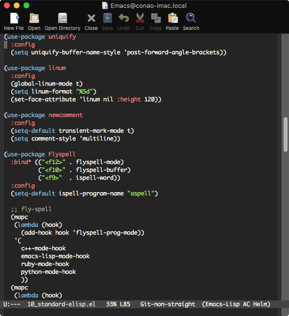

なんのために同じinit.elを読み込んでいるのかわかりません。

この時代にその解決方法として、ブランチを切って標準添付パッケージについては =use-package= を使わないinit.elを用意する運用を行っていました。この運用は前段に書いたとおり、同じコードがブランチに散らばり、すぐに管理不能になりました。。

** use-packageに代わるパッケージ, leaf.el
これらの問題点を解決するべく私が開発しているのが[[https://github.com/conao3/leaf.el][leaf.el]]です。use-packageに心酔している私が開発しているので、基本的にはuse-packageと同様の記述を提供します。

開発が追いついていないこともあり、現在実現していないことも多々ありますが、将来的に実現する予定です。

命名は「設定の『葉っぱ』を設定できるパッケージ」に由来します。Melpaに登録する時、分かりづらいので変えてくれと言われたら変わるかもしれません。

use-packageはpackageの設定を行うことを念頭に置いているのでその命名になっていますが、私の使い方ではpackageだけにとどまっていません。
前述のように何か一つの目的のために多くの行を割くようであったら、それをleafで囲みますし、また別の区切りもあるかもしれません。

現在の私のinit.elではCソース1ファイルずつにleafを割り当てて設定を行っています。

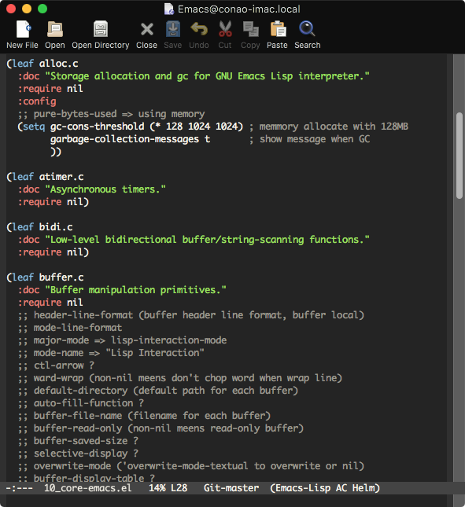

「一つ一つの『葉っぱ』が定義することは少ないかもしれないが、それが集まることによりEmacsがより手に馴染み、それぞれの唯一無二のエディタになる」という期待を込めています。

なお「feather.el」は「fetcher」につづりが似てるからそう命名しました。「羽のように軽快にパッケージをダウンロードするから」みたいにしておいたほうがかっこいいかもしれません。完全に後付けですが。

*** Emacs-22からの動作を保証
use-packageから離れる原因となった大きな理由を解消します。実際、lispなのでEmacs-22で動くようなコードを書くことはあまり障害になりません。

*** feather.elとの連携（開発中）
前段でpackage.elの不満点が出てきました。そういえばpackage.elはダウンロードするバージョンの固定ができないし、なぜか1つずつダウンロードするし、なぜかコンパイルする間、次のパッケージをダウンロードしません。

ということで新しいパッケージマネージャの開発に着手しました。tadsanさんに教えていただいたのですが、PHPでもこういう思想で作られた[[http://blog.tojiru.net/article/432944706.html][ソフトがある]]ようです。

feather.elは依存関係をきちんと考慮した上で、並列にパッケージをダウンロード・コンパイルします。そして[[https://qiita.com/takaxp/items/c01fb7737496af9a8fcd#%25E3%2583%25AD%25E3%2583%25BC%25E3%2583%2589%25E3%2583%2591%25E3%2582%25B9%25E3%2582%2592%25E3%2582%2580%25E3%2582%2584%25E3%2581%25BF%25E3%2581%25AB%25E5%25A2%2597%25E3%2582%2584%25E3%2581%2595%25E3%2581%25AA%25E3%2581%2584][load-pathが必要以上に長くなると起動時間が遅くなる]]というtakaxpさんの知見を活かし、コンパイルされたファイルは全て一つのディレクトリに保存されます。

もちろん投げっぱなしではなく、パッケージの削除を指示すると複数ファイルの管理をきちんと行ってくれます。

leaf.elはfeather.elをデフォルトで =:ensure= キーワードのバックエンドとして使用し、ユーザーとしては =use-package= を =leaf= に置換するだけでfeather.elのパワフルなパッケージマネージメントを利用できるようになる予定です。

*** ユーザーによる自由なキーワード追加
use-packageはキーワードの引数をnormalizeとhandlerの2つの関数で管理していますが、それが処理が見づらい原因になっていると思います。

leaf.elはhandlerの一つだけの関数で処理を行っており、とても素直な実装になっています。
さらにhandlerは必ずリストを返し、受け取り側では必ず =,@= でリストを開いて結合するルールになっており、統一性のあるコードになっていると思います。マクロ展開なので、バッククオートとカンマが多く、マクロに慣れていないと読みづらい可能性があります。。

逆にleaf.elへのキーワード追加を通してlispのマクロに親しむきっかけにもなると思います。まだ途中で英語のみですが、分かりやすいドキュメントを書く予定です。

ほしいキーワードがあったらissueを書いていただくほうがより簡単かもしれません。本体に入れるかはさておき、レポジトリを分けたとしてもleaf.elにとっては本体のキーワードと同様に処理できます。

** まとめ
時間に追われて尻すぼみになってしまいました。興味を持っていただけたらぜひ[[https://github.com/conao3/leaf.el][leaf.el]]や[[https://github.com/conao3/feather.el][feather.el]]をウォッチしていただければと思います。

* lispの同図像性とその周辺 ― leaf.el, seml-mode.elの内部構造に触れながら
:properties:
:export_file_name: generated/contents/blog/2019/13c1f0
:export_date: 2019-04-16
:export_updated: 2019-04-16
:export_tags: emacs-lisp lisp macro leaf-el
:end:

** はじめに
「EmacsのためにEmacsを使っている」事に最近気づいたconao3です。

とりあえず私の脳内スタックを紹介します。

- 競プロしたい！
- 当然Emacs使うでしょ
  - init.el編集して、 ~flycheck~ とか動かしたいな。。
  - 当然 ~use-package~ 使うでしょ
    - ~use-package~ がEmacs-22で動かない \arrow ~leaf.el~ 開発
      - Emacs-22で動くテストフレームワークが存在しない \arrow ~cort-test.el~ 開発
      - Emacs-22で動くパッケージマネージャが存在しない \arrow ~feather.el~ 開発
        - MELPAのレシピをあらかじめ変換しておきたい \arrow ~feather-recipes.el~ 開発
        - そもそもMELPAが提供しているjsonが壊れている \arrow ~feather-melpa~ 開発
        - .tar.gzをダウンロードさせるだけでいんじゃないか \arrow ~feather-server.el~ 開発
      - CUIベースの ~custom~ ではなく、Webブラウザベースで設定したい \arrow ~leaf-browser.el~ 開発
        - 当然HTMLを素で書く気にならないので、S式から変換させたい \arrow ~seml-mode.el~ 開発
  - ~org-publish~ のセクションが肥大化している \arrow ~orglyth.el~ 開発

つまりここに挙げたパッケージ群をちゃっちゃと開発し、どんどんスタックを ~pop~ していかないと、
「競プロしたい！」という当初の目的まで辿り着けないという状況になっています。辛い。

そもそもがinit.elの編集から木が深くなっているので、 ~leaf.el~ 開発当初はほぼ裸のEmacsで編集していました。
最近は ~leaf.el~ が結構便利になってきたので、快適に開発ができるようになってきています。

これだけのパッケージを開発していると、そこそこにアウトプットできるような知見が貯まってくるのですが、
今回、[[https://tokyo-emacs.connpass.com/event/128038/][東京Emacs勉強会 端午の節句]]に15分の発表の機会を得ることが出来たので、
その時間を考慮して、そのなかでも「Lispの同図像性」について発表するものです。

** Lispの評価器について
*** Lispの評価
Elispに限らず、lisp処理系は次のような仕組みを持っています。[fn:1][fn:2][fn:3][fn:4]

「式」を次で定義します。

- アトムを「数値」と「文字列」と「シンボル」とする。
- コンスセルを「(car . cdr)」と記述し、carとcdrに「アトム」か「コンスセル」が代入されるとする。
- リストを「(a b ... x)」と記述し、「空リスト」か、「末尾のコンスセルのcdr部に ~nil~ が代入されたもの」とする。
- 式を「アトム」か「コンスセル」か「リスト」さらに「式のリスト」とする。

なお、コンスセルのドットは字面上の意味がありますが、リストの3点リーダはシンボル群の略記です。
さらに「 ~nil~ 」は「アトム」であり、「空リスト」であるとします。

そして与えられた式を次のように評価 (~eval~) します。[fn:5]

1. 式が、アトムの場合、以下のように処理する。
   1. シンボルならば、そのシンボルの値を返却する。
   2. それ以外（数値、文字列など）ならば、それ自身を返却する。
2. 式が、リストフォームならば、リストフォームの先頭データの種類によって、以下のように処理する。
   1. スペシャルフォームならば、第2引数以降のデータを評価せずに渡し、それぞれ固有の処理を行い、結果を返却する。
   2. マクロならば、第2引数以降のデータを評価せずに渡し、評価後のS式を改めて評価 (~eval~) し、結果を返却する。
   3. 関数ならば、第2引数以降のデータを順に評価 (~eval~) した上で、関数に渡 (~apply~) し、結果を返却する。

スペシャルフォームとは処理系内部にLispとは異なる言語で定義されたものです。
Elispの場合、C言語で実装されている関数はすべてスペシャルフォームです。

スペシャルフォームの最たる例は条件分岐 ~(if COND THEN-PART ELSE-PART...)~ で、 ~COND~ が真の場合、 ~ELSE-PART~ は評価されません。
この性質は関数の場合と決定的に異なっており、例えば条件によって0除算エラーが起こってしまうなどのクリティカルな状況を回避することが出来ます。

条件分岐のような制御構造は通常の言語であれば、拡張不可(処理系のアップデートが必要)ですが、Lispであればマクロを使用することで自分で定義することが出来ます。

# Elispにおけるスペシャルフォームのすべてを示します。
# - 条件分岐
#   - and
#   - or
#   - if
#   - cond
# - 繰り返し
#   - while
# - 大域脱出とエラー処理
#   - catch
#   - condition-case
#   - unwind-protect
# - Lispオブジェクト生成
#   - quote
#   - function
#   - lambda
#   - setq
#   - setq-default
#   - defvar
#   - defconst
# - シーケンス
#   - prog1
#   - prog2
#   - progn
# - ローカル変数
#   - let
#   - let*
# - Emacsに特有の操作
#   - interactive
#   - save-current-buffer
#   - save-excursion
#   - save-restriction
#   - track-mouse
*** 3種類のマクロ
1. リーダマクロ
2. マクロ
3. コンパイラマクロ

** leaf.elの概略
[[https://github.com/conao3/leaf.el][leaf.el]]はjwiegley氏の[[https://github.com/jwiegley/use-package][use-package]]と同様に、Emacsのinit.elで頻出のイディオムを隠蔽し、編集しやすく、そして管理しやすくするものです。
~use-package~ はとても良く出来ていて、愛用していたのですが、問題もありました。（省略するので、別途[[https://s.conao3.com/blog/2018/8aa938][Qiita記事]]を参照）

- ~:if~ ~:disabled~ で無効化されているパッケージがなぜか読み込まれている。
- 新しいキーワードを追加するのが困難。
- あるパッケージだけ違うディストリビューションからダウンロードできない。
- (use-packageに依存したinit.elをEmacs-22で読み込むと骨抜きになる。)

主に最初の3つが大きな不満点でした。
最後の点は許容できたのですが、作り直すなら縛りプレイをすることにしました。

さて、説明のために次の簡単なマクロを定義した上で、

#+begin_src emacs-lisp
  (defmacro p (form)
    `(progn
       (pp (macroexpand-1 ',form))
       nil))

  (defmacro po (form)
    `(progn
       (pp ,form)
       nil))
#+end_src

~leaf.el~ は次のような変換をするマクロを提供するものです。

#+begin_src emacs-lisp
  (p
   (leaf yasnippet
     :ensure t
     :custom ((yas-indent-line . 'fixed))
     :bind (:map yas-minor-mode-map
                 ("C-c y i" . yas-insert-snippet)
                 ("C-c y n" . yas-new-snippet)
                 ("C-c y v" . yas-visit-snippet-file)
                 ("C-c y l" . yas-describe-tables)
                 ("C-c y g" . yas-reload-all))
     :config
     (leaf yasnippet-snippets :ensure t)
     (leaf yatemplate :ensure t)
     (yas-global-mode 1)))
  ;; => (progn
  ;;      (leaf-meta-backend/:ensure 'yasnippet '(t))
  ;;      (leaf-meta-backend/:bind 'yasnippet
  ;;                               '((:map yas-minor-mode-map
  ;;                                       ("C-c y i" . yas-insert-snippet)
  ;;                                       ("C-c y n" . yas-new-snippet)
  ;;                                       ("C-c y v" . yas-visit-snippet-file)
  ;;                                       ("C-c y l" . yas-describe-tables)
  ;;                                       ("C-c y g" . yas-reload-all))))
  ;;      (custom-set-variables '(yas-indent-line 'fixed))
  ;;      (leaf yasnippet-snippets :ensure t)
  ;;      (leaf yatemplate :ensure t)
  ;;      (yas-global-mode 1))
#+end_src

#+begin_src emacs-lisp
  (p
   (leaf yasnippet
     :disabled t
     :ensure t
     :custom ((yas-indent-line . 'fixed))))
  ;; => nil
#+end_src

~leaf~ はマクロなのでElisp処理系は、実際の評価の前にマクロが展開し、その後、評価器が実際の評価を行います。

** Footnotes
[fn:1] 東京大学 - [[http://www.jsk.t.u-tokyo.ac.jp/~inamura/lecture/download/20051205_soft3_lisp1.pdf][ソフトウェア第三 講義資料 - Lisp処理系, リスト処理]]
[fn:2] Paren-holic - [[https://booth.pm/ja/items/1317263][3つのLisp 3つの世界]]
[fn:3] STUART C. SHAPIRO - [[https://cse.buffalo.edu/~shapiro/Commonlisp/commonLisp.pdf][Common lisp - An Interactive approach]]
[fn:4] Harold Abelson他著、和田 栄一訳 - [[https://sicp.iijlab.net/fulltext/xcont.html][計算機プログラムの構造と解釈]]
[fn:5] Richard Stallman他著、Ayatakesi訳 - [[https://ayatakesi.github.io/lispref/24.5/elisp.html#Evaluation][GNU Emacs Lisp Reference Manual]]

* COMMENT 続・leaf.elを使おう
:properties:
:export_file_name: generated/contents/blog/2019/69b273
:export_date: 2019-05-31
:export_updated: 2019-05-31
:end:

** leafとは
use-packageはinit.el記述において、素晴らしいブレイクスルーを起こしました。
パッケージ

* COMMENT leaf.elを使う - Emacs初心者のためのEmacs拡張入門
:properties:
:export_file_name: generated/contents/blog/2019/34401b
:export_date: 2019-06-01
:export_updated: 2019-06-01
:end:

** 背景
先日MELPAにleaf.elがマージされ、導入のコストが最小限になりました。
  - [[https://s.conao3.com/blog/2019/2b6cbf][{正式リリース}leaf.elで雑然としたEmacs設定ファイル「init.el」をクリーンにする]]

その折にQiitaで紹介記事を書いたのですが、実際どの様に使えばいいのか、そもそもEmacsにパッケージをどの様にインストールすればよいのか、
そういう視点での補足記事が必要であろうと思ったので、この記事を書く次第です。

なお、この記事では簡潔さを重視して、説明を省く箇所があることをご了承下さい。
省くのは歴史的な経緯によって、互換性のために残されている機能で、現代では使用されないものです。

例えば、ホームディレクトリに ~.emacs~ という「ファイル」を置く方法と、
~.emacs.d~ という「ディレクトリ」を置いて、その中に ~init.el~ というファイルを置く方法がありますが、
現代ではほとんど後者のみが用いられているため、前者に関する説明は省略します。

** Emacsのインストール
Emacsのインストールは各々の環境とEmacsに何を求めるかによって、いろいろな方法があり、Emacs-JPでも「標準インストール」という手順を定められずにいます。

ひとまず、ここでは一つの方法を示すので、またコミュニティの共通認識が出てくれば変更することにします。

*** Mac
私は現在パッチなし、標準ローカルビルドのEmacs-26.2を使用していますが、やはり ~brew~ で導入できるのは簡便さの面で大きなメリットがあります。
複数バージョンをローカルに持っておかないといけないといった珍しい状況を除けば、 ~brew~ を選択するのは十分合理的だと思います。

#+begin_src bash
  brew tap railwaycat/emacsmacport
  brew install emacs-mac
#+end_src

*** Ubuntu
環境がないので分かりませんが、ローカルビルドしても大きな手間ではないと思います。
~apt~ で入れる場合はデフォルトではバージョンが古いため、アーカイブサイトを追加した後にインストールする必要があります。
  - http://ubuntuhandbook.org/index.php/2019/04/gnu-emacs-26-2-released-install-in-ubuntu-18-04/

#+begin_src bash
  sudo add-apt-repository ppa:kelleyk/emacs
  sudo apt update
  sudo apt install emacs26
#+end_src

*** Windows
環境がないので全く分かりません。私が高校の時はgnupackのdevelを使っていましたが、MSYS2の方が良いという情報もあり、良く分かりません。
  - https://ja.osdn.net/projects/gnupack/
  - https://www.msys2.org/

** 必要最低限のEmacs知識
*** 画面の要素
Emacsでの「ウィンドウ」は一般的な意味での「ウィンドウ」とは意味が異なっており、誤解していると意味を取り違えてしまいます。

さらに「ポイント」は一般的な用語での「カーソル」です。「ポイント」の直前に文字が挿入されます。
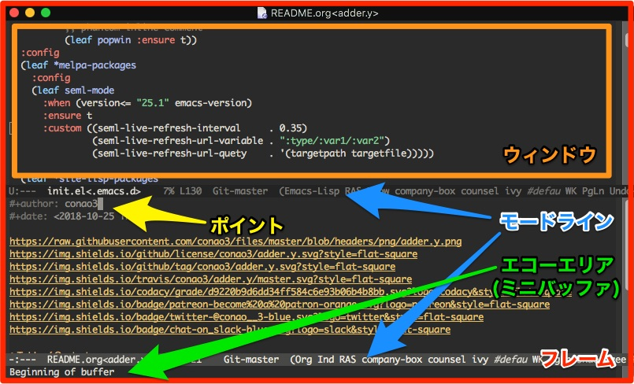

*** ショートカットキー
歴史的な経緯により ~Alt~ キーを ~Meta~ と呼びます。

さらに修飾キーの一文字を取って ~Ctrl~, ~Shift~, ~Meta~ を ~C~, ~S~, ~M~ と表記します。
つまり ~M-S-5 (query-replace)~ は ~Meta(Alt)~ キーと ~Shift~ を押しながら ~5~ を押すことを示します。
また ~S-5~ は ~%~ と等価なので、 ~M-% (query-replace)~ と表現することがあります。

なお、2つのコンビネーションを続けて書いた場合は、続けてそれらのキーを押すことになります。
つまり ~C-x C-f (find-file)~ は ~Ctrl~ と ~x~ を押した後に、 ~Ctrl~ と ~f~ を押すことを示しています。

*** Emacsの起動と終了
ターミナルを開き、 ~emacs~ と打つことでEmacsが起動します。

初期化ファイルなしで起動するには ~emacs -q~, デバッグ情報を表示するには ~emacs --debug-init~ で起動します。

~C-x C-c (save-buffers-kill-terminal)~
*** 困ったら
とりあえず ~C-g (keyboard-quit)~ を連打します。これは今の作業を中断して、通常の入力状態に戻すことを意味します。
「あれ？」っと思ったら、すぐに ~C-g~ を何回かタイプすることを覚えておくといいと思います。

さらに、ユーザーが普段使うコマンドはショートカットを覚えていなくても、 ~M-x~ を実行することでコマンドの名前を検索して実行できます。

** 初期化ファイルの作成
MacやLinuxならホームディレクトリの場所は疑いようがありませんが、Windowsの場合、選んだ処理系によってホームディレクトリが違うので注意する必要があります。

~C-x C-f (find-file)~ をした後にミニバッファで「Find file: 」とプロンプトが出るので、

* COMMENT leafはなぜ動くのか - lisp特有の特徴「同図像性」を読み解く
:properties:
:export_file_name: generated/contents/blog/2019/73938b
:export_date: 2019-06-01
:export_updated: 2019-06-01
:end:

** 背景
leafは私の初めて書いたパッケージですが、初めて書いた題材ながら、「lispらしい力」を使えるいい題材だったと思います。
lisp歴の浅い私が「lispらしい力」を語るのはお笑い種かもしれませんが、lispでない言語で同じ仕組みを実装するのは困難を極めたことは確実でしょう。

lispは極めて先進的な機能を多く有しており、GCや高階関数など多言語に取り入れられた特徴も多いです。
私が取り上げる「同図像性」は多言語では実装の難しい、lisp独自の特徴です。

この特徴を使えることが私がlisp系言語を使う理由であり、ぜひ布教に努めていきたい所存です。

なお、この記事ではElispの実行例を示します。

** leafとは
leafとはEmacsの拡張パッケージであり、その説明記事はこちらで読むことが出来ます。
- [[https://s.conao3.com/blog/2019/2b6cbf][{正式リリース}leaf.elで雑然としたEmacs設定ファイル「init.el」をクリーンにする]]

Emacs初心者の方でもleafを使うことで、「パッケージの設定」に集中できますし、出力するコードを読んでみることでElisp力を

** 同図像性
同図像性は「データとプログラムが同じ形式で書ける性質」で、lisp以外の言語では無理矢理、文字列をリード/実行によって実現することになると思います。

多言語との比較は私には出来ないので、ぜひお読みの方の得意な言語ではどうやって実現できるか考えてもらえればと思います。

* [正式リリース]leaf.elで雑然としたEmacs設定ファイル「init.el」をクリーンにする
:properties:
:export_file_name: generated/contents/blog/2019/2b6cbf
:export_date: 2019-06-15
:export_updated: 2019-06-15
:export_tags: emacs use-package package-management release leaf-el leaf-keywords-el
:end:

私は去年の[[https://github.com/conao3/dotfiles/commit/fd06cea5dd040ec1fb34225a3f3202200e00801e][8月]]から.emacs.d/init.elの大改革を行っており、その副産物としての成果物を[[https://qiita.com/advent-calendar/2018/emacs][Emacs Advent Calendar 2018]]や[[https://tokyo-emacs.connpass.com/event/128038/][東京Emacs勉強会 端午の節句]]などで共有させて頂いていました。

私の関わっているパッケージは多数ありますが、一番力を入れている =leaf.el= がやっとMELPAに仲間入りすることができたので、ダイレクトマーケティング記事を書く次第です。

GitHubへのリンクはこちら
[[https://github.com/conao3/leaf.el][file:./resources/public/img/2b6cbf-leaf.el.png]]

[[github:conao3/leaf.el::Emacs Lisp][Flexible, declarative, and modern init.el package configuration]]

** 背景
Emacsを使っている方ならば、自分のinit.elに採用するかはさておき、jwiegleyさんの[[https://github.com/jwiegley/use-package][use-package]]というパッケージの存在を知っていらっしゃると思います。

Qiitaでは @kai2nenobuさんの「[[https://qiita.com/kai2nenobu/items/5dfae3767514584f5220][use-packageで可読性の高いinit.elを書く]]」というとても分かりやすい記事がありますし、るびきちさんも「[[http://emacs.rubikitch.com/use-package-2/][use-package.el: Emacsの世界的権威が行っている最先端ラクラクinit.el整理術]]」という記事を書いていらっしゃいます。

私もこれらの記事を見ながらinit.elを書きなおしたのですが、init.elは個性の塊であるがゆえに、次第にjwiegleyさんが想定していない方法で =use-package= を使うようになってしまいました。そして =use-package= に自分が欲しいキーワードを自由に追加したいと思うようになりました。

=use-package= は素晴らしいパッケージですが、多くのコントリビューターを受け入れたことによるか、そもそもの設計の問題か、内部は複雑怪奇になっており、単純に読むだけでも困難を極めました。

そのため私が拡張したいように拡張するために、そして書きたいようにinit.elを書くために新しい =use-package= を作る必要がありました。

まぁ後から動機を分析してみたらこういう風な動機があった。と思うだけで、開発当時はOn Lispの「[[http://www.asahi-net.or.jp/~kc7k-nd/onlispjhtml/macros.html][マクロ]]」の項を読んで、 =use-package= に対して単なる技術的な興味を持っただけだったのかもしれません。

とにかく私は =leaf= を作ることによりlispの力の片鱗を感じとれ、Emacs-jpの勉強会で登壇できるくらいのノウハウを得ることができました。Emacs-lisp、そしてLispの演習としては、とても良い題材だったのではないかなと振り返っています。

なお、記事中で使うために、次のユーティリティーマクロを定義します。

#+begin_src emacs-lisp
(prog1 "conao3 utility"
  (defmacro p (form)
    "Output pretty `macroexpand-1'ed given FORM."
    `(progn
       (pp (macroexpand-1 ',form))
       nil))

  (defmacro po (form)
    "Output pretty given FORM."
    `(progn
       (pp ,form)
       nil))

  (defmacro pl (form &optional stream)
    "Output list"
    `(progn
       (with-temp-buffer
         (insert (prin1-to-string ,form))
         (goto-char (point-min))
         (forward-char)
         (ignore-errors
           (while t (forward-sexp) (insert "\n")))
         (delete-char -1)
         (princ (buffer-substring-no-properties (point-min) (point-max))
                (or ,stream standard-output))
         (princ "\n"))
       nil)))
#+end_src

** use-packageの問題点
=use-package= を使っていて、ストレスだった点をつらつら書きます。[[https://s.conao3.com/blog/2018/8aa938][年末のAdvent Calendar]]にも少し書いたのですが、それに加えて、話の流れとしてもう少し書きます。

*** use-packageが想定していなかった使い方
=use-package= は「パッケージ設定」のためのパッケージです。そのため、「パッケージのインストールとその設定」を考えるel-getとは一線を画しています。そのため「el-getでは。。」という[[https://github.com/jwiegley/use-package/issues/470][issueは1レスで閉じられ]]ます。もちろんjwiegleyさんの方針は理解できます。OSSでは風見鶏な運営をするとすぐ破綻してしまうので、ばっさり閉じられたことに意見はありません。

さて、 =leaf= は一体どういう方針なのかというと、 =leaf= は「パッケージ設定フォルダ」を提供するためのパッケージです。

=leaf= のネーミングはそもそもそういう使い方を想定しています。ひとつひとつの「葉」が集まってEmacs上に「大樹」を作るイメージです。「葉」は複数の「葉」によって構成されていても良く、それは平易に言い換えれば「パッケージ設定フォルダ」として機能します。

Spacemacsは使っていないのですが、言語毎、目的毎に =Layer= が管理されており、それを有効にするか無効にするかによって典型的な設定を行うという薄い知識があります。 =leaf= はひとつの「葉」に複数のパッケージの設定を内包することが出来ることから、Spacemacsのそれと同様な使い方が可能です。

なぜ一つの =use-package= に複数のパッケージの設定を書くようになったのかというと、その書き方がS式の折り畳みをするパッケージとの相性がとても良いからです。その話については年末のAdvent Calendarで[[https://s.conao3.com/blog/2018/8aa938][leafの記事の一部]]として書いています。

また条件分岐キーワードとの相性もとても良くなります。例えば =:disabled= や =:when= キーワードで、ある親パッケージを無効にすると、そのパッケージに依存する子パッケージも同時に無効にすることができます。

しかし =use-package= は本来1パッケージ-1 =use-package= が想定されているため、 =use-package= を単に設定フォルダとして使おうと思うと、逐一 =:no-require= キーワードが必要になります。キーワードを省略した時、 =require= に変換されるからです。

一方 =leaf= ではそのようなキーワードを別途指定する必要はありません。キーワードを省略した場合は空の =prog1= に変換されるからです。そのため次のような設定を簡単に書くことができます。

#+begin_src emacs-lisp
(leaf *minor-mode
  :config
  (leaf posframe
    :ensure t
    :when (version<= "26.1" emacs-version)
    :when window-system
    :config
    (leaf ivy-posframe
      :doc "Using posframe to show Ivy"
      :after ivy
      :ensure t
      :custom ((ivy-posframe-mode . t)
               (ivy-posframe-height-alist . '((swiper . 30) (t . 40)))
               (ivy-posframe-display-functions-alist
                . '((swiper . nil) (t . ivy-posframe-display-at-frame-center)))
               (ivy-posframe-parameters . '((left-fringe . 10)))))

    (leaf company-posframe
      :doc "Use a posframe as company candidate menu"
      :ensure t
      :after company
      :custom ((company-posframe-mode . t)))

    (leaf flycheck-posframe
      :ensure t
      :after flycheck
      :custom ((flycheck-posframe-mode . t)))

    (leaf which-key-posframe
      :ensure t
      :after which-key
      :custom ((which-key-posframe-mode . t)))

    (leaf ddskk-posframe
      :doc "Show Henkan tooltip for ddskk via posframe"
      :after skk
      :el-get conao3/ddskk-posframe.el
      :custom ((ddskk-posframe-mode . t))))

  ;; other minor-mode packages...
  )
#+end_src

これは私のinit.elに実際に存在する設定です。 =*minor-mode= という =leaf= ブロックでくくることによって、折り畳みパッケージの恩恵が受けやすくなり、やろうと思えばマイナーモードを全オフにしたEmacsを立ち上げることも容易です。

また、 =posframe= はEmacs-26に依存していますが、その条件が満されない場合、同時に =ivy-posframe=, =company-posframe=, =flycheck-posframe=, =which-keyposfrme=, =ddskk-posframe= の設定を無視させることが出来るようになります。

このようにパッケージ設定の階層構造を表現することがとても簡単にできます。

本来、エディタの設定にはあまり時間をかけられるものではありません。パッケージの設定を階層管理することによって、設定したパッケージが全体においてどんな位置付けなのか、素早く理解し編集することが可能になります。

*** use-packageのキーワード解釈の非統一性
例えばこれらのキーワードは不釣り合いです。

- =:defer= キーワードは「パッケージシンボル」か「それのリスト」 が受け取れるが、 =:ensure= キーワードはリストは受け取れない。
- =:if=, =:when=, =:unless= は真偽値と解釈され得るS式を期待するが、 =:disabled= キーワードは引数なしで活性化する。
- =:hook= や =:bind= は「ドット対」と「ドット対のリスト」を期待するが、 =:custom= キーワードは通常のリストを期待する。

具体的には次のような混乱があります。

#+begin_src emacs-lisp
(p (use-package ddskk-posframe
     :after posframe ddskk))            ; シンボル指定ok
;; => (eval-after-load 'ddskk
;;      '(eval-after-load 'posframe
;;         '(require 'ddskk-posframe nil nil)))

(p (use-package ddskk-posframe
     :after (posframe ddskk)))          ; リスト指定ok
;; => (eval-after-load 'ddskk
;;      '(eval-after-load 'posframe
;;         '(require 'ddskk-posframe nil nil)))
;;

(p (use-package ddskk-posframe
     :ensure posframe))                 ; シンボル一つなら処理できる
;; => (progn
;;      (use-package-ensure-elpa 'ddskk-posframe '(posframe) 'nil)
;;      (require 'ddskk-posframe nil nil))

(p (use-package ddskk-posframe
     :ensure posframe ddskk))           ; シンボルが2つ以上だとエラー
;; => Debugger entered--Lisp error: (error "use-package: :ensure wants exactly one argument")

(p (use-package ddskk-posframe
     :ensure (posframe ddskk)))         ; リスト指定でもエラー
;; => Debugger entered--Lisp error: (error "use-package: :ensure wants an optional package name (an unquoted symbol name), or (<symbol> :pin <string>)")

;;;;;;;;;;;;;;;;;;;;;;;;;;;;;;;;;;;;;;;;;;;;;;;;;;

(p (use-package posframe
     :when (version<= "26.1" emacs-version) ; あらゆるS式を処理できる
     :config (use-package ivy-posframe)))
;; => (when (version<= "26.1" emacs-version)
;;      (require 'posframe nil nil)
;;      (require 'ivy-posframe nil nil)
;;      t)

(p (use-package posframe
     :when
     window-system
     (version<= "26.1" emacs-version)       ; 受け取れるS式は一つのみ
     :config (use-package ivy-posframe)))
;; (error "use-package: :if wants exactly one argument")

(p (use-package posframe
     :disabled                              ; キーワードを書いただけで活性化
     :config (use-package ivy-posframe)))
;; => nil

(p (use-package posframe
     :disabled t                            ; tだと活性化
     :config (use-package ivy-posframe)))
;; => nil

(p (use-package posframe
     :disabled nil                          ; nilでも活性化
     :config (use-package ivy-posframe)))
;; => nil

(p (use-package posframe
     :disabled (version<= "26.1" emacs-version) ; 指定された要素は無視される
     :config (use-package ivy-posframe)))
;; => nil

;;;;;;;;;;;;;;;;;;;;;;;;;;;;;;;;;;;;;;;;;;;;;;;;;;

(p (use-package org
     :bind (("M-o o c" . org-capture)
            ("M-o o a" . org-agenda)
            ("M-o o l" . org-store-link)))) ; ドット対のリストを与える
;; => (progn
;;      (unless (fboundp 'org-capture) (autoload #'org-capture "org" nil t))
;;      (unless (fboundp 'org-agenda) (autoload #'org-agenda "org" nil t))
;;      (unless (fboundp 'org-store-link) (autoload #'org-store-link "org" nil t))
;;      (bind-keys :package org
;;                 ("M-o o c" . org-capture)
;;                 ("M-o o a" . org-agenda)
;;                 ("M-o o l" . org-store-link)))

(p (use-package real-auto-save
     :hook (find-file . real-auto-save-mode))) ; ドット対を与える
;; => (progn
;;     (unless (fboundp 'real-auto-save-mode) (autoload #'real-auto-save-mode "real-auto-save" nil t))
;;     (add-hook 'find-file-hook #'real-auto-save-mode))

(p (use-package real-auto-save
     :custom ((real-auto-save-interval . 0.3)))) ; ドット対を与えるとエラー
;; => Debugger entered--Lisp error: (wrong-type-argument listp 0.3)

(p (use-package real-auto-save
     :custom ((real-auto-save-interval 0.3))))   ; リストを与える必要がある
;; => (progn
;;      (customize-set-variable 'real-auto-save-interval 0.3 "Customized with use-package real-auto-save")
;;      (require 'real-auto-save nil nil))
#+end_src

このように =use-package= はキーワードごとに受理できる形式が異なっており、キーワードごとにどんな形式で与えるか考える必要があります。

その点、 =leaf= は注意深くハンドラーと受理形式を設計しているため、キーワードごとに余計な考慮をしなくて済みます。

そのため =leaf= のキーワードは全体として調和を保ち、整然とinit.elを記述できます。

#+begin_src emacs-lisp
(p (leaf ddskk-posframe
     :after posframe ddskk              ; 複数シンボル指定ok
     :config (ddskk-posframe-init)))
;; => (prog1 'ddskk-posframe
;;      (eval-after-load 'ddskk
;;        '(eval-after-load 'posframe
;;           '(progn
;;              (ddskk-posframe-init)))))

(p (leaf ddskk-posframe
     :after (posframe ddskk)            ; リスト指定ok
     :config (ddskk-posframe-init)))
;; => (prog1 'ddskk-posframe
;;      (eval-after-load 'ddskk
;;        '(eval-after-load 'posframe
;;           '(progn
;;              (ddskk-posframe-init)))))

(p (leaf ddskk-posframe
     :ensure posframe))                 ; シンボル指定ok
;; => (prog1 'ddskk-posframe
;;      (leaf-handler-package ddskk-posframe posframe nil))

(p (leaf ddskk-posframe
     :ensure posframe ddskk))           ; 複数シンボルok
;; => (prog1 'ddskk-posframe
;;      (leaf-handler-package ddskk-posframe posframe nil)
;;      (leaf-handler-package ddskk-posframe ddskk nil))

(p (leaf ddskk-posframe
     :ensure (posframe ddskk)))         ; リスト指定でもok
;; => (prog1 'ddskk-posframe
;;      (leaf-handler-package ddskk-posframe posframe nil)
;;      (leaf-handler-package ddskk-posframe ddskk nil))

;;;;;;;;;;;;;;;;;;;;;;;;;;;;;;;;;;;;;;;;;;;;;;;;;;

(p (leaf posframe
     :when (version<= "26.1" emacs-version) ; あらゆるS式を処理できる
     :config (leaf ivy-posframe)))
;; => (prog1 'posframe
;;      (when (version<= "26.1" emacs-version)
;;        (leaf ivy-posframe)))

(p (leaf posframe
     :when
     window-system
     (version<= "26.1" emacs-version)       ; 複数のS式を処理できる
     :config (leaf ivy-posframe)))
;; => (prog1 'posframe
;;      (when (and window-system
;;               (version<= "26.1" emacs-version))
;;        (leaf ivy-posframe)))

(p (leaf posframe
     :disabled                              ; キーワードを書いただけで活性化しない
     :config (leaf ivy-posframe)))
;; => (prog1 'posframe
;;      (leaf ivy-posframe))

(p (leaf posframe
     :disabled t                            ; tだと活性化
     :config (leaf ivy-posframe)))
;; => (prog1 'posframe)

(p (leaf posframe
     :disabled nil                          ; nilだときちんと非活性化
     :config (leaf ivy-posframe)))
;; => (prog1 'posframe
;;      (leaf ivy-posframe))

(p (leaf posframe
     :disabled (version<= "26.1" emacs-version) ; 指定された要素は評価され、きちんと活性化
     :config (leaf ivy-posframe)))
;; => (prog1 'posframe)

(p (leaf posframe
     :disabled (version<= "30.1" emacs-version) ; 指定された要素は評価され、きちんと非活性化
     :config (leaf ivy-posframe)))
;; => (prog1 'posframe
;;      (leaf ivy-posframe))

;;;;;;;;;;;;;;;;;;;;;;;;;;;;;;;;;;;;;;;;;;;;;;;;;;

(p (leaf org
     :bind (("M-o o c" . org-capture)
            ("M-o o a" . org-agenda)
            ("M-o o l" . org-store-link))))         ; ドット対を与える
;; => (prog1 'org
;;      (autoload #'org-capture "org" nil t)
;;      (autoload #'org-agenda "org" nil t)
;;      (autoload #'org-store-link "org" nil t)
;;      (leaf-keys
;;       (("M-o o c" . org-capture)
;;        ("M-o o a" . org-agenda)
;;        ("M-o o l" . org-store-link))))

(p (leaf real-auto-save
     :hook (find-file-hook . real-auto-save-mode))) ; ドット対を与える
;; => (prog1 'real-auto-save
;;      (autoload #'real-auto-save-mode "real-auto-save" nil t)
;;      (add-hook 'find-file-hook #'real-auto-save-mode))

(p (leaf real-auto-save
     :custom ((real-auto-save-interval . 0.3))))    ; ドット対を与える
;; => (prog1 'real-auto-save
;;      (custom-set-variables
;;       '(real-auto-save-interval 0.3 "Customized with leaf in real-auto-save block")))
#+end_src

*** :bindキーワードのインデント
=use-package= を使っていろいろなパッケージの設定を行うと、ある種類のパッケージで =:bind= のインデントが壊れてしまうことに気づくと思います。それはグローバルに割り当てがなく、特定のモードマップへの割り当てのみが存在する場合です。

=leaf= はその問題が起こることが分かっていたので、インデントが壊れない受理形式を設計することができました。

マイナーモードの指定にはシンボルとキーワードのどちらでも使うことができます。シンボルは定義ジャンプが可能で、キーワードは視認性に優れています。これは好みでユーザーに選んでもらえればと思います。

#+begin_src emacs-lisp
(use-package term
  :bind (("C-c t" . term)
         :map term-mode-map
         ("M-p" . term-send-up)         ; good indent
         ("M-n" . term-send-down)))

(use-package term
  :bind (:map term-mode-map
              ("M-p" . term-send-up)    ; indent broken
              ("M-n" . term-send-down)))

;;;;;;;;;;;;;;;;;;;;;;;;;;;;;;;;;;;;;;;;;;;;;;;;;;

(leaf term
  :bind (("C-c t" . term)
         (term-mode-map
          ("M-p" . term-send-up)        ; good indent
          ("M-n" . term-send-down))))

(leaf term
  :bind ((term-mode-map
          ("M-p" . term-send-up)        ; good indent
          ("M-n" . term-send-down))))

;;;;;;;;;;;;;;;;;;;;;;;;;;;;;;

(leaf term
  :bind (("C-c t" . term)
         (:term-mode-map                ; キーワードで指定しても良い
          ("M-p" . term-send-up)
          ("M-n" . term-send-down))))

(leaf term
  :bind ((:term-mode-map
          ("M-p" . term-send-up)
          ("M-n" . term-send-down))))
#+end_src

=use-package= の形式のさらに悪い点は「どこまでがマイナーモードの割り当てか分かりづらい」ことです。キーマップへの割り当てが一つなら許容できますが、2つ以上になると読み辛くなります。

これは =:map= が暗黙的な影響範囲を持っているからです。対してleafの形式はリストで指定するため、影響範囲は明白ですし、キーマップへの割り当ての後にグローバルマップへの割り当てが可能です。

#+begin_src emacs-lisp
(p (use-package smartparens
     :bind (("C-c s" . smartparens-mode)
            :map smartparens-mode-map
            ;; basic (fbnp-ae)
            ("C-M-f" . sp-forward-sexp)
            ("C-M-b" . sp-backward-sexp)
            ("C-M-n" . sp-next-sexp)
            ("C-M-p" . sp-previous-sexp)
            ("C-M-a" . sp-beginning-of-sexp)
            ("C-M-e" . sp-end-of-sexp)             ; smartparens-mode-mapへの割り当てはここまで?
            :map lisp-mode
            :package lisp-mode
            ("C-c s" . smartparens-strict-mode))))
;; => (progn
;;      (unless (fboundp 'smartparens-mode) (autoload #'smartparens-mode "smartparens" nil t))
;;      (unless (fboundp 'sp-forward-sexp) (autoload #'sp-forward-sexp "smartparens" nil t))
;;      (unless (fboundp 'sp-backward-sexp) (autoload #'sp-backward-sexp "smartparens" nil t))
;;      (unless (fboundp 'sp-next-sexp) (autoload #'sp-next-sexp "smartparens" nil t))
;;      (unless (fboundp 'sp-previous-sexp) (autoload #'sp-previous-sexp "smartparens" nil t))
;;      (unless (fboundp 'sp-beginning-of-sexp) (autoload #'sp-beginning-of-sexp "smartparens" nil t))
;;      (unless (fboundp 'sp-end-of-sexp) (autoload #'sp-end-of-sexp "smartparens" nil t))
;;      (unless (fboundp 'smartparens-strict-mode) (autoload #'smartparens-strict-mode "smartparens" nil t))
;;      (bind-keys :package smartparens
;;                 ("C-c s" . smartparens-mode)
;;                 :map smartparens-mode-map
;;                 ("C-M-f" . sp-forward-sexp)
;;                 ("C-M-b" . sp-backward-sexp)
;;                 ("C-M-n" . sp-next-sexp)
;;                 ("C-M-p" . sp-previous-sexp)
;;                 ("C-M-a" . sp-beginning-of-sexp)
;;                 ("C-M-e" . sp-end-of-sexp)
;;                 :map lisp-mode :package lisp-mode
;;                 ("C-c s" . smartparens-strict-mode)))

;;;;;;;;;;;;;;;;;;;;;;;;;;;;;;;;;;;;;;;;;;;;;;;;;;

(p (leaf smartparens
     :bind (("C-c s" . smartparens-mode)             ; global-mapへの割り当て
            (:smartparens-mode-map                   ; smartparens-mode-mapへの割り当ての開始
             ;; basic (fbnp-ae)
             ("C-M-f" . sp-forward-sexp)
             ("C-M-b" . sp-backward-sexp)
             ("C-M-n" . sp-next-sexp)
             ("C-M-p" . sp-previous-sexp)
             ("C-M-a" . sp-beginning-of-sexp)
             ("C-M-e" . sp-end-of-sexp))
            (:lisp-mode-map                          ; lisp-mode-mapへの割り当ての開始
             :package lisp-mode
             ("C-c s" . smartparens-strict-mode)))))
;; => (prog1 'smartparens
;;      (autoload #'smartparens-mode "smartparens" nil t)
;;      (autoload #'sp-forward-sexp "smartparens" nil t)
;;      (autoload #'sp-backward-sexp "smartparens" nil t)
;;      (autoload #'sp-next-sexp "smartparens" nil t)
;;      (autoload #'sp-previous-sexp "smartparens" nil t)
;;      (autoload #'sp-beginning-of-sexp "smartparens" nil t)
;;      (autoload #'sp-end-of-sexp "smartparens" nil t)
;;      (autoload #'smartparens-strict-mode "smartparens" nil t)
;;      (leaf-keys
;;       (("C-c s" . smartparens-mode)
;;        (:smartparens-mode-map :package smartparens
;;                               ("C-M-f" . sp-forward-sexp)
;;                               ("C-M-b" . sp-backward-sexp)
;;                               ("C-M-n" . sp-next-sexp)
;;                               ("C-M-p" . sp-previous-sexp)
;;                               ("C-M-a" . sp-beginning-of-sexp)
;;                               ("C-M-e" . sp-end-of-sexp))
;;        (:lisp-mode :package smartparens
;;                    ("C-c s" . smartparens-strict-mode)))))
#+end_src

** leaf.elとは
Yet another use-packageです。スクラッチから書きなおし、内部構造を完全に刷新することによって =use-package= の使い勝手をそのままに、高い柔軟性と拡張性を備えています。

典型的な例については =use-package= と同様に使うことができます。しかし =use-package= を使っていてストレスに感じた点は修正しているので、その点は逆に移行を考える際は注意する必要がある点になります。

*** ダウンロード・インストール
ここまで読んでいて頂いて、未だダウンロードコードすら載せていないことに軽く戦慄するのですが、私が推奨しているインストールコードを次に示します。

#+begin_src emacs-lisp
(prog1 "prepare leaf"
  (prog1 "package"
    (custom-set-variables
     '(package-archives '(("org"   . "https://orgmode.org/elpa/")
                          ("melpa" . "https://melpa.org/packages/")
                          ("gnu"   . "https://elpa.gnu.org/packages/"))))
    (package-initialize))

  (prog1 "leaf"
    (unless (package-installed-p 'leaf)
      (unless (assoc 'leaf package-archive-contents)
        (package-refresh-contents))
      (condition-case err
          (package-install 'leaf)
        (error
         (package-refresh-contents)       ; renew local melpa cache if fail
         (package-install 'leaf))))

    (leaf leaf-keywords
      :ensure t
      :config (leaf-keywords-init)))

  (prog1 "optional packages for leaf-keywords"
    ;; optional packages if you want to use :hydra, :el-get,,,
    (leaf hydra :ensure t)
    (leaf el-get :ensure t
      :custom ((el-get-git-shallow-clone  . t)))))
#+end_src

これをinit.elの冒頭に書いて、まず =leaf= をロードします。 =leaf= の文法に慣れた今となっては、冗長すぎて嫌気がさすのですが、もちろん =leaf= を読み込む前には =leaf= を使うことはできません。

=prog1= は設定のフォルダ分けの意味で書いてあります。無い方が良ければ削除しても構いません。

このブロックの後であれば、自由に =leaf= のパワフルなパワーを使ってパッケージの設定を書くことができるようになります。

*** 使い方
leafの[[https://github.com/conao3/leaf.el][README]]は =leaf= のtestファイルから参考になるテストケースを抜き出したものです。「テストファイルを見た方が早い」というのは私の持論ですがテストケースであるがゆえに全ての受理形式が書かれているので、かえってどう書けばいいのか困惑するかもしれません。

=leaf= がいろいろな形式の引数を受け取れるとはいえ、経験から言える一定の「型」のようなものは存在します。

この記事ではその典型的な引数の形式について書きます。

しかし、例示にはやはりテストケースを使います。拙作の[[https://github.com/conao3/cort-test.el][テストフレームワーク]]が受理する以下の形式を使います。マクロ展開の結果、 =FORM= に書かれたS式が =EXPECT= の位置に書かれたS式と一致することを期待します。

#+begin_src emacs-lisp
(cort-deftest-with-macroexpand TESTCASE-NAME
  '((FORM             ; will be expand by `macroexpand-1'
     EXPECT)          ; expect FORM's expansion will be EXPECT (test by `equal')

    (FORM
     EXPECT)

    ...))

(cort-deftest-with-macroexpand-let TESTCASE-NAME
    LETFORM
  '((FORM             ; will be expand by `macroexpand-1' in LETFORM
     EXPECT)          ; expect FORM's expansion will be EXPECT (test by `equal')

    (FORM
     EXPECT)

    ...))
#+end_src

また、簡単のために、 =leaf= 全体を =leafブロック=, leafブロックの名前を =leaf--name=, leafブロック全体の引数を =leaf--raw= と呼ぶことにします。

#+begin_src emacs-lisp
(leaf leaf--name
  leaf--raw)
#+end_src

*** 基本的なキーワード
**** none
=leaf= は =use-package= *とは違って、* キーワードを全く指定しなかった場合、 =require= *ではなく* 空の =prog1= に変換します。

#+begin_src emacs-lisp
(cort-deftest-with-macroexpand leaf/none
  '(((leaf leaf)
     (prog1 'leaf))))
#+end_src

つまり、 =leaf--name= は =leaf--name= を省略された引数のデフォルト値として使うキーワード(後述)を使わない限り、自由につけていいということです。

しかし無用のトラブルを避けるために、単に =leaf= をまとめるためだけの =leaf= の名前はアスタリスク =*= を付与し、 =:config= キーワードのみを使うようにしたほうが良いと思います。

以下の =*grep-tools= はパッケージの設定をまとめるだけの =メタleaf= とも呼ぶべき、leafブロックを作っています。そのためアスタリスクを前置し、 =:config= キーワードのみを使用しています。

一方、leafブロック =ag= は子の =leaf= を持っていますが、これは単なる親子関係で、 =ag= というパッケージが実際に存在しているため、アスタリスクは付与していません。

#+begin_src emacs-lisp
(leaf *grep-tools
    :config
    (leaf wgrep
      :ensure t
      :custom ((wgrep-enable-key . "e")
               (wgrep-auto-save-buffer . t)
               (wgrep-change-readonly-file . t)))

    (leaf ag
      :ensure t
      :custom ((ag-highligh-search . t)
               (ag-reuse-buffers . t)
               (ag-reuse-window . t))
      ;; :bind (("M-s a" . ag-project))
      :config
      (leaf wgrep-ag
        :ensure t
        :hook ((ag-mode-hook . wgrep-ag-setup))))

    (leaf migemo
      :disabled t
      :doc "Japanese incremental search through dynamic pattern expansion"
      :when (executable-find "cmigemo")
      :commands migemo-init
      :config
      (setq migemo-command (executable-find "cmigemo"))
      (autoload 'migemo-init "migemo" nil t)
      (migemo-init)))
#+end_src

**** :require
さて、 =use-package= ではキーワードを指定しないことをもって =require= 文に変換していましたが、 =leaf= はメタleafを簡単に作るためにデフォルトでは =require= 文を生成しません。

現代のEmacsパッケージ界隈は「[[https://github.com/melpa/melpa/blob/master/CONTRIBUTING.org][善いパッケージ作法]]」がきちんと広まって、ユーザーが =require= を実行しなければいけない場面はまれです。([[https://qiita.com/tadsan/items/431899f76f3765892abd#1-require-feature][参考]])

そういう事情もあって、 =leaf= はデフォルトでは =require= を生成しませんが、例えば開発者が設定のプロトタイプを提供してくれている場合はユーザーが =require= を実行する必要があります。

=leaf= では =require= 文を生成させるために =:require= キーワードを使う必要があります。これは =use-package= において =require= 文を生成しないように =:no-require= キーワードを使用することと全く逆です。

なお、 =t= を指定した場合は =leaf--name= を =require= します。複数のパッケージを =require= したい場合は、単にシンボルを書き連ねていけば良いです。

#+begin_src emacs-lisp
(cort-deftest-with-macroexpand leaf/require
  '(((leaf cort-test
       :load-path `,(locate-user-emacs-file "site-lisp/cort-test.el")
       :require t)
     (prog1 'cort-test
       (add-to-list 'load-path "~/.emacs.d/local/26.2/site-lisp/cort-test.el")
       (require 'cort-test)))

    ((leaf smartparens
       :doc "Automatic insertion, wrapping and  navigation with user defined pairs"
       :url "https://github.com/Fuco1/smartparens/wiki/Working-with-expressions"
       :url "https://github.com/Fuco1/smartparens/wiki/Tips-and-tricks"
       :when window-system
       :ensure t
       :require smartparens-config)
     (prog1 'smartparens
       (when window-system
         (leaf-handler-package smartparens smartparens nil)
         (require 'smartparens-config))))

    ((leaf skk
       :ensure ddskk
       :require t skk-study skk-hint
       :bind (("C-x j" . skk-auto-fill-mode)))
     (prog1 'skk
       (autoload (function skk-auto-fill-mode) "skk" nil t)
       (leaf-handler-package skk ddskk nil)
       (leaf-keys (("C-x j" . skk-auto-fill-mode)))
       (eval-after-load 'skk
         '(progn
            (require 'skk)
            (require 'skk-study)
            (require 'skk-hint)))))))
#+end_src

**** :ensure, :package, :el-get, :straight
=use-package= と同様に =:ensure= キーワードを使って、Emacs付属のパッケージマネージャ =package.el= を用いてパッケージをインストールすることができます。

=:require= と同じように =t= は =leaf--name= と解釈し、シンボルが与えられた場合、そのパッケージをインストールします。個人的には使いどころが分かりませんが、複数のシンボルも受理でき、それぞれをインストールできます。(ただ、依存関係はパッケージマネージャが解決してくれるので、本当に使いどころが分からない。)

#+begin_src emacs-lisp
(cort-deftest-with-macroexpand leaf/package
  '(((leaf treemacs
       :when (version<= "25.2" emacs-version)
       :ensure t)
     (prog1 'treemacs
       (when (version<= "25.2" emacs-version)
         (leaf-handler-package treemacs treemacs nil))))

    ((leaf skk
         :ensure ddskk
         :require t skk-study skk-hint
         :bind (("C-x j" . skk-auto-fill-mode)))
       (prog1 'skk
         (autoload (function skk-auto-fill-mode) "skk" nil t)
         (leaf-handler-package skk ddskk nil)
         (leaf-keys (("C-x j" . skk-auto-fill-mode)))
         (eval-after-load 'skk
           '(progn
              (require 'skk)
              (require 'skk-study)
              (require 'skk-hint)))))

    ((leaf ivy-posframe
       :ensure posframe ivy
       :custom ((ivy-posframe-mode . t)))
     (prog1 'ivy-posframe
       (leaf-handler-package ivy-posframe posframe nil)
       (leaf-handler-package ivy-posframe ivy nil)
       (custom-set-variables
        '(ivy-posframe-mode t "Customized with leaf in ivy-posframe block"))))))
#+end_src

=leaf= を使う上で必要な知識ではないですが、 =leaf-handler-package= とはパッケージインストールのためのルーチンをまとめたマクロです。展開すると下記のようになります。

キャッシュを検索し、存在しない場合はローカルレシピの更新を行った後にパッケージのインストールを行ないます。
キャッシュが存在したとしてもMELPAに登録された、バージョン名を含めたパッケージ名は時々刻々変わるため、一度インストールに失敗したらレシピの更新を行った後でもう一度ダウンロードを試行します。

#+begin_src emacs-lisp
(cort-deftest-with-macroexpand leaf/handler-package
  '(((leaf macrostep :ensure t)
     (prog1 'macrostep
       (leaf-handler-package macrostep macrostep nil)))

    ((leaf-handler-package macrostep macrostep nil)
     (unless (package-installed-p 'macrostep)
       (unless (assoc 'macrostep package-archive-contents)
         (package-refresh-contents))
       (condition-case err
           (package-install 'macrostep)
         (error
          (condition-case err
              (progn
                (package-refresh-contents)
                (package-install 'macrostep))
            (error
             (signal 'error
                     (format "In `macrostep' block, failed to :package of macrostep.  Error msg: %s"
                             (error-message-string err)))))))))))
#+end_src

この復帰動作は =use-package= が出力するコードに含まれていません。Emacs起動時にパッケージインストールに失敗して、手動でレシピを更新した後にEmacsを再起動した経験は一度や二度ではないと思います。 =leaf= ではそのようなことは起こりません。

また、 =leaf= は元々 =:ensure= キーワードで =package.el= のみをサポートしていましたが、leaf-keywordsパッケージによるキーワード追加の恩恵を得ることで =:el-get=, =:straight= のキーワードを使用することができるようになりました。そのため =package.el= 専用のキーワードとして =:package= というキーワードを用意しました。

=:package= キーワードは =:ensure= キーワードと全く同じです。 =package.el= を使うことを強くアピールしたい時はこのキーワードを使うことができます。ただ将来的に =:ensure= キーワードを「パッケージをインストールする」という意味の汎用的なキーワードにして、処理するバックエンドをカスタマイズできるようにするかもしれません。その場合でも =:ensure= を処理するデフォルトのパッケージは =package.el= にするので、動作が意図せず変わることはないです。

さて、 =el-get= と =straight= の使い方は他の記事に譲りますが、 =leaf= はこれらの全機能を =leaf= から使用することができます。

- el-get: [[https://tarao.hatenablog.com/entry/20150221/1424518030][Caskはもう古い、これからはEl-Get - いまどきのEmacsパッケージ管理]]
- straight: [[https://nukosuke.hatenablog.jp/entry/straight-el][Emacsパッケージマネージャ決定版：これからのパッケージ管理はstraight.elで決まり！]]

典型的な使い方は以下に示すとおりです。特にこだわりがない場合は、 =package.el= でインストールできるパッケージは =:ensure= を使って、GitHubにしか置いていないパッケージを =:el-get= でインストールするようにする方針が手軽だと思います。

#+begin_src emacs-lisp
(cort-deftest-with-macroexpand leaf/el-get
  '(((leaf leaf
       :el-get t)
     (prog1 'leaf
       (eval-after-load 'el-get
         '(progn
            (el-get-bundle leaf)))))

    ((leaf leaf
       :el-get conao3/leaf.el leaf-polyfill)
     (prog1 'leaf
       (eval-after-load 'el-get
         '(progn
            (el-get-bundle conao3/leaf.el)
            (el-get-bundle leaf-polyfill)))))

    ((leaf leaf
       :init (leaf-pre-init)
       :el-get
       (yaicomplete :url "https://github.com/tarao/elisp.git"
                    :features yaicomplete)
       (zenburn-theme :url "https://raw.githubusercontent.com/bbatsov/zenburn-emacs/master/zenburn-theme.el"
                      (load-theme 'zenburn t))
       (kazu-yamamoto/Mew :name mew :build ("./configure" "make"))
       :config (leaf-init))
     (prog1 'leaf
       (eval-after-load 'el-get
         '(progn
            (el-get-bundle yaicomplete :url "https://github.com/tarao/elisp.git" :features yaicomplete)
            (el-get-bundle zenburn-theme :url "https://raw.githubusercontent.com/bbatsov/zenburn-emacs/master/zenburn-theme.el"
              (load-theme 'zenburn t))
            (el-get-bundle kazu-yamamoto/Mew :name mew :build ("./configure" "make"))))
       (leaf-pre-init)
       (leaf-init)))))

(cort-deftest-with-macroexpand leaf/straight
  '(((leaf leaf
       :straight t)
     (prog1 'leaf
       (eval-after-load 'straight
         '(progn
            (straight-use-package 'leaf)))))

    ((leaf leaf
       :straight leaf leaf-polyfill)
     (prog1 'leaf
       (eval-after-load 'straight
         '(progn
            (straight-use-package 'leaf)
            (straight-use-package 'leaf-polyfill)))))

    ((leaf leaf
       :init (leaf-pre-init)
       :straight
       (zenburn-theme :type git :host github :repo "fake/fake")
       (yaicomplete :type git :host github :repo "fake/faker")
       (mew :type git :host gitlab :repo "fake/fakest" :no-build)
       :config (leaf-init))
     (prog1 'leaf
       (eval-after-load 'straight
         '(progn
            (straight-use-package '(zenburn-theme :type git :host github :repo "fake/fake"))
            (straight-use-package '(yaicomplete :type git :host github :repo "fake/faker"))
            (straight-use-package '(mew :type git :host gitlab :repo "fake/fakest" :no-build))))
       (leaf-pre-init)
       (leaf-init)))))
#+end_src

**** :preface, :init, :config
言語実装ガチ勢からの指摘は怖いですが、これまで見た通り、 =leaf= は =leaf= 独自のDSLからEmacsが理解可能なElispに変換するトランスパイラとして、ある面は見ることができると思います。

トランスパイラなら、そのトランスパイラが対応していない機能に対して、ネイティブに記述する方法が何かしら用意されているもので、 =leaf= もそれにもれず実装しています。

3つのキーワードはその展開位置の差異のみです。

- =:preface= は =:if=, =:when=, =:unless= の展開より先に展開されます。つまり、条件分岐に関係なく、常に実行されます
- =:init= は =:require= の展開よりも先に展開されます。
- =:config= は =:require= の展開より後に展開されます。

#+begin_src emacs-lisp
(cort-deftest-with-macroexpand leaf/preface
  '(((leaf leaf
       :preface
       (defun leaf-availablep ()
         (version<= "22.1" emacs-version))
       (defun leaf-keywords-availablep ()
         (version<= "24.4" emacs-version))
       :when (leaf-availablep) (leaf-keywords-availablep)
       :init
       (leaf-pre-init1)
       (leaf-pre-init2)
       :require t
       :config
       (leaf-init-1)
       (leaf-init-2))
     (prog1 'leaf
       (defun leaf-availablep nil
         (version<= "22.1" emacs-version))
       (defun leaf-keywords-availablep nil
         (version<= "24.4" emacs-version))
       (when
           (and
            (leaf-availablep)
            (leaf-keywords-availablep))
         (leaf-pre-init1)
         (leaf-pre-init2)
         (require 'leaf)
         (leaf-init-1)
         (leaf-init-2))))))
#+end_src

ここで =leaf= の展開順について説明します。 =leaf= は柔軟な入力を受け取るがゆえに、受け取ったままの状態ではほとんどの作業が行えません。また =leaf= は「キーワード自体の重複」もきちんと扱うことができます。そのため =:config= や =:when= キーワードが2つ以上ある場合なども正常に処理を行うことを求められます。

そのため =leaf= が最初に行う作業は、きちんと「キーとそれに対する引数が一対一で対応」し、「重複したキーが存在しない」典型的なplistに変換することです。plistにできれば、そのplistをスタックとして考え、無くなるまでどんどんpopしていけば全ての引数の処理ができたことになります。

さらに、「:prefaceは条件分岐キーワードより先に展開したい」などの順序に関する問題を解決するために、 =leaf= は整形されたplistを「善い順番」に並び替えます。

その「善い順番」は内部変数のleaf-keywordsの並び順で、 =*scratch*= で =(pl (leaf-available-keywords))= を評価することで得ることができます。

#+begin_src emacs-lisp
(pl (leaf-available-keywords))
;; => (:disabled              ; :disabledはここ
;;     :leaf-protect
;;     :load-path
;;     :leaf-autoload
;;     :doc
;;     :file
;;     :url
;;     :defun
;;     :defvar
;;     :preface               ; :prefaceはここ
;;     :when                  ; 条件分岐キーワードはここ
;;     :unless
;;     :if
;;     :ensure
;;     :package
;;     :straight
;;     :el-get
;;     :after
;;     :commands
;;     :bind
;;     :bind*
;;     :mode
;;     :interpreter
;;     :magic
;;     :magic-fallback
;;     :hook
;;     :advice
;;     :advice-remove
;;     :hydra
;;     :combo
;;     :combo*
;;     :smartrep
;;     :smartrep*
;;     :chord
;;     :chord*
;;     :leaf-defer
;;     :pre-setq
;;     :init                  ; :initはここ
;;     :require               ; :requireはここ
;;     :custom
;;     :custom-face
;;     :setq
;;     :setq-default
;;     :diminish
;;     :delight
;;     :config)               ; :configはここ
#+end_src

このリストを見ればこの節で説明した展開順は自明で、それは内部変数leaf-keywordsの並び順に由来していることが分かります。

**** :commands
Emacsには起動を早くするために、起動時にはある「エントリーポイント」が列挙されたファイルのみを読み込み、その関数が実行されたときに実際のパッケージのロードを行うようにする仕組みがあります。

「善いパッケージ」はユーザーがエントリーポイントとして実行する関数についてきちんとマジックコメントを記載し、パッケージマネージャに指示を与えますが、メンテナンス状況が良くないパッケージなどはそのマジックコメントが正しく記載されていない場合があります。

その限られた場合にこのキーワードを使い、 =leaf--name= の関数としてautoloadを設定します。

また、後述しますが、バインド系のキーワードに設定された関数は全て =:commands= と同じ形式でautoloadを設定されます。さらに言えば、このautoloadがきちんと設定される副作用を目的として、 =leaf= のキーワードを使うメリットがあります。

#+begin_src emacs-lisp
(cort-deftest-with-macroexpand leaf/commands
  '(((leaf lingr :ensure t :commands lingr-login)
     (prog1 'lingr
       (autoload (function lingr-login) "lingr" nil t)
       (leaf-handler-package lingr lingr nil)))

    ((leaf leaf
       :commands leaf leaf-pairp leaf-plist-get)
     (prog1 'leaf
       (autoload #'leaf "leaf" nil t)
       (autoload #'leaf-pairp "leaf" nil t)
       (autoload #'leaf-plist-get "leaf" nil t)))))
#+end_src

**** :after
パッケージにはそれぞれ、動作するための前提条件があり、他のパッケージに依存するパッケージは極めて一般的です。その場合、lazy-loadを考慮した上で、あるパッケージが読み込まれた「後に」ロードや設定を行う必要があることがあります。

=:after= キーワードは単に数個のシンボルを指定するだけで、強力な =eval-after-load= 文を生成します。

#+begin_src emacs-lisp
(cort-deftest-with-macroexpand leaf/after
  '(((leaf leaf-browser
       :after leaf
       :require t
       :config (leaf-browser-init))
     (prog1 'leaf-browser
       (eval-after-load 'leaf
         '(progn
            (require 'leaf-browser)
            (leaf-browser-init)))))

    ((leaf leaf-browser
       :after leaf org orglyth
       :require t
       :config (leaf-browser-init))
     (prog1 'leaf-browser
       (eval-after-load 'orglyth
         '(eval-after-load 'org
            '(eval-after-load 'leaf
               '(progn
                  (require 'leaf-browser)
                  (leaf-browser-init)))))))))
#+end_src

**** :bind, :bind*
これまでにも数回出てきていますが、 =:bind=, =:bind*= キーワードは =use-package= との大きな差異の一つです。

=:bind= は通常のglobal-mapとキーマップへのキーバインドです。 =:bind*= はEmacsにおける、より優先度の高いキーマップに登録するキーワードで、他のマイナーモードのキーバインドより優先して実行されます。

特定のキーマップにバインドする場合は、 *リストの先頭に、シンボルかキーワードとして* キーマップを指定します。キーワードで指定するのは視認性に優れていますが、定義ジャンプができません。シンボルで指定すると可能になります。

またキーマップが定義されるより前に、キーマップへのバインドを行おうとすると未定義エラーになるので、その場合はキーマップの指定に続けて、 =:package= キーワードを =:bind= キーワードの中で使用します。当該パッケージがロードされた後にキーバインドの設定を行うように設定できます。

#+begin_src emacs-lisp
(cort-deftest-with-macroexpand leaf/bind
  '(((leaf color-moccur
       :bind (("M-s" . nil)
              ("M-s o" . isearch-moccur)
              ("M-s i" . isearch-moccur-all)))
     (prog1 'color-moccur
       (autoload #'isearch-moccur "color-moccur" nil t)
       (autoload #'isearch-moccur-all "color-moccur" nil t)
       (leaf-keys (("M-s")
                   ("M-s o" . isearch-moccur)
                   ("M-s i" . isearch-moccur-all)))))

    ((leaf color-moccur
       :bind (("M-s O" . moccur)
              (:isearch-mode-map
               :package isearch
               ("M-o" . isearch-moccur)
               ("M-O" . isearch-moccur-all))))
     (prog1 'color-moccur
       (autoload #'moccur "color-moccur" nil t)
       (autoload #'isearch-moccur "color-moccur" nil t)
       (autoload #'isearch-moccur-all "color-moccur" nil t)
       (leaf-keys (("M-s O" . moccur)
                   (:isearch-mode-map
                    :package isearch
                    ("M-o" . isearch-moccur)
                    ("M-O" . isearch-moccur-all))))))

    ;; you also use symbol instead of keyword to specify keymap
    ((leaf color-moccur
       :bind (("M-s O" . moccur)
              (isearch-mode-map
               :package isearch
               ("M-o" . isearch-moccur)
               ("M-O" . isearch-moccur-all))))
     (prog1 'color-moccur
       (autoload #'moccur "color-moccur" nil t)
       (autoload #'isearch-moccur "color-moccur" nil t)
       (autoload #'isearch-moccur-all "color-moccur" nil t)
       (leaf-keys (("M-s O" . moccur)
                   (isearch-mode-map
                    :package isearch
                    ("M-o" . isearch-moccur)
                    ("M-O" . isearch-moccur-all))))))))
#+end_src

**** :hydra, :chord, :chord*, :smartrep, :combo
Emacsに新しいキーバインドを提供するパッケージは多数あり、それらに関するキーワードです。selectedは専用の関数が用意されていないためキーワードはありませんが、selected専用のキーマップに登録することで設定できます。

- hydra: [[https://qiita.com/Ladicle/items/feb5f9dce9adf89652cf#%E5%B0%8F%E6%8C%87%E3%82%92%E9%85%B7%E4%BD%BF%E3%81%9B%E3%81%9A%E3%81%8B%E3%81%A4%E3%82%AD%E3%83%BC%E3%83%90%E3%82%A4%E3%83%B3%E3%83%89%E3%81%AE%E3%82%AC%E3%82%A4%E3%83%89%E3%82%92%E5%87%BA%E3%81%99----hydra][小指を酷使せず、かつキーバインドのガイドを出す -- hydra - Emacsモダン化計画 -かわEmacs編-]]
- hydra: [[https://medium.com/@mopemope/hydra-%E3%81%AE%E3%82%B9%E3%82%B9%E3%83%A1-88a4168f945c][Hydraのススメ]]
- key-chord: [[https://qiita.com/tadsan/items/9cc262e1772edb630dd9][物覚えが悪いから同時に押す]]
- smartrep: [[https://qiita.com/ongaeshi/items/5bf6c4a623290752ed70][highlight-symbolをsmartrepを使ってキー消費を抑えながらバインドする]]
- key-combo: [[https://qiita.com/yynozk/items/0141c92dca0992732af8][ソースコードを書いているときに "=" の前後にスペースを自動で挿入してくれるkey-combo.el]]
- selected: [[https://qiita.com/takaxp/items/00245794d46c3a5fcaa8][selected.elで「選択して右クリック」的な概念を]]

それぞれについての設定例はleaf-keywords.elのREADMEを参照してもらえればと思います。

- hydra: [[https://github.com/conao3/leaf-keywords.el#hydra-keyword][:hydra keyword - leaf-keywords.el README]]

- key-chord: [[https://github.com/conao3/leaf-keywords.el#hydra-keyword][:chord, :chord* keywords - leaf-keywords.el README]]

- smartrep: [[https://github.com/conao3/leaf-keywords.el#hydra-keyword][:smartrep, :smartrep* keywords - leaf-keywords.el README]]

- key-combo: [[https://github.com/conao3/leaf-keywords.el#hydra-keyword][:combo, :combo* keywords -leaf-keywords.el README]]

- selected

  #+begin_src emacs-lisp
  (leaf selected
      :ensure t
      :custom ((selected-global-mode . t))
      :leaf-autoload nil
      :preface
      (defun c/eval-region ()
        (interactive)
        (when mark-active
          (eval-region (region-beginning) (region-end) t)))
      :bind ((:selected-keymap
              ("g" . google-this-noconfirm)
              (";" . comment-dwim)
              ("=" . count-words-region)
              ("f" . describe-function)
              ("v" . describe-variable)
              ("e" . c/eval-region)
              ("w" . osx-dictionary-search-pointer)
              ("5" . query-replace-from-region)
              ("q" . keyboard-quit)
              ("t" . org-table-convert-region))))
  #+end_src

**** :advice, :advice-remove
Emacsには関数のアドバイス機構が用意されており、advice-addとadvice-removeでそれを設定できます。個人的には =:around= のみ覚えておけば、それで必要十分だと思っています。

関数定義は =:preface= で行ない、アドバイスの付与と削除を =:advice= と =:advice-remove= で行ないます。 =lambda= も登録できますが、関数を定義して設定した方がアドバイスの修正がしやすいと思います。

#+begin_src emacs-lisp
(cort-deftest-with-macroexpand leaf/advice
  '(((leaf leaf
       :preface
       (defun matu (x)
         (princ (format ">>%s<<" x))
         nil)
       (defun matu-around0 (f &rest args)
         (prog2
             (princ "around0 ==>")
             (apply f args)
           (princ "around0 <==")))
       (defun matu-before0 (&rest args)
         (princ "before0:"))
       :advice
       (:around matu matu-around0)
       (:before matu matu-before0))
     (prog1 'leaf
       (autoload #'matu-around0 "leaf" nil t)
       (autoload #'matu-before0 "leaf" nil t)
       (defun matu (x)
         (princ
          (format ">>%s<<" x))
         nil)
       (defun matu-around0
           (f &rest args)
         (prog2
             (princ "around0 ==>")
             (apply f args)
           (princ "around0 <==")))
       (defun matu-before0
           (&rest args)
         (princ "before0:"))
       (advice-add 'matu :around #'matu-around0)
       (advice-add 'matu :before #'matu-before0)))))

(cort-deftest-with-macroexpand leaf/advice-remove
  '(((leaf leaf
       :advice-remove ((:around matu matu-around0)
                       (:before matu matu-before0)))
     (prog1 'leaf
       (autoload #'matu "leaf" nil t)
       (advice-remove ':around #'matu)
       (advice-remove ':before #'matu)))))
#+end_src

*** 変数設定のためのキーワード
**** :custom, :custom-face
値設定系の指定は全てドット対で設定することにしたので、 =use-package= *とは違って、* ドット対で変数と値を設定します。「複数のドット対」と「ドット対のリスト」が指定できますが、常に「ドット対のリスト」を指定することで十分だと思います。

また、好みの問題で、 =custom-set-faces= に関数ではないリストを指定するのは座りが悪く見えるので、 *クオートが必要* な点は注意する必要があります。

#+begin_src emacs-lisp
(cort-deftest-with-macroexpand leaf/custom
  '(((leaf paren
       :custom ((show-paren-delay . 0.0)
                (show-paren-mode  . t)))
     (prog1 'paren
       (custom-set-variables
        '(show-paren-delay 0.0 "Customized with leaf in paren block")
        '(show-paren-mode t "Customized with leaf in paren block"))))))

(cort-deftest-with-macroexpand leaf/custom-face
  '(((leaf eruby-mode
       :custom-face
       (eruby-standard-face . '((t (:slant italic)))))
     (prog1 'eruby-mode
       (custom-set-faces
        '(eruby-standard-face ((t (:slant italic)))))))))
#+end_src

また、 =show-paren-mode= に =t= を指定して有効にしていますが、この内部の仕組みについては別途記事が必要だと思います。とりあえず、マイナーモードの有効化については、この様に =custom-set-variables= を使って有効化できるので、簡単に =:custom= キーワードを使って有効化できます。

=:setq= や =:pre-setq= キーワードも用意されていますが、 =defvar= で宣言された変数も =custom-set-variables= を使って有効化できるので、簡単に =:custom= キーワードを使って設定できます。

**** :mode, :interpreter, :magic, :magic-fallback
現在、パッケージ作者がきちんと =auto-mode-alist= の設定を行ってくれているので、このキーワードを使用する機会は少ないかもしれませんが、普通の割り当てではない割り当てを行う場面では必要になるかもしれません。

私のinit.elでは =web-mode= のみがこのキーワードを使用しています。通常ドット対を期待しますが、ドット対のcdrを省略した場合、 =leaf--name= を指定されたものとして変換します。

#+begin_src emacs-lisp
(cort-deftest-with-macroexpand leaf/mode
  '(((leaf web-mode
       :mode "\\.js\\'" "\\.p?html?\\'")
     (prog1 'web-mode
       (autoload #'web-mode "web-mode" nil t)
       (add-to-list 'auto-mode-alist '("\\.js\\'" . web-mode))
       (add-to-list 'auto-mode-alist '("\\.p?html?\\'" . web-mode))))

    ((leaf web-mode
       :mode (("\\.html\\'" . web-mode)
              (("\\.js\\'" "\\.p?html?\\'") . web-mode)))
     (prog1 'web-mode
       (autoload #'web-mode "web-mode" nil t)
       (add-to-list 'auto-mode-alist '("\\.html\\'" . web-mode))
       (add-to-list 'auto-mode-alist '("\\.js\\'" . web-mode))
       (add-to-list 'auto-mode-alist '("\\.p?html?\\'" . web-mode))))))

(cort-deftest-with-macroexpand leaf/interpreter
  '(((leaf ruby-mode
       :mode "\\.rb\\'" "\\.rb2\\'" ("\\.rbg\\'" . rb-mode)
       :interpreter "ruby")
     (prog1 'ruby-mode
       (autoload #'ruby-mode "ruby-mode" nil t)
       (autoload #'rb-mode "ruby-mode" nil t)
       (add-to-list 'auto-mode-alist '("\\.rb\\'" . ruby-mode))
       (add-to-list 'auto-mode-alist '("\\.rb2\\'" . ruby-mode))
       (add-to-list 'auto-mode-alist '("\\.rbg\\'" . rb-mode))
       (add-to-list 'interpreter-mode-alist '("ruby" . ruby-mode))))))
#+end_src

=:interpreter= キーワードはファイル冒頭のシバンを見てメジャーモードを決定します。Emacsが開くファイルに対してどの様にメジャーモードを決定しているかは以下のページが詳しいです。

- [[https://qiita.com/fj_/items/a540b02441ebffb8973c][emacsのauto-mode-alistが動かない！？]]

同じ使い方で =:magic= と =:magic-fallback= キーワードも用意されています。それぞれ、上の記事でも紹介されていた、 =magic-mode-alist= と =magic-fallback-mode-alist= に対するキーワードです。

- [[https://github.com/conao3/leaf.el#magic-magic-fallback-keywords][:magic, :magic-fallback keywords - leaf.el README]]

**** :hook
hookを設定するキーワードです。 =use-package= *とは違って、* hookの全体のシンボルを指定する必要があります。これは =use-package-hook-name-suffix= が =""= に設定してある場合の挙動と同じです。これは定義ジャンプをしやすくする効果があります。

=:mode= などと同じように、ドット対を期待してますが、ドット対のcdrを省略した場合、 =leaf--name= を指定されたものとして変換します。

#+begin_src emacs-lisp
(cort-deftest-with-macroexpand leaf/hook
  '(((leaf ace-jump-mode
       :hook cc-mode-hook
       :config (ace-jump-mode))
     (prog1 'ace-jump-mode
       (autoload #'ace-jump-mode "ace-jump-mode" nil t)
       (add-hook 'cc-mode-hook #'ace-jump-mode)
       (eval-after-load 'ace-jump-mode
         '(progn
            (ace-jump-mode)))))

    ((leaf ace-jump-mode
       :hook cc-mode-hook (prog-mode-hook . my-ace-jump-mode))
     (prog1 'ace-jump-mode
       (autoload #'ace-jump-mode "ace-jump-mode" nil t)
       (autoload #'my-ace-jump-mode "ace-jump-mode" nil t)
       (add-hook 'cc-mode-hook #'ace-jump-mode)
       (add-hook 'prog-mode-hook #'my-ace-jump-mode)))

    ((leaf ace-jump-mode
       :hook ((cc-mode-hook prog-mode-hook) . my-ace-jump-mode))
     (prog1 'ace-jump-mode
       (autoload #'my-ace-jump-mode "ace-jump-mode" nil t)
       (add-hook 'cc-mode-hook #'my-ace-jump-mode)
       (add-hook 'prog-mode-hook #'my-ace-jump-mode)))))
#+end_src

**** :load-path
load-pathへの値の追加を行うキーワードです。 =use-package= *とは違って、* load-pathに指定する値の全体を指定する必要があります。 =use-package= のように =.emacs.d= からの相対パスで指定したい場合、バッククオートを使用して関数に変換させます。

#+begin_src emacs-lisp
(cort-deftest-with-macroexpand leaf/load-path
  '(((leaf leaf
       :load-path "~/.emacs.d/elpa-archive/leaf.el/"
       :require t
       :config (leaf-init))
     (prog1 'leaf
       (add-to-list 'load-path "~/.emacs.d/elpa-archive/leaf.el/")
       (require 'leaf)
       (leaf-init)))

    ((leaf leaf
       :load-path `(,(mapcar (lambda (elm)
                               (concat "~/.emacs.d/elpa-archive/" elm "/"))
                             '("leaf.el" "leaf-broser.el" "orglyth.el")))
       :require t
       :config (leaf-init))
     (prog1 'leaf
       (add-to-list 'load-path "~/.emacs.d/elpa-archive/leaf.el/")
       (add-to-list 'load-path "~/.emacs.d/elpa-archive/leaf-broser.el/")
       (add-to-list 'load-path "~/.emacs.d/elpa-archive/orglyth.el/")
       (require 'leaf)
       (leaf-init)))))
#+end_src

*** 条件分岐キーワード
**** :disabled
=use-package= *とは違って、* キーワードを指定しただけでは活性化しません。また複数の値を指定した場合、より上で指定した値のみが採用されます。

活性化の判断は =unless= を使っているので、活性化させるために厳密に =t= を指定する必要はありません。いわゆる =non-nil= の値として理解されれば、 =:disabled= は活性化し、leafブロック全体が =nil= に変換されます。

評価後の値を判断するので、おもむろに変数や関数を渡すことができます。

#+begin_src emacs-lisp
(defvar leaf-keywords
  (cdt
   '(:dummy
     :disabled (unless (eval (car leaf--value)) `(,@leaf--body))
     ...)))
#+end_src

#+begin_src emacs-lisp
(cort-deftest-with-macroexpand leaf/disabled
  '(((leaf leaf :disabled t       :config (leaf-init))
     nil)

    ((leaf leaf :disabled nil     :config (leaf-init))
     (prog1 'leaf
       (leaf-init)))

    ((leaf leaf :disabled nil t   :config (leaf-init))
     (prog1 'leaf
       (leaf-init)))

    ((leaf leaf :disabled t :disabled nil :config (leaf-init))
     nil)))
#+end_src

**** :if, :when, :unless
leafブロックを指定されたキーワードに対応する関数でくくります。これらの条件分岐に利用したい関数などは、この条件分岐より前に展開する必要があるので、 =:preface= キーワードを使ってください。

複数の値を指定した場合は、 =and= 関数によって接続します。

=unless= キーワードと =:disabled= キーワードの違いですが、「複数の値の扱い方」と「 =:preface= が実行されるか」が異なります。

=:disabled= は一番上の値しか見ず、 =and= で全ての値を考慮することはありません。そして =:preface= より早く評価されるので、 =:disabled= が活性化された場合は =:preface= ごとnilとして虚空に消える点が異なります。

#+begin_src emacs-lisp
(cort-deftest-with-macroexpand leaf/if
  '(((leaf leaf
       :if leafp
       :require t
       :config (leaf-init))
     (prog1 'leaf
       (if leafp
           (progn
             (require 'leaf)
             (leaf-init)))))

    ((leaf leaf
       :if leafp leaf-avairablep (window-system)
       :require t
       :config (leaf-init))
     (prog1 'leaf
       (if (and leafp leaf-avairablep (window-system))
           (progn
             (require 'leaf)
             (leaf-init)))))

    ((leaf leaf
       :if leafp leaf-avairablep (window-system)
       :when leaf-browserp
       :require t
       :config (leaf-init))
     (prog1 'leaf
       (when leaf-browserp
         (if (and leafp leaf-avairablep (window-system))
             (progn
               (require 'leaf)
               (leaf-init))))))))

(cort-deftest-with-macroexpand leaf/when
  '(((leaf leaf
       :when leafp
       :require t
       :config (leaf-init))
     (prog1 'leaf
       (when leafp
         (require 'leaf)
         (leaf-init))))

    ((leaf leaf
       :when leafp leaf-avairablep (window-system)
       :require t
       :config (leaf-init))
     (prog1 'leaf
       (when (and leafp leaf-avairablep (window-system))
         (require 'leaf)
         (leaf-init))))))

(cort-deftest-with-macroexpand leaf/unless
  '(((leaf leaf
       :unless leafp
       :require t
       :config (leaf-init))
     (prog1 'leaf
       (unless leafp
         (require 'leaf)
         (leaf-init))))

    ((leaf leaf
       :unless leafp leaf-avairablep (window-system)
       :require t
       :config (leaf-init))
     (prog1 'leaf
       (unless (and leafp leaf-avairablep (window-system))
         (require 'leaf)
         (leaf-init))))))
#+end_src

*** バイトコンパイラキーワード
**** :defun, :defvar
init.elをバイトコンパイルする際にワーニングが出る場合は =declare-function= と =defvar= によってワーニングを抑制する必要があります。

=:defun= もドット対(やそのリスト)を期待していますが、ドット対のcdrを省略した場合は =leaf--name= の関数として登録を行います。

=:defvar= はただ変数を定義するだけなので、シンボル(のリスト)を期待します。

#+begin_src emacs-lisp
(cort-deftest-with-macroexpand leaf/defun
  '(((leaf leaf
       :defun leaf leaf-normalize-plist leaf-merge-dupkey-values-plist)
     (prog1 'leaf
       (declare-function leaf "leaf")
       (declare-function leaf-normalize-plist "leaf")
       (declare-function leaf-merge-dupkey-values-plist "leaf")))

    ((leaf leaf
       :defun ((lbrowser-open lbrowser-close) . leaf-browser))
     (prog1 'leaf
       (declare-function lbrowser-open "leaf-browser")
       (declare-function lbrowser-close "leaf-browser")))))

(cort-deftest-with-macroexpand leaf/defvar
  '(((leaf leaf
       :defvar leaf leaf-normalize-plist leaf-merge-dupkey-values-plist)
     (prog1 'leaf
       (defvar leaf)
       (defvar leaf-normalize-plist)
       (defvar leaf-merge-dupkey-values-plist)))

    ((leaf leaf
       :defvar (leaf leaf-normalize-plist leaf-merge-dupkey-values-plist))
     (prog1 'leaf
       (defvar leaf)
       (defvar leaf-normalize-plist)
       (defvar leaf-merge-dupkey-values-plist)))))
#+end_src

*** ドキュメントキーワード
**** :doc, :file, :url
展開結果に影響を及ぼさない、ドキュメントのためのキーワードです。ポイント下のURLを開いたり、ファイルパスのファイルを開いたりするパッケージと相性が良いと思います。

#+begin_src emacs-lisp
(cort-deftest-with-macroexpand leaf/doc
  '(((leaf leaf
       :doc "Symplify init.el configuration"
       :config (leaf-init))
     (prog1 'leaf
       (leaf-init)))

    ((leaf leaf
       :file "~/.emacs.d/elpa/leaf.el/leaf.el"
       :config (leaf-init))
     (prog1 'leaf
       (leaf-init)))

    ((leaf leaf
       :url "https://github.com/conao3/leaf.el"
       :config (leaf-init))
     (prog1 'leaf
       (leaf-init)))

    ((leaf leaf
       :doc "Symplify init.el configuration"
       :file "~/.emacs.d/elpa/leaf.el/leaf.el"
       :url "https://github.com/conao3/leaf.el"
       :config (leaf-init))
     (prog1 'leaf
       (leaf-init)))

    ((leaf leaf
       :doc "Symplify init.el configuration"
       "
(leaf leaf
  :doc \"Symplify init.el configuration\"
  :config (leaf-init))
 => (progn
      (leaf-init))"
       "
(leaf leaf
  :disabled nil
  :config (leaf-init))
 => (progn
      (leaf-init))"
       :file "~/.emacs.d/elpa/leaf.el/leaf.el"
       :url "https://github.com/conao3/leaf.el"
       :config (leaf-init))
     (prog1 'leaf
       (leaf-init)))))
#+end_src

*** システムキーワード
=leaf= はそれぞれのleafブロックに対して自動で付与するキーワードがあります。対応するキーワードに対して =nil= を設定することで対応する機能をブロック単位で無効にできます。

**** :leaf-defer
=leaf-defer-keywords= に指定されたキーワードに値を設定すると、 =leaf= は =require= 文や =:config= キーワードを =eval-after-load= でくくって、遅延ロードしようとします。

=:leaf-defer= に =nil= を指定することによって、この機能をオフにできます。これはキーバインドを設定したものの、Emacs起動時に必ず読み込みたいパッケージなどに有用です。

また、これは =use-package= における =:demand= キーワードに対応しています。

#+begin_src emacs-lisp
(defcustom leaf-defer-keywords (cdr '(:dummy
                                      :bind :bind*
                                      :mode :interpreter :magic :magic-fallback
                                      :hook :commands))
  "Specifies a keyword to perform a deferred load.
`leaf' blocks are lazily loaded by their package name
with values for these keywords."
  :type 'sexp
  :group 'leaf)

(cort-deftest-with-macroexpand leaf/leaf-defer
  '(((leaf leaf
       :commands leaf
       :config (leaf-init))
     (prog1 'leaf
       (autoload #'leaf "leaf" nil t)
       (eval-after-load 'leaf
         '(progn
            (leaf-init)))))

    ((leaf leaf
       :leaf-defer nil
       :commands leaf
       :config (leaf-init))
     (prog1 'leaf
       (autoload #'leaf "leaf" nil t)
       (leaf-init)))))
#+end_src

**** :leaf-protect
=leaf= はあるパッケージの設定に失敗したとしても、エラーを報告するのみで、そこでinit.elの評価を止めることはしないようにコードを生成します。

なぜなら =leaf= はパッケージごとの設定に分かれているため、一つのパッケージの設定に失敗したとしても、他のパッケージのロードや設定を試みる価値があるからです。

このキーワードを =nil= に設定すると、この機能をオフにします。あるパッケージのロードに失敗したら、全体のロードを取り止めたいパッケージなどに設定すると良いと思います。

#+begin_src emacs-lisp
(cort-deftest-with-macroexpand-let leaf/leaf-protect
    ((leaf-expand-leaf-protect t))
  '(((leaf leaf
       :config (leaf-init))
     (prog1 'leaf
       (leaf-handler-leaf-protect leaf
         (leaf-init))))

    ((leaf leaf
       :leaf-protect nil
       :config (leaf-init))
     (prog1 'leaf
       (leaf-init)))

    ((leaf-handler-leaf-protect leaf
       (leaf-load)
       (leaf-init))
     (condition-case err
         (progn
           (leaf-load)
           (leaf-init))
       (error
        (leaf-error "Error in `leaf' block.  Error msg: %s"
                    (error-message-string err)))))))
#+end_src

**** :leaf-autoload
=leaf= はキーバインドのキーワードなどで、関数を =leaf--name= の関数として自動的に =autoload= として登録するようにコードを生成します。

このキーワードを =nil= に設定すると、この機能をオフにします。個人的に使いどころが分かりません。。

#+begin_src emacs-lisp
(cort-deftest-with-macroexpand leaf/leaf-autoload
  '(((leaf leaf
       :commands leaf
       :config (leaf-init))
     (prog1 'leaf
       (autoload #'leaf "leaf" nil t)
       (eval-after-load 'leaf
         '(progn
            (leaf-init)))))

    ((leaf leaf
       :leaf-autoload nil
       :commands leaf
       :config (leaf-init))
     (prog1 'leaf
       (eval-after-load 'leaf
         '(progn
            (leaf-init)))))))
#+end_src

** こまごまとしたこと
*** 実践例
私のinit.elはGitHubで公開しており、全てのパッケージの設定をleafで行なっているinit.elです。キーワードの使い方は具体例と一緒に紹介しましたが、実践的な設定方法は私のinit.elを見るのが一番早いかもしれません。

- [[https://github.com/conao3/dotfiles/blob/master/.dotfiles/.emacs.d/init.el][dotfiles/.dotfiles/.emacs.d/init.el - conao3/dotfiles]]

*** パッケージへの貢献について
leafはEmacs標準添付を目指しているので、PRを採用する際にはFSFへのサインが必要になりますが、外部パッケージにごりごりに依存しているleaf-keywords.elならその心配はありません。

新しいキーワードを追加したいという時にはぜひPRを送っていただけると幸いです。

- [[https://github.com/conao3/leaf.el][leaf.el - conao3/leaf.el]]
- [[https://github.com/conao3/leaf-keywords.el#hydra-keyword][leaf-keywords.el - conao3/leaf-keywords.el]]

*** 困ったことについて
なにかバグや改善すべきことがあれば、気軽にGitHubでissueを開いてもらえればと思います。しかし、「そもそもissueを開く問題なのか」が分からなかったり、「もっと気軽に相談したい」ということがあれば[[https://conao3-support.slack.com/join/shared_invite/enQtNjUzMDMxODcyMjE1LWUwMjhiNTU3Yjk3ODIwNzAxMTgwOTkxNmJiN2M4OTZkMWY0NjI4ZTg4MTVlNzcwNDY2ZjVjYmRiZmJjZDU4MDE][専用のSlack]]を用意しているので、そちらで連絡をとれればと思います。

これが日本人が作っているパッケージの強みでもあるので、ぜひ初心者の方でも気軽に =leaf= を使ってもらえればと思います。

*** 寄付について
日本で、こういう宣伝は卑しく受け止められるとは思ってはいますが、私は大学生で収入もほとんど無く、新しくオライリーの本を買うにも躊躇することが多々あります。このleafを面白いと思っていただけたり、他にも様々なEmacs関連パッケージを作っている私を金銭的にサポートしてあげてもいいと思ってもらえる人がいれば、ぜひ[[https://www.patreon.com/conao3][Patreon]]になって頂ければと思います。

私が関わったものは全てGitHubで公開しており、代表的なものは以下のものです。

- リリースしたもの
  - [[https://github.com/conao3/leaf.el/blob/master/leaf.el][leaf.el]]: use-packageを発展させた、シンプルで拡張性の高い、パッケージ設定のためのパッケージ
  - [[https://github.com/conao3/leaf-keywords.el][leaf-keywords.el]]: leaf.elのための外部パッケージに関する追加キーワード
  - [[https://github.com/conao3/seml-mode.el][seml-mode.el]]: S式からHTMLを生成するジェネレータとそのメジャーモード
  - [[https://github.com/conao3/ddskk-posframe.el][ddskk-posframe.el]]: ddskkの変換ポップアップをposframeで表示
  - [[https://github.com/conao3/cort-test.el][cort-test.el]]: Elispパッケージのための、シンプルなテストフレームワーク
- メンテナンスを行っているもの
  - [[https://github.com/tumashu/ivy-posframe][ivy-posframe]]: ivyをposframeで表示するためのパッケージ
- 開発中のもの
  - [[https://github.com/conao3/leaf-browser.el][leaf-browser.el]]: leaf.elの設定を最近のリッチエディタのように、ブラウザ上でGUIで行うパッケージ
  - [[https://github.com/conao3/feather.el][feather.el]]: 並列ダウンロード/並列バイトコンパイルを備えた、新しいパッケージマネージャ
  - [[https://github.com/conao3/liskk.el][liskk.el]]: スクラッチから実装している、Emacsで動作する新しいSKK
  - [[https://github.com/conao3/navbar.el][navbar.el]]: Emacsに「本来の」タブバーを追加するパッケージ

また6月からGitHubには「毎日コミット」を行なっており、毎日空いた時間を見つけながら精力的に活動を行なっています。


これらのパッケージにこれからも関われるように、そして更なる新しいパッケージを作るために、ぜひ[[https://www.patreon.com/conao3][Patreonでサポート]]をお願いします。

*** まとめ
=use-package= のストレスを解消するために、スクラッチから新しい =use-package= 実装を作ってしまいました!

MELPAで公開されたので導入のハードルも極めて低くなりました。ぜひ =leaf= を使って、整然として編集しやすいinit.elを書きましょう!

* COMMENT そうは言ってもちょっと気になる人のための、ゆるやかなEmacs再入門
:properties:
:export_file_name: generated/contents/blog/2019/3f8b40
:export_date: 2019-06-17
:export_updated: 2019-06-17
:end:

** Emacsとは
初心者研修もとっくに終わり、どんどん業務に取りかかろうとしている季節だと思います。
EmacsやVimの説明を受ける機会や上司からそれらを押しつけられた機会があり、Twitterに恨み節を書き込んだ経験もあろうかと思います。

しかし、あなたの中には「Emacsは挫折したけど、使いこなせるとすごいんだろうな」「実際、EmacsとVimは素養として身に付けておきたいな」
といった気持ちがあるのではないでしょうか。

そして、Emacsをもし使えるようになれば、その副作用として、何の苦もなく「エンジニア」との話題を一つ確保できることになります。
「Emacsなんか古めかしい。時代はVSCodeだ。」や、「おっ。Emacs使ってるの。昔はEmacsのMewでメールを打ってたものだ」など
どの方向に行くかはさておき、雑談の話題を一つ得ることができます。

さらに言えば「Emacsを使っている」という共通点だけでEmacs-JPのようなさまざまな業種のエンジニアが集まるユーザーコミュニティに
参加することができたり、Emacsの拡張をしようと思うなら「関数型言語」であるLispの知識も得ることができ、
Emacsの魅力もさることながら、その副作用もとても大きなものだと思っています。

ぜひこの記事があなたのEmacsへの恐怖心を少しでも取り除き、Emacsに再入門するきっかけとなれば幸いです。

(なお、私は高校1年生のときに、大学に訪問する機会があり、そこでお会いしたコンパイラを専門にしている教授から実際の「Emacs」を見せて頂きました。
「Emacs」というエディタは名だたるスーパーハッカーに愛されていたことは知っていましたが、使ってみたことはありませんでした。

高校では年1回、入門してそれぞれで3回挫折しました。
私が本格的にEmacsを使うようになったのは、大学に入ってからです。

今ではEmacsは私にとってなくてはならない存在となり、各国のエンジニアと一緒にEmacsのパッケージを作ったりメンテナンスをしたり、
Emacs-JPの勉強会で登壇したりと、とても楽しい経験を間接的にも直接的にももたらしてくれたツールになりました。

Emacsはあなたにも少なからざるものを与えてくれると信じています。)

そして私はVim/Emacs論争に加担することはありません。
私も両方使えますし、上に書いたとおり、VimとEmacsが使えることはエンジニアの素養だと思います。

しかし私は基本操作だけしか使えないので、私はEmacsの記事を書きます。

** カーソル移動について

* 依存関係をスマートに解決しつつ「GitHub Actions」でCIを無料でぶん回す
:properties:
:export_file_name: generated/contents/blog/2019/a95917
:export_date: 2019-12-01
:export_updated: 2019-12-01
:export_tags: github-actions ci emacs release setup-cask
:end:

** tl;dr
- =run:= セクションでは一時的なPATHの追加しか出来ない。
- ワークフローに依存関係がある場合、 =setup-*= を作ると簡単に解決できる。
- [[https://github.com/conao3/setup-cask][setup-cask]]を作った!
- 「GitHub Actions」便利なので、みんな使おう!

** GitHub Actionsについて
「GitHub Actions」は2018/10/16に発表[fn:1]され、2019/11/13に正式リリース[fn:2]されました。

当初はブロックを繋いでワークフローを作っていました[fn:1]が、現在ではYAMLでのワークフロー定義[fn:3]になり開発者にとって、再利用しやすく、簡潔にワークフローを定義できるようになりました。

パブリックレポジトリであれば、並列数20でLinux, macOS, Windowsが無料で使え、有効化は =.github/workflows/test.yml= にワークフローの定義を書いて =push= するだけです。

さらに、体感ですが、Travis CIよりJobの起動が早い気がします。バックエンドとしてGCPでなくAzureを使っている影響かもしれません。

Emacs畑でも、MELPAの管理をしているpurcellさんがActionsでEmacsが使えるようにする、[[https://github.com/purcell/setup-emacs][setup-emacs]]を作成したりと盛り上がっています。

** 出来上がったもの
完成形を示します。新しいプロジェクトでActionsを使うときは、下記手順を踏むことで簡単に複数バージョンでのCIが走ります。すごい!!

1. 下記スニペットを =.github/workflows/test.yml= で保存する。([[https://github.com/flylint/flylint/blob/master/.github/workflows/test.yml][ファイル]])

   #+begin_src yaml
   name: Main workflow
   on: [push]

   jobs:
     build:
       runs-on: ubuntu-latest
       strategy:
         matrix:
           emacs_version:
             - '26.1'
             - '26.2'
             - '26.3'
             - 'snapshot'
           include:
             - emacs_version: 'snapshot'
               allow_failure: true
       steps:
       - uses: actions/checkout@v1
       - uses: actions/setup-python@v1.1.1
       - uses: purcell/setup-emacs@master
         with:
           version: ${{ matrix.emacs_version }}
       - uses: conao3/setup-cask@master

       - name: Run tests
         if: matrix.allow_failure != true
         run: 'make test'

       - name: Run tests (allow failure)
         if: matrix.allow_failure == true
         run: 'make test || true'
   #+end_src

2. CommitしてGitHubにPush

3. 自動でActionsがキックされ、CIが回る。([[https://github.com/flylint/flylint/commit/eba699022622cb9a3300e000c8e6106b3601c4b5/checks?check_suite_id=335468421][ログ]])

** setup-caskの作成
*** setup-caskがなぜ必要なのか
今回例に挙げたプロジェクトは =Emacs=, =Cask= (=Python=) に依存しており、CIを回すためにはそれらのソフトウェアをどうにかして動くようにする必要があります。

しかし、EmacsとPythonにはそれぞれ =setup-emacs=, =setup-python= が用意されていましたが、Cask用の =setup-cask= を作っている人がいませんでした。

Caskのインストールは簡単で、 =cask/cask= をホームディレクトリに =.cask= としてCloneしてPATHを通すだけです。このようにインストールする野良ソフトは多いと思いますが、GitHub Actionsでは動きません。PATHの変更が *一つのステージしか適用されない* からです。

確認のため、次の =test.yml= でActionsを動かします。

#+begin_src yaml
name: Main workflow
on: [push]

jobs:
  build:
    runs-on: ubuntu-latest
    steps:
    - uses: actions/checkout@v1
    - name: Echo path
      run: echo $PATH

    - uses: actions/setup-python@v1.1.1

    - name: Add path
      run: export PATH="$HOME/.cask/bin:$PATH"; echo $PATH
    - name: Echo path
      run: echo $PATH
#+end_src

ログは次のようになりました。([[https://github.com/conao3/playground/commit/72b504ff0ee417378809442231b6996b22e1a102/checks?check_suite_id=336251823][Raw]])

- Set up job

- Set up job

- Run actions/checkout@v1

- Echo path

  #+begin_src shell
  /usr/share/rust/.cargo/bin:/usr/local/sbin:/usr/local/bin:/usr/sbin:/usr/bin:/sbin:/bin:/snap/bin~
  #+end_src

- Run echo $PATH

  #+begin_src shell
  /usr/share/rust/.cargo/bin:/usr/local/sbin:/usr/local/bin:/usr/sbin:/usr/bin:/sbin:/bin:/snap/bin~
  #+end_src

- Run actions/[[mailto:setup-python@v1.1.1][setup-python@v1.1.1]]

  #+begin_src shell
  Added matchers: 'python'. Problem matchers scan action output for known warning or error strings and report these inline.
  #+end_src

- Add path

  #+begin_src shell
  /home/runner/.cask/bin:/opt/hostedtoolcache/Python/3.8.0/x64/bin:/opt/hostedtoolcache/Python/3.8.0/x64:/usr/share/rust/.cargo/bin:/usr/local/sbin:/usr/local/bin:/usr/sbin:/usr/bin:/sbin:/bin:/snap/bin
  #+end_src

- Run export PATH="$HOME/.cask/bin:$PATH"; echo $PATH

  #+begin_src shell
  /home/runner/.cask/bin:/opt/hostedtoolcache/Python/3.8.0/x64/bin:/opt/hostedtoolcache/Python/3.8.0/x64:/usr/share/rust/.cargo/bin:/usr/local/sbin:/usr/local/bin:/usr/sbin:/usr/bin:/sbin:/bin:/snap/bin
  #+end_src

- Echo path

  #+begin_src shell
  /opt/hostedtoolcache/Python/3.8.0/x64/bin:/opt/hostedtoolcache/Python/3.8.0/x64:/usr/share/rust/.cargo/bin:/usr/local/sbin:/usr/local/bin:/usr/sbin:/usr/bin:/sbin:/bin:/snap/bin
  #+end_src

- Run echo $PATH

  #+begin_src shell
  /opt/hostedtoolcache/Python/3.8.0/x64/bin:/opt/hostedtoolcache/Python/3.8.0/x64:/usr/share/rust/.cargo/bin:/usr/local/sbin:/usr/local/bin:/usr/sbin:/usr/bin:/sbin:/bin:/snap/bin
  #+end_src

- Complete job

このように =Add path= で追加した =home/runner.cask/bin/= が次のステージでは消えてしまっています。しかし、 =setup-python= によって追加されたPython関連のPATHは次のステージでも保存されていることが分かると思います。

そのため =setup-cask= を作成する必要がありました。

*** setup-caskの作成
今回作成した =setup-cask= は[[https://github.com/conao3/setup-cask][こちら]]に置いてあります。

まず[[https://github.com/actions/setup-python][setup-python]]をフォークし、それとpurcellさんの[[https://github.com/purcell/setup-emacs][setup-emacs]]と見比べながら作成しました。

なおCask本体はバージョニングされていますが、依存関係のバージョニングはされておらず、常に最新版に依存することになっています。そのためキャッシュ機能を省くことにしました。結果として簡単にPython用の =setup-python= からCask用に変換することができました。

本体は =src/main.ts= です。CaskのReleaseページからzipを落として、解凍し、PATHを通すだけです。

#+begin_src typescript
import * as core from '@actions/core';
import * as exec from '@actions/exec';
import * as io from '@actions/io';
import * as path from 'path';
import * as os from 'os';

async function run() {
  try {
    const version =
      core.getInput('version') == 'snapshot'
        ? 'master'
        : core.getInput('version');
    const archive_name =
      core.getInput('version') == 'snapshot' ? 'master.zip' : `v${version}.zip`;
    const home = os.homedir();
    const tmp = os.tmpdir();

    core.startGroup('Fetch Cask');
    await exec.exec('curl', [
      '-L',
      `https://github.com/cask/cask/archive/${archive_name}`,
      '-o',
      `${tmp}/${archive_name}`
    ]);
    await exec.exec('unzip', [`${tmp}/${archive_name}`, '-d', `${tmp}`]);
    const options = {recursive: true, force: false};
    await io.mv(`${tmp}/cask-${version}`, `${home}/.cask`, options);
    core.addPath(`${home}/.cask/bin`);
    core.endGroup();

    core.startGroup('Install dependency');
    await exec.exec('cask', ['--version']);
    core.endGroup();

    // show Cask version
    await exec.exec('cask', ['--version']);
  } catch (err) {
    core.setFailed(err.message);
  }
}

run();
#+end_src

Actionsに依存した処理については[[https://github.com/actions/toolkit][actions/toolkit]]にあるライブラリを使用することができます。 =actions/toolkit= はさらに以下のツールによって構成されています。

- [[https://github.com/actions/toolkit/blob/master/packages/core][@actions/core]]
- [[https://github.com/actions/toolkit/blob/master/packages/exec][@actions/exec]]
- [[https://github.com/actions/toolkit/blob/master/packages/io][@actions/io]]
- [[https://github.com/actions/toolkit/blob/master/packages/tool-cache][@actions/tool-cache]]
- [[https://github.com/actions/toolkit/blob/master/packages/github][@actions/github]]

=core.startGroup= と =core.endGroup= で囲んだところのログは折り畳み表示されます。しかしセットアップの最後でバージョンを表示する際はグループで囲わない方が出力が見やすいと思います。

** 使用例
=setup-cask= はEmacsとPythonに依存しています。つまり =setup-cask= を実行する前に =setup-emacs= と =setup-python= を =uses:= セクションとして記述する必要があります。

この設計により、 =setup-cask= としてはCaskのバージョンのみ受け取ればよく、考えることを減らせます。

*** Basic testing
#+begin_src yaml
jobs:
  build:
    runs-on: ubuntu-latest
    steps:
      - uses: actions/checkout@v1
      - uses: actions/setup-python@v1.1.1
        with:
          python-version: '3.6'
          architecture: 'x64'
      - uses: purcell/setup-emacs@master
        with:
          version: '26.3'

      - uses: conao3/setup-cask@master
        with:
          version: 'snapshot'

      - name: Run tests
        run: make test
#+end_src

この例ではElispパッケージは次の環境でテストされます。

- Emacs: =26.3=
- Python: =3.6 (x64)=
- Cask: =snapshot= (HEAD)

*** Matrix testing
#+begin_src yaml
jobs:
  build:
    runs-on: ubuntu-latest
    strategy:
      matrix:
        emacs_version:
          - '26.1'
          - '26.2'
          - '26.3'
          - 'snapshot'
        cask_version:
          - '0.8.0'
          - '0.8.4'
          - 'snapshot'
    steps:
      - uses: actions/checkout@v1
      - uses: actions/setup-python@v1.1.1
        with:
          python-version: '3.6'
          architecture: 'x64'
      - uses: purcell/setup-emacs@master
        with:
          version: '26.3'

      - uses: conao3/setup-cask@master
        with:
          version: 'snapshot'

      - name: Run tests
        run: make test
#+end_src

この例ではElispパッケージは次の環境でテストされます。

- Emacs: =26.1=, =26.2=, =26.3=
- Python: =3.6 (x64)=
- Cask: =0.8.0=, =0.8.4=, =snapshot= (HEAD)

*** Simplest testing
#+begin_src yaml
jobs:
  build:
    runs-on: ubuntu-latest
    steps:
      - uses: actions/checkout@v1
      - uses: actions/setup-python@v1.1.1
      - uses: purcell/setup-emacs@master
        with:
          version: '26.3'
      - uses: conao3/setup-cask@master

      - name: Run tests
        run: make test
#+end_src

この例ではElispパッケージは次の環境でテストされます。

- Emacs: =26.3=
- Python: =3.x (x64)=
- Cask: =snapshot= (HEAD)

PythonとCaskのバージョンを明示的に指定していません。

明示的に指定しなかった場合の処理は各setupの実装に依存しますが、 =setup-python= ではVersionとして =3.x=, Architectureとして =x64= が指定されたものとして処理されます。 (see [[https://github.com/actions/setup-python/blob/master/action.yml][setup-python/action.yml]])

=setup-cask= ではVersionとして =snapshot= が指定されたものとして処理されます。 (see [[https://github.com/conao3/setup-cask/blob/master/action.yml][setup-cask/action.yml]])

=setup-emacs= でもバージョン指定を省略したいのですが、[[https://github.com/purcell/setup-emacs/pull/1][PRを出したところ]]却下されました。そのためEmacsのバージョンは明示的に指定する必要があります。

** まとめ
MSの資金力によってどんどんGitHubの機能が増えていきますね。パブリックレポジトリに限定されますが、並列数20でLinux, macOS, Windowsが無料で使えるのは驚異的です。

なお、「GitHub Actions」は発表当初、バッジが用意されていないとしてショックなニュースになっていましたが、現在では[[https://help.github.com/en/actions/automating-your-workflow-with-github-actions/configuring-a-workflow#adding-a-workflow-status-badge-to-your-repository][用意されています]]。

さらにShields.ioでも先週[[https://github.com/badges/shields/pull/3898][バッジリクエストがマージ]]され、使えるようになりました。

#+begin_quote
We now support badges for [[https://twitter.com/hashtag/GitHub?src=hash&ref_src=twsrc%5Etfw][#GitHub]] Actions, allowing you to display the status of your workflows (e.g. [[https://t.co/xfHbwoLqpx]]). Thanks calebcartwright for the implementation! Don't waste a minute, start adding them to your Readmes! 🚀

— Shields (@Shields_io) [[https://twitter.com/Shields_io/status/1200540112368611328?ref_src=twsrc%5Etfw][November 29, 2019]]
#+end_quote

GitHubのバッジより豊富なスタイル指定ができることが特徴です。詳細は[[https://shields.io/][shields.io]]を参照してください。

また、[[https://www.patreon.com/conao3][Patreon]]でご支援を頂ける方を募集しています。普段はElispパッケージなどを中心にOSS活動をしつつ、学生をしています。ぜひよろしくお願いします。

[[https://www.patreon.com/conao3]]

** Footnotes
[fn:1] GitHubが「GitHub Actions」を発表、開発者が好きな機能を使ってワークフローを自動化 - [[https://www.atmarkit.co.jp/ait/articles/1810/17/news067.html]]

[fn:2] モバイルアプリ版GitHub発表、GitHub Actions正式リリース、コードアーカイブ…GitHubの多面性が見えたGitHub Universe Keynote - [[https://codezine.jp/article/detail/11818]]

[fn:3] GitHub Actions now supports CI/CD, free for public repositories - [[https://github.blog/2019-08-08-github-actions-now-supports-ci-cd/]]

* 魔改造によってSolarized.elがEmacs最強のカラーテーマになってしまった件
:properties:
:export_file_name: generated/contents/blog/2019/b9700c
:export_date: 2019-12-02
:export_updated: 2019-12-02
:export_tags: emacs emacs-lisp color-theme solarized oss-contribution
:end:

** はじめに
この記事は「Emacs Advent Calendar 2019」の3日目の記事として書いたのです。
昨日は私の「[[https://s.conao3.com/blog/2019/3279ec][{2019年アップデート} leaf.elで雑然としたEmacs設定ファイル「init.el」をクリーンにする]]」でした。

まだ空きがあるので、ぜひ参加頂ければと思います!

[[github:bbatsov/solarized-emacs::Emacs Lisp][The Solarized colour theme, ported to Emacs.]]

** Emacsのカラーテーマについて
Emacsは「An extensible, customizable, free/libre text editor」です。
その中でカラーテーマはプログラマの個性が一番出る所で、Emacsも当然 *細かく* 設定できます。

。。。しかし、細かすぎるのです。そして細かすぎるがゆえにどうやって好みの色にしていくのか設定箇所も多岐に渡ります。

その状況をどのように脱却するかについて @zk-phiさんが興味深い考察と実践をされています。
- {Emacs} メタ・カラースキームとしてのsolarized
- カラースキームスキームとしてのカラースキーム

そのアイデアを元にsolarized-emacsにこれらのPRを送り、無事(大小の衝突がありつつ、、)マージされました。

最初の提案
- [[https://github.com/bbatsov/solarized-emacs/pull/330][#330 {New Feature} solarized.el as multi color scheme]]

#330に関連する修正/わざと分けた修正など。
- [[https://github.com/bbatsov/solarized-emacs/pull/342][#342 fix indentation see #330]]
- [[https://github.com/bbatsov/solarized-emacs/pull/343][#343 Add Cask and Makefile]]
- [[https://github.com/bbatsov/solarized-emacs/pull/345][#345 Fix package-lint warnings/error]]
- [[https://github.com/bbatsov/solarized-emacs/pull/346][#346 Remove turning on rainbow-mode magic comment]]
- [[https://github.com/bbatsov/solarized-emacs/pull/350][#350 Include pkg file information into solarized-theme.el]]
- [[https://github.com/bbatsov/solarized-emacs/pull/351][#351 call color-rgb-to-hex with 3 arguments when emacs<26]]
- [[https://github.com/bbatsov/solarized-emacs/pull/353][#353 Enable lexical-binding and some code-refactoring]]
- [[https://github.com/bbatsov/solarized-emacs/pull/355][#355 add description to create color-theme]]
- [[https://github.com/bbatsov/solarized-emacs/pull/361][#361 Fix wrong function name in readme]]
- [[https://github.com/bbatsov/solarized-emacs/pull/362][#362 Fix readme for usage of child theme]]
- [[https://github.com/bbatsov/solarized-emacs/pull/363][#363 Change user-emacs-directory in minimal-init.el]]
- [[https://github.com/bbatsov/solarized-emacs/pull/364][#364 Fix file local variables]]
- [[https://github.com/bbatsov/solarized-emacs/pull/367][#367 fix BODY to solarized-definition]]
- [[https://github.com/bbatsov/solarized-emacs/pull/372][#372 Merge *color-blend-rgb to *color-blend]]
- [[https://github.com/bbatsov/solarized-emacs/pull/373][#373 Remove solarized-color-lightness]]

この記事はsolarizedにマージされた、この新しい機能をどうやって使うのかについて解説をするものです。

** Emacsのカラーテーマの仕事
Emacsのカラーテーマの仕事は多くありません。
下記はカラーテーマのテンプレートです。

1. ~deftheme~ によってテーマの名前を宣言し、
2. ~custom-theme-set-faces~ と ~custom-set-variables~ によってフェイスと変数の設定を行い、
3. ~provide-theme~ と ~provide~ を実行し、Emacsから利用できるようにする。

しかし2.の手順がとても面倒なのです。

Emacs24のときに現在のテーマの仕組みが導入され、以前のcolor-theme.elから移行する必要があったとき、
emacs-jpの有志によって大量のカラーテーマが変換されました。(ここの経緯はよく分かりませんが。。)

そのカラーテーマ群は[[https://github.com/emacs-jp/replace-colorthemes][emacs-jp/replace-colorthemes]]に置いてあり、MELPAから ~color-theme-modern~ というパッケージ名でインストールできます。

その中の数テーマを眺めてもらえれば、テーマによって ~custom-theme-set-faces~ と ~custom-set-variables~ の充実度合いが違うことに気づくと思います。

一方で[[https://github.com/bbatsov/solarized-emacs/blob/master/solarized-faces.el][solarizedのフェイス定義]]はとても充実していることが分かります。

この作業は一人で管理するものではなく、逆にEmacsコミュニティで共同編集し、共有するものだと思います。
同じようなソースがバラバラに存在するのは嘆かわしいことです。

MELPAで「theme」と検索すると現在[[https://melpa.org/#/?q=theme][257パッケージがヒット]]します。それぞれにこの定義が書いてあるというのは恐ろしいと思います。管理できないし、報われない。。

** solarized-zenburn
「[[https://pawelbx.github.io/emacs-theme-gallery/][Emacs Theme Gallery]]」から1位のzenburnをsolarizedのAPIを使って再現してみます。

私も作りながら記事を書いているので、ぜひ一緒に作ってみるとどうやって使うのか分かりやすいと思います。

*** コアパレットの用意
zenburnは[[https://github.com/bbatsov/zenburn-emacs][bbatsov/zenburn-emacs]]に置かれており、色の定義は[[https://github.com/bbatsov/zenburn-emacs/blob/cf3b33c6807a6d72172a5b2164e3513c70dc7b28/zenburn-theme.el#L104-L157][こちら]]です。
#+begin_src emacs-lisp
  (defvar zenburn-default-colors-alist
    '(("zenburn-fg-1"     . "#656555")
      ("zenburn-fg-05"    . "#989890")
      ("zenburn-fg"       . "#DCDCCC")
      ("zenburn-fg+1"     . "#FFFFEF")
      ("zenburn-fg+2"     . "#FFFFFD")
      ("zenburn-bg-2"     . "#000000")
      ("zenburn-bg-1"     . "#2B2B2B")
      ("zenburn-bg-08"    . "#303030")
      ("zenburn-bg-05"    . "#383838")
      ("zenburn-bg"       . "#3F3F3F")
      ("zenburn-bg+05"    . "#494949")
      ("zenburn-bg+1"     . "#4F4F4F")
      ("zenburn-bg+2"     . "#5F5F5F")
      ("zenburn-bg+3"     . "#6F6F6F")
      ("zenburn-red-6"    . "#6C3333")
      ("zenburn-red-5"    . "#7C4343")
      ("zenburn-red-4"    . "#8C5353")
      ("zenburn-red-3"    . "#9C6363")
      ("zenburn-red-2"    . "#AC7373")
      ("zenburn-red-1"    . "#BC8383")
      ("zenburn-red"      . "#CC9393")
      ("zenburn-red+1"    . "#DCA3A3")
      ("zenburn-red+2"    . "#ECB3B3")
      ("zenburn-orange"   . "#DFAF8F")
      ("zenburn-yellow-2" . "#D0BF8F")
      ("zenburn-yellow-1" . "#E0CF9F")
      ("zenburn-yellow"   . "#F0DFAF")
      ("zenburn-green-5"  . "#2F4F2F")
      ("zenburn-green-4"  . "#3F5F3F")
      ("zenburn-green-3"  . "#4F6F4F")
      ("zenburn-green-2"  . "#5F7F5F")
      ("zenburn-green-1"  . "#6F8F6F")
      ("zenburn-green"    . "#7F9F7F")
      ("zenburn-green+1"  . "#8FB28F")
      ("zenburn-green+2"  . "#9FC59F")
      ("zenburn-green+3"  . "#AFD8AF")
      ("zenburn-green+4"  . "#BFEBBF")
      ("zenburn-cyan"     . "#93E0E3")
      ("zenburn-blue+3"   . "#BDE0F3")
      ("zenburn-blue+2"   . "#ACE0E3")
      ("zenburn-blue+1"   . "#94BFF3")
      ("zenburn-blue"     . "#8CD0D3")
      ("zenburn-blue-1"   . "#7CB8BB")
      ("zenburn-blue-2"   . "#6CA0A3")
      ("zenburn-blue-3"   . "#5C888B")
      ("zenburn-blue-4"   . "#4C7073")
      ("zenburn-blue-5"   . "#366060")
      ("zenburn-magenta"  . "#DC8CC3"))
    "List of Zenburn colors.
  Each element has the form (NAME . HEX).
  `+N' suffixes indicate a color is lighter.
  `-N' suffixes indicate a color is darker.")
#+end_src

ここから、下記の色を抜き出します。
- 最暗色・最明色
- ハイライト8色 (~yellow~ ~orange~ ~red~ ~magenta~ ~violet~ ~blue~ ~cyan~ ~green~)

とりあえず下記の色にしました。
- #3F3F3F #FFFFFD
- #F0DFAF #DFAF8F #CC9393 #DC8CC3 #6C3333 #8CD0D3 #93E0E3 #7F9F7F

*** init.elの編集
init.elに下記のleafを書きます。

#+begin_src emacs-lisp
  (leaf solarized-theme
    :ensure t
    :when (version<= "24.1" emacs-version)
    :custom ((solarized-distinct-fringe-background . t))
    :defun (solarized-create-theme-file-with-palette solarized-color-blend)
    :require t
    :preface
    (defun c/reload-theme ()
      (interactive)
      (let ((theme-name (save-excursion
                          (goto-char (point-min))
                          (re-search-forward "deftheme \\([^ ]*\\)")
                          (substring-no-properties (match-string 1)))))
        (eval-buffer)
        (load-theme (intern theme-name) t)))
    :config
    (solarized-create-theme-file-with-palette 'dark 'solarized-zenburn-dark
        '("#3F3F3F" "#FFFFFD"           ; base03 (02 01 00 0 1 2) base3
          "#F0DFAF" "#DFAF8F"           ; yellow orange
          "#CC9393" "#DC8CC3"           ; red    magenta
          "#6C3333" "#8CD0D3"           ; violet blue
          "#93E0E3" "#7F9F7F"           ; cyan   green
          ))
    (load-theme 'solarized-zenburn-dark 'no-confirm))
#+end_src

なお、私は以下のinit.elを、 ~/.debug.emacs.d/solarized-theme/init.el~ に保存し、
~emacs -q -l ~/.debug.emacs.d/solarized-theme/init.el~ で読み込みました。
#+begin_src emacs-lisp
  ;; ~/.debug.emacs.d/solarized-theme/init.el

  ;; you can run like 'emacs -q -l ~/.debug.emacs.d/{{pkg}}/init.el'
  (when load-file-name
    (setq user-emacs-directory
          (expand-file-name (file-name-directory load-file-name))))

  (prog1 "leaf"
    (prog1 "install leaf"
      (custom-set-variables
       '(package-archives '(("org"   . "https://orgmode.org/elpa/")
                            ("melpa" . "https://melpa.org/packages/")
                            ("gnu"   . "https://elpa.gnu.org/packages/"))))
      (package-initialize)
      (unless (package-installed-p 'leaf)
        (package-refresh-contents)
        (package-install 'leaf))))

  (leaf solarized-theme
    :ensure t
    :when (version<= "24.1" emacs-version)
    :custom ((solarized-distinct-fringe-background . t))
    :defun (solarized-create-theme-file-with-palette solarized-color-blend)
    :require t
    :preface
    (defun c/reload-theme ()
      (interactive)
      (let ((theme-name (save-excursion
                          (goto-char (point-min))
                          (re-search-forward "deftheme \\([^ ]*\\)")
                          (substring-no-properties (match-string 1)))))
        (eval-buffer)
        (load-theme (intern theme-name) t)))
    :config
    (solarized-create-theme-file-with-palette 'dark 'solarized-zenburn-dark
        '("#3F3F3F" "#FFFFFD"           ; base03 (02 01 00 0 1 2) base3
          "#F0DFAF" "#DFAF8F"           ; yellow orange
          "#CC9393" "#DC8CC3"           ; red    magenta
          "#6C3333" "#8CD0D3"           ; violet blue
          "#93E0E3" "#7F9F7F"           ; cyan   green
          ))
    (load-theme 'solarized-zenburn-dark 'no-confirm))
#+end_src

* [2019年アップデート] leaf.elで雑然としたEmacs設定ファイル「init.el」をクリーンにする
:properties:
:export_file_name: generated/contents/blog/2019/3279ec
:export_date: 2019-12-02
:export_updated: 2019-12-02
:export_tags: emacs package-management release leaf-el leaf-keywords-el
:end:

** はじめに
この記事は「[[https://qiita.com/advent-calendar/2019/emacs][Emacs Advent Calendar 2019]]」の2日目の記事として書いたものです。昨日は私の「[[https://s.conao3.com/blog/2019/a95917][依存関係をスマートに解決しつつ「GitHub Actions」でCIを無料でぶん回す]]」でした。

まだ空きがあるので、ぜひ参加頂ければと思います!

[[github:conao3/leaf.el::Emacs Lisp][Flexible, declarative, and modern init.el package configuration]]

** leafについて
[[https://github.com/conao3/leaf.el][leaf.el]]はjwiegleyさんの[[https://github.com/jwiegley/use-package][use-package]]を2.5年使った上で、私が感じていたストレスを解消するためにスクラッチから開発したパッケージです。Qiitaでもプレリリースとリリース時に記事を書きましたが、半年経つと新機能も増えてきます。

- プレリリース記事: [[https://s.conao3.com/blog/2018/8aa938][use-packageからの移行のすゝめ - leaf.elでバージョン安全なinit.elを書く]]
- リリース記事: [[https://s.conao3.com/blog/2019/2b6cbf][{正式リリース}leaf.elで雑然としたEmacs設定ファイル「init.el」をクリーンにする]]

リリースしたときの記事に追記しようかと思いましたが、別記事にすることにしました。

** leafのバージョニングについて
leaf.elの[[https://github.com/conao3/leaf.el/issues?utf8=%E2%9C%93&q=][issues/pulls]]を見てもらえれば分かりますが、 =v1.0.0= を付けたときからmasterへのcommitを禁止しており、issueを立てて、そのissueに対するPRを自分でマージする形でアップデートをしています。さらに、1つのPRで =0.0.1= バージョンが上がるようにしているので、バージョンを見るだけでどれだけアップデートされたかが分かるようになっています。

リリース記事を見ると、2019/06/15に投稿されており、この記事には2019/06/14にマージした「[[https://github.com/conao3/leaf.el/issues/253][Treat pair which car is list in :hook, :defun etc]]」までの情報で書かれています。

これは =:hook= や =:modes=, =:defun= の分配指定の機能です。[[https://s.conao3.com/blog/2019/2b6cbf][leaf.elとは/変数設定のためのキーワード/:hook]]の章で紹介されている、3つ目の例がちゃんと動くようにしたPRでした。(これはuse-packageでも実装されている機能なので、これをマージしないと記事として収まりが悪かった。)

#+begin_src emacs-lisp
(cort-deftest-with-macroexpand leaf/hook
  '(((leaf ace-jump-mode
       :hook cc-mode-hook
       :config (ace-jump-mode))
     (prog1 'ace-jump-mode
       (autoload #'ace-jump-mode "ace-jump-mode" nil t)
       (add-hook 'cc-mode-hook #'ace-jump-mode)
       (eval-after-load 'ace-jump-mode
         '(progn
            (ace-jump-mode)))))

    ((leaf ace-jump-mode
       :hook cc-mode-hook (prog-mode-hook . my-ace-jump-mode))
     (prog1 'ace-jump-mode
       (autoload #'ace-jump-mode "ace-jump-mode" nil t)
       (autoload #'my-ace-jump-mode "ace-jump-mode" nil t)
       (add-hook 'cc-mode-hook #'ace-jump-mode)
       (add-hook 'prog-mode-hook #'my-ace-jump-mode)))

    ((leaf ace-jump-mode
       :hook ((cc-mode-hook prog-mode-hook) . my-ace-jump-mode))
     (prog1 'ace-jump-mode
       (autoload #'my-ace-jump-mode "ace-jump-mode" nil t)
       (add-hook 'cc-mode-hook #'my-ace-jump-mode)
       (add-hook 'prog-mode-hook #'my-ace-jump-mode)))))
#+end_src

このPRでは =v3.2.5= が付けられています。現在の[[https://github.com/conao3/leaf.el/commit/57b99052f949f34471265f8b010549ee4725c320][HEAD]]は =v3.6.8= が付けられているので、単純には43件のPRがマージされたことになります。実際には外部の方のPRなどで、バージョンを上げてもらうことを言い忘れてマージしたことがあるので、少し誤差がありますが。。

*** leaf.el
**** Issue
Issueは期間中に55件ありました。

- [[https://github.com/conao3/leaf.el/issues/253][#253 Treat pair which car is list in :hook, :defun etc]]
- [[https://github.com/conao3/leaf.el/issues/255][#255 Add leaf-expand-minimally variable]]
- [[https://github.com/conao3/leaf.el/issues/257][#257 What is difference between use-package and leaf?]]
- [[https://github.com/conao3/leaf.el/issues/258][#258 Add leaf-available-keywords function]]
- [[https://github.com/conao3/leaf.el/issues/260][#260 make leaf-avairable-keywords interacrive function]]
- [[https://github.com/conao3/leaf.el/issues/262][#262 Use dockerize Emacs when running test]]
- [[https://github.com/conao3/leaf.el/issues/263][#263 Fix readme; fix english error]]
- [[https://github.com/conao3/leaf.el/issues/265][#265 {Question} What is the replacement for `use-package-always-ensure`?]]
- [[https://github.com/conao3/leaf.el/issues/266][#266 Eager macro-expansion failure: (error "leaf: Unrecognized keyword :bind-keymap")]]
- [[https://github.com/conao3/leaf.el/issues/267][#267 {Help} Unable to use leaf to initialize navbar]]
- [[https://github.com/conao3/leaf.el/issues/270][#270 :config not working when :bind is used?]]
- [[https://github.com/conao3/leaf.el/issues/271][#271 fix patreon logo]]
- [[https://github.com/conao3/leaf.el/issues/273][#273 request: don't defer keymap bindings when :leaf-defer is nil]]
- [[https://github.com/conao3/leaf.el/issues/274][#274 fix install code]]
- [[https://github.com/conao3/leaf.el/issues/276][#276 Setting or customizing variables from plstore]]
- [[https://github.com/conao3/leaf.el/issues/277][#277 not use leaf-error and leaf-warn at expansion form]]
- [[https://github.com/conao3/leaf.el/issues/279][#279 Why don't :setq, :custom, etc. distribute when normalizing?]]
- [[https://github.com/conao3/leaf.el/issues/281][#281 Disable indent-tabs-mode in emacs-lisp-mode via .dir-locals.el]]
- [[https://github.com/conao3/leaf.el/issues/283][#283 Add default plstore variable and get from it if value omitted]]
- [[https://github.com/conao3/leaf.el/issues/285][#285 Align code and testfile]]
- [[https://github.com/conao3/leaf.el/issues/287][#287 Move :advice and :advice-remove documents to misc keyword]]
- [[https://github.com/conao3/leaf.el/issues/289][#289 Add leaf-key-bindlist visualization]]
- [[https://github.com/conao3/leaf.el/issues/291][#291 Update README]]
- [[https://github.com/conao3/leaf.el/issues/293][#293 Fix :diminish expansion]]
- [[https://github.com/conao3/leaf.el/issues/294][#294 :ensure keyword with package-selected-packages integration]]
- [[https://github.com/conao3/leaf.el/issues/295][#295 :hook cannot handle lambda with multiple expressions]]
- [[https://github.com/conao3/leaf.el/issues/296][#296 :hook should not autoload lambda expressions]]
- [[https://github.com/conao3/leaf.el/issues/299][#299 :after should accept `t' symbol]]
- [[https://github.com/conao3/leaf.el/issues/301][#301 Don't provide a leaf-tests feature]]
- [[https://github.com/conao3/leaf.el/issues/303][#303 Fix leaf-handler-package error handling]]
- [[https://github.com/conao3/leaf.el/issues/305][#305 :custom should expnad behind of :leaf-defer]]
- [[https://github.com/conao3/leaf.el/issues/306][#306 init.el with leaf as a practical example]]
- [[https://github.com/conao3/leaf.el/issues/308][#308 Sort expansion order, :init and :config keyword]]
- [[https://github.com/conao3/leaf.el/issues/310][#310 Refactoring imenu support feature]]
- [[https://github.com/conao3/leaf.el/issues/312][#312 Refactoring: mapcan declare when compile time]]
- [[https://github.com/conao3/leaf.el/issues/314][#314 Remove :dummy list element]]
- [[https://github.com/conao3/leaf.el/issues/316][#316 Refactoring; code sorting, adding docstring]]
- [[https://github.com/conao3/leaf.el/issues/319][#319 Add leaf expand visualization feature]]
- [[https://github.com/conao3/leaf.el/issues/322][#322 lambda function does not accepted by :bind keyword]]
- [[https://github.com/conao3/leaf.el/issues/323][#323 Not working leaf-to-string with error]]
- [[https://github.com/conao3/leaf.el/issues/326][#326 Suppress byte-compiler warnings, unused lexical variable, err]]
- [[https://github.com/conao3/leaf.el/issues/328][#328 expand :init before :leaf-defer]]
- [[https://github.com/conao3/leaf.el/issues/330][#330 Do configure autoload if not have already set autoload]]
- [[https://github.com/conao3/leaf.el/issues/332][#332 Create :leaf-defun, auto declare function feature]]
- [[https://github.com/conao3/leaf.el/issues/334][#334 Add :leaf-defvar keyword]]
- [[https://github.com/conao3/leaf.el/issues/336][#336 fix :leaf-defvar expand statement]]
- [[https://github.com/conao3/leaf.el/issues/338][#338 add auth-* keywords as alias of pl-* keywords]]
- [[https://github.com/conao3/leaf.el/issues/340][#340 align keywords]]
- [[https://github.com/conao3/leaf.el/issues/342][#342 Remove unneeded quote in plstore example]]
- [[https://github.com/conao3/leaf.el/issues/346][#346 use with-output-to-temp-buffer to create leaf-expand buffer]]
- [[https://github.com/conao3/leaf.el/issues/347][#347 add :let keyword]]
- [[https://github.com/conao3/leaf.el/issues/348][#348 Add debug code in eval-after-load]]
- [[https://github.com/conao3/leaf.el/issues/349][#349 Add vector test-case for :bind]]
- [[https://github.com/conao3/leaf.el/issues/351][#351 update slack url]]
- [[https://github.com/conao3/leaf.el/issues/353][#353 use shields.io badge for GitHub Actions]]

**** Pull request
Pull requestは期間中に45件ありました。つまりバージョン上げるのを2回見落としてます。。

- [[https://github.com/conao3/leaf.el/pull/254][#254 feature#253]]
- [[https://github.com/conao3/leaf.el/pull/256][#256 feature#255]]
- [[https://github.com/conao3/leaf.el/pull/259][#259 feature#258]]
- [[https://github.com/conao3/leaf.el/pull/261][#261 feature#260]]
- [[https://github.com/conao3/leaf.el/pull/264][#264 feature#263]]
- [[https://github.com/conao3/leaf.el/pull/268][#268 feature#262]]
- [[https://github.com/conao3/leaf.el/pull/269][#269 Correctly eval cdr]]
- [[https://github.com/conao3/leaf.el/pull/272][#272 feature#271]]
- [[https://github.com/conao3/leaf.el/pull/275][#275 feature#274]]
- [[https://github.com/conao3/leaf.el/pull/278][#278 feature#277]]
- [[https://github.com/conao3/leaf.el/pull/280][#280 Implement plstore-related keywords]]
- [[https://github.com/conao3/leaf.el/pull/282][#282 feature#279]]
- [[https://github.com/conao3/leaf.el/pull/284][#284 feature#281]]
- [[https://github.com/conao3/leaf.el/pull/286][#286 feature#285]]
- [[https://github.com/conao3/leaf.el/pull/288][#288 feature#287]]
- [[https://github.com/conao3/leaf.el/pull/290][#290 feature#283]]
- [[https://github.com/conao3/leaf.el/pull/292][#292 feature#291]]
- [[https://github.com/conao3/leaf.el/pull/297][#297 feature#296]]
- [[https://github.com/conao3/leaf.el/pull/298][#298 feature#295]]
- [[https://github.com/conao3/leaf.el/pull/300][#300 Add imenu support feature.]]
- [[https://github.com/conao3/leaf.el/pull/302][#302 feature#301]]
- [[https://github.com/conao3/leaf.el/pull/304][#304 feature#303]]
- [[https://github.com/conao3/leaf.el/pull/307][#307 feature#305]]
- [[https://github.com/conao3/leaf.el/pull/309][#309 feature#308]]
- [[https://github.com/conao3/leaf.el/pull/311][#311 feature#310]]
- [[https://github.com/conao3/leaf.el/pull/313][#313 feature#312]]
- [[https://github.com/conao3/leaf.el/pull/315][#315 feature#314]]
- [[https://github.com/conao3/leaf.el/pull/317][#317 feature#316]]
- [[https://github.com/conao3/leaf.el/pull/318][#318 feature#289]]
- [[https://github.com/conao3/leaf.el/pull/320][#320 Typo Corrections: faether.el and feathre.el -> feather.el]]
- [[https://github.com/conao3/leaf.el/pull/324][#324 feature#323]]
- [[https://github.com/conao3/leaf.el/pull/325][#325 feature#319]]
- [[https://github.com/conao3/leaf.el/pull/327][#327 feature#326]]
- [[https://github.com/conao3/leaf.el/pull/329][#329 feature#328]]
- [[https://github.com/conao3/leaf.el/pull/331][#331 feature#330]]
- [[https://github.com/conao3/leaf.el/pull/333][#333 feature#332]]
- [[https://github.com/conao3/leaf.el/pull/335][#335 Feature#334]]
- [[https://github.com/conao3/leaf.el/pull/337][#337 feature#336]]
- [[https://github.com/conao3/leaf.el/pull/339][#339 feature#338]]
- [[https://github.com/conao3/leaf.el/pull/341][#341 feature#340]]
- [[https://github.com/conao3/leaf.el/pull/343][#343 feature#342]]
- [[https://github.com/conao3/leaf.el/pull/344][#344 Fix uncountable nouns]]
- [[https://github.com/conao3/leaf.el/pull/345][#345 Fix expressions in contributing.org]]
- [[https://github.com/conao3/leaf.el/pull/350][#350 feature#349]]
- [[https://github.com/conao3/leaf.el/pull/352][#352 feature#351]]

*** leaf-keywords.el
[[https://github.com/conao3/leaf-keywords.el/][leaf-keywords.el]]は外部パッケージに依存するキーワードをまとめたパッケージです。

leaf.elをEmacs本体に入れるという野望のために分けてありますが、基本的にはleaf.elとleaf-keywords.elは両方入れることを前提にしてます。

**** Issue
- [[https://github.com/conao3/leaf-keywords.el/issues/42][#42 add autoload magic comment]]
- [[https://github.com/conao3/leaf-keywords.el/issues/44][#44 Add :selected keyword]]
- [[https://github.com/conao3/leaf-keywords.el/issues/45][#45 Add :quelpa keyword]]
- [[https://github.com/conao3/leaf-keywords.el/issues/46][#46 fix patreon logo]]
- [[https://github.com/conao3/leaf-keywords.el/issues/48][#48 degrade with leaf-pair fixed]]
- [[https://github.com/conao3/leaf-keywords.el/issues/51][#51 Fix :diminish expansion]]
- [[https://github.com/conao3/leaf-keywords.el/issues/52][#52 Don't provide a leaf-keywords-tests feature]]
- [[https://github.com/conao3/leaf-keywords.el/issues/55][#55 :diminish does not work]]
- [[https://github.com/conao3/leaf-keywords.el/issues/56][#56 Automatically require packages feature]]
- [[https://github.com/conao3/leaf-keywords.el/issues/58][#58 Fix auto require feature]]
- [[https://github.com/conao3/leaf-keywords.el/issues/60][#60 Refactoring: code sorting, adding docstring]]
- [[https://github.com/conao3/leaf-keywords.el/issues/62][#62 Remove eval-after-load statement]]
- [[https://github.com/conao3/leaf-keywords.el/issues/64][#64 Remove straight from auto require packages]]
- [[https://github.com/conao3/leaf-keywords.el/issues/67][#67 update slack url]]
- [[https://github.com/conao3/leaf-keywords.el/issues/69][#69 Use Github Action instead of travis]]

**** Pull request
- [[https://github.com/conao3/leaf-keywords.el/pull/70][#70 feature#69]]
- [[https://github.com/conao3/leaf-keywords.el/pull/68][#68 feature#67]]
- [[https://github.com/conao3/leaf-keywords.el/pull/66][#66 feature#55]]
- [[https://github.com/conao3/leaf-keywords.el/pull/65][#65 feature#64]]
- [[https://github.com/conao3/leaf-keywords.el/pull/63][#63 feature#62]]
- [[https://github.com/conao3/leaf-keywords.el/pull/61][#61 feature#60]]
- [[https://github.com/conao3/leaf-keywords.el/pull/59][#59 feature#58]]
- [[https://github.com/conao3/leaf-keywords.el/pull/57][#57 feature#56]]
- [[https://github.com/conao3/leaf-keywords.el/pull/54][#54 feature#34]]
- [[https://github.com/conao3/leaf-keywords.el/pull/53][#53 feature#52]]
- [[https://github.com/conao3/leaf-keywords.el/pull/50][#50 feature#51]]
- [[https://github.com/conao3/leaf-keywords.el/pull/49][#49 feature#48]]
- [[https://github.com/conao3/leaf-keywords.el/pull/47][#47 feature#46]]
- [[https://github.com/conao3/leaf-keywords.el/pull/43][#43 feature#42]]

** 追加された機能
*** Add imenu support feature
- [[https://github.com/conao3/leaf.el/pull/300][#300 Add imenu support feature.]]
- [[https://github.com/conao3/leaf.el/issues/310][#310 Refactoring imenu support feature]]

この半年の目玉機能は、間違いなくgrugrutさんに提案頂いた、leafのImenu integrationでしょう。

これを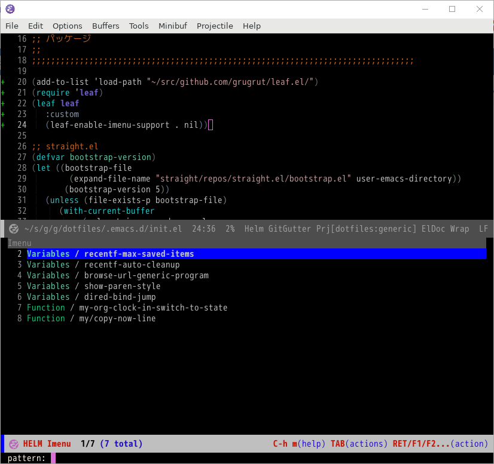

こうします。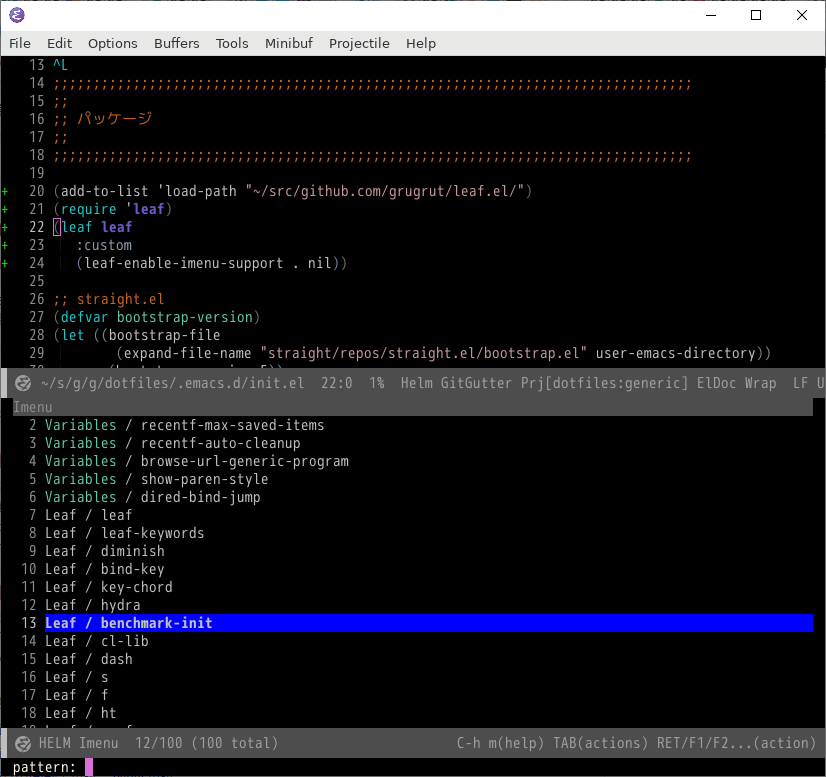

use-packageにもあるみたいですが、どうやらバグっているとのことなので、leaf.elでしか使えません。便利すぎるので、デフォルトでオンにしてあります。

そもそもEmacsには[[https://ayatakesi.github.io/emacs/temp/html/Imenu.html][imenuという機能]]があり、 =M-x imenu= で起動できます。ファイルをスキャンして関数定義や変数定義などの主要な定義についてのリストを提供し、その場所へのジャンプを提供します。

私はこのPRを受けて、この機能を知り、とても便利だったので =C-s= を =counsel-imenu= にあげることにしました。

=ivy= の =isearch= 相当は =swiper= なのですが、最近 =helm-swoop= のメンテナになったので、 =helm-swoop= を =C-S-s= に割り当てて使っています。

#+begin_src emacs-lisp
(leaf ivy
  :ensure t
  :diminish ivy-mode
  :custom ((ivy-re-builders-alist . '((t      . ivy--regex-fuzzy)
                                      (swiper . ivy--regex-plus)))
           (ivy-use-selectable-prompt . t)

           (ivy-mode     . t)
           (counsel-mode . t))
  :init
  (leaf *ivy-requirements
    :config
    (leaf swiper
      :disabled t
      :ensure t
      :bind (([remap isearch-forward] . swiper)))
    (leaf counsel
      :ensure t
      :diminish counsel-mode
      :bind (([remap isearch-forward] . counsel-imenu)
             ("C-x C-r" . counsel-recentf)))))

(leaf helm
  :ensure t
  ;; :require helm-config
  :config
  (leaf helm-swoop
    :load-path `,(locate-user-emacs-file "site-lisp/helm-swoop")
    :custom (helm-swoop-pre-input-function
             . (lambda ()
                 (if mark-active
                     (buffer-substring-no-properties (mark) (point))
                   "")))
    :bind ((helm-swoop-map   ("C-s" . helm-multi-swoop-all-from-helm-swoop))
           ("C-S-s" . helm-swoop)
           ("C-c f" . hydra-helm-swoop/body))))
#+end_src

*** Implement plstore-related keywords
- [[https://github.com/conao3/leaf.el/issues/276][#276 Setting or customizing variables from plstore]]
- [[https://github.com/conao3/leaf.el/pull/280][#280 Implement plstore-related keywords]]
- [[https://github.com/conao3/leaf.el/issues/283][#283 Add default plstore variable and get from it if value omitted]]
- [[https://github.com/conao3/leaf.el/issues/338][#338 add auth-* keywords as alias of pl-* keywords]]

目玉機能その2です。機密情報をEmacsの外に保存して、動的に復号し、Emacsの中で使う =auth-sources= のleafキーワードです。

この機能についてはちょっと説明が必要なので、別記事にし +てAdvent Calendarの穴埋めをし+ ます。

*** Add leaf-key-bindlist visualization
- [[https://github.com/conao3/leaf.el/issues/289][#289 Add leaf-key-bindlist visualization]]

目玉機能その3です。leafの =:bind= や =:bind*= で設定したキーバインドのリストを表示します。もしEmacsデフォルトのキーバインドを上書きしている場合は上書き前の関数名も表示されます。

これも、もともとuse-packageに実装されている =describe-personal-bindings= の移植です。

しかし、use-packageでは単にbufferにフォーマットされた文字列を表示するだけですが、 =leaf-key-describe-bindings= ではEmacsビルトインの表データ表示ライブラリ、 =tabulated-list= を使用して表示します。

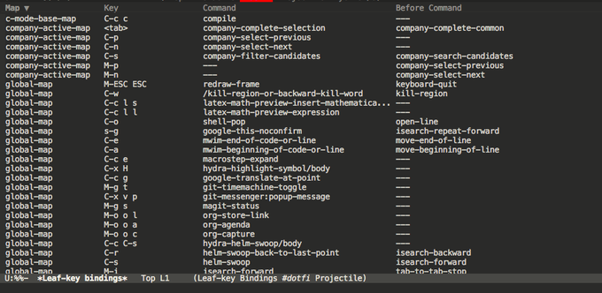

それによって各列での昇順、降順のソートなどができることで、use-packageのそれより使いやすく/見やすくなっていると思います。

*** Add leaf-expand-minimally variable
- [[https://github.com/conao3/leaf.el/issues/255][#255 Add leaf-expand-minimally variable]]

=leaf-emapand-minimally= という変数を追加しました。これは、use-packageにもある =use-package-expannd-minimally= の移植です。移植といいつつ、機能だけの移植でどうやって実装されているかまで見ていません。

leafの =leaf-expand-minimally= の実装は =leaf-expand-minimally-suppress-keywords= に指定されたキーワードに対して、優先度最大で、 =nil= を指定するというものです。

今のところ =leaf-expand-minimally-suppress-keywords= には =:leaf-protect= のみが指定されているので、有効にした場合は[[https://s.conao3.com/blog/2019/2b6cbf][:leaf-protect]]だけが無効化されます。

#+begin_src emacs-lisp
(defmacro p (form)
  "Output FORM processed `macroexpand-1' and `pp'."
  `(progn
     (pp (macroexpand-1 ',form))
     nil))
;;=> p

(p (leaf ace-window
     :ensure t
     :bind (("M-o a w" . ace-window))))
;;=> (prog1 'ace-window
;;     (leaf-handler-leaf-protect ace-window
;;       (unless
;;           (fboundp 'ace-window)
;;         (autoload #'ace-window "ace-window" nil t))
;;       (declare-function ace-window "ace-window")
;;       (leaf-handler-package ace-window ace-window nil)
;;       (leaf-keys
;;        (("M-o a w" . ace-window)))))

(let ((leaf-expand-minimally t))
  (p (leaf ace-window
       :ensure t
       :bind (("M-o a w" . ace-window)))))
;;=> (prog1 'ace-window
;;     (unless
;;         (fboundp 'ace-window)
;;       (autoload #'ace-window "ace-window" nil t))
;;     (declare-function ace-window "ace-window")
;;     (leaf-handler-package ace-window ace-window nil)
;;     (leaf-keys
;;      (("M-o a w" . ace-window))))
#+end_src

ただ、leafの展開形を知りたいだけなら後述する =leaf-expand= の方が使いやすいと思います。

*** Add leaf expand visualization feature
- [[https://github.com/conao3/leaf.el/issues/319][#319 Add leaf expand visualization feature]]

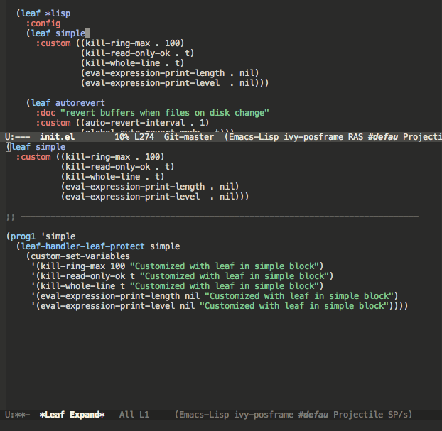

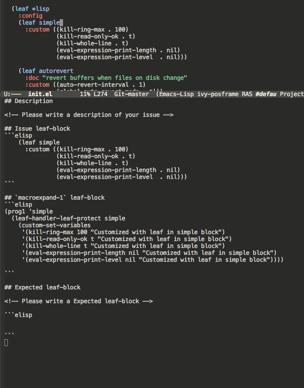

=M-x leaf-expand= と =M-x leaf-create-issue-template= を実装しました。

=leaf-expand= は現在のポイントから上のS式をスキャンして、一番最初に見つかったleafを =macroexpand-1= で展開し、新しいバッファに表示します。

=leaf-create-issue-template= はついでに実装したものです。展開前と展開後のleafをmd形式で新しいバッファに表示します。これをコピペすれば簡単にissueが書けるのではないかなと思います。

*** Add leaf-available-keywords
- [[https://github.com/conao3/leaf.el/issues/258][#258 Add leaf-available-keywords function]]
- [[https://github.com/conao3/leaf.el/issues/260][#260 make leaf-avairable-keywords interacrive function]]

=leaf-available-keywords= を追加しました。

lispプログラムから実行すると、単に現在使用できるキーワードのリストを返し、 =M-x leaf-avairable-keywords= と実行するとエコーエリアに表示します。

@@ image @@

あれ、どんなキーワードが使えるんだっけ。ってときに使えるかもしれません。このコマンドを実行する前にドキュメントを見てしまいそうですが。。

*** Why don't :setq, :custom, etc. distribute when normalizing?
- [[https://github.com/conao3/leaf.el/issues/279][#279 Why don't :setq, :custom, etc. distribute when normalizing?]]
- [[https://github.com/conao3/leaf.el/pull/282][#282 feature#279]]

=:hook= や =:mode= 以外のキーワードの分配代入のサポートの提案です。結局、下記のキーワードの全てで分配代入をサポートしました。

#+begin_example
:ensure :package
:hook :mode :interpreter :magic :magic-fallback :defun
:pl-setq :pl-pre-setq :pl-setq-default :pl-custom
:auth-custom :auth-pre-setq :auth-setq :auth-setq-default
:setq :pre-setq :setq-default :custom :custom-face
#+end_example

同じ値を複数の変数に設定するときに便利かもしれません。ただあんまり記述量変わらないし、変数名も長いので2行に渡ることもあり、私はあまり使ってません。

ただ、やっぱり =:hook= や =:mode= では便利。

*** Automatically require packages feature
- [[https://github.com/conao3/leaf-keywords.el/issues/56][#56 Automatically require packages feature]]
- [[https://github.com/conao3/leaf-keywords.el/issues/58][#58 Fix auto require feature]]
- [[https://github.com/conao3/leaf-keywords.el/issues/64][#64 Remove straight from auto require packages]]

leaf-keywords.elの追加機能です。leaf-keywords.elで使えるパッケージがインストールされていた場合、 =(leaf-keywords-setup)= をしたときに自動でrequireするようにしました。

この機能を使うには =(leaf-keywords-setup)= をする前に =el-get=, =hydra=, =key-combo=, =smartrep=, =key-chord=, =diminish=, =delight= のうちどれかをpackage.elなどでインストールしておく必要があります。

*** Remove eval-after-load statement
- [[https://github.com/conao3/leaf-keywords.el/issues/62][#62 Remove eval-after-load statement]]

leaf-keywords.elの追加機能です。leaf-keywords.elによって出力されたS式は、追加パッケージがrequireされたときに発火するように =eval-after-load= で囲われていました。

しかしこのおせっかい機能によって、 =:diminish= キーワードを使用しているのに =diminish= をインストールし忘れているという事故が起こっていました。

そこでエイヤッと取っぱらってしまいました。エラーによってきちんとユーザーに報告した方が良いだろうという判断です。なお =leaf-protect= で囲われている限り、エラーは起こりますが内部のエラーは全てワーニングに変換されるので、その後のパッケージは読み込もうとします。

** 修正された機能
*** Correctly eval cdr
- [[https://github.com/conao3/leaf.el/pull/269][#269 Correctly eval cdr]]

私は「ドット対のリスト」を指定するのが好みで、それをずっと使っていましたが、単に「ドット対」を渡したときに盛大にバグっていたことを教えて頂きました。

- 動く

  #+begin_src emacs-lisp
  (leaf some-mode
    :hook ((t . other-mode)))
  #+end_src

- 動かない

  #+begin_src emacs-lisp
  (leaf some-mode
    :hook (t . other-mode))
  #+end_src

leafは結構大きなDSL解析器になっていて、デバッグも大変になってきています。とりあえず、テストケースは全部通ることを確認しているので、見つけ次第追加していくしかないですね。。

なお、Readmeや私が書くleafの記事で紹介しているものはテストケースから抜き出したものなので、動くことが保証されています。

*** Fix install code
- [[https://github.com/conao3/leaf.el/issues/274][#274 fix install code]]

Readmeにおいて =leaf= のダウンロードに失敗したら =package-refresh= してもう一度ダウンロードを試すようにしていましたが、通常、leafは一番最初にダウンロードされるだろうということを仮定してインストールコードを簡略化しました。

ついでに =leaf-keywords.el= のインストールコードも =prog1= を使わない形に変えました。

- before

  #+begin_src emacs-lisp
  (prog1 "prepare leaf"
    (prog1 "package"
      (custom-set-variables
       '(package-archives '(("org"   . "https://orgmode.org/elpa/")
                            ("melpa" . "https://melpa.org/packages/")
                            ("gnu"   . "https://elpa.gnu.org/packages/"))))
      (package-initialize))

    (prog1 "leaf"
      (unless (package-installed-p 'leaf)
        (unless (assoc 'leaf package-archive-contents)
          (package-refresh-contents))
        (condition-case err
            (package-install 'leaf)
          (error
           (package-refresh-contents)       ; renew local melpa cache if fail
           (package-install 'leaf))))

      (leaf leaf-keywords
        :ensure t
        :config (leaf-keywords-init)))

    (prog1 "optional packages for leaf-keywords"
      ;; optional packages if you want to use :hydra, :el-get,,,
      (leaf hydra :ensure t)
      (leaf el-get :ensure t
        :custom ((el-get-git-shallow-clone  . t)))))
  #+end_src

- after

  #+begin_src emacs-lisp
  (prog1 "leaf"
    (prog1 "install leaf"
      (custom-set-variables
       '(package-archives '(("org"   . "https://orgmode.org/elpa/")
                            ("melpa" . "https://melpa.org/packages/")
                            ("gnu"   . "https://elpa.gnu.org/packages/"))))
      (package-initialize)
      (unless (package-installed-p 'leaf)
        (package-refresh-contents)
        (package-install 'leaf)))

    (leaf leaf-keywords
      :ensure t
      :config
      ;; optional packages if you want to use :hydra, :el-get,,,
      (leaf hydra :ensure t)
      (leaf el-get :ensure t
        :custom ((el-get-git-shallow-clone . t)))

      ;; initialize leaf-keywords.el
      (leaf-keywords-init)))
  #+end_src

*** Byte compile
- [[https://github.com/conao3/leaf.el/issues/326][#326 Suppress byte-compiler warnings, unused lexical variable, err]]
- [[https://github.com/conao3/leaf.el/issues/332][#332 Create :leaf-defun, auto declare function feature]]
- [[https://github.com/conao3/leaf.el/issues/334][#334 Add :leaf-defvar keyword]]
- [[https://github.com/conao3/leaf.el/issues/336][#336 fix :leaf-defvar expand statement]]

leafを使用したinit.elをバイトコンパイルしたときにワーニングが出たので直しました。バイトコンパイルについては少しコツがあるので、また別記事にするかもしれません。

*** Do configure autoload if not have already set autoload
- [[https://github.com/conao3/leaf.el/issues/330][#330 Do configure autoload if not have already set autoload]]

二重にautoloadされることを防止するためにautoloadする前に =fboundp= するようにしました。実はuse-packageの出力結果では =fboundp= してautoloadしていたのですが、そのチェックは本当に必要なんだろうか。と思ってチェックを外していたのです。

しかし、実際のところpackage.elによって設定された正しいautoloadをleafが上書きしていることが分かったので、設定する前にチェックするようにしました。

*** :hook should not autoload lambda expressions
- [[https://github.com/conao3/leaf.el/issues/295][#295 :hook cannot handle lambda with multiple expressions]]
- [[https://github.com/conao3/leaf.el/issues/296][#296 :hook should not autoload lambda expressions]]

=:hook= でlambda式を指定したときに、複数式だと動かないことと、変なautoloadが生成されていることの報告を受けて直しました。

この変更によって =:hook= で正常にlambda式を使用できるようになりました。

なお、 =:bind=, =:bind*= ではlambda式をバインドすることが[[https://github.com/conao3/leaf.el/issues/322][現状できない]]ので、 =:preface= で関数を宣言してバインドしてもらえればと思います。。

** まとめ
leafはIssueやPRを放置することなく、後方互換性を保った上で精力的に機能拡張を行なっています。ぜひこの記事や[[https://s.conao3.com/blog/2019/2b6cbf][リリース記事]]を参考にして、leafで快適なEmacs生活を送って頂ければと思います。

なお、12/18には「[[https://qiita.com/advent-calendar/2019/emacs][Emacs Advent Calendar 2019]]」の18日目の記事として @keita44_f4さんによるleafの記事がでるようなので、それも参考にしていただければと思います。

最後になりますが、Patreonでご支援を頂ける方を募集しています。普段はleafなどのElispパッケージなどを中心にOSS活動をしつつ、学生をしています。ぜひよろしくお願いします。

[[https://www.patreon.com/conao3]]

* COMMENT dash.elの置き換え
:properties:
:export_file_name: generated/contents/blog/2019/84b8f6
:export_date: 2019-12-03
:export_updated: 2019-12-03
:end:

** はじめに
この記事は「[[https://qiita.com/advent-calendar/2019/emacs][Emacs Advent Calendar 2019]]」の2日目の記事として書いたものです。
昨日は私の「[[https://s.conao3.com/blog/2019/3279ec][{2019年アップデート} leaf.elで雑然としたEmacs設定ファイル「init.el」をクリーンにする]]」でした。

まだ空きがあるので、ぜひ参加頂ければと思います!

** dashとは
dashとはmagnarsさんによって作られ、現在は主にFuco1さんによってメンテナンスされています。
[[https://qiita.com/pogin503/items/01005402dc7cfd375b55][Emacsのモダンなライブラリ4+1選 (2013年版)]]にも取り上げられる他、 その使いやすさから[[https://melpa.org/#/dash][440のパッケージ]]から参照されており、
[[https://melpa.org/#/?sort=downloads&asc=false][ダウンロードランキング]]では唯一100万ダウンロードを達成し、4000を越えるElispパッケージの堂々たる頂点に君臨しています。

しかし、dashは本当に依存すべきパッケージなのでしょうか。
あなたのElispパッケージがdashに依存することによって、どれだけのメリットを生んでいるのでしょうか。
dashがもし仕様変更したとき、あなたのElispパッケージが壊れるデメリットを甘受できるでしょうか。

dashの理念はプレフィックスのない関数を数多く宣言してしまう悪名高い =ci= パッケージに依存しないということでした。
しかし =ci= パッケージは =ci-lib= パッケージとして整理され、Emacsビルトインの =subr= パッケージも大きく進化しています。
一方でdashはMELPA登録パッケージが解決すべきであるpackage-lint/checkdocのエラー/ワーニングを[[https://github.com/magnars/dash.el/pull/327][470件も放置し]]、[[https://github.com/magnars/dash.el/pull/328][CIは一ヶ月前から通っていません]]。

dashの関数を既に大量に使っている場合は[[https://github.com/bbatsov/projectile/pull/1046][こんな感じで大変]]ですが、これからのElispパッケージを作る場合はdash非依存で作ってみてはいかがでしょうか。

* leaf.elに依存したEmacs設定ファイル「init.el」をバイトコンパイルして爆速にする
:properties:
:export_file_name: generated/contents/blog/2019/6c5374
:export_date: 2019-12-03
:export_updated: 2019-12-03
:export_tags: emacs emacs-lisp byte-compile macro performance leaf-el
:end:

** はじめに
この記事は「[[https://qiita.com/advent-calendar/2019/emacs][Emacs Advent Calendar 2019]]」の3日目の記事として書いたものです。昨日は私の「[[https://s.conao3.com/blog/2019/3279ec][{2019年アップデート} leaf.elで雑然としたEmacs設定ファイル「init.el」をクリーンにする]]」でした。

まだ空きがあるので、ぜひ参加頂ければと思います!

[[github:conao3/leaf.el::Emacs Lisp][Flexible, declarative, and modern init.el package configuration]]

** バイトコンパイルとは
Elispはバイトコンパイルすることができ、通常の =.el= から =.elc= にコンパイルすることができます[fn:1]。

バイトコンパイルすることにより、より効率的にElispコードを実行できるようになります。init.elでバイトコンパイルの恩恵はあまり得られないことは言われていますが、しかし数msでも早くなるならやっておきたいのが人情というもの。実際どれだけ早くなるのか分からないのだから、試してみるしかないのです。

しかしleaf.elを使っている場合、そのままではバイトコンパイルできません。なお、[[https://github.com/conao3/leaf.el][leaf.elのReadme]]でもバイトコンパイルのことには全く触れていません。[[https://github.com/conao3/leaf.el#byte-compile-keywords][バイトコンパイルキーワード]]として実装されていることは紹介していますが、実際どのようにしたらいいのか書いてないのです。その方法を解説するものです。

** leaf.elとは
[[https://github.com/conao3/leaf.el][leaf.el]]はjwiegleyさんの[[https://github.com/jwiegley/use-package][use-package]]を2.5年使った上で、私が感じていたストレスを解消するためにスクラッチから開発したパッケージです。本体の説明はQiitaに何回か記事を書いたので、そちらを参照してください

- プレリリース記事: [[https://s.conao3.com/blog/2018/8aa938][use-packageからの移行のすゝめ - leaf.elでバージョン安全なinit.elを書く]]
- リリース記事: [[https://s.conao3.com/blog/2019/2b6cbf][{正式リリース}leaf.elで雑然としたEmacs設定ファイル「init.el」をクリーンにする]]
- 2019年アップデート記事: [[https://s.conao3.com/blog/2019/3279ec][{2019年アップデート} leaf.elで雑然としたEmacs設定ファイル「init.el」をクリーンにする]]

** let'sバイトコンパイル
*** お題について
お題のinit.elを紹介します。私はこのinit.elを =/.debug.emacs.d/leaf/init.el= に保存しました。

#+begin_src emacs-lisp
;;; init.el --- leaf bytecompile sample   -*- lexical-binding: t; -*-

;;; Commentary:

;; leaf bytecompile sample

;;; Code:

;; ~/.debug.emacs.d/leaf/init.el

;; you can run like 'emacs -q -l ~/.debug.emacs.d/{{pkg}}/init.el'
(when load-file-name
  (setq user-emacs-directory
        (expand-file-name (file-name-directory load-file-name))))

(prog1 "leaf"
  (prog1 "install leaf"
    (custom-set-variables
     '(package-archives '(("org"   . "https://orgmode.org/elpa/")
                          ("melpa" . "https://melpa.org/packages/")
                          ("gnu"   . "https://elpa.gnu.org/packages/"))))
    (package-initialize)
    (unless (package-installed-p 'leaf)
      (package-refresh-contents)
      (package-install 'leaf)))

  (leaf leaf-keywords
    :ensure t
    :config
    ;; optional packages if you want to use :hydra, :el-get,,,
    (leaf hydra :ensure t)
    (leaf el-get :ensure t
      :custom ((el-get-git-shallow-clone . t)))

    ;; initialize leaf-keywords.el
    (leaf-keywords-init)))



(load (locate-user-emacs-file "../essentials.el"))

(leaf magit
  :when (version<= "25.1" emacs-version)
  :ensure t
  :preface
  (defun c/git-commit-a ()
    "Commit after add anything."
    (interactive)
    (shell-command "git add .")
    (magit-commit-create))
  :bind (("M-=" . hydra-magit/body))
  :hydra (hydra-magit
          (:hint nil :exit t)
          "
^^         hydra-magit
^^------------------------------
 _s_   magit-status
 _C_   magit-clone
 _c_   magit-commit
 _d_   magit-diff-working-tree
 _M-=_ magit-commit-create"
          ("s" magit-status)
          ("C" magit-clone)
          ("c" magit-commit)
          ("d" magit-diff-working-tree)
          ("M-=" c/git-commit-a)))

;;; init.el ends here
#+end_src

お題のinit.elにはleafとleaf-keywordsのインストール、magitをpackage.elによってインストール、 =:hydra= キーワードも含まれています。お題としてはまぁまぁではないでしょうか。

*** とりあえずやってみる
さて、このinit.elをバイトコンパイルするにあたって、注意するべきなのは、「leaf.elがマクロである」ということです。

マクロはバイトコンパイル時には既にコンパイラが定義を知っておく必要があります。

なお、flycheckのエラーも大変なことになっています。これでは重要なエラーを見落としてしまいます。

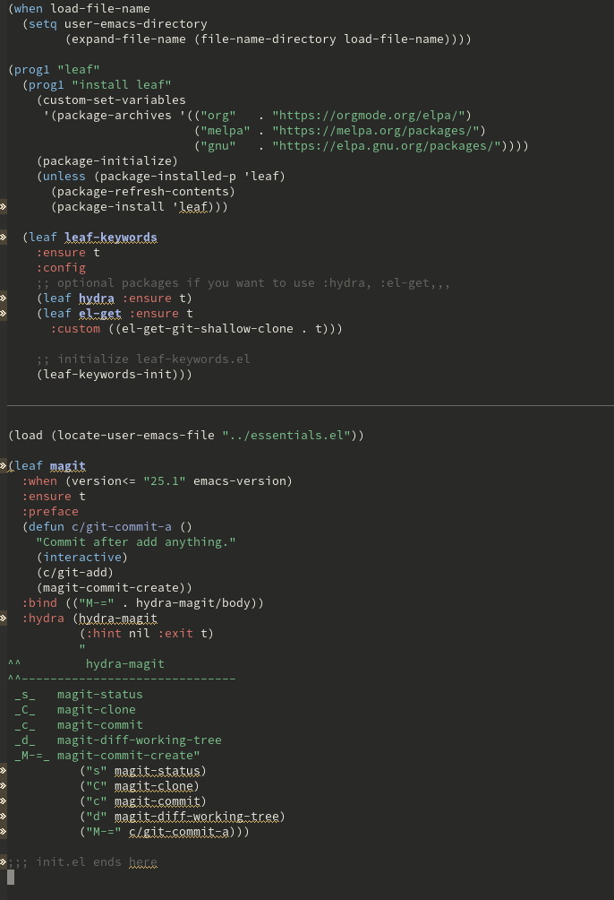

とりあえずやってみるということなので、バイトコンパイルしてみます。バイトコンパイルはいろいろな方法がありますが、簡単には外部のコンソールからバッチ処理モードでEmacsを起動してバイトコンパイルすることです。

#+begin_src shell
$ emacs --version
GNU Emacs 26.3
Copyright (C) 2019 Free Software Foundation, Inc.
GNU Emacs comes with ABSOLUTELY NO WARRANTY.
You may redistribute copies of GNU Emacs
under the terms of the GNU General Public License.
For more information about these matters, see the file named COPYING.


$ emacs -Q --batch -f batch-byte-compile init.el
In toplevel form:
init.el:25:25:Warning: ‘(el-get-git-shallow-clone . t)’ is a malformed
    function
init.el:27:9:Warning: reference to free variable ‘leaf-keywords’
init.el:31:11:Warning: reference to free variable ‘hydra’
init.el:32:11:Warning: reference to free variable ‘el-get’
init.el:42:1:Warning: ‘("M-=" . hydra-magit/body)’ is a malformed function
init.el:42:1:Warning: ‘"s"’ is a malformed function
init.el:42:1:Warning: ‘"C"’ is a malformed function
init.el:42:1:Warning: ‘"c"’ is a malformed function
init.el:42:1:Warning: ‘"d"’ is a malformed function
init.el:42:1:Warning: ‘"M-="’ is a malformed function
init.el:42:7:Warning: reference to free variable ‘magit’
init.el:52:11:Warning: ‘:hint’ called as a function
init.el:62:16:Warning: reference to free variable ‘magit-status’
init.el:63:16:Warning: reference to free variable ‘magit-clone’
init.el:64:16:Warning: reference to free variable ‘magit-commit’
init.el:65:16:Warning: reference to free variable ‘magit-diff-working-tree’
init.el:66:18:Warning: reference to free variable ‘c/git-commit-a’

In end of data:
init.el:69:1:Warning: the following functions are not known to be defined:
    package-installed-p, leaf, leaf-keywords-init, c/git-add,
    magit-commit-create, hydra-magit, :hint
#+end_src

なお、バイトコンパイルされた =elc= はメジャーバージョンをまたいでの互換性はないので、 =emacs= と起動したときにどのバージョンが起動されているのか確認することは重要です。さて、バイトコンパイルは大量のワーニングを出してバイトコンパイルできたようです。

。。。できてしまった。

いや、実行はできないはず。。。

#+begin_src emacs-lisp
emacs -q -l ~/.debug.emacs.d/leaf/init.el
#+end_src

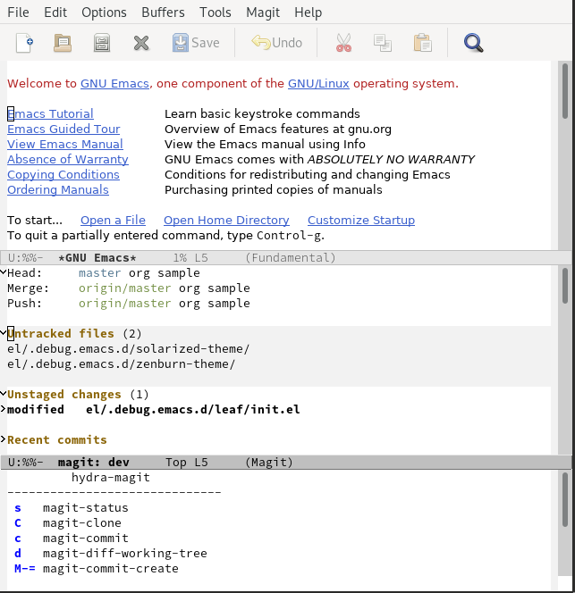

実行できてしまった。。

あれ、この記事の存在意義が良く分からなくなってしまったのですが、とりあえずワーニングでるの良くないよねということで、「ワーニングなしでバイトコンパイルする方法を紹介すること」に方針転換します。。

*** バイトコンパイル中の評価 - その1
「[[https://ayatakesi.github.io/lispref/24.5/elisp-ja.html#Eval-During-Compile][コンパイル中の評価]]」にある通り、バイトコンパイルのときにコンパイラに実行して欲しい式がある場合、 =eval-when-compile= で囲むことによって実現できます。

つまりleafのインストールをバイトコンパイル中にしてしまえばいいのです。そういえば[[https://github.com/jwiegley/use-package#getting-started][use-packageの推奨インストール]]はそもそもそうやって書かれていたのでした。

#+begin_src diff
modified   el/.debug.emacs.d/leaf/init.el
@@ -13,17 +13,21 @@
   (setq user-emacs-directory
         (expand-file-name (file-name-directory load-file-name))))

-(prog1 "leaf"
-  (prog1 "install leaf"
-    (custom-set-variables
-     '(package-archives '(("org"   . "https://orgmode.org/elpa/")
-                          ("melpa" . "https://melpa.org/packages/")
-                          ("gnu"   . "https://elpa.gnu.org/packages/"))))
-    (package-initialize)
-    (unless (package-installed-p 'leaf)
-      (package-refresh-contents)
-      (package-install 'leaf)))
+(eval-when-compile
+  (setq user-emacs-directory
+        (expand-file-name (file-name-directory default-directory))))

+(eval-when-compile
+  (prog1 "leaf"
+    (prog1 "install leaf"
+      (custom-set-variables
+       '(package-archives '(("org"   . "https://orgmode.org/elpa/")
+                            ("melpa" . "https://melpa.org/packages/")
+                            ("gnu"   . "https://elpa.gnu.org/packages/"))))
+      (package-initialize)
+      (unless (package-installed-p 'leaf)
+        (package-refresh-contents)
+        (package-install 'leaf))))
   (leaf leaf-keywords
     :ensure t
     :config
#+end_src

このように修正しました。バイトコンパイルしてみます。一度目はleafやleaf-keywords, hydraのインストールなどが行なわれると思います。出力が見づらいので、2回目を引用すると以下のようになります。

#+begin_src shell
$ emacs -Q --batch -f batch-byte-compile init.el

In end of data:
init.el:73:1:Warning: the following functions might not be defined at runtime
:
    package-installed-p, hydra-default-pre, hydra-keyboard-quit,
    hydra--call-interactively-remap-maybe, hydra-show-hint,
    hydra-set-transient-map
init.el:73:1:Warning: the function ‘magit-commit-create’ is not known to be
    defined.
#+end_src

どうやらまだワーニングが出ているようです。ワーニングは英語の意味そのままで、「バイトコンパイル中には定義を知っているが、実行時には多分知らないよ(実行時エラーになるよ)」ということです。実行時、それらの関数がきちんと使えることをバイトコンパイラに伝える必要がありそうです。

なお、 =user-emacs-diretory= の設定を =eval-when-compile= で囲った上で一つ増やしました。これはバイトコンパイル中も =user-emacs-directory= を変更しないとホームディレクトリの =.emacs.d= を使ってしまうからです。

別ディレクトリのクリーンな環境で実行しているからこそ、見落とさずに変更することができました。

*** バイトコンパイル中の評価 - その2
実行時に評価されないとバイトコンパイラに注意されたので、実行時にも評価するように変更します。

=eval-when-compile= を =eval-and-compile= に変更するだけです。これでバイトコンパイル中にも、実行時にも評価されることを宣言できます。

#+begin_src diff
modified   el/.debug.emacs.d/leaf/init.el
@@ -17,7 +17,7 @@
   (setq user-emacs-directory
         (expand-file-name (file-name-directory default-directory))))

-(eval-when-compile
+(eval-and-compile
   (prog1 "leaf"
     (prog1 "install leaf"
       (custom-set-variables
#+end_src

さて、バイトコンパイルしてみましょう。

#+begin_src shell
$ emacs -Q --batch -f batch-byte-compile init.el

In end of data:
init.el:73:1:Warning: the function ‘magit-commit-create’ is not known to be
    defined.
#+end_src

ワーニングがずいぶん少なくなりました!最後に残ったのは =magit-commit-create= が定義されていないというワーニングです。

これは =:preface= で宣言している =c/git-commit-a= で使用しているmagitの内部関数ですね。では最後にこのワーニングが出ないようにすればお題クリアです。

*** バイトコンパイル中の評価 - その3
前章で =magit-commit-create= が定義されていないというワーニングがでていました。ここで、ようやくleafのバイトコンパイルキーワードの出番です。

バイトコンパイルキーワードは2種類あり、 =:defun= は関数の宣言、 =:defvar= は変数の宣言を行います。今回は関数の未定義エラーがでているので、 =:defun= を使用します。

#+begin_src diff
modified   el/.debug.emacs.d/leaf/init.el
@@ -46,6 +46,7 @@
 (leaf magit
   :when (version<= "25.1" emacs-version)
   :ensure t
+  :defun (magit-commit-create)
   :preface
   (defun c/git-commit-a ()
     "Commit after add anything."
#+end_src

さて、もう一度バイトコンパイルしてみましょう。

#+begin_src shell
$ emacs -Q --batch -f batch-byte-compile init.el
#+end_src

出力がなにもありません。ワーニングなしでコンパイルできたようです!

flycheckのワーニングも全てなくなりました。これでflycheckのワーニングが価値あるものになりました。

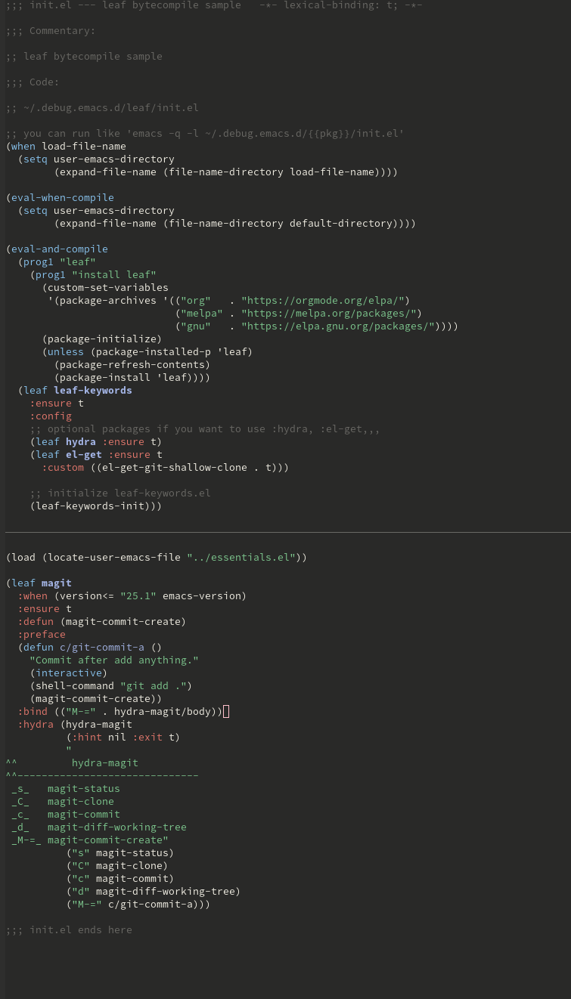

** まとめ
leaf.elを使っているinit.elをバイトコンパイルする方法を紹介しました。しかしこれは一番簡単な場合で、もし「init.elを複数のバージョンで読み込む可能性がある」場合は今回の方法は使えません。メジャーバージョン間で =elc= の互換性は存在しないので、エラーになってしまいます。

とはいえ、そんな状況で使っている人はまれで、多くの人はホームディレクトリの =.emacs.d= にinit.elを置いて単一バージョンで使っていると思います。この記事が参考になれば幸いです。

最後になりますが、Patreonでご支援を頂ける方を募集しています。普段はleafなどのElispパッケージなどを中心にOSS活動をしつつ、学生をしています。ぜひよろしくお願いします。

[[https://www.patreon.com/conao3]]

** Footnotes
[fn:1] GNU Emacs Lisp Reference Manual - バイトコンパイル[[https://ayatakesi.github.io/lispref/24.5/elisp-ja.html#Byte-Compilation]]

* Re: Makefileで.emacs.dの理想的なディレクトリ構造を生成する話
:properties:
:export_file_name: generated/contents/blog/2019/183c16
:export_date: 2019-12-04
:export_updated: 2019-12-04
:export_tags: emacs make dotfiles directory-structure byte-compile leaf-el
:end:

** はじめに
この記事は「[[https://qiita.com/advent-calendar/2019/emacs][Emacs Advent Calendar 2019]]」の4日目の記事として書いたものです。

昨日は私の「[[https://s.conao3.com/blog/2019/6c5374][leaf.elに依存したEmacs設定ファイル「init.el」をバイトコンパイルして爆速にする]]」でした。

まだ空きがあるので、ぜひ参加頂ければと思います!

** 去年のディレクトリ構造
去年、私は「[[https://s.conao3.com/blog/2018/07b41c][Makefileで.emacs.dの理想的なディレクトリ構造を生成する話]]」を「[[https://qiita.com/advent-calendar/2018/emacs][Emacs Advent Calendar 2018]]」に投稿しました。

そこで提案したのは以下の構造でした。

#+begin_example
.
├── Makefile
├── Makefunc.mk
├── init.el
├── conf/
│   ├── 00_leaf.el
│   ├── 01_core-emacs.el
│   ├── 10_standard-elisp.el
│   ├── 20_editor.el
│   ├── 30_utility.el
│   └── 40_major-mode.el
├── site-lisp/
│   ├── cort.el/
│   ├── dash.el/
│   ├── f.el/
│   ├── feather.el/
│   ├── leaf.el/
│   ├── org-mode/
│   ├── orglyth.el/
│   ├── s.el/
│   └── use-package/
├── snippets/
├── templete/
└── local/
    ├── conao-mixed-raw.el
    ├── conao-mixed.el
    ├── 22.1/
    │   ├── build/
    │   │   ├── conao-mixed.el -> ../../conao-mixed.el
    │   │   └── conao-mixed.elc
    │   │   snippets/ -> ../../snippets/
    │   │   templete/ -> ../../templete/
    │   └── site-lisp/
    │       ├── cort.el/
    │       ├── ...
    │       └── use-pacakge/
    ├── 23.4/
    ├── 24.5/
    ├── 25.3/
    └── 26.1/
#+end_example

また、自動生成される前はこの構造です。

#+begin_example
.
├── Makefile
├── Makefunc.mk
├── init.el
├── conf/
│   ├── 00_leaf.el
│   ├── 01_core-emacs.el
│   ├── 10_standard-elisp.el
│   ├── 20_editor.el
│   ├── 30_utility.el
│   └── 40_major-mode.el
├── snippets/
└── templete/
#+end_example

** 今年のディレクトリ構造
さて、1年使ってみると考えも変わってきます。大きく変わったのは「モダンなinit.elはファイル分割する」という観点です。実際、ファイル分割によって見通しのよいinit.el群の管理と読み込み順の管理、さらには条件付きの設定が実現できていました。

しかし、leaf.elの開発によって、巨大なinit.elを一つだけもっていたとしても[[https://s.conao3.com/blog/2019/3279ec][imenuですぐにジャンプ]]できますし、leaf.elには[[https://s.conao3.com/blog/2019/2b6cbf][強力な条件分岐キーワード]]があります。

よって、現在ではこのようなディレクトリ構造になっています

#+begin_example
.
├── Makefile
├── Makefunc.mk
├── init.el
├── conf.el
├── site-lisp/
│   ├── cort-test.el/
│   ├── feather.el/
│   ├── orglyth.el/
│   └── leaf.el/
├── snippets/
├── templetes/
└── local/
  ├── 22.1/
  ├── 23.4/
  ├── 24.5/
  ├── 25.3/
  ├── 26.1/
  ├── 26.2/
  └── 26.3/
      ├── Makefile
      ├── conf.el -> ../../conf.el
      ├── conf.elc
      ├── elpa/
      ├── snippets/ -> ../../snippets/
      ├── templetes/ -> ../../templetes/
      └── site-lisp/ -> ../../site-lisp/
#+end_example

なお自動生成前はこのようなディレクトリ構造です。つまりこの構造が[[https://github.com/conao3/dotfiles/tree/master/.dotfiles/.emacs.d][GitHubで見えて]]います。

#+begin_example
.
├── Makefile
├── Makefile-local.mk
├── init.el
├── conf.el
├── snippets/
└── templete/
#+end_example

このディレクトリ構造は以下の特徴を持っています。

- メジャーバージョンの異なる、複数のEmacsを同時に使用できる。
- (M)ELPAからダウンロード、コンパイルしたパッケージは =local/[ver]/elpa/= 以下に置かれる。(異なるバージョン間で混同しない)
- site-lispは全バージョンで同じディレクトリを使用する。(開発中のパッケージを置いてるので、いちいちコピーするのが面倒)
- Emacsパッケージが保存するセンシティブな情報を一括で.gitignoreできる。

去年は気づいていませんでしたが、特に最後の特徴は重要な意味を持つことに気付きました。データの永続化のために =user-emacs-directory= (通常は =$HOME/.emacs.d= )にファイルを保存するEmacsパッケージは多く存在しており、その情報は取り扱いに注意が必要なものもあります。

やばそう(普通他人に見せない)なものの代表例はこちらです。

- [[https://github.com/search?utf8=%E2%9C%93&q=path%3A.emacs.d+filename%3Asession&type=Code&ref=advsearch&l=&l=][session]]
- [[https://github.com/search?q=path%3A.emacs.d+filename%3A.emacs.desktop&type=Code][.emacs.desktop]]
- [[https://github.com/search?utf8=%E2%9C%93&q=path%3A.emacs.d+filename%3Atramp&type=Code&ref=advsearch&l=&l=][tramp]]
- [[https://github.com/search?utf8=%E2%9C%93&q=path%3A.emacs.d+filename%3Arecentf&type=Code&ref=advsearch&l=&l=][recentf]]
- [[https://github.com/search?q=path%3A.emacs.d+filename%3Ajisyo&type=Code][jisyo]] (ddskk)

これらはおそらく =.gitignore= 漏れだと思います。(意図してgit管理している場合もあるのでしょうが。。)

重要なのは、「どのEmacsパッケージが、どんな名前で情報を保存するのかは分からない」という点です。

この状況でブラックリスト管理するのは無理があります。たしかに =.gitignore= にもホワイトリスト管理する方法がありますが、簡単なのは 「 =user-emacs-directory= を =local= 以下に変更して、 =local= を =.gitignore= する」という方法です。

これなら =user-emacs-directory= 以下にどれだけセンシティブな情報を保存したとしてもまとめてignoreされます。

** Makefile
現在のMakefileを紹介します。これを見ると、[[https://s.conao3.com/blog/2018/07b41c][去年]]よりは簡単になっています。

#+begin_src makefile
## Makefile

all:

XARGS := xargs $(shell if ( echo | xargs -r > /dev/null 2>&1 ); then echo "-r"; else echo ""; fi)

DEV_PKGS := leaf.el leaf-keywords.el orglyth.el cort-test.el seml-mode.el navbar.el
DEV_PKGS  += feather.el feather-server.el leaf-browser.el solarized-emacs
DEV_PKGS  += liskk.el
DEV_PKGS  += phantom-inline-comment annotate.el point-history
DEV_PKGS  += ivy-posframe helm-swoop flylint

EMACS_LST_RAW := 22.0 22.1 22.2 22.3
EMACS_LST_RAW  += 23.0 23.1 23.2 23.3 23.4
EMACS_LST_RAW  += 24.0 24.1 24.2 24.3 24.4 24.5
EMACS_LST_RAW  += 25.0 25.1 25.2 25.3
EMACS_LST_RAW  += 26.0 26.1 26.2 26.3
EMACS_LST_RAW  += 27.0

EMACS_LST := $(shell echo $(EMACS_LST_RAW) | sed "s/ /\n/g" | $(XARGS) -I% sh -c "if type emacs-% >/dev/null 2>&1; then echo %; fi")
DIRS := local

export XARGS
export DEV_PKGS

##################################################

.PHONY: all clean
.PRECIOUS: site-lisp/%
all: $(DIRS) $(DEV_PKGS:%=site-lisp/%) $(EMACS_LST:%=local/%)
    @$(call ECHO_YELLOW,"make job:all completed!!","\n","\n")

$(DIRS):
    mkdir -p $@

##############################

site-lisp/%:
    @mkdir -p $(@D)
    $(if $(wildcard ~/dev/repos/$*), cd site-lisp; ln -sf ~/dev/repos/$*,\
    $(if $(wildcard ~/dev/forks/$*), cd site-lisp; ln -sf ~/dev/forks/$*,\
    cd site-lisp; git clone https://github.com/conao3/$*.git))

local/%: local conf.el Makefile-local.mk
    mkdir -p $@
    cp -f Makefile-local.mk $@/Makefile
    cp -f conf.el $@/conf.el
    $(MAKE) -C $@

##############################

clean-elc:
    find site-lisp -follow -name "*.elc" | $(XARGS) rm -rf

clean:
    -rm -rf local
    @$(call ECHO_CYAN,"make job:clean completed!!","\n","\n")
#+end_src

#+begin_src makefile
## Makefile-local

all:

EMACS ?= emacs-$(shell basename $$(pwd))
XARGS ?=

SYMS := latex-math-preview-cache lice snippets templates conf.el

##################################################

all: conf.elc $(SYMS)

%.elc: %.el site-lisp
    $(EMACS) -Q --batch -f batch-byte-compile $<

%.el: ../../%.el

$(SYMS):
    ln -sf ../../$@
#+end_src

** バイトコンパイルについて
昨日の記事、「[[https://s.conao3.com/blog/2019/6c5374][leaf.elに依存したemacs設定ファイル「init.el」をバイトコンパイルして爆速にする]]」の[[https://s.conao3.com/blog/2019/6c5374][まとめ]]でも触れましたが、バイトコンパイルした後の =elc= はメジャーバージョンをまたいでの互換性はありません。

つまり異なるメジャーバージョンのEmacsを同時に動かそうとすると =elc= にコンパイルできませんでした。

しかし、 =.emacs.d/init.el= はバージョン間で共通にしておいて、本体を別のファイルにしておけば、そのファイルはバイトコンパイルできることに気付きました。

ということでディレクトリ構成もそうなっていて、 =.emacs.d/init.el= は全バージョン共通(バイトコンパイルしない)、 =conf.el= は =.emacs.d/local/{{ver}}/conf.el= からシンボリックリンクを張り、それぞれのバージョンで =conf.elc= にバイトコンパイルすることになっています。

よって、[[https://github.com/conao3/dotfiles/blob/master/.dotfiles/.emacs.d/init.el][init.el]]は以下のように、 =user-emacs-directory= を変更して、 =conf.elc= を読み込むだけです。

#+begin_src emacs-lisp
;;; init.el

(prog1 "Change user-emacs-directory"
  ;; enable debug
  (setq debug-on-error  t
        init-file-debug t)

  ;; you can run like 'emacs -q -l ~/hoge/init.el'
  (when load-file-name
    (setq user-emacs-directory
          (expand-file-name (file-name-directory load-file-name))))

  ;; change user-emacs-directory
  (setq user-emacs-directory
        (expand-file-name
         (format "local/%s.%s/"
                 emacs-major-version emacs-minor-version)
         user-emacs-directory)))

(condition-case err
    (load (expand-file-name "conf" user-emacs-directory))
  (error
   (error "You need `make' before running Emacs! Raw err: %s" err)))
#+end_src

[[https://github.com/conao3/dotfiles/blob/master/.dotfiles/.emacs.d/conf.el][conf.el]]の先頭ではleafの初期化を行って、あとは気のむくままにパッケージの設定を書いていきます。

注意点として、私はleafの開発版をsite-lispに持っているので、少しインストールコードが異なっています。

#+begin_src emacs-lisp
(eval-when-compile
  (setq user-emacs-directory
        (expand-file-name (file-name-directory default-directory))))

(eval-and-compile
  (defvar package-archives)
  (setq package-archives '(("org"   . "https://orgmode.org/elpa/")
                           ("melpa" . "https://melpa.org/packages/")
                           ("gnu"   . "https://elpa.gnu.org/packages/")))
  (package-initialize)

  (add-to-list 'load-path (locate-user-emacs-file "site-lisp/leaf.el"))
  (add-to-list 'load-path (locate-user-emacs-file "site-lisp/leaf-keywords.el"))

  (require 'leaf)

  (leaf leaf
    :config
    (leaf leaf-keywords
      :require t
      :init
      (leaf package
        :init
        (leaf *elpa-workaround
          :when (or (version= "26.1" emacs-version)
                    (version= "26.2" emacs-version))
          :custom ((gnutls-algorithm-priority . "NORMAL:-VERS-TLS1.3")))
        :config
        (leaf *elsa-workaround
          :custom ((package-user-dir . "/home/conao/.emacs.d/local/26.3/elpa"))))

      (leaf hydra
        :ensure t
        :config
        (leaf *hydra-posframe
          :when (version<= "26.1" emacs-version)
          :when window-system
          :custom `((hydra-hint-display-type . 'posframe)
                    (hydra-posframe-show-params
                     . ',(list :internal-border-width 1
                               :internal-border-color "red"
                               :poshandler 'posframe-poshandler-window-bottom-right-corner)))))

      (leaf el-get
        :ensure t
        :init (unless (executable-find "git")
                (warn "'git' couldn't found. el-get can't download any packages"))
        :custom ((el-get-git-shallow-clone  . t)))

      (leaf diminish
        :ensure t)

      (leaf cus-edit
        :custom `((custom-file . ,(locate-user-emacs-file "custom.el"))))

      :config
      (leaf-keywords-init)))

  (leaf *libraries
    :config
    (leaf dash :ensure t :require t)
    (leaf ts :ensure t :require t)
    (leaf buttercup :ensure t :require t)
    (leaf ert-async :ensure t :require t)))

  ;; あとはパッケージの設定を書く
  (leaf ...)
#+end_src

** まとめ
色んなバージョンのEmacsを使うために、このディレクトリ構造にしましたが、思いがけず不要なファイルをgit管理しない構造になっていたことを発見しました。

この構造にメリットを見いだす人はわずかだとは思いますが、備忘録として残しておきます。

なお、Emacs-27からは =early-init.el= のロードが追加されており、[[https://www.reddit.com/r/emacs/comments/7yns85/emacs_adds_support_for_a_second_read_earlier_init/][クラスタは色めきあって]]います。さらにEmacs-27から[[https://specifications.freedesktop.org/basedir-spec/basedir-spec-latest.html][XDG Base Directory Specification]]にのっとり、 =.config/emacs/init.el= を最優先で読み込むようになっているようです。([[https://github.com/emacs-mirror/emacs/commit/4118297ae2fab4886b20d193ba511a229637aea3][該当コミット]] / [[https://github.com/emacs-mirror/emacs/blob/4118297ae2fab4886b20d193ba511a229637aea3/etc/NEWS#L135-L142][NEWS]])
(tomoyaさんが最初の報告、コミットとNEWSはelimさんが探してくださり、[[https://emacs-jp.github.io/][emacs-jpのSlack]]で共有して頂いた情報です。)

[[https://wiki.archlinux.jp/index.php/XDG_Base_Directory_%E3%82%B5%E3%83%9D%E3%83%BC%E3%83%88][ArchのWiki]]でもEmacsは「ハードコードされているソフトウェア」にリストされていますが、修正が必要になるかもしれません。

これらのupstreamの修正により私のdotfilesも変更を迫られるでしょうが、過度に保守的にならず、現在も修正が加えられているというのは喜ばしいことです。

[[https://lists.gnu.org/archive/html/emacs-devel/2019-11/msg00970.html][Emacs-27ももうすぐリリース]]されるようです(tak.kunihiroさんに共有して頂いた情報)。Emacsコントリビュータの人に感謝しつつ、いつか本体に貢献したいなと思っています。

最後になりますが、Patreonでご支援を頂ける方を募集しています。普段はleafなどのElispパッケージなどを中心にOSS活動をしつつ、学生をしています。ぜひよろしくお願いします!

[[https://www.patreon.com/conao3]]

* COMMENT pp.elの拡張パッケージ; ppp.elをMELPAに登録した話
:properties:
:export_file_name: generated/contents/blog/2019/981fee
:export_date: 2019-12-25
:export_updated: 2019-12-25
:end:

** はじめに
この記事は「[[https://qiita.com/advent-calendar/2019/emacs][Emacs Advent Calendar 2019]]」の23日目の記事として書いたものです。
昨日は @maebaruさんの「[[https://qiita.com/maebaru/items/f7163b70625865b32e68][Emacsユーザ向けChrome拡張機能を公開してみた]]」でした。

** pp.elについて
Elispに限らず、様々な言語

* COMMENT ox-hugoのwarningをなおす
:properties:
:export_file_name: generated/contents/blog/2020/c8afa7
:export_date: 2020-01-01
:export_updated: 2020-01-01
:end:

* COMMENT Emacsにおける.dir-locals.elについて
:properties:
:export_file_name: generated/contents/blog/2020/00a837
:export_date: 2020-01-01
:export_updated: 2020-01-01
:end:

** 背景
個々のファイルを汚さないためにも ~.dir-locals.el~ を活用していきたいものです。
しかし、歴史的な経緯により、 ~.el~ でサフィックスされているのに文法はElispではなく ~.dir-locals.el~ 独自のものとなっています。
それが ~.dir-locals.el~ をよく分からないものにしている一因んだと思われます。
この記事は様々な ~.dir-locals.el~ の具体例を示し、 ~.dir-locals.el~ の効果的な利用方法を見つけて頂く一助となればと思うものです。

** .dir-locals.elの仕組み
~.dir-locals.el~ はEmacs本体の ~lisp/files.el~ で処理されています。

なんと ~.dir-locals.el~ のファイル名は変数で管理されており、変更することができます(おすすめできませんが)。([[https://github.com/emacs-mirror/emacs/blob/emacs-27.1/lisp/files.el#L4106-L4120][GitHub - emacs-mirror/emacs - lisp/files.el]])

#+begin_src emacs-lisp
(defconst dir-locals-file ".dir-locals.el"
  "File that contains directory-local variables.
It has to be constant to enforce uniform values across different
environments and users.

A second dir-locals file can be used by a user to specify their
personal dir-local variables even if the current directory
already has a `dir-locals-file' that is shared with other
users (such as in a git repository).  The name of this second
file is derived by appending \"-2\" to the base name of
`dir-locals-file'.  With the default value of `dir-locals-file',
a \".dir-locals-2.el\" file in the same directory will override
the \".dir-locals.el\".

See Info node `(elisp)Directory Local Variables' for details.")
#+end_src

変数のドキュメントに記載があるように ~.dir-locals.el~ と ~.dir-locals-2.el~ が同時にディレクトリに存在する場合、後者が優先されるようですね。(知らなかった)
使用法としては、これも変数のドキュメントに記載のとおり、gitで ~.dir-locals.el~ が共有されていて、気に入らない値が設定されているとき ~.dir-locals.el~ を置くことで前者を無視することができるということです。
そういうユースケースなので、 ~.dir-locals-2.el~ はglobalの.gitignoreでignoreしておくといいのかもしれません。

~dir-locals-file~ を使っている ~dir-locals--all-files~ に適当にデバッガを仕込んでバックトレースを取ると次の情報が得られました。

#+begin_src emacs-lisp
  dir-locals--all-files("~/dev/dir-locals-test/")
  locate-dominating-file("/home/conao/dev/dir-locals-test/" dir-locals--all-files)
  dir-locals-find-file("/home/conao/dev/dir-locals-test/.dir-locals.el")
  hack-dir-local-variables()
  hack-local-variables(no-mode)
  run-mode-hooks(emacs-lisp-mode-hook)
  emacs-lisp-mode()
  set-auto-mode-0(emacs-lisp-mode nil)
  set-auto-mode()
  normal-mode(t)
  after-find-file(t t)
  find-file-noselect-1(#<buffer .dir-locals.el> "~/dev/dir-locals-test/.dir-locals.el" nil nil "~/dev/dir-locals-test/.dir-locals.el" nil)
  find-file-noselect("/home/conao/dev/dir-locals-test/.dir-locals.el" nil nil nil)
  find-file("/home/conao/dev/dir-locals-test/.dir-locals.el")
#+end_src

つまり、 ~find-file~ でファイルを開いたり、 ~revert-buffer~ で開き直せば ~normal-mode~ が呼ばれるので、 ~.dir-locals.el~ の設定内容を反映できるようですね。
~revert-buffer~ で反映できるのは ~.dir-locals.el~ のデバッグをするときには便利なので覚えておいて頂ければと思います。

* COMMENT Emacs --batchで標準エラー出力に出力する方法
:properties:
:export_file_name: generated/contents/blog/2020/fe6cf9
:export_date: 2020-01-01
:export_updated: 2020-01-01
:end:

https://stackoverflow.com/questions/22455366/how-can-i-write-to-standard-output-in-emacs

* COMMENT Elispにおけるquote(')とfunction(#')の使い分け
:properties:
:export_file_name: generated/contents/blog/2020/ab9c6e
:export_date: 2020-01-01
:export_updated: 2020-01-01
:end:

ネタ元はEmacs-jp。

functionを使うとバイトコンパイル時に関数が見つからない旨、警告を出してくれる。(kakiさんから)

chuntaroさん
#+begin_example
24 で lexical binding を実装するまでは一緒だったけど、24 から function の方にクロージャを生成すると言う機能が追加されてて、
'(lambda () ...)
#'(lambda () ...)
とした時に違いがあります。
詳しくは一応↓このツイートに書いてあります。
https://twitter.com/shima_tetsuo/status/1056030917284622336
ちなみに、シンボルに対しては (quote symbol) (function symbol) は単にシンボルを返すだけだから、全く同じです。
#+end_example

defunした関数は (function hoge) の様にするのみなので、これは単にシンボルhogeが返るだけですね。
ちなみに、ソース(C言語)を見てみると

#+begin_src C
  DEFUN ("function", Ffunction, Sfunction, 1, UNEVALLED, 0,
         doc: /* Like `quote', but preferred for objects which are functions.
  In byte compilation, `function' causes its argument to be handled by
  the byte compiler.  `quote' cannot do that.
  usage: (function ARG)  */)
    (Lisp_Object args)
  {
    Lisp_Object quoted = XCAR (args);

    if (!NILP (XCDR (args)))
      xsignal2 (Qwrong_number_of_arguments, Qfunction, Flength (args));

    if (!NILP (Vinternal_interpreter_environment)
        && CONSP (quoted)
        && EQ (XCAR (quoted), Qlambda))
      { /* This is a lambda expression within a lexical environment;
       return an interpreted closure instead of a simple lambda.  */
        Lisp_Object cdr = XCDR (quoted);
        Lisp_Object tmp = cdr;
        if (CONSP (tmp)
        && (tmp = XCDR (tmp), CONSP (tmp))
        && (tmp = XCAR (tmp), CONSP (tmp))
        && (EQ (QCdocumentation, XCAR (tmp))))
      { /* Handle the special (:documentation <form>) to build the docstring
           dynamically.  */
        Lisp_Object docstring = eval_sub (Fcar (XCDR (tmp)));
        CHECK_STRING (docstring);
        cdr = Fcons (XCAR (cdr), Fcons (docstring, XCDR (XCDR (cdr))));
      }
        return Fcons (Qclosure, Fcons (Vinternal_interpreter_environment,
                       cdr));
      }
    else
      /* Simply quote the argument.  */
      return quoted;
  }
#+end_src

ちょっと分かり難いけど… (lambda ...) となっているコンスセルのみに反応するようになってるのが分かると思います。

* COMMENT andがapplyできない。。Lispでリストの全てが条件を満たすか調べる方法
:properties:
:export_file_name: generated/contents/blog/2020/e13065
:export_date: 2020-01-01
:export_updated: 2020-01-01
:end:

* COMMENT Arch Linuxでいい感じに揃ったスクリーンショットを撮り、管理する方法
:properties:
:export_file_name: generated/contents/blog/2020/f0aaa7
:export_date: 2020-01-01
:export_updated: 2020-01-01
:end:


[[https://s.conao3.com/blog/2020/0a23fb][Netlify + Hugo + ox-hugoでブログを始める第一歩]]

* COMMENT mewが遅い件について
:properties:
:export_file_name: generated/contents/blog/2020/fd31b6
:export_date: 2020-01-01
:export_updated: 2020-01-01
:end:


nom  12:24
もうずっとMewを使っていますが，IMAPのfetchは確かに遅い気がします．
サーバがGmailの場合，読むのはWeb UIで，返事書くのをMewで書いたりすることもあります．
nom  12:40
最新100件だけfetchするのであれば，i (inc) ではなく，s (scan) して，rangeにlast:100のようにする方法がありますね．

* COMMENT Lispとは何なのか。LISt Processerの力
:properties:
:export_file_name: generated/contents/blog/2020/761276
:export_date: 2020-01-01
:export_updated: 2020-01-01
:end:

** 背景
この記事は[[https://cammel.connpass.com/event/185099/][Momiji-LT#1]]の発表の草稿です。
Lispを触ったことのない人に「Lispとは何か」を紹介し、魅力を伝えようとするものです。

** まとめ

** 参考
-

* COMMENT VMにArch Linux入れて初期設定するまで
:properties:
:export_file_name: generated/contents/blog/2020/72ce3b
:export_date: 2020-01-01
:export_updated: 2020-01-01
:end:

** intro

* COMMENT mustacheのwarningをなおす
:properties:
:export_file_name: generated/contents/blog/2020/cdbc75
:export_date: 2020-01-01
:export_updated: 2020-01-01
:end:

* COMMENT base64の画像をEmacsで表示する方法
:properties:
:export_file_name: generated/contents/blog/2020/089941
:export_date: 2020-01-01
:export_updated: 2020-01-01
:end:

ネタ元はROCKTAKEYさんのEmacs-jpでの発言。
(create-image
   (base64-decode-string "base64エンコードの画像")
    nil t :width nil)

* COMMENT org-modeから始めるEmacs入門
:properties:
:export_file_name: generated/contents/blog/2020/0bb7dc
:export_date: 2020-01-01
:export_updated: 2020-01-01
:end:

** はじめに
*** 自己紹介
- 山下 直哉 (@conao3)
- 学業
  - 広島大学先進理工系科学研究科@@html:<br>@@パターン認識研究室 (栗田・宮尾研究室)
    - 機械学習を用いた単眼動画像の深度予測
- 趣味
  - Emacsの布教活動 ([[https://emacs-jp.github.io/][Emacs-jp]]メンバー)
  - Emacsのパッケージ開発 ([[https://github.com/conao3/leaf.el][leaf.el]], [[https://github.com/conao3/seml-mode.el][seml-mode.el]],,,)
  - GitHubの草を生やす (OSS活動)
  - Link: [[https://github.com/conao3/][GitHub]], [[https://www.emacswiki.org/emacs/Conao3][Emacs Wiki]], [[https://twitter.com/conao_3][Twitter]], [[https://conao3.com/][conao3.com]]

** 界隈の最近
*** 2020年代のEmacs入門[fn:0bb7dc-3]
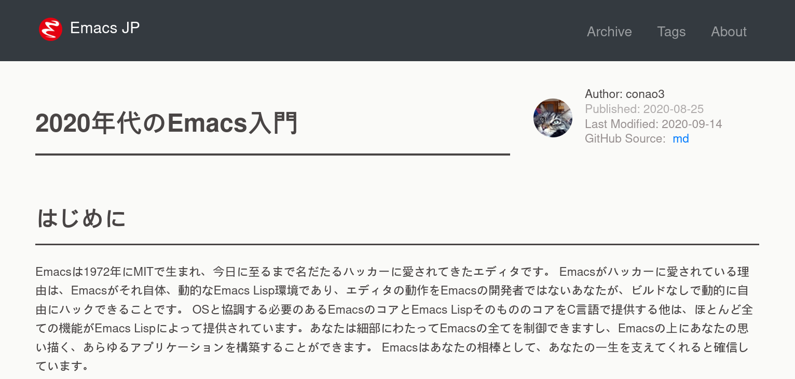

*** Emacsに一生入門できねえ2020[fn:0bb7dc-4]
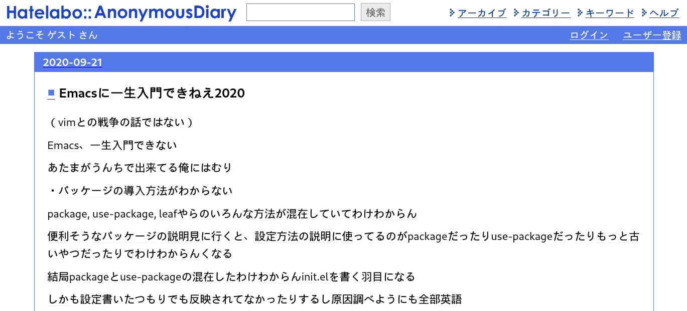

*** 風になりたい奴だけがEmacsを使えばいい2020[fn:0bb7dc-5]


*** 最近のEmacsJP
- 事実として、他コミュニティのような流量はない
  - vim-jp, Ruby-jp, Rust-jp,
  - プログラミング言語処理系が好きな人の集まり,,,
- しかし、数多くの心強いつよつよハッカー達が集まっている
  - ぜひ気軽に質問をしてください!
  - 「Emacs-jp」で検索!
- Windows周辺の情報のまとめ、現在進行中!

** それはそれとして
*** Zenn
#+attr_html: :style margin-top:8rem;


https://zenn.dev/

*** Zenn
- 概要
  - Qiita的な技術情報ブログサイト
  - Note的な投げ銭システム
  - とても簡単な「本」の出版 (公開)
  - ローカルプレビューのためのcliの提供
  - GitHub連携
- システム
  - 個人開発 (CatNoseさん)
    - Zenn needs help[fn:0bb7dc-6]
  - Next.js, Rails, GCP, Vercel

** org-mode
*** org-mode
- markdown的なstructuredプレーンテキスト
- Emacsでプレーンテキストを扱うならこれ
- org-tangle, org-export, org-publish, org-agenda, org-clock, org-capture, org-table等々の便利機能
  - Emacs界のキラーパッケージ
  - (しかしでかすぎて全容を把握できない)
- @@html:<div style="margin-top:2rem;"></div>@@org-export周辺だけでも、とても便利!
- 卒論をorgで書いた
  - org -> LaTeX -> pdf
- ブログ(conao3.com)もorg (ox-hugo)

*** [markdown] / org-mode
- 思想は同じ
  - structuredかつ簡単なスタイルを付けたプレーンテキスト
- markdownの進化
  - 本来のmarkdownの仕様は小さく、(需要に対して)不十分だった
    - 言語名付きのソースブロックはGFM拡張
  - 最初の実装はperlスクリプト
  - 「俺のmarkdown」(方言)の大量発生
  - 基本的にCommonMarkに収束
  - 空行やインデントの扱いなど、多くの実装依存な部分

*** markdown / [org-mode]
- org-modeの進化
  - Elispでの実装がずっとメンテナンスされている
    - 方言はない
  - Emacsで使うことを前提に、ノートテイキング、タスク管理などの機能
  - 文芸的プログラミングのさきがけ
    - jupyter notebookで有名に
  - 任意のフォーマットへの変換機能!
    - text, md, rst, LaTeX, beamer, html, odt(word)
    - このスライドもorg形式 -> reveal.js向けのhtml

*** org文書のイメージ[fn:0bb7dc-8]
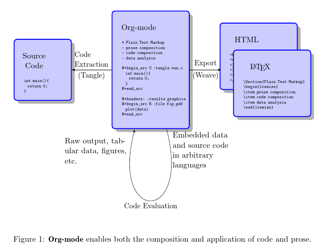

*** 文芸的プログラミング
#+attr_html: :width 200px :style float:left;margin-bottom:20rem


#+attr_html: :style display:block;margin-left:14rem;
- Donald Ervin Knuth (1938-) 提唱
- (狭義)ドキュメントとコードを同じファイルに書く
- 狭義では単に埋め込みドキュメントも該当してしまう
  - コード断片の評価及び返り値参照
  - コード断片のマクロ展開
    - 記述順に依存しない

*** orgの文芸的プログラミング
#+html_attr: :style font-fize:0.8rem
org-tangle: org文書からプログラムを出力

#+attr_html: :width 80%
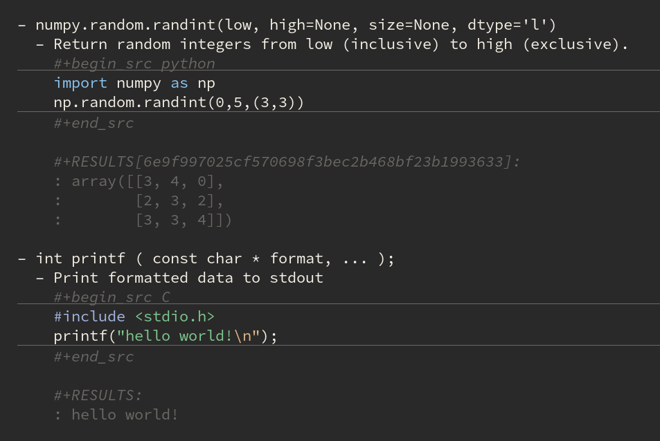

**** COMMENTサンプル

- numpy.random.randint(low, high=None, size=None, dtype='l')
  - Return random integers from low (inclusive) to high (exclusive).
    #+begin_src python
    import numpy as np
    np.random.randint(0,5,(3,3))
    #+end_src

    #+RESULTS[6e9f997025cf570698f3bec2b468bf23b1993633]:
    : array([[3, 4, 0],
    :        [2, 3, 2],
    :        [3, 3, 4]])

- int printf ( const char * format, ... );
  - Print formatted data to stdout
    #+begin_src C
    #include <stdio.h>
    printf("hello world!\n");
    #+end_src

    #+RESULTS:
    : hello world!

#+begin_src elisp
(-take 5 (leaf-available-keywords))
#+end_src

#+RESULTS:
| :disabled | :leaf-protect | :load-path | :load-path* | :leaf-autoload |

*** ox-zenn
- orgからzenn形式のmarkdownへ変換
- 今日! MELPAにマージ (23パッケージ目)
- ox-zennの開発期間は2日 (開発1日、修正1日)
- なぜそんなに早く開発できたのか
  - 中間表現はすでに提供されている
  - 多くの関連パッケージの存在
- 使い方はzennで公開[fn:0bb7dc-7]
- 作り方も公開予定

*** ox-zenn
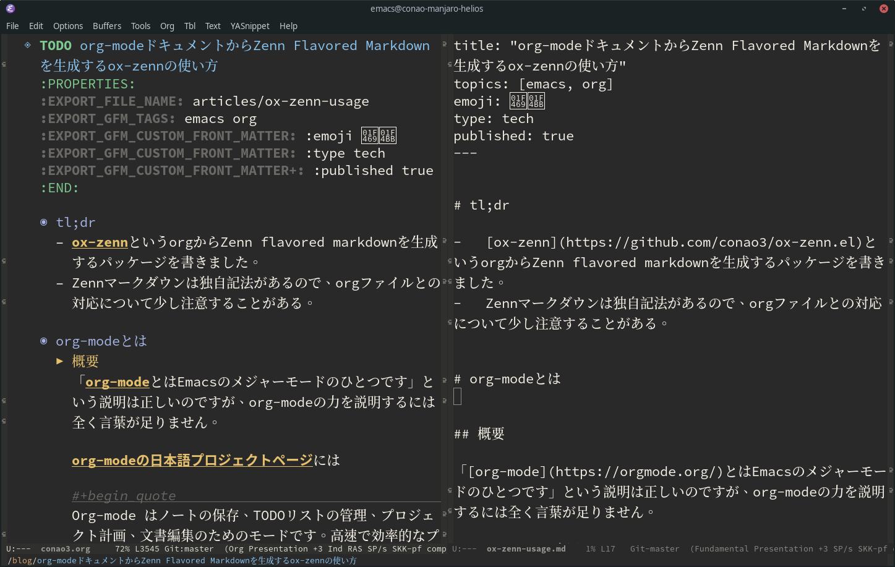

** まとめ
*** まとめ
- org-modeの紹介
  - org-tangle, org-export, org-publish
- zennの紹介とox-zennを作った話

#+REVEAL_HTML: <div style="height:1em"></div>
#+attr_html: :style font-size:1.8rem
今回、時間の (そして私の知識の) 関係で、@@html:<br>@@
orgの他の大部分の機能 (特にタスク管理)@@html:<br>@@
については紹介できませんでした。

#+attr_html: :style font-size:1.8rem
しかし、orgのドキュメント変換機能は単体でもとても便利です。

#+attr_html: :style font-size:1.8rem
私はorg-modeを使いたくてEmacsに入門しました。@@html:<br>@@
ぜひ皆さんもorg-modeを使ってみて、そのパワフルさを感じてください!

#+attr_html: :style font-size:1.8rem
Emacsに入門する際にはEmacsJPで支えますので、@@html:<br>@@
ぜひSlackに入ってみてください!@@html:<br>@@
https://emacs-jp.slack.com

*** 脚注
#+attr_html: :style font-size:1.5rem
1. 2020年代のEmacs入門 - https://emacs-jp.github.io/tips/emacs-in-2020.html
2. Emacsに一生入門できねえ2020 - https://anond.hatelabo.jp/20200921040234
3. 風になりたい奴だけがEmacsを使えばいい2020 - https://blog.tomoya.dev/posts/only-those-who-want-to-be-the-wind-should-use-emacs-2020/
4. Zenn needs help - https://catnose99.com/zenn-needs-help/
5. Eric Schulte, Dan Davison, Thomas Dye, et.al., "A Multi-Language Computing Environment for Literate Programming and Reproducible Research" https://www.jstatsoft.org/article/view/v046i03
6. ox-zennの使い方 - https://s.conao3.com/blog/2020/6dae6b

[fn:0bb7dc-3] 2020年代のEmacs入門 - https://emacs-jp.github.io/tips/emacs-in-2020.html
[fn:0bb7dc-4] Emacsに一生入門できねえ2020 - https://anond.hatelabo.jp/20200921040234
[fn:0bb7dc-5] 風になりたい奴だけがEmacsを使えばいい2020 - https://blog.tomoya.dev/posts/only-those-who-want-to-be-the-wind-should-use-emacs-2020/
[fn:0bb7dc-6] Zenn needs help - https://catnose99.com/zenn-needs-help/
[fn:0bb7dc-7] ox-zennの使い方 - https://s.conao3.com/blog/2020/6dae6b
[fn:0bb7dc-8] Eric Schulte, Dan Davison, Thomas Dye, et.al., "A Multi-Language Computing Environment for Literate Programming and Reproducible Research" https://www.jstatsoft.org/article/view/v046i03

* COMMENT Arch printer
:properties:
:export_file_name: generated/contents/blog/2020/c2b49e
:export_date: 2020-01-01
:export_updated: 2020-01-01
:end:

http://cocu.hatenablog.com/entry/2016/07/19/225308

* COMMENT Emacs-26.3新機能add-variable-watcherを使ってみる
:properties:
:export_file_name: generated/contents/blog/2020/e6f3b1
:export_date: 2020-01-01
:export_updated: 2020-01-01
:end:

chuntaro  16:58
#+begin_src emacs-lisp
  26.1 から add-variable-watcher なんてのが追加されてたんだな。
  (defvar my-var 1)
  my-var
  (add-variable-watcher 'my-var (lambda (symbol newval operation where)
                                  (print (list symbol newval operation where))))
  nil
  (setq my-var 2)
  (my-var 2 set nil) ; ← こんな事が分かる
  2
  (let ((my-var 3))
    (print my-var))
  (my-var 3 let nil) ; let でも反応する
  3
  (my-var 2 unlet nil) ; 元に戻す事は unlet って言うのか
  3
#+end_src
https://www.gnu.org/software/emacs/manual/html_node/elisp/Watching-Variables.html

chuntaro  17:00
add-variable-watcherを使うと、setqだけで処理を進められる邪悪なコーディングが出来てしまうから、あくまでもデバッグ目的で使うのが良いのかもね。
ただ、ビューアー的なものを作る場合は特定の変数の変化に対応出来るから便利かもしれない。

* COMMENT serch-forwardについて
:properties:
:export_file_name: generated/contents/blog/2020/d415bc
:export_date: 2020-01-01
:export_updated: 2020-01-01
:end:


roswell  22:23
"pointがある行で、引数で指定した文字列の先頭にpointを移動"
というような処理が必要なので、以下のような関数で動作確認はできたのですが ...
pointがある行を読み取るのは、 (thing-at-point 'line) でもできますが、もっと適切な関数等ありますでしょうか？
文字列検索search-forward , word-search-forwardは、文字列の最後にpoint移動するので、string-matchを使いましたが、指定文字列の先頭にpoint移動するような関数ありますでしょうか？
1.,2. 組み合わせれば、もっと簡潔な記述できるような気がしていますが、もっと簡潔な記述ありますでしょうか？
(defun my-move-point-to-begining-of-string-in-line (string)
  (interactive "sSearch String: ")
  (let ((pos (string-match string (thing-at-point 'line)))) ; pointがある行の、引数で指定した文字列の先頭にpointを移動
    (if pos
	(move-to-column pos))))

zk-phi  11:15
2. について、 `search-forward` した後は `match-beginning` で開始位置がとれるので、そこに `goto-char` してしまう手はありそうです。すると1. の「pointのある行を文字列として切り出す」必要がなくなるぶん、気持ち簡潔になりますかね…？
(and (search-forward string (point-at-eol) nil t)
     (goto-char (match-beginning 0))
でもこれくらいしか思いつかないです （編集済み）

* COMMENT push, setcdrについて
:properties:
:export_file_name: generated/contents/blog/2020/cbcd64
:export_date: 2020-01-01
:export_updated: 2020-01-01
:end:

roswell  14:36
list  の指定した位置のセルとセルの間に、セルを追加する場合、
例えば、下記の (0 1 2 3) の1と2の間に、 'aを追加する場合、
(setq xlist '(0 1 2 3))
=> (0 1 2 3)
(setcdr (nthcdr 1 xlist) (cons 'a (nthcdr 2 xlist)))
=>(a 2 3)
xlist
=>(0 1 a 2 3)
の様に記述しているのですが、
もっと簡単な記述とかあればご教示いただけますでしょうか？
指定した位置に追加できる様な、関数など有りますでしょうか？ （編集済み）

smzht  16:34
他にも方法はあると思いますが、こんなのとか。
(setq xlist '(0 1 2 3))

(defmacro add-to-list-2 (list element)
  `(setf ,list (cons ,element ,list)))

(add-to-list-2 (nthcdr 2 xlist) 'a)

smzht  16:52
これでできるようです。
(push 'a (nthcdr 2 xlist))
（編集済み）

roswell  17:32
@smzhtさんご教示ありがとうございます。
defmacroの例よりpushの方が簡単に記述できるので
気に入りました。
infoだと
 (setq l '(a b))
               ⇒ (a b)
          (push 'c l)
               ⇒ (c a b)
          l
               ⇒ (c a b)
リストの先頭に追加する例だったので、
途中に追加した際に、その前の部分と接続がされるのか
想像にも及びませんでした。 （編集済み）

kosh  18:55
http://www.ic.unicamp.br/~meidanis/courses/mc336/2006s2/funcional/L-99_Ninety-Nine_Lisp_Problems.html
L-99の21問目が参考になるかも（ちょっとしたリスト遊びや再帰の勉強にもなる
lisp
(insert-at 'alfa '(a b c d) 2) ;=> (A ALFA B C D)

kaki  22:38
push is a Lisp macro in `subr.el'.

(push NEWELT PLACE)

Add NEWELT to the list stored in the generalized variable PLACE.
This is morally equivalent to (setf PLACE (cons NEWELT PLACE)),
except that PLACE is only evaluated once (after NEWELT).
とのことなので、setfが使える対象にはpushも使えるみたいですね。これでちゃんとリストが繋がるのは、あとはコンスセルの構造を考えれば分かります。

* COMMENT EmacsでHTMLをいい感じにバッファに表示する方法
:properties:
:export_file_name: generated/contents/blog/2020/cc96da
:export_date: 2020-01-01
:export_updated: 2020-01-01
:end:

shr-render-buffer/shr-render-region

* COMMENT AtCoderのjsonAPIについて
:properties:
:export_file_name: generated/contents/blog/2020/80ae56
:export_date: 2020-01-01
:export_updated: 2020-01-01
:end:

https://atcoder.jp/contests/abc086/standings/jsonにアクセスするとAC状況が見れる。
情報源はこのブログ http://tatsumack.hatenablog.com/entry/2018/12/09/113908。* man

* COMMENT Test
:properties:
:export_file_name: generated/contents/blog/2020/0665b5
:export_date: 2020-01-01
:export_updated: 2020-01-01
:end:

test test test

test test test

平方根の高さを揃える $\sqrt{g}$ に \$\sqrt{h}$ は \mathstrutと \smashコマンドを使って $\ssqrt{g}$ と $\ssqrt{h}$ のように表示できる。

test

$$a$$

$$\RR$$

$$\div a$$

$$\sin(\frac{a}{b})$$

$$a \between b$$

* COMMENT 競技プログラミングのためのC++リファレンス
:properties:
:export_file_name: generated/contents/blog/2020/5afd3d
:export_date: 2020-01-01
:export_updated: 2020-01-01
:end:

cppは得意ではありませんが、競技プログラミングにおいては最強です。
特にClangの最適化の恩恵を得られることは大きいです。
コンテスト中にあちこちを見て回るのは時間の無駄なので、過去問演習中に必要だった情報をまとめておきます。

* COMMENT スクリーンショットコマンドscrot(1)のオプションと使い方
:properties:
:export_file_name: generated/contents/blog/2020/5c7232
:export_date: 2020-01-01
:export_updated: 2020-01-01
:end:

| Short | Long | Description |
|-------+------+-------------|
|       |      |             |

* Emacs入門から始めるleaf.el入門
:properties:
:export_file_name: generated/contents/blog/2020/d22aed
:export_date: 2020-04-16
:export_updated: 2020-04-16
:export_tags: emacs tutorial package-management leaf-el leaf-convert-el leaf-tree-el
:end:

** 背景
[[https://github.com/conao3/leaf.el][leaf.el]]の日本語情報は比較的充実していると思いますが、やはり多少の背後情報が必要です。Emacsの設定はどのファイルで行なうのか、マクロとは、バイトコンパイルとは、、、
leafが設定の簡略化をしてくれるとはいえ、基本的なEmacsのしくみについて知っておく必要があります。

この記事では初期状態のEmacsからleaf.elの導入と利用までを解説します。この記事を読んだ後なら、下記のleafの記事をスムーズに読むことができ、Emacsの動作をあなたの好きなようにカスタマイズできるようになると思います。

- 公式ドキュメント: [[https://github.com/conao3/leaf.el][conao3/leaf.el]]
- プレリリース記事: [[https://s.conao3.com/blog/2018/8aa938][use-packageからの移行のすゝめ - leaf.elでバージョン安全なinit.elを書く]]
- リリース記事: [[https://s.conao3.com/blog/2019/2b6cbf][[正式リリース]leaf.elで雑然としたEmacs設定ファイル「init.el」をクリーンにする]]
- 2019年アップデート記事: [[https://s.conao3.com/blog/2019/3279ec][[2019年アップデート] leaf.elで雑然としたEmacs設定ファイル「init.el」をクリーンにする]]

また、leafも一定の知名度を得てきたようで、レポジトリは[[https://github.com/conao3/leaf.el][記念すべき100スター]]を達成し、[[https://melpa.org/#/?q=conao3&sort=downloads&asc=false][MELPAでは3万ダウンロード]]を達成しました!

気に入ってもらえればレポジトリのスターとleafのダウンロードをしていただければ泣いて喜びます!

[[github:conao3/leaf.el::Emacs Lisp][Flexible, declarative, and modern init.el package configuration]]

** Emacsのインストール
まずEmacs-26.3をどうにかしてインストールします。もしEmacs-22とかいう化石を使っている場合はすぐEmacs-26.3に移行してください。(自戒)

leaf.elは24.4から動きますが、とても便利な[[https://github.com/conao3/leaf-convert.el][leaf-convert.el]]はEmacs-26.1を要求します。

Emacs-26.1とEmacs-26.2はELPAからのダウンロードに問題があります。結局Emacs-26.3を使うしか選択肢がありません。

各OSでのインストール方法は他の記事に譲り、下のような出力が得られたら次に進みます。

#+begin_src shell
$ emacs --version
GNU Emacs 26.3
Copyright (C) 2019 Free Software Foundation, Inc.
GNU Emacs comes with ABSOLUTELY NO WARRANTY.
You may redistribute copies of GNU Emacs
under the terms of the GNU General Public License.
For more information about these matters, see the file named COPYING.
#+end_src

もし =M-x leaf-available-keywords= と記事に書かれていたときにどういう意味か分からない場合は、ここでEmacsに慣れておいた方が良いかもしれません。少し鬼軍曹[fn:1]な気はありますが、「[[https://qiita.com/namn1125/items/5cd6a9cbbf17fb85c740][Emacs教習所に行ってきた(チートシート付き) - Qiita]]」が参考になるかもしれません。

** Emacs設定ファイル
*** init.elの作成
Emacsの設定ファイルは =~/.emacs.d/init.el= です。既にディレクトリがある場合は =~/.emacs.d/= を =~/.emacs.d.old= などにリネームした上で新しくディレクトリを作成してください。 =~/.emacs.d/init.el= にファイルを作成し、その先頭にleafの[[https://github.com/conao3/leaf.el#install][インストールコード]]を貼り付けます[fn:2]。

なお、現在では =leaf= のimenuインテグレーションのおかげでファイル分割しないinit.el管理がトレンドです。

#+begin_src emacs-lisp
;;; init.el --- My init.el  -*- lexical-binding: t; -*-

;; Copyright (C) 2020  Naoya Yamashita

;; Author: Naoya Yamashita <conao3@gmail.com>

;; This program is free software: you can redistribute it and/or modify
;; it under the terms of the GNU General Public License as published by
;; the Free Software Foundation, either version 3 of the License, or
;; (at your option) any later version.

;; This program is distributed in the hope that it will be useful,
;; but WITHOUT ANY WARRANTY; without even the implied warranty of
;; MERCHANTABILITY or FITNESS FOR A PARTICULAR PURPOSE.  See the
;; GNU General Public License for more details.

;; You should have received a copy of the GNU General Public License
;; along with this program.  If not, see <http://www.gnu.org/licenses/>.

;;; Commentary:

;; My init.el.

;;; Code:

;; this enables this running method
;;   emacs -q -l ~/.debug.emacs.d/{{pkg}}/init.el
(eval-and-compile
  (when (or load-file-name byte-compile-current-file)
    (setq user-emacs-directory
          (expand-file-name
           (file-name-directory (or load-file-name byte-compile-current-file))))))

(eval-and-compile
  (customize-set-variable
   'package-archives '(("org"   . "https://orgmode.org/elpa/")
                       ("melpa" . "https://melpa.org/packages/")
                       ("gnu"   . "https://elpa.gnu.org/packages/")))
  (package-initialize)
  (unless (package-installed-p 'leaf)
    (package-refresh-contents)
    (package-install 'leaf))

  (leaf leaf-keywords
    :ensure t
    :init
    ;; optional packages if you want to use :hydra, :el-get, :blackout,,,
    (leaf hydra :ensure t)
    (leaf el-get :ensure t)
    (leaf blackout :ensure t)

    :config
    ;; initialize leaf-keywords.el
    (leaf-keywords-init)))

;; ここにいっぱい設定を書く

(provide 'init)

;; Local Variables:
;; indent-tabs-mode: nil
;; End:

;;; init.el ends here
#+end_src

*** init.elのバイトコンパイル
init.elのバイトコンパイルは以下のように行ないます。バイトコンパイルによる実行速度への寄与は少ないですが、コンパイラのワーニング(未定義変数の参照、未定義関数の評価など)を受け取るためにもバイトコンパイルをした方が良いです。ただ、バイトコンパイルした =.elc= とバイトコンパイル前の =.el= は =.elc= の方が優先度が高いので、init.elを編集した後は必ずバイトコンパイルを忘れないようにしましょう。

初回にはleafやhydraのインストールが入るのでログが大量に流れます。

コンパイラのワーニングが見づらいようでしたら、もう一度実行することをお勧めします。出力がなければ正常終了であり、ワーニングなしでバイトコンパイルできたことを示します。

#+begin_src shell
$ cd .emacs.d
$ emacs --batch -f batch-byte-compile init.el
Importing package-keyring.gpg...
Importing package-keyring.gpg...done
Contacting host: orgmode.org:443
Contacting host: orgmode.org:443
Contacting host: melpa.org:443
Contacting host: elpa.gnu.org:443
Package refresh done
Setting ‘package-selected-packages’ temporarily since "emacs -q" would overwrite customizations
Setting ‘package-selected-packages’ temporarily since "emacs -q" would overwrite customizations
Contacting host: melpa.org:443
Generating autoloads for leaf.el...
Generating autoloads for leaf.el...done
Wrote /home/conao/.emacs.d/elpa/leaf-20200415.417/leaf-autoloads.el
...
Wrote /home/conao/.emacs.d/elpa/blackout-20200404.1550/blackout-autoloads.el
Checking /home/conao/.emacs.d/elpa/blackout-20200404.1550...
Compiling /home/conao/.emacs.d/elpa/blackout-20200404.1550/blackout-autoloads.el...
Compiling /home/conao/.emacs.d/elpa/blackout-20200404.1550/blackout-pkg.el...
Compiling /home/conao/.emacs.d/elpa/blackout-20200404.1550/blackout.el...
Done (Total of 1 file compiled, 2 skipped)

$ emacs --batch -f batch-byte-compile init.el
#+end_src

*** Emacsの起動
コマンドラインからEmacsを起動します。

#+begin_src shell
emacs
#+end_src

=M-x leaf-available-keywords= を実行して、 =leaf= の使えるキーワードを表示できるはずです。

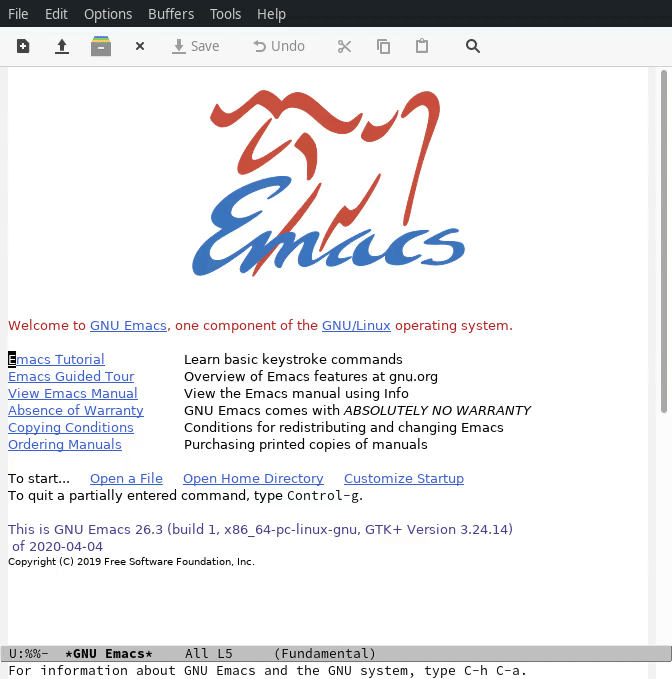

** 便利パッケージのインストール
leaf.elを使うにあたって、相性の良いパッケージがいくつかあります。早速leafを使ってインストールしてみましょう。

- [[https://github.com/conao3/leaf-keywords.el][leaf-keywords]] (インストール済)
  - [[https://github.com/dimitri/el-get][el-get]] (インストール済)
  - [[https://github.com/raxod502/blackout][blackout]] (インストール済)
- [[https://github.com/conao3/leaf-convert.el][leaf-convert]]
- [[https://github.com/conao3/leaf-tree.el][leaf-tree]]
- [[https://github.com/joddie/macrostep][macrostep]]

先程の =;; ここにいっぱい設定を書く= の場所に以下の設定を書きます。

#+begin_src emacs-lisp
(leaf leaf
  :config
  (leaf leaf-convert :ensure t)
  (leaf leaf-tree
    :ensure t
    :custom ((imenu-list-size . 30)
             (imenu-list-position . 'left))))

(leaf macrostep
  :ensure t
  :bind (("C-c e" . macrostep-expand)))
#+end_src

迷子防止のために今回だけinit.elの全文を貼ります。一緒のコードになりましたでしょうか？

#+begin_src emacs-lisp
;;; init.el --- My init.el  -*- lexical-binding: t; -*-

;; Copyright (C) 2020  Naoya Yamashita

;; Author: Naoya Yamashita <conao3@gmail.com>

;; This program is free software: you can redistribute it and/or modify
;; it under the terms of the GNU General Public License as published by
;; the Free Software Foundation, either version 3 of the License, or
;; (at your option) any later version.

;; This program is distributed in the hope that it will be useful,
;; but WITHOUT ANY WARRANTY; without even the implied warranty of
;; MERCHANTABILITY or FITNESS FOR A PARTICULAR PURPOSE.  See the
;; GNU General Public License for more details.

;; You should have received a copy of the GNU General Public License
;; along with this program.  If not, see <http://www.gnu.org/licenses/>.

;;; Commentary:

;; My init.el.

;;; Code:

;; this enables this running method
;;   emacs -q -l ~/.debug.emacs.d/{{pkg}}/init.el
(eval-and-compile
  (when (or load-file-name byte-compile-current-file)
    (setq user-emacs-directory
          (expand-file-name
           (file-name-directory (or load-file-name byte-compile-current-file))))))

(eval-and-compile
  (customize-set-variable
   'package-archives '(("org"   . "https://orgmode.org/elpa/")
                       ("melpa" . "https://melpa.org/packages/")
                       ("gnu"   . "https://elpa.gnu.org/packages/")))
  (package-initialize)
  (unless (package-installed-p 'leaf)
    (package-refresh-contents)
    (package-install 'leaf))

  (leaf leaf-keywords
    :ensure t
    :init
    ;; optional packages if you want to use :hydra, :el-get, :blackout,,,
    (leaf hydra :ensure t)
    (leaf el-get :ensure t)
    (leaf blackout :ensure t)

    :config
    ;; initialize leaf-keywords.el
    (leaf-keywords-init)))

;; ここにいっぱい設定を書く

(leaf leaf
  :config
  (leaf leaf-convert :ensure t)
  (leaf leaf-tree
    :ensure t
    :custom ((imenu-list-size . 30)
             (imenu-list-position . 'left))))

(leaf macrostep
  :ensure t
  :bind (("C-c e" . macrostep-expand)))


(provide 'init)

;; Local Variables:
;; indent-tabs-mode: nil
;; End:

;;; init.el ends here
#+end_src

編集後にはバイトコンパイルを忘れないでください。バイトコンパイルが終わったらEmacsを再起動します。

*** leaf-convert
leaf-convertはプレーンなElispやuse-packageからleafへの変換機能を提供します。目玉機能は2つです。

- =M-x leaf-convert-replace-pop=, =M-x leaf-convert-replace-region=

  選択したS式をleafブロックに変換し、 =M-x leaf-convert-replace-pop= は別バッファーに表示します。 =M-x leaf-convert-replace-region= は変換したleafブロックで置換します。

  leafの第1引数は =prog1= の第1引数に渡すことで指定できます。gifではひとつのS式しか選択していませんが、複数S式を同時に選択して変換することも可能です。

  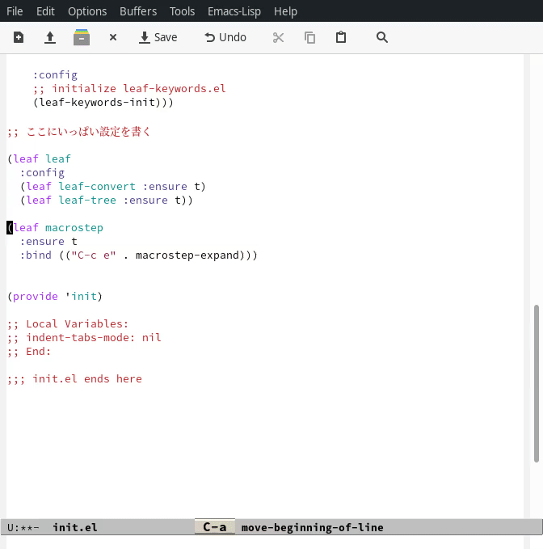

- =M-x leaf-convert-insert-template=

  =package.el= が持っている情報からよさげなleafブロックを生成し、挿入します。ただ、自動生成された =:after= キーワードと引数については削除した方が事故が少ないかもしれません。

  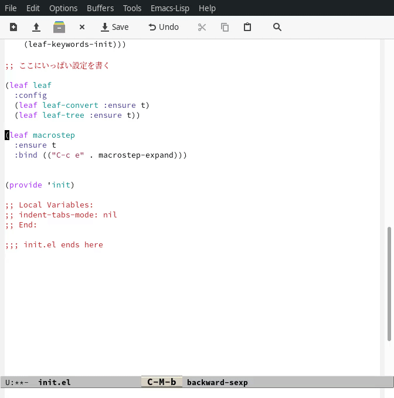

*** leaf-tree
leaf.elで書かれたinit.elを開き、 =M-x leaf-tree-mode= を実行することでクリックできるサイドバーを表示します。サイドバーはリアルタイムに更新され、現在のポインターがあるアイテムがハイライトされます。

サイドバーのアイテムをクリックすると、そのleafブロックにジャンプします。

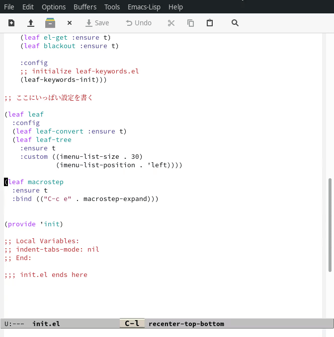

*** macrostep
leafに限らず、マクロを1ステップごとに展開することができます。

標準キーバインディングでは、展開したいS式で =C-c e= すると =macro-step-mode= という特殊なモードになります。バッファは読み取り専用となり、 =n= と =p= でさらに展開するS式を選び、 =e= を押すと展開されます。 =c= を押すと展開を元に巻き戻すことができます。 =C-g= で =macro-step-mode= から抜けることができます。

この =macrostep= による確認はleafで何かうまくいかないときに最初に取る行動です。leafに何を入力したら、どんなS式が生成されるかを意識するのは重要です。

leafは単なるマクロであり、雑多で典型的なS式を自動生成するためのパッケージにすぎないからです。

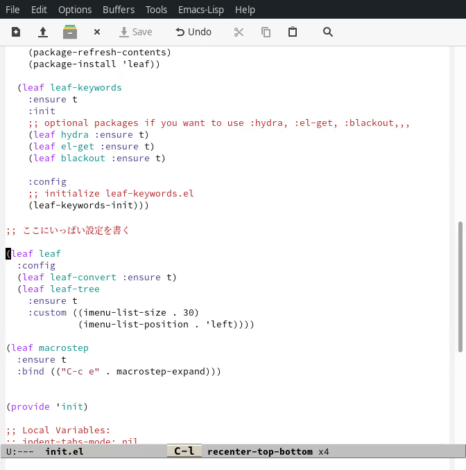

** 実践的なあれこれ
*** 変数の変更について
パッケージで公開されている変数の変更には、全ての場合について =setq= ではなく =custom-set-variables= で設定するべきです。ネットを検索すると以下の記事があり、公開順から「結局、setqを使う方が良い選択だ」となってしまっています。

- [[https://memo.sugyan.com/entry/20120104/1325604433][defcustomで定義された変数はcustom-set-variablesで変更すべき？ - 2012-01-04]]
- [[http://kawamuray.hatenablog.com/entry/2013/11/03/180543][defcustomで定義された変数はsetqではなくcustom-set-variablesで設定すべき理由 - 2013-11-03]]
- [[https://abicky.net/2013/12/30/184239/][custom-set-variablesは使わない方が良いかもしれない - 2013-12-30]]

しかし時代は変わりました。「ユーザーが変更できる変数」はほとんどの場合で =defcustom= で宣言され、 =defvar= で宣言されたものは「パッケージの内部変数である」という慣習を多くのパッケージ開発者が守っています。

=require= 前に値をセットしておくことでパッケージの動作が変更されるのは悪い設計であり、そのような設計を現在あえて採用するパッケージはありません。

また、実際には =custom-set-variables= での変更は最終的に =set= を実行するので =defvar= で宣言された変数も問題なく変更できます。

ということで常に =custom-set-variables= を使うべきであり、leafでは =:setq= ではなく、 =:custom= を使うほうが良いということになります。

問題はcustomがinit.elに次のようなダンプを出力する点です。このダンプにより、leafの =:custom= で管理している場合、2箇所を修正する必要が生じます。

#+begin_src emacs-lisp
(custom-set-variables
 ;; custom-set-variables was added by Custom.
 ;; If you edit it by hand, you could mess it up, so be careful.
 ;; Your init file should contain only one such instance.
 ;; If there is more than one, they won't work right.
 '(ag-highligh-search t t)
 '(ag-reuse-buffers t t)
 '(ag-reuse-window t t)
 ;;...
 )
#+end_src

この動作については =custom-file= という変数を変えれば出力先を変更でき、そのファイルを =load= しないことで単に無視することができます。

そのため、次のような設定を書いておくことはleafの全ユーザーに勧められます。

#+begin_src emacs-lisp
(leaf cus-edit
  :doc "tools for customizing Emacs and Lisp packages"
  :tag "builtin" "faces" "help"
  :custom `((custom-file . ,(locate-user-emacs-file "custom.el"))))
#+end_src

なお、動的な値をleafで設定するには上記のようにバッククオートとカンマを使うことによって実現します。

*** パッケージインストーラについて
基本的に =M-x leaf-convert-insert-template= の出力を参考にします。MELPAかELPAに存在するパッケージは自動的に =:ensure t= が展開されます。 =:ensure= はpackage.elを使用してパッケージをインストールする設定です。

存在しないパッケージの場合は、 =:el-get {user}/{repo}= が展開されるので、 *GitHubにある場合* 、 ={user}= を調べて置換するだけで設定が完了します。例えば、point-undoは =emacsmirror/point-undo= にあるので、 =emacsmirror= を追加するだけで大丈夫です。

しかし、 *GitLabにある場合* 、きちんとリストにしてgitのurlを指定する必要があります。これはleafの使い方ではなく、どちらかというとel-getの使い方です。

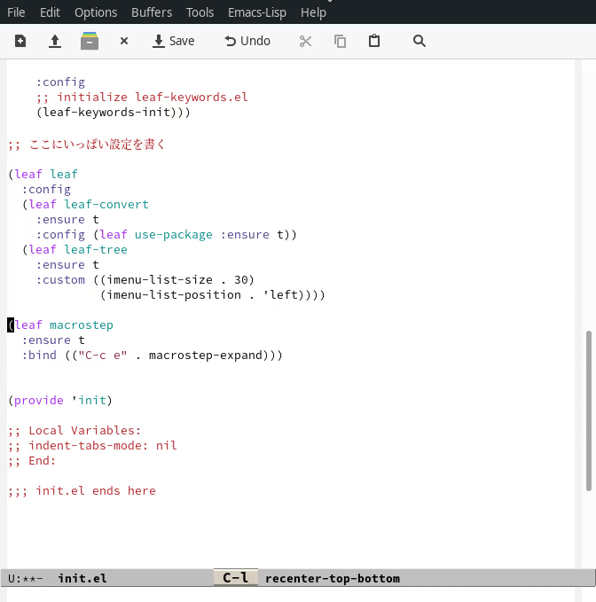

*** とりあえず:config
leafには与えられたS式をそのまま展開するキーワードがあり、 =:preface=, =:init=, =:config= の3種類が用意されています。それぞれ以下の場所に展開されます

- =:preface= は =:if=, =:when=, =:unless= の前
- =:init= は =:if=, =:when=, =:unless= と =:require= の間
- =:config= は =:require= の後

3種類ありますが、基本的には =:config= を使用します。 =:config= のS式はそのまま展開されるので、最初にleafを使う際はとりあえず =:config= に書いておくのは良い方針だと思います。

なお、leaf-convertはleafからleafへの変換も可能なので、変換してみると、よりよいキーワードを使ったleafに変換してくれる可能性もあります。

=:custom= で =nil= を設定する設定の変換結果は、ただのリストになってしまい、手で直す必要がありました。これは難しい問題ですが、将来的に解決したい問題ではあります。

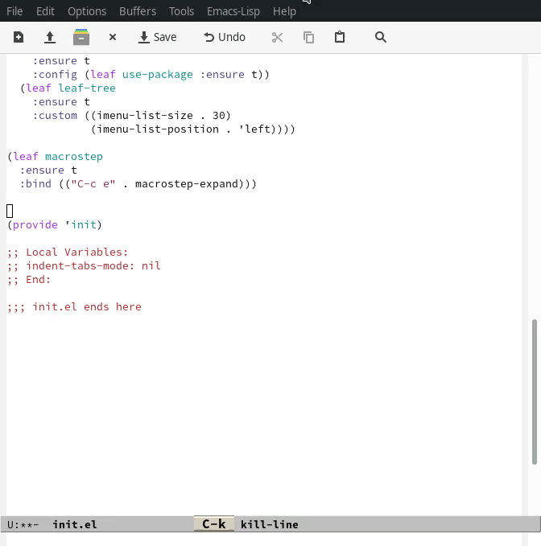

*** leaf-convertについて
leaf-convertを手に入れたおかげで、use-packageの設定例があればleafに変換できるようになりました。例えば[[https://qiita.com/Ladicle/items/feb5f9dce9adf89652cf#%E3%82%B3%E3%83%BC%E3%83%89%E3%81%8C%E8%AA%AD%E3%81%BF%E3%82%84%E3%81%99%E3%81%84%E3%83%86%E3%83%BC%E3%83%9E----doom-emacs-themesdoom-dracula][Emacsモダン化計画 -かわEmacs編- - コードが読みやすいテーマ]]を参考にして、下記のuse-package設定例があるとします。

#+begin_src emacs-lisp
(use-package doom-themes
  :custom
  (doom-themes-enable-italic t)
  (doom-themes-enable-bold t)
  :custom-face
  (doom-modeline-bar ((t (:background "#6272a4"))))
  :config
  (load-theme 'doom-dracula t)
  (doom-themes-neotree-config)
  (doom-themes-org-config))
#+end_src

この場合、コード貼り付け、範囲選択、 =M-x leaf-convert-region-replace= を実行することでleafに変換できます。 =use-package= を一度展開する必要があるので、 =use-package= をインストールする必要があることに注意する必要があります。

ここで注目したいのは、これまでleaf移行で鬼門となっていた =:custom= や =:custom-face= の引数の微妙な違いをleaf-convertに任せることができるようになった点です。

ただ、 =:custom-face= の変換結果の =quote= は見た目を気にすると、手で直す必要があります。これも難しい問題ですが、将来的に解決したいです。

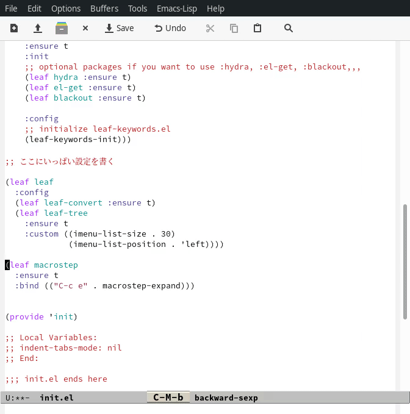

** まとめ
空のinit.elを作るところからleafの入門記事を書きました。leafを使うことによってEmacsのパッケージ設定を簡潔に宣言的に行うことができ、init.elの簡略化を実現できます。

また高速化についてはあまり意識していなかったのですが、実際のところleafに移行したことで高速化したことが複数人から報告があります。

-

  #+begin_quote
  use-package.elからleaf.elに移行したらEmacsの起動時間が半分になった。移行時に多少のリファクタを含むから、単純な移行による改善ではないけれでも。しかし、こんな早くなるか？？？はて

  — よんた (@keita44_f4) [[https://twitter.com/keita44_f4/status/1197064768999153666?ref_src=twsrc%5Etfw][November 20, 2019]]
  #+end_quote

  - [[https://qiita.com/keita44_f4/items/5cb5cfb78edd4244fa8b#%E8%89%AF%E3%81%8B%E3%81%A3%E3%81%9F-2][use-package.elからleaf.elに移行した]]

    #+begin_quote
    - 移行しただけでEmacsの起動時間が半分になった
      - use-package.elでは:defer tで遅延読み込みの指定がいるが、 leaf.elではデフォルトで遅延読み込みなのも効いていそう
      - use-package.elは起動時間の統計をとるなどリッチな機能を持っており、 そもそも遅いのも効いていそう
      - 詳細な原因調査はしていない
      - な に も し て な い の に Emacs が は や く な り ま し た
    #+end_quote

- [[https://www.ncaq.net/2020/03/16/18/57/27/#%E8%B5%B7%E5%8B%95%E3%81%8C%E6%97%A9%E3%81%8F%E3%81%AA%E3%81%A3%E3%81%9F%E6%B0%97%E3%81%8C%E3%81%97%E3%81%BE%E3%81%99][私の.emacs.dをelpaをgit管理下に入れる気の狂った管理方法からleafに移行させました]]

  #+begin_quote
  起動が早くなった気がします
  init-loaderをやめたからなのかわかりませんが,何故か起動が早くなった気がします.
  #+end_quote

参考として私のinit.elを読み込んだ場合、223パッケージ(elpaディレクトリには =archive= と =gnupg= ディレクトリがあるのを忘れていた)インストールされたEmacsを4.2秒で起動できています。HDDの環境なので、測定には悪条件ですが5秒未満なら十分に耐えられます。

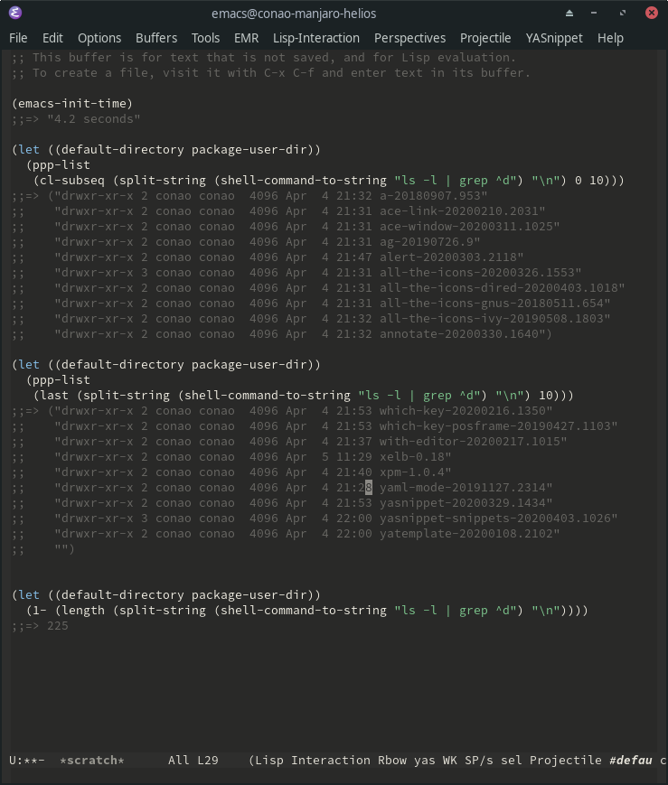

これはleafが =prog1= に展開されて、use-packageのように =require= を標準では展開しないからだと思われます。

use-packageが作られた当時はきちんとautoloadをパッケージ開発者が書いていなかったので =require= に展開することが求められていましたが、現代では善いパッケージ作法が広く知られているので問題はありません。

--------------

最後にpatreonの宣伝をします。

私はleaf.elやleaf-keywords、leaf-tree、leaf-convertといったleaf関連のEmacsパッケージ、他にもseml-modeやpppといったEmacsパッケージを書いています。作成した全てのパッケージと管理を手伝っているパッケージとリンクについては[[https://www.emacswiki.org/emacs/Conao3][Emacswikiのページ]]、アクティビティに関しては[[https://github.com/conao3][GitHubのユーザーページ]]を参照して頂ければと思います。


支援を頂くことで、これまでよりも気軽にオライリーの本をポチることができ、バイトの時間を減らしコーディングの時間を増やすことができます。

また、去年から先週までpatreonになることのメリットが全くなかった;;のですが、さすがに申し訳なくなってしまったので、これまでGitHubの[[https://github.com/conao3/dotfiles][conao3/dotfiles]]で公開していたdotfilesをプライベートに設定し、patreon限定でダウンロードできるようにしました。

ぜひ下記URLからご支援いただければと思います。よろしくお願いします!

[[https://www.patreon.com/conao3]]

** Footnotes
[fn:1] : 実際に[[https://qiita.com/zonkyy/items/c090d0733ec6ccab4724][鬼軍曹.elというパッケージがあり]]、インストールすることで軍曹の指導を受けることができる。

[fn:2] : leafのインストールコードには書いてませんが、別途 =user-emacs-directory= の設定を加えました。理由はコメントのような起動方法ができるからです。参考ブログ: [[http://peccu.hatenablog.com/entry/20130218/trial_init][Emacsでお試しinit.elの指針 - peccu.hatenablog]]

* Netlify + Hugo + ox-hugoでブログを始める第一歩
:properties:
:export_file_name: generated/contents/blog/2020/0a23fb
:export_date: 2020-05-05
:export_updated: 2020-05-05
:export_tags: hugo ox-hugo org-mode emacs blog static-site
:end:

** Intro
HTMLジェネレータの[[https://github.com/conao3/seml-mode.el][seml-mode.el]]とOrg->HTMLジェネレータ拡張の[[https://github.com/conao3/orglyth.el][orglyth.el]]を作っていて、自分のブログくらいはそれらを使って構築しようと思っていました。

しかし結局落ち着かないまま1年が経過し、[[https://github.com/conao3/leaf.el][leaf.el]]のドキュメントや、専門分野のまとめなどネットで公開したいものだけ溜まっていました。

[[https://conao3.com][conao3.com]]のドメインも2017年から持っていますが、3年もの間まともなコンテンツは提供されませんでした。

ここらへんで諦めてさっさとHugoとNetlifyで公開してしまえということで、きちんと整備されたツールを使わせてもらい、この度ようやく[[https://conao3.com][conao3.com]]でまともなコンテンツを提供できるようになりました。

** Netlify
よい情報で溢れているので省略します。

NetlifyはDNSも提供しているようなので、「さくらのドメイン」で取得したconao3.comをNetlify DNSで解決させるようにしました。

また、デフォルトでは古いHugoが動いているようなので、「Build & Deploy」->「Environment」->「Environment variables」で「HUGO_VERSION」をローカルのバージョンで設定します。
私の場合「0.69.2」でした。

** Hugo
*** Hugoのインストール
[[https://gohugo.io/getting-started/installing/][Install Hugo]]を参考にHugoをインストールします。

記載がありませんが、Archの場合はpacmanで簡単に入ります。([[https://www.archlinux.jp/packages/community/x86_64/hugo/][Archlinux - Package]])

#+begin_src shell
  # pacman -S hugo
  $ hugo version
  Hugo Static Site Generator v0.69.2/extended linux/amd64 BuildDate: unknown
#+end_src

*** ブログテンプレートの展開
[[https://gohugo.io/getting-started/quick-start/][Quick Start]]を参考にテンプレートを展開します。

私はローカルのレポジトリ置き場は =~/dev/repos= にしています。

#+begin_src shell
  $ cd ~/dev/repos
  $ hugo new site netlify-src
#+end_src

以下、 =netlify-src= はhugoサイトのルートディレクトリということにします。

*** ブログテーマの適用
[[https://themes.gohugo.io/][Hugo themes]]からいい感じのテーマを探し、submoduleでレポジトリに持ちます。

テーマはローカルで簡単にカスタマイズできる仕組みがあるので、多少気に入らないところがあっても大丈夫です。

#+begin_src shell
  $ cd quickstart
  $ git init
  $ git submodule add https://github.com/lxndrblz/anatole.git themes/anatole
#+end_src

テーマごとにカスタマイズする方法が違うので、テーマのREADMEを読んで設定をして下さい。

なお、私は当時ローカルで簡単にカスタマイズできる機構を知らず、forkでカスタマイズするしかないと思っていたので、「[[https://zwbetz.com/make-a-hugo-blog-from-scratch/][Make a Hugo blog from scratch]]」を参考に0からテーマを作りました。

私が作ったテーマは[[https://github.com/conao3/anatole-ext][conao3/anatole-ext]]で公開しています。

*** サンプル記事の追加
サンプルの記事を追加します。

テーマが =exampleSite= というフォルダを持っている場合は、それらのファイルを =netlify-src/= にコピーするだけでいいです。

コマンドでテンプレートを作成するには次のコマンドを実行します。
実行後、 =content/blog/my-first-post.md= が作成されているので、よしなに編集します。

#+begin_src shell
  $ hugo new blog/my-first-post.md
#+end_src

*** ローカルサーバーの起動
Hugoは簡単にローカルサーバーを起動でき、さらに依存ファイルが変更されたときに自動でブラウザにリロードさせることができます。

#+begin_src shell
  $ hugo server -D
#+end_src

サーバーを起動すると =localhost:1333= で配信されます。

*** 静的サイトのビルド
サイト全体のビルドは下記で行います。

Netlifyで公開するならローカルでビルドする必要はないのですが、最終的にどんなツリーになっているかを確認することができます。

#+begin_src shell
  $ hugo
#+end_src

** ox-hugo
*** ox-hugoのインストールと設定
[[https://github.com/kaushalmodi/ox-hugo][ox-hugo]]をインストールし、適宜設定を行ないます。

「[[https://pxaka.tokyo/blog/categories/hugo/][hugo | IMADENALE]]」を参考に無難な構成を考えましたが、もっといい方法がある気がします。
とりあえず私は下記の設定と方針でしばらくやってみます。

#+begin_src emacs-lisp
  (leaf ox-hugo
    :doc "Hugo Markdown Back-End for Org Export Engine"
    :req "emacs-24.4" "org-9.0"
    :tag "docs" "markdown" "org" "emacs>=24.4"
    :added "2020-05-05"
    :url "https://ox-hugo.scripter.co"
    :emacs>= 24.4
    :ensure t
    :after ox
    :custom ((org-hugo-front-matter-format . "yaml")))
#+end_src

*** orgファイル管理の方針
ox-hugo用のorgファイルは =netlify-src/org/{{user}}.org= に持つことにしました。

#+begin_src org
  ,#+title: Hugo blog source
  ,#+author: conao3
  ,#+date: <2020-05-05 Tue>
  ,#+options: ^:{}

  ,#+hugo_base_dir: ../
  ,#+hugo_section: blog

  ,#+link: files file+sys:../static/files/

  ,* blog
  :PROPERTIES:
  :EXPORT_HUGO_SECTION: blog
  :END:

  ,** DONE test                                                      :meta:hugo:
  CLOSED: [2020-05-05 Tue 19:21]
  :PROPERTIES:
  :EXPORT_FILE_NAME: test
  :EXPORT_DATE: 2020-05-05T00:00:00+09:00
  :EXPORT_HUGO_LASTMOD: [2020-05-05 Tue 16:20]
  :END:

  testestest.
#+end_src

もし将来的にこのorgファイルが超巨大なファイル(1万行~)になれば、適宜 =netlify-src/org/archive-{{user}}-{{num}}.org= に移すことにします。

レベル1は[[https://gohugo.io/content-management/sections/][セクション]]の分類に使い、レベル2のheadingから記事のツリーと解釈されます。

*** 静的ファイル管理の方針
filesのlinkは「[[https://pxaka.tokyo/blog/2018/a-test-of-images/][画像の埋め込みテスト | imadenale]]」を参考にしました。

スクリーンショットやPDFは =netlify-src/static/files= 以下に持つことにします。

=netlify-src/static= はレポジトリ肥大化を避けて[[https://github.com/conao3/netlify-src][conao3/netlify-src]]から[[https://github.com/conao3/netlify-src-blob][conao3/netlify-src-blob]]に切り出し、submoduleで持つことにします。

参考記事ではfilesのリンクをURLで設定していましたが、「[[https://qiita.com/takaxp/items/96629bbcc4a9403f0213][Org Modeのリンク機能で情報集約 | Qiita]]」を参考に =file+sys:= 指定を使うとorgの画像インライン表示もできますし、きちんとox-hugoによってリンクが修正され、正しいマークダウンが出力されました。

- Input
  #+begin_src org
    ,#+link: files file+sys:../static/files/

    ,#+attr_html: :width 128px
    [[files:logo.jpg]]
  #+end_src

- Output
  #+begin_src markdown
    
  #+end_src

- Rendering
  #+attr_html: :width 128px
  [[./resources/public/img/0a23fb-logo.jpg]]

** Deploy
NetlifyのデプロイはGitHubにpushするだけです!

Hugoのビルドはとても早く、pushしてNetlifyのログを見に行くともう終わっています。

ビルドできたら個人Slackに通知飛ばしたりするのをまた今度やりたいと思っています。

** Conclusion
Netlify + Hugo + ox-hugoで快適なブログ執筆環境を整えることができました!

ようやく情報発信する環境が整ったので、どんどん情報を発信していきたいと思います。

まずは見やすいleaf.elのドキュメントを書きます!

また、執筆現在は[[https://github.com/conao3/netlify-src][conao3/netlify-src]]と[[https://github.com/conao3/netlify-src-blob][conao3/netlify-src-blob]]をパブリックレポジトリとしていますが、後でプライベートレポジトリに変更し、[[https://www.patreon.com/conao3][Patreon]]の特典にします。

本来公開するものを非公開にすることでしか価値を付けられないことをお許しください。

ぜひ[[https://www.patreon.com/conao3][Patreon]]で私の活動のサポートをして頂けるとうれしいです!

* 個人ブログのパーマリンクに関する最適戦略について
:properties:
:export_file_name: generated/contents/blog/2020/0bc44c
:export_date: 2020-05-06
:export_updated: 2020-05-06
:export_tags: blog permalink
:end:

** Intro
Webで情報を公開するにあたって、パーマリンクの設計は将来に渡って重要なものです。

このブログは人生において3つめのブログであり、これまでの2つのブログは勝手にアーカイブしてネットから消してしまいました。

しかしこのブログは今のところ死ぬまで付き合うつもりであり、それが出来るようにコンテンツの少ない今、設計する必要があります。

ブログ管理の裏側については「[[https://s.conao3.com/blog/2020/0a23fb][Netlify + Hugo + ox-hugoでブログを始める第一歩]]」に書きましたが、パーマリンクの設計は表側の設計であり、ブログの人生の中で途中で変えることは許されていません。

もし無理矢理変えれば、これまでシェアしてもらったURLの意味は失くなり、404ページに多くの読者を案内してしまうことになります。

さて、このブログではどのようにパーマリンクを設計すると良いのでしょうか。

** 調査
パーマリンクの設計といっても選択肢は多くありません。

そもそも使える情報が =タイトル= と =公開日時= と =連番= くらいしかないので、代表的なものは以下のような形式か、その組み合わせです。

- ={{base-url}}= / ={{title}}= /
- ={{base-url}}= / ={{short-title}}= /
- ={{base-url}}= / ={{category}}= / ={{short-title}}= /
- ={{base-url}}= / ={{num}}= /
- ={{base-url}}= / ={{year}}= / ={{month}}= / ={{day}}= /

={{title}}= はそのまま記事のタイトルを使う方法です。
日本語のタイトルはそのままURLエンコードされ、URLになるパターンです。

={{short-title}}= はSEOに強い、記事ごとにつけられた短いタイトルを使う方法です。
あえて日本語を使う理由もなく、普通は英数字のみで長くても30文字くらいでまとめます。

={{category}}= は記事ごとに設定されたカテゴリーを使う方法です。

={{num}}= はサイトごとにカウンタを持っておいて、その連番をURLに使用する方法です。

={{year}}=, ={{month}}=, ={{day}}= は記事の公開日です。

** 評価
さて、これらの方法のなかで、どれがよいのでしょうか。

大きく分けると2つの分類ができ、記事ごとに新たに考える方法と自動で生成する方法です。

- 記事ごとに新たに考える方法
  - ={{short-title}}=
    - メリット
      - SEOやURLシェアの観点から最高の選択肢
    - デメリット
      - 記事ごとに短いタイトルを英語でつけなおさなければならない
      - 記事を少ない英単語で表現するのは一般的に難しく、長くなってしまう場合もある
      - 少ない英単語で命名するため、URL衝突を考慮する必要がある
      - もし、Emacsと命名した記事より、もっと適切な記事を書いた場合にその名前はもう使えない
  - ={{category}}=
    - メリット
      - URLから得られる情報がある
      - カテゴリー名は記事名に比べて、ずっと少ないので、命名はあまり苦でない
    - デメリット
      - [[https://ja.wikipedia.org/wiki/%E3%81%93%E3%81%86%E3%82%82%E3%82%8A%E5%95%8F%E9%A1%8C][こうもり問題]]の発生 (カテゴリ管理の問題点)

- 自動で生成する方法
  - ={{title}}=
    - メリット
      - 記事ごとに考えなくてよい
    - デメリット
      - 日本語のタイトルをつけるとURLが長大になる
  - ={{num}}=
    - メリット
      - 記事ごとに考えなくてよい
      - キリ番記事が作りやすい (100記事達成記事など)
    - デメリット
      - 記事を後から非公開にすると、欠番が生じる
      - URLから得られる情報が少ない
  - ={{year}}=, ={{month}}=, ={{day}}=
    - メリット
      - 記事ごとに考えなくてよい
      - URLを見れば公開日が分かる (技術系記事において新しい記事は重要)
    - デメリット
      - URLから得られる情報が少ない

というところでしょうか。
それぞれにメリットとデメリットがあるので、それを評価した後は好みの問題となります。

** 決定
前段の評価に基づいて、私はこのブログのパーマリンクを以下のように設計しました。

- ={{base-url}}= / blog / ={{year}}= / ={{random}}=

まず、私はとてもものぐさなので、記事ごとにショートタイトルを与える方法は難しいです。
いくらSEOやURLシェアの観点から最良の選択だと言っても、記事を書くモチベーションを失っては元も子もありません。

タイトルをそのまま付ける方法は、記事ごとに自動で決定できるので魅力的ですがきびしいです。各見出しの =id= は日本語をURLエンコードしたものをしかたなく使うとして、2つの要素をURLエンコードすると簡単に256文字を超えます。もちろん現代ではURLの長さに制限はないですが、限度はあると思います。

カテゴリー管理も同じような階層が現われ、破綻することが目に見えています。
実は前回のブログはそれで破綻したのです。 =/emacs/= と =/blog/emacs/=, =blog/advent/emacs/= などが乱立し、新たな記事をどの階層に作ればよいのか混乱する要因になりました。


連番を付ける方法も魅力的ですが、欠番が発生することに耐えられません。これは気分の問題です。

日付を使用する方法はとても良いと思います。
URLから得られる情報もありますし、後述するランダム値の衝突について「永遠」を考えなくてすみます。

ここまで、日付を使うことが決まり、タイトルもだめ、ショートタイトルもだめ、連番もだめといろいろな物を拒否した結果、一意性を確保するものとして使えるものはランダム値しかありません。

** まとめ
使用するパーマリンクを設計することができました。
しかし、 ={{random}}= はどれだけのビット数を使い、どのようなフォーマットを使うべきでしょうか。

その考察は次の記事「[[https://s.conao3.com/blog/2020/9383f3][誕生日のパラドックスから考察する、個人ブログURLに必要なランダムビット数]]」に譲るとして、この記事ではパーマリンク設計について大きな決定ができたので、とても満足しています。

なお、例外的に ={{base-url}}= / emacs / ={{package-name}}= というURLを使おうと思っています。
これはるびきちさんの[[http://emacs.rubikitch.com/#outline-container-9b95cd58a36fa4354dfb22f76d9b2460][パーマリンク設計]]を踏襲しています。
るびきちさんと同じようにEmacsのパッケージ紹介記事ではこのURLを使用しようと思います。

* ox-hugo用のorg-captureテンプレートについて
:properties:
:export_file_name: generated/contents/blog/2020/e6234e
:export_date: 2020-05-07
:export_updated: 2020-05-07
:export_tags: emacs org-mode ox-hugo hugo blog
:end:

** Intro
下記のブログの記事で考えて、ようやく記事を新規作成するために必要な情報が整いました。

- 「[[https://s.conao3.com/blog/2020/0a23fb][Netlify + Hugo + ox-hugoでブログを始める第一歩]]」
- 「[[https://s.conao3.com/blog/2020/0bc44c][個人ブログのパーマリンクに関する最適戦略について]]」
- 「[[https://s.conao3.com/blog/2020/9383f3][誕生日のパラドックスから考察する、個人ブログURLに必要なランダムビット数]]」

org-captureはいつも設定しておきながら、設定したことを忘れているのですが、ox-hugoを使うにあたってきちんと入門したいと思います。

** org-capture
[[https://orgmode.org/org.html#Capture-and-Attachments-1][org-capture]]はEmacsのどこにいてもorgでメモを取るためのフロントエンドです。

org-captureのユーザーはたくさんおり、設定例も溢れていますが、
「自分でグローバルバインドを設定しなければならない」という点が性に合わず、結局使わずじまいでした。

少し本題からずれますが、そもそも =C-c= につづくアルファベット、修飾キー付きのアルファベット、プレフィックスを自由に設定できるとして、覚えられる気がしません。

私のglobal-mapは[[https://github.com/conao3/transient-dwim.el][transient-dwim]]だけを設定しており、他のバインドはマイナーモード、メジャーモードのキーマップのみです。
transient-dwimは[[https://github.com/magit/transient][transient]]を利用したキーバインド管理パッケージです。

transient-dwimを =M-== に設定している場合、org-captureは =M-== =M-o M-o= で起動できます。

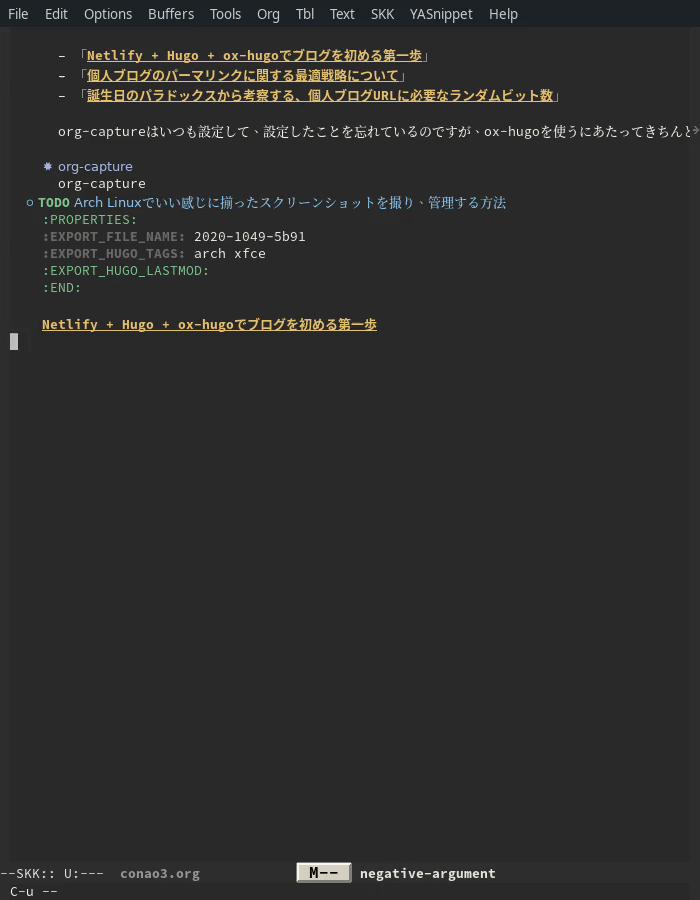

** ox-hugoの設定
「[[https://pxaka.tokyo/blog/2018/44febe88-04a5-9bc4-6bfb-678a8477a0ed/][ファイル名をUUIDで自動生成するテスト - IMADENELE]]」と「[[https://pxaka.tokyo/blog/2018/58e5bcee-1fb9-48a4-628b-a80692983bfe/][最終変更日の手動設定 - IMADENELE]]」を参考にテンプレートを調整しました。

#+begin_src emacs-lisp
  (leaf ox-hugo
    :doc "Hugo Markdown Back-End for Org Export Engine"
    :req "emacs-24.4" "org-9.0"
    :tag "docs" "markdown" "org" "emacs>=24.4"
    :added "2020-05-05"
    :url "https://ox-hugo.scripter.co"
    :emacs>= 24.4
    :ensure t
    :after org
    :require t
    :defun (org-set-property)
    :custom ((org-hugo-front-matter-format . "yaml"))
    :config
    (defun c/ox-hugo-add-lastmod nil
      "Add `lastmod' property with the current time."
      (interactive)
      (org-set-property "EXPORT_HUGO_LASTMOD"
                        (format-time-string "[%Y-%m-%d %a %H:%M]")))

    (leaf *ox-hugo--capture
      :require org-capture
      :defvar (org-capture-templates)
      :config
      (add-to-list 'org-capture-templates
                   '("b" "Create new blog post" entry
                     (file+headline "~/dev/repos/netlify-src/org/conao3.org" "blog")
                     "** TODO %?
  :PROPERTIES:
  :EXPORT_FILE_NAME: %(apply #'format \"%s-%s-%s\"
          (format-time-string \"%Y\")
          (let ((sha1 (sha1 (shell-command-to-string \"head -c 1k /dev/urandom\"))))
            (cl-loop for (a b c d) on (cdr (split-string sha1 \"\")) by #'cddddr repeat 2 collect (concat a b c d))))
  :EXPORT_HUGO_TAGS:
  :EXPORT_HUGO_LASTMOD:
  :END:
  "))
      (add-to-list 'org-capture-templates
                   '("p" "Create new package post" entry
                     (file+headline "~/dev/repos/netlify-src/org/conao3.org" "emacs")
                     "** TODO %?
  :PROPERTIES:
  :EXPORT_FILE_NAME:
  :EXPORT_HUGO_TAGS: emacs
  :EXPORT_HUGO_LASTMOD:
  :END:
  "))))
#+end_src

=p= はパッケージの紹介用で =emacs= ツリー以下に展開されます。

=b= は簡単なブログ用で =:EXPORT_FILE_NAME= は「[[https://s.conao3.com/blog/2020/9383f3][誕生日のパラドックスから考察する、個人ブログURLに必要なランダムビット数]]」をもとに8桁の16進数を使って自動生成します。

8桁の16進数は =/dev/urandom= から1KB読んで、それのsha1の先頭8桁のみを取ることにしました。
この乱数は衝突するときわめて面倒なことになるので、できるだけ均質なランダム値を得る必要があります。
この仕組みを作った後は衝突しないことをもう祈るしかない。。(もし衝突すると単に新しい記事で古い記事が上書きされて、特に警告は出ない。。)

** まとめ
org-captureの設定をすることによってブログ記事を書くハードルがとても下がりました。

これから情報発信に努めていきたいと思います!

* 誕生日のパラドックスから考察する、個人ブログURLに必要なランダムビット数
:properties:
:export_file_name: generated/contents/blog/2020/9383f3
:export_date: 2020-05-07
:export_updated: 2020-05-07
:export_tags: blog permalink
:end:

** tl;dr
- ブログのURLにランダム値を使うとして、必要なビット数は何桁だろうか
- ハッシュ衝突の問題は「誕生日のパラドックス」と同じ状況設定
- 数学的な裏付けの元で、ランダムビットを28桁確保すれば十分

** Intro
「[[https://s.conao3.com/blog/2020/0bc44c][個人ブログのパーマリンクに関する最適戦略について]]」において、

- ={{base-url}}= / blog / ={{year}}= / ={{random}}=

というURLをこのブログに使うことに決めました。しかし、 ={{random}}= はどれだけのビット数を使い、どのようなフォーマットを使うべきでしょうか。

幸い、 ={{year}}= を入れているので、「永遠」を考える必要はありません。
せいぜい「1年」でどれだけの記事を書くのかを見積れば良いことになります。

毎日、1記事を書いたとして $365$ 記事、多めに見積もって $400$ 記事とします。
さらに毎日、 $5$ 記事書くことを上限と仮定すると $5 \times 400 = 2000$ 記事となり、せいぜい $2000$ 記事がある場合に必要なランダムビット数を求めたいと思います。

** 誕生日のパラドックス
「[[https://ja.wikipedia.org/wiki/%E8%AA%95%E7%94%9F%E6%97%A5%E3%81%AE%E3%83%91%E3%83%A9%E3%83%89%E3%83%83%E3%82%AF%E3%82%B9][誕生日のパラドックス - Wikipedia]]」より、
#+begin_quote
誕生日のパラドックス（たんじょうびのパラドックス、英: birthday paradox）とは「何人集まれば、その中に誕生日が同一の2人（以上）がいる確率が、50%を超えるか?」という問題から生じるパラドックスである。鳩の巣原理より、366人（閏日も考えるなら367人）集まれば確率は100%となるが、しかしその5分の1に満たない70人しか集まらなくても確率は99.9%を超え、50%を超えるのに必要なのはわずか23人である。

誕生日のパラドックスは論理的な矛盾に基づいているという意味でのパラドックスではなく、結果が一般的な直感と反しているという意味でのパラドックスである。
#+end_quote

Wikipediaでも計算してありますが、ここでも計算しておきます。

きちんと問題として整理すると以下のようになります。

#+begin_quote
Aさんを含め、n人がいる。一年を365日とし、誕生日は全ての日で等確率とする。

1. Aさんと同じ誕生日の人が存在する確率 $P_1$
2. 同じ誕生日の人が存在する確率 $P_2$
3. $P_1$ と $P_2$ が $50$ %を超えるのにそれぞれ必要な人数 $n_\text{min1}$, $n_\text{min2}$
#+end_quote

1. Aさんと同じ誕生日の人が存在する確率 $P_1$

   余事象で求める。

   Aさん以外の人は $\frac{364}{365}$ の確率でAさんの誕生日と衝突しない。
   Aさん以外の人は $n-1$ 人存在するので、

   $$ P_1 = 1 - \qty(\frac{364}{365})^{n-1} $$

2. 同じ誕生日の人が存在する確率 $P_2$

   余事象で求める。

   n人の誕生日が異なる確率は
   $$ \frac{364}{365}\cdot\frac{363}{365}\cdot\frac{362}{365}\cdots\frac{365-(n-1)}{365} = \frac{{}_{364}\mathrm{P}_{n-1}}{365^{n-1}} = \frac{{}_{365}\mathrm{P}_n}{365^n}$$

   よって
   $$ P_2 = 1 - \frac{{}_{365}\mathrm{P}_n}{365^n} $$

3. $P_1$ と $P_2$ が $50$ %を超えるのにそれぞれ必要な人数 $n_\text{min1}$, $n_\text{min2}$

   $n_\text{min1}$ については計算できる。

   \begin{aligned}
     P_1 = 1 - \qty(\frac{364}{365})^{n-1} &> 0.5 \\
     0.5 &> \qty(\frac{364}{365})^{n-1} \\
     \log_2(0.5) &> (n-1)\log_2\qty(\frac{364}{365}) \\
     -1 &> (n-1)(-0.003958) \\
     253.65 &< n
   \end{aligned}

   よって $n_\text{min1}=254$ となる。

   $n_\text{min2}$ については面倒なので、Pythonを用いて図示する。

   #+begin_src python
     import matplotlib.pyplot as plt
     import numpy as np

     memo = np.full(400, -1.0)
     def NPn (n):
         """
         余事象の確率
         n人の誕生日が異なる確率
         """
         if n == 0 or n == 1:
             memo[0] = 1
             return memo[0]
         elif n >= 366:
             return 1;
         elif memo[n] != -1:
             return memo[n]
         else:
             p = NPn(n-1) * ((365-(n-1))/365.0)
             memo[n] = p
             return memo[n]

     def Pn (n):
         """
         n人のうち、2人以上誕生日が同じ確率
         """
         return 1 - NPn(n)

     n = 70
     with plt.style.context(('science-transparent')):
         y = [Pn(i) for i in range(n)]
         plt.plot(y)

         plt.xlabel('n')
         plt.ylabel('P_n')

         plt.axhline(0.5, color='C1')
         n_min2 = np.searchsorted(y, 0.5)
         plt.annotate('({}, {:.2f})'.format(n_min2, y[n_min2]),
                      (n_min2, y[n_min2]), (n_min2-15, 0.8),
                      arrowprops = dict(arrowstyle='-|>', mutation_scale=20))

         plt.show()
   #+end_src

   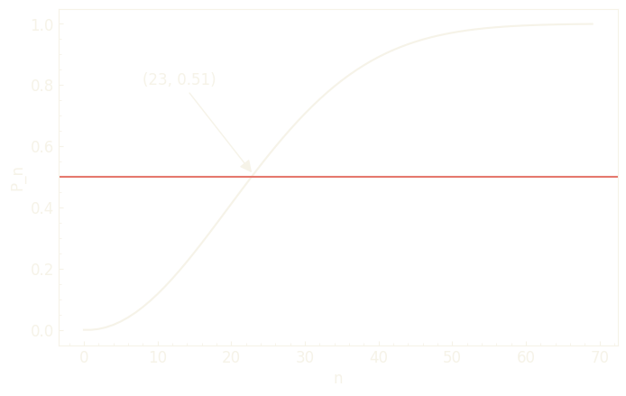

   グラフから、 $n_\text{min2} = 23$ 。

上記のとおり $n_\text{min1} = 254$, $n_\text{min2} = 23$ となり $P_\text{min2}$ は直感よりも少ないように思います。

直感との乖離の理由は「自分と同じ誕生日の人が存在する確率」と「同じ誕生日の組が存在する確率」を混同してしまうからです。

** ランダム値の衝突
今回問題にしているようなランダム値の衝突については、
「あるひとつのランダム値が衝突する事象」ではなく、「どれでもいいのでランダム値が衝突する事象」を考える必要があるので、
まさに誕生日のパラドックスと同じ状況設定となります。

誕生日のパラドックスでは365個の集合でしたが、今回は変数 $N$ とします。

前段の $P_2$ を参考に、 $N$ 個の集合から $n$ 個ランダム値を取ってきたときに、同じ値が存在する確率 $p$ は次の形となります。

\begin{aligned}
  p &= 1 - \frac{N-1}{N}\cdot\frac{N-2}{N}\cdot\frac{N-3}{N}\cdots\frac{N-(n-1)}{N} \\
    &= 1 - \qty(\qty(1-\frac{1}{N})\qty(1-\frac{2}{N})\qty(1-\frac{3}{N})\qty(1-\frac{n-1}{N})) \\
    &= 1 - \prod_{m=1}^{n-1}\qty(1-\frac{m}{N})
\end{aligned}

ここで、ネイピア数のテイラー展開は次の形です。 $x$ が十分小さいときは1次までの近似が使えます。

\begin{aligned}
  e^{-ax} &= 1 - ax + a^2\frac{x^2}{2!} - a^3\frac{x^3}{3!} + a^4\frac{x^4}{4!} + \cdots \\
         &\approx 1 - ax
\end{aligned}

$N$ はランダム値の全体総数なので、 $\frac{i}{N}$ は十分小さく、ネイピア数のテイラー展開から近似を使えます。

\begin{aligned}
  p = 1 - \prod_{m=1}^{n-1}\qty(1-\frac{1}{N}m) &\approx 1 - \prod_{m=1}^{n-1}\exp\qty(-\frac{1}{N}m) \\
   &= 1 - \exp\qty(\sum_{m=1}^{n-1}\qty(-\frac{m}{N})) \\
   &= 1 - \exp\qty(-\frac{1}{N}\sum_{m=1}^{n-1}m) \\
   &= 1 - \exp\qty(-\frac{n(n-1)}{2N})
\end{aligned}

さらに $n$ について変形します。途中、 $n$ が十分大きいことから、定数の減算を無視しました。

\begin{aligned}
  \exp\qty(-\frac{n(n-1)}{2N}) &= 1-p \\
  -\frac{n(n-1)}{2N} &= \ln(1-p) \\
  n(n-1) &= -2N\ln(1-p) \\
  n^2 &\approx 2N\ln\qty(\frac{1}{1-p}) \\
  n &= \sqrt{2N\ln\qty(\frac{1}{1-p})}
\end{aligned}

** 数値計算
*** Nが与えられている場合
ランダム値の大きさ($N$)が与えられている場合、何個ランダム値を取り出したら($n$)衝突するでしょうか。
なお $p=0.5$ とします。

\begin{aligned}
  n = \sqrt{2N\ln\qty(\frac{1}{1-0.5})} &= \sqrt{2N\ln2} \\
   &\approx 1.1774\sqrt{N} \\
   &\approx \sqrt{N}
\end{aligned}

最後の近似はオーダーを見積もるためにとても雑な近似を行いました。

もしランダムビットが *64bit* の場合、ランダム値の集合は $2^{64}$ となり、
$2^{32} = (42.9\text{億})$ 個([[https://www.wolframalpha.com/input/?i=2%5E%2832%29][WolframAlpha]])のランダム値を生成したら、確率 $0.5$ で衝突することになります。

*** Nを求めたい場合
逆に今回私は試行回数、1年 $2000$ 記事($n=2000$)からランダム値の大きさ($N$)を求めたいと思っています。
なお、ランダム値の大きさ $N$ はビット数 $b$ を用いて $N=2^b$ と書けます。

衝突する確率 $p$ は $1$ %と仮定します。

\begin{aligned}
  n &= \sqrt{2N\ln\left(\frac{1}{1-0.01}\right)} \\
  2000 &= \sqrt{2N\ln\left(\frac{1}{0.99}\right)} \\
  2000^2 &= 2N \cdot 0.0100 \\
  N = 2^b &= 1000 \cdot 2000 \cdot 100 \\
  b &= 27.5
\end{aligned}

以上、ランダムビット数は28桁あれば十分ということになります。

16進数の表記を使えば1文字で4ビットの自由度があるので、結局、8文字あれば十分ということが分かりました。

** まとめ
誕生日のパラドックスを導入としてランダム値の衝突問題(ハッシュ衝突問題)について考えました。

長々書いてきましたが、数学的な裏付けのもとで必要なランダムビット数が分かり、パーマリンクのフォーマットを決めることができました。

次の記事「[[https://s.conao3.com/blog/2020/e6234e][ox-hugo用のorg-captureテンプレートについて]]」ではこのフォーマットを実現するためのox-hugoの運用について書きたいと思います。

** 参考
- [[https://ja.wikipedia.org/wiki/%E8%AA%95%E7%94%9F%E6%97%A5%E3%81%AE%E3%83%91%E3%83%A9%E3%83%89%E3%83%83%E3%82%AF%E3%82%B9][誕生日のパラドックス - Wikipedia]]
- [[https://ja.wikipedia.org/wiki/%E8%AA%95%E7%94%9F%E6%97%A5%E6%94%BB%E6%92%83][誕生日攻撃 - Wikipedia]]
- [[https://mathtrain.jp/birthday][同じ誕生日の二人組がいる確率について - 高校数学の美しい物語]]
- [[https://qiita.com/ta_ta_ta_miya/items/1f8f71db3c1bf2dfb7ea][UUID(v4) がぶつかる可能性を考えなくていい理由 - Qiita]]
- [[https://tex2e.github.io/blog/crypto/birthday-attack][誕生日攻撃 (Birthday Attack) - 晴耕雨読]]

* 令和時代のEmacsカラーテーマの作り方
:properties:
:export_file_name: generated/contents/blog/2020/91b392
:export_date: 2020-05-10
:export_updated: 2020-05-10
:export_tags: emacs emacs-lisp color-theme solarized release iceberg-theme-el
:end:

** Intro
昨日の夜あまりにも進捗が出ないので、寝てしまおうと思ったらこんな感じのツイートを不覚にも見てしまいました。

#+begin_export html
<blockquote class="twitter-tweet"><p lang="ja" dir="ltr">1000とかすごいですね! おめでとうございます!<br>これMITライセンスということはIcebergなEmacsのカラーtheme作ってもいいわけですね〜! やったー</p>&mdash; Nyoho (@NeXTSTEP2OSX) <a href="https://twitter.com/NeXTSTEP2OSX/status/1258757464582795264?ref&#95;src=twsrc%5Etfw">May 8, 2020</a></blockquote> <script async src="https://platform.twitter.com/widgets.js" charset="utf-8"></script>
#+end_export

ちょっと興味を引かれたので、さっとEmacsポートを作る気になりました。
今のSolarizedなら簡単にできるはずです。

「今の」というのは、私が出したパッチ「[[https://github.com/bbatsov/solarized-emacs/pull/330][[new feature] solarized.el as multi color scheme]]」が入ったSolarized。

いろいろ議論を大きくしてしまいましたが、結局私のコードは元気に動いており、私もいつも自作カラーパレットでSolarizedを使っています。

今回、iceberg-theme.elをどのように作ったのか、まとめておきます。

成果物はこちら。[[https://github.com/conao3/iceberg-theme.el][iceberg-theme.el]]

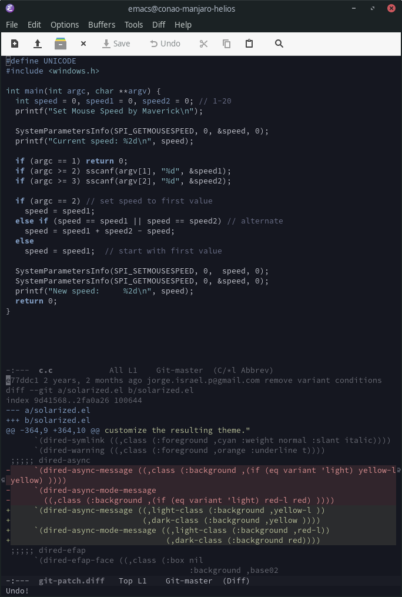

** 前提知識
*** Emacsにおけるface
=face= とは下記のように =defface= で各パッケージで定義されており、ユーザーのディスプレイ環境に応じて様々な色を設定できるようになっています。

下記の =face= の例において、 =feather= の例では =background= が =dark= か =light= かで色の分岐を行なっていますし、Emacs標準添付パッケージの =isearch= では =background= 判定に加え、最大表示色数も考慮されています。

#+begin_src emacs-lisp
(defface feather-dashboard-header
  '((((background dark))
     :background "#223377"
     :foreground "white"
     :weight bold :height 1.3 :family "Sans Serif")
    (((background light))
     :background "#abd7f0"
     :foreground "black"
     :weight bold :height 1.3 :family "Sans Serif"))
  "Face for feather-dashboard header."
  :group 'feather)

(defface isearch-fail
  '((((class color) (min-colors 88) (background light))
     (:background "RosyBrown1"))
    (((class color) (min-colors 88) (background dark))
     (:background "red4"))
    (((class color) (min-colors 16))
     (:background "red"))
    (((class color) (min-colors 8))
     (:background "red"))
    (((class color grayscale))
     :foreground "grey")
    (t (:inverse-video t)))
  "Face for highlighting failed part in Isearch echo-area message."
  :version "23.1")
#+end_src

あとはこの =face= を言語をパース後、ある意味のところに貼り付けたり、オーバーレイである文字のところに適用したりして使います。

*** Emacsにおけるカラーテーマ
Emacsのカラーテーマはこれらパッケージが提供する =face= を一括で変更してしまうものです。

具体例は[[https://github.com/emacs-jp/replace-colorthemes][emacs-jp/replace-colorthemes]]にたくさんあります。

このように =face= の名前と対応するスタイルを逐一変更するものがEmacsのカラーテーマです。

例えば[[https://github.com/emacs-jp/replace-colorthemes/blob/master/aalto-dark-theme.el][aalto-dark-theme]]の冒頭はこのようになっています。

#+begin_src emacs-lisp
  (deftheme aalto-dark
    "aalto-dark theme")

  (custom-theme-set-faces
   'aalto-dark

   '(default ((t (:background "DeepSkyBlue3" :foreground "white"))))
   '(mouse ((t (:foreground "black"))))
   '(cursor ((t (:background "yellow"))))
   '(border ((t (:foreground "black"))))

   '(bold ((t (:bold t :background "blue3" :foreground "white"))))
   '(bold-italic ((t (:italic t :bold t :foreground "blue3"))))
   '(calendar-today-face ((t (:underline t))))
   '(diary-face ((t (:foreground "red"))))
   '(font-lock-builtin-face ((t (:foreground "LightSteelBlue"))))
   '(font-lock-comment-face ((t (:foreground "OrangeRed"))))
   ;; ...
   )

  (provide-theme 'aalto-dark)
#+end_src

カラーテーマパッケージがどのようなことをしているか掴めてきましたでしょうか。

*** カラーテーマの問題点
さて、Emacsの =face= は先程のようにパッケージごとに定義されています。
もし、パッケージが増えた場合、カラーテーマはどのように対応するべきでしょうか。

簡単ですね。新しいパッケージが増えたら、その都度 =face= の設定を書き足すのです。。

例えば[[https://github.com/emacs-jp/replace-colorthemes/blob/master/andreas-theme.el][andreas-theme]]では =gnus= や =paren= というパッケージに対応していることが分かります。

このようにカラーテーマごとに「対応しているパッケージ」が異なっており、メンテナンスされていないカラーテーマを使っていると、パッケージが決めたデフォルトの色がそのまま表示されることになります。

そのため「色が暗い」「色がビビッドすぎる」「そもそも見えない」などの問題が発生します。

** Solarized
*** Solarizedのface定義
Emacsコミュニティによって長年メンテナンスされているSolarizedはどうなっているでしょうか。

実際のファイルは[[https://github.com/bbatsov/solarized-emacs/blob/master/solarized-faces.el][solarized-emacs/solarized-faces.el]]です。

=face= の再定義は2000行に及び、もし新しいパッケージが生まれたとしても有志の手によって速やかに追加されています。

これをSolarizedだけで使うのはもったいありません。

Solarizedも内部では基本となる10色を定義し、その色で =face= を再定義しています。

では、基本となる10色を外部から指定できるようにしたらSolarizedの仕組みに乗った上で簡単にカラーテーマが作れるのではないか。

それを提案したのがzk_phiさんの「[[https://qiita.com/zk_phi/items/35097fbb3dde4253d428][[Emacs] メタ・カラースキームとしてのsolarized]]」であり、私のパッチはそれを本家で実現したものです。

*** Solarizedから作るカラーテーマ
SolarizedのAPIで使いやすいのは =solarized-create-theme-file-with-palette= です。
この関数は最暗色、最明色に加え、アクセントカラー8色を指定することでSolarizedの =face= 定義を使うカラーテーマファイルを生成し、 =.emacs/themes= 以下に保存します。

早速icebergからアクセントカラーを貰ってカラーテーマを生成しましょう!

#+begin_src emacs-lisp
  (solarized-create-theme-file-with-palette 'dark 'solarized-iceberg-dark
    '("#161821" "#c6c8d1"
      "#e2a478" "#e27878" "#e27878" "#a093c7" "#b4be82" "#84a0c6" "#89b8c2" "#84a0c6"))
#+end_src

上記で書いた色はVim Scriptのソースからではなく[[https://speakerdeck.com/cocopon/creating-your-lovely-color-scheme?slide=51][講演資料]]から色を貰いました。


なお、icebergではアクセントカラーが6色のようなので、Solarizedが求めているアクセントカラー8色に足りません。そのため2色をダブらせて生成しました。

関数を実行して =.emacs/themes= 以下に保存されたテーマファイルは =load-theme= でロードできます。

** 微調整の仕方
Emacsの本文部分は =default= という =face= が当てられているのですが、solarizedのデフォルトでは文字色が最明色になりません。。

まずそこからカスタマイズしていきます。

=solarized-create-theme-file-with-palette= の第3引数にS式のリストを渡すことでテーマのカスタマイズができます。

#+begin_src emacs-lisp
  (solarized-create-theme-file-with-palette 'dark 'solarized-iceberg-dark
    '("#161821" "#c6c8d1"
      "#e2a478" "#e27878" "#e27878" "#a093c7" "#b4be82" "#84a0c6" "#89b8c2" "#84a0c6")
    '((custom-theme-set-faces
       theme-name
       `(default ((,class (:foreground ,base3 :background ,base03)))))))
#+end_src

カスタマイズはSolarizedの内部で色がどのように管理されているかを少し知っておく必要があります。

基本的に次のように色の名前が管理されています。

#+begin_example
<brightest                                 darkest>
base03 base02 base01 base00 base0 base1 base2 base3

<accent colors>
yellow orange red magenta violet blue cyan green
#+end_example

さらに色のバリエーションとして =yellow-d= や =yellow-l= という色も定義されており、第3引数で使用できます。

これらは =solarized-create-color-palette= という関数の中で自動生成されています。

** 完成形
本家のiceberg.vimのスクショと比較しながら、間違っている =face= を =describe-face= で確認して直す。。という作業を繰り返すと徐々に本家に近づいていきます。

最終的に次のような形になりました。

#+begin_src emacs-lisp
  (defun iceberg-theme-create-theme-file ()
    "Create iceberg-theme color theme using solarized API.

  Solarized pallete.

  brightest                                   darkest
  base03 base02 base01 base00 base0 base1 base2 base3

  yellow orange red magenta violet blue cyan green"
    (solarized-create-theme-file-with-palette 'dark 'solarized-iceberg-dark
      '("#161821" "#c6c8d1"
        "#e2a478" "#e27878" "#e27878" "#a093c7" "#b4be82" "#84a0c6" "#89b8c2" "#84a0c6")
      '((custom-theme-set-faces
         theme-name
         `(default ((,class (:foreground ,base3 :background ,base03))))
         `(vertical-border ((,class (:foreground ,base03))))
         `(mode-line ((,class (:foreground ,base2 :background ,base02))))
         `(mode-line-inactive ((,class (:foreground ,base0 :background ,base03))))

         `(font-lock-comment-delimiter-face ((,class (:foreground "#6b7089"))))
         `(font-lock-comment-face ((,class (:foreground "#6b7089"))))
         `(font-lock-preprocessor-face ((,class (:foreground ,green)))) ; yellow
         `(font-lock-type-face ((,class (:foreground ,cyan)))) ; yellow
         `(font-lock-builtin-face ((,class (:foreground ,green)))) ; base0

         `(diff-function ((,class (:foreground ,violet-1fg))))
         `(diff-header ((,class (:foreground ,green))))
         `(diff-hunk-header ((,class (:foreground ,green))))
         `(diff-file-header ((,class (:background ,base03 :foreground ,green))))
         `(diff-added ((,class (:background ,violet-1bg :foreground ,violet-1fg))))
         `(diff-indicator-added ((t (:foreground ,violet))))
         `(markdown-header-face ((,class (:foreground ,yellow))))
         `(markdown-header-rule-face ((,class (:foreground ,green))))
         `(markdown-markup-face ((,class (:inherit default))))
         `(markdown-url-face ((,class (:foreground ,magenta))))
         `(markdown-link-face ((,class (:foreground ,green :underline t))))
         `(markdown-inline-code-face ((,class (:foreground ,cyan))))
         `(markdown-pre-face ((,class (:foreground ,cyan))))
         `(sh-quoted-exec ((,class (:foreground ,violet))))
         `(haskell-type-face ((,class (:inherit default))))
         `(haskell-constructor-face ((,class (:inherit default))))
         `(haskell-operator-face ((,class (:foreground ,green))))
         `(haskell-definition-face ((,class (:inherit default))))
         `(web-mode-block-delimiter-face ((,class (:inherit default))))
         `(web-mode-html-attr-value-face ((,class (:foreground ,cyan))))
         `(web-mode-mode-type-face ((,class (:inherit default))))
         `(web-mode-function-call-face ((,class (:inherit default))))
         `(web-mode-keyword-face ((,class (:foreground ,green))))
         `(web-mode-constant-face ((,class (:foreground ,cyan))))
         `(web-mode-variable-name-face ((,class (:foreground ,cyan))))
         `(web-mode-html-tag-bracket-face ((,class (:foreground ,green))))
         `(org-verbatim ((,class (:foreground ,cyan))))
         `(php-php-tag ((,class (:inherit default))))
         `(php-constant ((,class (:inherit default))))
         `(php-paamayim-nekudotayim ((,class (:foreground ,green))))
         `(php-object-op ((,class (:foreground ,cyan))))
         `(php-variable-name ((,class (:foreground ,cyan))))
         `(php-variable-sigil ((,class (:foreground ,cyan))))))))
#+end_src

テーマを作る関数にしているのは「requireしただけでEmacsの動作を変えない」というパッケージ作成のルールに従うためです。

これでユーザーはiceberg-themeをインストール後、 =iceberg-theme-create-theme-file= を実行した後で =M-x load-theme solarized-iceberg-dark= と実行できるはずです。

** まとめ
現在ではSolarizedの資産を生かし、簡単にカラーテーマを作成することができます。

ぜひ独創的かつ目にやさしいカラーテーマを作っていただき、日々のEmacs生活がよりよいものになれば良いなと思っています。

* Archのrsyncで転送できないときに確認すること
:properties:
:export_file_name: generated/contents/blog/2020/55bf86
:export_date: 2020-05-11
:export_updated: 2020-05-11
:export_tags: github-actions deployment
:end:


** Intro
[[http://celpa.conao3.com/][celpa.conao3.com]]は私が契約している100GBの「さくらのレンタルサーバー」を向いているのだけど、その公開ディレクトリにGitHub Actionsからrsyncでデプロイしたい。

もちろん、GitHubのワーカーに秘密鍵をアップロードすることになるので、その秘密鍵は上手い具合に制限を設ける必要があります。

ローカルで試していたとき上手くいかなかったので、そのメモ。

** 普通のrsync
rsyncは接続先のサーバーにrsyncを起動して、そのプロセスと通信します。

どんなコマンドが実行されているかは =-vvv= オプションを付けることで表示されます。

#+begin_src shell
  $ rsync -vvv -an README.md conao3@conao3.sakura.ne.jp:/home/conao3/
  opening connection using: ssh -l conao3 conao3.sakura.ne.jp rsync --server -vvvnlogDtpre.iLsfxC . /home/conao3/  (9 args)
  sending incremental file list
  [sender] make_file(README.md,*,0)
  ...

  sent 60 bytes  received 368 bytes  285.33 bytes/sec
  total size is 15,379  speedup is 35.93 (DRY RUN)
  [sender] _exit_cleanup(code=0, file=main.c, line=1189): about to call exit(0) (DRY RUN)
#+end_src

=opening connection using= の行の =rsync= 以降が接続先で実行されているコマンドです。

そのため、そのコマンドだけ実行できる鍵を登録するには以下のように =authorized_keys= に登録します。 (=-vvv= はいらないので削る)

#+begin_src fundamental
command="rsync --server -nlogDtpre.iLsfxC . /home/conao3/",no-port-forwarding,no-X11-forwarding,no-agent-forwarding ssh-rsa AAAA...
#+end_src

** rsyncdを使ったrsync
*** 鍵の作成
rsync用の鍵を新しく作る。
GitHub Actionsのsshが古く、Openssh形式の秘密鍵が読めなかったのでPEM形式で出力するようにオプションを付けた。

鍵の名前は =sakura-rsync_rsa= と入力した。

#+begin_src shell
  cd .ssh
  ssh-keygen -t rsa -b 4096 -m PEM -C ""
#+end_src

*** 鍵の登録
ファイルをやりとりしたいサーバーにログインし、 =authorized_keys= に公開鍵 =sakura-rsync_rsa.pub= を登録する。

#+begin_src fundamental
  command="rsync --server --daemon --config=/home/conao3/.rsyncd.conf .",no-port-forwarding,no-X11-forwarding,no-agent-forwarding ssh-rsa AAAA...
#+end_src

*** rsyncd.confの作成
私が使っているのは共有サーバーなので、当然、ユーザーホーム以下しか触れない。
そのため =rsyncd.conf= は =~/.rsyncd.conf= に作成することにしました。

#+begin_src conf
  use chroot = no
  read only = yes

  [www]
    read only = no
    write only = yes
    path = /home/conao3/www

  [cache]
    path = /home/conao3/www/files/cache-40bbae27
#+end_src

*** 使ってみる
なぜかファイル転送されない。。。
#+begin_src shell
$ rsync -vvv -e "ssh -i sakura-rsync_rsa" /home/conao/dev/template/elisp conao3@conao3.sakura.ne.jp::foo/
opening connection using: ssh -i sakura-rsync_rsa -l conao3 conao3.sakura.ne.jp rsync --server --daemon .  (10 args)
sending daemon args: --server -vvve.LsfxC . foo/  (4 args)
skipping directory elisp
send_file_list done
send_files starting
send_files phase=1
send_files phase=2
send files finished
total: matches=0  hash_hits=0  false_alarms=0 data=0

sent 16 bytes  received 11 bytes  18.00 bytes/sec
total size is 0  speedup is 0.00
[sender] _exit_cleanup(code=0, file=main.c, line=1189): about to call exit(0)
#+end_src

=-a= オプションを付けると転送された。
#+begin_src shell
$ rsync -a -vvv -e "ssh -i sakura-rsync_rsa" /home/conao/dev/template/elisp conao3@conao3.sakura.ne.jp::foo
opening connection using: ssh -i sakura-rsync_rsa -l conao3 conao3.sakura.ne.jp rsync --server --daemon .  (10 args)
sending daemon args: --server -vvvlogDtpre.iLsfxC . foo/  (4 args)
sending incremental file list
[sender] make_file(elisp,*,0)
send_file_list done
[sender] pushing local filters for /home/conao/dev/template/elisp/
[sender] make_file(elisp/README.org,*,2)
[sender] make_file(elisp/Makefile,*,2)
[sender] make_file(elisp/elisp-template.el,*,2)
[sender] make_file(elisp/.github,*,2)
[sender] make_file(elisp/elisp-template-tests.el,*,2)
[sender] make_file(elisp/git-hooks,*,2)
[sender] make_file(elisp/.gitignore,*,2)
[sender] make_file(elisp/LICENSE,*,2)
[sender] make_file(elisp/Cask,*,2)
send_files starting
#+end_src

*** GitHub Actionsから使う
こんなファイルを =.github/workflows/test.yml= に保存すればできる。

「[[https://qiita.com/shimataro999/items/b05a251c93fe6843cc16][GitHub ActionsでSSHを使う - Qiita]]」で紹介されていた =shimataro/ssh-key-action= を使わせてもらいました。

#+begin_src yaml
  name: Main workflow
  on:
    push:
      branches:
        - master
    pull_request:
      branches:
        - master

  jobs:
    build:
      runs-on: ubuntu-latest
      strategy:
        matrix:
          emacs_version:
            - '26.3'
      steps:
        - uses: actions/checkout@v1
        - uses: actions/setup-python@v1.1.1
        - uses: purcell/setup-emacs@master
          with:
            version: ${{ matrix.emacs_version }}
        - uses: conao3/setup-cask@master
        - name: Install SSH key
          uses: shimataro/ssh-key-action@v1
          with:
            private-key: ${{ secrets.SSH_KEY }}
            public-key: ${{ secrets.SSH_KEY_PUBLIC }}
            known-hosts: ${{ secrets.KNOWN_HOSTS }}

        - name: Cache fetch
          run: |
            rsync -av --progress -e 'ssh' conao3@conao3.sakura.ne.jp::cache/celpa.tar.gz /tmp/
            rm -rf working
            tar xf /tmp/celpa.tar.gz

        - name: Build
          run: |
            make

        - name: Deploy
          run: |
            rsync -av -e 'ssh' --delete --exclude=working ./ conao3@conao3.sakura.ne.jp::www/celpa/

        - name: Cache push
          run: |
            rm /tmp/celpa.tar.gz
            tar czf /tmp/celpa.tar.gz working
            rsync -av --progress -e 'ssh' /tmp/celpa.tar.gz conao3@conao3.sakura.ne.jp::cache/
#+end_src

** まとめ
rsyncを使ってサイトをGitHub Actionsからデプロイできるようになりました。

** 参考
- [[https://jyn.jp/rsync-daemon-over-ssh/][rsync+sshはdaemonモードを使うと更に安全になる - 純規の暇人趣味ブログ]]
- [[https://qiita.com/shimataro999/items/b05a251c93fe6843cc16][GitHub ActionsでSSHを使う - Qiita]]
- [[https://amasuda.xyz/post/2019-07-27-ssh-keygen-openssh-to-pem/][ssh-keygenで生成されたOPENSSHフォーマットの秘密鍵をpemフォーマットへ変換する - Think Abstract]]
- [[https://machua.hatenadiary.org/entry/20110809/1312899353][SSHの秘密鍵について - 禿散らかしてました]]

* Emacsで最終行にポイントを動かさないようにするアドバイス
:properties:
:export_file_name: generated/contents/blog/2020/33dbfa
:export_date: 2020-05-23
:export_updated: 2020-05-23
:export_tags: emacs emacs-lisp
:end:

** Intro
Elispのadviceはとても便利。

#+begin_export html
<blockquote class="twitter-tweet"><p lang="ja" dir="ltr">でも気をつけないとバグの温床になりますっ！（笑</p>&mdash; Takaaki Ishikawa (@takaxp) <a href="https://twitter.com/takaxp/status/1263646615543275520?ref&#95;src=twsrc%5Etfw">May 22, 2020</a></blockquote> <script async src="https://platform.twitter.com/widgets.js" charset="utf-8"></script>
#+end_export

** 末尾にポイントを移動しない
Emacs-jpのスレッドで次のような質問があった。

# from $toyboot4
#+begin_quote
こんにちは！
2 行のファイルがあったとき、 3 行目にカーソル移動できないようにしたいです
何か方法は無いでしょうか
#+end_quote

このような細かい挙動はアドバイスで簡単に実現できる。

#+begin_src emacs-lisp
  (leaf simple
    :preface
    (defun c/advice-next-line (fn &rest args)
      (let ((maxline (count-lines (point-min) (point-max))))
        (if (< maxline (line-number-at-pos (line-beginning-position 2)))
            (message "restricted! (next-line)")
          (apply fn args))))
    (defun c/advice-forward-char (fn &rest args)
      (let ((maxline (count-lines (point-min) (point-max))))
        (if (< maxline (line-number-at-pos (+ (point) 1)))
            (message "restricted! (forward-char)")
          (apply fn args))))
    :advice ((:around next-line c/advice-next-line)
             (:around forward-char c/advice-forward-char)))

  (leaf simple
    :advice-remove ((next-line c/advice-next-line)
                    (forward-char c/advice-forward-char)))
#+end_src

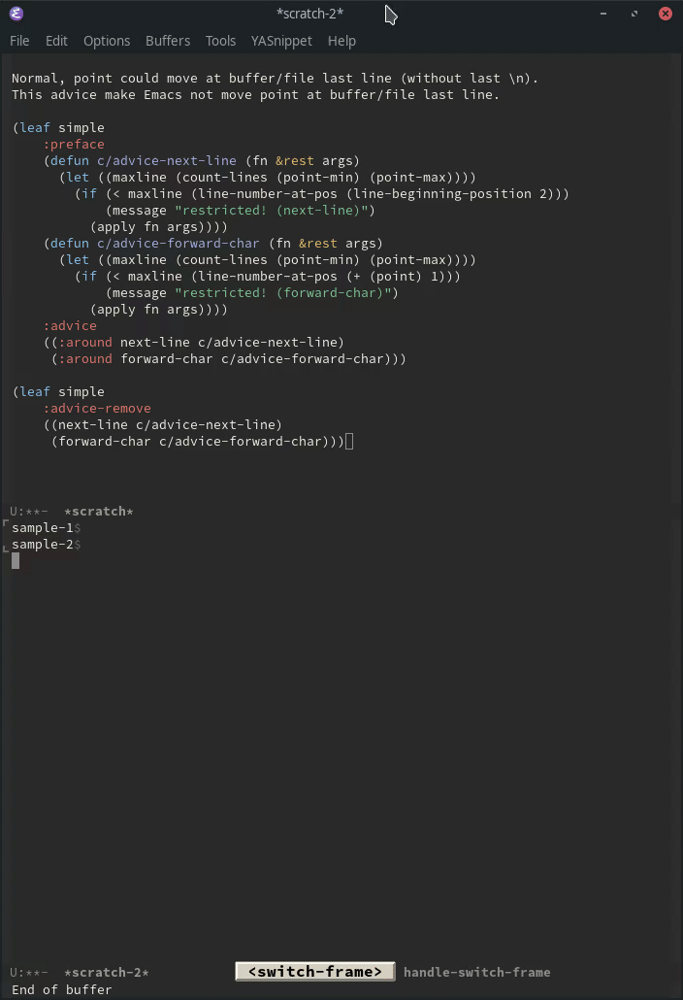

** 末尾にポイントを移動しようとしたら改行する
さらに、仕様を変えて、「最終行以上にポイントを動かそうとしたときに、自動で改行を入れる」ことも簡単に実現できる。

#+begin_src emacs-lisp
  (leaf simple
    :preface
    (defun c/advice-next-line (fn &rest args)
      (let ((maxline (count-lines (point-min) (point-max))))
        (if (< maxline (line-number-at-pos (line-beginning-position 2)))
            (progn (goto-char (line-beginning-position 2))
                   (save-excursion (insert "\n")))
          (apply fn args))))
    (defun c/advice-forward-char (fn &rest args)
      (let ((maxline (count-lines (point-min) (point-max))))
        (if (< maxline (line-number-at-pos (+ (point) 1)))
            (insert "\n")
          (apply fn args))))
    :advice ((:around next-line c/advice-next-line)
             (:around forward-char c/advice-forward-char)))

  (leaf simple
    :advice-remove ((next-line c/advice-next-line)
                    (forward-char c/advice-forward-char)))
#+end_src

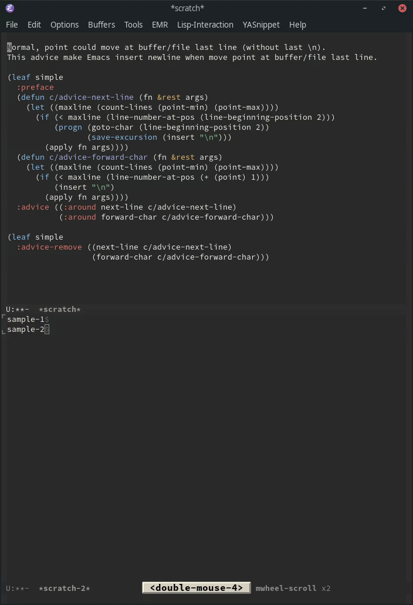

これらのアドバイスで「ファイル末尾に必ず改行がある」ことを強制できる。

** まとめ
ただ、今回の要求については「ファイル保存時に改行がない場合、末尾改行を付加する」というオプションがあり、私はこれを使っている。

#+begin_src emacs-lisp
  (leaf files
    :custom `((require-final-newline . t)))
#+end_src

とはいえ、このようなオプションがないときElispのアドバイスはとても便利。

細かい挙動がストレスになることもあるので、簡単にカスタマイズできるEmacsは良いエディタ。

* 制御記号付きのmake-processの出力をいい感じに処理する方法
:properties:
:export_file_name: generated/contents/blog/2020/5fb67c
:export_date: 2020-05-23
:export_updated: 2020-05-23
:export_tags: emacs emacs-lisp
:end:

** Intro
Emacsからプロセスを実行できます。

実行する方法は[[https://qiita.com/tadsan/items/17d32514b81f1e8f208a][いろいろあります]]が、最も低レベルな関数は =make-process= です。

最もユーザーに近い関数は =shell-command= で、 =M-!= に割り当てられています。
この関数はコマンド文字列を渡すだけで、お手軽に実行できます。

** make-process
[[https://www.gnu.org/software/emacs/manual/html_node/elisp/Asynchronous-Processes.html#Asynchronous-Processes][make-process]]は非同期プロセスを作成します。

必須のオプションは =:name= で、プロセスオブジェクトを返却します。
さらに =:buffer=, =:command=, =:coding=, =:connection-type=, =:noquery=, =:stop=, =:filter=, =:sentinel=, =:stderr= オプションが存在し、細かくプロセスの管理方法を制御できます。

基本的に =:name=, =:buffer=, =:command= を指定することになります。

#+begin_src emacs-lisp
  (setq proc
        (make-process
         :name "sh"
         :buffer (get-buffer-create "*proc*")
         :command '("hub" "clone" "conao3/celpa")))

  (progn
    (delete-process proc)
    (shell-command "rm -rf celpa"))
#+end_src

ただ、コマンドから送られてきた文字列を素朴に出力するため、gitのように =CR= を利用してリッチに出力するコマンドの出力は盛大に壊れます。

=CR= を解釈しながら賢く処理をすれば良いのですが、とても面倒です。

Emacs-jpで助けを求めると、eshellの関数を利用すれば良いのではという助言があり、調べてみると、きちんと出力できました。

eshellの仕組みに乗っかるので、 =eshell-mode= にしなければフィルター関数を使えないかと思いましたが、よく見ればいくつかのマーカーを設定するだけで使えました。

#+begin_src emacs-lisp
  (with-current-buffer (get-buffer-create "*proc*")
    (set (make-local-variable 'eshell-last-input-start) (point-marker))
    (set (make-local-variable 'eshell-last-input-end) (point-marker))
    (set (make-local-variable 'eshell-last-output-start) (point-marker))
    (set (make-local-variable 'eshell-last-output-end) (point-marker))
    (set (make-local-variable 'eshell-last-output-block-begin) (point)))

  (setq proc
        (make-process
         :name "sh"
         :buffer (get-buffer-create "*proc*")
         :command '("hub" "clone" "conao3/celpa")
         :filter (lambda (proc string)
                   (eshell-output-filter proc string))))

  (progn
    (delete-process proc)
    (shell-command "rm -rf celpa"))
#+end_src

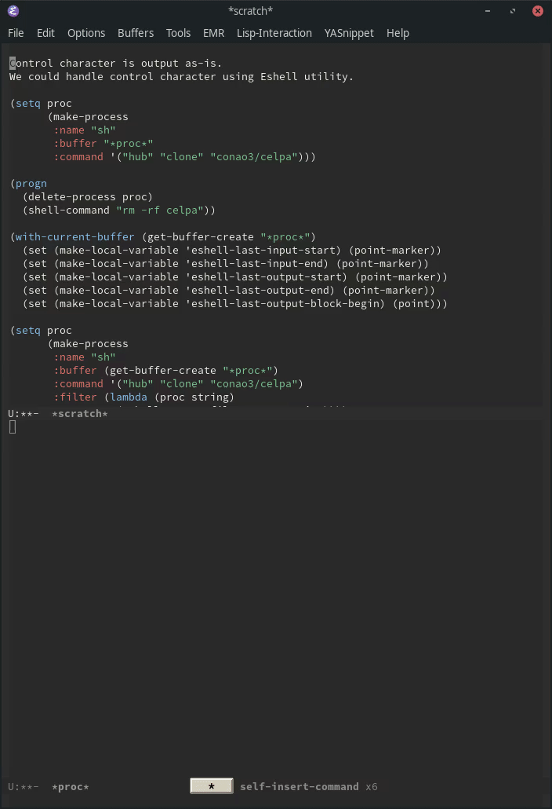

** まとめ
Emacsは良いエディタで、Elispは強力ですが、GitをElispで実装するのは現実的ではありません。

このように外部コマンドとElispを有効に協調させながら作業しやすい環境を整えていきましょう。

* CELPA (Conao3's Emacs Lisp Package Archive) をデプロイした話
:properties:
:export_file_name: generated/contents/blog/2020/7b1dc7
:export_date: 2020-05-24
:export_updated: 2020-05-24
:export_tags: emacs melpa package-management github-actions deployment release celpa
:end:

** Intro
[[https://github.com/melpa/melpa/pull/6892][MELPA]]のレビューが遅い。

MELPAのメンテナの方には感謝してもしきれないが、実際のところ、レシピ追加PRを出して2週間から3週間音沙汰ないまま放置されたり、先方のレビューを反映して修正しても、そこから2週間、3週間待たされることがままあり、ストレスを抱えていました。

私はあまりinit.elを大きくしたくなく、ある程度の大きさになるとパッケージで切りだして =(leaf hoge)= で簡単にアクティベートしたいと考えているため、MELPAに入れてもらえないと =el-get= で取ってこないといけませんでした。

ここでさらに問題があり、 =el-get= は =package= との相性が悪く、微妙な評価タイミングの違いがとても重要になります。

init.elを自分で全てコントロールしていたとしても、おまじないの部分が増えるし、[[https://github.com/conao3/leaf-manager.el][leaf-manager]]で自動管理している場合は原理的に不可能でした。

そのためMELPAっぽく、さらにレシピの追加を自分でコントロールできるアーカイブが必要となり、今回、[[https://celpa.conao3.com/][celpa.conao3.com]]をデプロイしました。

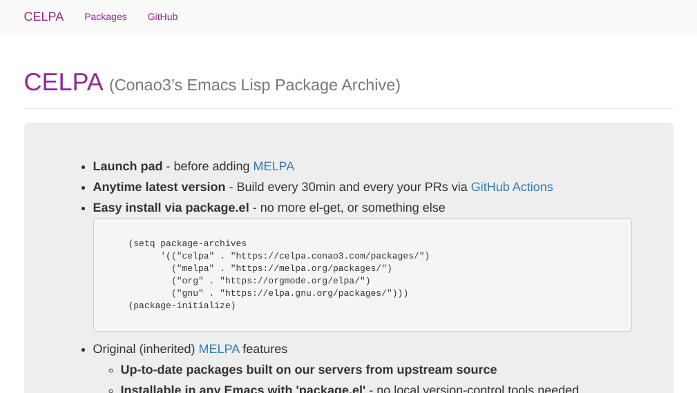

[[github:conao3/celpa::Emacs Lisp][Conao3’s Emacs Lisp Package Archive]]

** MELPAの仕組み
[[https://melpa.org/#/][MELPA]]は単に利用するもので、自分でMELPAを作りたい場合、どこから手をつけたら良いか分かりませんでした。

ただ、takaxpさんが[[https://qiita.com/takaxp/items/ede36da846099d2e5cf2][wikiを翻訳]]して下さっており、この通り進めればなんとかなりました。

もちろんwiki([[https://github.com/melpa/melpa/wiki/Custom-Melpa-Archive][Custom Melpa Archive]], [[https://github.com/melpa/melpa/wiki/melpa-and-package-build][Melpa and package build]])も参照しました。

** MELPAソースの修正
*** レシピの削除
MELPAのクローンを作ろうとしているわけではないので、MELPAに既に登録されているレシピは必要ありません。
[[https://github.com/conao3/celpa/commit/0308bcf9157cd9ba07c55edfb32e006783d15cf7][全部削除]]してしまいます。

*** レシピの追加
欲しいパッケージのレシピを[[https://github.com/conao3/celpa/commit/b1793475d891874f855068046cd8dffa54152877][おもむろに追加]]します。もちろんMELPAの形式と一緒のものです。

*** サーバーの用意
いい感じのサーバーとドメインを用意し、rsyncでよしなに同期できるようにします。
その話については「[[https://s.conao3.com/blog/2020/55bf86][Archのrsyncで転送できないときに確認すること]]」に書きました。

*** index.htmlの修正
いい感じに[[https://github.com/conao3/celpa/blob/master/html/index.html][index.html]]を修正します。
おそらくjsonが足らない(CELPAではダウンロード数の記録はしてない)らしく、MELPAに付属しているjavascriptが動きません。

適当にjsを書いたり、リンクを修正したりします。

*** GitHub Actionsの設定ファイル追加
GitHub Actionsで30分ごとにビルドが走るようにします。
#+begin_src yaml
  name: Main workflow
  on:
    push:
      branches:
        - master
    pull_request:
      branches:
        - master
    schedule:
      - cron: '*/30 * * * *'

  jobs:
    build:
      runs-on: ubuntu-latest
      strategy:
        matrix:
          emacs_version:
            - '26.3'
      steps:
        - uses: actions/checkout@v1
        - uses: actions/cache@v1
          with:
            path: working
            key: ${{ runner.os }}-working
        - uses: actions/setup-python@v1.1.1
        - uses: purcell/setup-emacs@master
          with:
            version: ${{ matrix.emacs_version }}
        - uses: conao3/setup-cask@master

        - name: Build
          run: |
            git status
            make add-package-build-remote
            make pull-package-build
            make
        - name: Install SSH key
          if: github.ref == 'refs/heads/master'
          uses: shimataro/ssh-key-action@v1
          with:
            private-key: ${{ secrets.SSH_KEY }}
            public-key: ${{ secrets.SSH_KEY_PUBLIC }}
            known-hosts: ${{ secrets.KNOWN_HOSTS }}

        - name: Deploy
          if: github.ref == 'refs/heads/master'
          run: |
            rsync -av -e 'ssh' --delete --exclude=.git --exclude=working ./ conao3@conao3.sakura.ne.jp::www/celpa/
#+end_src

** まとめ
振り返ってみるとMELPAをCELPAとして動かせるように修正するのは簡単でした。

やはりミスが許されず、時間がかかるのは秘密鍵/権限回りで、その部分で半分以上の時間を費やしました。

レシピを直接pushできるというのはMELPAを使っていた頃には考えられない快適さです。

ぜひみなさんもオレオレMELPAをデプロイして、package.elだけでパッケージを管理できるようにしましょう!

* Emacsで競技プログラミング | ojのラッパーパッケージを書いた話
:properties:
:export_file_name: generated/contents/blog/2020/5739d9
:export_date: 2020-05-24
:export_updated: 2020-05-24
:export_tags: emacs emacs-lisp competitive-programming release oj-el
:end:

** Intro
ちょっとEmacsで競技プログラミングをしてみようかと思いました。

どうやら[[https://github.com/online-judge-tools/oj][oj]]、[[https://github.com/online-judge-tools/template-generator][oj-template]]という便利なツールがあるようなので、Emacsから簡単に実行できるよう[[https://github.com/conao3/oj.el][oj.el]]というパッケージを作成しました。

[[github:conao3/oj.el::Emacs Lisp][Competitive programming tools client for AtCoder, Codeforces]]

** oj, oj-template
[[https://github.com/online-judge-tools/oj][oj]]は多数のオンラインジャッジに対応しているCLIツールです。

オンラインジャッジによって実装されている機能に制限はありますが、サンプルケースのダウンロード、テスト、提出、ランダムインプットの生成などの機能があります。


上の画像は [[https://github.com/online-judge-tools/oj#screencast][ojのREADMEのScreencast]] から引用しました。

さらに[[https://github.com/online-judge-tools/template-generator][oj-template]]は入出力サンプルからそれっぽいcppとpythonファイルを生成してくれます。

また、 =oj-prepare= はコンテストURLを指定すると、そのコンテストの全ての問題について =oj download= と =oj-template= をしてくれます。

コンテスト中は時間との戦いなので、これらのコマンドによる時短は大きなものになると思います。

** oj.el
[[https://github.com/conao3/oj.el][oj.el]]は先般の =oj=, =oj-template= をEmacsから実行できるようにしたものです。

#+begin_src emacs-lisp
  (leaf oj
    :ensure t
    :custom ((oj-compiler-c . "clang")
             (oj-compiler-python . "pypy")
             (oj-default-online-judge . "atcoder")))
#+end_src

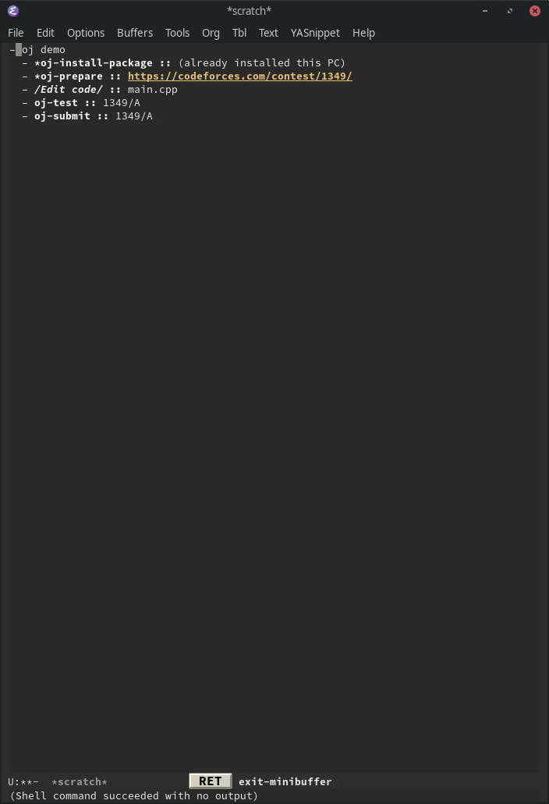

単に関数にバインドしただけでなく、多少の改善を入れています。

例えば =oj= はダウンロードするためにURL全体を指定する必要がありますが、 =oj-default-online-judge= で設定されているオンラインジャッジを既定のものと考え、入力を省略できるようにしています。
(CLIツールとしての[[https://online-judge-tools.readthedocs.io/en/master/introduction.ja.html#id7][方針]]と干渉するものではなく、エディタの拡張としての求められる機能として盛りこんだものです。)

例えば =atcoder= デフォルトに設定されている状況で、 =M-x oj-prepare= に =abc167= を入力すると下記コマンドが実行されます。

#+begin_src shell
  oj-template https://atcoder.jp/contests/abc167
#+end_src

さらに、 =abc167/a= と入力すると下記コマンドが実行されます。

#+begin_src shell
  oj-template https://atcoder.jp/contests/abc167/tasks/abc167_a
#+end_src

このように推測できる部分については、より推測するように実装しています。

詳しい使い方については[[https://github.com/conao3/oj.el#usage][README]]を参照して下さい。
基本的に =oj-install-package=, =oj-prepare=, =oj-test=, =oj-submit= の順にコマンドを実行すればいい感じに動くはずです。

** まとめ
ojをEmacsから使いやすくするラッパーパッケージを書きました。

こういう方向のパッケージもお手軽で良いですね。

* Emacs Lispの文字列操作まとめ
:properties:
:export_file_name: generated/contents/blog/2020/8e5d61
:export_date: 2020-05-26
:export_updated: 2020-05-26
:export_tags: emacs-lisp string
:end:

[[http://emacs.g.hatena.ne.jp/kiwanami/20110809/1312877192][元記事]]の[[https://web.archive.org/web/20150325073218/http://emacs.g.hatena.ne.jp/kiwanami/20110809/1312877192][アーカイブ]]のアーカイブ。なにか問題があれば教えて下さい。以下、アーカイブ。

-----

基本的にはEmacs LispのInfoを読むと何となくパーツはそろっていることは分かる。
ただ、パーツが特殊だったりしてよく使い方を忘れるのでよく見る情報をメモ。

** 基本的情報源
以下の情報はローカルにブックマークするなどして即引けるようにしておくと便利。

- Info 4 Strings and Characters
  - 4. 文字列と文字
  - 文字列の操作、比較、変換など
- Info 32.2 Examining Buffer Contents
  - 31.2バッファの内容を調べる
  - バッファの文字列取得
- Info 32.19 Text Properties
  - 31.19テキスト属性
  - テキストプロパティ（テキスト属性）のいろいろ
- Info 34 Searching and Matching
  - 33. 探索と一致
  - 探索、正規表現
- Info 38.10 Width
  - 38.9表示幅
  - 非ASCII文字列を含む文字や文字列の幅（画面上の長さ）、端っこ切る
- 逆引きEmacs Lisp文字列
  - それなりに数が多い
- no title
  - 実は必要なことはここに大体書いてあったりする

** Rubyとの文字列操作対応表
参照: 文字列操作の比較表: Ruby, Python, JavaScript, Perl, C++ - bkブログ
基本的に破壊的操作は無し。

| Ruby (String)         | Emacs Lisp                                                 | 注釈                                                                                 |
|-----------------------+------------------------------------------------------------+--------------------------------------------------------------------------------------|
| s = "abc"             | (setq s "abc")                                             | 変数にバインドするならlet使う方が一般的                                              |
| s = x + y             | (concat x y)                                               |                                                                                      |
| s == x                | (equal s x)                                                | string-equalが正式                                                                  |
| s % [x, y]            |                                                            |                                                                                      |
| sprintf(s, x, y)      | (format s x y)                                             |                                                                                      |
| [x, y, z].join(s)     | (mapconcat 'identity (list x y z) s)                       | 単に結合するなら (apply 'concat (list x y z)) もアリ                                 |
| s.capitalize          | (capitalize s)                                             |                                                                                      |
| s.capitalize!         |                                                            |                                                                                      |
| s.center(x)           | (cfw:render-center x s)                                    | calfw.el参照                                                                        |
| s.chomp               | (regexp-in-string "[\n\r]+$" "" s)                         |                                                                                      |
| s.chomp!              |                                                            |                                                                                      |
| s.chop                | (substring s 0 -1)                                         | 改行文字の扱いが違う                                                                 |
| s.chop!               |                                                            |                                                                                      |
| s.clear               | (clear-string s)                                           |                                                                                      |
| s.concat(x)           |                                                            |                                                                                      |
| s.count(x)            |                                                            | ループで回すか、一時バッファを使ってre-search-forwardで回数を数えるとか             |
| s.crypt(x)            |                                                            | rot13-stringとか、EPAとか                                                         |
| EzCrypt               |                                                            |                                                                                      |
| s.delete!(x)          | (regexp-in-string x "" s)                                  | 破壊的には行えない                                                                   |
| s.downcase            | (downcase s)                                               |                                                                                      |
| s.downcase!           |                                                            |                                                                                      |
| s.each_byte { x ... ) | (loop for x across s do … )                                | 文字単位でループ、xは文字コード（数値）文字コードからstringにするにはchar-to-string |
| s.each_line { x ... ) | (loop for x in (split-string s "[\n\r]") do … )            |                                                                                      |
| s.empty?              | (= 0 (length s))                                           | nullチェックが必要                                                                   |
| s.end_with?(x)        | (string-match (concat x "$") s)                            | sに改行が入らないことが前提                                                          |
| s.gsub(x, y)          | (regexp-in-string x y s)                                   |                                                                                      |
| s.gsub!(x, y)         |                                                            |                                                                                      |
| s.hex                 |                                                            |                                                                                      |
| s.to_i(16)            | (string-to-number s 16)                                    |                                                                                      |
| s.include?(x)         | (string-match x s)                                         | もし見つかれば開始位置が返ってくる                                                   |
| s.index(x)            | (string-match x s)                                         |                                                                                      |
| s.insert(i, x)        |                                                            | 一時バッファでやるか、自分でちぎってつなげるか                                       |
| s.intern              |                                                            |                                                                                      |
| s.to_sym              | (intern s)                                                 | シンボルテーブルに登録したくなければmake-symbol                                     |
| s.length              |                                                            |                                                                                      |
| s.size                | (length s)                                                 | 文字数が返る                                                                         |
| s.ljust(x)            | (cfw:render-left x s)                                      | calfw.el参照                                                                        |
| s.lstrip              | (regexp-in-string "^[ \t]+" "" s)                          | sに改行が入らないことが前提                                                          |
| s.lstrip!             |                                                            |                                                                                      |
| s.match(x)            |                                                            |                                                                                      |
| x.match(s)            | (string-match x s)                                         | マッチ結果はグローバルに保持しているmatch-string, match-beginning, match-end等参照 |
| s.next!               |                                                            |                                                                                      |
| s.succ!               |                                                            |                                                                                      |
| s.oct                 |                                                            |                                                                                      |
| s.to_i(8)             | (string-to-number s 8)                                     |                                                                                      |
| s.partition(x)        |                                                            | string-matchで自分でちぎる                                                           |
| s.replace(x)          |                                                            |                                                                                      |
| s.reverse             | (apply 'string (reverse (append s nil)))                   |                                                                                      |
| s.reverse!            |                                                            |                                                                                      |
| s.rindex(x)           |                                                            | 一時バッファでsearch-backward等を使う                                              |
| s.rjust(x)            | (cfw:render-right x s)                                     | calfw.el参照                                                                        |
| s.rpartition(x)       |                                                            | string-matchで自分でちぎる                                                           |
| s.rstrip              | (regexp-in-string "[ \t]+$" "" s)                          | sに改行が入らないことが前提                                                          |
| s.rstrip!             |                                                            |                                                                                      |
| s.scan(x) { ... }     |                                                            | 一時バッファでre-search-forward等を使う                                            |
| s[i]                  |                                                            |                                                                                      |
| s.slice(i)            | (aref s i)                                                 | 文字コード（数値）が返ってくる文字コードからstringにするにはchar-to-string          |
| s[i..-1]              |                                                            |                                                                                      |
| s.slice(i..-1)        | (substring s i)                                            |                                                                                      |
| s[i, l]               |                                                            |                                                                                      |
| s.slice(i, l)         | (substring s i (+ i l))                                    |                                                                                      |
| s[i..j]               |                                                            |                                                                                      |
| s.slice(i..j)         | (substring s i (1+ j))                                     |                                                                                      |
| s[i...j]              |                                                            |                                                                                      |
| s.slice(i...j)        | (substring s i j)                                          |                                                                                      |
| s.split(x)            | (split-string s x)                                         |                                                                                      |
| s.start_with?(x)*4    | (string-match (concat "^" x) s)                            | sに改行が入らないことが前提                                                          |
| s.strip               | (regexp-in-string "\\(^[ \t\n\r]+\\  [ \t\n\r]+$\\)" "" s) | sに改行が入らないことが前提                                                          |
| s.strip!              |                                                            |                                                                                      |
| s.sub(x, y)           |                                                            | string-matchを使って自分で初回を取ってくる                                          |
| s.sub!(x, y)          |                                                            |                                                                                      |
| s.swapcase            |                                                            |                                                                                      |
| s.to_f                | (string-to-number s)                                       | 整数に見える場合は整数が返る                                                         |
| s.to_i                | (string-to-number s)                                       |                                                                                      |
| s.to_s                | (substring s 0)                                            |                                                                                      |
| s.tr!(x, y)           |                                                            |                                                                                      |
| s.tr_s!(x, y)         |                                                            |                                                                                      |
| s.unpack(x)           |                                                            | bindatを使う                                                                         |
| s.upcase              | (upcase s)                                                 |                                                                                      |
| s.upcase!             |                                                            |                                                                                      |
| Regexp.escape(s)      |                                                            |                                                                                      |
| Regexp.quote(s)       | (regexp-quote s)                                           |                                                                                      |
#+TBLFM:
※もし間違いを見つけたら教えてください。

*** 表示幅について
formatの桁指定（"%5s" など）で表示幅のパディングが出来るが、あふれた文字列は切り落とされずに全部表示されてしまう。

指定幅で切り取りたい場合は、自分であらかじめ文字列の長さを見て切り落と(truncate)しておく必要がある。

切り落としにはsubstringとかではなくて、全角文字などについても適切に幅を見てくれるtruncate-string-to-widthを使うと良い感じ。

*** 文字列内の複雑な検索、置換など
replace-regexp-in-stringを使えば大抵のことが出来る。関数も取れるのでRubyのgsub相当も出来る。

ただ、複雑な正規表現をこねくり回したい場合は以下のように一時バッファを使う。

#+begin_src emacs-lisp
  ;; input に文字列が入っている
  ;; output に変換後の文字列を入れたい
  (setq output
    (with-temp-buffer
      (insert input)
      (goto-char (point-min))
      (while (re-search-forward REGEXP nil t)
          ;; ここで match-string などを使って何かする
       )
      (buffer-string)))
#+end_src

*** テキストプロパティについて
HTMLのDOMオブジェクトに独自属性を付加するように、自由に属性を入れることが出来る。
HTMLとは違って1文字単位でプロパティが設定できるが、大抵はまとまった領域にプロパティを設定する。

テキスト属性を使えるようになると、かなり複雑なアプリケーションが作れるようになる（と思う）。

*** アプリケーションからの利用
テキストプロパティに必要な値をごっそり入れておき、キー操作でカーソル上の文字列からテキストプロパティを取ってきて必要なアクションを行うというような方法が一般的に行われている。大抵は、行全体や必要な領域全体にプロパティをつけておいて、キー操作で取得するときは行頭の1文字目のプロパティを見るということがよく行われている。

Diredやorgmodeなど、多くのプログラムがこのような設計になっている。しかしながら、場当たり的にテキストプロパティを使い始めると、テキストプロパティを舞台にしたスパゲティコードになるため、本格的に使う場合はあらかじめ構造化したデータを代表して入れておく等の工夫をした方がよいと考えている。

*** はまりポイントなど
属性は文字列の操作などでもそのままコピーされてしまうので、欲しくない場合はsubstring-no-propertiesなどで消す。

属性の操作は破壊的なので、うっかり変えてはいけないところまで変えてしまうことがある。また、ソースコードリテラルの文字列オブジェクトには属性の操作ができない。なので、外から来た文字列に対して属性を操作する場合は、文字列をコピーしておくと安全。

font-lockが有効なバッファでfaceに何か入れても速攻でクリアされてしまう。そんなときはfont-lock-faceに入れる。

テキスト属性のループパターン
バッファの中の特定のテキストプロパティについてループを書きたいときがある。そんなときはnext-property-changeまたはnext-single-property-changeなどを使う。Infoのnext-property-changeにループのサンプルがある。

以下はfaceの付いている領域についてループするイディオム。

#+begin_src emacs-lisp
  (defun iterate-text-prop (prop func)
    (loop with pos = (point-min)
          for next = (next-single-property-change pos prop)
          for text-val = (and next (get-text-property next prop))
          while next do
          (when text-val
            (funcall func pos next text-val))
          (setq pos next)))

  (iterate-text-prop 'face
    (lambda (begin end val)
      (and val (message ">> %S : %S" val (buffer-substring-no-properties begin end)))))
#+end_src

Nオーダーではあるけどもなかなか高速に動作するので、O(N^2) のアルゴリズムでなければ問題なさそう。

* Emacsに存在するwithプレフィックスのマクロ一覧
:properties:
:export_file_name: generated/contents/blog/2020/8f0b12
:export_date: 2020-05-26
:export_updated: 2020-05-26
:export_tags: emacs emacs-lisp macro ppp-el
:end:


=with= マクロは便利。

=with-temp-buffer= や =with-current-buffer= は超基本マクロだし、helmなども =with-helm-buffer= という同じ文脈のマクロを提供している。

ふと、 =with= プレフィックスのマクロがどれだけEmacsに用意されているのか気になったので調べた。

ppp, promise, asyncに依存して、次のコード片を実行すれば調べられる。

31シンボル見つかった。

#+begin_src emacs-lisp
  emacs-version
  ;;=> "26.3"

  (ppp-list
   (promise-wait-value
    (promise-wait 5
      (promise:async-start
       (lambda ()
         (let (res)
           (mapatoms
            (lambda (elm)
              (when (and (fboundp elm)
                         (string-prefix-p "with-" (symbol-name elm)))
                (push elm res))))
           (sort res (lambda (a b) (string< (symbol-name a) (symbol-name b))))))))))
  ;;=> (with-auto-compression-mode
  ;;    with-case-table
  ;;    with-category-table
  ;;    with-coding-priority
  ;;    with-connection-local-profiles
  ;;    with-current-buffer
  ;;    with-current-buffer-window
  ;;    with-demoted-errors
  ;;    with-displayed-buffer-window
  ;;    with-electric-help
  ;;    with-eval-after-load
  ;;    with-file-modes
  ;;    with-help-window
  ;;    with-isearch-suspended
  ;;    with-local-quit
  ;;    with-mutex
  ;;    with-no-warnings
  ;;    with-output-to-string
  ;;    with-output-to-temp-buffer
  ;;    with-selected-frame
  ;;    with-selected-window
  ;;    with-silent-modifications
  ;;    with-syntax-table
  ;;    with-temp-buffer
  ;;    with-temp-buffer-window
  ;;    with-temp-file
  ;;    with-temp-message
  ;;    with-timeout
  ;;    with-timeout-suspend
  ;;    with-timeout-unsuspend
  ;;    with-wrapper-hook)
#+end_src

先のコード片で面倒なことをやっているのは、いわゆる =emacs -q= で実行した結果を得たいため。
今起動しているEmacsでの結果が欲しい場合はpromiseを消せば良い。

82シンボル見つかった。

#+begin_src emacs-lisp
  (ppp-list
   (let (res)
     (mapatoms
      (lambda (elm)
        (when (and (fboundp elm)
                   (string-prefix-p "with-" (symbol-name elm)))
          (push elm res))))
     (sort res (lambda (a b) (string< (symbol-name a) (symbol-name b))))))
  ;;=> (with-auto-compression-mode
  ;;     with-buffer-modified-unmodified
  ;;     with-case-table
  ;;     with-category-table
  ;;     with-coding-priority
  ;;     with-connection-local-profiles
  ;;     with-current-buffer
  ;;     with-current-buffer-window
  ;;     with-decoded-time-value
  ;;     with-demoted-errors
  ;;     with-displayed-buffer-window
  ;;     with-editor
  ;;     with-editor*
  ;;     with-editor--setup
  ;;     with-editor-async-shell-command
  ;;     with-editor-cancel
  ;;     with-editor-debug
  ;;     with-editor-emacsclient-path
  ;;     with-editor-emacsclient-version
  ;;     with-editor-emulate-terminal
  ;;     with-editor-export-editor
  ;;     with-editor-export-git-editor
  ;;     with-editor-export-hg-editor
  ;;     with-editor-finish
  ;;     with-editor-kill-buffer-noop
  ;;     with-editor-locate-emacsclient
  ;;     with-editor-locate-emacsclient-1
  ;;     with-editor-mode
  ;;     with-editor-output-filter
  ;;     with-editor-process-filter
  ;;     with-editor-read-envvar
  ;;     with-editor-return
  ;;     with-editor-server-window
  ;;     with-editor-set-process-filter
  ;;     with-editor-shell-command
  ;;     with-editor-shell-command-read-args
  ;;     with-editor-usage-message
  ;;     with-electric-help
  ;;     with-eval-after-load
  ;;     with-feather-dashboard-buffer
  ;;     with-file-modes
  ;;     with-helm-after-update-hook
  ;;     with-helm-alive-p
  ;;     with-helm-buffer
  ;;     with-helm-current-buffer
  ;;     with-helm-default-directory
  ;;     with-helm-display-marked-candidates
  ;;     with-helm-in-frame
  ;;     with-helm-quittable
  ;;     with-helm-temp-hook
  ;;     with-helm-time-after-update
  ;;     with-helm-window
  ;;     with-help-window
  ;;     with-httpd-buffer
  ;;     with-isearch-suspended
  ;;     with-ivy-window
  ;;     with-local-quit
  ;;     with-lsp-workspace
  ;;     with-lsp-workspaces
  ;;     with-mutex
  ;;     with-no-warnings
  ;;     with-output-to-string
  ;;     with-output-to-temp-buffer
  ;;     with-parsed-tramp-file-name
  ;;     with-ppp--working-buffer
  ;;     with-selected-frame
  ;;     with-selected-window
  ;;     with-silent-modifications
  ;;     with-slots
  ;;     with-syntax-table
  ;;     with-temp-buffer
  ;;     with-temp-buffer-window
  ;;     with-temp-file
  ;;     with-temp-message
  ;;     with-timeout
  ;;     with-timeout-suspend
  ;;     with-timeout-unsuspend
  ;;     with-tramp-connection-property
  ;;     with-tramp-file-property
  ;;     with-tramp-progress-reporter
  ;;     with-vc-properties
  ;;     with-wrapper-hook)
#+end_src

* Emacsのキーマップlookup順序について
:properties:
:export_file_name: generated/contents/blog/2020/40023a
:export_date: 2020-05-26
:export_updated: 2020-05-26
:export_tags: emacs keybinding
:end:

[[http://emacs.g.hatena.ne.jp/kiwanami/20110606/1307385847][元記事]]の[[https://web.archive.org/web/20110612063312/http://emacs.g.hatena.ne.jp/kiwanami/20110606/1307385847][アーカイブ]]のアーカイブ。なにか問題があれば教えて下さい。以下、アーカイブ。

-----

何となく忘れてしまうのでメモ。

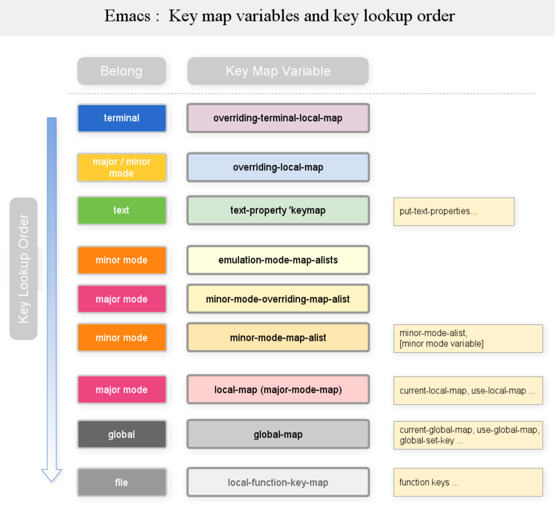

Infoの22.8 Searching the Active Keymaps, 22.9 Controlling the Active Keymapsなどから。

「belong」は誰がその変数を管理するかとか、変数の所属先という感じ。

** 基本
全バッファ共通は =global-map= 、メジャーモードは =local-map= を設定する。

マイナーモードはまとめて =minor-mode-map-alist= に入っていて、マイナーモードの変数が =on= か =off= で有効無効が決まる。
このリストの順番も重要。

テキストには文字単位でkeymapと言う属性をつけて、キーバインドを設定できる。

あと、これらのどれにもヒットしなければ、 =local-function-key-map= でキーの変換が行われる。
例えば、環境によって =C-i= （タブ文字） と =<tab>= は区別されているが、実質は同じと見なした方が便利なのでここで変換される。

優先順位は見たまま。 =text-property 'keymap= > =minor-mode-map-alist= > =local-map= > =global-map= > =local-function-key-map=

** override
この優先順位を少し覆すことが出来るしくみがoverriding関係。
CSSの =important!= のような感じ。

まず、メジャーモードよりマイナーモードの方が優先されてしまうので、これを覆す仕組みが =minor-mode-overriding-map-alist= 。
ただ、覆そうとしているマイナーモードの名前を知らないといけない。

次に、文字単位のkeymapをメジャーモードやマイナーモードから覆す仕組みが =overriding-local-map= 。

最後に、端末入力の最上位で入力を乗っ取る仕組みが =overriding-terminal-local-map= 。
これは影響範囲がその端末だけ。

=emulation-mode-map-alists= は他のメジャーモードやマイナーモードが別のモードのキーマップを乗っ取ったり、 =remap= で挙動を変えたりする場合に使うもの。
検索してもあまり情報がない (cua, viperとかぐらい)。

* Emacsでプレフィックスキーにバインドする方法
:properties:
:export_file_name: generated/contents/blog/2020/609573
:export_date: 2020-05-26
:export_updated: 2020-05-26
:export_tags: emacs emacs-lisp keybinding leaf-el
:end:

ネタ元はEmacs-jp。
#+begin_quote
namnium  06:43
すみません、とても小さい質問なのですが、検索ワードが思いつかなかったので質問させてください。
yasnippetでキーバインド C-x i i  をスニペット挿入に割り当てたところ、今まで使用していた insert-file C-x i  を打てなくなってしまったのですが、このようにキーバインドを途中で打ち切りたくなった時はどうすればいいのでしょうか?
とりあえず現在は M-x insert-file  で諦めています...

conao3  08:18
インタラクティブなら、C-x i iにnilをバインドした後にC-x iを再バインドします。
インタラクティブでなくていいなら、init.elの該当行を削除して再起動するだけです。

namnium  09:48
両立って無理な感じですか?

conao3  09:50
うーん、、独自にキーを待つ関数をC-x iに登録したら実現できるかもしれませんが、、
#+end_quote

ということでEmacsにできないことはないので、実装してみた。

#+begin_src emacs-lisp
  (leaf async-await
    :ensure t
    :config
    (leaf c/insert-file
      :leaf-defer nil
      :pre-setq ((c/insert-file-enable . t)
                 (c/insert-file-delay . 1.0))
      :bind (("C-x i" . nil)
             ("C-x i i" . yas-insert-snippet))
      :config
      (funcall
       (async-lambda ()
         (while c/insert-file-enable
           (await (promise:delay c/insert-file-delay))
           (warn "%s" (prin1-to-string
                       (which-key--this-command-keys)))
           (when (equal [24 105] (which-key--this-command-keys))
             (warn "Detect: C-x i")
             (await (promise:delay c/insert-file-delay))
             (when (equal [24 105] (which-key--this-command-keys))
               (warn "Redetect: C-x i")
               (call-interactively #'insert-file))))))))
  (setq c/insert-file-enable nil)
#+end_src

async-awaitとwhich-keyに依存しています。

ループを止める手段が用意されてないので、外から =c/insert-file-enable= を =nil= に設定することで止めます。

あと =call-interactively= を =quit= すると無限ループが止まってしまうんですが、なぜだろう。。

=C-x i= を打って、Redetectされる前に =i= を素早く入力すると、 =yas-insert-snippet= が実行されます。
Redetectされると =insert-file= が実行されます。

* Lispでスペシャルフォームのorやandをapplyする方法
:properties:
:export_file_name: generated/contents/blog/2020/6e67e4
:export_date: 2020-05-26
:export_updated: 2020-05-26
:export_tags: emacs-lisp lisp
:end:


=or= や =and= を =apply= したい。

つまり、いろんな操作によって得られたリストに対して =or= や =and= がとりたい。

#+begin_export html
<blockquote class="twitter-tweet"><p lang="ja" dir="ltr">なんでこんな面倒なことをしてるんだと思ったら、andがsubrだからapplyできないのか。<br>この問題、CLerはどうやって解決するんだろう <a href="https://twitter.com/hashtag/lisp?src=hash&amp;ref&#95;src=twsrc%5Etfw">#lisp</a> <a href="https://t.co/cmwx3p8ABm">pic.twitter.com/cmwx3p8ABm</a></p>&mdash; Conao3 (@conao&#95;3) <a href="https://twitter.com/conao&#95;3/status/1243861782352912385?ref&#95;src=twsrc%5Etfw">March 28, 2020</a></blockquote> <script async src="https://platform.twitter.com/widgets.js" charset="utf-8"></script>
<blockquote class="twitter-tweet"><p lang="ja" dir="ltr">(every #&#39;identity &lt;list&gt;) というのも。</p>&mdash; Shiro Kawai (@anohana) <a href="https://twitter.com/anohana/status/1243863766619410432?ref&#95;src=twsrc%5Etfw">March 28, 2020</a></blockquote> <script async src="https://platform.twitter.com/widgets.js" charset="utf-8"></script>
#+end_export

河合さんに =every= を教えてもらいました。

#+begin_src emacs-lisp
  (mapcar #'featurep '(emacs leaf use-package-leaf))
  ;;=> (t t nil)

  (cl-every #'identity (mapcar #'featurep '(emacs leaf use-package-leaf)))
  ;;=> nil

  (cl-every #'identity (mapcar #'featurep '(emacs leaf)))
  ;;=> t
#+end_src

たしかに上手くいっている。 =every= は =and= 相当だったので、 =some= は =or= 相当となる。

#+begin_src emacs-lisp
  (cl-some #'identity (mapcar #'featurep '(emacs leaf)))
  ;;=> t

  (cl-some #'identity (mapcar #'featurep '(use-package-leaf use)))
  ;;=> nil
#+end_src

もちろん、今回の方法はスペシャルフォームではないので、評価してはいけない式が後続している場合、普通にエラーになる。

#+begin_src emacs-lisp
  (or nil t (/ 1 0))
  ;;=> t

  (cl-some #'identity (list nil t (/ 1 0)))
  ;;=> Debugger entered--Lisp error: (arith-error)
  ;;     /(1 0)
  ;;     (list nil t (/ 1 0))
  ;;     (cl-some (function identity) (list nil t (/ 1 0)))
  ;;     eval((cl-some (function identity) (list nil t (/ 1 0))) nil)
  ;;     scratch-comment--elisp--eval-last-sexp(t)
  ;;     scratch-comment--eval-last-sexp(t)
  ;;     scratch-comment-eval-sexp()
  ;;     funcall-interactively(scratch-comment-evalp-sexp)
  ;;     call-interactively(scratch-comment-eval-sexp nil nil)
  ;;     command-execute(scratch-comment-eval-sexp)
#+end_src

* リストに関数を適用して最初にnon-nilを返した値を得る方法
:properties:
:export_file_name: generated/contents/blog/2020/cec89c
:export_date: 2020-05-26
:export_updated: 2020-05-26
:export_tags: emacs-lisp
:end:


このような関数をさくっと使いたい。
3つのポイントがあり、「リストに関数を適用して」「最初にnon-nilが返ってきた」「その値を得る」ということ。

2つめのポイントまでなら =cl-find-if= がそのまま使える。
=cl-find-if= は「リストに関数を適用して」「最初にnon-nilが返ってきた」「元の値を得る」ことができる。

#+begin_src emacs-lisp
  (cl-find-if (lambda (elm) (when (<= 3 elm) (* elm elm))) '(1 2 3 4))
  ;;=> 3
#+end_src

私が欲しいのはこういう関数です。
#+begin_src emacs-lisp
  (defun first-value (fn lst)
    "Apply FN for LST and return first non-nil value."
    (funcall fn (cl-find-if fn lst)))
  ;;=> first-value

  (first-value (lambda (elm) (when (<= 3 elm) (* elm elm))) '(1 2 3 4))
  ;;=> 9
#+end_src

Emacs-jpで聞いたところ、koshさんに =seq-some= を教えてもらいました。

#+begin_src emacs-lisp
  (seq-some (lambda (elm) (when (<= 3 elm) (* elm elm))) '(1 2 3 4))
  ;;=> 9
#+end_src

便利。

* MELPAのパッケージページにHomepageリンクが追加
:properties:
:export_file_name: generated/contents/blog/2020/cbf3fd
:export_date: 2020-05-27
:export_updated: 2020-05-27
:export_tags: emacs melpa package-management
:end:

MELPAの公式がツイートしてた。

#+begin_export html
<blockquote class="twitter-tweet"><p lang="en" dir="ltr">We changed the MELPA website&#39;s package pages so that &quot;Homepage&quot; links go to the URL named in the package&#39;s Homepage or URL header, instead of directly to the source code. Hope that helps you explore more conveniently!</p>&mdash; MELPA (@melpa&#95;emacs) <a href="https://twitter.com/melpa&#95;emacs/status/1265125454282801153?ref&#95;src=twsrc%5Etfw">May 26, 2020</a></blockquote> <script async src="https://platform.twitter.com/widgets.js" charset="utf-8"></script>
#+end_export

どうやらこの[[https://github.com/melpa/melpa/commit/02163bf1d920d076f927803796b0f86e3f13ef9b][コミット]]らしい。この[[https://github.com/melpa/melpa/issues/6914][issue]]が引用されています。
さらにこの[[https://lists.gnu.org/archive/html/emacs-devel/2020-05/msg02470.html][ML]]の投稿がリンクされている。投稿者は[[https://www.gnu.org/software/emms/][Emms]]のメンテナであるYoniさん。

ポイントは以下。
#+begin_example
What the MEPLA people are doing that I don't like:

    * Never communicate with the developers of the Emms in any way.

    * Omit many files that come with Emms.

    * Associate Emms with several Emms extensions that live only on
      MELPA and that we, the Emms developers, have never heard
      about. This would give anyone accessing Emms via MELPA that those
      extensions are somehow a part of Emms, when they are not.

      Maybe those extensions are good, in which case I would love for
      the developers to contact us, the Emms developers. But Maybe those
      extensions are bad, don't work, are out of date, or connect with
      non-free services.

    * Not even linking to the Emms home page
      (https://www.gnu.org/software/emms/).
#+end_example

#+begin_example
Ideas for improvement:

    * Encourage people to speak to the developers of a project before
      packaging it.

    * Find a way of packaging a project as-is. For instance, Emms could
      be distributed as is, and the M/ELPA software could simply point
      at where Emms keeps its .el files for Emacs to find. This is
      instead of how I see ELPA working now, which is to force the
      software through a kind of a sieve (I think ELPA calls it a
      recipe) where only a select few files come out the other end.

      Emms doesn't need a recipe; it already comes organized and
      packaged for working with Emacs.

      It makes me think of taking bread, crumbling it up, the mushing
      those crumbs back together to re-form a new loaf of bread.
#+end_example

この投稿を受けて、MELPAにHomepageリンクの追加が提案されました。

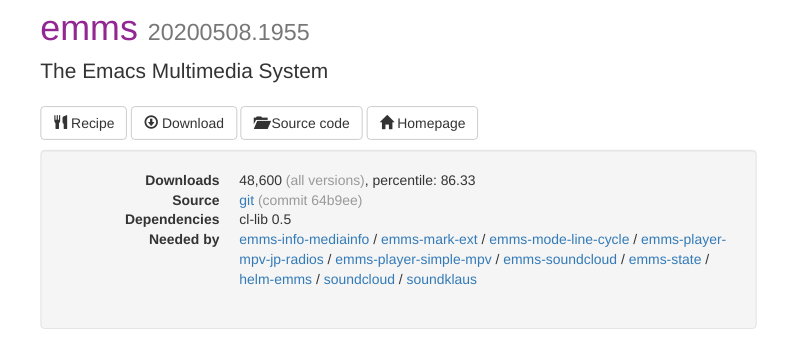

このようにHomepageというボタンが追加されました。

ただ、、MLは個人的にあまり使いたくない。。

そもそも[[https://lists.gnu.org/archive/html/emacs-devel/2020-05/threads.html][量が膨大]]すぎるし、この量をさばくUIもない。
本家の開発に参加したいのは山々なのですが、本質とは関係ないところで敷居を高くしている気がします。

* Elispファイルをタブ/スペース混在インデントからスペースインデントに修正する方法
:properties:
:export_file_name: generated/contents/blog/2020/67a1dc
:export_date: 2020-08-01
:export_updated: 2020-08-01
:export_tags: emacs emacs-lisp git
:end:

** インデントの話
そもそもEmacsはタブ/スペース混在インデントが初期設定です。

そのためEmacs本体のソースなどはすべて混在インデントでインデントされています。
しかし「空白8つよりタブ1つにしてファイル容量を削減しなくては」という時代は明らかに終わったので、スペースでインデントしましょう。して下さい(泣)。

[[https://github.com/bbatsov/emacs-lisp-style-guide#source-code-layout--organization][Emacs lisp style guide]]にもスペースでインデントすることが太字で記載されていますし、 =white-space-mode= での見た目も良いです。

(ということでほとんどのユーザーはグローバルで =indent-tabs-mode= を =nil= に設定しています。
そのため本体のソースはタブ/スペース混在インデントの部分とスペースインデントの部分が混在しています。カオス。)

これからパッケージを作り始めるときはさておき、歴史のあるソースで修正するのは多少の痛みを伴います。
しかし、Blameで一回変なコミットを見てしまうことを甘んじて受け入れてでもスペースでインデントして欲しいのです。

そもそも[[https://git-scm.com/docs/git-log][git log]]や[[https://git-scm.com/docs/git-blame][git blame]]には空白の変更を無視するオプション( =-w= )があるので履歴の面でもデメリットは無視できます。
Magitのblameでは =-w= はデフォルトで指定されていますし、[[https://github.blog/2018-05-01-ignore-white-space-in-code-review/][GitHubのdiffでも無視]]することができます。

メリットとデメリットは以上です。
** インデントの変更
「よし、スペースインデントにしてやるぜ。」とタブ/スペース混在インデントから考えを変えて下さった方。ありがとうございます。

しかし、すでに成長しきっているプロジェクトで数十のファイルがあるんだけど。。というときには次のスニペットを使って頂ければと思います。

1. diredでElispだけをフィルタリング([[http://emacs.rubikitch.com/dired-filter/][dired-filter]])して、
2. 最初のファイルにポインタを合わせ、
3. 次のスニペットを =M-:= から実行するだけです。

   #+begin_src emacs-lisp
     (while (dired-get-filename nil 'no-error)
       (let ((file (dired-get-filename))
             (indent-tabs-mode nil))
         (with-temp-file file
           (insert-file-contents file)

           (emacs-lisp-mode)
           (delete-trailing-whitespace)
           (untabify (point-min) (point-max))
           (indent-region (point-min) (point-max)))
         (dired-next-line 1)))
   #+end_src

多少時間がかかるかもしれませんが、diredでリストされているファイルの末尾まで処理を実行してくれます。
** 今後の悲劇を防止する
タブ/スペース混在インデントでソースが管理されていたということは、レポジトリオーナーやコントリビュータによって、また混在インデントによるコミットが行われる可能性が高いです。

あるディレクトリ以下で特定の設定を強制することができます。 =.dir-locals.el= です。

以下の =.dir-locals.el= をレポジトリルートに置いて今後の悲劇を防止できます。この方法は[[https://github.com/magit/magit/blob/master/.dir-locals.el][magitのレポジトリ]]でも採用されています。

#+begin_src emacs-lisp
  ((emacs-lisp-mode
    (indent-tabs-mode . nil))
#+end_src

=.dir-locals.el= をレポジトリルートに置きたくないんだけど。という場合には以下を各Elispファイルの末尾付近に置いておけば大丈夫です。
#+begin_src emacs-lisp
  ;; Local Variables:
  ;; indent-tabs-mode: nil
  ;; End:
#+end_src

なお、いろいろなプロジェクトを見て慣習を探ったのですが、 =provide= と =ends here= の間に置くことが多いようです。
#+begin_src emacs-lisp
  (provide '{{pkg-name}})

  ;; Local Variables:
  ;; indent-tabs-mode: nil
  ;; End:

  ;;; {{pkg-name}}.el ends here
#+end_src
** まとめ
タブ/スペース混在インデントは役目を終えました。

Emacsは後方互換性を重視しているためデフォルト値が変更される望みは薄いですが、コミュニティとしてはスペースインデントを使うということでなにとぞ。。

* Elispでstring-trimの代替を用意する方法
:properties:
:export_file_name: generated/contents/blog/2020/dc06b0
:export_date: 2020-08-10
:export_updated: 2020-08-10
:export_tags: emacs-lisp string
:end:

** 背景
~string-trim~ とは与えた文字列の先頭と末尾の空白文字っぽいものを削除してくれる ~subr-x~ に定義されている便利関数です。
しかし、 ~string-trim~ が ~subr-x~ に追加されたのはEmacs-24.4からなので、Emacs-24.4未満で動かしたいエクストリームパッケージはその恩恵を得ることができません。
簡単な関数なので何度か作ったのですが、いちいち自分のパッケージをgrepするのが面倒なので、ブログポストとして残しておきます。

** 実装
~string-trim~ はサブルーチンとして ~string-left~ と ~string-right~ を組み合わせて実装されています。

#+begin_src emacs-lisp
(defsubst string-trim-left (string &optional regexp)
  "Trim STRING of leading string matching REGEXP.

REGEXP defaults to \"[ \\t\\n\\r]+\"."
  (if (string-match (concat "\\`\\(?:" (or regexp "[ \t\n\r]+") "\\)") string)
      (substring string (match-end 0))
    string))

(defsubst string-trim-right (string &optional regexp)
  "Trim STRING of trailing string matching REGEXP.

REGEXP defaults to  \"[ \\t\\n\\r]+\"."
  (let ((i (string-match-p (concat "\\(?:" (or regexp "[ \t\n\r]+") "\\)\\'")
                           string)))
    (if i (substring string 0 i) string)))

(defsubst string-trim (string &optional trim-left trim-right)
  "Trim STRING of leading and trailing strings matching TRIM-LEFT and TRIM-RIGHT.

TRIM-LEFT and TRIM-RIGHT default to \"[ \\t\\n\\r]+\"."
  (string-trim-left (string-trim-right string trim-right) trim-left))
#+end_src

つまり、これらを連結すればできます。

#+begin_src emacs-lisp
(defun my--string-trim (str &optional trim-left trim-right)
  "Trim STR of leading and trailing strings matching TRIM-LEFT and TRIM-RIGHT.

TRIM-LEFT and TRIM-RIGHT default to \"[ \\t\\n\\r]+\".
Original function is `string-trim'.
This function is polyfill for Emacs<24.4."
  (let ((res str))
    (setq res (replace-regexp-in-string (or trim-left "\\`[ \t\n\r]*") "" res))
    (setq res (replace-regexp-in-string (or trim-right "[ \t\n\r]*\\'") "" res))
    res))
#+end_src

また、この実装では ~replace-regexp-in-string~ を2回実行していますが、正規表現を工夫すれば1回で良いです。

#+begin_src emacs-lisp
  (defun my--string-trim (str)
    "Trim STR of leading and trailing space like strings.

  TRIM-LEFT and TRIM-RIGHT default to \"[ \\t\\n\\r]+\".
  Original function is `string-trim'.
  This function is polyfill for Emacs<24.4."
    (replace-regexp-in-string "\\`[ \t\n\r]*\\|[ \t\n\r]*\\'" "" str))
#+end_src

** まとめ
~string-trim~ を実装しました。
もう一度書きますが、この関数は ~subr-x~ に定義されている関数なので、「Emacs-24.4未満で動かしたいんだけど」というエクストリームパッケージ用です。
正攻法としてはEmacsの要求バージョンを上げてしまうのが一番早いので、そこは留意して頂ければと思います。

* GitHub Actionsで全てのジョブの実行を強制する方法
:properties:
:export_file_name: generated/contents/blog/2020/0fb03f
:export_date: 2020-08-11
:export_updated: 2020-08-11
:export_tags: github-actions ci
:end:

** 背景
GitHub Actions便利ですね。
着々とMSの資金力に囲われている気がしますが、便利なものには乗っかってしまった方がいいのが事実。

困っていたのはmatrixで複数バージョンのテストを走らせたときに、ひとつ失敗するとまだ終わってないジョブが強制的にキャンセルされてしまうこと。
([[https://github.com/conao3/cort.el/actions/runs/202646423][実際のActions]])

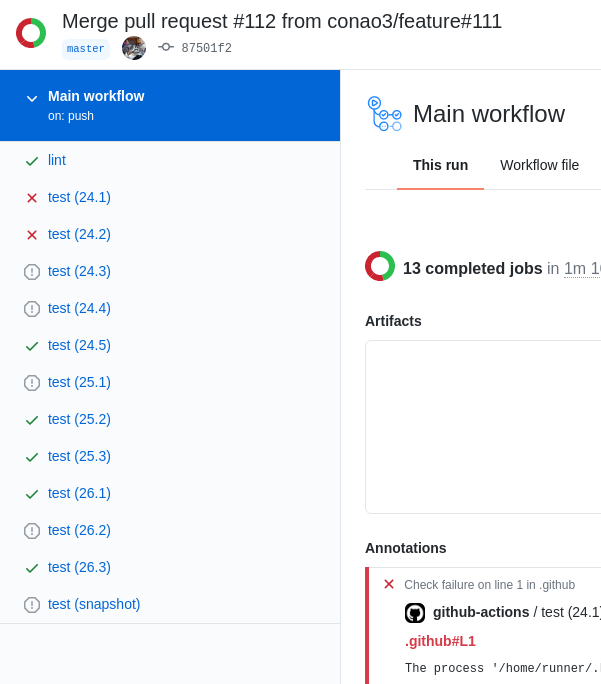

この例だとバージョンの違いでCIが失敗することが分かりますが、その境界が分かりません。これは困る。

ドキュメントを良く見ると、この動作を変える方法が載ってたので紹介する次第です。

** 方法
ドキュメントの該当箇所は 「[[https://docs.github.com/en/actions/reference/workflow-syntax-for-github-actions#jobsjob_idstrategyfail-fast][Workflow syntax for GitHub Actions - jobs.<job_id>.strategy.fail-fast]]」です。

~strategy.fail-fast-~ に ~false~ を指定するだけです。全体はこんな感じ。([[https://github.com/conao3/cort.el/actions/runs/202649689/workflow][実際のActions]])

#+begin_src yaml
name: Main workflow
on:
  push: {branches: [master]}
  pull_request: {branches: [master]}

jobs:
  lint:
    runs-on: ubuntu-latest
    steps:
    - uses: actions/checkout@v1
    - uses: purcell/setup-emacs@master
      with:
        version: '26.3'
    - uses: conao3/setup-keg@master
    - name: Run lint
      run: 'make lint'

  test:
    runs-on: ubuntu-latest
    strategy:
      fail-fast: false
      matrix:
        emacs_version:
          - '24.1'
          - '24.2'
          - '24.3'
          - '24.4'
          - '24.5'
          - '25.1'
          - '25.2'
          - '25.3'
          - '26.1'
          - '26.2'
          - '26.3'
          - 'snapshot'
        include:
          - emacs_version: 'snapshot'
            allow_failure: true
    steps:
    - uses: actions/checkout@v1
    - uses: purcell/setup-emacs@master
      with:
        version: ${{ matrix.emacs_version }}
    - uses: conao3/setup-keg@master

    - name: Run tests
      if: matrix.allow_failure != true
      run: 'make test'

    - name: Run tests (allow failure)
      if: matrix.allow_failure == true
      run: 'make test || true'
#+end_src

この設定をすることで以下の結果を得ることができました。
境界はEmacs-24.3とEmacs-24.4の間でしたね。

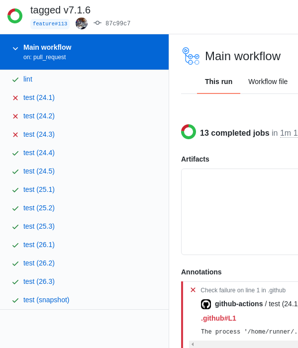

** まとめ
マシンを貸し出す側からしたらさっさとジョブを中止したいのだと思いますが、
ユーザーからすると ~strategy.fail-fast~ を ~false~ に設定するのは必須かもしれません。

パブリックレポジトリでのActionsは無料なのでどんどん使ってバグをmasterに入れないようにしましょう!

** 参考
- [[https://docs.github.com/en/actions/reference/workflow-syntax-for-github-actions][GitHub Docs - Workflow syntax for GitHub Actions]]

* Elispでplist-getをsetfに対応させる方法
:properties:
:export_file_name: generated/contents/blog/2020/48c25c
:export_date: 2020-08-17
:export_updated: 2020-08-17
:export_tags: emacs-lisp macro
:end:

** 背景
~setf~ という便利な関数があります。

これは汎変数に対する ~setq~ と説明できるのですが、この短い紹介では表せないほどの汎用性と利便性を提供してくれます。

汎変数についてはkawabataさんの神記事([[https://qiita.com/kawabata@github/items/9a1a1e211c57a56578d8#%E6%B1%8E%E5%A4%89%E6%95%B0%E3%81%AE%E5%AE%9A%E7%BE%A9%E6%96%B9%E6%B3%95][Qiita - Emacs Lispの汎変数（とその他）]])があるので、まずそちらを参照していただければと思います。

さて、問題は ~alist-get~ は汎変数として定義されているのに、なぜか ~plist-get~ の汎変数が定義されていないことです。

~alist~ も ~plist~ もlispの基本構造で、本質的に同じなので ~alist~ だけ使えて ~plist~ だけ使えないというのは
無意味な非対称性を感じます。

今回は ~plist~ に対して ~setf~ を使えるようにすることを目的とします。

** 汎変数の定義
magitなどの大きな(そして注意深く実装されている)パッケージを読んでいると、いきなり ~gv-~ から始まるS式を見ることがあります。

これが汎変数の定義であり、標準で提供されていない汎変数を独自に定義することができます。

汎変数の定義についてもkawabataさんの記事([[https://qiita.com/kawabata@github/items/9a1a1e211c57a56578d8#%E6%B1%8E%E5%A4%89%E6%95%B0%E3%81%AE%E5%AE%9A%E7%BE%A9%E6%96%B9%E6%B3%95][Qiita - Emacs Lispの汎変数（とその他）#汎変数の定義方法]])に記載があります。

ここでは ~gv.el~ の実装を参考に、汎変数を定義する方法を解説します。

*** gv-define-simple-setter
最も簡単なのは ~gv-define-simple-setter~ を使用できる場合です。
セッターを組み立てる際、 ~get~ <-> ~set~ / ~put~ の対応が取れている関数が用意されている場合で、単に関数シンボルを替えるだけで良い場合に使用できます。

#+begin_src emacs-lisp
(gv-define-simple-setter aref aset)
(gv-define-simple-setter car setcar)
(gv-define-simple-setter cdr setcdr)
(gv-define-simple-setter get put)
(gv-define-simple-setter default-value set-default)
(gv-define-simple-setter process-get process-put)
#+end_src

~setf~ や ~rotatef~ はこのように展開され、意図通りにリストが変更されます。
#+begin_src emacs-lisp
(ppp-macroexpand-all
 (let ((target '(a b c)))
   (setf (car target) 'modify)
   target))
;;=> (let ((target '(a b c)))
;;     (let* ((v target))
;;       (setcar v 'modify))
;;     target)

(let ((target '(a b c)))
  (setf (car target) 'modify)
  target)
;;=> (modify b c)

;;;;;;;;;;;;;;;;;;;;;;;;;;;;;;;;;;;;;;;;;;;;;;;;;;

(ppp-macroexpand-all
 (let ((target '(a b c)))
   (cl-rotatef (car target) (cadr target))
   target))
;;=> (let ((target '(a b c)))
;;     (let* ((v target)
;;            (--cl-rotatef-- (car v)))
;;       (progn
;;         (setcar v
;;                 (let* ((v target))
;;                   (prog1 (car (cdr v))
;;                     (setcar
;;                      (cdr v)
;;                      --cl-rotatef--))))
;;         nil))
;;     target)

(let ((target '(a b c)))
  (cl-rotatef (car target) (cadr target))
  target)
;;=> (b a c)
#+end_src

*** gv-define-setter
~gv-define-setter~ はセッターを組み立てる際に、単に関数シンボル置き換えでは実現できない場合に使用します。

基本的にはこのマクロを使うことになるかと思います。
なお、先程の ~gv-define-simple-setter~ は ~gv-define-setter~ を生成するマクロとして定義されていました。

#+begin_src emacs-lisp
(gv-define-setter caar (val x) `(setcar (car ,x) ,val))
(gv-define-setter cadr (val x) `(setcar (cdr ,x) ,val))
(gv-define-setter cdar (val x) `(setcdr (car ,x) ,val))
(gv-define-setter cddr (val x) `(setcdr (cdr ,x) ,val))
(gv-define-setter elt (store seq n)
  `(if (listp ,seq) (setcar (nthcdr ,n ,seq) ,store)
     (aset ,seq ,n ,store)))
(gv-define-setter gethash (val k h &optional _d)
 `(puthash ,k ,val ,h))
#+end_src

~gv-define-setter~ の使用方法は眺めていると分かってきますが、
第1引数に汎変数を定義する関数シンボル、第2引数に関数の引数、第3引数にマクロ展開部を指定します。
第2引数は先頭に変更先の値を受け取って、その後に関数の引数を並べることになっているようです。

~setf~ や ~rotatef~ はこのように展開され、意図通りにリストが変更されます。

#+begin_src emacs-lisp
(ppp-macroexpand-all
 (let ((target '(a b c)))
   (setf (cadr target) 'modify)
   target))
;;=> (let ((target '(a b c)))
;;     (let* ((v target))
;;       (setcar (cdr v) 'modify))
;;     target)

(let ((target '(a b c)))
  (setf (cadr target) 'modify)
  target)
;;=> (a modify c)

;;;;;;;;;;;;;;;;;;;;;;;;;;;;;;;;;;;;;;;;;;;;;;;;;;

(ppp-macroexpand-all
 (let ((target '(a b c)))
   (cl-rotatef (cadr target) (caddr target))
   target))
;;=> (let ((target '(a b c)))
;;     (let* ((v target)
;;            (--cl-rotatef-- (car (cdr v))))
;;       (progn
;;         (setcar
;;          (cdr v)
;;          (let* ((v (cdr (cdr target))))
;;            (prog1 (car v)
;;              (setcar v --cl-rotatef--))))
;;         nil))
;;     target)

(let ((target '(a b c)))
  (cl-rotatef (cadr target) (caddr target))
  target)
;;=> (a c b)
#+end_src

*** gv-define-expander
~gv-define-expander~ はセッターを生成する際にセッターを使いたい場合など、特別な処理を要する関数に使用します。

~alist-get~ の汎変数はこのマクロで定義されています。

なお、先程の ~gv-define-setter~ は ~gv-define-expander~ を生成するマクロとして定義されていました。

#+begin_src emacs-lisp
(gv-define-expander alist-get
  (lambda (do key alist &optional default remove testfn)
    (macroexp-let2 macroexp-copyable-p k key
      (gv-letplace (getter setter) alist
        (macroexp-let2 nil p `(if (and ,testfn (not (eq ,testfn 'eq)))
                                  (assoc ,k ,getter ,testfn)
                                (assq ,k ,getter))
          (funcall do (if (null default) `(cdr ,p)
                        `(if ,p (cdr ,p) ,default))
                   (lambda (v)
                     (macroexp-let2 nil v v
                       (let ((set-exp
                              `(if ,p (setcdr ,p ,v)
                                 ,(funcall setter
                                           `(cons (setq ,p (cons ,k ,v))
                                                  ,getter)))))
                         `(progn
                            ,(cond
                             ((null remove) set-exp)
                             ((or (eql v default)
                                  (and (eq (car-safe v) 'quote)
                                       (eq (car-safe default) 'quote)
                                       (eql (cadr v) (cadr default))))
                              `(if ,p ,(funcall setter `(delq ,p ,getter))))
                             (t
                              `(cond
                                ((not (eql ,default ,v)) ,set-exp)
                                (,p ,(funcall setter
                                              `(delq ,p ,getter))))))
                            ,v))))))))))
#+end_src

~alist-get~ の汎変数の定義がこのように複雑になっているのは、「alistに存在しないキーに対して ~setf~ したときにコンスセルごと追加する」という処理があるからです。

#+begin_src emacs-lisp
(ppp-macroexpand-all
 (let ((target '((a ."a") (b . "b") (c . "c"))))
   (setf (alist-get 'd target) "modify")
   target))
;;=> (let ((target '((a . "a") (b . "b") (c . "c"))))
;;     (let* ((p (if (and nil (not (eq nil 'eq)))
;;                   (assoc 'd target nil)
;;                 (assq 'd target))))
;;       (progn
;;         (if p
;;             (setcdr p "modify")
;;           (setq target (cons (setq p (cons 'd "modify")) target)))
;;         "modify"))
;;     target)

;;;;;;;;;;;;;;;;;;;;;;;;;;;;;;;;;;;;;;;;;;;;;;;;;;

(let ((target '((a ."a") (b . "b") (c . "c"))))
  (setf (alist-get 'a target) "modify")
  target)
;;=> ((a . "modify") (b . "b") (c . "c"))

(let ((target '((a ."a") (b . "b") (c . "c"))))
  (setf (alist-get 'd target) "modify")
  target)
;;=> ((d . "modify") (a . "a") (b . "b") (c . "c"))
#+end_src

「alistに存在しないキーに対して ~setf~ したときにコンスセルごと追加する」という処理が必要ない場合、 ~gv-define-setter~ を使って簡単に定義することができます。
(さらに簡単のため、 ~alist-get~ の ~default~ 、 ~remove~ 、 ~testfn~ 引数も無視します。)

#+begin_src emacs-lisp
(gv-define-setter alist-get (val key alist &optional _default _remove _testfn)
  `(setcdr (assq ,key ,alist) ,val))
;;=> ...

(ppp-macroexpand-all
 (let ((target '((a ."a") (b . "b") (c . "c"))))
   (setf (alist-get 'a target) "modify")
   target))
;;=> (let ((target '((a . "a") (b . "b") (c . "c"))))
;;     (let* ((v target))
;;       (setcdr (assq 'a v) "modify"))
;;     target)

;;;;;;;;;;;;;;;;;;;;;;;;;;;;;;;;;;;;;;;;;;;;;;;;;;

(let ((target '((a ."a") (b . "b") (c . "c"))))
  (setf (alist-get 'a target) "modify")
  target)
;;=> ((a . "modify") (b . "b") (c . "c"))

(let ((target '((a ."a") (b . "b") (c . "c"))))
  (setf (alist-get 'd target) "modify")
  target)
;;=> Debugger entered--Lisp error: (wrong-type-argument consp nil)
;;     setcdr(nil "modify")
;;     (let* ((v target)) (setcdr (assq 'd v) "modify"))
;;     (setf (alist-get 'd target) "modify")
;;     (let ((target '((a . "a") (b . "b") (c . "c")))) (setf (alist-get 'd target) "modify") target)
;;     (progn (let ((target '((a . "a") (b . "b") (c . "c")))) (setf (alist-get 'd target) "modify") target))
;;     eval((progn (let ((target '((a . "a") (b . "b") (c . "c")))) (setf (alist-get 'd target) "modify") target)) t)
#+end_src

このように簡単に定義できますが、alistに存在しないキーに対して作用させようとするとエラーになってしまいます。
~alist-get~ の汎変数はこのような要件を満たすために複雑な定義になっています。

なお、 ~gv-define-expander~ は ~gv-define-setter~ から生成されるので、 ~gv-define-setter~ がどのような式を生成するかを眺めることでも使用法を予想することができます。

#+begin_src emacs-lisp
(ppp-macroexpand
  (gv-define-setter cddr (val x) `(setcdr (cdr ,x) ,val)))
;;=> (gv-define-expander cddr
;;     (lambda (do &rest args)
;;       (declare-function gv--defsetter "gv"
;;                         (name setter do args &optional vars))
;;       (gv--defsetter 'cddr
;;                      (lambda (val x) `(setcdr (cdr ,x) ,val))
;;                      do args)))
#+end_src

**** alist-getの汎変数余談
~gv-define-setter~ は分かりやすいので、どうにかして ~alist-get~ の汎変数を ~gv-define-setter~ で定義できないでしょうか。
まず思いつくのはこのような定義です。

(~macroexp-let2~ は第1引数が ~nil~ のときに、第2引数の名前で ~make-symbol~ したものに第3引数の値をlet束縛するものです。

これはマクロ展開のイディオムを簡略化するものであり、望まない変数捕捉を避けるものです。(マクロの変数捕捉についてはOnlisp([[http://www.asahi-net.or.jp/~kc7k-nd/onlispjhtml/variableCapture.html][Onlisp - 変数捕捉]])参照))

#+begin_src emacs-lisp
(gv-define-setter alist-get (val key alist &optional _default _remove _testfn)
  (macroexp-let2 nil p `(assq ,key ,alist)
    `(if ,p
         (setcdr ,p ,val)
       (setq ,alist (cons (cons ,key ,val) ,alist)))))
;;=> ...

(ppp-macroexpand-all
 (let ((target '((a ."a") (b . "b") (c . "c"))))
   (setf (alist-get 'a target) "modify")
   target))
;;=> (let ((target '((a . "a") (b . "b") (c . "c"))))
;;     (let* ((v target)
;;            (p (assq 'a v)))
;;       (if p
;;           (setcdr p "modify")
;;         (setq v (cons (cons 'a "modify") v))))
;;     target)
;;   nil

;;;;;;;;;;;;;;;;;;;;;;;;;;;;;;;;;;;;;;;;;;;;;;;;;;

(let ((target '((a ."a") (b . "b") (c . "c"))))
  (setf (alist-get 'a target) "modify")
  target)
;;=> ((a . "modify") (b . "b") (c . "c"))

(let ((target '((a ."a") (b . "b") (c . "c"))))
  (setf (alist-get 'd target) "modify")
  target)
;;=> ((a . "a") (b . "b") (c . "c"))
#+end_src

しかし上手く動いてないようです。マクロ展開結果を注意深く見れば分かるのですが、letで一時的に束縛された変数にsetqしてしまっています。
これではグローバルの値を変更できていません。

先程確認したように ~gv-define-setter~ は ~gv--defsetter~ を展開し、これに含まれる ~macroexp-let2~ によりalistをlet束縛してしまいます。
~gv-define-expander~ を直接使うことで ~macroexp-let2~ を展開せず、 ~gv-letplace~ でグローバル値のセッターを得ることができます。

#+begin_src emacs-lisp
(defun gv--defsetter (name setter do args &optional vars)
  "Helper function used by code generated by `gv-define-setter'.
NAME is the name of the getter function.
SETTER is a function that generates the code for the setter.
NAME accept ARGS as arguments and SETTER accepts (NEWVAL . ARGS).
VARS is used internally for recursive calls."
  (if (null args)
      (let ((vars (nreverse vars)))
        (funcall do `(,name ,@vars) (lambda (v) (apply setter v vars))))
    ;; FIXME: Often it would be OK to skip this `let', but in general,
    ;; `do' may have all kinds of side-effects.
    (macroexp-let2 nil v (car args)
      (gv--defsetter name setter do (cdr args) (cons v vars)))))

(ppp-macroexpand
 (gv-define-setter alist-get (val key alist &optional _default _remove _testfn)
   (gv-letplace (getter setter) alist
     (macroexp-let2 nil p `(assq ,key ,alist)
       `(if ,p
            (setcdr ,p ,val)
          ,(funcall setter `(cons (cons ,key ,val) ,getter)))))))
;;=> (gv-define-expander alist-get
;;     (lambda (do &rest args)
;;       (declare-function gv--defsetter "gv"
;;                         (name setter do args &optional vars))
;;       (gv--defsetter 'alist-get
;;                      (lambda (val key alist &optional _default _remove _testfn)
;;                        (gv-letplace (getter setter) alist
;;                          (macroexp-let2 nil p `(assq ,key ,alist)
;;                            `(if ,p
;;                                 (setcdr ,p ,val)
;;                               ,(funcall setter `(cons (cons ,key ,val)
;;                                           ,getter))))))
;;                      do args)))
;;   nil

(ppp-macroexpand
 (gv-define-expander alist-get
   (lambda (do key alist &optional _default _remove _testfn)
     (gv-letplace (getter setter) alist
       (macroexp-let2 nil p `(assq ,key ,alist)
         (funcall do '_getter
                  (lambda (val)
                    `(if ,p
                         (setcdr ,p ,val)
                       ,(funcall setter `(cons (cons ,key ,val) ,getter))))))))))
;;=> (function-put 'alist-get 'gv-expander
;;                 (lambda (do key alist &optional _default _remove _testfn)
;;                   (gv-letplace (getter setter) alist
;;                     (macroexp-let2 nil p `(assq ,key ,alist)
;;                       (funcall do '_getter
;;                                (lambda (val)
;;                                  `(if ,p
;;                                       (setcdr ,p ,val)
;;                                     ,(funcall setter `(cons (cons ,key ,val)
;;                                                 ,getter)))))))))
;;   nil
#+end_src

次に示すように、 ~gv-define-setter~ では上手くいかず、 ~gv-define-expander~ を使うと上手くいきます。

#+begin_src emacs-lisp
(gv-define-setter alist-get (val key alist &optional _default _remove _testfn)
  (gv-letplace (getter setter) alist
    (macroexp-let2 nil p `(assq ,key ,alist)
      `(if ,p
           (setcdr ,p ,val)
         ,(funcall setter `(cons (cons ,key ,val) ,getter))))))
;;=> ...

(ppp-macroexpand-all
 (let ((target '((a ."a") (b . "b") (c . "c"))))
   (setf (alist-get 'd target) "modify")
   target))
;;=> (let ((target '((a . "a")
;;                   (b . "b")
;;                   (c . "c"))))
;;     (let* ((v target)
;;            (p (assq 'd v)))
;;       (if p
;;           (setcdr p "modify")
;;         (setq v (cons (cons 'd "modify") v))))
;;     target)
;;   nil

(let ((target '((a ."a") (b . "b") (c . "c"))))
  (setf (alist-get 'd target) "modify")
  target)
;;=> ((a . "a") (b . "b") (c . "c"))

;;;;;;;;;;;;;;;;;;;;;;;;;;;;;;;;;;;;;;;;;;;;;;;;;;

(gv-define-expander alist-get
  (lambda (do key alist &optional _default _remove _testfn)
    (gv-letplace (getter setter) alist
      (macroexp-let2 nil p `(assq ,key ,alist)
        (funcall do '_getter
                 (lambda (val)
                   `(if ,p
                        (setcdr ,p ,val)
                      ,(funcall setter `(cons (cons ,key ,val) ,getter)))))))))
;;=> ...

(ppp-macroexpand-all
 (let ((target '((a ."a") (b . "b") (c . "c"))))
   (setf (alist-get 'd target) "modify")
   target))
;;=> (let ((target '((a . "a")
;;                   (b . "b")
;;                   (c . "c"))))
;;     (let* ((p (assq 'd target)))
;;       (if p
;;           (setcdr p "modify")
;;         (setq target (cons (cons 'd "modify") target))))
;;     target)
;;   nil

(let ((target '((a ."a") (b . "b") (c . "c"))))
  (setf (alist-get 'd target) "modify")
  target)
;;=> ((d . "modify") (a . "a") (b . "b") (c . "c"))
#+end_src

** まとめ
~setf~ はとても便利なので、ぜひ使いこなして頂ければと思います。

今回、汎変数を定義する方法についてまとめたので、自作パッケージでも汎変数を定義しておいてあげるとユーザーが便利に使えるパッケージになると思います。

なお、今回の目的である ~plist-get~ の汎変数については ~gv-define-setter~ を使って、次のように定義しました。

後でemacs-develにも投稿しておきたいと思います。
本家に取り入れられればこのパッチなしで ~plit-get~ に対する ~setf~ を使用できるようになります。

#+begin_src emacs-lisp
(gv-define-expander plist-get
  (lambda (do plist prop)
    (macroexp-let2 macroexp-copyable-p key prop
      (gv-letplace (getter setter) plist
        (macroexp-let2 nil p `(plist-member ,getter ,key)
          (funcall do
                   `(cadr ,p)
                   (lambda (val)
                     `(if (plist-member ,plist ,key) (setcar (cdr (plist-member ,plist ,key)) ,val)
                        ,(funcall setter `(cons ,key (cons ,val ,getter)))))))))))
;;=> ...

(ppp-macroexpand-all
 (let ((target '(:a "a" :b "b" :c "c")))
   (setf (plist-get target :a) "modify")
   target))
;;=> (let ((target '(:a "a" :b "b" :c "c")))
;;     (let* ((p (plist-member target :a)))
;;       (if (plist-member target :a)
;;           (setcar
;;            (cdr (plist-member target :a))
;;            "modify")
;;         (setq target (cons :a (cons "modify" target)))))
;;     target)
;;   nil

;;;;;;;;;;;;;;;;;;;;;;;;;;;;;;;;;;;;;;;;;;;;;;;;;;

(let ((target '(:a "a" :b "b" :c "c")))
  (setf (plist-get target :a) "modify")
  target)
;;=> (:a "modify" :b "b" :c "c")

(let ((target '(:a "a" :b "b" :c "c")))
  (cl-rotatef (plist-get target :a) (plist-get target :c))
  target)
;;=> (:a "c" :b "b" :c "a")

(let ((target '(:a "a" :b "b" :c "c")))
  (setf (plist-get target :d) "modify")
  target)
;;=> (:d "modify" :a "a" :b "b" :c "c")
#+end_src

** 参考
- [[https://qiita.com/kawabata@github/items/9a1a1e211c57a56578d8#%E6%B1%8E%E5%A4%89%E6%95%B0%E3%81%AE%E5%AE%9A%E7%BE%A9%E6%96%B9%E6%B3%95][Qiita - Emacs Lispの汎変数（とその他）]]
- [[https://github.com/emacs-mirror/emacs/blob/emacs-27.1/lisp/emacs-lisp/gv.el][Emacs source - gv.el]]
- [[https://github.com/emacs-mirror/emacs/blob/emacs-27.1/lisp/emacs-lisp/macroexp.el][Emacs source - macroexp.el]]

* ピクシブ夏インターンシップ「PIXIV SUMMER BOOT CAMP 2020」体験記
:properties:
:export_file_name: generated/contents/blog/2020/8ecc43
:export_date: 2020-09-24
:export_updated: 2020-09-24
:export_tags: internship
:end:


** はじめに
ピクシブさんのインターンシップ「[[https://www.pixiv.co.jp/news/recruit/article/10019/][PIXIV SUMMER BOOT CAMP 2020]]」へ参加してきました!

期間は8日間という短い期間でしたが、短い期間ながら、とても濃い経験が出来たと思います。

インターン最終日に発表した資料はこちら。

#+html: <script async class="speakerdeck-embed" data-id="3491c9ab20ef40938119aecadb06f1c6" data-ratio="1.77777777777778" src="//speakerdeck.com/assets/embed.js"></script>

** 感想
アウトプットはピクシブ百科事典のオレオレフレームワークからPSR-7/15/17ベースのPHPへ(一部のクラスだが)移行したこと。
触らせて頂いたgitレポジトリのヒストリーだと、cvsからgitへ移行した最初のコミットが9年前、dispatcherやrouter、index.phpには多少手が入ることはあっても抜本的に手が入るのはこれが初めてでした。

最終発表ではこの「9年前」ということに対して、「いやもっと前。。。」というコメントもあったので、長らく「いつか改善したいなぁ」とピクシブのエンジニアさんが思っていたところを作業でき、そのコードに貢献できたのはとても嬉しいことでした。
技術的なことと、その変更をしているときに詰まったところなどは発表資料を参照して頂ければと。

メンターをして頂いたtadsanさんからのコメントです。
インターンで取り組んだ課題の背景などもスレッドで投稿されています。

#+html: <blockquote class="twitter-tweet"><p lang="ja" dir="ltr">ピクシブ百科事典のPSR-7/15/17化が圧倒的進捗しました💪 <a href="https://t.co/bhrbCcIgLe">https://t.co/bhrbCcIgLe</a></p>&mdash; ぞぬ頃し半分子 (@tadsan) <a href="https://twitter.com/tadsan/status/1306904083576401921?ref_src=twsrc%5Etfw">September 18, 2020</a></blockquote> <script async src="https://platform.twitter.com/widgets.js" charset="utf-8"></script>


ノベルティもたくさん頂きました。
現地で参加できれば、このパーカーを着て作業していたらしいですが。。とても残念!

世界的な疫病の拡大により、インターンに係る全ての作業はリモートで行なわれ、初めてのインターンではあるものの不思議な感覚でした。。

そもそも広島からのリモートでのインターン参加を認めて下さったこと、さらにはインターネットの不調により急遽モバイルルータを手配して頂くなど、手厚いサポートを頂きました。

このピクシブのインターンで「圧倒的猛者」になれました!! 本当にありがとうございました!

* org-modeドキュメントからZenn Flavored Markdownを生成するox-zennの使い方
:properties:
:export_file_name: generated/contents/blog/2020/6dae6b
:export_date: 2020-09-25
:export_updated: 2020-09-25
:export_tags: emacs emacs-lisp org-mode blog release ox-zenn-el
:end:

** tl;dr
- [[https://github.com/conao3/ox-zenn.el][ox-zenn]]というorgからZenn flavored markdownを生成するパッケージを書きました。
- Zennマークダウンは独自記法があるので、orgファイルとの対応について少し注意することがある。

[[github:conao3/ox-zenn.el::Emacs Lisp]]

** org-modeとは
*** 概要
「[[https://orgmode.org/][org-mode]]とはEmacsのメジャーモードのひとつです」という説明は正しいのですが、org-modeの力を説明するには全く言葉が足りません。

[[https://orgmode.org/ja/][org-modeの日本語プロジェクトページ]]には

#+begin_quote
Org-mode はノートの保存、TODOリストの管理、プロジェクト計画、文書編集のためのモードです。高速で効率的なプレーンテキストのシステムを使ってファイルを編集します。
#+end_quote

と説明されています。

この説明でとても重要なのはorgドキュメントが「プレーンテキスト」であるという点です。

「プレーンテキスト」はロックインを避けるための究極の選択肢です。

「org-mode」にロックインしてるじゃないか。という手痛い指摘が飛んできそうですが、それには当たりません。なぜならorg-modeが編集の対象にしているのは「プレーンテキスト」であり、もしorg-modeが明日なくなったとしても普通のエディタで編集や読み書きができ、様々なUnixコマンドによる処理が容易にできるからです。

*** 万能のドキュメントソース
org-modeはとても大きく、私も全容を把握できていません。
しかしつまみ食いをするだけでもとても大きなメリットがある機能があります。
それがorgのエクスポート機能とコード実行機能[fn:1]です。

[[./resources/public/img/6dae6b-92e07c45-cc71-48c6-b009-1e7e1b7a524d.png]]

このようにorgドキュメントを中心として、HTMLやLaTeX、Wordドキュメント生成や、実行可能なソースコードを生成する。ドキュメントの中で任意の言語のコード実行を伴なうこともできます。

LSP(Language Server Protocol Support)にも似た思想を感じます。
LSPも各言語に対するプログラミング支援環境を各エディタにそれぞれ実装するのは無駄が多いからという理由で現代では主流といっても良い、勢いとシェアがあります。

私がorgドキュメントとorg-modeを使う理由も同じです。
もうHTMLを、LaTeXを、Wordを、PowerPointをそれぞれのファイルフォーマットで編集する時代は終わっているのです。
私が編集するドキュメント形式はorgドキュメントだけであり、orgドキュメントに情報を集約することで情報の再利用性と利便性が向上するのです。

** ox-zenn
orgはorgドキュメントをパースし、それぞれの「意味」でどのような「出力」にするのか制御することでエクスポート先のファイルを生成します。

つまり我々がorgドキュメントから新しいフォーマットで出力したい場合はorgが解釈した「意味」からどのような出力にするのかというエクスポートバックエンドのみを作成すれば良いことになります。
それがこちら「[[https://github.com/conao3/ox-zenn.el][ox-zenn]]」です。

ox-zennの作り方については別の記事にするとして、この記事では使い方を説明します。

*** org-modeとox-zennのインストール
[[https://github.com/conao3/leaf.el][leaf]]を使ってインストールします。
また、orgはEmacsに標準添付されているのですが、upstreamがとても活発に改善されているので、この手順に従い、最新版を入れることをおすすめします。

現状、ox-zennがまだ[[http://celpa.conao3.com/][celpa]]にしか入っていないので、celpaのURLを ~package-archives~ に追加する必要があることに注意する必要があります。

#+begin_src elisp
(eval-and-compile
  (customize-set-variable
   'package-archives '(("gnu" . "https://elpa.gnu.org/packages/")
                       ("melpa" . "https://melpa.org/packages/")
                       ("celpa" . "https://celpa.conao3.com/packages/")
                       ("org" . "https://orgmode.org/elpa/")))
  (package-initialize)
  (unless (package-installed-p 'leaf)
    (package-refresh-contents)
    (package-install 'leaf))

  (leaf leaf-keywords
    :ensure t
    :config
    (leaf-keywords-init)))

(leaf org
  :ensure org-plus-contrib
  :custom ((org-startup-indented . t)
           (org-return-follows-link . t)
           (org-src-window-setup . 'other-window)
           (org-highlight-latex-and-related . '(latex script entities))))

(leaf ox-zenn
   :ensure t
   :after org
   :require t)
#+end_src

*** 基本のorg記法
orgのプロジェクトページに[[https://orgmode.org/worg/dev/org-syntax.html][org-syntax]]のページがあるので参照して頂ければと。

*** ox-zenn拡張記法
Zenn公式による[[https://zenn.dev/zenn/articles/markdown-guide][Markdownの解説記事]]があります。
Zennは基本的に今時のマークダウン、つまり[[https://github.github.com/gfm/][GFM(GitHub Flavored Markdown)]]を受け取るように見えます。
さらにZenn独自の記法として[[https://zenn.dev/zenn/articles/markdown-guide#zenn%E7%8B%AC%E8%87%AA%E3%81%AE%E8%A8%98%E6%B3%95][独自拡張のブロック要素]]と[[https://zenn.dev/zenn/articles/markdown-guide#%E5%A4%96%E9%83%A8%E3%82%B3%E3%83%B3%E3%83%86%E3%83%B3%E3%83%84%E3%81%AE%E5%9F%8B%E3%82%81%E8%BE%BC%E3%81%BF][コンテンツ埋め込み用のショートコード]]をサポートしています。

残念ながらorgには対応している記法が存在しないのでox-zennが特別に解釈する文法を追加しました。
もちろん、他のバックエンドは解釈しないのでドキュメントの可搬性が落ちることに留意する必要があります。

**** frontmatter
マークダウンの上にYAMLのfrontmatterが書けるのは、どのマークダウンが始めたのか分かりませんが、Zennのマークダウンもfrontmatterでタイトルなどのメタ要素を指定することができます。

Zennはfrontmatterで次の要素を指定することができます。
- ~title~
- ~topics~
- ~emoji~
- ~type~
- ~published~

orgドキュメントでは次のように指定すると、

#+begin_src org
  ,#+title: ZennのMarkdown記法

  ,#+gfm_tags: markdown zenn
  ,#+gfm_custom_front_matter: :emoji 👩‍💻 :type tech
  ,#+gfm_custom_front_matter: :published true
#+end_src

次のようにマークダウンに出力されます。

#+begin_src markdown
---
author: Naoya Yamashita
title: "ZennのMarkdown記法"
last_modified: 2020-09-24
emoji: 👩‍💻
type: tech
topics: [markdown, zenn]
published: true
---
#+end_src

~gfm_tags~ は空白区切りです。
~gfm_custom_front_matter~ はplist風に空白区切りで指定します。
それぞれ、一行が長くなる場合、複数行に分けて指定しても正しく解釈されます。

~author~ と ~last_modified~ は自動で追加されるので、それらは ~options~ で無効化できます。

#+begin_src org
  ,#+title: ZennのMarkdown記法
  ,#+options: broken-links:mark toc:nil author:nil last-modified:nil

  ,#+gfm_tags: markdown zenn
  ,#+gfm_custom_front_matter: :emoji 👩‍💻 :type tech
  ,#+gfm_custom_front_matter: :published true
#+end_src

ZennではサイドバーにToCが表示されているので、 ~toc:nil~ を指定しておくのも便利です。
~:topics~ の指定において、空白が含まれる値を設定する都合上、若干トリッキーになっているので注意する必要があります。

**** ブロック要素
ブロック要素はブロッククオートにhtml属性を付けることで対応しました。
このように定義することで他のバックエンドで出力した際にも多少は意味を保てると思います。

- message :: ブロッククオートに ~#+attr_html:~ で ~x-type~ に ~message~ を指定します。

  #+begin_src org
    ,#+attr_html: :x-type message
    ,#+begin_quote
    メッセージをここに
    ,#+end_quote
  #+end_src

  これは次のようにマークダウンに変換され、

  #+begin_src markdown
  :::message
  メッセージをここに
  :::
  #+end_src

  次のように表示されます。

  #+attr_html: :x-type message
  #+begin_quote
  メッセージをここに
  #+end_quote

- alert :: ブロッククオートに ~#+attr_html:~ で ~x-type~ に ~alert~ を指定します。

  #+begin_src org
    ,#+attr_html: :x-type alert
    ,#+begin_quote
    メッセージをここに
    ,#+end_quote
  #+end_src

  これは次のようにマークダウンに変換され、

  #+begin_src markdown
  :::alert
  メッセージをここに
  :::
  #+end_src

  次のように表示されます。

  #+attr_html: :x-type alert
  #+begin_quote
  メッセージをここに
  #+end_quote

- details :: ブロッククオートに ~#+attr_html:~ で ~x-type~ に ~details~ を指定します。summaryを指定したい場合は ~x-summary~ にサマリを指定します。

  #+begin_src org
    ,#+attr_html: :x-type details :x-summary タイトル
    ,#+begin_quote
    表示したい内容
    ,#+end_quote
  #+end_src

  これは次のようにマークダウンに変換され、

  #+begin_src markdown
    :::details タイトル
    表示したい内容
    :::
  #+end_src

  次のように表示されます。

  #+attr_html: :x-type details :x-summary タイトル
  #+begin_quote
  表示したい内容
  #+end_quote

  なお、 ~x-summary~ 要素を省略した場合は ~details~ をサマリに指定したと解釈されます。

**** 埋め込みショートコード
ショートコードは悩んだ結果、それぞれのサービス名をschemeとして指定するリンクを特別に解釈することにしました。

つまりorgで次のように記述した場合、

#+begin_src org
[[tweet://https://twitter.com/conao_3/status/1308747297790898176]]
[[youtube://jNa3axo40qM]]
[[codepen://https://codepen.io/alphardex/pen/poyOMgr]]
[[slideshare://866aBtwVYswXvu]]
[[speakerdeck://3491c9ab20ef40938119aecadb06f1c6]]
[[jsfiddle://https://jsfiddle.net/chrisvfritz/50wL7mdz]]
#+end_src

次のようにマークダウンで出力され、

#+begin_src markdown
@[tweet](https://twitter.com/conao_3/status/1308747297790898176)
@[youtube](jNa3axo40qM)
@[codepen](https://codepen.io/alphardex/pen/poyOMgr)
@[slideshare](866aBtwVYswXvu)
@[speakerdeck](3491c9ab20ef40938119aecadb06f1c6)
@[jsfiddle](https://jsfiddle.net/chrisvfritz/50wL7mdz)
#+end_src

次のように表示されます。

[[https://twitter.com/conao_3/status/1308747297790898176]]

[[https://www.youtube.com/watch?v=jNa3axo40qM]]

[[https://codepen.io/alphardex/pen/poyOMgr]]

[[https://www.slideshare.net/slideshow/embed_code/key/866aBtwVYswXvu]]

[[https://speakerdeck.com/player/3491c9ab20ef40938119aecadb06f1c6]]

[[https://jsfiddle.net/chrisvfritz/50wL7mdz]]

なお、この拡張は他のバックエンドで動きません。
またデフォルトの状態ではこのリンクは未定義要素へのリンクとして解釈されるため、他のドキュメントへのエクスポートが途中で止まってしまいます。。

これは未定義要素へのリンクを無視するように指定することで回避できます。
orgドキュメントの上の方に ~#+options: broken-links:mark~ と記述します。

**** 画像の拡張記法
orgにおいて、画像を表示するにはdescriptionなしのリンクで表現します。

さらにZennは独自の記法により[[https://zenn.dev/zenn/articles/markdown-guide#%E7%94%BB%E5%83%8F][画像の横幅を指定]]できるようになっています。
この機能については ~#+attr_html~ で ~alt~ 属性と ~width~ 属性を指定すると適切に出力するようにしました。

つまりこのorgフォーマットは
#+begin_src org
  [[https://raw.githubusercontent.com/conao3/files/master/blob/headers/png/ox-zenn.el.png]]

  ,#+attr_html: :alt image
  [[https://raw.githubusercontent.com/conao3/files/master/blob/headers/png/ox-zenn.el.png]]

  ,#+attr_html: :alt image :width 250px
  [[https://raw.githubusercontent.com/conao3/files/master/blob/headers/png/ox-zenn.el.png]]
#+end_src

このように変換され、

#+begin_src markdown


#+end_src

このように表示されます。


#+attr_html: :alt image


#+attr_html: :alt image :width 250px


注意点は画像っぽいリンク、正確に言えば ~org-html-inline-image-rules~ にマッチするリンクでないとインライン表示されず、単なるリンクになってしまいます。

#+begin_src elisp
org-html-inline-image-rules
;;=> (("file" . "\\.\\(jpeg\\|jpg\\|png\\|gif\\|svg\\)\\'")
;;    ("attachment" . "\\.\\(jpeg\\|jpg\\|png\\|gif\\|svg\\)\\'")
;;    ("http" . "\\.\\(jpeg\\|jpg\\|png\\|gif\\|svg\\)\\'")
;;    ("https" . "\\.\\(jpeg\\|jpg\\|png\\|gif\\|svg\\)\\'"))
#+end_src

*** org-publishサポート
この章はオプショナルです。

ox-zennはorg-publishをサポートしているので、若干の設定が必要になりますが、こちらの方が便利だという向きもあるかもしれません。

#+begin_src elisp
  (leaf ox-zenn
    :ensure t
    :after org
    :require t ox-publish
    :defun zenn/f-parent org-publish
    :defvar org-publish-project-alist
    :preface
    (defvar zenn/org-dir "~/dev/repos/zenn-src/org")

    (defun zenn/org-publish (arg)
      "Publish zenn blog files."
      (interactive "P")
      (let ((force (or (equal '(4) arg) (equal '(64) arg)))
            (async (or (equal '(16) arg) (equal '(64) arg))))
        (org-publish "zenn" arg force async)))

    :config
    (setf
     (alist-get "zenn" org-publish-project-alist nil nil #'string=)
     (list
      :base-directory (expand-file-name "" zenn/org-dir)
      :base-extension "org"
      :publishing-directory (expand-file-name "../" zenn/org-dir)
      :recursive t
      :publishing-function 'org-zenn-publish-to-markdown)))
#+end_src

こうすれば次のようなディレクトリ構成にした上で、orgディレクトリ以下のorgドキュメントを一括でarticlesディレクトリとbooksディレクトリにマークダウンに変換できます。(1記事/1orgドキュメント)

#+begin_src shell
~/dev/repos/zenn-src/
├── articles/
│   ├── (ox-zenn-usage.md)
│   ├── (ox-publish-usage.md)
│   ├── (ox-odt-usage.md)
│   └── (ox-html-usage.md)
├── books/
│   └── ox-zenn-book/
│       ├── (1.md)
│       ├── (2.md)
│       ├── (3.md)
│       ├── (config.yml)
│       └── (cover.png)
├── org/
│   ├── articles/
│   │   ├── ox-zenn-usage.org
│   │   ├── ox-publish-usage.org
│   │   ├── ox-odt-usage.org
│   │   └── ox-html-usage.org
│   └── articles
│       └── ox-zenn-book/
│           ├── 1.org
│           ├── 2.org
│           ├── 3.org
│           ├── config.yml
│           └── cover.png
└── README.org
#+end_src

()で囲われたファイルが生成対象のファイル群です。
orgディレクトリでのディレクトリ構造のままファイルがpublishされていることが分かります。

*** subtreeスタイル
この章もオプショナルです。

私はこの方法でZennコンテンツを管理することにしました。

ディレクトリ構造はこのようになります。

#+begin_src shell
~/dev/repos/zenn-src/
├── articles/
│   ├── (ox-zenn-usage.md)
│   ├── (ox-publish-usage.md)
│   ├── (ox-odt-usage.md)
│   └── (ox-html-usage.md)
├── books/
│   └── ox-zenn-book/
│       ├── (1.md)
│       ├── (2.md)
│       ├── (3.md)
│       ├── config.yml
│       └── cover.png
├── main.org
└── README.org
#+end_src

()で囲われたファイルが生成対象のファイル群です。

main.orgに全てのコンテンツを集中させる方法(多記事/1orgドキュメント)です。
ox-hugoのような積極的なサポートではないですが、org標準の機能を使ってもこのように記事を管理できます。

main.orgは次のような形です。
#+begin_src org
  ,#+title: Zenn blog source
  ,#+author: conao3
  ,#+date: <2020-09-24 Thu>
  ,#+options: ^:{} toc:nil

  ,* articles
  ,** org-modeドキュメントからZenn Flavored Markdownを生成するox-zennの使い方
  :PROPERTIES:
  :EXPORT_FILE_NAME: articles/ox-zenn-usage
  :EXPORT_GFM_TAGS: markdown zenn
  :EXPORT_GFM_CUSTOM_FRONT_MATTER: :emoji 👩‍💻 :type tech
  :EXPORT_GFM_CUSTOM_FRONT_MATTER+: :published true
  :END:

  ,*** org-modeとは
  ,**** 概要
  「[[https://orgmode.org/][org-mode]]とはEmacsのメジャーモードのひとつです」という説明は正しいのですが、org-modeの力を説明するには全く言葉が足りません。
  ...
#+end_src

単一orgドキュメントで管理するようになるので、各記事は第2レベルをトップレベルとするようになり、記事ごとのオプションはプロパティドロワで設定するようになります。

プロパティには ~EXPORT_~ が前置されることに注意してください。

エクスポートは記事タイトル(つまり第2レベルの見出し)にポイントを乗せた上で、 ~C-c C-e C-s z z~ という呪文()を入力すれば出力できます。

** まとめ
ox-zennを使うことでorgドキュメントからZenn拡張の含まれたマークダウンを出力できるようになりました。
ぜひみなさんもこのバックエンドを使ってorgからZennの記事を書いてもらえればと思います。

気に入ってもらえたら、ぜひzennか[[https://www.patreon.com/conao3][patreon]]でサポートを頂ければと思います!

** Footnotes

[fn:1] Eric Schulte, Dan Davison, Thomas Dye, et.al., "A Multi-Language Computing Environment for Literate Programming and Reproducible Research" https://www.jstatsoft.org/article/view/v046i03

* COMMENT EmacsにおけるOOPであるところのEIEIOと、DBをElispで扱いながらEIEIOオブジェクトを保存するまで
:properties:
:export_file_name: generated/contents/blog/2020/958847
:export_date: 2020-12-25
:export_updated: 2020-12-25
:end:


この記事は[[https://qiita.com/advent-calendar/2020/emacs][Emacs Advent Calendar 2020]]の1日目の記事です。投稿日時は(ｯｽｩｰ...)

(さらに予約してあった「CUIのEmacsを再考する」はお蔵入りになりました。再考できずにGUIに戻ってしまったのでアドベントカレンダーに書けるだけのノウハウが溜まりませんでした;;
アドベントカレンダー外でなら書けると思いますので、時間が取れたら書きます;;)

翌日はmkt3「[[https://mako-note.com/python-emacs-ide/][自分のemacsでのpython開発環境をまとめてみる]]」でした

さて、最近ゴリラさんのgh.vimに触発されて、はちゃめちゃ便利そうだったのでEmacsでも使いたいなと思い、細々と[[https://github.com/conao3/reforge.el][reforge]]というパッケージを開発しています。

実は既にForgeというパッケージがある(「[[https://qiita.com/eggc/items/5ce3de89fa4234fe9bbe][Emacs forge入門 - Qiita]]」)のですが、GitHubから全ての情報を一度に取ってこようとするため[[https://github.com/melpa/melpa][melpa/melpa]]などのまぁまぁ大きなレポジトリだと初回フェッチに5分くらいEmacsがハングするという残念な仕様になっています。

#+begin_quote
一方の不満点はレスポンスの遅さ、サクサク感が足りないところです。
現在仕事で使っているプルリクエストと issue の総数は1万件を超えて
おり、初回の M-x forge-pull だけで30分近くかかってしまうような状
態でした。
#+end_quote

PRを送りたいだけなのに、なぜこんなに待たないといけないのか。。
そのためForgeを入れておきながら、PRには ~M-! hub pull-request &~ を実行する運用になっていました。(EDITORはemacs-clientにしているので、雰囲気EmacsでPRを書いている気分にはなれる。)

さらに[[https://en.wikipedia.org/wiki/Forge_(software)][Forge]]という名のとおり多くのホスティングサービスに対応しようとしており、結果的に最小公倍数であるIssueとPRの登録、その他少ししか対応していませんでした。

非同期処理は全部[[https://github.com/chuntaro/emacs-promise][promise]]で書きたいという思いもあり、全部書き直すことにしました。パッケージ名は適当に[[https://github.com/conao3/reforge.el][reforge]]ということにしました。(スター頂けると喜びます!)

開発の過程でEIEIOとEIEIOのクラスをDBに保存する方法について調べたので、備忘録としてまとめるものです。

** EIEIOとは
[[https://www.gnu.org/software/emacs/manual/html_node/eieio/][EIEIO]](Enhanced Implementation of Emacs Interpreted Objects)はElispで実装された[[https://lisphub.jp/common-lisp/cookbook/index.cgi?%E3%82%AA%E3%83%96%E3%82%B8%E3%82%A7%E3%82%AF%E3%83%88%E3%82%B7%E3%82%B9%E3%83%86%E3%83%A0%28CLOS%29][CLOS]](Common Lisp Object System)です。

といいつつ、CommonLisperの方には「[[https://g000001.cddddr.org/3692638429][#:g1: Emacs LispのEIEIOはCLOSではない]]」という記事を書かれてしまっているので、CLOSとしてのEIEIOというよりEIEIOをそのまま受け入れた方がいいのかもしれません。

EIEIOのドキュメントは短いので、この章ではそれ(と補足)を駆け足で再編成して紹介します。

[[https://ja.wikipedia.org/wiki/%E3%82%AA%E3%83%96%E3%82%B8%E3%82%A7%E3%82%AF%E3%83%88%E6%8C%87%E5%90%91%E3%83%97%E3%83%AD%E3%82%B0%E3%83%A9%E3%83%9F%E3%83%B3%E3%82%B0][オブジェクト指向プログラミング]](OOP)は「カプセル化 (encapsulation)」、「継承 (inheritance)」、「多態性 (polymorphism)」に特徴付けられるらしいので、その観点でまとめます。
(この分野、全く詳しくないので、間違いがあれば教えて下さい。)

*** カプセル化
「一定の関連性を持つ属性と、それらを操作するメソッドをひとまとめにしてオブジェクトとし、公開したいものを公開し、それ以外を内部に隠蔽する機能」です。

~:protection~ が隠蔽に対応するのかなと思いましたが。。

#+begin_src emacs-lisp
(defclass my-cpu-class ()
  ((name :initarg :name)
   (base-clock :initarg :base-clock)
   (thread-num :initarg :thread-num))
  "My CPU Baseclass.")
;;=> my-cpu-class

(setq my-obj-1 (make-instance 'my-cpu-class
                              :name "Snapdragon 888"
                              :base-clock "1.8Ghz"
                              :thread-num 8))
;;=> #s(my-cpu-class "Snapdragon 888" "1.8Ghz" 8)

(oref my-obj-1 :name)
;;=> "Snapdragon 888"

;;;;;;;;;;;;;;;;;;;;;;;;;;;;;;;;;;;;;;;;;;;;;;;;;;

(defclass my-cpu-secret-class ()
  ((name :initarg :name)
   (base-clock :initarg :base-clock)
   (thread-num :initarg :thread-num)
   (secret-slot :initarg :secret-slot :protection :private))
  "My CPU Baseclass.")
;;=> my-cpu-secret-class

(setq my-obj-2 (make-instance 'my-cpu-secret-class
                              :name "Snapdragon 888"
                              :base-clock "1.8Ghz"
                              :thread-num 8
                              :secret-slot "secret!!"))
;;=> #s(my-cpu-secret-class "Snapdragon 888" "1.8Ghz" 8 "secret!!")

(oref my-obj-2 :secret-slot)
;;=> "secret!!"
#+end_src

[[https://www.gnu.org/software/emacs/manual/html_node/eieio/Slot-Options.html][とのこと]]で、 ~protection~ は飾りです。
#+begin_quote
:protection

    This is an old option that is not supported any more.

    When using a slot referencing function such as slot-value, and the value behind slot is private or protected, then the current scope of operation must be within a method of the calling object.

    This protection is not enforced by the code any more, so it’s only useful as documentation.
#+end_quote

*** 継承
「既存オブジェクトのデータ構成とメソッド構成を引き継いで、新しい派生オブジェクトを定義する機能」です。

こんな感じに継承できます。
~defclass~ の第2引数は親クラスです。何も指定しない場合、ベースクラスとなります。

#+begin_src emacs-lisp
(defclass my-cpu-class ()
  ((name :initarg :name)
   (base-clock :initarg :base-clock)
   (thread-num :initarg :thread-num))
  "My CPU Baseclass.")
;;=> my-cpu-class

(defclass my-cpu-amd-class (my-cpu-class)
  ((zen3-arch :initarg :zen3-arch))
  "My CPU AMD class.")
;;=> my-cpu-amd-class

(defclass my-cpu-intel-class (my-cpu-class)
  ((intel-hyper-threading :initarg :intel-hyper-threading))
  "My CPU Intel class.")
;;=> my-cpu-intel-class

(make-instance 'my-cpu-class
               :name "Snapdragon 888"
               :base-clock "1.8Ghz"
               :thread-num 8)
;;=> #s(my-cpu-class "Snapdragon 888" "1.8Ghz" 8)

(make-instance 'my-cpu-amd-class
               :name "Ryzen 5 5600X"
               :base-clock "3.7Ghz"
               :thread-num 12
               :zen3-arch t)
;;=> #s(my-cpu-amd-class "Ryzen 5 5600X" "3.7Ghz" 12 t)

(make-instance 'my-cpu-intel-class
               :name "Intel Core i5-10400F"
               :base-clock "2.9Ghz"
               :thread-num 12
               :intel-hyper-threading t)
;;=> #s(my-cpu-intel-class "Intel Core i5-10400F" "2.9Ghz" 12 t)
#+end_src

下記のように、親クラスは複数指定できます。

#+begin_src emacs-lisp
(defclass my-cpu-meta-class (my-cpu-amd-class my-cpu-intel-class)
  ((sale-p :initarg :sale-p))
  "My CPU meta class.")
;;=> my-cpu-meta-class

(make-instance 'my-cpu-meta-class
               :name "Ryzen 5 5600X/Intel Core i5-10400F"
               :base-clock "3.7Ghz/2.9Ghz"
               :thread-num 12
               :intel-hyper-threading t
               :sale-p t)
;;=> #s(my-cpu-meta-class "Ryzen 5 5600X/Intel Core i5-10400F" "3.7Ghz/2.9Ghz" 12 unbound t t)
#+end_src

~:initarg~ を指定しないと ~make-instance~ 時に指定できません(なぜ。。)。スロット名と異なるシンボルでも多分大丈夫ですが、混乱すると思います。

スロットには様々な引数を指定できます。詳しくは[[https://www.gnu.org/software/emacs/manual/html_node/eieio/Slot-Options.html][ドキュメントを参照]]して頂ければと。

*** 多態性
「異なる種類のオブジェクトに同一の操作インターフェースを持たせる機能」です。

制限として、現在のEIEIOは[[https://ufcpp.net/study/csharp/sp4_multipledispatch.html][多重ディスパッチ]]には[[https://www.gnu.org/software/emacs/manual/html_node/eieio/Introduction.html][対応していません]]。つまり、ディスパッチは引数の組み合わせではなく、必ず第1引数の型により決定されます。

しかし、cl-generic(Emacs-25からcl-libに付属)は[[https://www.reddit.com/r/emacs/comments/5u7rsu/bbdb_on_eieio_an_introduction_to_objectoriented/ddtk2sn/?utm_source=reddit&utm_medium=web2x&context=3][対応してる]]みたいです。
~cl-defmethod~ と ~cl-defgeneric~ が両方 ~cl-generic~ に定義されていて混乱するのですが、どうやら ~cl-defgeneric~ は複数の ~cl-defmethod~ を定義できるようです。

#+begin_src emacs-lisp
(defclass thing-one ()
  nil)
;;=> thing-one

(defclass thing-two ()
  nil)
;;=> thing-two

(cl-defmethod foo ((obj thing-one))
  (message "ONE.foo on %s" obj))
;;=> foo

(cl-defmethod foo ((obj thing-two))
  (message "TWO.foo on %s" obj))
;;=> foo

(foo (make-instance 'thing-one))
;;=> "ONE.foo on #s(thing-one)"

(foo (make-instance 'thing-two))
;;=> "TWO.foo on #s(thing-two)"
#+end_src

#+begin_src emacs-lisp
(defclass thing-three ()
  nil)
;;=> thing-three

(cl-defmethod bar ((obj-a thing-one) (obj-b thing-two))
  (message "(ONE, TWO).bar on %s, %s" obj-a obj-b))
;;=> bar

(cl-defmethod bar ((obj-a thing-two) (obj-b thing-three))
  (message "(TWO, THREE).bar on %s, %s" obj-a obj-b))
;;=> bar

(bar (make-instance 'thing-one) (make-instance 'thing-two))
;;=> "(ONE, TWO).bar on #s(thing-one), #s(thing-two)"

(bar (make-instance 'thing-two) (make-instance 'thing-three))
;;=> "(TWO, THREE).bar on #s(thing-two), #s(thing-three)"
#+end_src

#+begin_src emacs-lisp
(cl-defgeneric hoge (obj-a obj-b)
  "bar function"
  (:method ((obj-a thing-one) (obj-b thing-two))
           (message "(ONE, TWO).hoge on %s, %s" obj-a obj-b))
  (:method ((obj-a thing-two) (obj-b thing-three))
           (message "(TWO, THREE).hoge on %s, %s" obj-a obj-b)))
;;=> hoge

(hoge (make-instance 'thing-one) (make-instance 'thing-two))
;;=> "(ONE, TWO).hoge on #s(thing-one), #s(thing-two)"

(hoge (make-instance 'thing-two) (make-instance 'thing-three))
;;=> "(TWO, THREE).hoge on #s(thing-two), #s(thing-three)"
#+end_src

さらにadviceのように ~:around~, ~:after~, ~before~ を使って関数をカスタマイズできるようですが、これは[[https://ericabrahamsen.net/tech/2016/feb/bbdb-eieio-object-oriented-elisp.html#org36435cd][参考リンク]]を貼るだけにします。

*** (インスタンス生成)
これまで ~make-instance~ 関数によりインスタンスを生成していましたが、クラス名と同名の関数が定義されているので、それを使っても同じ結果になります。
#+begin_src emacs-lisp
  (defclass my-cpu-class ()
    ((name :initarg :name)
     (base-clock :initarg :base-clock)
     (thread-num :initarg :thread-num))
    "My CPU Baseclass.")

  (make-instance 'my-cpu-class
                 :name "Snapdragon 888"
                 :base-clock "1.8Ghz"
                 :thread-num 8)
  ;;=> #s(my-cpu-class "Snapdragon 888" "1.8Ghz" 8)

  (my-cpu-class :name "Snapdragon 888"
                :base-clock "1.8Ghz"
                :thread-num 8)
  ;;=> #s(my-cpu-class "Snapdragon 888" "1.8Ghz" 8)
#+end_src

** 参考資料
- [[https://ericabrahamsen.net/tech/2016/feb/bbdb-eieio-object-oriented-elisp.html][BBDB on EIEIO – An Introduction to Object-Oriented Emacs Lisp]]

* COMMENT EmacsのGitクライアントMagitのプラグイン紹介
:properties:
:export_file_name: generated/contents/blog/2020/c23057
:export_date: 2020-12-25
:export_updated: 2020-12-25
:end:

[[https://github.com/magit/magit][Magit]]という超便利パッケージがあります。

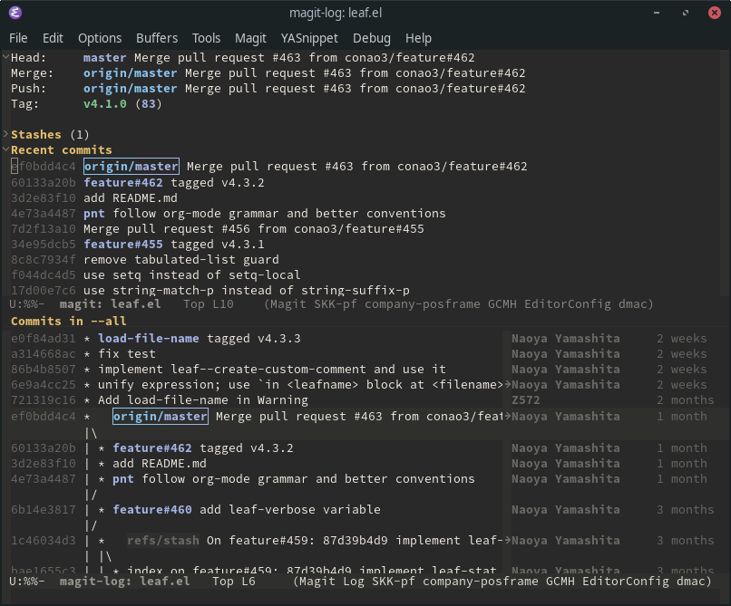

私がEmacsから離れられないのは、この[[https://github.com/magit/magit][magit]]と[[https://orgmode.org/][org-mode]]、[[https://www.gnu.org/software/emacs/manual/html_mono/eintr.html][emacs-lisp]]なので、magitはとても大きなウェイトを占めています。

magitは[[https://github.com/tarsius][tarsius]]さんの代表的なパッケージで、

* leaf-defaultsというはちゃめちゃ便利キーワードをleafに追加した話
:properties:
:export_file_name: generated/contents/blog/2020/5fc05c
:export_date: 2020-12-25
:export_updated: 2020-12-25
:export_tags: emacs emacs-lisp leaf-el leaf-keywords-el release advent-calendar
:end:

この記事は[[https://qiita.com/advent-calendar/2020/emacs][Emacs Advent Calendar 2020]]の16日目の記事です。投稿日時は見てはいけません()
前日はTakesxiSximadaさんの「EmacsでPlantUMLを使う」、翌日はfiboさんの「[[https://qiita.com/fibo/items/174898ffc447542f7786][emacs -nwのコピペ事情]]」でした。

今回、[[https://github.com/conao3/leaf.el][leaf]]という自作パッケージに新しいキーワードを追加したので、その紹介をするものです。
(スター200越えました...! やる気に影響するので、よさげなツールだなぁと思っていただければ、ぜひスターを頂ければと...!)

[[github:conao3/leaf-keywords.el::Emacs Lisp][Additional leaf.el keywords for external packages]]

** leafの紹介
leafを使っていらっしゃる方も、use-packageからの移行を悩んでおられる方も、素のElispでEmacsの設定をされている方もおられるかと思います。

まず、leafがどのようなメリットを提供するのか軽く紹介します。

- 統一されたフォーマットでのEmacsパッケージ設定
  - パッケージ設定に係る「イディオム」を隠蔽し、簡潔でメンテナンスしやすくなる
- パッケージの設定が一つのS式になり、一目で設定の区切りを認識できる
- キーワードを(比較的)簡単に追加でき、leafを自分で拡張できる
- use-packageのおせっかい?な挙動や文法上の問題を修正している。
- Emacs-jpでleafについての質問が日本語で出来る。

とりあえず5点挙げました。素のElispで管理されている方には全ての点が、既にuse-packageで書かれている方はleafに移行することによって後半の3点のメリットを享受できるようになります。

今回は「キーワードを(比較的)簡単に追加でき、leafを自分で拡張できる」の点を使って =leaf-defaults= という機能を追加したので、その紹介をしたいと思います。

** leaf-defaults
*** きっかけ
=leaf= は確かにイディオムを隠蔽してくれるが、「それ以上」が欲しい。
具体的には *各パッケージのおすすめ設定* を特殊なキーワードを指定したら *勝手に設定してくれる* 機能を入れられないだろうか。
何なら各ユーザーのおすすめ設定をどこかにアップロードしてもらって、特殊なキーワードから指定したら *自動でダウンロードする* 機能とかどうだろうか。と考えたのがきっかけでした。

元はleaf-defaultsという別パッケージにして配布する予定でした。具体的にいつ、この機能を思いついていたのかは忘れましたが、どうやら[[https://github.com/conao3/leaf-defaults.el][2年前にはレポジトリを作っていた]]ようでした。

ただ、Emacsの設定をアップロード/ダウンロードするとかは結構(というかかなり)セキュリティに問題がある気がしたので断念した結果、その特殊なキーワードを既存の[[https://github.com/conao3/leaf-keywords.el][leaf-keywords]]に入れるということで当初の目的の8割ぐらいを実現したものになります。

(こういうきっかけがあるので、この記事や他で言及するときは「leaf-defaults」として言及しますが、特にそういう名前のパッケージがあるわけではないです。leaf-keywordsの中に実装された一つのキーワードです。)

*** ユースケース
私はEmacsを使いながら、Emacsのパッケージを趣味で書いていますし、気に入ったパッケージがあればその紹介記事を書いたりすることもあります。「[[https://emacs-jp.github.io/tips/emacs-in-2020.html][2020年代のEmacs入門 - Emacs-jp]]」とかは分散していたおすすめ入門パッケージを一つにした記事ですね。

この記事、書く方は、まぁ順当に大変なのですが、読む方も結構大変だと思います。
実際、私が最近新しい環境に放り込まれたので、この記事を見ながらEmacsの最小限のセットアップをしたのですが、コードブロックが分かれていてコピペが非常に面倒でした。

leaf-defaultsを使えば、このように書けます!

#+begin_src emacs-lisp
(leaf leaf-keywords-defaults
  :require t
  :config
  (leaf-keywords-defaults-basic-dependency)
  (leaf-keywords-defaults--leaf-defaults/base))
#+end_src

これで「[[https://emacs-jp.github.io/tips/emacs-in-2020.html][2020年代のEmacs入門 - Emacs-jp]]」の設定の8割方を自分のEmacsに反映することができます!

さらに「[[https://emacs-jp.github.io/packages/ddskk-posframe][ddskk-posframe: ddskkツールチップposframeフロントエンド]]」という紹介記事には冒頭に設定例が書いてある例が多いですが、このような場合、

#+begin_src emacs-lisp
(leaf skk :defaults t)
(leaf posframe :defaults t)
(leaf ddskk-posframe :defaults t)
#+end_src

と書くことで設定が完了します! (この記事の場合、 =ddskk-posframe= が =skk= と =posframe= に依存しているので3つのS式に分かれてますが、普通の記事だと1つのS式になるはず)

*** 仕組み
leaf-defaultsは設定を隠蔽しているだけなので、設定の本体があるはずです。あります。[[https://github.com/conao3/leaf-keywords.el/blob/6e0d407768e1adf7953fbd20e8b91ad5ecfbfd5c/leaf-keywords-defaults.el][leaf-keywords.el/leaf-keywords-defaults.el]]です。このファイルは[[https://github.com/conao3/leaf-manager.el][leaf-manager]]を使って半自動で編集されている、私が管理している設定ファイルです。

さらっと見ると =:convert-defaults= という見慣れないキーワードがあります。まずこれを説明します。

(マクロ展開に拙作のpppを使います。ローカルで結果を確認したい方はインストールしてもらえればと。
さらに結果を簡潔にするために =(setq leaf-expand-minimally t)= しています。)

**** :convert-defaultsキーワード
leafはマクロなので、leafが受け取ったS式を *自由に変換して* Emacsに解釈させることができます。普段は個人用の設定を書くために使うものなので、生成するS式の順序を変更したり、イディオムを生成するだけです。

普段のleaf。 =:doc= などのドキュメントキーワードの引数を消したり、 =:emacs>== キーワードからバージョン判定式を生成したり、 =:bind= から =autoload= 式を生成したりなどしています。

#+begin_src emacs-lisp
(ppp-macroexpand
 (leaf company
   :doc "Modular text completion framework"
   :emacs>= 24.3
   :ensure t
   :blackout t
   :leaf-defer nil
   :bind ((company-active-map
           ("C-n" . company-select-next)
           ("C-p" . company-select-previous))
          (company-search-map
           ("C-n" . company-select-next)
           ("C-p" . company-select-previous)))
   :custom ((company-tooltip-limit . 12)
            (company-idle-delay . 0))
   :global-minor-mode global-company-mode))
;;=> (prog1 'company
;;     (unless (fboundp 'global-company-mode)
;;       (autoload #'global-company-mode "company" nil t))
;;     (unless (fboundp 'company-select-next)
;;       (autoload #'company-select-next "company" nil t))
;;     (unless (fboundp 'company-select-previous)
;;       (autoload #'company-select-previous "company" nil t))
;;     (when (version<= "24.3" emacs-version)
;;       (leaf-handler-package company company nil)
;;       (leaf-keys
;;        ((company-active-map :package company
;;                             ("C-n" . company-select-next)
;;                             ("C-p" . company-select-previous))
;;         (company-search-map :package company
;;                             ("C-n" . company-select-next)
;;                             ("C-p" . company-select-previous))))
;;       (customize-set-variable 'company-tooltip-limit 12 "Customized with leaf in company block")
;;       (customize-set-variable 'company-idle-delay 0 "Customized with leaf in company block")
;;       (global-company-mode 1)
;;       (with-eval-after-load 'company
;;         (blackout 'company-mode nil))))
#+end_src

しかし、もっと大きく結果を変えることもできます。 =:convert-defaults= キーワードを指定するとこうなります。

#+begin_src emacs-lisp
(ppp-macroexpand
 (leaf company
   :convert-defaults t
   :doc "Modular text completion framework"
   :emacs>= 24.3
   :ensure t
   :blackout t
   :leaf-defer nil
   :bind ((company-active-map
           ("C-n" . company-select-next)
           ("C-p" . company-select-previous))
          (company-search-map
           ("C-n" . company-select-next)
           ("C-p" . company-select-previous)))
   :custom ((company-tooltip-limit . 12)
            (company-idle-delay . 0))
   :global-minor-mode global-company-mode))
;;=> (prog1 'company
;;     (defun leaf-keywords-defaults--leaf/company nil
;;       "Default config for leaf/base."
;;       (unless (fboundp 'global-company-mode)
;;         (autoload #'global-company-mode "company" nil t))
;;       (unless (fboundp 'company-select-next)
;;         (autoload #'company-select-next "company" nil t))
;;       (unless (fboundp 'company-select-previous)
;;         (autoload #'company-select-previous "company" nil t))
;;       (when (version<= "24.3" emacs-version)
;;         (leaf-handler-package company company nil)
;;         (leaf-keys
;;          ((company-active-map :package company
;;                               ("C-n" . company-select-next)
;;                               ("C-p" . company-select-previous))
;;           (company-search-map :package company
;;                               ("C-n" . company-select-next)
;;                               ("C-p" . company-select-previous))))
;;         (customize-set-variable 'company-tooltip-limit 12 "Customized with leaf in company block")
;;         (customize-set-variable 'company-idle-delay 0 "Customized with leaf in company block")
;;         (global-company-mode 1)
;;         (with-eval-after-load 'company
;;           (blackout 'company-mode nil)))))
#+end_src

なにが変わっているでしょうか。

そうですね。leafが生成したS式全体が =defun= で囲われており、以前は *S式の実行* だったものが、 *関数の宣言* に変わりました。

この仕組みにより設定集を =leaf-keywords= に添付しても各ユーザーにとっては単に関数が宣言されているだけで、その中の設定は反映されることはありません。

=:convert-defaults= に =t= ではなくシンボルを渡した場合、そのシンボル名を使って関数が定義されます。

#+begin_src emacs-lisp
(ppp-macroexpand
 (leaf company
   :convert-defaults t
   :global-minor-mode global-company-mode))
;;=> (prog1 'company
;;     (defun leaf-keywords-defaults--leaf/company nil
;;       "Default config for leaf/company."
;;       (unless (fboundp 'global-company-mode)
;;         (autoload #'global-company-mode "company" nil t))
;;       (global-company-mode 1)))

(ppp-macroexpand
 (leaf company
   :convert-defaults conao3
   :global-minor-mode global-company-mode))
;;=> (prog1 'company
;;     (defun leaf-keywords-defaults--conao3/company nil
;;       "Default config for conao3/company."
;;       (unless (fboundp 'global-company-mode)
;;         (autoload #'global-company-mode "company" nil t))
;;       (global-company-mode 1)))
#+end_src

最後はこの自動生成した関数を呼び出す仕組みを作るだけです。

**** :defaultsキーワード
=:defaults= キーワードは =:convert-defaults= キーワードで生成された関数を実行するS式を生成するキーワードです。これまでに書いたように =t= やシンボルを与えることができます。

#+begin_src emacs-lisp
(ppp-macroexpand-all
 (leaf company :defaults nil))
;;=> (prog1 'company)

(ppp-macroexpand-all
 (leaf company :defaults t))
;;=> (prog1 'company
;;     (leaf-keywords-defaults--leaf/company))

(ppp-macroexpand-all
 (leaf company :defaults conao3))
;;=> (prog1 'company
;;     (leaf-keywords-defaults--conao3/company))
#+end_src

=nil= はキーワード無効化、 =t= はleafが提供している設定を反映、 シンボルはユーザー名を想定しており、 =conao3= だとconao3が提供している設定を反映することになります。

**** パッケージグループ機能
[[https://github.com/conao3/leaf-keywords.el/blob/6e0d407768e1adf7953fbd20e8b91ad5ecfbfd5c/leaf-keywords-defaults.el][leaf-keywords-defaults]]には多くのパッケージ設定が登録される予定です。パッケージを一つずつ反映するのではなく、パッケージ設定例をまとめた「パッケージグループ」のようなものを定義できたら便利ではないでしょうか。

ということで、[[https://github.com/conao3/leaf-keywords.el/blob/6e0d407768e1adf7953fbd20e8b91ad5ecfbfd5c/leaf-keywords-defaults.el#L111-L112][ここ]]で =base= パッケージグループを定義しています。これまでも例示していた =(leaf-keywords-defaults--leaf-defaults/base)= を実行すると、どうやら下記のパッケージ群が設定されることが分かります。

- cus-edit
- cus-start
- delsel
- files
- paren
- simple
- startup
- flycheck
- company

(このパッケージ群は変わる可能性があります、が、ほとんど必須と言って良いパッケージのみ登録する予定です。
例えばhelmとivyについては各ユーザーの好みがあると思うので、baseパッケージグループには(現状では)入りません。)

*** 拡張
Emacsユーザーは拡張性を重視します。leaf-defaultsも拡張しやすいように設計されています。
leafが提供する設定例を変えたい場合、色々な方法で変えることができます。

=:convert-deafults= で生成されるのは「関数」であることに注意すれば下記の方法があります。

1. leafの設定キーワードを使う

   =:defaults= は =:when= や =:if= などの条件分岐キーワードの後に展開されます。
   ということで、普通に =:config= キーワードや =:custom= キーワードを使うことで提供されている設定例から少し変えることができます。

   #+begin_src emacs-lisp
   (leaf company
     :defaults t
     :custom ((company-idle-delay . 0)))
   #+end_src

2. アドバイスで変える

   関数なのでアドバイスをかけられます。

   #+begin_src emacs-lisp
   (leaf company
     :preface
     (defun my/advice--leaf-keywords-defaults--leaf/company (fn &rest args)
       (apply fn args)
       (setq company-idle-delay 0))
     :advice (:around leaf-keywords-defaults--leaf/company
                        my/advice--leaf-keywords-defaults--leaf/company))

   (leaf company :defaults t)                ; :defaults より :advice の方が遅いので注意
   #+end_src

3. 上書きで変える

   関数なので、同名で定義してしまえば新しい定義で上書きできます。

   #+begin_src emacs-lisp
   (leaf company
     :convert-defaults t                   ; leafの設定例を上書き
     :custom ((company-idle-delay . 0))
     :global-minor-mode global-company-mode)

   (leaf company :defaults t)              ; 上書きした設定を読み込み
   #+end_src

4. PRで変える

   [[https://github.com/conao3/leaf-keywords.el][leaf-keywords]]にPRすればデフォルトの設定例を変更できます!()

** まとめ
leaf-defaultsについて紹介しました。2年前から構想はしていたものの、形になるまで結構な時間がかかったパッケージになりました。

これでEmacsパッケージ紹介記事がより読み易くなればいいなと思っています。

もちろん、紹介記事を書けば =:defaults= が使えるわけではありません。パッケージ紹介記事を書き、 =:defaults= キーワードで読者に設定させてみたいなという奇特な方がいらっしゃいましたら、設定例を[[https://github.com/conao3/leaf-keywords.el][leaf-keywords]]にPRしてもらえればと思いますー!
(当然、PRされた設定例はleaf公認としてリリースするので、レビューが入ります。)

* dioxus-tui入門 - 0.2.2
:properties:
:export_file_name: generated/contents/blog/2022/6b4afc
:export_date: 2022-12-16
:export_updated: 2022-12-16
:export_tags: rust macro tutorial advent-calendar
:end:

** はじめに
この記事はRustアドベントカレンダー16日目の記事です。
昨日はyukinaritさんの「[[https://zenn.dev/yukinarit/articles/71bb4a01a8e58e][PGOでRustで書かれた広告サーバを早くする]]」でした。

RustでTUIアプリケーションを作りたいなーっと思っていろいろ探しているとdioxus-tuiというライブラリを見つけたので、使ってみた記事を書きます。

今回の記事で作ったレポジトリは[[https://github.com/conao3/rust-dioxus-tui-sample][conao3/rust-dioxus-tui-sample]]に置いてあります。

** dioxusとは
TUIアプリケーション専用ではなく、仮想DOMを使ってWebフロントエンド、デスクトップアプリ、モバイルアプリを書き出すクレート。

日本語記事ではここらへんを参照

- [[https://zenn.dev/mizchi/scraps/449f0591e2cee9][dioxus webやってみる - Zenn/mizchi]]
- [[https://qiita.com/uwattotaitai/items/4d262e46c2165e01f477][Rust UIライブラリ「Dioxus」をReact+Typescriptと比較してみた - Qiita/uwattotaitai]]

この記事ではdioxusを使ってTUIアプリを作ってみます。

** Getting Started
適当なRustプロジェクトを作って遊んでみます。
#+begin_src sh
mkdir rust-dioxus-tui-sample
cd rust-dioxus-tui-sample
cargo init --name dioxus-tui-sample
#+end_src

cargoで取ってきます。
#+begin_src sh
cargo add dioxus dioxus-tui
#+end_src

=src/main.rs= を以下で置き換えます。
#+begin_src rust
use dioxus::prelude::*;

fn main() {
    dioxus_tui::launch(app);
}

fn app(cx: Scope) -> Element {
    cx.render(rsx! {
        div {
            width: "100%",
            height: "10px",
            background_color: "red",
            justify_content: "center",
            align_items: "center",
            "Hello world!"
        }
    })
}
#+end_src

cargoで起動します。
#+begin_src sh
cargo run
#+end_src

起動できたら成功です! :tada:
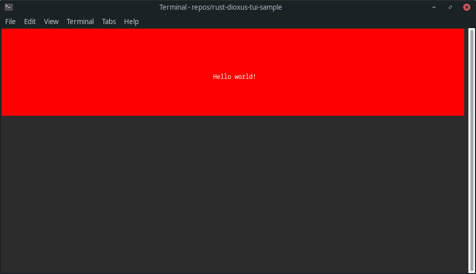

** rsx!マクロ
*** rsx
JSXのようなインターフェースを提供するマクロ。次のようなサンプルが動きます。

#+begin_src rust
use dioxus::prelude::*;

fn main() {
    dioxus_tui::launch(app);
}

fn app(cx: Scope) -> Element {
    let val = 42;
    let name = if val == 42 { "Jack" } else { "Bob" };

    cx.render(rsx! (
        div {
            "hello world"
            "hello {val}"
            "hello {name}"
        }
    ))
}
#+end_src

なおJSXのように ={}= の中に任意の式を書くことはできないようです。一旦rsxマクロの外で計算しておくのがおすすめとのこと。

*** rsx - bool.then()
一方でこういうのはできるようです。

#+begin_src rust
let show_title = true;
rsx!(
    div {
        // Renders nothing by returning None when show_title is false
        show_title.then(|| rsx!{
            "This is the title"
        })
    }
)
#+end_src

*** rsx - Option.map()
=Option= に対する =map= 風のAPIも使えます。

#+begin_src rust
let user_name = Some("bob");
rsx!(
    div {
        // Renders nothing if user_name is None
        user_name.map(|name| rsx!("Hello {name}"))
    }
)
#+end_src

*** rsx - iter
動的に =rsx!= を作ることもできます。

#+begin_src rust
let names = ["jim", "bob", "jane", "doe", "a"];

cx.render(rsx! (
    ul {
        names.iter().map(|name| rsx!{
            li { "{name}" }
        })
    }
))
#+end_src

が、tuiのレンダラは上手く表示できないようです。(改行せずに上書き表示されてる？)
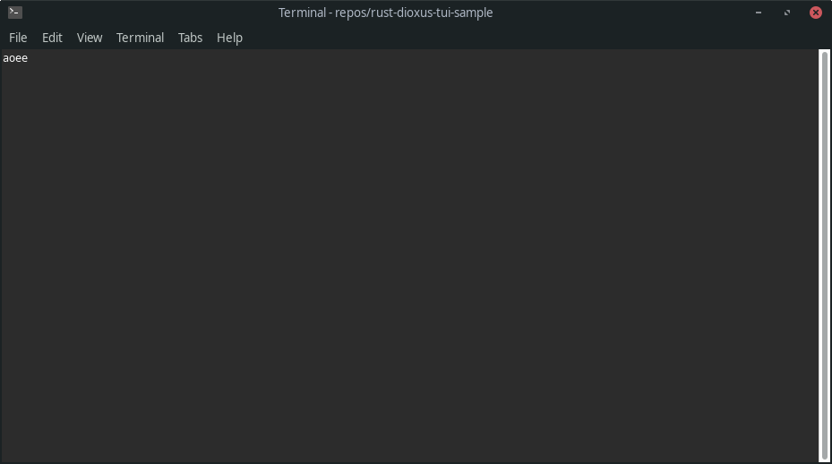

*** rsx - Components
Componentの実装

#+begin_src rust
#![allow(non_snake_case)]

use dioxus::prelude::*;

#[derive(Props)]
struct TitleCardProps<'a> {
    title: &'a str,
}

fn TitleCard<'a>(cx: Scope<'a, TitleCardProps<'a>>) -> Element {
    cx.render(rsx!{
        h1 { "{cx.props.title}" }
    })
}

fn main() {
    dioxus_tui::launch(app);
}

fn app(cx: Scope) -> Element {
    cx.render(rsx! (
        TitleCard {
            title: "hello world"
        }
    ))
}
#+end_src

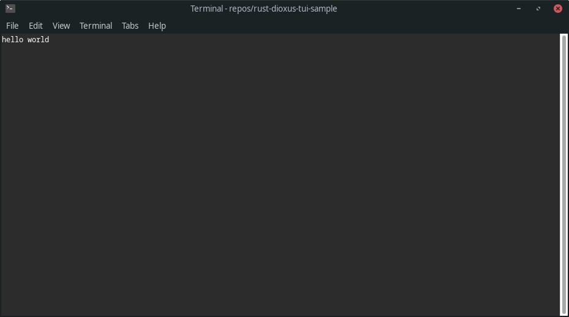

** hooks
React風のhookが利用できます。

*** useState
=use_state= はReactと全く同じです。

#+begin_src rust
let count = use_state(&cx, || 0);

cx.render(rsx! (
    div {
        "count: {count}"
    }
))
#+end_src

本来ならボタンを追加して値の更新をするのですが。。dioxus-tuiにはまだボタンが実装されていなく確かめられませんでした。

*** useFuture
dioxusの拡張。async関数を取って、非同期で実行してくれます。

#+begin_src rust
use dioxus::prelude::*;

fn main() {
    dioxus_tui::launch(app);
}

fn app(cx: Scope) -> Element {
    let count = use_state(&cx, || 0);

    use_future(&cx, (), move |_| {
        let count = count.to_owned();
        let update = cx.schedule_update();
        async move {
            loop {
                count.with_mut(|f| *f += 1);
                tokio::time::sleep(std::time::Duration::from_millis(1000)).await;
                update();
            }
        }
    });

    cx.render(rsx! {
        div { width: "100%",
            div {
                width: "50%",
                height: "5px",
                background_color: "blue",
                justify_content: "center",
                align_items: "center",
                "Hello {count}!"
            }
            div {
                width: "50%",
                height: "10px",
                background_color: "red",
                justify_content: "center",
                align_items: "center",
                "Hello {count}!"
            }
        }
    })
}
#+end_src


良く見るとこのサンプル、背景赤の場所に表示されるべき文字が左に出てますね。。

** Events
=on*= を使ってイベントを処理できる。。らしい。が、dioxus-tui(0.2.2)ではpanicしてしまった。

#+begin_src rust
let log_event = move |event: Event| {
    events.write().push(event);
};


cx.render(rsx! {
    div {
        width: "100%",
        height: "100%",
        flex_direction: "column",
        div {
            width: "80%",
            height: "50%",
            border_width: "1px",
            justify_content: "center",
            align_items: "center",
            background_color: "hsl(248, 53%, 58%)",

            onmousemove: move |event| log_event(Event::MouseMove(event.data)),
            onclick: move |event| log_event(Event::MouseClick(event.data)),
            ondblclick: move |event| log_event(Event::MouseDoubleClick(event.data)),
            onmousedown: move |event| log_event(Event::MouseDown(event.data)),
            onmouseup: move |event| log_event(Event::MouseUp(event.data)),

            onwheel: move |event| log_event(Event::Wheel(event.data)),

            onkeydown: move |event| log_event(Event::KeyDown(event.data)),
            onkeyup: move |event| log_event(Event::KeyUp(event.data)),
            onkeypress: move |event| log_event(Event::KeyPress(event.data)),

            onfocusin: move |event| log_event(Event::FocusIn(event.data)),
            onfocusout: move |event| log_event(Event::FocusOut(event.data)),

            "Hover, click, type or scroll to see the info down below"
        },
        div {
            width: "80%",
            height: "50%",
            flex_direction: "column",
            events_rendered,
        },
    },
})
#+end_src


https://github.com/DioxusLabs/dioxus/blob/fc2aaa7df5/packages/tui/examples/tui_all_events.rs

レポジトリに置いてあるHEADのサンプルも同じくpanicしてしまうのでどこかのコミットで壊れてそのままになってる。。かなにか動かし方を間違えてるようです。

動かせた人は教えてくれると嬉しいです。

** まとめ
dioxusという意欲的なプロジェクトを見つけたのでちょっと動かしてみました。

TUIのレンダラはまだまだ発展途上のようですが、React文化をTUIに持ってくるのは普通に便利だと思うので期待してます。

(ユーザーとしては素直にnodeの[[https://github.com/vadimdemedes/ink][ink]]を使った方がいいかもしれない。ただ俺はRustでTUIを作りたいんだ。。!)

v1がリリースされたらまたチャレンジしてみようかなと思います。

* Hello Astro
:properties:
:export_file_name: generated/contents/blog/2023/b81579
:export_date: 2023-03-12
:export_updated: 2023-03-12
:export_tags: astro react cloudflare blog static-site
:end:

** Intro
エンジニアは2~3年ごとにブログを作りなおす。私もその習性に従って新しいブログを作った。

前回のブログで[[https://s.conao3.com/blog/2020/0a23fb][新しいブログ作ったよ記事]]が2020年の5月だったので、まぁそれくらいの周期でやってくる。

技術まわりの備忘録を書いておいて、また3年経ったらこの記事を参照することになるだろう。

なお、筆者はフロント周りの技術に疎いので、雰囲気で書いていることを添えておく。

** Astro
ベースの技術は[[https://astro.build/][Astro]]だ。
Hugoと同じように静的サイトを生成するライブラリで、基本的にビルド成果物をぽん置きするだけで動く。便利。

=.astro= ファイルというHTMLとJSXを悪魔合体させたようなもの (そもそもJSXがJSとHTMLを悪魔合体させたようなものだが) が提供されており、
これを使ってコンポーネントベースでページを作る。

一方でReactやVueのようなUIフレームワークを使うこともできる。その場合でも =astro build= するとjsファイルなしで静的サイトが生成される。

*** Getting Started
[[https://docs.astro.build/ja/getting-started/][公式のGetting started]]が丁寧に書いてあるのでそれに従う。厨二なのでyarnを使った。(最近はnpmへの揺り戻しが起こっているらしい)

#+begin_src bash
yarn create astro
#+end_src

して、適当にプロンプトに答えるとastroプロジェクトが生成される。

#+begin_src bash
yarn dev
#+end_src

でローカルサーバーが立つ。すばらしい。


(絵文字が豆腐になっているが、これはOSに絵文字に対応したフォントをインストールしてないからである。)

Nextのようにファイルベースルーティングを採用しているので、 =content/blog= 配下にmdファイルを置くとそのままブログ記事になる。

当然のこと (便利な世の中になった) ながら、ライブリロードが入っているので、mdファイルを編集すると即座にブラウザに反映される。

*** .astro入門
現在時点の公式ブログテンプレートにはなぜか =draft= の対応が入っていない。ので、この対応をすることで =.astro= の基本的な使い方を紹介する。

まずは =src/content.config.ts= でfrontmatterに =draft= があるということを定義する。デフォルトは =false= (公開) にしておく。

#+begin_src diff
 import { defineCollection, z } from 'astro:content';

 const blog = defineCollection({
   // Type-check frontmatter using a schema
   schema: z.object({
     title: z.string(),
     // Transform string to Date object
     pubDate: z
       .string()
       .or(z.date())
       .transform((val) => new Date(val)),
     updatedDate: z
       .string()
       .optional()
       .transform((str) => (str ? new Date(str) : undefined)),
     heroImage: z.string().optional(),
+    draft: z.boolean().default(false),
    }),
 });
#+end_src

そして =src/pages/blog/index.astro= で =draft= が =false= な記事のみをリストするように修正する。

#+begin_src diff
 ---
 import BaseHead from '../../components/BaseHead.astro';
 import Header from '../../components/Header.astro';
 import Footer from '../../components/Footer.astro';
 import { SITE_TITLE } from '../../consts';
 import { getCollection } from 'astro:content';
 import FormattedDate from '../../components/FormattedDate.astro';

 const posts = (
-    (await getCollection('blog'))
+    (await getCollection('blog', ({ data }) => !data.draft))
     .sort((a, b) => a.data.pubDate.valueOf() - b.data.pubDate.valueOf())
 )
 ---
#+end_src

これで完了だ。便利。

[追記] =src/pages/blog/[...slug].astro= にもdraft対応が必要。

#+begin_src diff
 export async function getStaticPaths() {
 	return (
-        (await getCollection('blog'))
+        (await getCollection('blog', ({ data }) => !data.draft))
         .map((post) => ({
             params: { slug: post.slug },
             props: post,
         }))
     );
 }
#+end_src

*** Reactとの連携
そもそも =.astro= ファイルでコンポーネントを使いつつ、propを渡して、、ということができるので、静的に決まるならReactは不要。とはいえミーハーなので動作確認くらいはしておく。

ドキュメントの[[https://docs.astro.build/ja/core-concepts/framework-components/][UIフレームワークのページ]]や[[https://docs.astro.build/ja/guides/integrations-guide/react/][@astrojs/react]]を参照しつつ、Reactのコンポーネントを使ってみる。

まず =astro add= する。

#+begin_src bash
yarn astro add react
#+end_src

題材はなんでも良いが、動的な要素がないコンポーネントを実装したい。
今回は[[https://quarto.org/docs/authoring/callouts.html][CalloutBlock]]を実装してみる。

=src/components/SimpleCalloutBlock.tsx= を以下の内容で作る。色は[[https://spectrum.adobe.com/page/color-palette/][Adobe Spectrum]]からもらった。

#+begin_src tsx
type SimpleCalloutBlockProps = {
  title: string;
  children: React.ReactNode;
};

export function SimpleCalloutBlock(props: SimpleCalloutBlockProps) {
  const divheader = (
    <div style={{
      backgroundColor: "rgb(255, 221, 214)",  // Red 200
      padding: "0.25rem",
      fontWeight: "bold",
    }}>{props.title}</div>
  )
  const divcontent = (
    <div style={{
      padding: "0.25rem",
    }}>{props.children}</div>
  )

  return <>
    <div style={{
      borderRadius: "0.25rem",
      border: "1px solid",
      borderColor: "rgb(213, 213, 213)",  // Gray 300
      borderLeft: "5px solid",
      borderLeftColor: "rgb(247, 92, 70)",  // Red 800
    }}>
      {divheader}
      {divcontent}
    </div>
  </>
}
#+end_src

=.astro= ファイルでは以下のように利用できる。

#+begin_src astro
import SimpleCalloutBlock from '../../components/SimpleCalloutBlock.tsx';
---
<SimpleCalloutBlock title="This is Important">Danger, callouts will really improve your writing.</SimpleCalloutBlock>
#+end_src

さらにAstroはmdxをサポートしているので、なんとmdの中に直接tsxを書くこともできる

#+begin_src mdx
import SimpleCalloutBlock from '../../components/SimpleCalloutBlock.tsx';

<SimpleCalloutBlock title="This is Important">Danger, callouts will really improve your writing.</SimpleCalloutBlock>
#+end_src

レンダリング結果はこんな感じ。

#+begin_quote
*This is Important*

Danger, callouts will really improve your writing.
#+end_quote

=SimpleCalloutBlock= はReactを使って作ったが、ビルドするとjsなしの静的なHTMLとCSSになる。便利。

*** Astro Islands
Astroには[[https://docs.astro.build/ja/concepts/islands/][Astroアイランド]]という概念がある。
これによりページの一部のコンポーネントのみインタラクティブ (jsあり) の領域を作ることができる。

アイランドはそれぞれ独立しており、それぞれは異なるUIフレームワークを使うことができる。
(Spotifyの[[https://engineering.mercari.com/blog/entry/2018-12-06-162827/][マイクロフロントエンド]]みたいなのを想像している)

これも動作確認程度に動かしておく。

Reactで簡単なカウンターを =src/components/SimpleButton.tsx= に実装する。

#+begin_src tsx
import React from "react"

export function SimpleButton() {
  const [count, setCount] = React.useState(0)
  return <button onClick={()=>setCount(count+1)}>Click me: {count}</button>
}
#+end_src

そして利用側でこのように記述する。

#+begin_src md
import { SimpleButton } from '../../../components/SimpleButton';

<SimpleButton client:load />
#+end_src

#+begin_example
Click me: 0
#+end_example

=client:load= を付けることで、このコンポーネントに限り、jsをクライアントで実行するように設定できる。
もし付けなければこれは静的なコンポーネントになるので、カウンターは動かない。

#+begin_example
Click me: 0
#+end_example

jsが読み込まれるタイミングを =client:*= で制御できる。詳細は[[https://docs.astro.build/ja/reference/directives-reference/#client-directives][ドキュメント]]を参照。

** Cloudflare Pages
ホスティングは[[https://www.cloudflare.com/ja-jp/products/pages/][Cloudflare Pages]]を使う。
以前使っていたNetlifyでも良かったが、界隈で[[https://blog.tomoya.dev/posts/i-was-billed-beyond-limits-of-netlify/][Cloudflare Pagesが注目]]されていたのでそれにした。

使い勝手はNetlifyとほぼ同じ。GitHubと連携して、pushすると自動でビルド/デプロイされる。便利。


少し悩んだのが、カスタムドメインの設定。

conao3.comをNetlifyのDNSに置いて、そのままNetlifyを向くように設定していたので新しいastroのブログをどのURLで公開するか悩んだ。

ひとまずNetlifyに置いてあるドメインはそのままにしておいて、CNAME a.conao3.comでastroのブログを見るように設定した。 (=a= は =astro= の =a=)


将来的にはNetlifyに置いてあるブログをh.conao3.comくらいで見れるようにしたらいいのかなと思う。 (=h= は =hugo= の =h=)

ついでにドメインをNetlifyからCloudflareに引っ越しすると良いかもしれない。リダイレクトの設定が面倒なので、また時間が取れるときにやる。

** まとめ
感想としてはAstroが便利すぎる。全部入りで速い。コンテンツ中心のウェブページを作るならこれが最初の選択肢になりそう。

ブログのソースは[[https://github.com/conao3/blog-astro-src][conao3/blog-astro-src]]に置くことにした。
各ページから直接ソースのmdに飛べるようにしたら便利かもしれない。

ひとまずスモールスタートとして直接マークダウンを書いたが、Emacsユーザーとしてはox-hugoと同じように一つのorgファイルから複数のページを生成できるようにしたい。

* 2023年のPython環境構築: pyenv + poetry
:properties:
:export_file_name: generated/contents/blog/2023/d76e1d
:export_date: 2023-03-14
:export_updated: 2023-03-14
:export_tags: python poetry package-management
:end:

** Intro
[[https://qiita.com/c60evaporator/items/b6a7394231d1e768ce64][Pythonのパッケージ管理ベストプラクティス - Qiita]]という記事が公開されていた。
とはいえ少々overwhelmingな感があるので、ざっくりといつもやっている手順をまとめる。

お気持ちを書くと結局この記事も同じ轍を踏むので、お気持ちパートは後半で。

** 方針
- =anyenv= を入れる
- =pyenv= でPythonを入れる
- =poetry= でPythonプロジェクトを管理する

これが最短最小のセットアップだ。

私もVMを起動してクリーンな環境で試しつつこの記事を書いてみる。

*** anyenvのインストール
昨今、Pythonだけ必要なことはあまりなく、どうせNodeなどが欲しくなるので、最初からanyenvを入れる。

#+begin_src bash
git clone https://github.com/anyenv/anyenv ~/.anyenv

export PATH="$HOME/.anyenv/bin:$PATH"
echo 'export PATH="$HOME/.anyenv/bin:$PATH"' >> ~/.bash_profile
#+end_src

#+begin_src bash
anyenv init
#+end_src

#+begin_src bash
eval "$(anyenv init -)"
echo 'eval "$(anyenv init -)"' >> ~/.bash_profile
#+end_src

#+begin_src bash
anyenv install --init
#+end_src

これで =anyenv= が使えるようになった。

*** anyenv-updateのインストール
[[https://github.com/znz/anyenv-update][znz/anyenv-update]]をインストールする。
これは =anyenv update= でインストールされている =*env= をアップデートできるようにするプラグイン。

アップデートしないと新しいPythonをインストールできないので、インストール前にはこのサブコマンドが使えると便利。

#+begin_src bash
mkdir -p $(anyenv root)/plugins
git clone https://github.com/znz/anyenv-update.git $(anyenv root)/plugins/anyenv-update
#+end_src

これで =anyenv update= ができるようになった。

*** pyenvのインストール
=anyenv= を手に入れたので、 =pyenv= は =anyenv= 経由でインストールできる。

#+begin_src bash
anyenv install pyenv

eval "$(anyenv init -)"
#+end_src

=pyenv install -l= でインストール可能なPythonのバージョンを確認できる。

使いたいバージョンのPythonを適宜インストールする。強い理由がなければ =x.yy.zz= のフォーマットの最新のバージョンを入れる。最新だからと言って不安定だということは (経験上ほぼ) ない。

コマンドをこねこねすると現在インストールできる最新のバージョンを得ることができる。

#+begin_src bash
$ pyenv install -l | sed -E 's/^ +//' | grep -E '^3\.11\.[0-9]+$' | tail -n1
3.11.2

$ pyenv install -l | sed -E 's/^ +//' | grep -E '^3\.10\.[0-9]+$' | tail -n1
3.10.10

$ pyenv install -l | sed -E 's/^ +//' | grep -E '^3\.9\.[0-9]+$' | tail -n1
3.9.16
#+end_src

さてインストール。。の前に[[https://github.com/pyenv/pyenv/wiki][pyenvのwiki]]にOS別の依存パッケージインストール方法が記載されているのでそれを実行する。

私はArchlinuxを使っているので =pacman= の手順を実行した。

#+begin_src bash
pacman -S --needed base-devel openssl zlib xz tk
#+end_src

さぁ、Pythonをインストールする。

#+begin_src bash
pyenv install 3.11.2
pyenv install 3.10.10
pyenv install 3.9.16
#+end_src

無事インストールできたら =python= で起動するpythonをpyenvでインストールしたものに変更する。

#+begin_src bash
pyenv global 3.11.2 3.10.10 3.9.16
#+end_src

インストールできない場合、pyenv wikiの[[https://github.com/pyenv/pyenv/wiki/Common-build-problems][Common build Problems]]を参照する。
それでもできなかったらおとなしくOSからクリーンインストールした方が早い。

*** poetryのインストール
[[https://python-poetry.org/docs/][poetry]]はPythonのプロジェクト管理ツールである。
プロジェクトに合ったPythonを選んだり、依存関係を解決したり、一回解決したものをロックファイルとして保存/共有することができる。

公式ページのインストール手順に従ってインストールする。

#+begin_src bash
pipx install poetry
#+end_src

poetryのデフォルトではプロジェクトルートに =.venv= を作らないため、プロジェクトルートに作成するように変更する。
VSCodeが自動的に仮想環境を見つけてくれるし、定義ジャンプするときにツリーが見えるので便利。

#+begin_src bash
poetry config virtualenvs.in-project true
#+end_src

これでpoetryがインストールできた。環境構築は以上だ。

** 運用方法
ここでは簡単な =wc= コマンドを実装する。

フォルダを作って =poetry init= すると =pyproject.toml= が作成される。

#+begin_src bash
mkdir pywc
cd pywc
poetry init
#+end_src

本体を実装して、 =pyproject.toml= に =pywc= という名前でエントリポイントを登録する。

#+begin_src bash
mkdir -p src/pywc
touch src/pywc/__init__.py
touch src/pywc/main.py
#+end_src

=src/pywc/main.py= は以下の内容。

#+begin_src python
def cli():
    print(len(input()))
#+end_src

=pyproject.toml= に以下の変更をする。

#+begin_src diff
 authors = ["Your Name <you@example.com>"]
 readme = "README.md"

+[tool.poetry.scripts]
+pywc = "pywc.main:cli"
+
 [tool.poetry.dependencies]
 python = "^3.11"
#+end_src

そして =poetry install= する。

#+begin_src bash
poetry install
#+end_src

すると仮想環境内に =pywc= というコマンドがインストールされる。
仮想環境内のコマンドは =poetry run= で実行できる。

#+begin_src bash
$ echo asdf | poetry run pywc
4
#+end_src

ちゃんと動いている。

もしグローバルでこのコマンドが使いたいなら =~/.local/bin/= にシンボリックリンクを貼る。

#+begin_src bash
$ ln -s "$(poetry run which pywc)" ~/.local/bin/

$ echo asdf | pywc
4
#+end_src

これでいつでも使える。便利だ。

** まとめ
いろいろ思うところがあったのだけど、Twitterで書くよりブログで書いた方が参照しやすくて便利なのでこの形式で公開することにした。

正直Pythonユーザーの半数。いや、7割。。？くらいは[[https://pypi.org/][PyPI]]に自作モジュールを公開なんてせずに単にユーザーとして利用するだけだと思う。
単に使うだけならPythonってこんなに便利なんですよというのを伝えたかった。

モジュールもたくさんあるし、プロトタイピングには最適な言語だと思う。

** お気持ち
*** なぜ公式インストーラではなくpyenvなのか
インストーラでインストールするとシステム領域にインストールされる。もちろん全ての作業は仮想環境を作って行うので問題ないのだが、万一環境が壊れたときにアンインストールが必要になる。

さて、そのアンインストーラはちゃんと動くのだろうか。インストーラが展開したファイルを一つ残らず消してくれるのだろうか。

pyenvならバージョンごとにフォルダ管理されており、コマンドから捨てることができるし、最悪 =~/.anyenv= ごと吹き飛ばせばいい。

「クリーンな状態」をすぐ取り戻せるというのは心の余裕だ。「すぐ戻せる」から壊すハードルを下げることができる。

*** なぜ公式インストーラではなくpyenvなのか2
そもそも、その「公式インストーラ」はどこにあるのだろう。。()

[[https://www.python.org/downloads/][python.org/downloads]]だと思うが、WindowsとmacOSの場合はGUIのインストーラっぽいからぽちぽちしたら入るっぽい。
Linux勢はどうやってインストールするのだろう。各ディストリビューションごとにパッケージ名が違うのをまず調べてからインストールすることになる。

うーん。pyenvならマルチプラットフォームで同じように開発できるのでこちらを取るかな。。

「インストーラ」が何をやっているのか分からないのが嫌なのかもしれない。「アンインストーラ」が信用できないのも。

Linuxのパッケージマネージャでも =pacman= は信用しているが、 =apt= は信用してない。(インストールしてアンインストールしたらちゃんと元に戻るという観点で)

その意味ではmacOS/Linuxの =brew= はちゃんとパッケージマネージャとしての責務を果たしてくれるので好き。

*** なぜvenvを直接使わずpoetryを使うのか
正直 =venv= は難しい。初学者に勧めるのは抵抗がある。もちろん言ってることは分かるし、venvで開発できそうなことは分かったが周辺のノウハウが散らばっているように感じた。

OSSでも =poetry.lock= が置いてあるプロジェクトは本当に貢献しやすい。 =git clone= して =poetry install= 。これで全ての依存が降ってきてすぐ開発できる状況になる。

これは業務で使う場合でも一緒だ。みんながみんなPythonのビルドシステム周りに詳しいわけではない。 =poetry install= して =poetry run hoge= で動く。案内しやすいし便利だ。

ここまで書いたが、 =venv= ももうちょっと分かりやすいサブコマンドがあると良い話なのかもしれない。

| poetry            | venv                              | venv (提案)               |
|-------------------+-----------------------------------+---------------------------|
| =poetry init=     | =python -m venv .venv=            | =python -m venv init=     |
| =poetry add hoge= | =pip install hoge=                | =python -m venv add hoge= |
| =poetry lock=     | =pip freeze > requirements.txt=   | =python -m venv lock=     |
| =poetry install=  | =pip install -r requirements.txt= | =python -m venv install=  |
| =poetry shell=    | =. .venv/bin/activate=            | =python -m venv shell=    |
| =C-d= (exit venv) | =deactivate=                      | =C-d=                     |
| =poetry run hoge= | =.venv/bin/hoge=                  | =python -m venv run hoge= |

提案のvenvなら使えたかもしれない。

仮想環境に入るのを忘れて =pip install= したらもれなくグローバルのPythonにインストールされるのも心証が悪かった。

さらに =. .venv/bin/activate= で仮想環境に入って、出るときは =deactivate= を実行するという非対称性にも耐えられなかった。
=. .venv/bin/deactivate= ならまだ許容できたが、まぁ歴史あるものはしょうがない面もある。

*** なぜPythonがインストールできないときOSのクリーンインストールをするのか

#+begin_quote
インストールできない場合、pyenv wikiのCommon build Problemsを参照する。 それでもできなかったらおとなしくOSからクリーンインストールした方が早い。
#+end_quote

読者の中にはちゃんとビルドできない原因を調べて解明する方が良いと思う人もいると思う。

[[https://github.com/pyenv/pyenv/wiki/Common-build-problems][Common build Problems]]を参照した上でもPythonがビルドすらできない環境というのは十中八九、本人すらも自分のPCの状態が管理できてない状態だと思う。
Pythonのインストーラに限らず、自分で制御できる方法でPCを常にメンテナンスすることが必要で、一旦制御不能になったらもうそれは教訓にして世界をやり直した方が早い。

やり直すのは悪いことではない。どうやったら簡単にやり直せるか考えて整備する。
簡単にやり直せるようになったところで、もう世界をやり直さないと分からないところまで壊れることはほぼなくなっているが、そうやって学ぶのが結局早い。

* COMMENT Astroでbookが書きたい
:properties:
:export_file_name: generated/contents/blog/2023/d23672
:export_date: 2023-03-18
:export_updated: 2023-03-18
:end:

** Intro
ブログという体裁をとっているが、なにか連載記事のようなものを書きたいときがある。
イメージとしては[[https://zenn.dev/zenn/books/how-to-create-book][Zennの「本」]]。

[[https://zenn.dev/zenn/articles/zenn-cli-guide#cli-%E3%81%A7%E6%9C%AC%EF%BC%88book%EF%BC%89%E3%82%92%E7%AE%A1%E7%90%86%E3%81%99%E3%82%8B][Zennの制御ファイル]]が結構しっかりしてるので、これを参考に作ってみる。

* パッケージをささっと試すためのplayground - Python
:properties:
:export_file_name: generated/contents/blog/2023/7a00d9
:export_date: 2023-03-19
:export_updated: 2023-03-19
:export_tags: python poetry tutorial
:end:

** はじめに
Pythonには様々なパッケージがあり、簡単にインストールして使うことができます。
しかし、既存のある程度大きなプロジェクトに対していきなり導入すると、もし動かなかったときに切り分けが大変です。

また、パッケージが動く最小構成を試しておくことで後から他のプロジェクトで利用するときにも役立ちます。
パッケージに何か不具合を見つけた場合でも、最小構成を用意しておくことで報告しやすくなります。

この記事を参考にして、パッケージを試すためのplaygroundを作ってみましょう。

** 前提
Pythonの環境はpyenv + poetryで構築されているとします。
[[https://s.conao3.com/blog/2023/d76e1d][2023年の環境構築記事]]が参考になるかもしれません。

** フォルダ構成
playgroundのフォルダ構成は以下のようになります。

#+begin_example
python-hogehoge/
├── hogehoge_sample/
│   ├── __init__.py
│   └── main.py
├── pyproject.toml
└── README.md
#+end_example

=hogehoge_sample= ディレクトリを作成し、その中に =main.py= を作成します。

*** pyproject.toml
=poetry init= で =pyproject.toml= を作成します。

#+begin_example
mkdir python-dataclasses
poetry init
#+end_example

package-nameは =dataclasses-sample= と答えます。
ここで =dataclasses= と答えると、本来の =dataclasses= と名前が被るので、避ける必要があります。

以下の =pyproject.toml= が作成されます。

#+begin_src toml
[tool.poetry]
name = "dataclasses-sample"
version = "0.1.0"
description = ""
authors = ["Naoya Yamashita <conao3@gmail.com>"]
readme = "README.md"
packages = [{include = "dataclasses_sample"}]

[tool.poetry.dependencies]
python = "^3.11"

[build-system]
requires = ["poetry-core"]
build-backend = "poetry.core.masonry.api"
#+end_src

=packages= の指定は必要ないので、削除します。

#+begin_src diff
 [tool.poetry]
 name = "dataclasses-sample"
 version = "0.1.0"
 description = ""
 authors = ["Naoya Yamashita <conao3@gmail.com>"]
 readme = "README.md"
-packages = [{include = "dataclasses_sample"}]

 [tool.poetry.dependencies]
 python = "^3.11"

 [build-system]
 requires = ["poetry-core"]
 build-backend = "poetry.core.masonry.api"
#+end_src

*** src/dataclasses_sample/main.py
一旦、以下の内容で =main.py= を作成します。

#+begin_src python
def main1():
    print('Hello, world!')


if __name__ == '__main__':
    main1()
#+end_src

*** Install / 起動確認
さぁ =poetry install= 。。なのですが、 =README.md= がないと怒られるので作っておきます。

#+begin_example
touch README.md
#+end_example

=poetry install= でインストールします。

#+begin_example
$ poetry install
Installing the current project: dataclasses-sample (0.1.0)
#+end_example

インストールできたら、 =poetry run= で実行できます。
=scripts= は指定してないので、直接モジュール指定で起動することになります。

#+begin_example
$ poetry run python -m dataclasses_sample.main
Hello, world!
#+end_example

これで、playgroundの準備は完了です。

** パッケージを試す
dataclassesを試してみます。
[[https://docs.python.org/ja/3/library/dataclasses.html][公式ドキュメント]]を参考に、以下のように修正します。

#+begin_src diff
+import dataclasses


+@dataclasses.dataclass
+class Person:
+    name: str
+    age: int


 def main1():
     print('Hello, world!')


+def main2():
+    p = Person('John', 30)
+    print(p)


 if __name__ == '__main__':
-    main1()
+    main2()
#+end_src

起動してみるとこのようになります。

#+begin_src bash
$ poetry run python -m dataclasses_sample.main
Person(name='John', age=30)
#+end_src

成功です。これが一番シンプルな =dataclasses.dataclass= の使い方です。

今までの関数を消さずに、新しく追加した関数の中で他のメソッドやクラスなどを記述し、その新しい関数を呼び出すように修正します。

もちろん起動時引数によって起動する関数を変えることもできるのですが、playgroundはこのくらいの気軽さが良いと思います。

** git push
遊んだ後はGitHubにpushしておきましょう。

「はじめに」にも書きましたが、ざざっと書いたものというのは結構助けになります。

私はこういうplaygroundを上げる専用の一人orgを作っていて、そこにpushしています。
今回は[[https://github.com/conao3-playground/python-dataclasses][conao3-playground/python-dataclasses]]にpushしました。

** まとめ
私が最近試しているplaygroundというやり方を紹介しました。

さくっと書いてさくっと動くのがPythonの良いところなので、その良さを活かしていきたいですね。

* Pydantic: 基本的な使用方法
:properties:
:export_file_name: generated/contents/blog/2023/38d15e
:export_date: 2023-03-20
:export_updated: 2023-03-20
:export_tags: python pydantic tutorial
:end:

** はじめに
[[https://docs.pydantic.dev/][Pydantic]]は私が一番好きなPythonのパッケージです。
イメージとしては、builtinの[[https://docs.python.org/ja/3/library/dataclasses.html][dataclasses]]に実行時バリデーションを追加したものです。

「型は飾り」のPythonにおいて、実行時においても型に守られるのはとても嬉しいです。
データの型変換とバリデーションが同時に行われる他、デフォルト値の補完もpydanticに任せることができます。
そのため外界とのインターフェイスにpydanticを置くことで、安心してデータを扱うことができます。

現在は[[https://fastapi.tiangolo.com/ja/][FastAPI]]や[[https://strawberry.rocks/][Strawberry]]などと統合され、人気パッケージとなっています。

サンプルコードは[[https://github.com/conao3-playground/python-pydantic-blog][conao3-playground/python-pydantic-blog]]にあります。

** 基本的な使用方法
*** モデルの定義
まずは基本的なモデルの定義から見ていきます。

=pydantic.BaseModel= を継承してモデルを定義します。

#+begin_src python
class User(pydantic.BaseModel):
    user_cd: str
    name: str
    age: int = 20
#+end_src

初期値を与えることで、デフォルト値を設定することができます。
初期値がないフィールドは必須フィールドとなります。

#+begin_src python
user1 = User(user_cd='u_001', name='Alice')
user2 = User(user_cd='u_002', name='Bob', age=30)

print(user1)
print(user2)
#+end_src

#+begin_example
user_cd='u_001' name='Alice' age=20
user_cd='u_002' name='Bob' age=30
#+end_example

=pydantic.BaseModel= を継承することで、キーワードでの初期化が可能になり、print関数の出力も見やすいフォーマッタが用意されます。

*** pydanticオブジェクトの生成
=pydantic.BaseModel= を継承したモデルのインスタンスを便宜上「pydanticオブジェクト」と呼ぶことにします。

pydanticオブジェクトは複数の方法で生成することができます。

**** キーワード引数での初期化
基本の使い方で見た通り、キーワード引数で初期化することができます。

#+begin_src python
user1 = User(user_cd='u_001', name='Alice')
print(user1)
#+end_src

#+begin_example
user_cd='u_001' name='Alice' age=20
#+end_example

**** dictからの初期化
dictを持っている場合、そのdictからpydanticオブジェクトを生成することができます。

#+begin_src python
user1_dct = {'user_cd': 'u_001', 'name': 'Alice'}
user1 = User.parse_obj(user1_dct)
print(user1)
#+end_src

また、dictは =**= 演算子でキーワード引数に展開できるため、以下のようにも書くことができます。

#+begin_src python
user1_dct = {'user_cd': 'u_001', 'name': 'Alice'}
user1 = User(**user1_dct)
print(user1)
#+end_src

=parse_obj(obj: Any)= は引数を =dict(args: Iterable)= で変換してから =**= 演算子で展開しています。
そのため、実際にはdict以外のオブジェクトを渡すこともできます。

#+begin_src python
user1_data = [('user_cd', 'u_001'), ('name', 'Alice')]
user1 = User.parse_obj(user1_data)
print(user1)
#+end_src

**** JSONからの初期化
JSON文字列を持っている場合、そのJSON文字列からpydanticオブジェクトを生成することができます。

#+begin_src python
user1_json = '{"user_cd": "u_001", "name": "Alice"}'
user1 = User.parse_raw(user1_json)
print(user1)
#+end_src

*** pydanticオブジェクトから取り出し
**** フィールド名での取り出し
pydanticオブジェクトからフィールド名で取り出すことができます。

#+begin_src python
user1 = User(user_cd='u_001', name='Alice')
print(user1.user_cd)
print(user1.name)
print(user1.age)
#+end_src

#+begin_example
u_001
Alice
20
#+end_example

**** dictへの変換
pydanticオブジェクトは =dict()= 関数でdictに変換することができます。

#+begin_src python
user1 = User(user_cd='u_001', name='Alice')
print(type(user1.dict()))
print(user1.dict())
#+end_src

#+begin_example
<class 'dict'>
{'user_cd': 'u_001', 'name': 'Alice', 'age': 20}
#+end_example

**** jsonへの変換
pydanticオブジェクトは =json()= 関数でjsonに変換することができます。

#+begin_src python
user1 = User(user_cd='u_001', name='Alice')
print(type(user1.json()))
print(user1.json())
#+end_src

#+begin_example
<class 'str'>
{"user_cd": "u_001", "name": "Alice", "age": 20}
#+end_example

** まとめ
この記事はほとんど =dataclasses= と同じことをしているだけになってしまいましたが、
次回はバリデーションの話をします。

* 記事の依存関係を管理したいという話
:properties:
:export_file_name: generated/contents/blog/2023/2bff82
:export_date: 2023-03-20
:export_updated: 2023-03-20
:export_tags: blog
:end:

** SSIA
技術ブログに限らず、何かの事実を伝える際、「事前条件」というのは極めて重要です。

「事前条件」までは双方で同意があり、その上で何か別のことをやってみる。その結果を伝える。
そして結果について考察する。これが基本のプロトコルかと思います。

そして、事前条件がそもそも自明でない場合は、それを説明しないといけないのですが、
そうすると記事が伸びてくるので、別記事に分けてみるか。というのをやってみています。

別記事に分けておくことで、ある事前条件を複数の記事で参照することもできます。

ただ、その依存関係を本文からのリンクで表すというのは書く側も面倒だし、
読者としても把握しづらいですねーというのが今回の話です。

** インターフェースを考える
依存関係がある場合、基本的に子から親に向かってリンクが貼れると便利です。

雰囲気としては店舗マスタがあって、その店舗マスタに紐付く店舗情報とか、入出庫履歴があるという感じです。
この場合も店舗マスタは単体で存在しておいて、店舗情報を作るときに外部キーで紐付けるという順序になると思います。

もちろん子からリンクが貼られたことを検知して、親からもリンクが貼られると便利です。backrefみたいな概念になります。

** 見せ方を考える
インターフェースが決まれば、後はどう見せるかを考えます。
まぁ普通に有向グラフになるので、そこはそこでいいかなと思います。

というか[[https://help.obsidian.md/Plugins/Graph+view][obsidian]]の見せ方がおしゃれすぎるので、こんな感じにしたい。

** まとめ
とりとめのない話でしたが、こういうのを考えているという備忘録でした。
時間が取れたら実装されるかもしれません。

* yarnからpnpmに移行してみる
:properties:
:export_file_name: generated/contents/blog/2023/916227
:export_date: 2023-03-22
:export_updated: 2023-03-22
:export_tags: pnpm package-management astro
:end:

** はじめに
[[https://s.conao3.com/blog/2023/b81579][Hello Astro]]で厨二なのでnpmではなくyarnを使うという話をしましたが、
巷でpnpmが話題になってるので、素振りも兼ねてpnpmに移行してみました。

** なぜpnpmを使うのか
雰囲気でyarnを使っていたので全く気付いてなかったのですが、yarnはv1, v2, v3がそれぞれ生きている状況らしく、
どうやらv2で独自路線に振りすぎたのをv3で揺り戻した？みたいになっているらしく、
そもそも私も今使っているyarnのバージョンが良く分からない。。
結局使っていたのはv1だったのですが、もうこの時点で面倒くさいことになっている。
詳細は 「[[https://zenn.dev/mizchi/articles/yarn-v1-to-v3][yarn v3の独自機能を避けつつyarn v1からv3へのアップグレードをする - Zenn]]」などを参考。

pnpmは彗星の如く現れたよさげなパッケージマネージャなのですが、これも詳細は 「[[https://zenn.dev/azukiazusa/articles/pnpm-feature][pnpmの特徴 - Zenn]]」などを見てもらうとして、
個人的に気に入ってるのは「厳格なパッケージ管理」のところです。

簡単に言うとAがBに依存してるとき、npmやyarnの場合node_modules内でAとBが同じ階層に配置されるので、Bもまたinclude可能になるのですが、
AがBに依存しなくなったとき、Bをincludeしてたら死ぬよねということです。
Bをincludeしたかったらpackage.jsonに依存を書きなさいと。なるほど。良さそうですね。

** インストール
pnpmのインストールは悩んだのですが、yayでインストールできたのでこれを使うことにしました。

#+begin_src bash
yay -S pnpm
#+end_src

** 移行
以下の記事を参考にしつつ移行します。

- [[https://dev.to/andreychernykh/yarn-npm-to-pnpm-migration-guide-2n04][How to migrate from yarn / npm to pnpm - Dev.]]
- [[https://zenn.dev/mihorin1729/articles/8f4a966b01f93e][yarnからpnpmに移行した時の話 - Zenn]]

*** node_modules削除
とりあえず =node_modules= を削除します。

#+begin_src bash
rm -rf node_modules
#+end_src

*** package.json編集
preinstall scriptsを追加します。

#+begin_src diff
 {
   "scripts": {
+    "preinstall": "npx only-allow pnpm",
     "dev": "next dev",
     "build": "next build",
     "start": "next start",
     "lint": "next lint",
     "format": "prettier --write .",
     "type-check": "tsc --noEmit"
 },
#+end_src

*** pnpm import / install
=pnpm import= で =yarn.lock= から =pnpm-lock.yaml= を生成します。

#+begin_src bash
pnpm import
#+end_src

=yarn.lock= を削除します。

#+begin_src bash
rm -rf yarn.lock
#+end_src

=pnpm install= で =pnpm-lock.yaml= を元に =node_modules= にインストールします

#+begin_src bash
pnpm install
#+end_src

*** ローカルサーバー起動
インストールできたので、 =pnpm run dev= でローカルサーバーを起動してみます。

#+begin_src bash
pnpm run dev
#+end_src

問題なく動きました。

** ビルドコマンドの設定
「[[https://community.cloudflare.com/t/add-pnpm-to-pre-installed-cloudflare-pages-tools/288514/4][Add PNPM to Pre-installed Cloudflare Pages tools]]」
を参考に、ビルドコマンドを =npm run build= から =npm install -g pnpm && pnpm install && pnpm run build= に変更します。

さらに、デフォルトで =npm install= が実行されるので、 =NPM_FLAGS= を =--version= に設定しておくことで、無害なコマンドが実行されるように変更しておきます。

** えいや
えいやでpushします。この記事が公開されてれば成功です。

** まとめ
特に躓くこともなく移行できました。 =pnpm install= が爆速なのはやっぱり良いですね。
プロダクションで使うにはまだちょっとエッジ感がありますが、今のところは良さそうです。

* AstroでReact Flowを使いたいぞという話
:properties:
:export_file_name: generated/contents/blog/2023/bb48a7
:export_date: 2023-03-24
:export_updated: 2023-03-24
:export_tags: astro react blog
:end:

** はじめに
[[https://reactflow.dev/][React Flow]]に一目惚れしたので、このブログでも使ってみたい。
[[https://s.conao3.com/blog/2023/b81579][Hello Astro]]で素のReactが動くことは確かめたのだけど、このクラスのライブラリが動くかどうかは分からないので、ちょっとチャレンジングな課題。

** pnpm install
まずは、React Flowをインストールする。

#+begin_src bash
pnpm install reactflow
#+end_src

ローカルサーバーを起動してみる。

#+begin_src bash
pnpm run dev
#+end_src

普通に立ち上がってきた。インストールしただけで壊れるということはなかったようです。

** mdxで使ってみる
[[https://reactflow.dev/docs/quickstart/#creating-your-first-flow][Creating your first flow]]の例をやってみる。

#+begin_src jsx
import ReactFlow from 'reactflow';

import 'reactflow/dist/style.css';

const initialNodes = [
  { id: '1', position: { x: 10, y: 10 }, data: { label: '1' } },
  { id: '2', position: { x: 10, y: 100 }, data: { label: '2' } },
];
const initialEdges = [{ id: 'e1-2', source: '1', target: '2' }];

export default function App() {
  return (
    <div style={{ border: '1px solid', width: '100%', height: '500px' }}>
      <ReactFlow nodes={initialNodes} edges={initialEdges} />
    </div>
  );
}
#+end_src

これを =src/components/SimpleReactflow.tsx= で保存して、以下のようにmdxに埋め込む。

#+begin_src mdx
import App from '../../../components/SimpleReactflow.tsx'

<App client:only />
#+end_src


。。。普通に動いてしまった。。なんだこれ、Astro最高だな。

とはいえ実は一回失敗していた。 =cliend:load= を指定するとビルド時にAstroが落ちてしまった。
SSRに対応してないのかな？ということで =client:only= を指定してgot事無き。

** まとめ
予想外にさくっと動いてしまったのでびっくりしてしまいました。

たしかにhugoよりもページ生成速度は少し遅いですが、十分速いですし、出来上がったページはhugoと遜色ないです。(ゼロjsなので)

それでいてこんな感じにReactが普通に動くのは夢が広がります。みなさんも試してみてください。

* AstroでKaTeXを使いたいぞという話
:properties:
:export_file_name: generated/contents/blog/2023/e4b3be
:export_date: 2023-03-25
:export_updated: 2023-03-25
:export_tags: astro ast blog
:end:

** はじめに
Webで数式組版をしたい場合、MathJaxを使うというのが常識でしたが、前回のhugoブログを作った時点でKaTeXの方が速くて良いぞという話になっていました。
今回のAstroブログでもどうにか数式を表示したいということで、さくっと調べてみたのですが、あまり情勢は変わってないようだったので、KaTeXを導入することにします。

** Remark / Rehype
AstroはMarkdownをHTMLにレンダリングする際、Remark/Rehypeを利用しているようです。(ref: [[https://docs.astro.build/ja/guides/markdown-content/#markdown%E3%81%A8mdx%E3%81%AE%E8%A8%AD%E5%AE%9A][MarkdownとMDXの設定]])

Remark/Rehypeの関係は掴み辛いですが、「[[https://unifiedjs.com/learn/guide/introduction-to-unified/][Introduction to unified]]」や「[[https://vivliostyle.github.io/vivliostyle_doc/ja/vivliostyle-user-group-vol2/spring-raining/index.html][Remarkで広げるMarkdownの世界]]」が分かりやすかったので紹介します。

こんな感じの理解をしてます。

- =unist= というASTがあり、それの特化として =mdast= や =hast= 、 =nlcst= (なぜ =tast= にしなかった。。) がある。
- =*-parse= で =unist= に変換する。
- =*-stringify= で =unist= をそのフォーマットの文字列に変換する。

さらに

- =unist= から =unist= に変換する =transform= を挟むことができ、ここにプラグインを刺す
- =unist= 同士の変換を =remark-rehype= や =rehype-remark= で行う


この一連の流れが =unified= エコシステムで整理されています。
うーん。きれいですね。すばらしい。

** remark-math / rehype-katexの導入
[[https://unifiedjs.com/explore/package/remark-math/][remark-math]]と[[https://unifiedjs.com/explore/package/rehype-katex/][rehype-katex]]を導入します。

=remark-math= がマークダウン中の =$C_L$= のような数式をmdast上で変換し、
=rehype-katex= がhast上でKaTeXを使うように変換します。

Astroでは書き下しませんが、READMEの例が分かりやすかったので引用します。

#+begin_src ts
import {read} from 'to-vfile'
import {unified} from 'unified'
import remarkParse from 'remark-parse'
import remarkMath from 'remark-math'
import remarkRehype from 'remark-rehype'
import rehypeKatex from 'rehype-katex'
import rehypeStringify from 'rehype-stringify'

const file = await unified()
  .use(remarkParse)
  .use(remarkMath)
  .use(remarkRehype)
  .use(rehypeKatex)
  .use(rehypeStringify)
  .process(await read('example.md'))

console.log(String(file))
#+end_src

マークダウンの文字列をmdastに変換して、mdastでmathを変換して、hastに変換して、hastでkatexを変換して、htmlに変換しているのが分かります。

** Astroでの設定
*** astro.config.mjsに追加
Astroから使えるようにするには =astro.config.mjs= に以下のように設定します。

#+begin_src diff
 import { defineConfig } from 'astro/config';
 import mdx from '@astrojs/mdx';
 import sitemap from '@astrojs/sitemap';
+import remarkMath from 'remark-math';
+import rehypeKatex from 'rehype-katex';

 import react from "@astrojs/react";

 export default defineConfig({
   site: 'https://a.conao3.com',
   integrations: [mdx(), sitemap(), react()],
+  markdown: {
+    remarkPlugins: [remarkMath],
+    rehypePlugins: [rehypeKatex],
+  }
 });
#+end_src

*** CSSの追加
[[https://katex.org/docs/browser.html][KaTeXのページ]]からCSSのタグをコピーして良い感じのところに貼り付けます。
私はいろいろ面倒だったので、 =src/component/BaseHeader.astro= に貼り付けて全ページで読み込まれるようにしました。

#+begin_src html
<link rel="stylesheet" href="https://cdn.jsdelivr.net/npm/katex@0.16.4/dist/katex.min.css" integrity="sha384-vKruj+a13U8yHIkAyGgK1J3ArTLzrFGBbBc0tDp4ad/EyewESeXE/Iv67Aj8gKZ0" crossorigin="anonymous">
#+end_src

** 動作確認
=$C_L$= は $C_L$ のようにレンダリングされます。

ブロックスタイルはこんな感じ。

#+begin_src md
$$
\frac{1}{\pi} = \frac{2\sqrt{2}}{99^2}
                \sum_{n=0}^\infty
                \frac{(4n)!}{(4^n n!)^4}
                \frac{1103 + 26390n}{99^{4n}}
$$
#+end_src

$$
\frac{1}{\pi} = \frac{2\sqrt{2}}{99^2}
                \sum_{n=0}^\infty
                \frac{(4n)!}{(4^n n!)^4}
                \frac{1103 + 26390n}{99^{4n}}
$$

ちゃんと動いてそう。すばら。

** まとめ
想像以上に簡単にできた。remark/rehypeというプロジェクトを知れたのも良かった。どんどん使っていきたい。

記事ごとレイアウトを指定すると良いという記事もあったが、多分それは記事のタイトルとか記事の抜粋で
別のページに出たときに壊れる気がするので、今回は全ページで読み込むようにした。

rehype-katexが $\KaTeX$ にレンダリングしているので、おそらくその時だけCSSを追加するようにできると最適化されて良さそう。

** 参考
- [[https://ileumas.com/writing/2022/03/astro-math-katex/][Render Math in Astro Markdown Pages with KaTeX]]

* さくっとpostgreSQLを立ち上げたいときのメモ
:properties:
:export_file_name: generated/contents/blog/2023/17d2f4
:export_date: 2023-03-31
:export_updated: 2023-03-31
:export_tags: docker postgresql
:end:

** はじめに
今SQLを叩きたいぞというときが稀にある。
そもそもそういうときはこの「はじめに」すら読み飛ばすので、さっさと方法を書く。

** プロジェクトに紐付かない場合 (docker)
最短でpostgresを立ち上げたい場合、直接dockerで上げてしまう。

#+begin_src bash
docker run --rm -it -e POSTGRES_PASSWORD=password -p 15432:5432 postgres
#+end_src

以下の情報で接続できる。

- host: =localhost=
- port: =15432=
- db_name: =postgres=
- user: =postgres=
- password: =password=

** プロジェクトに紐付く場合 (docker-compose)
プロジェクトのローカルDB環境としてpostgresを立ち上げたいなら、docker-composeを使ってメンバーと共有した方が良い。
起動方法もdocker-composeに隠蔽されるので便利。

=docker/postgres/Dockerfile= として以下の内容で保存する。

#+begin_src docker
FROM postgres:15

RUN localedef -i ja_JP -c -f UTF-8 -A /usr/share/locale/locale.alias ja_JP.UTF-8
ENV LANG ja_JP.utf8
ENV LC_MESSAGES en_US.utf8
#+end_src

=compose.yml= に以下内容で保存する。

#+begin_src yaml
services:
  db:
    build:
      context: ./docker/postgres
    command: log_statement=all
    ports:
      - ${DB_PORT}:5432
    environment:
      - POSTGRES_DB=${DB_NAME}
      - POSTGRES_USER=${DB_USER}
      - POSTGRES_PASSWORD=${DB_PASSWORD}
#+end_src

最後に =.env= に以下内容を用意しておく。

#+begin_example
DB_PORT=15432
DB_NAME=postgres
DB_USER=postgres
DB_PASSWORD=password
#+end_example

で、以下のコマンドで起動する。

#+begin_src bash
docker-compose up
#+end_src

postgresもlocaleでソート順が変わるという[[https://www.postgresql.jp/document/14/html/locale.html][罠挙動がある]]ので、それを確かめたいときなどはDockerfileを書けると便利。

* COMMENT オイラーの公式から三角関数の世界を再構築できるか
:properties:
:export_file_name: generated/contents/blog/2023/145870
:export_date: 2023-04-01
:export_updated: 2023-04-01
:end:

** はじめに
三角関数にまつわる公式は数多くあります。
高校数学ではとりあえず加法定理だけ覚えておいて、他の公式を導くというのをやっていたかと思いますが、
何もないところから与えるには少し複雑すぎです。

もう少し分かりやすいものから出発して、なおかつ普段の世界を構築できると良いですね。
ということでオイラーの公式を既知として、三角関数の世界を再構築してみます。

** オイラーの公式の導出
既知にするとはいえ、オイラーの公式を導出しておきます。
いろいろな方法がありますが、今回は私の好きな微分方程式からの導出を紹介します。

まずは以下の微分方程式を考えます。

\[
\frac{\mathrm{d}^2y}{\mathrm{d}x^2} + y = 0
\]

この微分方程式の基本解は

\[
y = \begin{cases}
\sin x \\
\cos x \\
\end{cases}
\]

であるため、一般解はこの基本解の線形結合により与えられる。

実際、ロンスキアンは0にならない。

\[
W = \begin{vmatrix}
\sin x & \cos x \\
\cos x & -\sin x \\
\end{vmatrix}
= \cos^2 x - \sin^2 x = 1
\]

一方で、\(e^{ix}\) もこの微分方程式の解である。

基本解は \(\sin x\) と \(\cos x\) であるため、\(e^{ix}\) はこれらの関数の線形結合で表される。

\[
e^{ix} = C_1 \sin x + C_2 \cos x
\]

この式の微分により

\[
ie^{ix} = C_1 \cos x - C_2 \sin x
\]

を得る。それぞれ \(x=0\) を代入し、 \(C_1 = 0\) と \(C_2 = 1\) が分かるので、つまり

\[
e^{ix} = \cos x + i \sin x
\]

を得る。これはオイラーの公式である。

** 加法定理
高校数学では加法定理から全てを構築していたので、オイラーの公式から加法定理が導ければそれでこの記事の目的は達成とも言えます。

オイラーの公式において \(x = \alpha \pm \beta\) を代入すると

\[
e^{i(\alpha \pm \beta)} = \cos(\alpha + \beta) \pm i \sin(\alpha + \beta)
\]

一方で指数法則より

\[
\begin{split} e^{i(\alpha \pm \beta)}
&= e^{i\alpha} e^{\pm i\beta}\\
&= (\cos \alpha + i \sin \alpha) (\cos \beta \pm i \sin \beta)\\
&= (\cos \alpha \cos \beta \mp \sin \alpha \sin \beta) + i (\sin \alpha \cos \beta \pm \cos \alpha \sin \beta)\\
\end{split}
\]

なので、実部と虚部を比較して、

\[
\begin{aligned}
\cos(\alpha \pm \beta) &= \cos \alpha \cos \beta \mp \sin \alpha \sin \beta \\
\sin(\alpha \pm \beta) &= \sin \alpha \cos \beta \pm \cos \alpha \sin \beta
\end{aligned}
\]

これは三角関数の加法定理である。

* COMMENT キ◯トーンが作りたい/その1: 要件
:properties:
:export_file_name: generated/contents/blog/2023/9709e5
:export_date: 2023-04-02
:export_updated: 2023-04-02
:end:

** はじめに
私はバックエンドが好きなのですが、やはりパソコンに不慣れな人に使ってもらうにはよさげなフロントエンドが必要です。
また、CUIで頑張るよりもやはりブラウザの力を借りてばばっと視覚化した方がパッと見で取得できる情報量が多いことがあります。

ただ、DBがあってそれに対するAPIが用意っされてると仮定しても、フロントエンドはそれぞれの好みに影響されるので、うーんこの要求はもしかしたらこの人だけなんだろうかとか面倒なことになります。

ということでフロントの見た目をユーザーが触れるようにすると、勝手にスケールするので便利ですねということで登場するのがキ◯トーンです。

話には聞いたことがある程度で触ったことはないのですが、Youtubeとかに上がっている動画を見つつ、似たようなものを作りたいですねということです。

** 目標
これです

[[https://www.youtube.com/watch?v=BrebZZvp6a4]]

なんと10年前です。10年前のアプリを現代の技術でさくっと作っちゃいませんかということですね (そんなに上手くいかない)

** 要件
要件もざざっと書き出します。

- high: 複数の組込みウィジェットが用意される。
- high: ウィジェットをドラッグアンドドロップで組み合わせて画面を作ることができる。
- high: ウィジェットの設定を変更することができる。
- high: 画面全体の保存ができる。
- medium: ログイン機能がある。
- medium: ユーザーグループ機能がある。
- medium: データベースに情報を保存できる。
- medium: データベースに保存した情報を一覧できる。
- low: オンライン上で編集できる。
- low: APIで情報を取得できる。
- low: モバイル端末から利用できる。

こんなものですかね。では次回から作っていきたいと思います。

* COMMENT キ◯トーンが作りたい/その2: ドラッグアンドドロップでの並び換え
:properties:
:export_file_name: generated/contents/blog/2023/abe9ab
:export_date: 2023-04-03
:export_updated: 2023-04-03
:end:

** はじめに
初心者が思い付くことは得てして難しいものだと思います。
この「ドラッグアンドドロップで四角を並び換えたいなー」というのもそうだと思います。どうやってやればいいのかさっぱり分からない。

何事も初めて見たものが親ということで、私は[[https://github.com/adobe/react-spectrum][react-spectrum]]を親だと思っているのですが、これのドキュメントに[[https://react-spectrum.adobe.com/react-spectrum/dnd.html][ドラッグアンドドロップ]]があるのでそれをどうにか使えないかと思っているところです。

** react-spectrumのドキュメント
a

* better shellscriptとしてのdeno
:properties:
:export_file_name: generated/contents/blog/2023/760239
:export_date: 2023-06-04
:export_updated: 2023-06-04
:export_tags: typescript deno
:end:

** はじめに
denoで一枚ペラのTypeScriptが動きます。
better shellscriptとしてのdenoを考えてみます。

** denoのインストール
どこからかdenoをインストールします。
ArchLinuxならyayでインストールできます。

#+begin_src sh
yay -S deno
#+end_src

#+begin_src sh
$ deno --version
deno 1.32.5 (release, x86_64-unknown-linux-gnu)
v8 11.2.214.9
typescript 5.0.3
#+end_src

他のディストリの場合は[[https://deno.com/manual@v1.34.1/getting_started/installation][公式のインストール方法]]を参照。

** TypeScriptインタプリタとしてのdeno
denoを引数なしで起動するとTypeScriptのREPLが起動します。

#+begin_src sh
$ deno
Deno 1.32.5
exit using ctrl+d, ctrl+c, or close()
REPL is running with all permissions allowed.
To specify permissions, run `deno repl` with allow flags.
> console.log('hello deno')
hello deno
undefined
> function add(a: int, b: int): int { return a+b }
undefined
> add(1,2)
3
> add("a", 2)
"a2"
#+end_src

型宣言も書けますが、特に怒ってくれないのであまり意味がないようです。

** denoでTSファイルの実行
*** deno run
=run= サブコマンドでローカルのTSファイルを実行できます。

#+begin_src typescript
console.log('Hello, deno!')
#+end_src

#+begin_src sh
$ deno run hello.ts
Hello, deno!
#+end_src

さらにURLを指定することで、TSファイルをダウンロードしてその場で実行できます。

#+begin_src sh
$ deno run https://deno.land/std/examples/welcome.ts
Welcome to Deno!
#+end_src

私のブログでもstaticファイルとして置いています。ファイル一覧は[[https://a.conao3.com/static/deno][/static/deno]]で確認できます。

#+begin_src sh
$ deno run https://a.conao3.com/static/deno/hello-world.v1.ts
Hello, deno!
#+end_src

*** 権限管理
denoはnodeの反省を生かしてスクリプトに対して[[https://deno.com/manual@v1.34.1/basics/permissions][与える権限をコントロール]]することができます。
権限を与えないとファイルアクセスやネットワークアクセスができないようになっています。

console.logは権限を与えなくても実行できます。

#+begin_src typescript
console.log('Hello, deno!')
#+end_src

#+begin_src sh
$ deno run hello.ts
Hello, deno!
#+end_src

しかし、ファイルアクセスはできません。

#+begin_src typescript
const decoder = new TextDecoder("utf-8");
const data = await Deno.readFile("hello.ts");
console.log(decoder.decode(data));
#+end_src

実行すると権限を追加で与えるか聞いてきます。

#+begin_src sh
$ deno run readfile.ts
┌ ⚠️  Deno requests read access to "hello.ts".
├ Requested by `Deno.readFile()` API.
├ Run again with --allow-read to bypass this prompt.
└ Allow? [y/n/A] (y = yes, allow; n = no, deny; A = allow all read permissions) >
>
#+end_src

=n= を入力すると拒否でき、 =y= を入力すると許可できます。

#+begin_src sh
> n
┌ ⚠️  Deno requests read access to "hello.ts".
❌ Denied read access to "hello.ts".
error: Uncaught PermissionDenied: Requires read access to "hello.ts", run again with the --allow-read flag
const data = await Deno.readFile("hello.ts");
             ^
    at async Object.readFile (ext:deno_fs/30_fs.js:684:18)
    at async file:///home/conao/dev/tmp/deno/readfile.ts:2:14
#+end_src

#+begin_src sh
> y
┌ ⚠️  Deno requests read access to "hello.ts".
✅ Granted read access to "hello.ts".
console.log('Hello, deno!')
#+end_src

便利。

とはいえ、自分のスクリプトの場合 =-A= を与えることにはなりそうです。

** まとめ
いろいろ単発のサンプルスクリプトを書こうと思ったのですが、永遠に公開できなくなりそうなのでここまでにします。

このブログにdenoのスクリプト置くの結構便利そうなので、また何か書けたら書きます。

* Apollo Clientことはじめ
:properties:
:export_file_name: generated/contents/blog/2023/085ed2
:export_date: 2023-06-05
:export_updated: 2023-06-05
:export_tags: graphql react typescript pnpm tutorial
:end:

** はじめに
GraphQLクライアントのApollo Clientを使ってみたので、そのメモです。

** 環境構築
以下の記事を参考に進めます。

- Nextまわり: [[https://eh-career.com/engineerhub/entry/2023/04/18/093000]]
- Apollo Client: [[https://www.apollographql.com/docs/react/get-started][Get started with Apollo Client]]

*** Create Next app
#+begin_src bash
$ pnpm create next-app react-apollo-client
.../share/pnpm/store/v3/tmp/dlx-3829487  |   +1 +
Packages are hard linked from the content-addressable store to the virtual store.
  Content-addressable store is at: /home/conao/.local/share/pnpm/store/v3
  Virtual store is at:             ../../../.local/share/pnpm/store/v3/tmp/dlx-3829487/node_modules/.pnpm
.../share/pnpm/store/v3/tmp/dlx-3829487  | Progress: resolved 1, reused 1, downloaded 0, added 1, done
✔ Would you like to use TypeScript with this project? … No / Yes: Yes
✔ Would you like to use ESLint with this project? … No / Yes: Yes
✔ Would you like to use Tailwind CSS with this project? … No / Yes: Yes
✔ Would you like to use `src/` directory with this project? … No / Yes: Yes
✔ Use App Router (recommended)? … No / Yes: Yes
✔ Would you like to customize the default import alias? … No / Yes: Yes
✔ What import alias would you like configured? … @/*
Creating a new Next.js app in /home/conao/dev/tmp/git/react-apollo-client.
#+end_src

=pnpm run dev= でローカルサーバーが起動します。

#+begin_src bash
$ cd react-apollo-client
$ pnpm run dev
#+end_src

*** 不要ファイルの削除
publicの画像や不要な設定を削除します。

#+begin_example
5 files changed, 5 insertions(+), 141 deletions(-)
public/next.svg     |   1 -
public/vercel.svg   |   1 -
src/app/globals.css |  24 -----------
src/app/page.tsx    | 112 ++--------------------------------------------------
tailwind.config.js  |   8 +---
#+end_example

*** Apollo Clientのインストール
Apollo Clientをインストールします。

#+begin_src bash
$ pnpm add @apollo/client graphql
#+end_src

単純な読み込みで動作確認します。

#+begin_src ts
import { ApolloClient, InMemoryCache, ApolloProvider, gql } from '@apollo/client';

const client = new ApolloClient({
  uri: 'https://spacex-production.up.railway.app/',
  cache: new InMemoryCache(),
});

client
  .query({
    query: gql`
    {
      launchesPast(limit: 10) {
        mission_name
        launch_date_local
        launch_site {
          site_name_long
        }
        links {
          article_link
          video_link
        }
        rocket {
          rocket_name
        }
      }
    }
    `,
  })
  .then((result) => console.log(result));
#+end_src

=page.tsx= に書いた場合はサーバーで実行されるので、ターミナルに結果が表示されます。

#+begin_src bash
- event compiled client and server successfully in 280 ms (685 modules)
{
  data: {
    launchesPast: [
      [Object], [Object],
      [Object], [Object],
      [Object], [Object],
      [Object], [Object],
      [Object], [Object]
    ]
  },
  loading: false,
  networkStatus: 7
}
#+end_src

*** useQueryの利用
Reactのコンポーネントで利用するために、 =useQuery= を利用します。
適当なところで =ApolloProvider= でラップすることで、その下のコンポーネントで利用できます。

ブラウザのNetworkでリクエストが見たいのでクライアント側からリクエストを送るようにします。
page.tsxの先頭に ='use client'= を追加します。

#+begin_src tsx
'use client';

import { ApolloClient, InMemoryCache, ApolloProvider, gql } from '@apollo/client';
import { LaunchesList } from './components/LaunchesList';

const client = new ApolloClient({
  uri: 'https://spacex-production.up.railway.app/',
  cache: new InMemoryCache(),
});

export default function Page() {
  return (
    <ApolloProvider client={client}>
      <main>
        <div>
          <p className="font-bold underline">Hello, world!</p>
        </div>
        <LaunchesList />
      </main>
    </ApolloProvider>
  )
}
#+end_src

#+begin_src tsx
'use client';

import { useQuery, gql } from '@apollo/client';

const LAUNCHES_LIST = gql`
  {
    launchesPast(limit: 10) {
      id
      mission_name
      launch_date_local
      launch_site {
        site_name_long
      }
      links {
        article_link
        video_link
      }
      rocket {
        rocket_name
      }
    }
  }
  `;

export function LaunchesList() {
  const { loading, error, data } = useQuery(LAUNCHES_LIST);

  if (loading) return <div>loading...</div>
  if (error) return <div>Error: {error.message}</div>

  return (
    <ul>
      {data.launchesPast.map((launch: any) => (
        <li key={launch.id}>{launch.mission_name}</li>
      ))}
    </ul>
  )
}
#+end_src

*** TypeScript統合
[[https://www.apollographql.com/docs/react/development-testing/static-typing][TypeScript with Apollo Client]]を参考にTypeScriptと統合します。

#+begin_src bash
$ pnpm add -D typescript @graphql-codegen/cli @graphql-codegen/client-preset
#+end_src

また、私が生成したときは =@graphql-typed-document-node/core= に依存したコードが生成されたので、それもインストールしておきます。

#+begin_src bash
$ pnpm add -D @graphql-typed-document-node/core
#+end_src

codegen.tsを以下の内容で作成します。URLのところは対象のEndpointに変更が必要です。

#+begin_src ts
import { CodegenConfig } from '@graphql-codegen/cli';

const config: CodegenConfig = {
  schema: '<URL_OF_YOUR_GRAPHQL_API>',
  documents: ['src/**/*.tsx'],
  generates: {
    './src/__generated__/': {
      preset: 'client',
      plugins: [],
      presetConfig: {
        gqlTagName: 'gql',
      }
    }
  },
  ignoreNoDocuments: true,
};

export default config;
#+end_src

package.jsonにジョブを追加します。

#+begin_src json
  "scripts": {
    "gen": "graphql-codegen"
  },
#+end_src

実行します。

#+begin_src bash
$ pnpm run gen

> react-apollo-client@0.1.0 gen /home/conao/dev/tmp/git/react-apollo-client
> graphql-codegen

✔ Parse Configuration
✔ Generate outputs
#+end_src

そうすると =__generated__= フォルダが生成されます。

=__generated__= の =gql= を使うことで型が付きます。便利。

#+begin_src tsx
'use client';

import { useQuery } from '@apollo/client';
import { gql } from '../../__generated__/gql';

const LAUNCHES_LIST = gql(/* GraphQL */`
  query LaunchList {
    launchesPast(limit: 10) {
      id
      mission_name
      launch_date_local
      launch_site {
        site_name_long
      }
      links {
        article_link
        video_link
      }
      rocket {
        rocket_name
      }
    }
  }
`);

export function LaunchesList() {
  const { loading, error, data } = useQuery(LAUNCHES_LIST);

  if (loading) return <div>loading...</div>
  if (error) return <div>Error: {error.message}</div>

  return (
    <ul>
      {data?.launchesPast?.map((launch) => (
        <li key={launch?.id}>{launch?.mission_name}</li>
      ))}
    </ul>
  )
}
#+end_src

* poetryでPyPIにPublishする
:properties:
:export_file_name: generated/contents/blog/2023/7c1a85
:export_date: 2023-11-01
:export_updated: 2023-11-01
:export_tags: python poetry package-management clojure release thread-last
:end:

** はじめに
[[https://s.conao3.com/blog/2023/d76e1d][2023年のPython環境構築: pyenv + poetry]]を書いた当時はPyPIにライブラリを公開することがほとんどなかったので、publishについては意図的に省いていた。
最近やってみると予想外に簡単だったので小物をどんどん公開するようにしている。この記事では私のいつものフローについて解説する。

** プロジェクト作成
ライブラリなので、他のプロジェクトにimportして便利に使えるような機能を考える。
今回はClojureの[[https://clojuredocs.org/clojure.core/-%3E%3E][->>(thread-last)]]をPythonで実装して公開するライブラリを作ってみることにした。

#+begin_example
mkdir python-thread-last
cd python-thread-last
poetry init
#+end_example

=poetry init= のプロンプトは以下の通り。
もし私の様にフォルダ名に =python-= という接頭辞を付けたなら =Package name= のところで =python-= という接頭辞を削ること。

#+begin_example
This command will guide you through creating your pyproject.toml config.

Package name [python-thread-last]:  thread-last
Version [0.1.0]:
Description []:  thread-last for Python
Author [Naoya Yamashita <conao3@gmail.com>, n to skip]:
License []:  Apache-2.0
Compatible Python versions [^3.11]:  ^3.12

Would you like to define your main dependencies interactively? (yes/no) [yes]
You can specify a package in the following forms:
  - A single name (requests): this will search for matches on PyPI
  - A name and a constraint (requests@^2.23.0)
  - A git url (git+https://github.com/python-poetry/poetry.git)
  - A git url with a revision (git+https://github.com/python-poetry/poetry.git#develop)
  - A file path (../my-package/my-package.whl)
  - A directory (../my-package/)
  - A url (https://example.com/packages/my-package-0.1.0.tar.gz)

Package to add or search for (leave blank to skip):

Would you like to define your development dependencies interactively? (yes/no) [yes]
Package to add or search for (leave blank to skip):

Generated file

[tool.poetry]
name = "thread-last"
version = "0.1.0"
description = "thread-last for Python"
authors = ["Naoya Yamashita <conao3@gmail.com>"]
license = "Apache-2.0"
readme = "README.md"
packages = [{include = "thread_last"}]

[tool.poetry.dependencies]
python = "^3.12"


[build-system]
requires = ["poetry-core"]
build-backend = "poetry.core.masonry.api"


Do you confirm generation? (yes/no) [yes]
#+end_example

** おまじないファイル作成
おまじない的に必要なファイル群を作成する。
もし私の様に =-= が含まれるパッケージ名にした場合は =_= に置換してフォルダを作成する。

#+begin_example
mkdir -p src/thread_last
touch src/thread_last/__init__.py
touch src/thread_last/lib.py
echo '# python-thread-last' >> README.md
curl https://www.apache.org/licenses/LICENSE-2.0.txt > LICENSE
echo '.venv' >> .gitignore
echo '__pycache__' >> .gitignore
echo 'dist' >> .gitignore
#+end_example

** pyproject.tomlの編集
これで =poetry install= ができる。。はずなのだが、 =src= というフォルダを掘っているせいでpyproject.tomlと整合性が合わなくなっているので修正する。

#+begin_src diff
diff --git a/pyproject.toml b/pyproject.toml
index f70b45c..a1e31ba 100644
--- a/pyproject.toml
+++ b/pyproject.toml
@@ -5,7 +5,7 @@ description = "thread-last for Python"
 authors = ["Naoya Yamashita <conao3@gmail.com>"]
 license = "Apache-2.0"
 readme = "README.md"
-packages = [{include = "thread_last"}]
+packages = [{include = "src/thread_last"}]

 [tool.poetry.dependencies]
 python = "^3.12
#+end_src

** poetry install
=poetry install= でvenvの作成、インストールを一発でやってくれる。
プロジェクトに問題がなければ成功するはず。

#+begin_example
$ poetry install
The currently activated Python version 3.11.2 is not supported by the project (^3.12).
Trying to find and use a compatible version.
Using python3 (3.12.0)
Creating virtualenv thread-last in /home/conao/dev/repos/python-thread-last/.venv
Installing dependencies from lock file

Installing the current project: thread-last (0.1.0)
#+end_example

** 実装
以下の内容を =src/thread_last/lib.py= に保存する。
(型は諦めました。誰か強い人教えて下さい)

#+begin_src python
import functools
from typing import Any, Callable


def thread_last(x: Any, *fns: Callable[[Any], Any]) -> Any:
    return functools.reduce(lambda v, f: f(v), fns, x)
#+end_src

** publish
いよいよpublishです。
(=--build= は =poetry build= をpublishの直前に実行してくれるオプション)

#+begin_example
poetry publish --build
#+end_example

表示は以下の通り。

#+begin_example
Building thread-last (0.1.0)
  - Building sdist
  - Built thread_last-0.1.0.tar.gz
  - Building wheel
  - Built thread_last-0.1.0-py3-none-any.whl

Publishing thread-last (0.1.0) to PyPI
 - Uploading thread_last-0.1.0-py3-none-any.whl 100%
 - Uploading thread_last-0.1.0.tar.gz 100%
#+end_example

公開できた。[[https://pypi.org/project/thread-last/][thread-last - PyPI]]

** 使ってみる
時間切れ。また後で追記します。

** Appendix
- なぜ =src= というフォルダを掘るのか: [[https://docs.pytest.org/en/7.1.x/explanation/goodpractices.html][Good Integration Practices]]

* leafのつくりかた
:properties:
:export_file_name: generated/contents/blog/2023/32f60d
:export_date: 2023-12-28
:export_updated: 2023-12-28
:export_tags: emacs emacs-lisp macro leaf-el advent-calendar tutorial
:end:

** はじめに
これは[[https://qiita.com/advent-calendar/2023/emacs][Emacsアドベントカレンダー2023]]の15日目の記事です。空いていたのでしゅっと放り込んでおきます。

あまり最新情報を追いかけられてないので、[[https://github.com/conao3/leaf.el][leaf]]を作ったときのノウハウを共有します。

leafがどのように作られているのかを参考に、マクロに親しみを持ってもらえれば幸いです。

この記事で実装される =config= の全文は[[https://github.com/conao3-playground/elisp-config][conao3-playground/elisp-config]]に置いてあります。

[[github:conao3/leaf.el::Emacs Lisp][Flexible, declarative, and modern init.el package configuration]]

** 目標設定
leafの全ての機能を実装することはこの記事では難しいので、leafのサブセットを考えることにします。leafのサブセット =config= は以下のように動作します。

#+begin_src lisp
(ppp-macroexpand
 (config test
   :config (setq test-config 1)
   :preface (setq test-preface 1)
   :when (executable-find "rg")
   :require t))
;;=> (prog1 'test
;;     (setq test-preface 1)
;;     (when (executable-find "rg")
;;       (require 'test)
;;       (setq test-config 1)))
#+end_src

** マクロとは
disclaimer: ドキュメント等は参照せずに私の理解で勝手に書きます。

configはマクロです。マクロについて恐怖心がある方もいるかもしれないので少し私なりに解説します。

普通の関数は「計算結果」を返しますが、マクロは「計算すべきS式」を返し、その後ランタイムによって実行されるものです。

引数を加算する例を実装してみます。 まずは関数です。applyが難しいかもしれないですが、エスパーで読めると思います。

#+begin_src lisp
(defun add-fn (&rest args)
  (apply #'+ args))
;;=> add-fn

(add-fn 1 2 3)
;;=> 6
#+end_src

この機能をマクロで実装してみましょう。 マクロは「計算すべきS式」を返すため、その設計をする必要があります。

#+begin_src lisp
(add-macro-fn 1 2 3)
;;=> (+ 1 2 3)

(add-macro-fn 42)
;;=> (+ 42)
#+end_src

この結果を返す関数を実装できますでしょうか。

このように構造を作る関数には =`(backquote)= が便利です。 クオートに似ていますが、指示したところだけを評価することができます。

今回の関数はこのように実装できます。

#+begin_src lisp
(defun add-macro-fn (&rest args)
  `(+ ,@args))
;;=> add-macro-fn

(add-macro-fn 1 2 3)
;;=> (+ 1 2 3)

(add-macro-fn 42)
;;=> (+ 42)
#+end_src

ここまでできれば =defun= を =defmacro= に変更するだけでマクロとして動作します。 マクロが返したS式が実行されるため、計算結果が返却されます。

#+begin_src lisp
(defmacro add-macro (&rest args)
  `(+ ,@args))
;;=> add-macro

(add-macro 1 2 3)
;;=> 6

(add-macro 42)
;;=> 42
#+end_src

マクロとして宣言されたまま展開後のS式を確認する方法はあるのでしょうか。 あります。 =macroexpand= です。 ただ、標準の =macroexpand= は指定するマクロをクオートする必要があったり、展開後のS式がフォーマットされず、見辛いので、[[https://github.com/conao3/ppp.el][ppp]]をおすすめします。

#+begin_src lisp
(ppp-macroexpand (add-macro 1 2 3))
;;=> (+ 1 2 3)
#+end_src

他には[[http://emacs.rubikitch.com/macrostep/][macrostep]]も便利です。 これを使う場合、scratchバッファで評価するのではなく、キーバインドで展開できます。

さらに、少々詰め込みすぎですが、マクロの中身は普通の関数なので、マクロの実装には関数やマクロを使うことができます。 となると =add-macro= の実装として =add-macro-fn= を使うことができます。

#+begin_src lisp
(defmacro add-macro (&rest args)
  (apply #'add-macro-fn args))
;;=> add-macro

(add-macro 1 2 3)
;;=> 6
#+end_src

マクロについて少しでもイメージが掴めたでしょうか。

** キーワード変換基盤の実装
configはuse-packageやleafのようなキーワードとその引数を受け取るようなインターフェイスを持っています。 キーワードを簡単に追加できるように変換する基盤を実装しましょう。

configの引数は簡単のために完全なplistになっています。 そのため引数の扱いは素直にできます。

今回はuse-package方式を採用し、対応する関数を動的にディスパッチするようにします。

最初の一歩の例としてはこのようになります。

#+begin_src lisp
(defun config-normalizer/:require (name key val rest body)
  val)

(defun config-handler/:require (name key val rest body)
  `(,key ,val ,@body))

(defun config-process-keywords (name plist raw)
  (when plist
    (let* ((key (pop plist))
           (val (pop plist))
           (normalizer-fn (intern (format "config-normalizer/%s" key)))
           (handler-fn (intern (format "config-handler/%s" key)))
           body)
      (setq val (funcall normalizer-fn name key val plist body))
      (setq body (config-process-keywords name plist raw))
      (funcall handler-fn name key val plist body))))

(defmacro config (name &rest args)
  (declare (indent defun))
  `(prog1 ',name
     ,@(config-process-keywords name args args)))
#+end_src

現状、このように動きます。

#+begin_src lisp
(ppp-macroexpand
 (config test
   :require t))
;;=> (prog1 'test
;;     (:require t))
#+end_src

=prog1= を使い、キーワードに依存して =config= の返り値がころころ変わらないようにしています。

=intern= して =funcall= するのはメソッド動的ディスパッチのイディオムです。

簡単実装なのでキーワードのソートなどはしていません。そのためキーワードの順番によっては正しく動作しない可能性があります。

しかしこれができれば =config= の心臓部は完成です。あとはキーワードを追加していくだけです。

** :requireキーワードの実装
=:require= はboolを受け取って =require= 式を生成するキーワードです。 そのためnormalizerとhandlerはこのようになります。

#+begin_src lisp
(defun config-normalizer/:require (name key val rest body)
  val)

(defun config-handler/:require (name key val rest body)
 `(,@(when val `((require ',name))) ,@body))
#+end_src

実行してみましょう。

#+begin_src lisp
(ppp-macroexpand
 (config test
   :require t))
;;=> (prog1 'test
;;     (require 'test))

(ppp-macroexpand
 (config test
   :require nil))
;;=> (prog1 'test)
#+end_src

正しく動作しているようです。

** :whenキーワードの実装
=:when= キーワードは =when= 式で囲うキーワードです。 そのためnormalizerとhandlerはこのようになります。

normalizerは現時点で =:require= と同じなので =defalias= で実装を省略します。 (これはまさにuse-packageの実装です。 =:require= のnormalizerを変えたら =:when= が壊れるじゃないかって？まあ、そうですね。。)

#+begin_src lisp
(defalias 'config-normalizer/:when 'config-normalizer/:require)

(defun config-handler/:when (name key val rest body)
 `((when ,val ,@body)))
#+end_src

実行してみましょう。

#+begin_src lisp
(ppp-macroexpand
 (config test
   :when t
   :require t))
;;=> (prog1 'test
;;     (when t
;;       (require 'test)))

(ppp-macroexpand
 (config test
   :when (executable-find "rg")
   :require t))
;;=> (prog1 'test
;;     (when (executable-find "rg")
;;       (require 'test)))
#+end_src

** :preface, :configキーワードの実装
=:preface= と =:config= キーワードは引数をそのまま展開するキーワードです。 展開場所だけが異なり、 =:preface= は =:when= の前に展開され、条件に関係なく実行されます。

#+begin_src lisp
(defalias 'config-normalizer/:preface 'config-normalizer/:require)
(defalias 'config-normalizer/:config 'config-normalizer/:require)

(defun config-handler/:preface (name key val rest body)
 `(,val ,@body))

(defun config-handler/:config (name key val rest body)
 `(,val ,@body))
#+end_src

実行してみましょう。

#+begin_src lisp
(ppp-macroexpand
 (config test
   :preface (setq test-preface 1)
   :when (executable-find "rg")
   :require t
   :config (setq test-config 1)))
;;=> (prog1 'test
;;     (setq test-preface 1)
;;     (when (executable-find "rg")
;;       (require 'test)
;;       (setq test-config 1)))
#+end_src

=config= は引数としてplistを仮定しているので、複数の式を指定したい場合はユーザーが =progn= などで囲む必要があります。

#+begin_src lisp
(ppp-macroexpand
 (config test
   :preface (setq test-preface 1)
   :when (executable-find "rg")
   :require t
   :config
   (progn
     (setq test-config1 1)
     (setq test-config2 2))))
;;=> (prog1 'test
;;     (setq test-preface 1)
;;     (when (executable-find "rg")
;;       (require 'test)
;;       (progn
;;         (setq test-config1 1)
;;         (setq test-config2 2))))
#+end_src

** キーワードのソート機能の実装
=:preface= と =:config= は =:when= の前に展開されるという特徴があります。 一方でhandlerはそのことを意識していません。つまり今の実装ではユーザーが指定した順番で展開されます。

確かめてみましょう。

#+begin_src lisp
(ppp-macroexpand
 (config test
   :config (setq test-config 1)
   :preface (setq test-preface 1)
   :when (executable-find "rg")
   :require t))
;;=> (prog1 'test
;;     (setq test-config 1)
;;     (setq test-preface 1)
;;     (when (executable-find "rg")
;;       (require 'test)))
#+end_src

このように =:config= が =:preface= よりも前に展開されています。 これはユーザーが意図した順番とは異なるので、引数をソートし指定順に依存しないようにしましょう。

plistのソートは今回はこのように実装しました。 =push= して =nreverse= するのはlispのイディオムです。

#+begin_src lisp
(defun config-plist-sort (plist)
  (let (sorted-plist)
    (dolist (key config-keywords)
      (when (plist-member plist key)
        (push key sorted-plist)
        (push (plist-get plist key) sorted-plist)))
    (nreverse sorted-plist)))

(config-plist-sort
 '(:config (setq test-config 1)
   :preface (setq test-preface 1)
   :when (executable-find "rg")
   :require t))
;;=>(:preface (setq test-preface 1)
;;   :when (executable-find "rg")
;;   :require t
;;   :config (setq test-config 1))
#+end_src

これを使ってキーワードの展開前にplistをソートするようにしましょう。

#+begin_src lisp
(defmacro config (name &rest args)
  (declare (indent defun))
  (let ((args* (config-sort-plist args)))
    `(prog1 ',name
       ,@(config-process-keywords name args* args*))))
#+end_src

そうすると先程上手く展開できなかった例が上手く展開できるようになります。

#+begin_src lisp
(ppp-macroexpand
 (config test
   :config (setq test-config 1)
   :preface (setq test-preface 1)
   :when (executable-find "rg")
   :require t))
;;=> (prog1 'test
;;     (setq test-preface 1)
;;     (when (executable-find "rg")
;;       (require 'test)
;;       (setq test-config 1)))
#+end_src

良いですね。

** まとめ
駆け足ですが当初の目標は達成できました。lispのマクロの強力さを感じることができたのではないでしょうか。 このように目的に合わせたDSLを自由に作れるのがlispの強みです。

読み返してみると =normalizer= は何もしていないので、いらなかったかなと思いましたが、どんどん =config= が発展していくに従って引数の操作部分だけ複数のキーワードで共有したいという場面が出てくるのでそのままにしておきます。

ぜひマクロを怖がらず使ってみてもらえると嬉しいです。

* maturinで始めるRustのPythonバインディング
:properties:
:export_file_name: generated/contents/blog/2024/3ef28c
:export_date: 2024-01-07
:export_updated: 2024-01-07
:export_tags: rust python package-management pydantic cedar github-actions
:end:

** はじめに
PydanticがRustで[[https://blog.pydantic.dev/blog/2022/07/10/pydantic-v2-plan/][爆速になるぜ]]といって、実際に[[https://blog.pydantic.dev/blog/2023/06/30/pydantic-v2-is-here/][V2がリリース]]されました。
本当に17倍速くなったかはあまり気にしていませんが、多分速くなっているんでしょう。私はAPIがきれいになったので実務的にはそちらの方が嬉しいと思っています。

さて、Rust実装は[[https://github.com/pydantic/pydantic-core][pydantic/pydantic-core]]に置かれており、pydanticはこれを使っているようです。
プロジェクトはmaturinで管理されています。
maturinに興味が出てきたので触ってみると意外と簡単に使えたので、そのメモです。

課題設定としてはRustで実装された便利クレートがあるとして、それをPythonから使いたいというものです。今回は[[https://github.com/cedar-policy/cedar][cedar-policy]]を題材にします。

サンプルコードは以下に置いてあります。

- maturin側: [[https://github.com/conao3-playground/python-maturin-cedar][conao3-playground/python-maturin-cedar]] (PyPI: [[https://pypi.org/project/test-maturin-cedar/][test-maturin-cedar]])
- 利用側: [[https://github.com/conao3-playground/python-maturin-cedar-client][conao3-playground/python-maturin-cedar-client]]

** プロジェクトの作成
*** Install dependency
Python, Rust, maturin, pdmをインストールします。

- Python: [[https://s.conao3.com/blog/2023/d76e1d][2023年のPython環境構築: pyenv + poetry]]
- Rust: [[https://www.rust-lang.org/ja/tools/install][公式ページ]]

#+begin_src bash
# pipx
python3 -m pip install --user pipx
python3 -m pipx ensurepath

# maturin, pdm
pipx install maturin
pipx install pdm
#+end_src

*** maturin init
maturinプロジェクトを生成します。
プロンプトでは =pyo3= を選択します。

#+begin_src bash
mkdir python-maturin-cedar
cd python-maturin-cedar
maturin init
#+end_src

以下の様なファイルが生成されます。
個人的にポイントなのはGitHub Actionsの設定が生成されていることです。
タグを付けると自動で複数環境のwheelを作成し、PyPIにリリースされるようになっています。

#+begin_src bash
$ tree -a
.
├── Cargo.toml
├── .github
│   └── workflows
│       └── CI.yml
├── .gitignore
├── pyproject.toml
└── src
    └── lib.rs
#+end_src

src/lib.rsには以下の様なコードが生成されています。
これももう動くようになっており、加算した結果を文字列で返す関数が定義されています。

#+begin_src rust
use pyo3::prelude::*;

/// Formats the sum of two numbers as string.
#[pyfunction]
fn sum_as_string(a: usize, b: usize) -> PyResult<String> {
    Ok((a + b).to_string())
}

/// A Python module implemented in Rust.
#[pymodule]
fn python_maturin_cedar(_py: Python, m: &PyModule) -> PyResult<()> {
    m.add_function(wrap_pyfunction!(sum_as_string, m)?)?;
    Ok(())
}
#+end_src

私のようにGitHubのレポジトリにプレフィックスを付けたい派の人はフォルダ名とプロジェクト名が一致しないため、ここで直しておきます。
プロジェクト名は =test_maturin_cedar= ということにしました。

#+begin_src diff
$ git diff
diff --git a/Cargo.toml b/Cargo.toml
index 5fa7570..863521b 100644
--- a/Cargo.toml
+++ b/Cargo.toml
@@ -1,11 +1,11 @@
 [package]
-name = "python-maturin-cedar"
+name = "test-maturin-cedar"
 version = "0.1.0"
 edition = "2021"

 # See more keys and their definitions at https://doc.rust-lang.org/cargo/reference/manifest.html
 [lib]
-name = "python_maturin_cedar"
+name = "test_maturin_cedar"
 crate-type = ["cdylib"]

 [dependencies]
diff --git a/src/lib.rs b/src/lib.rs
index db6e797..67edb3e 100644
--- a/src/lib.rs
+++ b/src/lib.rs
@@ -8,7 +8,7 @@ fn sum_as_string(a: usize, b: usize) -> PyResult<String> {

 /// A Python module implemented in Rust.
 #[pymodule]
-fn python_maturin_cedar(_py: Python, m: &PyModule) -> PyResult<()> {
+fn test_maturin_cedar(_py: Python, m: &PyModule) -> PyResult<()> {
     m.add_function(wrap_pyfunction!(sum_as_string, m)?)?;
     Ok(())
 }
#+end_src

*** pdm init
maturinはRust-Python間のみが守備範囲のため、Pythonプロジェクトの管理は別途必要です。
pdmが良さそうなのでこれを使います。

プロンプトは以下で答えました。pyproject.tomlが既にある状態で更新してくれるのはすごいですね。

#+begin_src bash
$ pdm init
pyproject.toml already exists, update it now.
Please enter the Python interpreter to use
0. /home/conao/.anyenv/envs/pyenv/shims/python3 (3.12)
...
Please select (0):
Would you like to create a virtualenv with /home/conao/.anyenv/envs/pyenv/versions/3.12.0/bin/python3? [y/n] (y): y
Virtualenv is created successfully at /home/conao/dev/tmp/git/python-maturin-cedar/.venv
Project name (python-maturin-cedar): test-maturin-cedar
Project version (0.1.0):
Is the project a library that is installable?
If yes, we will need to ask a few more questions to include the build backend [y/n] (n): y
Project description (): cedar-policy bindings
Which build backend to use?
0. pdm-backend
1. setuptools
2. flit-core
3. hatchling
Please select (0):
License(SPDX name) (MIT): Apache-2.0
Author name (Naoya Yamashita):
Author email (conao3@gmail.com):
Python requires('*' to allow any) (>=3.12):
Project is initialized successfully
#+end_src

=.gitignore= にいくつかエントリを追加します。
maturinの.gitignoreは不必要な行が多かったので一旦削除しました。

#+begin_src bash
echo > .gitignore
echo .venv >> .gitignore
echo __pycache__ >> .gitignore
echo dist >> .gitignore
echo .pdm-python >> .gitignore
echo target >> .gitignore
echo '*.so' >> .gitignore
#+end_src

また、srcフォルダにプロジェクトフォルダが追加されているので削除します。(このフォルダはRustのツリーなので)

#+begin_src bash
rm -rf src/test_maturin_cedar
#+end_src

=pyproject.toml= を少し修正します。

- build-backendはmaturinを使うので、pdmに変更されているのを戻します。
- versionがdynamicと設定されているので削除します。

#+begin_src diff
$ git diff
diff --git a/pyproject.toml b/pyproject.toml
index c282aa2..c1fbece 100644
--- a/pyproject.toml
+++ b/pyproject.toml
@@ -1,6 +1,6 @@
 [build-system]
-requires = ["pdm-backend"]
-build-backend = "pdm.backend"
+requires = ["maturin>=1.4,<2.0"]
+build-backend = "maturin"

 [project]
 name = "test-maturin-cedar"
@@ -10,7 +10,6 @@ classifiers = [
     "Programming Language :: Python :: Implementation :: CPython",
     "Programming Language :: Python :: Implementation :: PyPy",
 ]
-dynamic = ["version"]
 version = "0.1.0"
 description = "cedar-policy bindings"
 authors = [
#+end_src

*** 動作確認
=pdm install= でインストールできます。

#+begin_src bash
pdm install
#+end_src

動かせるかPythonのREPLでさくっと確認します。

#+begin_src bash
$ pdm run python
Python 3.12.0 (main, Oct 21 2023, 09:50:40) [GCC 13.2.1 20230801] on linux
Type "help", "copyright", "credits" or "license" for more information.
>>> import test_maturin_cedar
>>> test_maturin_cedar.sum_as_string(1, 3)
'4'
#+end_src

ちゃんと動くのはすごいですね。これでRust界とPython界を繋ぐことができました。

*** 自動テストの整備
pdmを使っているので、簡単にpytestをインストールできます。

#+begin_src bash
pdm add -d pytest pytest-icdiff
#+end_src

=tests/test_maturin_cedar.py= を作成します。

#+begin_src python
import test_maturin_cedar

def test_sum_as_string():
    assert test_maturin_cedar.sum_as_string(1, 3) == "4"
#+end_src

=pdm run pytest= でテストが通ることを確認します。

#+begin_src bash
$ pdm run pytest
================================== test session starts ===================================
platform linux -- Python 3.12.0, pytest-7.4.4, pluggy-1.3.0
rootdir: /home/conao/dev/tmp/git/python-maturin-cedar
plugins: icdiff-0.9
collected 1 item

tests/test_maturin_cedar.py .                                                      [100%]

=================================== 1 passed in 0.02s ====================================
#+end_src

完璧ですね。maturinで作ったモジュールのテストはPython界から行なうと良いのかなと思います。Rustからもできるのですが、maturinのテストの作法が難しく、結局Python側から使えることを確認する必要があるので。

*** pythonレイヤーの追加
maturinで作ったモジュールをPythonから使うことができるようになりましたが、PythonにRustのAPIをそのまま見せると整備が結構大変です。Pythonのモジュールとして使いやすくするために、Rustの手前にPythonレイヤーを追加します。

ドキュメントは[[https://www.maturin.rs/project_layout#mixed-rustpython-project][Project Layout/Mixed Rust/Python project]]を参考にします。

良く読むと冒頭の例より =python= というフォルダを切る方がおすすめのようなので、これを採用します。

pyproject.tomlで =python= フォルダを使うよと教えます。

#+begin_src diff
$ git diff
diff --git a/pyproject.toml b/pyproject.toml
index 30e98af..28bb22f 100644
--- a/pyproject.toml
+++ b/pyproject.toml
@@ -21,6 +21,7 @@ license = {text = "Apache-2.0"}

 [tool.maturin]
 features = ["pyo3/extension-module"]
+python-source = "python"

 [tool.pdm]
 package-type = "library"
#+end_src

あとはさくっと用意します。

#+begin_src bash
mkdir -p python/test_maturin_cedar
touch python/test_maturin_cedar/__init__.py
touch python/test_maturin_cedar/lib.py
#+end_src

=__init__.py= は以下の内容を書きます。

#+begin_src python
from .test_maturin_cedar import *

__doc__ = test_maturin_cedar.__doc__
if hasattr(test_maturin_cedar, "__all__"):
    __all__ = test_maturin_cedar.__all__
#+end_src

=lib.py= は以下の内容を書きます。

#+begin_src python
import itertools

from . import test_maturin_cedar


def list_sum_as_string(*args: int) -> list[str]:
    res: list[str] = []

    for batch in itertools.batched(args, 2):
        a, b, *_ = batch + (0,)
        res.append(test_maturin_cedar.sum_as_string(a, b))

    return res
#+end_src

テストを追加します。

#+begin_src diff
$ git diff
diff --git a/tests/test_maturin_cedar.py b/tests/test_maturin_cedar.py
index 9e89f00..7cf1e57 100644
--- a/tests/test_maturin_cedar.py
+++ b/tests/test_maturin_cedar.py
@@ -1,4 +1,10 @@
 import test_maturin_cedar
+import test_maturin_cedar.lib

 def test_sum_as_string():
     assert test_maturin_cedar.sum_as_string(1, 3) == "4"
+
+
+def test_list_sum_as_string():
+    assert test_maturin_cedar.lib.list_sum_as_string(1, 3, 2, 4) == ["4", "6"]
+    assert test_maturin_cedar.lib.list_sum_as_string(1, 3, 2) == ["4", "2"]
#+end_src

=pdm run pytest= でテストが通ることを確認します。

#+begin_src bash
$ pdm run pytest
============================= test session starts ==============================
platform linux -- Python 3.12.0, pytest-7.4.4, pluggy-1.3.0
rootdir: /home/conao/dev/tmp/git/python-maturin-cedar
plugins: icdiff-0.9
collected 2 items

tests/test_maturin_cedar.py ..                                           [100%]

============================== 2 passed in 0.03s ===============================
#+end_src

動きますね。

*** typing
maturinで作ったモジュールには型情報がないので、教えてあげる必要があります。
Rustの型情報から自動生成できるようになるらしいのですが、今のところは手動で定義する必要があります。

#+begin_src bash
touch python/test_maturin_cedar/py.typed
touch python/test_maturin_cedar/test_maturin_cedar.pyi
#+end_src

=py.typed= は空ファイルです。
PEP561に準拠して型情報があることを示します。

=test_maturin_cedar.pyi= は以下の内容を書きます。

#+begin_src python
def sum_as_string(a: int, b: int) -> str: ...
#+end_src

これで型情報を教えることができ、LSPなどで補完が効くようになります。

*** リリース
ここまでで一旦PyPIにリリースしてみます。

PyPIのトークンの設定をします。usernameは固定値 =__token__= です。passwordにはPyPIのトークンを設定します。

#+begin_src bash
pdm config repository.pypi.username "__token__"
pdm config repository.pypi.password "pypi-xxx"
#+end_src

リリースします。[fn:1]

#+begin_src bash
pdm build --no-wheel
pdm publish --no-build
#+end_src

PyPIにリリースできたら、今回のレポジトリに権限を絞ったトークンを作成できるので作成します。

GitHubの当該レポジトリの [Settings] -> [Secrets and variables] -> [Actions] -> [New repository secret] で登録します。キーの名前は =PYPI_API_TOKEN= です。

先程の手動リリースで =v0.1.0= が消費されたので、 =v0.1.1= とします。

#+begin_src diff
$ git diff
diff --git a/Cargo.toml b/Cargo.toml
index 863521b..34b770d 100644
--- a/Cargo.toml
+++ b/Cargo.toml
@@ -1,6 +1,6 @@
 [package]
 name = "test-maturin-cedar"
-version = "0.1.0"
+version = "0.1.1"
 edition = "2021"

 # See more keys and their definitions at https://doc.rust-lang.org/cargo/reference/manifest.html
diff --git a/pyproject.toml b/pyproject.toml
index 28bb22f..7428e21 100644
--- a/pyproject.toml
+++ b/pyproject.toml
@@ -10,7 +10,7 @@ classifiers = [
     "Programming Language :: Python :: Implementation :: CPython",
     "Programming Language :: Python :: Implementation :: PyPy",
 ]
-version = "0.1.0"
+version = "0.1.1"
 description = "cedar-policy bindings"
 authors = [
     {name = "Naoya Yamashita", email = "conao3@gmail.com"},
#+end_src

GitHub Actionsでリリースするためトリガーを叩きます。

#+begin_src bash
git commit -am 'bump v0.1.1'
git push origin HEAD
git tag v0.1.1
git push origin v0.1.1
#+end_src

しばらく待つとリリースが完了します。素晴らしいですね。


PyPIを見に行くとこの様に各環境のwheelが作成されていることが確認できます。
利用者はこのwheelをダウンロードして利用するため、利用側にはRustのインストールは不要です。便利。


** cedarバインディングの作成
Rustプロジェクトに =cedar-policy= を追加します[fn:2]。

#+begin_src bash
cargo add cedar-policy
#+end_src

後は =src/lib.rs= でPythonとのインターフェースを追加します。
バインディングで =pyo3= を選択したので、実際には[[https://pyo3.rs/v0.20.2/module][=pyo3= のドキュメント]]を参考にしながら実装することになります。

=src/lib.rs= は以下のようになります。いろいろお手軽実装になっていますが、一旦動作はします。

#+begin_src rust
use pyo3::prelude::*;
use cedar_policy as cedar;

/// Formats the sum of two numbers as string.
#[pyfunction]
fn sum_as_string(a: usize, b: usize) -> PyResult<String> {
    Ok((a + b).to_string())
}

#[pyclass]
struct Authorizer(cedar::Authorizer);

#[pymethods]
impl Authorizer {
    #[new]
    fn new() -> Self {
        Self(cedar::Authorizer::new())
    }

    fn is_authorized(&self, request: [Option<&str>; 3], policy_set: &str) -> bool {
        let request = cedar::Request::new(
            request[0].map(|s| s.parse().expect("invalid principal")),
            request[1].map(|s| s.parse().expect("invalid action")),
            request[2].map(|s| s.parse().expect("invalid resource")),
            cedar::Context::empty(),
            None,
        ).expect("invalid request");
        let policy_set = policy_set.parse().expect("invalid policy-set");
        let response = self.0.is_authorized(&request, &policy_set, &cedar::Entities::empty());
        match response.decision() {
            cedar::Decision::Allow => true,
            _ => false,
        }
    }
}

/// A Python module implemented in Rust.
#[pymodule]
fn test_maturin_cedar(_py: Python, m: &PyModule) -> PyResult<()> {
    m.add_function(wrap_pyfunction!(sum_as_string, m)?)?;
    m.add_class::<Authorizer>()?;
    Ok(())
}
#+end_src

Python側の =pyi= はこの様になります。

#+begin_src python
from typing import Optional


def sum_as_string(a: int, b: int) -> str: ...

class Authorizer:
    def is_authorized(
        self,
        request: tuple[Optional[str], Optional[str], Optional[str]],  # principal, action, resource
        policy_set: str
    ) -> bool: ...
#+end_src

テストコードです。

#+begin_src python
def test_cedar_simple():
    request = (
        'User::"alice"',
        'Action::"update"',
        'Photo::"VacationPhoto94.jpg"',
    )
    policy_set = """
permit(
  principal == User::"alice",
  action    == Action::"update",
  resource  == Photo::"VacationPhoto94.jpg"
);
"""
    authorizer = test_maturin_cedar.Authorizer()
    assert authorizer.is_authorized(request, policy_set) == True
#+end_src

さて動くでしょうか。

#+begin_src bash
$ pdm run pytest
============================= test session starts ==============================
platform linux -- Python 3.12.0, pytest-7.4.4, pluggy-1.3.0
rootdir: /home/conao/dev/tmp/git/python-maturin-cedar
plugins: icdiff-0.9
collected 3 items

tests/test_maturin_cedar.py ...                                          [100%]

============================== 3 passed in 0.13s ===============================
#+end_src

動きました! これにて目標達成です。

** まとめ
=maturin= を使うとRustをPythonに簡単にバインディングすることができます。
=maturin= コミュニティの尽力によりリリースも簡単ですし、ドキュメントも豊富です。世界が広がると思うので、ぜひ試してみてください。

最後に[[https://www.cedarpolicy.com/en/tutorial][cedarのサンプルコード]]を比較しようと思います。

#+begin_src rust
use cedar_policy::{Query, PolicySet, Authorizer, Entities, Context, EntityUid};

let principal = EntityUid::from_str("User::\"alice\"").expect("entity parse error");
let action = EntityUid::from_str("Action::\"update\"").expect("entity parse error");
let resource = EntityUid::from_str("Photo::\"VacationPhoto94.jpg\"").expect("entity parse error");

let context_json_val: serde_json::value::Value = serde_json::json!({});
let context = Context::from_json_value(context_json_val, None).unwrap();

let query: Query = Query::new(Some(principal), Some(action), Some(resource), context);

let policies_str = r#"permit(
  principal == User::"alice",
  action    == Action::"update",
  resource  == Photo::"VacationPhoto94.jpg"
);"#;
let policy_set = PolicySet::from_str(policies_str).expect("policy parse error");

let entities_json = r#"[]"#;
let entities = Entities::from_json_str(entities_json, None).expect("entity parse error");

let authorizer = Authorizer::new();
let decision = authorizer.is_authorized(&query, &policy_set, &entities);
#+end_src

一方、今回作成したcedarバインディングで書いたPythonではこんな感じです。

#+begin_src python
import test_maturin_cedar

request = (
    'User::"alice"',
    'Action::"update"',
    'Photo::"VacationPhoto94.jpg"',
)
policy_set = """
permit(
  principal == User::"alice",
  action    == Action::"update",
  resource  == Photo::"VacationPhoto94.jpg"
);
"""

authorizer = test_maturin_cedar.Authorizer()
assert authorizer.is_authorized(request, policy_set) == True
#+end_src

これを見ると、やはりRustのフロントエンド言語としてのPythonという領域は思ったより可能性があると感じます。みなさんはどう思いますか？

[fn:1] =pdm publish= を実行するとwheelを作成してアップロードしようとしてくれるのですが、 =[PublishError]: 400 Client Error: Binary wheel 'test_maturin_cedar-0.1.0-cp312-cp312-linux_x86_64.whl' has an unsupported platform tag 'linux_x86_64'. for url: https://upload.pypi.org/legacy/= で失敗してしまうため、一旦wheelなしでリリースしました。
       初回リリースは単にPyPIで場所を作ってトークンを発行するだけが目的なのでこれで問題ないです。
       (manylinuxにならないといけないっぽいが、なぜlinux_x86_64になってしまうのだろう)

[fn:2] cedar-policyを入れると[[https://github.com/conao3-playground/python-maturin-cedar/actions/runs/7433672158][s390xでのビルドが失敗する]]ようになります。
       そのためGitHub Actionsのマトリクスから除外します。

* 2025年からを生きるためのEmacs入門
:properties:
:export_file_name: generated/contents/blog/2024/d27077
:export_date: 2024-08-04
:export_updated: 2024-08-04
:export_tags: emacs clojure leaf-el talk tutorial
:end:

[[https://tokyo-emacs.connpass.com/event/321255/][東京Emacs勉強会 サマーフェスティバル2024]]の登壇資料です。

** 自己紹介 - Conao3
#+attr_org: :width 300
[[./resources/public/img/d27077-6c1e2eb9-aeae-4f13-9d3b-9be0e0c39104.jpg]]

- 転職しました！
  - 広島 → 目黒
  - Pythonista → Clojurian
  - せっかく上京してきたので遊んでくれる人募集してます！
    - 具体的にはVim-jpの #event-ramenで「ラーメン行きたい」と呟くと召喚できます！

- 趣味
  - EmacsLisp
    - Author: leaf, seml-mode, org-generate, keg,,,
    - Co-maintainer: ddskk, cask,,,

- 興味
  - Lisp, Type, Compiler, GraphQL

** 2020年代のEmacs入門
#+attr_org: :width 1500


- 基本構成
  - =ivy=, =flycheck=, =company=

公開時、 =vertico= が新進気鋭で盛り上がっていましたが、あえて保守的なパッケージ選定をしました。
そのおかげかEmacs入門記事としてはヒットし、Google検索でも公式の直後に表示されるようになりました。
(Emacs-JP名義だったことも多分に影響しています)

#+attr_org: :width 1500


** Emacsで始めるClojure入門
#+attr_org: :width 1000

EmacsとClojureの相性はとても良いです。
正確にはClojure hackerたちの時間が大量にEmacsとそのエコシステムに投下されていることにより、この環境があります。

Ref: [[https://batsov.com/articles/2024/02/27/m-x-reloaded-the-second-golden-age-of-emacs/][M-x Reloaded: The Second Golden Age of Emacs - bbatsov]]
  - bbatsov: RuboCop, cider, projectile作者

#+begin_quote
Yesterday I wrote that I think Emacs is currently experiencing its (second) Golden Age.
...
I’m reasonably sure that Clojure played a major role in the success of Emacs in recent years by attracting both new users and new contributors to the project.
#+end_quote

#+begin_quote
昨日、Emacsは現在（2度目の）黄金期を迎えていると思うと書いた。
...
私は、Clojureが新しいユーザーと新しい貢献者の両方をプロジェクトに引き寄せることによって、近年のEmacsの成功に大きな役割を果たしたと確信している。
#+end_quote

実際のところ、Emacs Lispを覚えた次にLispを使ってなにかスタンドアロンのアプリを作りたいとき、Clojureはとても良い選択肢になります。
Clojureは イミュータブルなデータ構造を持つ言語として設計されており、JVMの資産を使いつつ、REPLを通して対話的に爆速開発することができます。

** さて、、Emacs使っているよ! という人

** 風になりたい奴だけがEmacsを使えばいい
#+attr_org: :width 1500


私選おすすめtomoyaさん記事。

確かにEmacsの初期学習コストは高い。
しかし、そのコストを乗り越えて余るほどの力を与えてくれます。

風になるかどうか決めるのはあなた次第です！

** Emacsで始めるClojure入門
*** → Clojureで始めるEmacs入門 (2025年からを生きるためのEmacs入門)
[[https://emacs-jp.github.io/tips/emacs-in-2020][2020年代のEmacs入門]]はプログラミングも初めてですという人向けにあえて保守的なパッケージを選定していました。
一方で、私が既に移行を終えているパッケージがおすすめされており、コミュニティでのサポート時に多少の心苦しさを感じていました。

今回は中級者 (プログラミング経験あり&多少のトラブルは歓迎(?)) を想定し、私が実際に使っているパッケージを紹介し、2025年からのモダンEmacs環境を構築します。
なお、この記事では[[https://emacs-jp.github.io/tips/emacs-in-2020][2020年代のEmacs入門]]の「Emacs設定ファイル」に対応するところから進めますので、それ以前の章については先の記事を参照して頂ければと思います。

なお、この記事のスニペットをコピペしてできあがる =init.el= は[[https://github.com/conao3/.emacs.d.2025][conao3/.emacs.d.2025]]に置いてあります。

** Build Emacs
Emacsをビルドします。
この方法が一番確実に動きます。

具体的には、Elispの定義ジャンプでEmacsのコアであるC言語のソースに飛ぶ挙動が設定なしで動く。
また、自分でビルドするので、TreesitterやXWidgets、NativeCompile、ImageMagick統合など楽しい機能を有効にできます。

=~/.local/work= を作業ディレクトリとして、Emacsをビルドします。
=emacs= というフォルダにEmacsのソースツリーをキャッシュとして持っておき、日付付きのフォルダにコピーしてそのフォルダでビルドします。

ビルド後、Macの場合はソースツリーの =nextstep= というフォルダに =Emacs.app= ができているはずなので、適宜 =/Applications= 配下にコピーしてインストールします。

#+begin_src bash
mkdir -p ~/.local/work
cd ~/.local/work
git clone https://github.com/emacs-mirror/emacs.git
./build-emacs
#+end_src

=build-emacs= スクリプトは以下です。
=date= コマンドはBSD版とGNU版の差異が大きいので、適宜環境に合わせて下さい。バックアップを取る目的で日付が欲しいだけです。

また、HEADをビルドするようになっていますが、まずは安定版をビルドしても良いかもしれません。
安定版はタグが付いており、 =emacs-xx.y= (yは1以上) が安定版です。

#+begin_src bash
#!/usr/bin/env bash

set -euxo pipefail -o posix

today=$(date +'%Y%m%d')

cd emacs
git fetch --all
git checkout master
git merge origin/master
git clean -fdx
cd ..

rm -rf "emacs-${today}"
cp -r emacs "emacs-${today}"

cd "emacs-${today}"
./autogen.sh
./configure --prefix $HOME/.local --with-tree-sitter --with-xwidgets --with-native-compilation=aot --with-imagemagick
make -j6
make install -j6

echo '=== Build Complete ==='
#+end_src

** leaf - modern =use-package=
Emacs29から =use-package= がbuiltinになったため、 =leaf= がインストールしやすくなりました (えっ)

#+begin_src elisp :tangle "~/dev/repo/.emacs.d.2025/init.el"
(eval-and-compile
  (customize-set-variable
   'package-archives '(("gnu" . "https://elpa.gnu.org/packages/")
                       ("melpa" . "https://melpa.org/packages/")))
  (package-initialize)
  (use-package leaf :ensure t)

  (leaf leaf-keywords
    :ensure t
    :init
    (leaf blackout :ensure t)
    :config
    (leaf-keywords-init)))

(leaf leaf-convert
  :doc "Convert many format to leaf format"
  :ensure t)
#+end_src

** builtinパッケージの設定
現代のソフトウェアとして求められている挙動に近づくように設定する。

*** cus-edit - customizeの設定
#+begin_src elisp :tangle "~/dev/repo/.emacs.d.2025/init.el"
(leaf cus-edit
  :doc "tools for customizing Emacs and Lisp packages"
  :custom `((custom-file . ,(locate-user-emacs-file "custom.el"))))
#+end_src

*** cus-start - EmacsのC言語部分で定義された変数などの定義
#+begin_src elisp :tangle "~/dev/repo/.emacs.d.2025/init.el"
(leaf cus-start
  :doc "define customization properties of builtins"
  :preface
  (defun c/redraw-frame nil
    (interactive)
    (redraw-frame))

  :bind (("M-ESC ESC" . c/redraw-frame))
  :custom '((user-full-name . "Naoya Yamashita")
            (user-mail-address . "conao3@gmail.com")
            (user-login-name . "conao3")
            (create-lockfiles . nil)
            (tab-width . 4)
            (debug-on-error . t)
            (init-file-debug . t)
            (frame-resize-pixelwise . t)
            (enable-recursive-minibuffers . t)
            (history-length . 1000)
            (history-delete-duplicates . t)
            (scroll-preserve-screen-position . t)
            (scroll-conservatively . 100)
            (mouse-wheel-scroll-amount . '(1 ((control) . 5)))
            (ring-bell-function . 'ignore)
            (text-quoting-style . 'straight)
            (truncate-lines . t)
            (use-dialog-box . nil)
            (use-file-dialog . nil)
            (menu-bar-mode . t)
            (tool-bar-mode . nil)
            (scroll-bar-mode . nil)
            (indent-tabs-mode . nil))
  :config
  (defalias 'yes-or-no-p 'y-or-n-p)
  (keyboard-translate ?\C-h ?\C-?))
#+end_src

*** autorevert - Emacs外でファイルが更新されたときに更新する
#+begin_src elisp :tangle "~/dev/repo/.emacs.d.2025/init.el"
(leaf autorevert
  :doc "revert buffers when files on disk change"
  :global-minor-mode global-auto-revert-mode)
#+end_src

*** delsel - 選択状態で入力したときに選択範囲を消す
#+begin_src elisp :tangle "~/dev/repo/.emacs.d.2025/init.el"
(leaf delsel
  :doc "delete selection if you insert"
  :global-minor-mode delete-selection-mode)
#+end_src

*** paren - カッコのハイライト
#+begin_src elisp :tangle "~/dev/repo/.emacs.d.2025/init.el"
(leaf paren
  :doc "highlight matching paren"
  :global-minor-mode show-paren-mode)
#+end_src

*** simple - 編集機能の設定
#+begin_src elisp :tangle "~/dev/repo/.emacs.d.2025/init.el"
(leaf simple
  :doc "basic editing commands for Emacs"
  :custom ((kill-read-only-ok . t)
           (kill-whole-line . t)
           (eval-expression-print-length . nil)
           (eval-expression-print-level . nil)))
#+end_src

*** files - ファイル入出力の設定
#+begin_src elisp :tangle "~/dev/repo/.emacs.d.2025/init.el"
(leaf files
  :doc "file input and output commands for Emacs"
  :global-minor-mode auto-save-visited-mode
  :custom `((auto-save-file-name-transforms . '((".*" ,(locate-user-emacs-file "backup/") t)))
            (backup-directory-alist . '((".*" . ,(locate-user-emacs-file "backup"))
                                        (,tramp-file-name-regexp . nil)))
            (version-control . t)
            (delete-old-versions . t)
            (auto-save-visited-interval . 1)))
#+end_src

*** startup - 起動時の設定
#+begin_src elisp :tangle "~/dev/repo/.emacs.d.2025/init.el"
(leaf startup
  :doc "process Emacs shell arguments"
  :custom `((auto-save-list-file-prefix . ,(locate-user-emacs-file "backup/.saves-"))))
#+end_src

*** savehist - ミニバッファ履歴の保存
#+begin_src elisp :tangle "~/dev/repo/.emacs.d.2025/init.el"
(leaf savehist
  :doc "Save minibuffer history"
  :custom `((savehist-file . ,(locate-user-emacs-file "savehist")))
  :global-minor-mode t)
#+end_src

*** flymake - コード診断機能
#+begin_src elisp :tangle "~/dev/repo/.emacs.d.2025/init.el"
(leaf flymake
  :doc "A universal on-the-fly syntax checker"
  :bind ((prog-mode-map
          ("M-n" . flymake-goto-next-error)
          ("M-p" . flymake-goto-prev-error))))
#+end_src

*** which-key - キーバインドの補完表示
#+begin_src elisp :tangle "~/dev/repo/.emacs.d.2025/init.el"
(leaf which-key
  :doc "Display available keybindings in popup"
  :ensure t
  :global-minor-mode t)
#+end_src

** exec-path-from-shell - シェルから環境変数を引き継ぐ
#+begin_src elisp :tangle "~/dev/repo/.emacs.d.2025/init.el"
(leaf exec-path-from-shell
  :doc "Get environment variables such as $PATH from the shell"
  :ensure t
  :defun (exec-path-from-shell-initialize)
  :custom ((exec-path-from-shell-check-startup-files)
           (exec-path-from-shell-variables . '("PATH" "GOPATH" "JAVA_HOME")))
  :config
  (exec-path-from-shell-initialize))
#+end_src

** ns - Mac用設定
=x= の下のモディファイアキーは =Meta= じゃないとねというこだわりがある人向け
#+begin_src elisp :tangle "~/dev/repo/.emacs.d.2025/init.el"
(leaf ns
  :doc "next/open/gnustep / macos communication module"
  :when (eq 'ns window-system)
  :custom ((ns-control-modifier . 'control)
           (ns-option-modifier . 'super)
           (ns-command-modifier . 'meta)
           (ns-right-control-modifier . 'control)
           (ns-right-option-modifier . 'hyper)
           (ns-right-command-modifier . 'meta)
           (default-frame-alist . '((ns-appearance . dark)
                                    (ns-transparent-titlebar . t)))))
#+end_src

** vertico - 新時代fuzzy-finder
Anything/Helm → ivy → vertico and friends

*** vertico - 補完候補を縦に並べる
#+begin_src elisp :tangle "~/dev/repo/.emacs.d.2025/init.el"
(leaf vertico
  :doc "VERTical Interactive COmpletion"
  :ensure t
  :global-minor-mode t)
#+end_src

*** marginalia - 補完候補について付随情報を追加する
#+begin_src elisp :tangle "~/dev/repo/.emacs.d.2025/init.el"
(leaf marginalia
  :doc "Enrich existing commands with completion annotations"
  :ensure t
  :global-minor-mode t)
#+end_src

*** consult - 補完候補を生成する
#+begin_src elisp :tangle "~/dev/repo/.emacs.d.2025/init.el"
(leaf consult
  :doc "Consulting completing-read"
  :ensure t
  :hook (completion-list-mode-hook . consult-preview-at-point-mode)
  :defun consult-line
  :preface
  (defun c/consult-line (&optional at-point)
    "Consult-line uses things-at-point if set C-u prefix."
    (interactive "P")
    (if at-point
        (consult-line (thing-at-point 'symbol))
      (consult-line)))
  :custom ((xref-show-xrefs-function . #'consult-xref)
           (xref-show-definitions-function . #'consult-xref)
           (consult-line-start-from-top . t))
  :bind (;; C-c bindings (mode-specific-map)
         ([remap switch-to-buffer] . consult-buffer) ; C-x b
         ([remap project-switch-to-buffer] . consult-project-buffer) ; C-x p b

         ;; M-g bindings (goto-map)
         ([remap goto-line] . consult-goto-line)    ; M-g g
         ([remap imenu] . consult-imenu)            ; M-g i
         ("M-g f" . consult-flymake)

         ;; C-M-s bindings
         ("C-s" . c/consult-line)       ; isearch-forward
         ("C-M-s" . nil)                ; isearch-forward-regexp
         ("C-M-s s" . isearch-forward)
         ("C-M-s C-s" . isearch-forward-regexp)
         ("C-M-s r" . consult-ripgrep)

         (minibuffer-local-map
          :package emacs
          ("C-r" . consult-history))))
#+end_src

*** affe - 非同期で補完候補を生成する
#+begin_src elisp :tangle "~/dev/repo/.emacs.d.2025/init.el"
(leaf affe
  :doc "Asynchronous Fuzzy Finder for Emacs"
  :ensure t
  :custom ((affe-highlight-function . 'orderless-highlight-matches)
           (affe-regexp-function . 'orderless-pattern-compiler))
  :bind (("C-M-s r" . affe-grep)
         ("C-M-s f" . affe-find)))
#+end_src

*** orderless - 順序違いの絞り込みスタイルの提供
#+begin_src elisp :tangle "~/dev/repo/.emacs.d.2025/init.el"
(leaf orderless
  :doc "Completion style for matching regexps in any order"
  :ensure t
  :custom ((completion-styles . '(orderless))
           (completion-category-defaults . nil)
           (completion-category-overrides . '((file (styles partial-completion))))))
#+end_src

*** embark - 補完候補に対するアクションの提供
#+begin_src elisp :tangle "~/dev/repo/.emacs.d.2025/init.el"
(leaf embark-consult
  :doc "Consult integration for Embark"
  :ensure t
  :bind ((minibuffer-mode-map
          :package emacs
          ("M-." . embark-dwim)
          ("C-." . embark-act))))
#+end_src

*** corfu - インライン補完機能の提供
#+begin_src elisp :tangle "~/dev/repo/.emacs.d.2025/init.el"
(leaf corfu
  :doc "COmpletion in Region FUnction"
  :ensure t
  :global-minor-mode global-corfu-mode corfu-popupinfo-mode
  :custom ((corfu-auto . t)
           (corfu-auto-delay . 0)
           (corfu-auto-prefix . 1)
           (corfu-popupinfo-delay . nil)) ; manual
  :bind ((corfu-map
          ("C-s" . corfu-insert-separator))))
#+end_src

*** cape - インライン補完候補の生成
#+begin_src elisp :tangle "~/dev/repo/.emacs.d.2025/init.el"
(leaf cape
  :doc "Completion At Point Extensions"
  :ensure t
  :config
  (add-to-list 'completion-at-point-functions #'cape-file))
#+end_src

** eglot - LSPクライアント
Emacs builtinになった =eglot= を利用します。
[[https://github.com/jdtsmith/eglot-booster][eglot-booster]]というRustのプロジェクトをビルドしてPATHを通すと爆速になります。言語サーバーとのJSON-RPC通信のJSONをバイトコンパイルしてくれる。

eglotには言語サーバーの自動インストール機能はないため、Emacs外で自分でインストールして、 =PATH= を通す必要があります。
この点については私が自動インストール機能を提供するソフトウェアを書く予定なので、完成したら追加します。

#+begin_src elisp :tangle "~/dev/repo/.emacs.d.2025/init.el"
(leaf eglot
  :doc "The Emacs Client for LSP servers"
  :hook ((clojure-mode-hook . eglot-ensure))
  :custom ((eldoc-echo-area-use-multiline-p . nil)
           (eglot-connect-timeout . 600)))

(leaf eglot-booster
  :when (executable-find "emacs-lsp-booster")
  :vc ( :url "https://github.com/jdtsmith/eglot-booster")
  :global-minor-mode t)
#+end_src

** puni - 構造的編集
paredit, smartparens後継。
#+begin_src elisp :tangle "~/dev/repo/.emacs.d.2025/init.el"
(leaf puni
  :doc "Parentheses Universalistic"
  :ensure t
  :global-minor-mode puni-global-mode
  :bind (puni-mode-map
         ;; default mapping
         ;; ("C-M-f" . puni-forward-sexp)
         ;; ("C-M-b" . puni-backward-sexp)
         ;; ("C-M-a" . puni-beginning-of-sexp)
         ;; ("C-M-e" . puni-end-of-sexp)
         ;; ("M-)" . puni-syntactic-forward-punct)
         ;; ("C-M-u" . backward-up-list)
         ;; ("C-M-d" . backward-down-list)
         ("C-)" . puni-slurp-forward)
         ("C-}" . puni-barf-forward)
         ("M-(" . puni-wrap-round)
         ("M-s" . puni-splice)
         ("M-r" . puni-raise)
         ("M-U" . puni-splice-killing-backward)
         ("M-z" . puni-squeeze))
  :config
  (leaf elec-pair
    :doc "Automatic parenthesis pairing"
    :global-minor-mode electric-pair-mode))
#+end_src

** cider - Clojure編集環境
Clojure要素を入れないと。。(義務感)
#+begin_src elisp :tangle "~/dev/repo/.emacs.d.2025/init.el"
(leaf cider
  :doc "Clojure Interactive Development Environment that Rocks"
  :ensure t)
#+end_src

** vim-jp-radio - ポッドキャストクライアント
楽しいのでみんな聞こう！
(Linuxで開発したのだが、Macでの挙動が怪しい -> iTunesどこ？って聞いてくる)
#+begin_src elisp :tangle "~/dev/repo/.emacs.d.2025/init.el"
(leaf vim-jp-radio
  :vc ( :url "https://github.com/vim-jp-radio/vim-jp-radio.el"))
#+end_src

** デモ
ciderを少し使ってみます。

軽量Clojureである =babashka= をインストールします。
インストール方法は[[https://github.com/babashka/babashka#installation][公式]]を参照してください。

*** プロジェクトの作成
#+begin_src bash
mkdir -p ~/dev/tmp/babashka
cd ~/dev/tmp/babashka
touch bb.edn
echo '#!/usr/bin/env bb' > bbdate
chmod +x bbdate
#+end_src

*** cider-jack-in - REPLの接続
=bbdate= ファイルを開き、 =C-c M-j (cider-jack-in)= を実行します。
REPLウィンドウが開き、対話しながら開発することができます。

*** bbdateの編集
以下内容で保存します。
#+begin_src clojure
#!/usr/bin/env bb

(defn main [args]
  (let [date (java.time.LocalDateTime/now)
        formatter (java.time.format.DateTimeFormatter/ofPattern (first args))]
    (format. date formatter)))

(println (main *command-line-args*))
#+end_src

*** 実行
#+begin_src bash
$ ./bbdate yyyyMMdd
20240804

$ time ./bbdate yyyyMMdd
20240804
real 0.02
user 0.00
sys 0.01
#+end_src

** Happy hacking, with Emacs
Emacsこわくないよ！
なにか質問等あればEmacs-jp or Vim-jp(#tech-emacs) にて！

近々Clojureの勉強会をしようと思っているので、興味がある方はVim-jpの #tech-lispにぜひぜひ参加お願いします!

- スライド(記事) :: https://s.conao3.com/blog/2024/d27077
- スライド(元ソース) :: [[https://github.com/conao3/blog-astro-src/blob/master/src/content/blog/2024/_7c7c265.org][https://github.com/conao3/blog-astro-src/.../src/content/blog/2024/_7c7c265.org]]

* COMMENT tree-sitter入門とEmacsにおけるtree-sitter
:properties:
:export_file_name: generated/contents/blog/2024/ee6a20
:export_date: 2024-10-18
:export_updated: 2024-10-18
:end:

[[https://tokyo-emacs.connpass.com/event/330572/][東京Emacs勉強会 オクトーバーフェスティバル2024]]の登壇資料です。

** 自己紹介 - Conao3


- 転職しました！

  - 広島 → 目黒
  - Pythonista → Clojurian
  - せっかく上京してきたので遊んでくれる人募集してます！
    - 具体的にはVim-jpの #event-ramenで「ラーメン行きたい」と呟くと召喚できます！

- 趣味

  - EmacsLisp
    - Author: leaf, seml-mode, org-generate, keg,,,
    - Co-maintainer: ddskk, cask,,,

- 興味

  - Lisp, Type, Compiler, GraphQL

** Tree-sitterとは
** Tree-sitterパーサ
[[https://github.com/conao3/tree-sitter-clojure]]

*** tree-sitter init
#+begin_src bash
npx tree-sitter init
#+end_src

で生成します。

プロンプトは以下で回答しました。

#+begin_example
✔ Parser name / clojure
✔ CamelCase name / Clojure
✔ Description / Clojure parser
✔ Repository URL / https://github.com/conao3/tree-sitter-clojure
✔ TextMate scope / source.clojure
✔ File types (space-separated) / .clj .cljs .cljc .edn
✔ Version / 0.1.0
✔ License / Apache-2.0
✔ Author name / Naoya Yamashita
✔ Author email / conao3@gmail.com
✔ Author URL / https://a.conao3.com
#+end_example

*** 文法ファイル
最初の状態。

#+begin_src js
/**
 ,* @file Clojure parser
 ,* @author Naoya Yamashita <conao3@gmail.com>
 ,* @license Apache-2.0
 ,*/

/// <reference types="tree-sitter-cli/dsl" />
// @ts-check

module.exports = grammar({
  name: "clojure",

  rules: {
    // TODO: add the actual grammar rules
    source: $ => "hello"
  }
});
#+end_src

サンプルファイル

#+begin_example
hello
#+end_example

動かしてみる

#+begin_example
npx tree-sitter generate
npx tree-sitter parse example-file.conao3
#+end_example

動いた。

#+begin_example
(source [0, 0] - [1, 0])
#+end_example

ある形式の繰り返しが受け取れるようにする。

#+begin_src js
  rules: {
    source: $ => repeat($._form),

    _form: $ => choice(
      $.symbol,
    ),

    symbol: $ => /[a-zA-Z*+!_?'<>=][a-zA-Z0-9*+!_?'<>=.]*/,
  }
#+end_src

デフォルトで空白は無視される。

#+begin_example
hello clojure
a  b c
#+end_example

#+begin_example
(source [0, 0] - [2, 0]
  (symbol [0, 0] - [0, 5])
  (symbol [0, 6] - [0, 13])
  (symbol [1, 0] - [1, 1])
  (symbol [1, 3] - [1, 4])
  (symbol [1, 5] - [1, 6]))
#+end_example

テストを書く。

#+begin_example
================================================================================
Simple Symbol
================================================================================

hello clojure
a  b c

--------------------------------------------------------------------------------

(source
  (symbol)
  (symbol)
  (symbol)
  (symbol)
  (symbol))
#+end_example

実行

#+begin_example
npx tree-sitter test
#+end_example

** Tree-sitterクライアント

* Clojureで始めるTree-sitter
:properties:
:export_file_name: generated/contents/blog/2024/5d087f
:export_date: 2024-10-26
:export_updated: 2024-10-26
:export_tags: emacs clojure parser emacs-lisp talk
:end:

東京Emacs勉強会オクトーバーフェスティバル2024の登壇資料です。

** 自己紹介 - Conao3
attr_org: :width 300
[[./resources/public/img/5d087f-6c1e2eb9-aeae-4f13-9d3b-9be0e0c39104.jpg]]

- 転職しました！
  - 広島 → 目黒
  - Pythonista → Clojurian
  - せっかく上京してきたので遊んでくれる人募集してます！
    - 具体的にはVim-jpの #event-ramenで「ラーメン行きたい」と呟くと召喚できます！

- 趣味
  - EmacsLisp
    - Author: leaf, seml-mode, org-generate, keg,,,
    - Co-maintainer: ddskk, cask,,,

- 興味
  - Lisp, Type, Compiler, GraphQL

** アジェンダ
- Emacs meets tree-sitter
- tree-sitterパーサの作り方
- tree-sitterパーサをEmacsから使う

  この記事で紹介するtreesitterパーサ及びEmacsの設定は[[https://github.com/conao3-playground/tree-sitter-conao3-clojure][github.com/conao3-playground/tree-sitter-conao3-clojure]]に置いてあります。

** Emacs meets tree-sitter
Emacs 29でtree-sitterサポートがビルトインになった。

tree-sitterの登場により、エディタそれぞれでハイライトの実装をしなくてよい。
ある種、ハイライト分野のLSP。

速い!!

なお、tree-sitter.elはtreesit.elとしてビルトインされたので、ネット上の情報を調べるのはこの知識があると調べやすい。

** tree-sitterパーサの作り方
[[https://tree-sitter.github.io/tree-sitter/creating-parsers][tree-sitter/creating-parser]]が丁寧に書いてある。

*** tree-sitter-cliのインストール
まず対象の言語を決めて、 =tree-sitter-cli= を入れる。

#+begin_src bash
language=conao3-clojure

mkdir tree-sitter-${language}
cd tree-sitter-${language}

npm init
npm install tree-sitter-cli --save-dev
#+end_src

*** tree-sitter init
initする。

#+begin_src bash
npx tree-sitter init
#+end_src

grammar.jsが文法ファイル。生成時点はこのような内容。
#+begin_src js
module.exports = grammar({
  name: "conao3_bash",

  rules: {
    // TODO: add the actual grammar rules
    source_file: $ => "hello"
  }
});
#+end_src

*** tree-sitter generate
文法ファイルからパーサを生成する。

#+begin_src bash
npx tree-sitter generate
#+end_src

Cで書かれたパーサが生成される。
#+begin_src bash
	new file:   src/grammar.json
	new file:   src/node-types.json
	new file:   src/parser.c
	new file:   src/tree_sitter/alloc.h
	new file:   src/tree_sitter/array.h
	new file:   src/tree_sitter/parser.h
#+end_src

*** tree-sitter parse
使ってみる。

#+begin_src bash
echo hello > tmp
npx tree-sitter parse tmp
#+end_src

このような結果が表示される
#+begin_src bash
(source_file [0, 0] - [1, 0])
#+end_src

*** tree-sitter test
テストランナーが付属している。

=test/corpus/basic.txt= を以下の内容で用意する。
#+begin_src bash
=====
Basic
=====

hello

---

(source_file)
#+end_src

実行
#+begin_src bash
npx tree-sitter test
#+end_src


結果
#+begin_src bash
   basic:
      1. ✓ Basic
#+end_src

実際のところ、テストを実行するためには事前にパーサを生成しておく必要があるので、連続で実行するようにしておくと良い。

#+begin_src bash
npx tree-sitter generate && npx tree-sitter test
#+end_src

*** Clojureの文法ファイル
Clojureをパースするために書いたのはこちら。
#+begin_src js
module.exports = grammar({
  name: "conao3_clojure",

  rules: {
    source_file: $ => repeat($._form),

    _form: $ => choice(
      $.list,
      $.vector,
      $.map,
      $.set,

      $.string,
      $.number,
      $.symbol,
      $.character,
      $.nil,
      $.boolean,
      $.keyword,
    ),

    list: $ => seq("(", repeat($._form), ")"),
    vector: $ => seq("[", repeat($._form), "]"),
    map: $ => seq("{", repeat($._form), repeat($._form), "}"),
    set: $ => seq("#{", repeat($._form), "}"),

    string: $ => /"[^"]*"/,
    number: $ => token(seq(/[+-]?/, choice(/\d+/, /\d*\.\d+/))),
    symbol: $ => /'[^()\[\]{}'"\s]+/,
    character: $ => /\\./,
    nil: $ => "nil",
    boolean: $ => choice("true", "false"),
    keyword: $ => /:[^()\[\]{}'"\s]+/,
  },
});
#+end_src

簡略化されているが、それでもこれくらいのものはパースできるようになっている。

#+begin_src clojure
=====
Basic
=====

"a"
42 3.14
a
\a
nil
true false
:a

---

(source_file
  (string)
  (number) (number)
  (symbol)
  (character)
  (nil)
  (boolean) (boolean)
  (keyword))

===========
Collections
===========

(a b c)
[a b c]
{:a 1 :b 2 :c 3}
#{a b c}

---

(source_file
  (list
    (symbol) (symbol) (symbol))
  (vector
    (symbol) (symbol) (symbol))
  (map
    (keyword) (number)
    (keyword) (number)
    (keyword) (number))
  (set
    (symbol) (symbol) (symbol)))
#+end_src

** tree-sitterパーサをEmacsから使う
*** 設定
#+begin_src elisp
(leaf *treesit
  :custom ((treesit-font-lock-level . 4))
  :config
  (require 'treesit)

  (defvar conao3-clojure-ts-mode--indent-rules
  `((conao3-clojure
     ((parent-is "list") (nth-sibling 1) define))))

  (define-derived-mode conao3-clojure-ts-mode prog-mode "[conao3]Clojure"
    (unless (treesit-language-available-p 'conao3-clojure)
      (treesit-install-language-grammar 'conao3-clojure))

    (setq treesit-primary-parser (treesit-parser-create 'conao3-clojure))

    ;; ここでいろいろ準備する

    (treesit-major-mode-setup))

  (add-to-list 'auto-mode-alist '("\\.clj[sc]?\\'" . clojure-mode))
  (add-to-list 'auto-mode-alist '("\\.edn\\'" . clojure-mode))
  (add-to-list 'major-mode-remap-alist '(clojure-mode . conao3-clojure-ts-mode))
  (add-to-list 'treesit-language-source-alist
               '(conao3-clojure "https://github.com/conao3-playground/tree-sitter-conao3-clojure")))
#+end_src

こんな感じで書く。

*** 使い方
このメジャーモードを実行する。具体的には以下の内容を記述した適当なcljファイルを開く。

#+begin_src clojure
"a"
(a b c)
{:a 1 :b 2 :c 3}
#+end_src

そうするとこのような感じで出力され、自動的にtree-sitterパーサのclone及びコンパイル、インストールが行われる。便利。
#+begin_src txt
Cloning repository
Compiling library
Library installed to /Users/conao/.debug.emacs.d/eglot-clojure-lsp/tree-sitter/libtree-sitter-conao3-clojure.dylib
#+end_src

Emacsがtree-sitterパーサによってどのように理解しているかは =M-x treesit-explore-mode= を見ると分かりやすい。

*** treesit-major-mode-setup
=treesit-major-mode-setup= が便利関数。
ドキュメントを要約するとこんなことをするらしい。

#+begin_src elisp
;; `treesit-font-lock-settings'
;; -> set up fontification and enable `font-lock-mode'.

;; `treesit-simple-indent-rules'
;; -> set up indentation.

;; `treesit-defun-type-regexp' or `defun' is defined in `treesit-thing-settings'
;; -> set up `beginning-of-defun-function' and `end-of-defun-function'.

;; `treesit-defun-name-function'
;; -> set up `add-log-current-defun'.

;; `treesit-simple-imenu-settings'
;; -> set up Imenu.

;; If either `treesit-outline-predicate' or `treesit-simple-imenu-settings'
;; -> setup Outline minor mode.

;; If `sexp', `sentence' are defined in `treesit-thing-settings'
;; -> enable tree-sitter navigation commands for them.
#+end_src

これらの変数を =treesit-major-mode-setup= の前に設定しておくと、関連する設定をいい感じにやってくれて便利

*** コードハイライト
これを追加する。
#+begin_src elisp
(setq-local treesit-font-lock-settings
            (treesit-font-lock-rules
             :language 'conao3-clojure
             :feature 'all
             '(((keyword) @font-lock-keyword-face)
               ((string) @font-lock-string-face)
               ((number) @font-lock-constant-face)
               ((symbol) @font-lock-function-name-face)
               ((boolean) @font-lock-builtin-face)
               ((nil) @font-lock-constant-face))))

(setq-local treesit-font-lock-feature-list '((all)))
#+end_src

*** インデント
これを追加する
#+begin_src elisp
(setq-local treesit-simple-indent-rules
            '((conao3-clojure
               ((parent-is "list") parent-bol 1)
               ((parent-is "vector") parent-bol 1)
               ((parent-is "map") parent-bol 1)
               ((parent-is "set") parent-bol 1)
               (no-node parent-bol 0))))
#+end_src

*** thing-at-point
=treesit-defun-type-regexp= or =defun= is defined in =treesit-thing-settings=
-> set up =beginning-of-defun-function= and =end-of-defun-function=.

わかりませんでした!!

*** treesit-defun-name-function
わかりませんでした!!
そもそも =add-log-current-defun= って何？

*** iMenu
バッファの中で重要そうな行を抽出する機能。
これを追加する。詳細は要調査。

#+begin_src elisp
(setq-local treesit-simple-imenu-settings
            '(("List" "\\`list\\'" nil nil)
              ("Vector" "\\`vector\\'" nil nil)
              ("Map" "\\`map\\'" nil nil)
              ("Set" "\\`set\\'" nil nil)))
#+end_src

*** Outline minor mode
=treesit-simple-imenu-settings= を設定していれば =outline-minor-mode= で使えるようになるらしい。

=M-x outline-minor-mode=, =M-x outline-cycle=

*** コメント
=M-;= でコメント追加するやつ。
これを追加する。

#+begin_src elisp
(setq comment-start "; ")
#+end_src

** まとめ
- tree-sitter (treesit) により、エディタに依存したそれぞれのパーサを作るのではなく、「言語のパーサ」として異なるエディタのユーザーが共同で作りあげられるようになった。
- tree-sitterパーサを作るのは (簡単には) 簡単に作れるので、やってみると便利
- そのtree-sitterパーサに依存したメジャーモードを作るのも簡単
- ぜひやってみてください

** 告知
Clojure学んでみたい。。？本を書きました!!
11/2 (来週日曜日) 池袋です。
「技術書典17 clojure」で検索してみてください。

https://techbookfest.org/product/f7rPGt7NeeDuqxYdE3Teyc

Clojureの標準モジュールであるclojure.coreを網羅的に解説しました。ぜひお手に取ってみてください!

* Hello Stasis
:properties:
:export_file_name: generated/contents/blog/2024/5a7fcc.md
:export_date: 2024-12-21
:export_updated: 2024-12-21
:export_tags: clojure blog release blog-stasis-src
:end:

私はconao3.comを持っていて、どうせ何回ブログを作っても飽きるので初めからサブドメインで用意するようにしています。
今までのブログはこんな感じ。

- https://conao3.com :: 2020/05~ hugo製
- https://a.conao3.com :: 2023/03~ astro製
- https://s.conao3.com :: 2024/12~ stasis製

このブログは[[https://github.com/magnars/stasis][stasis]]から生成されています。
stasisはClojureの静的ブログ生成ライブラリで、主張がほとんどない薄いフレームワークです。

descriptionには「Some Clojure functions for creating static websites.」とあります。
その説明通り、提供されているのは単なる関数なので、それを自分で組み合わせてオレオレフレームワークを作ろうぜという世界観です。

ソースは[[https://github.com/conao3/blog-stasis-src][conao3/blog-stasis-src]]においてあります。
ひとまずこんなところで。

* ClojureでEcho Server
:properties:
:export_file_name: generated/contents/blog/2024/4d880f.md
:export_date: 2024-12-23
:export_updated: 2024-12-23
:export_tags: clojure networking
:end:

ClojureでTCPソケットを使ったプログラムを書きたくなりました。
TCPソケットを使おうと思ったら書くのがEcho Serverですね。書きましょう。

ライブラリなしで書くときはとりあえずcoreのドキュメントを参照します。
https://clojure.github.io/clojure/index.html

しかし、ソケット通信のためのAPIは用意されてないので、javaのドキュメントを参照します。
Clojureが利用しているJDKのバージョンは以下で調べることができます

#+begin_src clojure
(System/getProperty "java.version")
;;=> "21.0.5
#+end_src

JDK21のドキュメントはこちらです。
- https://docs.oracle.com/javase/jp/21/index.html
- https://docs.oracle.com/javase/jp/21/docs/api/index.html

=java.net= を使うことで実装できそうです。

** 調査
まずサーバー側のソケットを作り、 =accept= で待ち受けます。
=accept= は通信要求が来るまでブロッキングされます。

#+begin_src clojure
(def server-socket (java.net.ServerSocket. 15390))
;;=> #'user/server-socket

(def client-socket (. server-socket accept))
;;=> #'user/client-socket
#+end_src

なお、クライアントは =telnet= で試すことができます。
=telnet= は =C-]= を押すと通信を止めることができます。

#+begin_src sh
$ telnet localhost 15390
Trying ::1...
Connected to localhost.
Escape character is '^]'.
#+end_src

サーバー側に戻ります。
=client-socket= を得ることができたら、 =io/reader= と =io/writer= により、ioを得ることができます。
#+begin_src clojure
(def input-stream (io/reader client-socket))
;;=> #'user/input-stream

(def output-stream (io/writer client-socket))
;;=> #'user/output-stream
#+end_src

=io/reader= の返り値のため、 =readLine= などを利用することができます。
#+begin_src clojure
(. input-stream readLine)
;;=> "asdf"
#+end_src

=readLine= は ="\n"= が入力されるまでブロッキングします。

** 実装
調査を受けて、実装はこちらです。

#+begin_src clojure
(ns echo-server.core
  (:require
   [clojure.java.io :as io])
  (:import
   [java.net ServerSocket]
   [java.io BufferedReader BufferedWriter])
  (:gen-class))

(defn handle-client [client-socket]
  (let [input-stream ^BufferedReader (io/reader client-socket)
        output-stream ^BufferedWriter (io/writer client-socket)]
    (loop []
      (let [inpt (. input-stream readLine)]
        (println "Received: " inpt)
        (when (and inpt (not= "" inpt))
          (. output-stream write (str inpt "\n"))
          (. output-stream flush))
        (when-not (nil? inpt)         ; nil indicates EOF
          (recur))))))

(defn start-server []
  (println "Listening localhost:15390")
  (let [server-socket (ServerSocket. 15390)]
    (loop []
      (let [client-socket (. server-socket accept)]
        (println "Connection Accepted")
        (handle-client client-socket))
      (recur))))
#+end_src

もうちょっとClojureらしく書かせて欲しいという感情はありますが、とりあえずこれでできました。

* COMMENT Nix with Commonlisp
:properties:
:export_file_name: generated/contents/blog/2024/fa34f6
:export_date: 2024-12-27
:export_updated: 2024-12-27
:end:

NixでCommonlispプロジェクトを管理する。
taniさんがテンプレを用意してくれているので、それを使わせてもらう。

#+begin_src elisp
(setq inferior-lisp-program "nix develop --command sbcl")
#+end_src

#+begin_src common-lisp
(:source-registry
 (:tree (:home "dev/repos/cl-paip"))
 :inherit-configuration)
#+end_src

load
#+begin_src common-lisp
(asdf:load-system :paip)
#+end_src

test
#+begin_src common-lisp
(asdf:test-system :paip)
#+end_src

* 日本語レポートから始めるorg-modeとEmacs
:properties:
:export_file_name: generated/contents/blog/2025/f84aea
:export_date: 2025-12-02
:export_updated: 2025-12-02
:export_tags: emacs org-mode nix advent-calendar tutorial
:end:

この記事は[[https://qiita.com/advent-calendar/2025/emacs][Emacs Advent Calendar 2025]]の4日目の記事です。

[[https://orgmode.org/][org-mode]]は言わずと知れたEmacsのキラーフィーチャーですが、Emacsの学習曲線もさることながら、org-modeの学習曲線も同様に急峻であるため入門したくても踏み切れないという初心者の方がたくさん居るという声を聞きます。
しかし、タイトルにもありますが、日本語レポートから始めるorg-modeでゆるやかにorg-mode、ひいてはEmacsに入門するのは私がとてもおすすめしている入門経路で、実は私もこの経路でorg-modeとEmacsに入門しています。

ぜひ怖がらずに入門してみましょう。

** 日本語レポートの題材
なんでも良いのですが、[[https://tcs.c.titech.ac.jp/csbook/c_lang/chap1.html][東工大のC言語入門]]を見つけたのでこれを使わせてもらうことにします。

** Emacsの起動とファイルの準備
Emacsをインストールして起動してください。
Nixをインストールしている方は以下のコマンドでEmacsがインストールされている環境に入ることができます。

#+begin_src shell
nix shell nixpkgs#emacs
#+end_src

その後、 =emacs= で起動できます。

#+begin_src shell
emacs
#+end_src


=C-x C-f (find-file)= を実行してファイルを開きます。存在しないパスを指定すると空のファイルとして開くことができます。


ここでもしフォルダが存在していない場合は以下のようなメッセージが表示されます。

> Use M-x make-directory RET RET to create the directory and its parents

この通りに実行してフォルダを作ることもできますし、保存時にフォルダを作るか尋ねられるので、そこでyと答えてもOKです。


** org-modeの文法
[[https://orgmode.org/features.html][features]]のページがざっと全体像になっています。
レポートを書くという目的ではheadingの作り方といくつかの文字装飾の方法を学んでおくと良いでしょう。
markdownとの対応で記述します。

*** headingの作り方
markdownでは =#= を使いますが、org-modeでは =*= を利用します。 =M-RET= で挿入することができ、heading上にポインタがある状態で =M-←= や =M-→= でレベルの変更ができます。

h1は =*= 、h2では =**= というように重ねて深いレベルを表現するところは同じです。

なおmarkdownと同じく、改行は無視され、空行を入れることで段落分けを表現します。
そのため、headingの間は自由な量の空行を入れることができます。

#+begin_src org
,* heading 1
ほんぶん1
,** heading 1.1
ほんぶん1.1
,** heading 1.2
ほんぶん1.2

,* heading 2
,** heading 2.1
,** heading 2.2
#+end_src

*** 文字装飾
(本当はそのまま表示したかったけどレンダリングを止められなかったのでコードブロックで。)

#+begin_src org
| markdown     | org-mode     | rendered   |
|--------------+--------------+------------|
| =`code`=     | ==code==     | =code=     |
| =*emphasis*= | =/emphasis/= | /emphasis/ |
| =**strong**= | =*strong*=   | *strong*   |
| =~~strike~~= | =+strike+=   | +strike+   |
#+end_src

*** リスト
markdownと同じく =-= でリストを作ることができます。
=-= のリスト上にポインタがあるとき、 =M-RET= で追加の =-= を挿入することができます。
headingと同じく、リスト上にポインタを置いた上で =M-←= と =M-→= でリストの深さを変更することができます。

#+begin_src org
- apple
- banana
- orange
  - orange2
#+end_src

- apple
- banana
- orange
  - orange2

*** リンク
markdownでは =[link text](link)= と表現するところ、org-modeでは =[[link][link text]]= と表現します。
逆になっているので注意しましょう。

もしくは =link text= と書いて選択した後、 =C-c C-l (org-insert-link)= を実行することで、対話的にリンクを作ることができます。

[[https://orgmode.org/][org-mode]]へのリンクです。

*** テーブル
テーブルはmarkdownと同じくasciiで表現します。

テーブルヘッダはあってもなくても良く、作る場合は =-= で区切ります。
ただし、この表記を全て自分で整えなくても良く、ある程度書いたら =C-c C-c= を押すことでorg-modeに整えてもらうことができます。

#+begin_src org
| 名前    | 説明         |
|---------+--------------|
| table   | テーブル     |
| caption | キャプション |
#+end_src

| 名前    | 説明         |
|---------+--------------|
| table   | テーブル     |
| caption | キャプション |

*** コードブロック
org-modeでのコードブロックは拡張性があるがゆえに少し冗長に感じるかもしれません。
markdownでは =``` 言語= と =```= で囲むことによって表現しますが、org-modeでは =#+begin_src 言語= と =#+end_src= で囲うことによって表現します。

#+begin_src org
,#+begin_src python
print("hello")
,#+end_src
#+end_src

#+begin_src python
print("hello")
#+end_src

言語の指定がなく、単にコードブロックとして表現したい場合は =#+begin_example= と =#+end_example= で囲います。

#+begin_src org
,#+begin_example
こーど
ブロック
,#+end_example
#+end_src

#+begin_example
こーど
ブロック
#+end_example

*** 脚注
markdownでは =foo[^foo]= と =[^foo]: fooに対しての脚注= と書きますが、org-modeは =foo[fn::fooに対しての脚注]= と表記します。

こんな感じ[fn::どんな感じ？]になります。

*** メタ設定
org文書に対してタイトルなどを指定することができます。
基本的にはファイルの先頭に書くことが多いです。

#+begin_src org
,#+title: 文書のタイトル
,#+author: conao3
,#+date: 2025-12-02
#+end_src

設定できる項目の一覧は[[https://orgmode.org/manual/Export-Settings.html
][ドキュメント]]にあります。
設定できてもエクスポートに利用する形式でサポートされていないと単に無視されることもあります。

** レポートを書こう
ここまで学んだ文法を元にorg-modeでレポートを書いてみましょう。

#+begin_src org
,#+title: C言語入門01 - プログラミングの準備
,#+author: conao3
,#+date: 2025-12-02

,* 演習問題回答
,** 演習1-1
,#+begin_example
以下のプログラムをコンパイル・実行すると、どのような表示がされるか確認してください。

#include <stdio.h>

int main() {
    printf("2 * 8 = %d\n", 2 * 8);
    printf("36 = %d * %d\n", 3, 12);
    return 0;
}
,#+end_example

回答

,#+begin_example
2 * 8 = 16
36 = 3 * 12
,#+end_example

,** 演習1-2
,#+begin_example
以下のプログラムをコンパイルするとコンパイルエラーが発生します。
コンパイルエラーが発生する理由を考えて、修正方法を考えてください。

#include <stdio.h>

int main() {
    printf("The quick brown fox
            jumps over
            the lazy dog.");
    return 0;
}
,#+end_example

文字列の終端なしに行の終わりになっているため、エラーが発生する。
修正方法としては =\= を行末に置き、行継続していることを表現することでエラーを修正できる。

,#+begin_src C
    printf("The quick brown fox\
            jumps over\
            the lazy dog.");
,#+end_src

,** 演習1-3

,#+begin_example
以下のプログラムと同じ表示をするプログラムをprintf 関数を
1 回しか使わずに記述してください。

ヒント: \n は文字列の途中に書くこともできます。

#include <stdio.h>

int main() {
    printf("%d apples\n", 4);
    printf("%d apples\n", 9);
    printf("%d apples\n", 16);
    return 0;
}
,#+end_example

回答

,#+begin_src C
#include <stdio.h>

int main() {
    printf("%d apples\n%d apples\n%d apples\n", 4, 9, 16);
    return 0;
}
,#+end_src

,#+begin_example
4 apples
9 apples
16 apples
,#+end_example
#+end_src

** エクスポートしてみよう
残念ながらorg-modeの形式では教授は受け取ってくれません。
しかし、org-modeから種々のフォーマットに変換することでその問題を解決することができます。

テキストフォーマットはもちろん、markdownやhtml、man形式やLaTeX形式など様々なフォーマットが[[https://orgmode.org/manual/Exporting.html][org-mode本体によりサポート]]されています。
なお、筆者はこの機能でLaTeXにエクスポートし卒論を書きました。

さらにはコミュニティにより他にも様々なフォーマットへの変換がサポートされています。
エクスポートパッケージは =ox=- を付けることが慣習のため、[[https://melpa.org/#/?q=ox-][MELPAでこのクエリを入れて検索]]すると追加で実に40種ほどのエクスポート先を利用することができます。
その中には私が作成した[[https://s.conao3.com/blog/2020/6dae6b][ox-zenn]]もあります。

今回は簡単にテキストフォーマットのエクスポートを試してみましょう。
org-modeの文書を開いた状態で、 =C-c C-t (org-export-dispatch)= を実行します。


そうすると現在エクスポート可能な一覧が表示されるので、今回は =t A= と入力してasciiでのテキストフォーマットにエクスポートしてみましょう。その結果がこちらです。

#+begin_example
                  ____________________________________

                   C言語入門01 - プログラミングの準備

                                 conao3
                  ____________________________________


                               2025-12-02


Table of Contents
_________________

1. 演習問題回答
.. 1. 演習1-1
.. 2. 演習1-2
.. 3. 演習1-3


1 演習問題回答
==============

1.1 演習1-1
~~~~~~~~~~~

  ,----
  | 以下のプログラムをコンパイル・実行すると、どのような表示がされるか確認してください。
  | 
  | #include <stdio.h>
  | 
  | int main() {
  |     printf("2 * 8 = %d\n", 2 * 8);
  |     printf("36 = %d * %d\n", 3, 12);
  |     return 0;
  | }
  `----

  回答

  ,----
  | 2 * 8 = 16
  | 36 = 3 * 12
  `----


1.2 演習1-2
~~~~~~~~~~~

  ,----
  | 以下のプログラムをコンパイルするとコンパイルエラーが発生します。
  | コンパイルエラーが発生する理由を考えて、修正方法を考えてください。
  | 
  | #include <stdio.h>
  | 
  | int main() {
  |     printf("The quick brown fox
  |             jumps over
  |             the lazy dog.");
  |     return 0;
  | }
  `----

  文字列の終端なしに行の終わりになっているため、エラーが発生する。修正方
  法としては `\' を行末に置き、行継続していることを表現することでエラー
  を修正できる。

  ,----
  | printf("The quick brown fox\
  |         jumps over\
  |         the lazy dog.");
  `----
#+end_example

このようにテキストファイルとしてフォーマットされ、目次やタイトルが挿入され、地の文は適切に折り返した状態で出力されます。
編集時はエディタ側で折り返すけれどもエクスポート時はこのように特定の桁で改行を入れておく方がテキストファイルとしては適しています。

UTF-8でエクスポートした結果がこちらです。

#+begin_example
                  ━━━━━━━━━━━━━━━━━━━━━━━━━━━━━━━━━━━━
                   C言語入門01 - プログラミングの準備

                                 conao3
                  ━━━━━━━━━━━━━━━━━━━━━━━━━━━━━━━━━━━━


                               2025-12-02


Table of Contents
─────────────────

1. 演習問題回答
.. 1. 演習1-1
.. 2. 演習1-2
.. 3. 演習1-3


1 演習問題回答
══════════════

1.1 演習1-1
───────────

  ┌────
  │ 以下のプログラムをコンパイル・実行すると、どのような表示がされるか確認してください。
  │ 
  │ #include <stdio.h>
  │ 
  │ int main() {
  │     printf("2 * 8 = %d\n", 2 * 8);
  │     printf("36 = %d * %d\n", 3, 12);
  │     return 0;
  │ }
  └────

  回答

  ┌────
  │ 2 * 8 = 16
  │ 36 = 3 * 12
  └────
#+end_example

このようにUTF-8の文字が使われ、asciiのものと比べると少しリッチなフォーマットになりました。

最後にHTMLでのエクスポートを試してみましょう。 =C-c C-e= の後、 =h o= でHTMLファイルで書き出してブラウザで開くところまでを実行してくれます。


このようなスタイルのWebページを見たことはないでしょうか。もしかしたらそのページはorg-modeから書き出されたページかもしれません。

** 発展
ここまでの内容でも普通に便利にorg-modeを利用できていると言って過言ではないと思います。
ここからorg-modeの機能を少しずつ学んで行くことができるでしょう。

この日本語レポートが書けるようになった読者に次の一歩としておすすめなorgの機能は =babel= です。
babelはいわゆる「文芸的プログラミング」をサポートする機能で、「[[https://www.jstatsoft.org/article/view/v046i03][A Multi-Language Computing Environment for Literate Programming and Reproducible Research]]」で紹介 (というかorg-modeで論文あるのすごくないか) されているところの「Code Evaluation」にあたる機能です。


この機能を使うことで文書内に任意のプログラミング言語のブロックを挿入し、エクスポート時に実行することで実際のエクスポートの内容を決定するということができるようになります。

例えば以下のように記述することでエクスポート時にC言語ソースのコンパイルから実行まで自動で行い、結果をその↓のコードブロックとして挿入するということが実現できます。

#+begin_src org
回答

,#+begin_src C :includes stdio.h :results output :exports results
printf("2 * 8 = %d\n", 2 * 8);
printf("36 = %d * %d\n", 3, 12);
,#+end_src
#+end_src

エクスポートもしくはこのコードブロックで =C-c C-c= を押すと実行され、結果がコードブロックとして埋め込まれた状態がこちらです。

#+begin_src org
,#+begin_src C :includes stdio.h :results output :exports results
printf("2 * 8 = %d\n", 2 * 8);
printf("36 = %d * %d\n", 3, 12);
,#+end_src

,#+RESULTS:
: 2 * 8 = 16
: 36 = 3 * 12
#+end_src

=:exports results= の指定をしてあるため、エクスポートした文書には結果のみが出力されます。
レポートの回答としては結果のみが求められていたのでこれで良いですね。

という感じで =babel= を導入するのはジャンプが少ないかなと思います。
論文の図に戻ると、右側の矢印はExportで既に扱っているため、残すは左の矢印のみです。
これは =tangle= と呼ばれ、このコードブロックを「抽出」してソースファイル化するというものです。

抽出したソースファイルの場所も当然のことながら指定できるため、つまりorg文書というドキュメントから複数のソースファイルを書き出せるという機能です。

tangleの利用例についてはたけてぃが最近は活発に記事を書いてくれているので興味があればぜひ。
https://www.google.com/search?q=tangle+site%253Ahttps%253A%252F%252Fwww.takeokunn.org

org-modeの機能は今回扱った文書としての使い方が大きなものではありますが、同じくらい大きな機能として本格的なGTD (Getting Things Done) での利用に耐えうる程のタスク管理機能があります。
正直筆者もまだ使いこなせていないので手に馴染んだらまた紹介しようと思います。

** まとめ
org-modeから始めるEmacs入門を書きました。
個人的には私のEmacs入門のパスがこれなので、ずっと書きたかった記事です。
Emacsでいきなりコードを書き始めるのではなく、まずは日本語から書いてみてはどうかという趣旨です。

この記事を見てorg-modeに、そしてEmacsに入門してみようかなという人が一人でも増えてくれたらいいなと思います。

* COMMENT ClojureのIO, Stream回りの整理
:properties:
:export_file_name: generated/contents/blog/2025/68a957
:export_date: 2025-11-27
:export_updated: 2025-11-27
:end:

ClojureはJavaで動作するため、Javaとの相互運用のために便利な仕組みが用意されています。
特にIO回りはホスト言語に依存する要素が多いため専用のネームスペースである =clojure.java.io= も用意されています。

javaの概念とClojureの抽象化がどのように対応しているのか整理します。

なお、この記事においては直近の日本語ドキュメントがあるLTSの[[https://docs.oracle.com/javase/jp/21/index.html][JDK21]]を前提にします。

** JavaのIO
Javaには主要なIOのパッケージが2つあります。 =java.io= と =java.nio= です。
=java.io= は =java.nio= で置き換えられたということではなく、より高パフォーマンスで利便性の高いパッケージとして導入されています。

特にファイル操作に関しては =java.nio= を利用することで便利になりますが、IOについては =java.io= の範囲で十分です。

=java.io= の各クラスの継承関係は[[https://docs.oracle.com/javase/jp/21/docs/api/java.base/java/io/package-tree.html][javadoc]]で見ることができます。

重要クラスは =InputStream=, =OutputStream=, =Reader=, =Writer= です。
これだけに絞って抜き出すとこのような関係になっています。

- InputStream (Closeableを実装)
  - ByteArrayInputStream
  - FileInputStream
  - FilterInputStream
    - BufferedInputStream
    - DataInputStream (DataInputを実装)
    - LineNumberInputStream
    - PushbackInputStream
  - ObjectInputStream (ObjectInput、ObjectStreamConstantsを実装)
  - PipedInputStream
  - SequenceInputStream
  - StringBufferInputStream
- OutputStream (Closeable、Flushableを実装)
  - ByteArrayOutputStream
  - FileOutputStream
  - FilterOutputStream
    - BufferedOutputStream
    - DataOutputStream (DataOutputを実装)
    - PrintStream (java.lang.Appendable、Closeableを実装)
  - ObjectOutputStream (ObjectOutput、ObjectStreamConstantsを実装)
  - PipedOutputStream
- Reader (Closeable、java.lang.Readableを実装)
  - BufferedReader
    - LineNumberReader
  - CharArrayReader
  - FilterReader
    - PushbackReader
  - InputStreamReader
    - FileReader
  - PipedReader
  - lStringReader
- Writer (java.lang.Appendable、Closeable、Flushableを実装)
  - BufferedWriter
  - CharArrayWriter
  - FilterWriter
  - OutputStreamWriter
    - FileWriter
  - PipedWriter
  - PrintWriter
  - StringWriter

=InputStream= がバイト単位で入力できる基本のクラスで、 =Reader= はcharsetを設定して文字列として入力できるという関係になっています。

** java.ioを直接使う
Clojureのinteropを使って、java.ioを直接使ってみましょう。

以下のテキストを =sample.txt= として保存します。
#+begin_src text
あ
#+end_src

=sample.txt= を =java.io.FileInputStream= で読み込みます。

#+begin_src clojure
(import '[java.io FileInputStream])
;;=> java.io.FileInputStream

(def f (java.io/FileInputStream. "sample.txt"))
;;=> #'user/f

(.read f)
;;=> 227

(.read f)
;;=> 129

(.read f)
;;=> 130

(.read f)
;;=> 10

(.read f)
;;=> -1

(.close f)
;;=> nil
#+end_src

このようにバイト単位で読み込み、読み込めるデータがないときは =read()= は =-1= を返却します。
使い終わったら =close()= を呼んで閉じておきましょう。

=FileReader= はReaderのため、charsetを考慮できます。
charsetを渡さない場合は =java.nio.charset.Charset/defaultCharset()= で返却される値が利用されます。

#+begin_src clojure
(do (import '[java.io FileInputStream FileReader])
    (import '[java.nio.charset Charset]))

(java.nio.charset.Charset/defaultCharset)
#object[sun.nio.cs.UTF_8 0xd9f1005 "UTF-8"]

(def f (java.io/FileReader. "sample.txt"))
;;=> #'user/f

(def f (java.io/FileReader. "sample.txt" (java.nio.charset.Charset/forName "UTF-8")))
;;=> #'user/f

(.read f)
;;=> 12354

(.read f)
;;=> 10

(.read f)
;;=> -1

(.close f)
;;=> nil
#+end_src

* COMMENT ClaudeCodeのブラウザフロントエンドを作る
:properties:
:export_file_name: generated/contents/blog/2025/1488a7
:export_date: 2025-12-03
:export_updated: 2025-12-03
:end:

ClaudeCode

* Nixpkgsでのアップデート作業
:properties:
:export_file_name: generated/contents/blog/2025/b1a436
:export_date: 2025-12-14
:export_updated: 2025-12-14
:export_tags: nix package-management
:end:

nixpkgsに登録されているclj-kondoが少し古いバージョンだった。
nixpkgsを更新するために調べたのでメモ。

** 結論
[[https://github.com/Mic92/nix-update][nix-update]]を使えば良い。
特にグローバルに入れる必要もなく、nix runから直接起動すると良い。

#+begin_src sh
nix run nixpkgs#nix-update -- clj-kondo --build --commit
#+end_src

** Tips
おそらくこのツールで作られたPRが[[https://github.com/NixOS/nixpkgs/pull/455542][NixOS/nixpkgs#455542]]。
このPRがnixpkgsの各ブランチにshipされたかどうかを追跡する以下のような便利サイトがある。

- https://nixpk.gs/pr-tracker.html?pr=455542
- https://nixpkgs-tracker.ocfox.me/?pr=455542

* Nixで始めるemacsclient
:properties:
:export_file_name: generated/contents/blog/2026/26583e
:export_date: 2026-01-24
:export_updated: 2026-11-27 22:23
:export_tags: emacs nix tutorial
:end:

Emacsを使っていると、シェルから現在のEmacsのインスタンスを使ってファイル編集したいことがあります。

そこで登場するのがemacsclientです。
Emacsをサーバーとして常駐させておき、クライアントから接続することで瞬時にファイルを開くことができます。

この記事ではNixOSのservices.emacsを利用して、簡単にemacsclient環境を構築する方法を紹介します。

ref: [[https://github.com/NixOS/nixpkgs/blob/master/nixos/modules/services/editors/emacs.md][nixpkgs/nixos/modules/services/editors/emacs.md at master / NixOS/nixpkgs / GitHub]]

** emacsclientとは
Emacsはサーバー/クライアントモデルをサポートしています。
通常Emacsを起動すると独立したプロセスとして動作しますが、サーバーモードで起動することでバックグラウンドで常駐させることができます。

その後、emacsclientコマンドを使うことで既に起動しているEmacsサーバーに接続し、新しいフレームやバッファでファイルを開くことができます。

** 検証環境
:PROPERTIES:
:ID:       5bca7858-d433-4930-b520-0d6b78d34b80
:END:
NixOSを使っていない人でも試せるよう、NixのFlakeを使ってQEMU上でNixOS VMを起動する環境を用意します。
もちろんNixOSを既に使っている場合は、自分の =configuration.nix= に直接設定を追加すれば良いです。

今回の検証環境は最小限のXfceデスクトップ環境を持つVMで、Emacsのサーバー/クライアント機能を試すのに十分な環境となっています。

flake.nix
#+begin_src nix
{
  inputs.nixpkgs.url = "github:nixos/nixpkgs/nixos-unstable";

  outputs = { self, nixpkgs }: {
    nixosConfigurations.minimal-vm = nixpkgs.lib.nixosSystem {
      system = "x86_64-linux";
      modules = [ ./configuration.nix ];
    };

    packages.x86_64-linux.default = self.nixosConfigurations.minimal-vm.config.system.build.vm;
  };
}
#+end_src

configuration.nix
#+begin_src nix
{ modulesPath, pkgs, ... }: {
  imports = [ (modulesPath + "/virtualisation/qemu-vm.nix") ];

  system.stateVersion = "24.11";

  users.users.demo = {
    isNormalUser = true;
    extraGroups = [ "wheel" ];
    initialPassword = "demo";
  };

  services.xserver.enable = true;
  services.xserver.desktopManager.xfce.enable = true;
  services.xserver.desktopManager.xfce.enableScreensaver = false;

  environment.systemPackages = with pkgs; [ git ];
}
#+end_src

この2ファイルを置いて、以下のコマンドでVMを起動できます。

#+begin_src shell
QEMU_OPTS="-m 8192 -smp 4" nix run
#+end_src


#+DOWNLOADED: screenshot @ 2026-01-24 14:40:56


以降、基本的にconfiguration.nixを編集することになります。

** 設定
=services.emacs= を有効化することで、ユーザーログイン時に自動的にEmacsサーバーが起動するようになります。

configuration.nix
#+begin_src nix
{
  services.emacs = {
    enable = true;
    defaultEditor = true;
  };
}
#+end_src

NixOSはこの設定から[[https://github.com/NixOS/nixpkgs/blob/2786a2a72088ecf32aea5b3ec52099e6a7cff78f/nixos/modules/services/editors/emacs.nix#L68-L89][systemdのユーザーのサービス]] =emacs= を作り、このサービスがデスクトップへのログインと一緒に =emacs --fg-daemon= を実行します。

さらに =defaultEditor= を設定することで =EDITOR= をemacsclientを利用するように設定できるため、 =EDITOR= を利用するソフトウェアとも透過的にemacsclientを利用することができます。

環境変数に設定されるだけのため、 =EDITOR= を =e= として起動できるようにしておくと =e something.txt= でファイルを開くことができるようになります。

#+begin_src nix
{
  environment.shellAliases = {
    e = "$EDITOR";
  };
}
#+end_src

*** services.emacsのオプション
=services.emacs= には他にも便利なオプションがあります。

**** package
使用するEmacsのパッケージを指定できます。
デフォルトは =pkgs.emacs= ですが、emacs-noxやemacs-pgtk、自分でカスタマイズしたEmacsパッケージなども指定できます。

#+begin_src nix
{
  services.emacs = {
    enable = true;
    package = pkgs.emacs-pgtk;
  };
}
#+end_src

** 使い方
*** 起動後
:PROPERTIES:
:ID:       f1a2c804-e101-429a-b0cb-8369353e76ac
:END:
デスクトップにログインした時点でEmacsサーバーが起動しているので、emacsclientで新規フレームを開くことができます。
先ほど =e= を =$EDITOR= のエイリアスとして設定したので、 =e= を実行するだけで新しいフレームが開きます。
=&= を付けてブロックしないようにすると良いです。

#+begin_src shell
e &
#+end_src

もちろん、 =emacsclient -c= を直接実行することもできます。

#+begin_src shell
emacsclient -c &
#+end_src

#+DOWNLOADED: screenshot @ 2026-01-25 10:51:15


*** ファイルを開く
同様に、 =e something.txt= でファイルを開くことができます。
開いたシェルに制御を返すには =C-x #= で編集終了を伝えることができます。

#+begin_src shell
e something.txt
#+end_src

*** emacsclientの主要オプション
**** -c (=--create-frame=)
新しいフレームを作成して開きます。

#+begin_src shell
e -c file.txt
#+end_src

**** -t (=--tty=)
ターミナル内でEmacsを開きます。

#+begin_src shell
e -t file.txt
#+end_src

**** -n (=--no-wait=)
ファイルを開いた後、すぐにシェルに制御を返します。
デフォルトではemacsclientは編集が終わるまで待機しますが、このオプションを付けることでバックグラウンドで開くことができます。

#+begin_src shell
e -n file.txt
#+end_src

*** サーバーの状態確認
Emacsサーバーが正常に動作しているか確認するには =systemctl= を使います。

#+begin_src shell
systemctl --user status emacs
#+end_src

サーバーを手動で再起動したい場合:

#+begin_src shell
systemctl --user restart emacs
#+end_src

*** トラブルシューティング
**** サーバーが起動しない
まずログを確認します。

#+begin_src shell
journalctl --user -u emacs
#+end_src

多くの場合、Emacsの設定ファイル（init.el）にエラーがあることが原因です。
Emacsを通常起動して設定を修正した後、サーバーを再起動します。

**** 複数のサーバーが動いている
何らかの理由で複数のEmacsサーバーが起動してしまった場合、以下のコマンドで全て停止できます。

#+begin_src shell
systemctl --user stop emacs
pkill -u $USER emacs
#+end_src

その後、サーバーを再起動します。

#+begin_src shell
systemctl --user start emacs
#+end_src

**** クリップボードの共有
QEMU VM上でコピーした内容をホスト側でも使えるようにするには、QEMUのGTKバックエンドを使用します。

VM起動時のQEMU_OPTSに =-display gtk= を追加するだけです:

#+begin_src shell
QEMU_OPTS="-m 8192 -smp 4 -display gtk" nix run
#+end_src

これでVM内でコピーした内容がホスト側のクリップボードにも反映されるようになります。

**** tips
どういう設定がされているのか見てみると楽しいです。

systemdのユニットファイルを確認:

#+begin_src shell
systemctl --user cat emacs
#+end_src

環境変数EDITORの内容を確認:

#+begin_src shell
$ echo $EDITOR
emacseditor

$ which $EDITOR
/run/current-system/sw/bin/emacseditor

$ cat $(which $EDITOR)
#!/nix/store/lw117lsr8d585xs63kx5k233impyrq7q-bash-5.3p3/bin/bash
if [ -z "$1" ]; then
  exec /nix/store/3gh804i02baai4yvn4vz99hs4ncvxjdd-emacs-30.2/bin/emacsclient --create-frame --alternate-editor /nix/store/3gh804i02baai4yvn4vz99hs4ncvxjdd-emacs-30.2/bin/emacs
else
  exec /nix/store/3gh804i02baai4yvn4vz99hs4ncvxjdd-emacs-30.2/bin/emacsclient --alternate-editor /nix/store/3gh804i02baai4yvn4vz99hs4ncvxjdd-emacs-30.2/bin/emacs "$@"
fi
#+end_src

=emacsclient= を簡単にラップした =emacseditor= というシェルスクリプトが動いていることが分かります。

** まとめ
NixOSの =services.emacs= を利用することで、emacsclientの環境を簡単に構築できます。
emacsclientに興味がありながらも上手く設定できずに悩んでいた人におすすめです。

* emacsclient on NixOS: run Emacs as a server with services.emacs
:properties:
:export_file_name: generated/contents/blog/2026/7d3afe
:export_date: 2026-11-27 19:03
:export_updated: 2026-11-27 19:03
:export_draft: t
:export_lang: en
:export_original: /blog/2026/26583e
:export_tags: emacs nix tutorial
:end:

As an Emacs user, you sometimes want to edit a file from the shell in the Emacs instance that is already running, and emacsclient lets you do that.
This post sets up emacsclient on NixOS with services.emacs.

You keep Emacs running as a server, and emacsclient connects to it as a client and opens the file at once.

ref: [[https://github.com/NixOS/nixpkgs/blob/master/nixos/modules/services/editors/emacs.md][nixpkgs/nixos/modules/services/editors/emacs.md at master / NixOS/nixpkgs / GitHub]]

** How emacsclient works
Emacs supports a server/client model.
Started the usual way, Emacs runs as a standalone process, but in server mode it stays resident in the background.

The emacsclient command then connects to the running Emacs server and opens files in a new frame or buffer.

** Test environment
So that you can try this without NixOS, I set up a Nix flake that boots a NixOS VM on QEMU.
If you already use NixOS, add the settings to your own =configuration.nix= instead.

The VM has a minimal Xfce desktop, which is enough to try the server and client features of Emacs.

flake.nix
#+begin_src nix
{
  inputs.nixpkgs.url = "github:nixos/nixpkgs/nixos-unstable";

  outputs = { self, nixpkgs }: {
    nixosConfigurations.minimal-vm = nixpkgs.lib.nixosSystem {
      system = "x86_64-linux";
      modules = [ ./configuration.nix ];
    };

    packages.x86_64-linux.default = self.nixosConfigurations.minimal-vm.config.system.build.vm;
  };
}
#+end_src

configuration.nix
#+begin_src nix
{ modulesPath, pkgs, ... }: {
  imports = [ (modulesPath + "/virtualisation/qemu-vm.nix") ];

  system.stateVersion = "24.11";

  users.users.demo = {
    isNormalUser = true;
    extraGroups = [ "wheel" ];
    initialPassword = "demo";
  };

  services.xserver.enable = true;
  services.xserver.desktopManager.xfce.enable = true;
  services.xserver.desktopManager.xfce.enableScreensaver = false;

  environment.systemPackages = with pkgs; [ git ];
}
#+end_src

With these two files in place, this command boots the VM.

#+begin_src shell
QEMU_OPTS="-m 8192 -smp 4" nix run
#+end_src


#+DOWNLOADED: screenshot @ 2026-01-24 14:40:56


From here on, you make your changes in configuration.nix.

** Configuration
Enabling =services.emacs= starts the Emacs server when the user logs in.

configuration.nix
#+begin_src nix
{
  services.emacs = {
    enable = true;
    defaultEditor = true;
  };
}
#+end_src

NixOS turns this setting into the [[https://github.com/NixOS/nixpkgs/blob/2786a2a72088ecf32aea5b3ec52099e6a7cff78f/nixos/modules/services/editors/emacs.nix#L68-L89][systemd user service]] =emacs=, which runs =emacs --fg-daemon= when you log in to the desktop.

Setting =defaultEditor= as well points =EDITOR= at emacsclient, so programs that use =EDITOR= open files in emacsclient without any setup of their own.

The option only sets an environment variable, so if you let =e= run =EDITOR=, =e something.txt= opens the file.

#+begin_src nix
{
  environment.shellAliases = {
    e = "$EDITOR";
  };
}
#+end_src

*** services.emacs options
=services.emacs= has a few more useful options.

**** package
This option selects the Emacs package to use.
The default is =pkgs.emacs=, and you can also set emacs-nox, emacs-pgtk, or an Emacs package you customized yourself.

#+begin_src nix
{
  services.emacs = {
    enable = true;
    package = pkgs.emacs-pgtk;
  };
}
#+end_src

** Usage
*** After login
The Emacs server starts when you log in to the desktop, so emacsclient can open a new frame right away.
Earlier you made =e= an alias for =$EDITOR=, so running =e= alone opens a new frame.
Add =&= so the command doesn't block the shell.

#+begin_src shell
e &
#+end_src

You can also run =emacsclient -c= yourself.

#+begin_src shell
emacsclient -c &
#+end_src

#+DOWNLOADED: screenshot @ 2026-01-25 10:51:15


*** Opening a file
In the same way, =e something.txt= opens a file.
To give control back to the shell, press =C-x #= and tell Emacs you have finished editing.

#+begin_src shell
e something.txt
#+end_src

*** Main emacsclient options
**** -c (=--create-frame=)
Creates a new frame and opens the file in it.

#+begin_src shell
e -c file.txt
#+end_src

**** -t (=--tty=)
Opens Emacs inside the terminal.

#+begin_src shell
e -t file.txt
#+end_src

**** -n (=--no-wait=)
Gives control back to the shell as soon as the file opens.
By default emacsclient waits until you finish editing, and with this option it opens the file in the background.

#+begin_src shell
e -n file.txt
#+end_src

*** Checking the server status
Use =systemctl= to check that the Emacs server is running.

#+begin_src shell
systemctl --user status emacs
#+end_src

To restart the server by hand:

#+begin_src shell
systemctl --user restart emacs
#+end_src

*** Troubleshooting
**** The server doesn't start
Check the log first.

#+begin_src shell
journalctl --user -u emacs
#+end_src

In most cases, an error in your Emacs init file (init.el) causes this.
Start Emacs the usual way, fix the configuration, and then restart the server.

**** Several servers are running
If several Emacs servers end up running for some reason, these commands stop all of them.

#+begin_src shell
systemctl --user stop emacs
pkill -u $USER emacs
#+end_src

Then start the server again.

#+begin_src shell
systemctl --user start emacs
#+end_src

**** Sharing the clipboard
To use text you copied in the QEMU VM on the host as well, use the GTK backend of QEMU.

Add =-display gtk= to QEMU_OPTS when you boot the VM:

#+begin_src shell
QEMU_OPTS="-m 8192 -smp 4 -display gtk" nix run
#+end_src

Text you copy inside the VM then shows up in the clipboard of the host.

**** tips
It's fun to look at what this configuration sets up.

Check the systemd unit file:

#+begin_src shell
systemctl --user cat emacs
#+end_src

Check the value of the EDITOR environment variable:

#+begin_src shell
$ echo $EDITOR
emacseditor

$ which $EDITOR
/run/current-system/sw/bin/emacseditor

$ cat $(which $EDITOR)
#!/nix/store/lw117lsr8d585xs63kx5k233impyrq7q-bash-5.3p3/bin/bash
if [ -z "$1" ]; then
  exec /nix/store/3gh804i02baai4yvn4vz99hs4ncvxjdd-emacs-30.2/bin/emacsclient --create-frame --alternate-editor /nix/store/3gh804i02baai4yvn4vz99hs4ncvxjdd-emacs-30.2/bin/emacs
else
  exec /nix/store/3gh804i02baai4yvn4vz99hs4ncvxjdd-emacs-30.2/bin/emacsclient --alternate-editor /nix/store/3gh804i02baai4yvn4vz99hs4ncvxjdd-emacs-30.2/bin/emacs "$@"
fi
#+end_src

You can see that =EDITOR= runs =emacseditor=, a small shell script that wraps =emacsclient=.

** Summary
With =services.emacs= on NixOS, setting up emacsclient takes little effort.
If you have wanted to use emacsclient but couldn't get the setup to work, give this a try.

* Emacs posframe入門
:properties:
:export_file_name: generated/contents/blog/2025/ba3a31
:export_draft: t
:export_date: 2025-12-17
:export_updated: 2025-12-17
:export_tags: emacs emacs-lisp tutorial
:end:

posframeはEmacsで独立したポップアップを表示するパッケージです。
裏では単にフレームが使われています。

このフレームに対してミニバッファを消したりモードラインを消したりしてポップアップ「らしさ」を調整し、さらにいろいろなハンドリング関数を追加したものがposframeです。
特にウィンドウ分割関係なく自由な位置に配置できるため、このposframeを使うことで簡単に「Emacsでは通常不可能なリッチな表示」が可能となります。
[[https://melpa.org/#/?q=posframe&sort=downloads&asc=false][posframeに依存しているパッケージ一覧]]を見るとそのイメージが掴みやすいと思います。

ではposframeを触っていきましょう。

** posframeことはじめ
まずここから始めます。

#+begin_src elisp
(leaf posframe :ensure t :require t)
;;=> posframe

(posframe-workable-p)
;;=> t

(posframe-show " *my-posframe-buffer*"
               :string "This is a test"
               :position (point))
;;=> #<frame *scratch* 0xb3c235c30>

(posframe-hide " *my-posframe-buffer*")
;;=> nil
#+end_src

leafでインストールします。
=(posframe-workable-p)= が =t= であることが必要です。
=posframe-show= で表示して =posframe-hide= で隠します。以上です。

** 装飾をしてみよう
posframe-showは以下のような引数を受け取ることができます。

#+begin_src elisp
(cl-defun posframe-show (buffer-or-name
                         &key
                         string
                         position
                         poshandler
                         poshandler-extra-info
                         width
                         height
                         max-width
                         max-height
                         min-width
                         min-height
                         x-pixel-offset
                         y-pixel-offset
                         left-fringe
                         right-fringe
                         border-width
                         border-color
                         internal-border-width
                         internal-border-color
                         font
                         cursor
                         tty-non-selected-cursor
                         window-point
                         foreground-color
                         background-color
                         respect-header-line
                         respect-mode-line
                         initialize
                         no-properties
                         keep-ratio
                         lines-truncate
                         override-parameters
                         timeout
                         refresh
                         accept-focus
                         hidehandler
                         refposhandler
                         &allow-other-keys)
#+end_src

いくつか使ってみるとposframeを装飾することができます。

#+begin_src elisp
(posframe-show " *my-posframe-buffer*"
               :string "表示するテキスト"
               :position (point)
               :background-color "#282a36"
               :foreground-color "#f8f8f2"
               :border-width 1
               :border-color "#6272a4")
#+end_src

** もっとリッチなposframeを表示したい
posframeの装飾はposframe自体の装飾とposframeが表示するバッファに分かれます。
posframe自体の装飾は常識的な範囲に滞まっているので、

* bunsai — Docker不要、単一バイナリのAWSエミュレータをBunで書いた
:properties:
:export_file_name: generated/contents/blog/2026/2653f0
:export_draft: t
:export_date: 2026-06-14
:export_updated: 2026-06-14
:export_tags: typescript aws release bun-bunsai
:end:

ローカル開発やCIでAWSをモックするとき、長らくLocalStackが定番でした。
Docker daemonを立てて、 =localstack/localstack= を =docker run= して、 =--endpoint-url= をSDKに食わせる、というやつです。

このやり方の不満をBunで全部書き直したのが[[https://github.com/conao3/bun-bunsai][bunsai]]です。
本記事ではv1.3.0 ( =@conao3/bunsai@1.3.0= )を題材に、何ができて何が違うかを実機で確認しながら紹介します。

[[github:conao3/bun-bunsai::TypeScript][Local AWS API emulator built with Bun (LocalStack alternative)]]

** 何が違うのか
LocalStackと比べた構造的な差は次の3点です。

1. *Docker不要・単一バイナリ起動*。 =bunx @conao3/bunsai= またはGitHub Releasesのlinux-x64 / darwin-arm64バイナリを直接実行できます。コールドスタートは手元で約0.7-1.4秒、RSSは237MB程度。LocalStack 3.8.1の =docker run= は同条件で約3.88秒・404MBでした。
2. *Web dashboardがApache-2.0で同梱*。LocalStackのResource BrowserはPro限定のSaaS ( =app.localstack.cloud= )ですが、bunsaiは =http://localhost:4566/= をブラウザで開くと自前のReact 19製ダッシュボードが立ち上がります。
3. *Lambdaを実プロセスで実行*。Node.jsはBunが直接ハンドラを読み込むので低レイテンシ。Python / Ruby / Java / .NET / Go ( =provided.al*= )はホストにインストールされた言語ランタイムを =Bun.spawn= で起動します。LocalStackがDocker内のLambdaランタイムイメージを別途起動するのに対し、bunsaiは「ホストの =python3= を直接叩く」シンプルな経路です。

** 起動してみる
依存はBunだけです。fresh dirで:

#+begin_src sh
mkdir bunsai-demo && cd bunsai-demo
bun add @conao3/bunsai@1.3.0
bunx bunsai
# bunsai listening on http://localhost:4566/
#   AWS gateway:    POST/GET http://localhost:4566/ (any signed AWS request)
#   Management API: http://localhost:4566/__bunsai/*
#   Dashboard:      http://localhost:4566/__dashboard/
#+end_src

ポートは =4566= の1本だけ。AWS gateway / management API / dashboardが同じoriginに同居していて、SigV4で署名されたリクエストはgatewayへ、 =/__bunsai/*= は管理API、ブラウザでルートを叩くと =/__dashboard/= に302 redirectされます。

AWS CLIから普通に叩けます:

#+begin_src sh
export AWS_ACCESS_KEY_ID=test AWS_SECRET_ACCESS_KEY=test AWS_DEFAULT_REGION=us-east-1
EU=http://localhost:4566

aws --endpoint-url $EU s3 mb s3://demo-bucket
aws --endpoint-url $EU s3 cp /etc/hostname s3://demo-bucket/hostname.txt
aws --endpoint-url $EU sqs create-queue --queue-name jobs
aws --endpoint-url $EU dynamodb create-table --table-name Users \
    --attribute-definitions AttributeName=id,AttributeType=S \
    --key-schema AttributeName=id,KeyType=HASH \
    --billing-mode PAY_PER_REQUEST
aws --endpoint-url $EU secretsmanager create-secret --name db/password \
    --secret-string '{"user":"admin","pass":"hunter2"}'
aws --endpoint-url $EU kms create-key
aws --endpoint-url $EU sns create-topic --name notifications
#+end_src

認証情報は =test= / =test= で構いません(SigV4署名は検証していません)。

** Dashboard
ここからが面白いところで、 =http://localhost:4566/= をブラウザで開くと、いま立てたリソースとリクエストがリアルタイムで見えます。

*** Overview


カードは「実際に呼び出した」「リソースを作った」サービス順に並び、 ``No activity yet'' のサービスは色味を抑えて表示されます。
左上のステータスサマリで全体のヘルスとUptime、上部にUptime / Total Requests / Error Rate / Avg Latencyの4つのKPIが出ます。

*** Resource Browser


サービス横断のリソースツリーで、bucketを開けばオブジェクト一覧、queueを選べばapproximate countとmessage本文が、DynamoDBテーブルを選べば先頭5件のitemが見えます。
状態をブラウザで覗けるのはローカルAWSをやるなら必需品で、これがOSSのbunsaiにそのまま入っているのが大きな差別化軸です。

*** Request Log


呼び出された全API callがSSEでライブストリームされ、service / operation / status / latencyで絞り込んだり検索したりできます。
1行クリックすると右ドロワー(または下部パネル、Settingsで切替可)で生ボディ・ヘッダ・パース後パラメータ・レスポンスが見えます。

** 多言語Lambda
LocalStackのCommunity版でもLambdaは動きますが、bunsaiはホスト直叩き方式を採っています。

#+begin_src sh
# Node.js — Bunが直接ハンドラを実行(低レイテンシ)
cat > index.mjs <<'EOF'
export const handler = async (e) => ({ statusCode: 200, hello: e.name ?? 'world' });
EOF
zip fn.zip index.mjs

aws --endpoint-url $EU lambda create-function --function-name hello \
    --runtime nodejs20.x --role arn:aws:iam::000000000000:role/r \
    --handler index.handler --zip-file fileb://fn.zip

aws --endpoint-url $EU lambda invoke --function-name hello \
    --payload "$(echo -n '{"name":"bunsai"}' | base64)" /tmp/out.json
cat /tmp/out.json
# {"statusCode":200,"hello":"bunsai"}
#+end_src

Pythonを試したいなら =python3= がホストにあればOK:

#+begin_src sh
cat > lambda_function.py <<'EOF'
def lambda_handler(event, context):
    return {"statusCode": 200, "hello": event.get("name", "world")}
EOF
zip py.zip lambda_function.py

aws --endpoint-url $EU lambda create-function --function-name py-fn \
    --runtime python3.13 --role arn:aws:iam::000000000000:role/r \
    --handler lambda_function.lambda_handler --zip-file fileb://py.zip

aws --endpoint-url $EU lambda invoke --function-name py-fn \
    --payload "$(echo -n '{"name":"bunsai"}' | base64)" /tmp/out.json
#+end_src

ホストに =python3= が見つからない場合、bunsaiは正規のAWSエラー =Runtime.NotReady= を返します。 =BUNSAI_LAMBDA_PYTHON= / =_RUBY= / =_JAVA= / =_DOTNET= でインタプリタのパスを上書きできます。

| Runtime                  | 実行方法                                       |
|--------------------------+------------------------------------------------|
| =nodejs*=                | Bunが直接 =import()=                           |
| =python*=                | ホストの =python3= を =Bun.spawn=              |
| =ruby*=                  | ホストの =ruby= を =Bun.spawn=                 |
| =java*=                  | ホストの =java <source>.java= を =Bun.spawn=   |
| =dotnet*=                | ホストの =dotnet= を =Bun.spawn=               |
| =provided.al*= / =go1.x= | zip内の =bootstrap= を直接起動 + AWS Runtime APIシム |

Docker daemonを立ち上げなくていいので、CI runnerの =setup-python= や =setup-ruby= がそのまま使えます。

** サービスカバレッジ
bunsaiは146サービスをbotocoreのservice-2.jsonから取り込んで実装しています。
LocalStack OSS Community(35サービス)とdiffを取ったところ、 ``LocalStackで動くがbunsaiで動かない'' サービスは0でした(v1.2.0で =dynamodbstreams= / =resourcegroupstaggingapi= / =support= / =s3control= / =es= の5サービスを追加してギャップを閉じています)。

| 観点              | LocalStack OSS Community  | bunsai            |
|-------------------+---------------------------+-------------------|
| サービス数        | 35                        | 146               |
| Web Dashboard     | Pro限定SaaS               | 同梱 (Apache-2.0) |
| Lambda runtime    | Docker内のLambdaイメージ  | ホスト直接実行    |
| 起動時間          | ~3.88s (docker run cold)  | ~0.7-1.4s         |
| RSS               | ~404MB                    | ~237MB            |
| Docker依存        | あり                      | なし              |
| 配布形態          | Docker image / pip        | npm + 単一バイナリ |

** スコープ外
bunsaiの差別化のために割り切っている部分も書いておきます。

- *SigV4署名は検証しません*。credential pairは何でも通ります。
- *IAMポリシーの評価はしません*。CRUDだけです。
- *Lambdaのメモリ / CPU隔離なし*。ホストプロセスとして動くので、MemorySizeは記録するだけです。
- *rpcv2Cborは未対応*。AWS SDKがCBORを既定化したら追従予定です。
- *event-stream APIは未対応*(Kinesis =SubscribeToShard= 等)。

これらは「実装してもbunsaiの差別化を毀損する」「LocalStackと併用すれば足りる」ものを意図的に省いた結果です。

** 入手
3経路あります。

#+begin_src sh
# 1) bunx — Bunがあれば一発で起動
bunx @conao3/bunsai

# 2) npm install してCLI起動
npm install -g @conao3/bunsai
bunsai

# 3) GitHub Releasesの単一バイナリ
curl -fLo bunsai https://github.com/conao3/bun-bunsai/releases/latest/download/bunsai-linux-x64
chmod +x bunsai && ./bunsai
#+end_src

ライセンスはApache-2.0、リポジトリは[[https://github.com/conao3/bun-bunsai]]です。
Issue / PR大歓迎です。

* Leanで書く証明付きの日付と税計算
:properties:
:export_file_name: generated/contents/blog/2026/5499a8
:export_date: 2026-11-03 04:36
:export_updated: 2026-11-03 04:36
:export_tags: lean formal-verification cli tax release lean-ritsuryo
:end:

控訴期間の末日や所得税の額は条文を読めば計算の手順が決まるのですが、年末年始に当たる末日の繰り下げや税率の区分の境目のように、手で計算すると間違えやすい所があります。
プログラムに書いたとしても、その計算が条文どおりかを確かめるのには手間がかかります。

そこで、日本の法令が定める期間と税額の計算をLean 4で書いたライブラリとCLIの[[https://github.com/conao3/lean-ritsuryo][lean-ritsuryo]]を作りました。
ライブラリの関数には、条文を写して書いた定義と結果が一致することの証明を付けていて、CLIもこの関数を呼んで計算します。

扱う計算は民法の期間計算、祝日の判定、控訴期間などの期限、所得税、相続税、消費税、延滞税、利子税、加算税の税額と、国税の端数処理です。
以下の出力はどれもv0.5.0の =ritsuryo= で実行した結果です。

[[github:conao3/lean-ritsuryo::Lean][Japanese statutory period computations (民法 期間計算, 年齢計算, 祝日) in Lean 4 with proofs on the shipped functions, and the ritsuryo CLI]]

** 使ってみる
CLIの引数はAWS CLIと同じ文法で書きます。
どのコマンドもJSONを出力し、次のキーを含みます。

- =Result=: 計算の結果
- =Steps=: 途中の値
- =Basis=: 根拠の条文
- =Assumptions=: 計算の前提にした条文の読み方

*** 控訴期間
2026-12-15に判決の送達を受けたときの控訴期間を計算してみます。
2週間の末日は2026-12-29ですが、この日は年末年始に当たるので、[[https://laws.e-gov.go.jp/law/408AC0000000109#Mp-Pa_1-Ch_5-Se_3-At_95-Pr_3][民事訴訟法 第95条第3項]]により末日は2027-01-04に繰り下がります。

#+begin_src console
$ ritsuryo deadline compute-appeal-deadline --served-date 2026-12-15 \
    | jq '{Result: .Result, RolledOver: [.Steps.RolledOverDays[].Date]}'
{
  "Result": {
    "Deadline": "2027-01-04",
    "Period": "控訴期間",
    "Invariable": true
  },
  "RolledOver": [
    "2026-12-29",
    "2026-12-30",
    "2026-12-31",
    "2027-01-01",
    "2027-01-02",
    "2027-01-03"
  ]
}
#+end_src

=RolledOver= には繰り下げのときに飛ばした日が並び、祝日の判定には内閣府の祝日CSVを使っていて、その取得元とSHA-256を出力の =Data= に書いています。

*** 所得税
2026年分で課税総所得金額が7,000,000円のとき、所得税は974,000円になり、国税庁の[[https://www.nta.go.jp/taxes/shiraberu/taxanswer/shotoku/2260.htm][速算表]]で7,000,000 × 23% − 636,000と求めた額と同じになります。

#+begin_src console
$ ritsuryo income-tax compute-tax --tax-year 2026 --taxable-income 7000000 | jq .Result
{
  "IncomeTax": 974000,
  "ReconstructionTax": 20454,
  "DefenseTax": 0,
  "Total": 994454,
  "Payable": 994400
}
#+end_src

2027年分からは復興特別所得税が1.1%、防衛特別所得税が1%になるので、 =--tax-year 2027= を渡すと =ReconstructionTax= が10714、 =DefenseTax= が9740になります。

** 条文を写して書く
lean-ritsuryoでは、計算を条文の構造どおりの定義として書いています。
以下ではこの定義を仕様と呼びます。

Leanの定義は実行できるのですが、条文が結果の条件だけを定めているときや、条文どおりの手順では遅いときは、仕様をそのまま実行には使えません。
仕様を実行に使えるかどうかで、書き方は次の3通りに分かれます。

*** 仕様をそのまま実行するとき
民事訴訟法 第95条第3項は、期間の末日が休日に当たるときは期間がその翌日に満了すると定めていて、休日は日曜日、土曜日、祝日法の休日、1月2日、1月3日、12月29日から31日までの日です。
これらの日を判定する仕様は、条文の列挙をそのまま並べた関数にしました。

#+begin_src lean
def isHolidaySpec (national : Date → Bool) (d : Date) : Bool :=
  HolidayClass.holds national d .sunday || HolidayClass.holds national d .saturday ||
    HolidayClass.holds national d .nationalHoliday || HolidayClass.holds national d .newYear ||
    HolidayClass.holds national d .yearEnd
#+end_src

この関数は十分に速いので、繰り下げの計算はこの仕様をそのまま呼んでいます。
この場合、仕様のほかに実装は書いていません。

*** 仕様の実行が遅く、速い実装を書くとき
仕様の計算が遅いときは、速く計算できる実装を別に書いて、実装が仕様と一致することを証明していて、ライブラリから仕様と実装のどちらを呼ぶかは、一致がすべての入力で成り立つか、条件付きで成り立つかで変わります。

**** 実装がすべての入力で仕様と一致するとき
[[https://laws.e-gov.go.jp/law/340AC0000000033#Mp-Pa_2-Ch_3-Se_1-At_89][所得税法 第89条]]は、課税総所得金額を表の区分に分けてそれぞれに税率を掛け、合計した額を税額とすると定めていて、この条文を写した仕様の =incomeTaxCentsSpec= は税率表の区分を1つずつたどって税額を積み上げます。
課税総所得金額は円で、税額と控除額は百分の一円を1とする整数で表しました。

#+begin_src lean
def table : List Bracket := [
  ⟨some 1950000, 5⟩, ⟨some 3300000, 10⟩, ⟨some 6950000, 20⟩, ⟨some 9000000, 23⟩,
  ⟨some 18000000, 33⟩, ⟨some 40000000, 40⟩, ⟨none, 45⟩]

def incomeTaxCentsSpec (x : Nat) : Nat :=
  progressiveCents table 0 x
#+end_src

ただ、国税庁の速算表のように税率を掛けて控除額を引けば、区分をたどらなくても1本の式で同じ税額を出せます。

#+begin_src lean
def quickCents (x : Nat) : Nat :=
  if x ≤ 1950000 then 5 * x
  else if x ≤ 3300000 then 10 * x - 9750000
  else if x ≤ 6950000 then 20 * x - 42750000
  else if x ≤ 9000000 then 23 * x - 63600000
  else if x ≤ 18000000 then 33 * x - 153600000
  else if x ≤ 40000000 then 40 * x - 279600000
  else 45 * x - 479600000
#+end_src

そこで、仕様と速算表の式がどの金額でも等しいことを証明して、その定理に =@[csimp]= を付けました。
この書き方はv0.5.0のあとの[[https://github.com/conao3/lean-ritsuryo/blob/c59558ea1f5a774614a3f1ce663d9525f4e6372f/Ritsuryo/Tax/Income.lean#L71-L72][masterのコード]]に入っていて、v0.5.0の税額の関数は速算表の式を直接呼びます。

#+begin_src lean
@[csimp]
theorem incomeTaxCentsSpec_eq_quickCents : @incomeTaxCentsSpec = @quickCents := by
  funext x
  simp only [incomeTaxCentsSpec, table, progressiveCents, quickCents]
  repeat' split
  all_goals omega
#+end_src

=@[csimp]= の付いた等式があると、Leanのコンパイラは左辺の関数を呼ぶ箇所を右辺の関数を呼ぶように書き換えてくれるので、ライブラリの税額の関数はソースでは仕様の =incomeTaxCentsSpec= を呼んでいても、実行されるのは速算表の式になります。

相続税の税率表も同じ形にしています。


書き換えられたことはコンパイラが出力する中間表現のIRで確かめられて、次は =incomeTaxCentsSpec x= を返すだけの関数 =probeIncome= のIRです。

#+begin_src console
def probeIncome (x_1 : @& tobj) : tobj :=
  let x_2 : tobj := Ritsuryo.Tax.Income.quickCents x_1;
#+end_src

IRでは仕様ではなく =quickCents= が呼ばれています。
コンパイラは仕様を呼ぶ関数をコンパイルするときに書き換えるので、 =@[csimp]= の定理はその関数より前に書いておく必要があります。

**** 実装が条件付きで仕様と一致するとき
[[https://laws.e-gov.go.jp/law/129AC0000000089#Mp-Pa_1-Ch_6-At_143][民法 第143条]]は、週、月、年で定めた期間を暦に従って計算し、最後の週、月、年で起算日に応当する日の前日に満了すると定めていて、この条文を写した仕様は応当日を次のように求めます。

#+begin_src lean
def correspondingDaySpec (start : Date) : Length → Option Date
  | .days n => some (start.addDaysNaive n)
  | .weeks n => some (weekCorrespondingSpec start n)
  | len =>
    let ym := lastMonthSpec start len
    if start.day ≤ ym.daysInMonth then some ⟨ym.year, ym.month, start.day⟩ else none
#+end_src

日の期間は =addDaysNaive= で翌日を =n= 回たどり、週の期間は =weekCorrespondingSpec= で翌日をたどりながら同じ曜日の日を探します。
月と年の期間も =lastMonthSpec= が1か月ずつ進めて最後の月を求めるので、どれも計算の回数が期間の日数か月数に比例して増えてしまいます。

そこで実装では、日付を基準日からの通算日に直して計算することにしました。

#+begin_src lean
def correspondingDays (start : Date) : Length → Option Int
  | .days n => some (start.toDays + n)
  | .weeks n => some (start.toDays + 7 * n)
  | len =>
    let ym := lastMonth start len
    if start.day ≤ ym.daysInMonth then some (toDays ⟨ym.year, ym.month, start.day⟩) else none
#+end_src

日と週の期間は通算日に =n= か =7 * n= を足すだけで、月と年の期間も =lastMonth= が月の通し番号に =n= を足して最後の月を求めます。

ライブラリの期間の計算 =compute= はこの実装を使っていて、その結果が仕様と一致することを定理PER-1で証明しています。

#+begin_src lean
theorem per1_compute_eq_spec (event : Date) (h : event.Valid) (startAtMidnight : Bool)
    (len : Length) :
    (compute event startAtMidnight len).start = Civil.startDateSpec event startAtMidnight ∧
      (compute event startAtMidnight len).corresponding =
        Civil.correspondingDaySpec (Civil.startDateSpec event startAtMidnight) len ∧
      (compute event startAtMidnight len).expiry = Civil.expirySpec event startAtMidnight len
#+end_src

仮定の =h : event.Valid= は出来事の日 =event= が実在する日付であることを表していて、PER-1はこの仮定が成り立つときにしか一致を保証しません。
=@[csimp]= はこのような仮定の付いた等式には使えないので、ライブラリの関数からは実装を直接呼んでいて、 =@[csimp]= を使うには実在する日付だけを表す型を作り、関数の引数をその型にする必要があります。

*** 仕様が手順ではなく結果の条件を定めるとき
[[https://laws.e-gov.go.jp/law/129AC0000000089#Mp-Pa_1-Ch_6-At_142][民法 第142条]]は、期間の末日が休日のときの繰り下げを次のように定めています。

#+begin_quote
第百四十二条　期間の末日が日曜日、国民の祝日に関する法律（昭和二十三年法律第百七十八号）に規定する休日その他の休日に当たるときは、その日に取引をしない慣習がある場合に限り、期間は、@@html:<strong>@@その翌日@@html:</strong>@@に満了する。
#+end_quote

民事訴訟法 第95条第3項も同じ「その翌日」という書き方で、どちらも翌日も休日のときについては書いていないので、lean-ritsuryoでは休日でない最初の日まで繰り下げると読んでいます。

この読み方が定めているのは計算の手順ではなく結果が満たすべき条件で、仕様が実行できる関数にならないので、繰り下げの実装を1つ書きました。
実装は通算日を1日ずつ進めていき、休日でない日が見つかったところで止まります。

#+begin_src lean
def rolloverDays (isHoliday : Int → Bool) : Nat → Int → Option Int
  | 0, _ => none
  | fuel + 1, z => if isHoliday z then rolloverDays isHoliday fuel (z + 1) else some z
#+end_src

=fuel= は調べる日数の上限で、上限までに休日でない日がなければ =none= を返します。
定理ROL-1では、この実装の結果が次の2つの条件を満たすことを証明しています。

- 繰り下げた日はもとの日以後で休日でない
- もとの日から繰り下げた日の前日まではすべて休日である

lean-ritsuryoの定理の多くはこの形で、たとえば次のように、1つの関数が満たす性質を述べています。

- 期間の末日は起算点についても長さについても単調である
- 所得税は課税所得が増えると減らず、課税所得から所得税を引いた額も減らない
- 消費税の端数処理を品目ごとにしたときと合計でしたときの税額の差は、品目の数から1を引いた円以下である
- [[https://laws.e-gov.go.jp/law/129AC0000000089#Mp-Pa_5-Ch_3-Se_2-At_900][民法 第900条]]の法定相続分の合計は1になる

定理にはTAX-1のようなIDを付けていて、IDは全部で35個あり、そのうち2個は次の祝日のデータの検査です。
祝日については、内閣府の[[https://www8.cao.go.jp/chosei/shukujitsu/syukujitsu.csv][祝日のCSV]]にある1955年から2027年までの各年で、[[https://laws.e-gov.go.jp/law/323AC1000000178#Mp-At_2][祝日法 第2条]]から導いた日が国民の祝日の行と一致し、[[https://laws.e-gov.go.jp/law/323AC1000000178#Mp-At_3][第3条]]から導いた日が「休日」の行と一致することをLeanのカーネルで確かめています。
春分の日と秋分の日はCSVから日付を取り、2020年と2021年に特別措置法で移った海の日、スポーツの日、山の日は日付を表に書いています。
皇室の儀式による休日の行は第2条との比較に入れていません。

定理はすべて =lake build= のときにLeanが検査していて、どの証明も =sorry= 、 =admit= 、 =native_decide= を使っていません。
=sorry= と =admit= は証明を書かずに命題を通す印で、 =native_decide= はカーネルの代わりにコンパイルしたコードの実行結果を信頼する手続きです。

** Leanで防げる誤り
テストは選んだ入力について結果を確かめるだけですが、定理はすべての入力について述べていて、Leanは =lake build= のたびにその証明を検査します。
そのため、選んだ入力に現れない誤りもビルドの時点でエラーになります。

*** 税率表の写し間違い
試しに速算表の控除額を1つ写し間違えて、695万円超900万円以下の区分の636,000円を636,500円にしてみました。

#+begin_src lean
  else if x ≤ 9000000 then 23 * x - 63650000
#+end_src

すると、仕様と速算表の式が等しいという証明が通らなくなり、Leanがエラーを出します。

#+begin_src console
$ lake env lean typo.lean
typo.lean:16:12: error: omega could not prove the goal:
#+end_src

証明は金額を税率表の7つの区分で場合分けして、区分ごとに2つの式が等しいことを =omega= で示しています。
=omega= は整数の1次式の等式と不等式を判定するLeanの手続きです。

証明できずに残ったのは695万円超900万円以下の区分だけでした。
この区分では条文どおりの積み上げが =23 * x - 63600000= になり、写し間違えた =23 * x - 63650000= とはどの金額でも500円ずれるので、等式が成り立たないわけです。

700万円を例に使うテストでもこの誤りは見つかるものの、4,000万円を超える区分の誤りはその金額を例に入れていないテストでは見つからないのに対し、証明なら7つの区分のどれに誤りがあってもその区分でエラーになります。

一方で、区分の境目の =x ≤ 6950000= を =x < 6950000= に変えても証明は通りましたが、これはちょうど6,950,000円のときに20%の区分の式でも23%の区分の式でも税額が962,500円になり、どの金額でも税額が変わらないからです。

*** 繰り下げを1日で止める誤り
「その翌日」を文字どおり1日だけ繰り下げる関数にすると、翌日も休日のときにその休日が期間の末日になってしまいます。
次のコードでは、2026-12-29を1日だけ繰り下げた2026-12-30も民事訴訟法 第95条第3項の休日に当たることを、Leanのカーネルで確かめています。

#+begin_src lean
def court : Date → Bool := RolloverRule.civilProcedure95.isHoliday Holiday.isHoliday

def rolloverOnce (H : Date → Bool) (d : Date) : Date :=
  if H d then Date.ofDays (d.toDays + 1) else d

example : court (rolloverOnce court ⟨2026, 12, 29⟩) = true := by decide +kernel
#+end_src

この関数はROL-1の1つ目の条件を満たさないのでROL-1は証明できませんし、休日なら必ず2日進めるような繰り下げすぎる関数も、2つ目の条件を満たさないので証明できません。

*** 月末をまたぐ期間
2025-01-31から始まる期間では、1か月は2025-02-28に満了し、続く1か月は2025-03-31に満了するのですが、2か月の期間は2025-03-30に満了します。
1か月の計算を2回くり返して2か月の期間を求める実装はこの例で1日ずれるので、PER-1を証明できません。

*** 防げない誤り
Leanが確かめるのは、実装が仕様と一致することと、実装が定理に書いた性質を満たすことです。
仕様そのものが条文を読み違えていれば、実装も読み違えたとおりに計算して、証明も通ってしまいます。

この誤りを減らすために、仕様は条文の構造どおりに書いて、条文と並べて読み比べられるようにしていて、条文の読み方は[[https://github.com/conao3/lean-ritsuryo/blob/v0.5.0/docs/interpretation.md][docs/interpretation.md]]に書いたうえで、国税庁のタックスアンサーに載っている計算例とも照らしています。

** 実行時間とバイナリの大きさ
x86_64-linux向けのリリースの =ritsuryo= は3.4 MBの実行ファイル1つで、ほかに必要なのはCライブラリだけです。
1回の実行は約6 msで終わります。

Leanで書いたプログラムはモジュールの読み込み方によってはバイナリが140 MBになります。
lean-ritsuryoは関数に根拠の条文を記録するために独自の属性を使っていて、この属性を定義するモジュールが =Lean= をimportしているので、通常のimportで読み込むと =Lean= 全体がリンクされてしまいます。
そこでこのモジュールを =meta import= で読み込み、属性をコンパイルのときだけ使うようにしました。

** 入手
[[https://github.com/conao3/lean-ritsuryo/releases][GitHubのリリース]]に、x86_64-linux、aarch64-linux、aarch64-darwinのアーカイブがあります。

#+begin_src sh
curl -sSfL https://github.com/conao3/lean-ritsuryo/releases/download/v0.5.0/ritsuryo-x86_64-linux.tar.gz | tar -xz
./ritsuryo --version
# ritsuryo 0.5.0
#+end_src

Nixを使う場合は =nix run github:conao3/lean-ritsuryo -- help= で実行できます。

ライセンスはApache-2.0で、リポジトリは[[https://github.com/conao3/lean-ritsuryo]]です。
条文の読み方の違いや計算の誤りに気づいたら、Issueで教えてください。
* lean-ritsuryo: Japanese statutory deadline and tax calculations in Lean 4, with proofs
:properties:
:export_file_name: generated/contents/blog/2026/232531
:export_date: 2026-11-27 18:04
:export_updated: 2026-11-27 18:04
:export_draft: t
:export_lang: en
:export_original: /blog/2026/5499a8
:export_tags: lean formal-verification cli tax release lean-ritsuryo
:end:

I built [[https://github.com/conao3/lean-ritsuryo][lean-ritsuryo]], a Lean 4 library and CLI that computes the periods and tax amounts set by Japanese law.
Each library function comes with a proof that its result matches a definition transcribed from the statute, and the CLI calls these functions to compute.

The statute fixes the steps for an appeal deadline or an income tax amount.
Some steps are still easy to get wrong by hand, such as moving a deadline past the New Year holidays or the boundaries between tax brackets.
Even when you write the calculation as a program, checking that it follows the statute takes work.

lean-ritsuryo covers period computation under the Civil Code, holiday checks, deadlines such as the appeal period, the amounts of income tax, inheritance tax, consumption tax, delinquency tax, interest tax, and penalty taxes, and the rounding rules for national taxes.
I produced every output below with =ritsuryo= v0.5.0.

[[github:conao3/lean-ritsuryo::Lean][Japanese statutory period computations (民法 期間計算, 年齢計算, 祝日) in Lean 4 with proofs on the shipped functions, and the ritsuryo CLI]]

** Trying it out
The CLI takes arguments in the same syntax as the AWS CLI.
Every command prints JSON with these keys:

- =Result=: the result of the calculation
- =Steps=: intermediate values
- =Basis=: the provisions behind the calculation
- =Assumptions=: the readings of the provisions that the calculation assumes

*** Appeal period
Let's compute the appeal period when you receive service of a judgment on 2026-12-15.
The two-week period ends on 2026-12-29, but that day falls in the New Year holidays, so under [[https://laws.e-gov.go.jp/law/408AC0000000109#Mp-Pa_1-Ch_5-Se_3-At_95-Pr_3][Article 95(3) of the Code of Civil Procedure]] the last day moves to 2027-01-04.

#+begin_src console
$ ritsuryo deadline compute-appeal-deadline --served-date 2026-12-15 \
    | jq '{Result: .Result, RolledOver: [.Steps.RolledOverDays[].Date]}'
{
  "Result": {
    "Deadline": "2027-01-04",
    "Period": "控訴期間",
    "Invariable": true
  },
  "RolledOver": [
    "2026-12-29",
    "2026-12-30",
    "2026-12-31",
    "2027-01-01",
    "2027-01-02",
    "2027-01-03"
  ]
}
#+end_src

=RolledOver= lists the days the rollover skipped, and the holiday check uses the Cabinet Office's holiday CSV, whose source and SHA-256 appear in =Data= in the output.

*** Income tax
For tax year 2026 with a total taxable income of 7,000,000 yen, income tax comes to 974,000 yen, the same amount you get from 7,000,000 × 23% − 636,000 with the National Tax Agency's [[https://www.nta.go.jp/taxes/shiraberu/taxanswer/shotoku/2260.htm][quick calculation table]].

#+begin_src console
$ ritsuryo income-tax compute-tax --tax-year 2026 --taxable-income 7000000 | jq .Result
{
  "IncomeTax": 974000,
  "ReconstructionTax": 20454,
  "DefenseTax": 0,
  "Total": 994454,
  "Payable": 994400
}
#+end_src

From tax year 2027 the special income tax for reconstruction is 1.1% and the special income tax for defense is 1%.
Passing =--tax-year 2027= gives a =ReconstructionTax= of 10714 and a =DefenseTax= of 9740.

** Transcribing the statute
lean-ritsuryo writes each calculation as a definition that follows the structure of the provision.
Below, I call such a definition the specification.

Lean can run definitions, but when a provision only states conditions on the result, or when following its steps as written is slow, you can't use the specification to run the calculation.
Whether you can run the specification decides which of three forms the code takes.

*** Running the specification as is
Article 95(3) of the Code of Civil Procedure says that when the last day of a period falls on a holiday, the period ends on the next day.
It counts as holidays Sundays, Saturdays, holidays under the Public Holiday Act, January 2 and 3, and December 29 to 31.
The specification that checks for these days is a function that lists the cases of the provision one after another.

#+begin_src lean
def isHolidaySpec (national : Date → Bool) (d : Date) : Bool :=
  HolidayClass.holds national d .sunday || HolidayClass.holds national d .saturday ||
    HolidayClass.holds national d .nationalHoliday || HolidayClass.holds national d .newYear ||
    HolidayClass.holds national d .yearEnd
#+end_src

This function runs fast enough, so the rollover calls the specification as is.
In this case lean-ritsuryo has no implementation apart from the specification.

*** A slow specification with a fast implementation
When the specification is slow, lean-ritsuryo adds a fast implementation and proves that it agrees with the specification.
Which of the two the library calls depends on whether the agreement holds for all inputs or only under a condition.

**** When the implementation agrees with the specification on all inputs
[[https://laws.e-gov.go.jp/law/340AC0000000033#Mp-Pa_2-Ch_3-Se_1-At_89][Article 89 of the Income Tax Act]] splits the total taxable income into the brackets of a table, applies each bracket's rate, and takes the sum as the tax, and =incomeTaxCentsSpec=, the specification transcribed from this article, walks the brackets of the rate table one at a time and adds up the tax.
Total taxable income is in yen, and tax and deduction amounts are integers in units of 1/100 yen.

#+begin_src lean
def table : List Bracket := [
  ⟨some 1950000, 5⟩, ⟨some 3300000, 10⟩, ⟨some 6950000, 20⟩, ⟨some 9000000, 23⟩,
  ⟨some 18000000, 33⟩, ⟨some 40000000, 40⟩, ⟨none, 45⟩]

def incomeTaxCentsSpec (x : Nat) : Nat :=
  progressiveCents table 0 x
#+end_src

With the National Tax Agency's quick calculation table, you multiply by the rate and subtract a deduction, and one formula gives the same tax without walking the brackets.

#+begin_src lean
def quickCents (x : Nat) : Nat :=
  if x ≤ 1950000 then 5 * x
  else if x ≤ 3300000 then 10 * x - 9750000
  else if x ≤ 6950000 then 20 * x - 42750000
  else if x ≤ 9000000 then 23 * x - 63600000
  else if x ≤ 18000000 then 33 * x - 153600000
  else if x ≤ 40000000 then 40 * x - 279600000
  else 45 * x - 479600000
#+end_src

So I proved that the specification and the quick calculation formula are equal for every amount, and gave that theorem the =@[csimp]= attribute.
This form is in the [[https://github.com/conao3/lean-ritsuryo/blob/c59558ea1f5a774614a3f1ce663d9525f4e6372f/Ritsuryo/Tax/Income.lean#L71-L72][code on master]] after v0.5.0, and in v0.5.0 the tax function calls the quick calculation formula directly.

#+begin_src lean
@[csimp]
theorem incomeTaxCentsSpec_eq_quickCents : @incomeTaxCentsSpec = @quickCents := by
  funext x
  simp only [incomeTaxCentsSpec, table, progressiveCents, quickCents]
  repeat' split
  all_goals omega
#+end_src

Given an equation tagged =@[csimp]=, the Lean compiler rewrites each call to the function on the left side into a call to the function on the right side.
The library's tax function calls the specification =incomeTaxCentsSpec= in the source, and the compiled code runs the quick calculation formula.

The inheritance tax rate table uses the same form.


You can see the rewrite in the IR, the intermediate representation that the compiler prints, and here is the IR of =probeIncome=, a function that only returns =incomeTaxCentsSpec x=.

#+begin_src console
def probeIncome (x_1 : @& tobj) : tobj :=
  let x_2 : tobj := Ritsuryo.Tax.Income.quickCents x_1;
#+end_src

The IR calls =quickCents= in place of the specification.
The compiler rewrites a function that calls the specification when it compiles that function, so the =@[csimp]= theorem has to come before that function.

**** When the implementation agrees with the specification under a condition
[[https://laws.e-gov.go.jp/law/129AC0000000089#Mp-Pa_1-Ch_6-At_143][Article 143 of the Civil Code]] says that a period given in weeks, months, or years follows the calendar and ends on the day before the day in the last week, month, or year that corresponds to the starting day, and the specification transcribed from this article finds the corresponding day like this.

#+begin_src lean
def correspondingDaySpec (start : Date) : Length → Option Date
  | .days n => some (start.addDaysNaive n)
  | .weeks n => some (weekCorrespondingSpec start n)
  | len =>
    let ym := lastMonthSpec start len
    if start.day ≤ ym.daysInMonth then some ⟨ym.year, ym.month, start.day⟩ else none
#+end_src

For a period in days, =addDaysNaive= steps to the next day =n= times, and for a period in weeks, =weekCorrespondingSpec= steps one day at a time to find the same day of the week.
For months and years, =lastMonthSpec= also steps one month at a time to find the last month.
In every case the number of steps grows with the number of days or months in the period.

So the implementation converts each date to a day count from a fixed starting date and computes with that.

#+begin_src lean
def correspondingDays (start : Date) : Length → Option Int
  | .days n => some (start.toDays + n)
  | .weeks n => some (start.toDays + 7 * n)
  | len =>
    let ym := lastMonth start len
    if start.day ≤ ym.daysInMonth then some (toDays ⟨ym.year, ym.month, start.day⟩) else none
#+end_src

For days and weeks it adds =n= or =7 * n= to the day count, and for months and years =lastMonth= adds =n= to a running month number to find the last month.

The library's period function =compute= uses this implementation, and theorem PER-1 proves that its result agrees with the specification.

#+begin_src lean
theorem per1_compute_eq_spec (event : Date) (h : event.Valid) (startAtMidnight : Bool)
    (len : Length) :
    (compute event startAtMidnight len).start = Civil.startDateSpec event startAtMidnight ∧
      (compute event startAtMidnight len).corresponding =
        Civil.correspondingDaySpec (Civil.startDateSpec event startAtMidnight) len ∧
      (compute event startAtMidnight len).expiry = Civil.expirySpec event startAtMidnight len
#+end_src

The hypothesis =h : event.Valid= says that the event date =event= exists on the calendar, and PER-1 guarantees agreement only when this hypothesis holds.
=@[csimp]= doesn't accept an equation with a hypothesis like this, so library functions call the implementation directly.
To use =@[csimp]=, you would need a type that holds only real dates and functions that take that type as their argument.

*** When the specification states conditions on the result
[[https://laws.e-gov.go.jp/law/129AC0000000089#Mp-Pa_1-Ch_6-At_142][Article 142 of the Civil Code]] sets the rollover for a period whose last day is a holiday as follows.

#+begin_quote
第百四十二条　期間の末日が日曜日、国民の祝日に関する法律（昭和二十三年法律第百七十八号）に規定する休日その他の休日に当たるときは、その日に取引をしない慣習がある場合に限り、期間は、@@html:<strong>@@その翌日@@html:</strong>@@に満了する。
#+end_quote

In my translation, the article says that when the last day of a period falls on a Sunday, a holiday under the Act on National Holidays (Act No. 178 of 1948), or another holiday, the period ends on "the following day," but only where there is a custom of not doing business on that day.

Article 95(3) of the Code of Civil Procedure uses the same wording, "the following day."
Neither says what happens when the following day is also a holiday, so lean-ritsuryo reads both as moving the last day to the first day that isn't a holiday.

This reading gives conditions that the result must meet and no steps to compute it, so the specification can't be a runnable function, and lean-ritsuryo has a single implementation of the rollover.
The implementation advances the day count one day at a time and stops at the first day that isn't a holiday.

#+begin_src lean
def rolloverDays (isHoliday : Int → Bool) : Nat → Int → Option Int
  | 0, _ => none
  | fuel + 1, z => if isHoliday z then rolloverDays isHoliday fuel (z + 1) else some z
#+end_src

=fuel= caps the number of days to check, and the function returns =none= if it finds no such day within the cap.
Theorem ROL-1 proves that the result of this implementation meets these two conditions:

- The new last day is on or after the original day and isn't a holiday
- Every day from the original day up to the day before the new last day is a holiday

Most of lean-ritsuryo's theorems take this form and state a property of a single function, for example:

- The last day of a period is monotone in both the starting point and the length
- Income tax doesn't decrease as taxable income grows, and neither does taxable income minus income tax
- The consumption tax from rounding per item and from rounding the total differ by at most the number of items minus one, in yen
- The statutory shares of inheritance under [[https://laws.e-gov.go.jp/law/129AC0000000089#Mp-Pa_5-Ch_3-Se_2-At_900][Article 900 of the Civil Code]] add up to 1

The theorems carry IDs such as TAX-1, 35 in all, and 2 of them check the holiday data as follows.
The Lean kernel checks each year from 1955 to 2027 in the Cabinet Office's [[https://www8.cao.go.jp/chosei/shukujitsu/syukujitsu.csv][holiday CSV]].
It confirms that the days derived from [[https://laws.e-gov.go.jp/law/323AC1000000178#Mp-At_2][Article 2 of the Public Holiday Act]] match the rows for national holidays, and that the days derived from [[https://laws.e-gov.go.jp/law/323AC1000000178#Mp-At_3][Article 3]] match the rows labeled 休日 (holiday).
The vernal and autumnal equinox days come from the CSV, and a table lists the dates of Marine Day, Sports Day, and Mountain Day, which a special measures act moved in 2020 and 2021.
The comparison with Article 2 leaves out the rows for holidays given for imperial ceremonies.

Lean checks every theorem during =lake build=, and no proof uses =sorry=, =admit=, or =native_decide=.
=sorry= and =admit= let a proposition pass without a proof, and =native_decide= trusts the result of running compiled code in place of the kernel.

** Errors Lean catches
A test checks results only for the inputs you pick, but a theorem covers all inputs, and Lean checks its proof on every =lake build=.
So an error that your chosen inputs don't reach still fails the build.

*** A miscopied tax rate table
As an experiment, I miscopied one deduction in the quick calculation formula and changed the 636,000 yen for the bracket over 6.95 million and up to 9 million yen to 636,500 yen.

#+begin_src lean
  else if x ≤ 9000000 then 23 * x - 63650000
#+end_src

The proof that the specification equals the quick calculation formula then fails, and Lean reports an error.

#+begin_src console
$ lake env lean typo.lean
typo.lean:16:12: error: omega could not prove the goal:
#+end_src

The proof splits the amount into the 7 brackets of the rate table and shows with =omega= that the two formulas agree in each bracket.
=omega= is a Lean procedure that decides linear equalities and inequalities over integers.

The only goal left unproved was the bracket over 6.95 million and up to 9 million yen.
In that bracket, adding up by the statute gives =23 * x - 63600000=, and the miscopied =23 * x - 63650000= is off by 500 yen at every amount, so the equation fails.

A test that uses 7 million yen as its example also finds this error.
An error in the bracket over 40 million yen slips past any test without an amount in that bracket, but the proof fails in whichever of the 7 brackets holds the error.

Changing the bracket boundary =x ≤ 6950000= to =x < 6950000= still let the proof pass.
At exactly 6,950,000 yen both the 20% formula and the 23% formula give a tax of 962,500 yen, so the tax stays the same for every amount.

*** Rolling over by only one day
If you write "the following day" as a function that moves the day forward only once, a following day that is also a holiday becomes the last day of the period.
The code below uses the Lean kernel to confirm that 2026-12-30, one day after 2026-12-29, is also a holiday under Article 95(3) of the Code of Civil Procedure.

#+begin_src lean
def court : Date → Bool := RolloverRule.civilProcedure95.isHoliday Holiday.isHoliday

def rolloverOnce (H : Date → Bool) (d : Date) : Date :=
  if H d then Date.ofDays (d.toDays + 1) else d

example : court (rolloverOnce court ⟨2026, 12, 29⟩) = true := by decide +kernel
#+end_src

This function breaks the first condition of ROL-1, so you can't prove ROL-1 for it.
A function that rolls over too far, such as one that always moves a holiday forward two days, breaks the second condition and fails the proof as well.

*** Periods across a month end
For a period starting on 2025-01-31, one month ends on 2025-02-28 and the next month ends on 2025-03-31, but a two-month period ends on 2025-03-30.
An implementation that computes two months by repeating the one-month calculation twice is off by a day in this example, so you can't prove PER-1 for it.

*** Errors Lean can't catch
Lean checks that the implementation agrees with the specification and that the implementation has the properties the theorems state.
If the specification itself misreads the statute, the implementation computes the same misreading and the proofs still pass.

To reduce this kind of error, the specifications follow the structure of the provisions so you can read them side by side with the statute.
The readings of the provisions are in [[https://github.com/conao3/lean-ritsuryo/blob/v0.5.0/docs/interpretation.md][docs/interpretation.md]], and I also compared the results with the worked examples in the National Tax Agency's Tax Answer pages.

** Running time and binary size
The release build of =ritsuryo= for x86_64-linux is a single 3.4 MB executable that needs only the C library.
One run takes about 6 ms.

A Lean program can end up as a 140 MB binary, depending on how it imports modules.
lean-ritsuryo uses its own attribute to record the provisions behind each function, and the module that defines this attribute imports =Lean=, so a regular import would link all of =Lean= into the binary.
So lean-ritsuryo loads that module with =meta import= and uses the attribute only at compile time.

** Getting it
The [[https://github.com/conao3/lean-ritsuryo/releases][GitHub releases]] have archives for x86_64-linux, aarch64-linux, and aarch64-darwin.

#+begin_src sh
curl -sSfL https://github.com/conao3/lean-ritsuryo/releases/download/v0.5.0/ritsuryo-x86_64-linux.tar.gz | tar -xz
./ritsuryo --version
# ritsuryo 0.5.0
#+end_src

With Nix, you can run it with =nix run github:conao3/lean-ritsuryo -- help=.

The license is Apache-2.0, and the repository is [[https://github.com/conao3/lean-ritsuryo]].
If you find a different reading of a provision or an error in a calculation, please tell me in an Issue.

* git fetch is Turing complete
:properties:
:export_file_name: generated/contents/blog/2026/1e0718
:export_date: 2026-11-04 01:59
:export_updated: 2026-11-04 01:59
:export_lang: en
:export_tags: git security ai-agent release minsky-git
:end:

This is a program:

#+begin_src console
$ git fetch loop
#+end_src

Git runs it from a =.git/config= that holds fetch refspecs, a remote group, and one include.
=git fetch= renames a single ref again and again and stops when the computation ends.
With the right config, =git fetch= computes anything a Turing machine can.

In October 2026, Nicolas Seriot showed that curl 8.12 to 8.16 could run a two-counter Minsky machine from its configuration files ([[https://seriot.ch/computation/curl.html][How curl was accidentally Turing-complete for nine months]]).
Git does the same with its own config and starts no hook or alias along the way.
Claude Opus 5.5 found this construction, and the last section tells that story.

The code is at [[https://github.com/conao3/minsky-git][conao3/minsky-git]].
=git-minsky= compiles a small program into a repository, and plain Git runs it.

[[github:conao3/minsky-git::Shell][A two-counter Minsky machine that runs on git fetch refspecs]]

** The big picture

Git uses four ordinary features as the four parts of a computer.

| Part of a computer | Git feature                                                       |
|--------------------+-------------------------------------------------------------------|
| Memory             | the name of a single ref                                          |
| Instructions       | fetch refspecs, which rename refs by a pattern                    |
| Clock              | a remote group that contains itself, so =git fetch= restarts itself |
| Halt               | an include that breaks =.git/config= when a directory appears     |

The figure below shows a complete run of a program that doubles =a = 3= into =b=.
Each box holds the ref name after one step, and the columns on the right decode it into the current instruction and the two counters.
Each step renames the ref.
At =halt=, Git can no longer read its own config, and the fetch stops.


The figure shows a two-counter Minsky machine, and Minsky proved that this kind of machine can simulate any Turing machine.

** The machine to build

A two-counter Minsky machine has two counters, =a= and =b=, that hold non-negative integers, and a numbered list of instructions of three kinds.

- =inc r next=: add one to counter =r= and go to instruction =next=.
- =dec r next zero=: if =r= is positive, subtract one and go to =next=; otherwise go to =zero=.
- =halt=: stop.

=examples/double.prog= is the program in the figure.
Instruction 1 takes one from =a=, instructions 2 and 3 add two to =b=, and the machine halts when =a= reaches zero.

#+begin_src text
1 dec a 2 H
2 inc b 3
3 inc b 1
H halt
#+end_src

On the Git side, I set one rule: the machine uses Git's own behavior and nothing that runs another program.
Git can run programs through hooks, aliases that start with =!=, clean and smudge filters, diff drivers, =core.editor=, =core.pager=, and credential helpers, and the machine uses none of them.

** Memory: one ref name

I store the whole machine in the name of a single ref.


=refs/A/s3xaaybz= means instruction =3= with =a = 2= and =b = 1=.
Each counter appears in unary between two markers: =x= and =y= enclose =a=, and =y= and =z= enclose =b=.
An empty counter leaves two markers side by side, as in =refs/A/s1xaaayz=, where =b = 0=.
All refs point at the same empty commit, and the machine reads their names alone.
The two-fetch step below uses the slot =A=.

** Instructions: refspecs are rewrite rules

The repository has a remote called =self= whose URL is =.=, the repository itself.
A glob refspec such as =+refs/A/s1x*:refs/B/s2xa*= matches a ref name, keeps the part matched by =*=, and replaces the fixed text around it.
A counter machine needs no more than that: it adds or removes one letter at either end of a counter and changes the instruction number.

| Instruction   | Refspecs                                                         |
|---------------+------------------------------------------------------------------|
| =1 inc a 2=   | =+refs/A/s1x*:refs/B/s2xa*=                                      |
| =1 inc b 2=   | =+refs/A/s1x*z:refs/B/s2x*bz=                                    |
| =1 dec a 2 3= | =+refs/A/s1xa*:refs/B/s2x*= and =+refs/A/s1xy*:refs/B/s3xy*=     |
| =1 dec b 2 3= | =+refs/A/s1x*bz:refs/B/s2x*z= and =+refs/A/s1x*yz:refs/B/s3x*yz= |

Pattern matching gives the zero test.
=refs/A/s1xa*= matches when =a= is positive, and =refs/A/s1xy*= matches when =a= is zero.

** One step takes two fetches

The instruction refspecs read from =refs/A= and write to =refs/B=.
=self= has one more refspec, =+refs/B/*:refs/A/*=, and =remote.self.prune = true=.
A fetch from =self= sees the refs that existed before the fetch, writes every destination, and prunes the destination refs that no source produced.
As a result, the ref moves to =refs/B= on one fetch and back to =refs/A= on the next.


One step of the machine takes two fetches from =self=, which is one arrow in the first figure.

** Clock: a remote group that contains itself

Git can fetch a group of remotes with =git fetch <group>=, and a group may list itself.

#+begin_src conf
[remotes]
	loop = self
	loop = loop
#+end_src

=git fetch loop= fetches =self=, then starts a new =git fetch= process for the group =loop=.
Each new process does the same, and this chain of processes ticks the clock until the program halts.
One =git fetch loop= from your shell runs the program to the end.

** Halt: a broken include

The configuration ends with =include.path = refs/H=.
Git resolves this path relative to =.git/= and skips an include file that does not exist without an error.

The =halt= instruction writes one more ref, =refs/H/<counters>=, and the files ref backend creates the directory =.git/refs/H= to store it.
Git then fails to read =.git/config=, the next nested =git fetch= exits with an error, and each parent process exits in turn.

** The whole program

=git-minsky= compiles =double.prog= into the =.git/config= below.
The gray labels on the left show which instruction each refspec implements.


I ran it with =a = 3= and set two environment variables to keep my own Git configuration out of the experiment.

#+begin_src console
$ export GIT_CONFIG_GLOBAL=/dev/null GIT_CONFIG_NOSYSTEM=1
$ bin/git-minsky machine create-repository \
    --repository-path /tmp/m --program file://examples/double.prog --counter-a 3
{"RepositoryPath":"/tmp/m","Ref":"refs/A/s1xaaayz","RefspecCount":7}
$ git -C /tmp/m fetch loop
Fetching self
From .
 - [deleted]         (none)          -> refs/A/s1xaaayz
 * [new ref]         refs/A/s1xaaayz -> refs/B/s2xaayz
Fetching loop
Fetching self
From .
 - [deleted]         (none)         -> refs/B/s2xaayz
 * [new ref]         refs/B/s2xaayz -> refs/A/s2xaayz
...
warning: unable to access '.git/refs/H': Is a directory
fatal: bad config line 24 in file .git/config
error: could not fetch loop
...
$ bin/git-minsky machine describe-state --repository-path /tmp/m
{"State":"H","CounterA":0,"CounterB":6,"Halted":true}
#+end_src

The fetch log doubles as the execution trace.
Each =[new ref]= line records one rename, and its =refs/A= names match the boxes of the first figure.

** Limits

Like the curl construction, this one is Turing complete with unbounded resources, and a real machine sets these limits.

- Each step nests two more =git fetch= processes. On my Linux machine, a program that never halts died after 1,812 fetches (three minutes) with =unable to fork= and =Argument list too long=.
- The files ref backend stores a ref as a file, so a ref name has at most 255 bytes, and =a + b= has to stay below about 250. The reftable backend removes that limit, but the halting trick needs the files backend.
- For a local URL, Git starts =git-upload-pack= through =/bin/sh -c=. That shell runs one command, =git-upload-pack=, as a process outside Git.

** Security impact

I see none.
The program sits in =.git/config=, and =git clone= leaves that file behind, so a remote repository has no way to plant it.
A remote sends refs and objects, and your local refspecs decide what happens to their names.
Anyone who can write =.git/config= can run any command through =core.hooksPath= or an alias that starts with =!=, as the [[https://git-scm.com/docs/git#_security][SECURITY section of git(1)]] states.
At worst, this construction fills the machine with nested =git fetch= processes, and the person who wrote the config could do that with a shell loop too.

** How Claude Opus 5.5 found it

I asked Claude Code, in Japanese, whether there were other stories like curl being Turing complete.
Opus 5.5 answered with the well-known list, from sed and sendmail.cf to Magic: The Gathering and GNU find.
Then I asked it to find new examples, since people on the internet love this kind of thing, and a moment later I added "use agents while you explore".
Those two messages made up the whole brief.

Opus 5.5 began by screening dozens of everyday tools for the three things curl had: state it can rewrite, a way to branch, and a way to repeat, all without a shell.
Most tools fail the third test.
ssh_config caps its include depth, Prometheus relabeling runs each rule once, and Terraform rejects a module that calls itself.
tmux passed all three, but [[https://willhbr.net/2024/03/15/making-a-compiler-to-prove-tmux-is-turing-complete/][willhbr proved it Turing complete in 2024]], so Opus 5.5 dropped it.

Opus 5.5 gave each of the two survivors its own agent.

- Web server rewrite rules. Apache's =[N]= [[https://httpd.apache.org/docs/current/rewrite/flags.html#flag_n][flag]] restarts the rule set after each rewrite, so the rules form a string rewriting system. The same agent took nginx.
- Git. Its configuration has includes and conditions, and its refspecs rename refs.

A third agent took everything else, with orders to list more candidates, screen them the same way, and build the best one.
All three agents followed the same rule: use the tool's own features, with no shell escape or embedded scripting language, and run the result.

The Git agent tried the obvious parts of Git first and found that each lacked writable state, a loop, or both.

- =include.path= and =includeIf= read configuration and cannot change it, and Git stops at an [[https://github.com/git/git/blob/v2.52.0/config.c#L135][include depth of 10]].
- Aliases without =!= expand to one Git command, and Git detects alias loops.
- The todo list of =git rebase -i= moves forward and cannot jump back. =label= and =reset= move =HEAD= but not the position in the list, and a conflict stops the rebase, so the list cannot branch.
- Revision syntax, =for-each-ref --format= with =%(if)=, and mailmap read state and cannot write it.

Fetch refspecs let Git read a name, rewrite it by a pattern, and write it back, and a remote group adds the loop.
About fourteen minutes after it started, the agent reported a working two-counter Minsky machine, the measured recursion limit, and the caveat about =/bin/sh=.

The other two agents also reported back.
Apache's =mod_rewrite= worked too, but s3lph had built a binary adder with it in 2020.
nginx [[https://nginx.org/en/docs/http/ngx_http_rewrite_module.html][stops after 10 rewrites]], and only a rebuild changes that limit.
The third agent made ImageMagick compute Rule 110 in a single =magick= command and confirmed that GNU units rejects recursive definitions.

I asked whether any of this was new.
Opus 5.5 searched again and reported the prior art it found, such as the mod_rewrite adder.
It found no prior art for the Git construction; a search can miss things, so if you know of earlier work, please tell me.
Opus 5.5 also wrote =git-minsky=, its tests, and the first draft of this post.
Each command output in this post comes from a real run, pasted as is.

* git fetchはチューリング完全
:properties:
:export_file_name: generated/contents/blog/2026/014092
:export_date: 2026-11-27 20:30
:export_updated: 2026-11-27 20:30
:export_original: /blog/2026/1e0718
:export_draft: t
:export_tags: git security ai-agent release minsky-git
:end:

=git fetch= はチューリング完全で、次の1行はそれで動くプログラムです。

#+begin_src console
$ git fetch loop
#+end_src

Gitはこれを、fetchのrefspecとremoteのグループと1つのincludeを書いた =.git/config= から動かします。
=git fetch= は1つのrefの名前を何度も付け替えて計算が終わると止まり、設定を選べばチューリングマシンが計算できるものを何でも計算できます。

2026年10月にNicolas Seriotさんが、curl 8.12から8.16は設定ファイルで2カウンタのミンスキーマシンを動かせたことを記事 [[https://seriot.ch/computation/curl.html][How curl was accidentally Turing-complete for nine months]] で示しました。
Gitは自分の設定で同じことをして、その途中でhookもaliasも起動しません。

この仕組みはClaude Opus 5.5が見つけたもので、その経緯は最後の節に書きました。
コードは [[https://github.com/conao3/minsky-git][conao3/minsky-git]] にあり、 =git-minsky= が小さなプログラムをリポジトリにコンパイルすると、素のGitがそのリポジトリを実行します。

[[github:conao3/minsky-git::Shell][A two-counter Minsky machine that runs on git fetch refspecs]]

** 全体像

Gitはありふれた4つの機能を、計算機の4つの部品として使います。

| 計算機の部品 | Gitの機能                                                    |
|--------------+--------------------------------------------------------------|
| メモリ       | 1つのrefの名前                                               |
| 命令         | refの名前をパターンで付け替えるfetchのrefspec                |
| クロック     | 自分自身を含むremoteのグループで、 =git fetch= が自分を起動し直す |
| 停止         | ディレクトリが現れると =.git/config= を壊すinclude           |

次の図は =a = 3= を2倍して =b= に入れるプログラムを最後まで動かした様子です。
箱はそれぞれ1ステップ後のrefの名前で、右の列はそのrefの名前を今の命令と2つのカウンタに読み解いたものです。

ステップごとにrefの名前が変わり、 =halt= に着くとGitは自分の設定を読めなくなってfetchが止まります。


図が動かしているのは2カウンタのミンスキーマシンで、この種の機械はどんなチューリングマシンでも模倣できることをMinskyが証明しています。

** 作る機械

2カウンタのミンスキーマシンは0以上の整数を持つ2つのカウンタ =a= 、 =b= と、番号の付いた3種類の命令の列でできています。

- =inc r next= はカウンタ =r= に1を足して命令 =next= に進みます。
- =dec r next zero= は =r= が正なら1を引いて =next= に進み、そうでなければ =zero= に進みます。
- =halt= で止まります。

=examples/double.prog= は図のプログラムで、命令1は =a= から1を引き、命令2と3は =b= に2を足します。
=a= が0になると機械は止まります。

#+begin_src text
1 dec a 2 H
2 inc b 3
3 inc b 1
H halt
#+end_src

この機械にはGit自身の動作だけを使い、ほかのプログラムを起動するものは使わないというルールを1つ決めました。
Gitはhook、 =!= で始まるalias、cleanとsmudgeのフィルタ、diffのドライバ、 =core.editor= 、 =core.pager= 、credential helperからプログラムを起動できますが、この機械はどれも使いません。

** 1つのrefの名前をメモリにする

機械の状態はすべて1つのrefの名前に入れます。


=refs/A/s3xaaybz= は命令 =3= で =a = 2= 、 =b = 1= の状態を表します。
カウンタはそれぞれ2つの印のあいだに文字を1進法で並べ、 =x= と =y= のあいだが =a= 、 =y= と =z= のあいだが =b= です。

カウンタが空だと2つの印が隣り合い、 =refs/A/s1xaaayz= は =b = 0= の状態です。
refはどれも同じ空のcommitを指していて機械はその名前だけを読み、後で説明する2回のfetchのステップがこの =A= の部分を使います。

** refspecを書き換え規則として命令にする

リポジトリにはURLが =.= 、つまりリポジトリ自身を指す =self= というremoteがあります。
=+refs/A/s1x*:refs/B/s2xa*= のようなglobのrefspecがrefの名前に当てはまると、 =*= に当たった部分を残して前後の決まった文字列を置き換えます。
カウンタマシンはカウンタの両端のどちらかで1文字を足すか消して命令の番号を変えるだけなので、この置き換えで足ります。

| 命令          | refspec                                                          |
|---------------+------------------------------------------------------------------|
| =1 inc a 2=   | =+refs/A/s1x*:refs/B/s2xa*=                                      |
| =1 inc b 2=   | =+refs/A/s1x*z:refs/B/s2x*bz=                                    |
| =1 dec a 2 3= | =+refs/A/s1xa*:refs/B/s2x*= と =+refs/A/s1xy*:refs/B/s3xy*=     |
| =1 dec b 2 3= | =+refs/A/s1x*bz:refs/B/s2x*z= と =+refs/A/s1x*yz:refs/B/s3x*yz= |

0かどうかはパターンの一致で判定でき、 =refs/A/s1xa*= は =a= が正のときに当てはまり、 =refs/A/s1xy*= は =a= が0のときに当てはまります。

** 1ステップに2回のfetchを使う

命令のrefspecは =refs/A= から読んで =refs/B= に書き、 =self= にはもう1つ =+refs/B/*:refs/A/*= のrefspecがあって =remote.self.prune = true= も設定してあります。

=self= からのfetchはfetchの前にあったrefを見てすべての書き込み先に書きます。
どの元からも作られなかった書き込み先のrefはpruneで消えるので、refは1回目のfetchで =refs/B= に移り、次のfetchで =refs/A= に戻ります。


機械の1ステップは =self= からの2回のfetchで、最初の図の矢印1本に当たります。

** 自分を含むremoteのグループをクロックにする

Gitは =git fetch <group>= でremoteのグループをまとめてfetchでき、グループには自分自身を入れられます。

#+begin_src conf
[remotes]
	loop = self
	loop = loop
#+end_src

=git fetch loop= は =self= をfetchしてから、グループ =loop= のための新しい =git fetch= のプロセスを起動します。
新しいプロセスも同じことをするので、プログラムが止まるまでこのプロセスの連なりがクロックを刻み、シェルから =git fetch loop= を1回打てばプログラムは最後まで動きます。

** 壊れたincludeで止める

設定の最後の行は =include.path = refs/H= で、Gitはこのパスを =.git/= からの相対パスとして解決し、存在しないincludeのファイルはエラーにせずに読み飛ばします。

=halt= の命令はもう1つ =refs/H/<counters>= のrefを書き、filesのrefバックエンドはそのrefを保存するために =.git/refs/H= のディレクトリを作ります。
するとGitは =.git/config= を読めなくなり、次の入れ子の =git fetch= がエラーで止まって、親のプロセスも順に終わります。

** プログラムの全体

=git-minsky= は =double.prog= を次の =.git/config= にコンパイルし、左の灰色のラベルはそれぞれのrefspecがどの命令を実装しているかを示します。


=a = 3= で動かし、自分のGitの設定が実験に入らないように環境変数を2つ設定しました。

#+begin_src console
$ export GIT_CONFIG_GLOBAL=/dev/null GIT_CONFIG_NOSYSTEM=1
$ bin/git-minsky machine create-repository \
    --repository-path /tmp/m --program file://examples/double.prog --counter-a 3
{"RepositoryPath":"/tmp/m","Ref":"refs/A/s1xaaayz","RefspecCount":7}
$ git -C /tmp/m fetch loop
Fetching self
From .
 - [deleted]         (none)          -> refs/A/s1xaaayz
 * [new ref]         refs/A/s1xaaayz -> refs/B/s2xaayz
Fetching loop
Fetching self
From .
 - [deleted]         (none)         -> refs/B/s2xaayz
 * [new ref]         refs/B/s2xaayz -> refs/A/s2xaayz
...
warning: unable to access '.git/refs/H': Is a directory
fatal: bad config line 24 in file .git/config
error: could not fetch loop
...
$ bin/git-minsky machine describe-state --repository-path /tmp/m
{"State":"H","CounterA":0,"CounterB":6,"Halted":true}
#+end_src

fetchのログはそのまま実行のトレースになり、 =[new ref]= の行がそれぞれ1回の付け替えを記録していて、その =refs/A= の名前は最初の図の箱と一致します。

** 限界

curlの仕組みと同じく、この機械は資源に上限が無ければチューリング完全ですが、実際の計算機には次の制約があります。

- 1ステップごとに =git fetch= のプロセスの入れ子が2段深くなります。私のLinuxのマシンでは、止まらないプログラムが3分で1,812回fetchしたあと、 =unable to fork= と =Argument list too long= で落ちました。
- filesのrefバックエンドはrefを1つのファイルとして保存するので、refの名前は255バイトまでになり、 =a + b= は250くらいを超えられません。reftableのバックエンドならこの上限はありませんが、止める仕掛けにはfilesのバックエンドが要ります。
- ローカルのURLでは、Gitは =/bin/sh -c= を通して =git-upload-pack= を起動します。そのシェルは =git-upload-pack= という1つのコマンドを、Gitの外のプロセスとして動かします。

** セキュリティへの影響

プログラムは =.git/config= にあり、 =git clone= はこのファイルを持ってこないのでリモートのリポジトリからは仕込めず、セキュリティへの影響は無いと見ています。
リモートが送るのはrefとobjectで、その名前をどう扱うかは手元のrefspecが決めます。

=.git/config= に書き込める人は、 [[https://git-scm.com/docs/git#_security][git(1)のSECURITYの節]] にあるとおり、 =core.hooksPath= や =!= で始まるaliasでどんなコマンドでも動かせます。
最悪の場合でもこの仕組みは計算機を入れ子の =git fetch= のプロセスで埋めるだけで、設定を書いた人はシェルのループでも同じことができます。

** Claude Opus 5.5が見つけた経緯

Claude Codeに、curlがチューリング完全だったような話がほかにもあるかを日本語で聞くと、Opus 5.5はsedやsendmail.cfからMagic: The GatheringやGNU findまで、よく知られた例の一覧を返しました。
続けて、ネットの人はこういう話が大好きなので新しい例を見つけてほしいと頼み、少しあとに探索にはエージェントを使うよう付け足しました。
依頼はこの2つのメッセージだけでした。

Opus 5.5はまず身近なツール数十個を、curlが持っていた3つの性質で振り分けました。
ツールは書き換えられる状態と分岐する方法と繰り返す方法の3つをシェルを使わずに備えている必要があり、ほとんどのツールは3つめで落ちました。

ssh_configはincludeの深さに上限があり、Prometheusのrelabelは規則を1回ずつしか動かさず、Terraformは自分を呼ぶmoduleを受け付けません。
tmuxは3つとも満たしましたが、 [[https://willhbr.net/2024/03/15/making-a-compiler-to-prove-tmux-is-turing-complete/][willhbrさんが2024年にチューリング完全だと証明していた]] ので、Opus 5.5は候補から外しました。

Opus 5.5は残った2つの候補にそれぞれエージェントを1つずつ割り当てました。

- Webサーバーのrewriteの規則。Apacheの =[N]= の [[https://httpd.apache.org/docs/current/rewrite/flags.html#flag_n][フラグ]] は書き換えのたびに規則の集まりを最初からやり直すので、規則は文字列書き換え系になります。同じエージェントがnginxも受け持ちました。
- Git。設定にはincludeと条件があり、refspecはrefの名前を付け替えます。

Opus 5.5は3つめのエージェントにそれ以外を受け持たせ、候補をもっと挙げて同じように振り分けてからいちばん良いものを作るよう指示しました。
3つのエージェントはどれも同じルールに従い、シェルを呼ぶ機能や埋め込みのスクリプト言語は使わずにツール自身の機能を使い、作ったものを実際に動かしました。

Gitのエージェントはまず目につく部品を試し、どれも書き換えられる状態かループか、その両方を欠いていることを確かめました。

- =include.path= と =includeIf= は設定を読むだけで書き換えられず、Gitは [[https://github.com/git/git/blob/v2.52.0/config.c#L135][includeの深さ10]] で止まります。
- =!= の無いaliasは1つのGitのコマンドに展開され、Gitはaliasのループを検出します。
- =git rebase -i= のtodoリストは前に進むだけで、後ろに戻れません。 =label= と =reset= は =HEAD= を動かしてもリストの位置は動かさず、競合でrebaseが止まるので、リストは分岐できません。
- リビジョンの書き方、 =%(if)= を使った =for-each-ref --format= 、mailmapは、状態を読むだけで書けません。

fetchのrefspecを使うとGitは名前を読んでパターンで書き換えて書き戻せて、remoteのグループで繰り返せます。
エージェントは始めてから14分ほどで、動く2カウンタのミンスキーマシンと、測った再帰の上限と、 =/bin/sh= についての注意を報告しました。

ほかの2つのエージェントも報告を返しました。
Apacheの =mod_rewrite= でも動きましたが、s3lphさんが2020年にそれで2進の加算器を作っていました。

nginxは [[https://nginx.org/en/docs/http/ngx_http_rewrite_module.html][10回書き換えると止まり]] 、この上限はビルドし直さないと変えられません。
3つめのエージェントはImageMagickに1回の =magick= のコマンドでRule 110を計算させ、GNU unitsが再帰的な定義を受け付けないことを確かめました。

これらが新しいかどうかを聞くと、Opus 5.5は探し直してmod_rewriteの加算器のような先行例を報告しました。
Gitの仕組みの先行例は見つかりませんでしたが、検索では見落としもあるので、先行する例を知っていたら教えてください。

Opus 5.5は =git-minsky= とそのテストとこの記事の最初の下書きも書きました。
記事のコマンドの出力はどれも実際に動かしたものをそのまま貼っています。

* Leanの論文をaiXivに投稿した
:properties:
:export_file_name: generated/contents/blog/2026/bfc7fe
:export_date: 2026-11-04 14:43
:export_updated: 2026-11-04 14:43
:export_tags: lean paper formal-verification ai-agent lean-ritsuryo
:end:

[[https://s.conao3.com/blog/2026/5499a8][Leanで書く証明付きの日付と税計算]]で紹介したlean-ritsuryoについて、英語の論文を書いてaiXivに投稿しました。
論文は[[https://aixiv.online/abs/2611.00464][aiXiv:2611.00464]]で読めて、ページにはタイトルと著者のほか、AIの関与の区分のAI-derivedなどが出ます。


** 招待のメール
きっかけはaiXivの運営から届いた1通のメールで、件名は "Your result on Lean 4 verified Japanese statutory period and tax computations: an invitation to publish on aiXiv.online" でした。

宛先はリポジトリのコミットに記録したメールアドレスで、本文の末尾にもそう書いてあったので、aiXivの運営はGitHubで公開された結果を見つけて投稿を勧めるメールを送っているようです。

本文によれば、投稿するにはアカウントを作って、エージェントに結果をアップロードさせるだけです。
手で投稿する画面もあるのですが、エージェントから投稿すると結果に至るまでのセッションの記録も共有されてあとの研究の役に立つという理由で、運営はエージェントからの投稿を勧めています。

** aiXivとは
[[https://aixiv.online][aiXiv]]はAIを使った数学の研究を載せるオープンアーカイブで、Manifold AI Inc.が運営しています。
名前は似ていますが、arXivとは関係がありません。

[[https://aixiv.online/terms][規約]]と[[https://aixiv.online/llms.txt][投稿の案内]]には、次のことが書かれています。

- 載せるのは =math.*= の数学と、理論・数理物理の研究だけ
- 論文は必須で、公開リポジトリ、エージェントのセッションの記録、AIを使った工程のメモを添えられる
- 投稿は受け付けた時点でUTCの時刻とSHA-256が付いて公開され、削除の依頼は受け付けない
- 一覧に載るのは審査を通ってからで、審査は研究としての寄与、主張の論証、参考文献の実在などを見る

lean-ritsuryoは法令の計算をLean 4で書いたもので、数学の研究とは言いにくい内容です。
それでも、Lean 4で検証した[[https://aixiv.online/abs/2610.03288][実行可能なチェッカーの論文]]が数理論理学の =math.LO= に載っていたので、同じ分野で出すことにしました。

** 送るもの
aiXivに送ったのは次の4つです。

- 論文: LaTeXで書いた9ページの英語の論文。サーバーがpdfLaTeXでコンパイルし直す
- リポジトリ: [[https://github.com/conao3/lean-ritsuryo]]
- AIの関与の申告: 人が命題を決め、モデルが証明を書き、人が確かめる =ai-derived= の区分
- 工程のメモ: 条文の範囲と読み方を誰が決め、コードと証明と論文を誰が書いたか

lean-ritsuryoのコードと証明、論文の本文はClaude Codeが書いていて、私は扱う条文と条文の読み方、証明する性質を決めました。
申告にはこの分担をそのまま書いています。

論文の参考文献はCrossrefとarXivの書誌情報で実在を確かめてから載せ、書誌情報で確かめられない巻やページは書きませんでした。

** セッションは添付しない
投稿のCLIの =npx aixiv@latest publish= は、投稿するディレクトリで動かしたエージェントのセッションファイルを既定で添付します。
ところがサーバーがセッションファイルから消すのはAPIキーとトークン、ファイルパスの中のユーザー名、メールアドレス、IPアドレスだけです。
Claude Codeのセッションファイルには、エージェントが読み込んだ個人用のメモやほかのリポジトリでの作業の内容も入ってしまいます。

そこで =--no-sessions= を付けて、セッションを添付せずに投稿しました。
実行する前に =https://aixiv.online/cli/aixiv.js= をダウンロードして読み、 =--no-sessions= を付けたときはセッションファイルを読まずに添付の処理を飛ばすことも確かめてあります。

CLIから投稿するときは、まず =aixiv login= が出すリンクをブラウザで開いて承認します。
続けて =publish= に =--dry-run= を付けて実行すると、論文は公開されず、サーバーがLaTeXをコンパイルして読み取ったタイトル、著者、要旨だけが返ってきます。

要旨はそのままページに出るので、 =\emph= や自前のマクロは使わないほうがよいです。

** 審査のnotes
投稿して約12分後に審査が終わり、一覧に載りました。

審査の結果には直すことを求める =changes_to_make= とnotesの欄があり、 =changes_to_make= はなかったものの、notesに本文の直し候補が4点付いていました。

- 年末年始の繰り下げの例で、1月4日が土日や祝日に当たるとさらに先へ延びることが書かれていない
- 祝日の検査が比べる行に特別法の休日を含まないことが書かれておらず、検査の所要時間が2か所で食い違って見える
- 利子税の根拠に国税通則法 第64条が抜けている
- 1872年の改暦の法令の種別が正確でない

短い時間で審査が終わったうえに、指摘がどれも直したほうがよい箇所を突いていたので驚きました。

指摘に沿って直したところ、次の節の経緯で第2版が公開されました。
第2版にもnotesが3点付き、うち1点は祝日法 第3条の第2項と第3項の改正の経過をまとめすぎているという指摘だったので、この3点も直して第3版を出しました。

** 改訂の公開と =--dry-run=
第2版を出す前に、直した内容を確かめるつもりでClaude Codeが =--new-version= と =--dry-run= を付けて =publish= を実行したところ、第2版がそのまま公開されてしまいました。

CLIのv0.4.1では、 =publish= に =--new-version= を付けると、 =--dry-run= を付けても新しいバージョンが公開されます。
端末から実行していないときや、 =--json= か =--yes= を付けたときは公開する前の確認も出ず、aiXivは公開した版の削除を受け付けないので、第2版は取り消せません。

改訂を出す前に確かめたいときは、 =--new-version= を付けずに =aixiv publish <dir> --dry-run= を実行すれば、新しいバージョンを公開せずに、コンパイルの結果とLaTeXから読み取ったタイトル、著者、要旨を確かめられます。

** おわりに
aiXivでは、投稿した論文に時刻とハッシュの付いた記録が残り、審査の結果には具体的な直し候補が付きます。
Claude Codeと書いた[[https://aixiv.online/abs/2611.00464][論文]]と[[https://github.com/conao3/lean-ritsuryo][lean-ritsuryoのリポジトリ]]のように、AIを使って書いたコードと証明をまとめる先として使えました。

* Publishing a Lean 4 paper on aiXiv
:properties:
:export_file_name: generated/contents/blog/2026/bec1c0
:export_date: 2026-11-27 18:04
:export_updated: 2026-11-27 18:04
:export_draft: t
:export_lang: en
:export_original: /blog/2026/bfc7fe
:export_tags: lean paper formal-verification ai-agent lean-ritsuryo
:end:

I wrote an English paper on lean-ritsuryo, the Lean 4 library I introduced in [[https://s.conao3.com/blog/2026/232531][an earlier post]], and submitted it to aiXiv.
You can read the paper at [[https://aixiv.online/abs/2611.00464][aiXiv:2611.00464]], and its page shows the title, the authors, and the AI involvement category, AI-derived, among other fields.


** The invitation email
It started with an email from the aiXiv team with the subject "Your result on Lean 4 verified Japanese statutory period and tax computations: an invitation to publish on aiXiv.online".

The email went to the address recorded in my repository's commits, as the end of the message also said.
The aiXiv team seems to find results published on GitHub and email their authors to invite a submission.

According to the email, to submit you create an account and have an agent upload the result.
aiXiv also has a page for submitting by hand.
The team still recommends submitting from an agent, because the session records that led to the result then go out with it and later research can use them.

** What aiXiv is
[[https://aixiv.online][aiXiv]] is an open archive for mathematical research done with AI, run by Manifold AI Inc.
Despite the similar name, it has no connection to arXiv.

The [[https://aixiv.online/terms][terms]] and the [[https://aixiv.online/llms.txt][submission guide]] say the following:

- aiXiv accepts only mathematics (=math.*=) and theoretical and mathematical physics
- A paper is required, and you can attach a public repository, agent session records, and notes on the steps that used AI
- aiXiv publishes a submission as soon as it accepts it, with a UTC timestamp and a SHA-256 hash, and it doesn't accept requests to remove it
- A submission appears in the listing only after review, which looks at the research contribution, the support for the claims, whether the references exist, and more

lean-ritsuryo implements legal calculations in Lean 4, which is hard to call mathematical research.
Still, aiXiv lists a [[https://aixiv.online/abs/2610.03288][paper on an executable checker]] verified in Lean 4 under mathematical logic (=math.LO=), so I submitted to the same category.

** What I submitted
I sent aiXiv these four things:

- Paper: a 9-page English paper in LaTeX, which the server recompiles with pdfLaTeX
- Repository: [[https://github.com/conao3/lean-ritsuryo]]
- AI involvement declaration: =ai-derived=, the category where a person states the propositions, a model writes the proofs, and a person checks them
- Process notes: who chose the provisions and how to read them, and who wrote the code, the proofs, and the paper

Claude Code wrote lean-ritsuryo's code and proofs and the body of the paper, and I chose the provisions to cover, how to read them, and the properties to prove.
The declaration states this split as it is.

I added each reference to the paper only after confirming in Crossref or arXiv metadata that it exists, and I left out volume and page numbers that the metadata couldn't confirm.

** Leaving out the sessions
The submission CLI, =npx aixiv@latest publish=, attaches by default the session files of the agents you ran in the directory you submit.
But the server removes only API keys and tokens, user names in file paths, email addresses, and IP addresses from those files.
A Claude Code session file also holds the personal notes the agent read and the work it did in other repositories.

So I added =--no-sessions= and submitted without any sessions.
Before running it, I downloaded and read =https://aixiv.online/cli/aixiv.js= and confirmed that with =--no-sessions= the CLI skips the attachment step without reading any session file.

To submit from the CLI, you first open the link that =aixiv login= prints in a browser and approve it.
Then you run =publish= with =--dry-run=, and the server compiles the LaTeX and returns the title, authors, and abstract it read, without publishing the paper.

The abstract appears on the page as you wrote it, so you're better off without =\emph= or macros of your own in it.

** The review notes
The review finished about 12 minutes after I submitted, and the paper appeared in the listing.

The review result has a =changes_to_make= field for required changes and a notes field, and =changes_to_make= was empty, but the notes held four suggested fixes to the text:

- The New Year rollover example doesn't say that the deadline moves further when January 4 falls on a weekend or a holiday
- The paper doesn't say that the rows the holiday check compares leave out holidays under special laws, and the running time of the check looks inconsistent between two places
- The legal basis for interest tax leaves out Article 64 of the Act on General Rules for National Taxes
- The paper gets the type of law for the 1872 calendar reform wrong

I was surprised that the review took so little time and that every note pointed at a passage worth fixing.

I made the fixes, and version 2 went public in the way the next section describes.
Version 2 also got three notes, one of which said the paper condensed the amendment history of paragraphs 2 and 3 of Article 3 of the Public Holiday Act too much.
I fixed those three as well and published version 3.

** Publishing a revision and =--dry-run=
Before publishing version 2, Claude Code ran =publish= with =--new-version= and =--dry-run= to check the fixes, and that published version 2.

In v0.4.1 of the CLI, =publish= with =--new-version= publishes a new version even with =--dry-run=.
When you don't run it from a terminal, or when you pass =--json= or =--yes=, the CLI doesn't ask before publishing.
aiXiv doesn't accept removal of a published version, so I can't take version 2 back.

To check a revision before you publish it, run =aixiv publish <dir> --dry-run= without =--new-version=, and you can see the compile result and the title, authors, and abstract read from the LaTeX without publishing a new version.

** Wrapping up
aiXiv keeps a record of each submitted paper with a timestamp and a hash, and its review comes with concrete suggested fixes.
It worked as a place to collect code and proofs written with AI, as with the [[https://aixiv.online/abs/2611.00464][paper]] I wrote with Claude Code and the [[https://github.com/conao3/lean-ritsuryo][lean-ritsuryo repository]].

* APIトークンを持たずにGitHub ActionsのビルドをCloudflare Workersへデプロイする
:properties:
:export_file_name: generated/contents/blog/2026/12e5f6
:export_date: 2026-11-04 20:32
:export_updated: 2026-11-27 21:45
:export_tags: github-actions cloudflare ci deployment security emacs-doc
:end:

GNU Emacsのマニュアルを日本語に機械翻訳したサイト[[https://emacs-doc.conao3.com]]をCloudflare Workersで公開していて、リポジトリの[[https://github.com/conao3/emacs-doc][conao3/emacs-doc]]はpublicにしています。

このサイトは、CloudflareのAPIトークンを自分で発行せず、GitHubにも置かずにデプロイしています。
ビルドはGitHub Actionsで行って生成物をGitHubのReleaseの添付ファイルとして置き、デプロイはCloudflareのWorkers Buildsがその添付ファイルを取って行う、という構成で、この記事ではその作りと性質を紹介します。


** よくある方法はトークンをSecretsに置く
GitHub ActionsからWorkersへデプロイする方法はCloudflareの公式の手順[[https://developers.cloudflare.com/workers/ci-cd/external-cicd/github-actions/][GitHub Actions]]に書かれています。
この手順では、 =CLOUDFLARE_API_TOKEN= と =CLOUDFLARE_ACCOUNT_ID= をリポジトリのSecretsに置き、 =cloudflare/wrangler-action= に渡します。

po4aで文書を翻訳してサイトを作る[[https://github.com/Netatalk/netatalk.io/blob/5adab47738ae78f88b6f301e0d11ceb4674256d0/.github/workflows/deploy.yml#L73-L77][Netatalk/netatalk.io]]も、同じようにトークンをSecretsに置いてCloudflare Pagesへデプロイしています。

GitHubのOIDCを使えば、クラウドによってはトークンを置かずに済みます。
しかし、CloudflareはGitHubのOIDCを受け付けません。

** Workers Buildsではemacs-docをビルドできない
Workers BuildsはCloudflareのGit連携の機能で、GitHubのリポジトリをつなぐと、監視するブランチへpushされるたびにCloudflare側でbuild commandとdeploy commandを実行してくれます。
deploy commandの既定は =npx wrangler deploy= なので、GitHub側にCloudflareのトークンは要りません。

ただ、emacs-docのサイトはWorkers Buildsの環境ではビルドできません。
emacs-docのビルドでは、Texinfoのマニュアルを =makeinfo --html= でHTMLにし、po4aで訳を差し込みます。

ところがWorkers Buildsのビルドイメージ[[https://developers.cloudflare.com/workers/ci-cd/builds/build-image/][Build image]]はUbuntu 24.04で、NodeやPythonは入っていてもtexinfo・po4a・gettextは入っていません。
それに[[https://developers.cloudflare.com/workers/ci-cd/builds/limits-and-pricing/][Limits & pricing]]のとおり1回のビルドは20分までで、emacs-docでは =make pot= と =make site= だけでもそれぞれ約5分かかります。

** ビルドとデプロイを分ける
そこで、ビルドはGitHub Actions、デプロイはWorkers Buildsに分けることにしました。
Actionsは名前を固定したリリース =site= に添付ファイル =dist.tar.zst= を上げ、Workers BuildsはそのSHA-256を書いたファイル =SITE_SHA256= と照合してデプロイします。

*** 1. Actionsがサイトを作ってReleaseに上げる
Actionsの[[https://github.com/conao3/emacs-doc/blob/39891ed7e2a199be41cf987eefea8e9d96bc3d9d/.github/workflows/update.yml][Updateワークフロー]]は =workflow_dispatch= で手動で回していて、サイトを =dist/= に作ったあと[[https://github.com/conao3/emacs-doc/blob/39891ed7e2a199be41cf987eefea8e9d96bc3d9d/Makefile#L57-L72][make package]]でtarにします。

#+begin_src makefile
package:
	mkdir -p build
	tar --sort=name --mtime=@0 --owner=0 --group=0 --numeric-owner --pax-option=delete=atime,delete=ctime \
	  -C $(DIST_DIR) -cf build/dist.tar .
	zstd -q -19 -f --rm -o $(SITE_ARCHIVE) build/dist.tar
	sha256sum $(SITE_ARCHIVE) | cut -d" " -f1 > SITE_SHA256
#+end_src

tarのオプションは、同じ内容のファイルから同じバイト列を作るためのものです。
ファイルを名前の順に並べ、更新時刻と所有者・グループを0に固定し、paxヘッダーからアクセス時刻のatimeと状態の変更時刻のctimeを外しているので、手元で作ったtarとActionsで作ったtarのSHA-256は一致しました。

続いて、できたtarでリリース =site= の添付ファイルを上書きします。

#+begin_src yaml
- name: Upload the site to the release
  env:
    GH_TOKEN: ${{ github.token }}
  run: |
    gh release view site >/dev/null 2>&1 || gh release create site --title site \
      --notes "The site deployed by Workers Builds (make fetch-site)." --latest=false
    gh release upload site build/dist.tar.zst --clobber
#+end_src

ワークフローの権限は =contents: write= で、Actionsが自動で発行する =GITHUB_TOKEN= だけで足ります。

*** 2. SHA-256をmasterにcommitする
続けて =EMACS_REVISION= と =SITE_SHA256= とPOファイルをmasterにcommitしてpushしますが、3つのファイルのどれもmasterから変わっていなければcommitを作りません。
次のステップは、POファイルの扱いを省いて抜粋したものです。

#+begin_src yaml
- name: Commit the catalogs and the checksum of the site
  run: |
    git config user.name "github-actions[bot]"
    git config user.email "41898282+github-actions[bot]@users.noreply.github.com"
    git add EMACS_REVISION SITE_SHA256 po/*.ja.po
    if ! git diff --cached --quiet; then
      git commit -m "Update the site for Emacs $(cut -c1-10 EMACS_REVISION)"
      git push
    fi
#+end_src

*** 3. Workers Buildsがtarを取ってデプロイする
Workers BuildsでWorker =emacs-doc= をGitHubのmasterにつなぎ、build commandを =make fetch-site= 、deploy commandを =npx wrangler deploy= にしています。

#+begin_src makefile
SITE_URL := https://github.com/conao3/emacs-doc/releases/download/site/dist.tar.zst

fetch-site:
	mkdir -p build
	curl -fsSL --retry 3 -o $(SITE_ARCHIVE) $(SITE_URL)
	echo "$$(cat SITE_SHA256)  $(SITE_ARCHIVE)" | sha256sum --check
	rm -rf $(DIST_DIR)
	mkdir $(DIST_DIR)
	tar --zstd -xf $(SITE_ARCHIVE) -C $(DIST_DIR)
#+end_src

リポジトリがpublicなのでReleaseの添付ファイルは認証なしのcurlで取れて、取ったtarを =sha256sum --check= で =SITE_SHA256= と照合してから =dist/= に展開します。
curl、sha256sum、tar、zstdはどれもビルドイメージに入っているので、このbuild commandはWorkers Buildsの環境でも動きます。

deploy commandでは、 =wrangler.jsonc= の =assets.directory= が =./dist= なので、 =npx wrangler deploy= が =dist/= をWorkerの静的アセットとして上げます。
デプロイが終わると、GitHubのcommitに =Workers Builds: emacs-doc= のcheck runが付きます。

** この構成の性質
- CloudflareのAPIトークンを自分で発行せず、GitHubのSecretsは空です。Workers Buildsが使うトークンは[[https://developers.cloudflare.com/workers/ci-cd/builds/configuration/#api-token][Cloudflareが自動で作って]]Cloudflareの中に持ち、Actionsが使うのは =GITHUB_TOKEN= だけです。
- 生成物をgitの履歴に入れません。サイトは2,240ファイルで、tarにすると49 MB、zstdで圧縮すると4.7 MBですが、サイトについて履歴に入るのは64文字のSHA-256だけです。
- tarは同じ内容のファイルから同じバイト列になるので、サイトの中身が変わらなければ =SITE_SHA256= も変わりません。 =EMACS_REVISION= とPOファイルも変わらなければ、Actionsがcommitを作らないのでデプロイも走りません。
- READMEの修正など、 =SITE_SHA256= を変えないpushでもWorkers Buildsは動きますが、このときは同じtarを取って同じサイトをデプロイし直すだけです。
- =SITE_SHA256= とReleaseのtarが食い違うと、 =sha256sum --check= が失敗してbuild commandも失敗します。deploy commandは実行されないので公開中のサイトは前のままで、公開されるのは =SITE_SHA256= と一致したtarに限られます。

一方で、この構成ではReleaseのtarが常に最新の1つだけなので、古いcommitからビルドしても前のバージョンのサイトをデプロイし直せません。
Workers Buildsはそのcommitの =SITE_SHA256= が今のtarと違えば照合で失敗し、同じなら今のtarをデプロイします。

同じ理由で、Actionsがtarを上げてから =SITE_SHA256= をpushするまでの間に別のpushがあると、そのビルドも失敗します。

以前のバージョンに戻したいときは、そのバージョンの状態でサイトを作り直して上げることになります。

** 似た構成の実例
トークンを置かずにActionsの生成物を公開する実例はGitHub Pagesに多くあって、 =actions/upload-pages-artifact= で生成物をartifactに上げ、 =actions/deploy-pages= が =id-token: write= のOIDCで公開する構成です。
makeinfoでマニュアルを作る[[https://github.com/r0man/beads.el/blob/bf1c50da9b3365ff9d878b4559eb55e994cbdf61/.github/workflows/pages.yml#L86-L100][r0man/beads.el]]がこの形です。
po4aで訳したFreeBSDの文書を公開する[[https://github.com/fierceX/freebsd-doc-cn/blob/3b54ea4da3ef11f51eb23a988d84f8bba821c580/.github/workflows/build.yml#L95-L104][fierceX/freebsd-doc-cn]]は、 =GITHUB_TOKEN= で生成物をブランチ =bsd-doc= へpushする形で、こちらもトークンを置いていません。

一方、Releaseの添付ファイルをWorkers Buildsが取ってデプロイする構成の実例は、GitHubのコード検索とWeb検索では見つかりませんでした。

** おわりに
Workers Buildsの環境でビルドできないサイトでも、ビルドをActionsに任せて生成物をpublicのReleaseに置けば、トークンを持たずにWorkersへデプロイできます。
Workers BuildsがReleaseのtarをmasterの =SITE_SHA256= と照合するので、公開されるのは一致したtarだけです。

Workersの静的アセットで配りたいけれど、CloudflareのトークンをGitHubに置きたくない、というときに使えます。

* Deploying GitHub Actions builds to Cloudflare Workers without an API token in GitHub
:properties:
:export_file_name: generated/contents/blog/2026/881c64
:export_date: 2026-11-27 17:50
:export_updated: 2026-11-27 17:50
:export_draft: t
:export_lang: en
:export_original: /blog/2026/12e5f6
:export_tags: github-actions cloudflare ci deployment security emacs-doc
:end:

I build the site at [[https://emacs-doc.conao3.com]] with GitHub Actions and deploy it to Cloudflare Workers without creating a Cloudflare API token or storing one in GitHub.
The site hosts a machine translation of the GNU Emacs manual into Japanese, and the [[https://github.com/conao3/emacs-doc][conao3/emacs-doc]] repository is public.

GitHub Actions attaches the build to a GitHub release.
Cloudflare Workers Builds downloads that attachment and deploys it.


** The standard GitHub Actions setup
To follow Cloudflare's [[https://developers.cloudflare.com/workers/ci-cd/external-cicd/github-actions/][GitHub Actions guide]], store =CLOUDFLARE_API_TOKEN= and =CLOUDFLARE_ACCOUNT_ID= as repository secrets and pass them to =cloudflare/wrangler-action=.

The [[https://github.com/Netatalk/netatalk.io/blob/5adab47738ae78f88b6f301e0d11ceb4674256d0/.github/workflows/deploy.yml#L73-L77][Netatalk/netatalk.io]] project uses po4a to translate its documentation and stores a token in repository secrets to deploy the site to Cloudflare Pages.

Some cloud providers accept GitHub OIDC in place of a stored token.
Cloudflare doesn't accept GitHub OIDC for Workers deployments.

** What the emacs-doc build needs
With Cloudflare's Git integration, Workers Builds runs your build and deployment commands on Cloudflare whenever you push to a branch it watches.
The default deploy command is =npx wrangler deploy=, and Workers Builds handles the Cloudflare credentials.

Building emacs-doc takes =makeinfo --html= to convert the Texinfo manual to HTML and po4a to insert the translations.

The Ubuntu 24.04 [[https://developers.cloudflare.com/workers/ci-cd/builds/build-image/][Workers Builds image]] ships with Node and Python, and the emacs-doc build needs texinfo, po4a, and gettext, which the image lacks.
Cloudflare's [[https://developers.cloudflare.com/workers/ci-cd/builds/limits-and-pricing/][build limit]] is 20 minutes per run, and =make pot= and =make site= each take about 5 minutes for emacs-doc.

** Build on GitHub Actions and deploy with Workers Builds
GitHub Actions builds the site and uploads =dist.tar.zst= to the =site= release.
Workers Builds checks the archive against the SHA-256 in =SITE_SHA256= before deploying.

*** 1. Build the site and upload it to the release
I run the [[https://github.com/conao3/emacs-doc/blob/39891ed7e2a199be41cf987eefea8e9d96bc3d9d/.github/workflows/update.yml][Update workflow]] by hand with =workflow_dispatch=.
The workflow builds the site in =dist/= and packages it with [[https://github.com/conao3/emacs-doc/blob/39891ed7e2a199be41cf987eefea8e9d96bc3d9d/Makefile#L57-L72][make package]].

#+begin_src makefile
package:
	mkdir -p build
	tar --sort=name --mtime=@0 --owner=0 --group=0 --numeric-owner --pax-option=delete=atime,delete=ctime \
	  -C $(DIST_DIR) -cf build/dist.tar .
	zstd -q -19 -f --rm -o $(SITE_ARCHIVE) build/dist.tar
	sha256sum $(SITE_ARCHIVE) | cut -d" " -f1 > SITE_SHA256
#+end_src

I use these tar options to get the same bytes from the same files.
I sort the files by name, set their modification time, owner, and group to 0, and omit access time (atime) and status change time (ctime) from the pax headers.
The archive I made on my machine and the one GitHub Actions made had the same SHA-256.

The workflow replaces the asset on the =site= release with the new archive.

#+begin_src yaml
- name: Upload the site to the release
  env:
    GH_TOKEN: ${{ github.token }}
  run: |
    gh release view site >/dev/null 2>&1 || gh release create site --title site \
      --notes "The site deployed by Workers Builds (make fetch-site)." --latest=false
    gh release upload site build/dist.tar.zst --clobber
#+end_src

With =contents: write=, the workflow can upload the asset using the =GITHUB_TOKEN= that GitHub Actions issues.

*** 2. Commit the SHA-256 to master
The workflow stages =EMACS_REVISION=, =SITE_SHA256=, and the PO files for a commit to master. If all three match master, it makes no commit.
This excerpt leaves out how the workflow handles PO files.

#+begin_src yaml
- name: Commit the catalogs and the checksum of the site
  run: |
    git config user.name "github-actions[bot]"
    git config user.email "41898282+github-actions[bot]@users.noreply.github.com"
    git add EMACS_REVISION SITE_SHA256 po/*.ja.po
    if ! git diff --cached --quiet; then
      git commit -m "Update the site for Emacs $(cut -c1-10 EMACS_REVISION)"
      git push
    fi
#+end_src

*** 3. Download and deploy the archive with Workers Builds
I connect the =emacs-doc= Worker to the GitHub repository's master branch in Workers Builds.
I set the build command to =make fetch-site= and the deploy command to =npx wrangler deploy=.

#+begin_src makefile
SITE_URL := https://github.com/conao3/emacs-doc/releases/download/site/dist.tar.zst

fetch-site:
	mkdir -p build
	curl -fsSL --retry 3 -o $(SITE_ARCHIVE) $(SITE_URL)
	echo "$$(cat SITE_SHA256)  $(SITE_ARCHIVE)" | sha256sum --check
	rm -rf $(DIST_DIR)
	mkdir $(DIST_DIR)
	tar --zstd -xf $(SITE_ARCHIVE) -C $(DIST_DIR)
#+end_src

Anyone can fetch the release asset with curl because the repository is public.
The build command uses =sha256sum --check= to compare the downloaded archive with =SITE_SHA256=, then extracts it to =dist/=.
The Workers Builds image includes curl, sha256sum, tar, and zstd, so it can run this build command.

In =wrangler.jsonc=, =assets.directory= points to =./dist=, so =npx wrangler deploy= uploads that directory as the Worker's static assets.
After deployment, GitHub shows a =Workers Builds: emacs-doc= check run on the commit.

** What this setup means for deployments
- I leave the GitHub repository's secrets empty. [[https://developers.cloudflare.com/workers/ci-cd/builds/configuration/#api-token][Cloudflare creates and stores the token]] that Workers Builds uses, and GitHub Actions uses its own =GITHUB_TOKEN=.
- The site has 2,240 files. The tar archive takes up 49 MB, and zstd compresses it to 4.7 MB. Git tracks the 64-character SHA-256.
- Identical site contents produce identical archive bytes and the same =SITE_SHA256=. If =EMACS_REVISION= and the PO files also stay the same, the workflow makes no commit and Workers Builds doesn't run.
- Pushes that leave =SITE_SHA256= untouched, such as a README edit, still trigger Workers Builds. It fetches the same archive and redeploys the same site.
- If the release archive and =SITE_SHA256= disagree, =sha256sum --check= fails and stops the build before deployment. The live site keeps serving the last archive that passed the check.

The release holds a single archive, so you can't redeploy an earlier version of the site from an older commit.
Workers Builds fails the check if that commit's =SITE_SHA256= differs from the current archive, and deploys the current archive if they match.

A push between the archive upload and the push that updates =SITE_SHA256= can also trigger a build with a mismatched checksum.

To roll back, rebuild the site from the version you want and upload that build.

** Similar setups on GitHub Pages
Many GitHub Pages workflows publish builds without a stored token.
They upload the build with =actions/upload-pages-artifact= and publish it with =actions/deploy-pages=, which uses OIDC with =id-token: write=.

The [[https://github.com/r0man/beads.el/blob/bf1c50da9b3365ff9d878b4559eb55e994cbdf61/.github/workflows/pages.yml#L86-L100][r0man/beads.el]] project builds a manual with makeinfo and publishes it this way.
The [[https://github.com/fierceX/freebsd-doc-cn/blob/3b54ea4da3ef11f51eb23a988d84f8bba821c580/.github/workflows/build.yml#L95-L104][fierceX/freebsd-doc-cn]] project uses po4a to translate the FreeBSD documentation and uses =GITHUB_TOKEN= to push the build to the =bsd-doc= branch.

My searches of GitHub code and the web turned up no other projects where Workers Builds deploys a GitHub release asset.

** Deploying static assets with Workers Builds
If your site needs tools outside the Workers Builds image, build it with GitHub Actions and attach the build to a public GitHub release.
Workers Builds can deploy the site as static assets without a Cloudflare token in GitHub.
Workers Builds compares the release archive with =SITE_SHA256= on master and deploys the archive that matches.

* PLaMo 3 Translateを手元で動かしてパイプで訳すCLI plamo-tr-localを作った
:properties:
:export_file_name: generated/contents/blog/2026/33d2c2
:export_date: 2026-11-05 02:00
:export_updated: 2026-11-05 02:00
:export_tags: rust cargo nix llm cli release rust-plamo-tr-local
:end:

2026-11-05にPreferred Networksの翻訳特化LLMであるPLaMo 3 Translateの重みが公開されたので、このモデルを手元のPCで動かして、シェルのパイプで文章を訳すコマンド =plamo-tr-local= を作りました。
公開リポジトリは[[https://github.com/conao3/rust-plamo-tr-local][conao3/rust-plamo-tr-local]]で、ライセンスはApache-2.0です。

記事の中の訳文の例は、すべてPLaMo 3 Translateが生成したものです。


[[github:conao3/rust-plamo-tr-local::Rust][Translate text from the command line with PLaMo 3 Translate running on your machine]]

** きっかけ
[[https://www.preferred.jp/ja/blog/tech/plamo-3-translate-weight-release][Preferred Networksのテックブログ]]によると、PLaMo 3 Translateは0.8B・2B・8B・31Bの4つの大きさで公開されていて、llama.cpp向けのGGUFやMLX向けの量子化版もそろっています。
ただ、重みをダウンロードしただけでは訳せず、文章を少し訳したいだけでも、PFML3という形式でプロンプトを組んでllama.cppなどでモデルを動かす必要があります。

作ろうと思ったのは、kat0hさんの[[https://x.com/kat0h/status/2118173128207851727][ポスト]]を見たからです。
kat0hさんはClaudeの日本語の言い回しが嫌で、その応答を手元のPLaMoに通して表示するスクリプトを用意したそうです。

手元の翻訳モデルをパイプの1段として使えれば、こうした使い方をすぐに試せます。

** 使い方
Nixがあれば、インストールせずに実行できます。

#+begin_src console
$ nix run github:conao3/rust-plamo-tr-local -- text translate-text --text 今日はいい天気ですね。
#+end_src

Cargoでもインストールできますが、ビルドの途中でllama.cppをコンパイルするので、CMake、C++コンパイラ、libclangが要ります。

#+begin_src console
$ cargo install --git https://github.com/conao3/rust-plamo-tr-local
#+end_src

初めて実行すると、Hugging Faceの =pfnet/plamo-3-translate-<大きさ>-GGUF= からQ4_K_MのGGUFをキャッシュへ自動でダウンロードします (Linuxなら =~/.cache/plamo-tr-local= です)。
Q4_K_Mは重みを1つあたり約4ビットに量子化した版で、2bのモデルは1.81 GBです。
アカウントもAPIキーも要らず、訳す文章はPCの外に出ません。

訳文の言語を指定しなければ、日本語の文は英語に、それ以外の言語の文は日本語に訳し、既定ではJSONで出力します。

#+begin_src console
$ plamo-tr-local text translate-text --text 今日はいい天気ですね。
{
  "TranslatedText": "The weather is nice today, isn't it?",
  "SourceLanguageCode": null,
  "TargetLanguageCode": "en"
}
#+end_src

標準入力から読むときは =--text= を省き、訳文だけを取り出したいときは出力のJSONを =jq= に渡します。

#+begin_src console
$ echo "Since it's raining today, I think I'll relax at home and read a book." \
    | plamo-tr-local text translate-text | jq -r .TranslatedText
今日は雨だから、家でゆっくり本を読んでいようと思う。
#+end_src

=--glossary= で語の訳を指定でき、 =--writing-style= で日本語の文体を常体の =plain= と敬体の =polite= から選べます。

#+begin_src console
$ plamo-tr-local text translate-text --text "Filter tasks by owner." \
    --glossary Source=owner,Target=担当者 --writing-style polite | jq -r .TranslatedText
担当者でタスクを絞り込みます。
#+end_src

ほかに、前後の段落やページの種類を伝える =--context= と、モデルの大きさを選ぶ =--model-size= があります。
=--model-size= には =0.8b= ・ =2b= ・ =8b= ・ =31b= を指定でき (既定は =2b= )、小さいモデルほど速く動き、大きいモデルほど自然に訳します。

** AWS CLI型のコマンド体系
コマンド体系はAWS CLIと同じ形にしていて、 =<コマンド> <サブコマンド>= の後に名前付きの引数を並べます。

** PFML3のプロンプトを組む
PLaMo 3 Translateへ渡すプロンプトの形式はPFML3で、 =<|plamo:tag|>= で始まる節を連ねて、データセットの種類、参考文脈、用語集、原文、訳文の言語と文体を順に書きます。
=plamo-tr-local= は、GGUFのリポジトリに付く[[https://huggingface.co/pfnet/plamo-3-translate-2b-GGUF/blob/main/chat_template.jinja][chat_template.jinja]]と同じ手順で、引数からこのプロンプトを組み立てています。

たとえば、参考文脈に "A task list" 、用語集にowner → 担当者を指定して、"Filter by owner." を日本語の敬体に訳すときのプロンプトは次のようになります。
実際は1行の文字列ですが、ここでは読みやすいように節ごとに改行しています。

#+begin_example
<|plamo:tag|>dataset<|plamo:msg|>translation
<|plamo:tag|>context<|plamo:msg|>A task list
<|plamo:tag|>glossary<|plamo:index|>owner<|plamo:item|>担当者
<|plamo:tag|>input<|plamo:msg|>Filter by owner.
<|plamo:tag|>output<|plamo:key|>lang<|plamo:val|>ja<|plamo:key|>form<|plamo:val|>polite<|plamo:msg|>
#+end_example

=input= の節で =lang= に原文の言語を指定しなければ、モデルが言語を判定してくれます。
モデルは最後の =<|plamo:msg|>= に続けて訳文を生成し、 =plamo-tr-local= は =<|plamo:tag|>= などの区切りのトークンが出たところで生成を止めますが、トークンは毎回もっとも確率の高い候補を選ぶgreedy方式で決めています。
原文に =<|plamo:= を含む文字列があるとプロンプトの区切りと見分けられないので、そのときは =plamo-tr-local= が終了コード254で止まります。

** 長い文は段落ごとに訳す
[[https://huggingface.co/pfnet/plamo-3-translate-2b][モデルカード]]によると、モデルが一度に扱えるのは入力と出力を合わせて32,768トークンまでなので、 =plamo-tr-local= は長い文章を空行で段落に分け、4,096トークン以下の塊にまとめて1回ずつ訳します。
1つの段落が4,096トークンを超えるときは行ごとに分け、訳した結果は元の文章と同じ空行と改行でつなぎ直します。

** 作るときに当たったこと
*** llama-cpp-2のリビジョンの固定
Rustからllama.cppを呼ぶのに[[https://github.com/utilityai/llama-cpp-rs][llama-cpp-rs]]の =llama-cpp-2= クレートを使っているのですが、crates.ioの0.1.161に同梱されたllama.cppでは、モデルの読み込みが =unknown tokenizer: 'plamo3'= で失敗しました。
そこで、llama.cpp v0.8.0を取り込んだllama-cpp-rsのgitのリビジョンに依存を固定しました。

#+begin_src toml
[dependencies.llama-cpp-2]
git = "https://github.com/utilityai/llama-cpp-rs"
rev = "0364f5da1c6a6ee37f507031f116ce4a09b28594"
version = "0.1.162"
#+end_src

Nixでビルドするときは、gitから取る依存の中身を固定するために、 =flake.nix= の =cargoLock.outputHashes= にハッシュを書いておきます。

#+begin_src nix
cargoLock = {
  lockFile = ./Cargo.lock;
  outputHashes."llama-cpp-2-0.1.162" = "sha256-7jI4+6tJ6s69ojMeqUbDHbbUfmlMbnecpvWrTM7iLEM=";
};
#+end_src

*** AVX2を使うビルド
=llama-cpp-2= が使うバインディングのllama-cpp-sys-2は、llama.cppのCPU向けの命令セットをRustのtarget featureから決めます。
Rustのx86_64向けの既定はSSE2までなので、そのままビルドするとllama.cppもAVX2を使わず、そのビルドはAVX2を使うビルドより3〜4倍遅くなりました。

そこで =.cargo/config.toml= で、x86_64 Linux向けのtarget CPUを =x86-64-v3= にしています。
=x86-64-v3= はAVX2を含む水準で、IntelはHaswell以降、AMDはExcavator以降のCPUが当てはまります。

#+begin_src toml
[target.x86_64-unknown-linux-gnu]
rustflags = ["-C", "target-cpu=x86-64-v3"]
#+end_src

*** スレッド数の既定
手元のIntel Core Ultra 5 225Uは、性能重視のPコアと省電力のEコアが混ざった論理CPU 14個のCPUなので、MITライセンスの本文を2bのモデルで日本語に訳す時間を、スレッド数を変えて測ってみました。
表の「最初のトークンまで」はモデルを読み込んだあとプロンプトを読んで最初のトークンを出すまでの時間で、4スレッドは1回、ほかは3回以上測った中央値です。

| スレッド数 | 最初のトークンまで | 出力 (214トークン) | 全体    |
|------------+--------------------+---------------------+---------|
|          4 | 4.6秒             | 13.0秒             | 21.2秒 |
|          7 | 3.2秒             | 10.0秒             | 17.0秒 |
|         10 | 2.9秒             | 9.3秒              | 15.9秒 |
|         14 | 2.7秒             | 10.4秒             | 16.8秒 |


プロンプトの処理は14スレッドがもっとも速かったのですが、出力の生成は10スレッドがもっとも速く、8・9・11・12スレッドも測ったものの、どれも10スレッドより遅くなりました。
14スレッドに至っては、出力の生成が7スレッドより遅くなっています。
そこでスレッド数の既定は論理CPUの3/4 (手元のCPUでは10) にして、環境変数 =PLAMO_TR_LOCAL_THREADS= で変えられるようにしました。

** 速さ
同じMITライセンスの本文を日本語に訳す時間を、モデルの大きさごとに比べてみました。
原文は英語169語でプロンプトは252トークン、Intel Core Ultra 5 225UのCPUだけを使ってスレッド数は既定の10にし、どちらも3回以上測った中央値です。
処理ごとの時間は =--debug= が出す値を使っています。

#+begin_src console
$ plamo-tr-local text translate-text --text file://LICENSE | jq -r .TranslatedText
#+end_src

| モデル | 読み込み | 最初のトークンまで | 出力の速さ       | 全体    |
|--------+----------+--------------------+------------------+---------|
| 0.8b   | 2.8秒   | 0.7秒             | 71トークン/秒 | 6.9秒  |
| 2b     | 3.4秒   | 2.9秒             | 23トークン/秒 | 15.9秒 |


グラフの「読み込みなど」は、全体から「最初のトークンまで」と出力の生成の時間を引いた残りで、モデルの読み込みを含みます。
訳文は0.8bが229トークン、2bが214トークンで、2bの訳文は次のとおりです。

#+begin_quote
MITライセンス

Copyright (c) \lt{}year\gt{} \lt{}copyright holders\gt{}

本ソフトウェアおよび関連ドキュメントファイル（以下「本ソフトウェア」）の複製を取得したすべての者に対し、以下の条件に従い、本ソフトウェアを制限なく取り扱う（本ソフトウェアの使用、複製、改変、結合、公開、頒布、サブライセンス、および／または販売を行う権利、ならびに本ソフトウェアを提供された者が同様の行為を行うことを許可する権利を含むが、これらに限定されない）ことを、無償で許諾する。

上記の著作権表示および本許諾表示は、本ソフトウェアのすべての複製物または実質的な部分に含まれなければならない。

本ソフトウェアは「現状のまま」提供され、明示的か黙示的かを問わず、商品性、特定目的への適合性、および非侵害性に関する保証を含むがこれらに限定されない、いかなる種類の保証も伴わない。いかなる場合においても、著作者または著作権者は、契約上の行為、不法行為、またはその他の事由を問わず、本ソフトウェアに起因し、または本ソフトウェアの使用もしくはその他の取り扱いに関連して生じたいかなる請求、損害、またはその他の責任についても、一切の責任を負わないものとする。
#+end_quote

モデルの読み込みはコマンドを呼ぶたびにかかり、0.8bでは全体の4割を占めるので、Claudeの応答を段落ごとにパイプで渡して訳すような使い方だと、この読み込みの時間が段落の数だけ積み重なってしまいます。
複数の文章を続けて訳すときは、モデルを1回だけ読み込んで1行ずつ訳す[[https://github.com/conao3/rust-plamo-tr-local#text-batch-translate-text][text batch-translate-text]]を使えます。

** 文体の指定で試したこと
PLaMo 3 Translateの文体の指定 =form= に使える値は常体の =plain= と敬体の =polite= の2つですが、お嬢様言葉や関西弁に訳せないかを試してみました。
llama.cppの =llama-server= で2Bと8BのQ4_K_MのGGUFを動かし、temperatureを0にして次の指定を試しています。

- 訳文の言語の =lang= に =お嬢様言葉= ・ =関西弁= ・ =Japanese (Kansai dialect)= を入れると、原文の日本語をそのまま返しました。
- =form= に =お嬢様言葉= ・ =ojousama= ・ =kansai= を入れると、常体で訳しました。
- 参考文脈の =context= に「お嬢様言葉で訳す」と書くと、ふつうの口調で訳しました。
- お嬢様言葉の対訳の例を2組、履歴として原文の前に置くと、ふつうの口調で訳しました。

結局、2Bと8Bのどちらでも、お嬢様言葉や関西弁の訳文は出ませんでした。

一方で、日本語から日本語へ ~form=polite~ を付けて訳すと、2Bのモデルで常体の文を敬体に書き換えられました。
=plamo-tr-local= は原文と訳文に同じ言語を指定すると止まるので、この書き換えは =llama-server= で試しています。

#+begin_example
今日は雨だから家で本読むわ。
→ 今日は雨だから家で本を読みます。
#+end_example

** ライセンス
=plamo-tr-local= のライセンスはApache-2.0ですが、 =plamo-tr-local= がダウンロードするモデルにはPreferred Networksの[[https://huggingface.co/pfnet/plamo-3-translate-8b/raw/main/LICENSE/ja][PLaMoコミュニティライセンス]]が適用され、要点は次のとおりです。

- 私的な利用と非商用の利用は無償です。
- 商用の利用はPLaMo商用利用登録フォームで登録したうえで、直近の事業年度の売上が10億円以下である間は無償です。
- ライセンスの第5条は、翻訳のような変換だけを行うモデルの生成物を明示なしに公表できると定めています。書籍や論文のような独立した長文の全部か実質的な部分として公表するときだけ、PLaMoを翻訳に使ったことの明示を求めています。
- モデルや派生モデルを第三者に提供するときは「Built with PLaMo」と表示します。

=plamo-tr-local= のREADMEにもこの表示を書いているので、使う前にライセンスの本文を読んでください。

** おわりに
文章をPCの外に出さずに訳したいときに使ってください。

* plamo-tr-local: a CLI that runs PLaMo 3 Translate on your machine and translates text in a shell pipe
:properties:
:export_file_name: generated/contents/blog/2026/c5f673
:export_date: 2026-11-27 18:30
:export_updated: 2026-11-27 18:30
:export_draft: t
:export_lang: en
:export_original: /blog/2026/33d2c2
:export_tags: rust cargo nix llm cli release rust-plamo-tr-local
:end:

Preferred Networks released the weights of PLaMo 3 Translate, its LLM for translation, on 2026-11-05, so I wrote =plamo-tr-local=, a CLI that runs the model locally on my PC and translates text in a shell pipe.
The repository is [[https://github.com/conao3/rust-plamo-tr-local][conao3/rust-plamo-tr-local]], under the Apache-2.0 license.

PLaMo 3 Translate produced every translation example in this post.


[[github:conao3/rust-plamo-tr-local::Rust][Translate text from the command line with PLaMo 3 Translate running on your machine]]

** Why I wrote it
The [[https://www.preferred.jp/ja/blog/tech/plamo-3-translate-weight-release][Preferred Networks tech blog]] says PLaMo 3 Translate comes in four sizes, 0.8B, 2B, 8B, and 31B, with GGUF files for llama.cpp and quantized versions for MLX.
The weights alone don't translate anything, though, and even for a short passage you have to build a prompt in the PFML3 format and run the model with llama.cpp or a similar runtime.

I started on it after I saw a [[https://x.com/kat0h/status/2118173128207851727][post]] by kat0h.
kat0h didn't like the way Claude phrases Japanese, so they wrote a script that passes Claude's replies through PLaMo on their own machine before showing them.

With a local translation model as one stage of a pipe, you can try setups like that right away.

** Usage
With Nix, you can run it without installing it.

#+begin_src console
$ nix run github:conao3/rust-plamo-tr-local -- text translate-text --text 今日はいい天気ですね。
#+end_src

You can also install it with Cargo.
The build compiles llama.cpp, so you need CMake, a C++ compiler, and libclang.

#+begin_src console
$ cargo install --git https://github.com/conao3/rust-plamo-tr-local
#+end_src

On the first run, =plamo-tr-local= downloads the Q4_K_M GGUF from =pfnet/plamo-3-translate-<size>-GGUF= on Hugging Face into its cache (=~/.cache/plamo-tr-local= on Linux).
Q4_K_M quantizes each weight to about 4 bits, and the 2b model takes 1.81 GB.
You need no account or API key, and your text stays on your PC.

Without a target language, =plamo-tr-local= translates Japanese text into English and text in any other language into Japanese, and it prints JSON by default.

#+begin_src console
$ plamo-tr-local text translate-text --text 今日はいい天気ですね。
{
  "TranslatedText": "The weather is nice today, isn't it?",
  "SourceLanguageCode": null,
  "TargetLanguageCode": "en"
}
#+end_src

To read standard input, leave out =--text=, and to get only the translation, pipe the JSON to =jq=.

#+begin_src console
$ echo "Since it's raining today, I think I'll relax at home and read a book." \
    | plamo-tr-local text translate-text | jq -r .TranslatedText
今日は雨だから、家でゆっくり本を読んでいようと思う。
#+end_src

=--glossary= sets the translation of a term, and =--writing-style= picks the Japanese style: =plain= for the plain form or =polite= for the polite form.

#+begin_src console
$ plamo-tr-local text translate-text --text "Filter tasks by owner." \
    --glossary Source=owner,Target=担当者 --writing-style polite | jq -r .TranslatedText
担当者でタスクを絞り込みます。
#+end_src

Two more options exist: =--context= describes the surrounding paragraphs or the kind of page, and =--model-size= picks the model size.
=--model-size= accepts =0.8b=, =2b=, =8b=, and =31b= (the default is =2b=). Smaller models run faster, and larger models translate more naturally.

** A command structure like the AWS CLI
The commands follow the layout of the AWS CLI: =<command> <subcommand>= followed by named arguments.

** Building the PFML3 prompt
PLaMo 3 Translate takes its prompt in the PFML3 format, a series of sections that each start with =<|plamo:tag|>= and give the dataset type, the reference context, the glossary, the source text, and the target language and style, in that order.
=plamo-tr-local= builds this prompt from its arguments in the same way as the [[https://huggingface.co/pfnet/plamo-3-translate-2b-GGUF/blob/main/chat_template.jinja][chat_template.jinja]] in the GGUF repository.

Below is the prompt for translating "Filter by owner." into polite Japanese, with "A task list" as the reference context and owner → 担当者 in the glossary.
The real prompt is a single-line string, and I put each section on its own line here to make it easier to read.

#+begin_example
<|plamo:tag|>dataset<|plamo:msg|>translation
<|plamo:tag|>context<|plamo:msg|>A task list
<|plamo:tag|>glossary<|plamo:index|>owner<|plamo:item|>担当者
<|plamo:tag|>input<|plamo:msg|>Filter by owner.
<|plamo:tag|>output<|plamo:key|>lang<|plamo:val|>ja<|plamo:key|>form<|plamo:val|>polite<|plamo:msg|>
#+end_example

If you leave out =lang= for the source language in the =input= section, the model detects the language.
The model generates the translation after the last =<|plamo:msg|>=, and =plamo-tr-local= stops generating when a delimiter token such as =<|plamo:tag|>= comes out. It picks each token greedily, taking the most probable candidate every time.
If the source text contains a string with =<|plamo:=, the program can't tell it apart from the prompt delimiters, so =plamo-tr-local= exits with code 254.

** Translating long text paragraph by paragraph
The [[https://huggingface.co/pfnet/plamo-3-translate-2b][model card]] says the model handles up to 32,768 tokens of input and output combined, so =plamo-tr-local= splits long text into paragraphs at blank lines, groups them into chunks of 4,096 tokens or fewer, and translates one chunk at a time.
It splits a paragraph longer than 4,096 tokens by line, and it joins the translations back with the same blank lines and line breaks as the source.

** Problems I ran into
*** Pinning the llama-cpp-2 revision
I call llama.cpp from Rust through the =llama-cpp-2= crate of [[https://github.com/utilityai/llama-cpp-rs][llama-cpp-rs]], but with the llama.cpp bundled in 0.1.161 on crates.io, loading the model failed with =unknown tokenizer: 'plamo3'=.
I pinned the dependency to the git revision of llama-cpp-rs that brings in llama.cpp v0.8.0.

#+begin_src toml
[dependencies.llama-cpp-2]
git = "https://github.com/utilityai/llama-cpp-rs"
rev = "0364f5da1c6a6ee37f507031f116ce4a09b28594"
version = "0.1.162"
#+end_src

For the Nix build, I write the hash in =cargoLock.outputHashes= in =flake.nix= to fix the contents of the dependency that comes from git.

#+begin_src nix
cargoLock = {
  lockFile = ./Cargo.lock;
  outputHashes."llama-cpp-2-0.1.162" = "sha256-7jI4+6tJ6s69ojMeqUbDHbbUfmlMbnecpvWrTM7iLEM=";
};
#+end_src

*** Building with AVX2
llama-cpp-sys-2, the binding under =llama-cpp-2=, picks the CPU instruction set for llama.cpp from the Rust target features.
The Rust default for x86_64 stops at SSE2, so a build with the defaults left llama.cpp without AVX2, and that build ran 3 to 4 times slower than one with AVX2.

To fix it, =.cargo/config.toml= sets the target CPU for x86_64 Linux to =x86-64-v3=.
=x86-64-v3= is the level that includes AVX2, and it covers Intel CPUs from Haswell on and AMD CPUs from Excavator on.

#+begin_src toml
[target.x86_64-unknown-linux-gnu]
rustflags = ["-C", "target-cpu=x86-64-v3"]
#+end_src

*** The default thread count
My Intel Core Ultra 5 225U has 14 logical CPUs that mix performance P-cores with efficient E-cores, so I measured how long the 2b model took to translate the MIT License text into Japanese at different thread counts.
In the table, "To first token" is the time from the end of model loading until the model has read the prompt and produced the first token. I measured 4 threads once and took the median of three or more runs for the others.

| Threads | To first token | Output (214 tokens) | Total  |
|---------+----------------+---------------------+--------|
|       4 | 4.6 s          | 13.0 s              | 21.2 s |
|       7 | 3.2 s          | 10.0 s              | 17.0 s |
|      10 | 2.9 s          | 9.3 s               | 15.9 s |
|      14 | 2.7 s          | 10.4 s              | 16.8 s |


14 threads processed the prompt fastest, but 10 threads generated the output fastest, and 8, 9, 11, and 12 threads all came out slower than 10.
With 14 threads, output generation was even slower than with 7.
I set the default thread count to 3/4 of the logical CPUs (10 on my CPU), and the =PLAMO_TR_LOCAL_THREADS= environment variable changes it.

** Speed
I compared how long each model size took to translate the same MIT License text into Japanese.
The source was 169 English words and the prompt 252 tokens. I used only the CPU of the Intel Core Ultra 5 225U with the default 10 threads, and each value is the median of three or more runs.
The time of each step comes from the values that =--debug= prints.

#+begin_src console
$ plamo-tr-local text translate-text --text file://LICENSE | jq -r .TranslatedText
#+end_src

| Model | Load  | To first token | Output speed | Total  |
|-------+-------+----------------+--------------+--------|
| 0.8b  | 2.8 s | 0.7 s          | 71 tokens/s  | 6.9 s  |
| 2b    | 3.4 s | 2.9 s          | 23 tokens/s  | 15.9 s |


The 読み込みなど (loading and other) part of the chart is the total minus the time to the first token and the output generation time, and it includes loading the model.
The 0.8b translation was 229 tokens and the 2b translation 214 tokens. The 2b translation reads:

#+begin_quote
MITライセンス

Copyright (c) \lt{}year\gt{} \lt{}copyright holders\gt{}

本ソフトウェアおよび関連ドキュメントファイル（以下「本ソフトウェア」）の複製を取得したすべての者に対し、以下の条件に従い、本ソフトウェアを制限なく取り扱う（本ソフトウェアの使用、複製、改変、結合、公開、頒布、サブライセンス、および／または販売を行う権利、ならびに本ソフトウェアを提供された者が同様の行為を行うことを許可する権利を含むが、これらに限定されない）ことを、無償で許諾する。

上記の著作権表示および本許諾表示は、本ソフトウェアのすべての複製物または実質的な部分に含まれなければならない。

本ソフトウェアは「現状のまま」提供され、明示的か黙示的かを問わず、商品性、特定目的への適合性、および非侵害性に関する保証を含むがこれらに限定されない、いかなる種類の保証も伴わない。いかなる場合においても、著作者または著作権者は、契約上の行為、不法行為、またはその他の事由を問わず、本ソフトウェアに起因し、または本ソフトウェアの使用もしくはその他の取り扱いに関連して生じたいかなる請求、損害、またはその他の責任についても、一切の責任を負わないものとする。
#+end_quote

The command loads the model on every run, and for 0.8b the load takes 40% of the total, so if you pipe Claude's replies in one paragraph at a time, you pay the load time once per paragraph.
To translate several texts in a row, use [[https://github.com/conao3/rust-plamo-tr-local#text-batch-translate-text][text batch-translate-text]], which loads the model once and translates one line at a time.

** Trying other writing styles
The =form= setting of PLaMo 3 Translate accepts two values, =plain= for the plain form and =polite= for the polite form, and I tried to get translations in ojousama speech (the refined speech of a well-bred young lady in Japanese fiction) and in the Kansai dialect.
I ran the 2B and 8B Q4_K_M GGUF files with =llama-server= from llama.cpp, set the temperature to 0, and tried these settings:

- With =お嬢様言葉=, =関西弁=, or =Japanese (Kansai dialect)= as the target =lang=, the model returned the Japanese source unchanged.
- With =お嬢様言葉=, =ojousama=, or =kansai= in =form=, the model translated in the plain form.
- With 「お嬢様言葉で訳す」 (translate in ojousama speech) in the =context= reference context, the model translated in a neutral tone.
- With two pairs of ojousama-speech translation examples placed before the source as history, the model translated in a neutral tone.

In the end, neither 2B nor 8B produced ojousama speech or the Kansai dialect.

Translating Japanese into Japanese with ~form=polite~, on the other hand, the 2B model rewrote plain-form sentences in the polite form.
=plamo-tr-local= stops when the source and target languages are the same, so I tried this rewrite with =llama-server=.

#+begin_example
今日は雨だから家で本読むわ。
→ 今日は雨だから家で本を読みます。
#+end_example

** License
=plamo-tr-local= is under the Apache-2.0 license, but the models it downloads come under the [[https://huggingface.co/pfnet/plamo-3-translate-8b/raw/main/LICENSE/ja][PLaMo Community License]] from Preferred Networks. The main points are:

- Personal and non-commercial use is free.
- Commercial use is free after you register through the PLaMo commercial use registration form, as long as your revenue for the most recent fiscal year is 1 billion yen or less.
- Article 5 of the license lets you publish the output of a model that only transforms text, such as translation, without saying so. It asks you to state that you used PLaMo for translation only when you publish the output as all or a substantial part of an independent long text such as a book or a paper.
- Anyone who provides the model or a derived model to a third party displays "Built with PLaMo".

The =plamo-tr-local= README carries this notice too, and you should read the full license text before you use it.

** Closing
Use it when you want to translate text without sending it off your PC.
* AWS CLI v2と出力が同じで最大550倍速いawsrをRustで作った
:properties:
:export_file_name: generated/contents/blog/2026/f681b9
:export_date: 2026-11-05 18:21
:export_updated: 2026-11-05 18:21
:export_tags: rust aws aws-cli cargo performance differential-testing release rust-awscli
:end:

AWS CLI v2のコマンドラインをそのまま受け付け、本家とバイト単位で同じ出力を返すCLI =awsr= をRustで作りました。
リポジトリは[[https://github.com/conao3/rust-awscli][conao3/rust-awscli]]で、ライセンスはApache-2.0です。

=awsr sts get-caller-identity= は6.0msで終わり、同じPCで本家の =aws= 2.39.3は659msかかるので、110倍の差になります。
helpページなら380〜550倍速く出ます。

なお、 =awsr= はAWSの公式の製品ではありません。

[[github:conao3/rust-awscli::Rust][A fast, output-compatible Rust reimplementation of the AWS CLI v2]]

** 使い方
=aws= を =awsr= に置き換えて使います。

#+begin_src console
$ awsr sts get-caller-identity
$ awsr dynamodb list-tables --output table
$ awsr ec2 describe-instances \
    --query 'Reservations[].Instances[].InstanceId' --output text
#+end_src

設定ファイルの =~/.aws/config= と =~/.aws/credentials= 、SSOのトークンのキャッシュ、環境変数は本家と同じものを読みます。
json、text、tableの出力も =--query= の結果も本家と同じバイト列になるので、シェルスクリプトの =aws= を =awsr= に置き換えても出力は変わりません。
なお0.2.5からは、 =--version= 、usageの行、エラーメッセージの頭の =awsr: [ERROR]:= 、helpページのコマンド行は =awsr= の名前で出すので、この4つは本家と異なります。

本家は、AWSのPython向けSDKの土台であるbotocoreを同梱していて、botocoreは各サービスのAPI (操作、引数、応答の形) を[[https://github.com/aws/aws-cli/tree/2.39.3/awscli/botocore/data][JSONのモデル]]として持っています。
=awsr= はこの記事を書いた時点で本家の2.39.3からbotocoreのモデルを取り込んでいて、モデルにある全サービスの全操作を =awsr <サービス> <操作>= の形で呼べます。
取り込むバージョンは[[https://s.conao3.com/blog/2026/7fe084][本家のリリースに毎日追従]]させています。
=s3 cp= や =s3 sync= などの高レベルのコマンド、 =configure= 、 =sso login= も本家から移植しました。

** 速さ
Intel Core Ultra 5 225Uの手元のPCで、 =hyperfine -N= を使って平均の実行時間を測りました。
APIを呼ぶコマンドは =--endpoint-url= でローカルのスタブサーバーに向けて静的な認証情報で動かしました。

=awsr= はnixのflakeの静的リンクのパッケージで、本家は公式のLinux向けインストーラで入れた2.39.3です。


| コマンド                      |  awsr | aws 2.39.3 |     比 |
|-------------------------------+-------+------------+--------|
| =--version=                   | 1.3ms |      497ms | 380倍 |
| =sts get-caller-identity=     | 6.0ms |      659ms | 110倍 |
| =dynamodb list-tables=        | 5.3ms |      728ms | 140倍 |
| =ec2 describe-regions=        | 5.0ms |      936ms | 190倍 |
| =help=                        | 1.9ms |      759ms | 400倍 |
| =ec2 help=                    | 1.9ms |     1052ms | 550倍 |
| =ec2 describe-instances help= | 3.5ms |     1346ms | 380倍 |

本家はPythonで書かれていて、呼ぶたびにインタプリタを起動し、多くのモジュールをimportし、pluginを登録し、サービスのモデルのJSONを読み込んでいます。
=aws= をループで何百回も呼ぶスクリプトやCIでは、この0.5〜1秒が回数分だけ積み重なってしまいます。

比べる下限として同じPCでCのhello worldを動かしてみると、動的リンクで1.1ms、静的リンクで0.7msでした。
APIを呼ぶコマンドの残りの数msは、プロセスの起動、エンドポイントのルールの評価、HTTPの送受信にかかっています。

** 起動を速くする仕組み
=awsr= では、本家が実行のたびに行う準備をビルド時に済ませておき、モデルは解析済みの形にして、helpページは整形して、バイナリに埋め込んでいます。


*** モデルを解析済みの形で埋め込む
botocoreは各サービスのAPIを =service-2.json= などのJSONのモデルで表していて、本家は呼ぶたびにこれを読み込んで解析します。
モデルが最大のec2は、JSONで3.5MBあります。

そこで =awsr= はビルド時にモデルを、オフセットでたどれる木と、重複を除いた文字列の表からなる形式に変換して、圧縮せずにバイナリへ埋め込むことにしました。
オブジェクトのキーには並べ替えた索引を付けて二分探索で引くので、実行時はJSONの解析も展開もせずに、呼んだ操作が使うshapeだけを読めます。

そのため、ec2の操作もstsの操作と同じくらいの時間で終わります。

サービスごとのRustのコードは生成していません。
公式のAWS SDK for Rustはサービスごとに型付きのコードを生成していて、[[https://github.com/awslabs/aws-sdk-rust/issues/113][awslabs/aws-sdk-rust#113]]で報告されているとおりaws-sdk-ec2だけでビルドに[[https://github.com/awslabs/aws-sdk-rust/issues/113#issuecomment-2112976928][150]]〜[[https://github.com/awslabs/aws-sdk-rust/issues/113#issuecomment-2578341465][250秒]]かかります。

=awsr= はモデルを実行時に解釈するので、Rustのコンパイルの量はサービスの数によって変わりません。

*** helpページをgroffで整形して埋め込む
本家の =aws help= は、モデルと文書からreStructuredTextを組み立て、docutilsでman形式に変換し、groffで整形してページャに渡します。
=awsr= はreStructuredTextの組み立てとdocutilsの変換をRustに移植したものの、整形には本家と同じく手元のgroffを使っていて、groffを毎回起動すると =ec2 help= に107msかかってしまいます。

そこで、配布するバイナリにはビルド時にgroffで整形した全20,448ページを埋め込むことにしました。
整形したページは合計732MBあり、最大の =quicksight update-template= は36MBです。

これをzstdの辞書を使ってレベル19で圧縮すると35.8MBになります。
辞書は16ページに1ページを標本にして学習させました。

埋め込みのページを含めて、flakeのパッケージのバイナリは150MiBです。

ただしgroffの出力はバージョンによって変わるので、埋め込むページは、GitHub ReleasesのバイナリではUbuntuのgroff 1.23.0で、flakeのパッケージではnixpkgsのgroffで整形しています。

=awsr= は =PATH= にあるgroffの =groff -v= の1行目を見て整形に使ったgroffとバージョンを比べ、同じで =GROFF= で始まる環境変数もなければ、埋め込みのページを展開して出します。
違うときは本家と同じく手元のgroffで整形して結果を =~/.cache/awsr/help= に保存し、2回目からはそれを出します。

=groff -v= の結果はgroffの実行ファイルごとにキャッシュするので、groffを起動するのはそのPCで最初の1回だけで、この1回でも =ec2 help= は3.8msで終わります。

ほかにも、起動を速くするために次のようにしています。

- 引数の解析とエンドポイントのルールの評価では、正規表現をコンパイルせずに照合します。
- tokioのランタイムは =--version= やhelpでは作らず、最初のリクエストを送るときに作ります。
- 配布するバイナリはglibcを静的リンクし、起動時に動的ローダーを動かしません。
- メモリの割り当てにはglibcのmallocを使い、mimallocに替えるとどのコマンドも1.4〜2.3倍遅くなりました。

** 本家と出力が一致することの確かめ方
*** 差分テスト
出力を本家と一致させるには、Pythonの値の書式まで合わせる必要があります。
たとえば浮動小数点数は =1e-05= や =1.0= のようにPythonの =repr= と同じ書式で出し、textの出力の真偽値は =True= と =False= にし、tableの出力の文字幅は、本家が同梱するPythonの =unicodedata.east_asian_width= に従って数えます。

このような規則を移植した結果を確かめるために、差分テストの道具 =awsr-difftest= を作りました。
=awsr-difftest= は同じコマンドラインで =awsr= と本家を動かして、stdout、stderr、終了コード、ストリーミングで書き出したファイル、スタブサーバーが受けたリクエストを比べます。

本家は公式のインストーラの2.39.3をnixで取り込んで、同梱のPythonまで含めてバージョンを固定しています。

スタブサーバーは操作の出力のshapeからシード付きの乱数で応答を作り、その応答には =1.50= 、 =1e2= 、 =-0= 、多倍長の整数、 =NaN= 、オフセットの異なるタイムスタンプ、全角文字など、書式の規則が分かれる値を必ず混ぜています。
署名の値のように実行のたびに変わるヘッダーは、比べる対象から外しました。

全サービスの全操作を、シード4つとjson、text、tableの3つの出力形式で回すと233,880件になります。

このうち840件はスタブサーバーでは比べられない操作で、CLIのコマンドにならない552件、本物のエンドポイントに向かう144件、 =session-manager-plugin= を起動する24件、イベントストリームの12件などです。
除いた理由は[[https://github.com/conao3/rust-awscli/blob/master/difftest/exclusions.txt][difftest/exclusions.txt]]に書いてあります。

残りの233,040件は、すべて本家と一致しました。
本家の実行結果はキャッシュしておくので、キャッシュがあれば全件を2〜5分で回せます。

*** helpの全ページ比較
helpは[[https://github.com/conao3/rust-awscli/blob/master/scripts/compare-help.sh][scripts/compare-help.sh]]で本家と比べていて、本家のhelpの全20,482個のコマンドラインを =awsr= と本家で実行し、stdout、stderr、終了コードをバイト単位で比べます。
ビルド時に整形したページを埋め込んだ =awsr= で比べると、20,482個のすべてが本家と一致しました。
0.2.5からはhelpページのコマンド行が =awsr= になったので、名前を =aws= に戻してからバイト単位で比べ、名前の長さで折り返しが動いたページは折り返しを除いて比べています。

** 配布
GitHub Releasesに、Linuxのx86_64、x86_64のmusl、aarch64と、macOSのx86_64、aarch64のバイナリを置いていて、nixとCargoでも入れられます。

#+begin_src console
$ nix profile install github:conao3/rust-awscli
$ cargo install awsr
#+end_src

=cargo install= ではビルド時にhelpページを整形しないので、helpは最初に開いたときに手元のgroffで整形します。

*** crates.ioの10MBの上限
crates.ioに上げる.crateファイルは[[https://doc.rust-lang.org/cargo/reference/publishing.html#packaging-a-crate][1つあたり10MBまで]]なのですが、 =awsr= が埋め込むモデルはzstdで圧縮しても計11.4MBあり、1つのcrateには収まりません。
crates.ioに上限の引き上げを頼んでみたものの、認められませんでした。

そこで、モデルを、ファイルとそのディレクトリだけを収めた3つのデータcrateに分けることにしました。

| crate                      | 中身                                             | 大きさ |
|----------------------------+--------------------------------------------------+--------|
| =awsr-models=              | CLIのデータ、エンドポイント、例、helpの入力など | 2.1MiB |
| =awsr-models-services-a-l= | 頭文字がa〜lのサービスのモデル                 | 5.2MiB |
| =awsr-models-services-m-z= | 頭文字がm〜zのサービスのモデル                 | 3.7MiB |
| =awsr=                     | 本体                                             | 3.1MiB |

=awsr= は3つのデータcrateをbuild-dependencyに取り、 =build.rs= が各crateのディレクトリからファイルを読んで埋め込みます。
データcrateのバージョンは本家の2.39.3にそろえていて、本家のバージョンを上げたときだけ新しいバージョンを出します。

分けても埋め込むデータは分ける前とバイト単位で同じなので、速さも変わりません。
7つのコマンドを分ける前のバイナリと並べて測っても差は±0.3ms以内で、測る順番を入れ替えると速い側も入れ替わりました。

*** trusted publishingで公開する
crates.ioへは、OIDCを使うGitHub Actionsのtrusted publishingで公開しています。
=Publish= のworkflowでは[[https://github.com/rust-lang/crates-io-auth-action][rust-lang/crates-io-auth-action]]が一時的なトークンを取るので、crates.ioのAPIトークンをリポジトリのsecretに置かずに済みます。

=Publish= は3つのデータcrate、 =awsr= の順に、crates.ioにまだないバージョンだけを =cargo publish= します。
crates.ioの各バージョンのページには、公開したGitHub Actionsのrunが記録されます。

リリースは =Release= のworkflowを手で起動するだけです。
=Release= は =Cargo.toml= のバージョンを上げてcommitとタグをpushし、5つのターゲットのバイナリを作ってGitHubのリリースに付けたあと、最後に =Publish= を起動します。

** おわりに
=aws= を何度も呼ぶスクリプトやCIで、 =aws= を =awsr= に置き換えて使ってみてください。
* awsr: the AWS CLI v2 in Rust, with the same output and up to 550 times the speed
:properties:
:export_file_name: generated/contents/blog/2026/87e5cb
:export_original: /blog/2026/f681b9
:export_date: 2026-11-05 18:56
:export_updated: 2026-11-05 18:56
:export_lang: en
:export_tags: rust aws aws-cli cargo performance differential-testing release rust-awscli
:end:

I wrote =awsr=, a Rust CLI that takes the command line of the AWS CLI v2 and prints the same bytes as the official CLI.
The repository is [[https://github.com/conao3/rust-awscli][conao3/rust-awscli]], under Apache-2.0.
=awsr sts get-caller-identity= finishes in 6.0 ms.
On the same PC, the official =aws= (2.39.3) takes 659 ms, 110 times as long.
Help pages come up 380 to 550 times faster.
=awsr= is not an AWS product.

[[github:conao3/rust-awscli::Rust][A fast, output-compatible Rust reimplementation of the AWS CLI v2]]

** Usage
Type =awsr= where you typed =aws=.

#+begin_src console
$ awsr sts get-caller-identity
$ awsr dynamodb list-tables --output table
$ awsr ec2 describe-instances \
    --query 'Reservations[].Instances[].InstanceId' --output text
#+end_src

=awsr= reads the same config files (=~/.aws/config= and =~/.aws/credentials=), SSO token cache, and environment variables as =aws=.
The json, text, and table output and the result of =--query= match =aws= byte for byte, so your shell scripts that call =aws= print the same thing with =awsr=.
Since 0.2.5, =--version=, the usage lines, the =awsr: [ERROR]:= prefix of error messages, and the command lines of the help pages name =awsr=, so these four differ from =aws=.

The AWS CLI bundles botocore, the core of the AWS SDK for Python, and botocore describes the API of each service (its operations, arguments, and response shapes) as [[https://github.com/aws/aws-cli/tree/2.39.3/awscli/botocore/data][JSON models]].
When I wrote this post, =awsr= carried the botocore models that AWS CLI 2.39.3 ships, and you can call any operation of any service in them as =awsr <service> <operation>=.
A daily workflow now moves =awsr= to each new release of the AWS CLI ([[https://github.com/conao3/rust-awscli/blob/master/models/VERSION][models/VERSION]]).
I also ported the high-level commands such as =s3 cp= and =s3 sync=, =configure=, and =sso login=.

** Speed
I measured the mean wall time with =hyperfine -N= on my PC (Intel Core Ultra 5 225U).
The commands that call an API ran against a local stub server through =--endpoint-url=, with static credentials.
For =awsr= I used the nix flake package (statically linked), and for =aws= the official Linux installer of 2.39.3.


| Command                       |   awsr | aws 2.39.3 | Speedup |
|-------------------------------+--------+------------+---------|
| =--version=                   | 1.3 ms |     497 ms |    380× |
| =sts get-caller-identity=     | 6.0 ms |     659 ms |    110× |
| =dynamodb list-tables=        | 5.3 ms |     728 ms |    140× |
| =ec2 describe-regions=        | 5.0 ms |     936 ms |    190× |
| =help=                        | 1.9 ms |     759 ms |    400× |
| =ec2 help=                    | 1.9 ms |    1052 ms |    550× |
| =ec2 describe-instances help= | 3.5 ms |    1346 ms |    380× |

As a floor, a C hello world takes 1.1 ms on the same PC when linked dynamically and 0.7 ms when linked statically.
In the commands that call an API, =awsr= spends the remaining few milliseconds on starting the process, evaluating the endpoint rules, and the HTTP round trip.

=aws= runs on Python.
Each call starts the interpreter, imports many modules, registers plugins, and loads the JSON model of the service.
If a script or a CI job calls =aws= hundreds of times in a loop, it pays 0.5 to 1 second for each call.

** How awsr starts fast
=aws= prepares on each run what =awsr= prepares at build time: it parses the models for API calls and formats the pages for help.


*** Models embedded in parsed form
botocore describes the API of each service in a JSON model (=service-2.json= and others), and =aws= loads and parses it on each call.
The largest model, ec2, weighs 3.5 MB as JSON.

At build time, =awsr= converts the models into a tree that it walks by offsets plus a table of deduplicated strings, and embeds the result in the binary uncompressed.
Each object carries a sorted index of its keys, and =awsr= looks keys up by binary search.
At run time =awsr= neither parses nor decompresses anything and reads only the shapes the called operation uses, so an ec2 operation takes about as long as an sts one.

=awsr= generates no Rust code per service.
The official AWS SDK for Rust generates typed code for each service, and aws-sdk-ec2 alone takes [[https://github.com/awslabs/aws-sdk-rust/issues/113#issuecomment-2112976928][150]] to [[https://github.com/awslabs/aws-sdk-rust/issues/113#issuecomment-2578341465][250 seconds]] to build ([[https://github.com/awslabs/aws-sdk-rust/issues/113][awslabs/aws-sdk-rust#113]]).
=awsr= interprets the models at run time, so the amount of Rust to compile stays the same however many services AWS adds.

I made a few more choices for a fast start:

- The argument parser and the endpoint rule evaluator match patterns without compiling regular expressions.
- =awsr= builds the tokio runtime when it sends the first request. =--version= and help do not build it.
- The distributed binaries link glibc statically, so no dynamic loader runs at start.
- =awsr= allocates memory with glibc's malloc. A build with mimalloc ran =--version=, the API calls, and help 1.4 to 2.3 times slower.

*** Help pages formatted with groff at build time
=aws help= builds reStructuredText from the model and the docs, converts it to a man page with docutils, formats it with groff, and pipes it to the pager.
I ported the document builder and the docutils conversion to Rust, but =awsr= still formats with the local groff, as =aws= does.
Starting groff on each call makes =ec2 help= take 107 ms.

To skip that cost, the distributed binaries carry all 20,448 pages, formatted with groff at build time.
The formatted pages add up to 732 MB (the largest, =quicksight update-template=, weighs 36 MB).
I trained a zstd dictionary on one page in sixteen and compressed the pages with it at level 19, which brings them down to 35.8 MB.
With the embedded pages, the binary of the flake package weighs 150 MiB.

groff output depends on the groff version.
=awsr= compares the version of the groff on =PATH= (the first line of =groff -v=) with the version that formatted the pages.
If they match and no environment variable starting with =GROFF= is set, =awsr= decompresses and prints the embedded page.
=awsr= caches the result of =groff -v= per groff binary, so it starts groff once per machine (=ec2 help= takes 3.8 ms that time).
The GitHub Releases binaries carry pages formatted by the groff 1.23.0 of Ubuntu, and the flake package carries pages formatted by the groff of nixpkgs.
With a different version, =awsr= formats the page with the local groff as =aws= does, saves the output in =~/.cache/awsr/help=, and prints the saved page from the second time on.

** Checking the output against aws
*** Differential testing
Matching =aws= means matching Python's value formatting.
=awsr= prints floats in the format of Python's =repr= (=1e-05= and =1.0=) and booleans in text output as =True= and =False=.
It counts character widths in table output with =unicodedata.east_asian_width= from the Python that =aws= bundles.

To check the ported rules, I wrote =awsr-difftest=.
It runs =awsr= and =aws= on the same command line and compares stdout, stderr, the exit code, the file a streaming operation writes, and the requests the stub server receives.
I pinned the reference by importing the official installer (2.39.3) with nix, bundled Python included.

The stub server builds each response from the output shape of the operation with a seeded random generator.
The generated values include ones that take different formatting paths: =1.50=, =1e2=, =-0=, big integers, =NaN=, timestamps with various offsets, and full-width characters.
=awsr-difftest= skips headers that change on each run, such as the signature.

Running every operation of every service with 4 seeds and the json, text, and table formats gives 233,880 cases.
233,040 of them match =aws=, and none differ.
The other 840 cases call operations that a stub server cannot compare: 552 cases of operations that the CLI does not expose as commands, 144 that go to the real endpoint, 24 that start =session-manager-plugin=, 12 of event streams, and a few more.
[[https://github.com/conao3/rust-awscli/blob/master/difftest/exclusions.txt][difftest/exclusions.txt]] gives the reason for each.
=awsr-difftest= caches the runs of =aws=, and with the cache a full run takes 2 to 5 minutes.

*** The help pages
[[https://github.com/conao3/rust-awscli/blob/master/scripts/compare-help.sh][scripts/compare-help.sh]] compares the help pages with =aws=.
It lists every help command line of =aws= (20,482 of them), runs each with =awsr= and =aws=, and compares stdout, stderr, and the exit code byte for byte.
With an =awsr= that carries the pages formatted at build time, all 20,482 match =aws=.
Since 0.2.5 the command lines of the help pages say =awsr=, so the script turns the name back into =aws= before comparing byte for byte, and compares the pages whose line breaks the longer name moved with the line breaks taken out.

** Distribution
GitHub Releases carry binaries for Linux (x86_64, x86_64 musl, and aarch64) and macOS (x86_64 and aarch64).
You can also install =awsr= with nix or Cargo.

#+begin_src console
$ nix profile install github:conao3/rust-awscli
$ cargo install awsr
#+end_src

=cargo install= formats no help page at build time, so =awsr= formats each page with the local groff the first time you open it.

*** The 10 MB limit of crates.io
crates.io accepts .crate files of [[https://doc.rust-lang.org/cargo/reference/publishing.html#packaging-a-crate][up to 10 MB]].
The models that =awsr= embeds weigh 11.4 MB even after zstd compression, more than one crate can hold.
I asked crates.io to raise the limit, and they declined.

I split the models into three data crates that hold only files and their directory.

| Crate                      | Contents                                         |    Size |
|----------------------------+--------------------------------------------------+---------|
| =awsr-models=              | CLI data, endpoints, examples, help inputs, etc. | 2.1 MiB |
| =awsr-models-services-a-l= | models of services from a to l                   | 5.2 MiB |
| =awsr-models-services-m-z= | models of services from m to z                   | 3.7 MiB |
| =awsr=                     | the CLI                                          | 3.1 MiB |

=awsr= takes the three data crates as build dependencies, and =build.rs= reads the files in their directories and embeds them.
The data crates share the version of the reference CLI (2.39.3), and I publish new versions of them only when I move to a new release of the AWS CLI.
After the split, =build.rs= produces the same embedded data byte for byte, and =awsr= runs as fast as before.
I timed seven commands against the binary from before the split: they differed by 0.3 ms or less, and swapping the order of the runs swapped the faster side.

*** Publishing with trusted publishing
A GitHub Actions workflow publishes the crates through crates.io trusted publishing (OIDC).
In the =Publish= workflow, [[https://github.com/rust-lang/crates-io-auth-action][rust-lang/crates-io-auth-action]] gets a short-lived token, so the repository keeps no crates.io API token in its secrets.
The workflow runs =cargo publish= for the three data crates and then =awsr=, skipping versions that crates.io already has.

To release, I start the =Release= workflow by hand.
=Release= bumps the version in =Cargo.toml=, pushes the commit and the tag, builds binaries for five targets, attaches them to the GitHub release, and then starts =Publish=.
The page of each version on crates.io links to the GitHub Actions run that published it.

** Wrapping up
If your scripts or CI jobs call =aws= many times, replace =aws= with =awsr=.

* Lean 4で証明した関数をClojureから呼べるlean-cljを作った
:properties:
:export_file_name: generated/contents/blog/2026/4e5aa2
:export_date: 2026-11-05 20:05
:export_updated: 2026-11-05 20:05
:export_tags: lean clojure formal-verification code-generation property-based-testing release lean-clj
:end:

Lean 4で書いて証明した関数をClojureから呼び、Clojureで書いた関数の性質をLeanで証明するためのライブラリとして、lean-cljを作りました。
リポジトリは[[https://github.com/conao3/lean-clj][conao3/lean-clj]]、ライセンスはApache-2.0で、Clojarsに =io.github.conao3/lean-clj= として公開しています。

この記事は0.3.0をもとに書いています。
lean-cljの開発は[[https://github.com/conao3/lean-leanfran/tree/master/langs/Clojure][conao3/lean-leanfran]]に移していて、leanfranは[[https://s.conao3.com/blog/2026/23d62c][こちらの記事]]で紹介しています。

lean-cljはLeanのコンパイラの中間表現をClojureのソースに変換するので、JVMの上では、LeanのC backendがビルドするのと同じプログラムから型と証明を消したものが動きます。

[[github:conao3/lean-clj::Clojure][Lean 4 IR to Clojure backend and Lean embedded in Clojure via S-expressions]]

** 3つの使い方
lean-cljには次の3つの使い方があります。


1. Clojureのファイルに =deflean= でLeanの関数と定理を書き、Clojureから呼ぶ。
2. 既存のLeanのlakeプロジェクトを、CLIでClojureのnamespaceの集まりに変換する。
3. Clojureの関数を =lean-clj.typed= で書いてLeanのモデルに変換し、その性質をLeanで証明する。

1と2はLeanからClojureへ、3はClojureからLeanへの向きで、以下この順に例を挙げていきます。

** Leanで書いてClojureから呼ぶ
まず =deps.edn= にlean-cljを追加します。

#+begin_src clojure
{:deps {io.github.conao3/lean-clj {:mvn/version "0.3.0"}}}
#+end_src

=deflean= のブロックを最初に展開するときはLean 4.35.0の =lean= と =lake= 、 =lean-clj= のCLIが =PATH= に要ります。
CLIはnixでインストールできます。

#+begin_src console
$ nix profile install github:conao3/lean-clj/v0.3.0
#+end_src

=deflean= の本体には、Leanの構文をS式にしたものを書きます。

#+begin_src clojure
(ns demo.core
  (:refer-clojure :exclude [double])
  (:require [lean-clj.core :refer [deflean]]))

(deflean arith
  (def double [n Nat] Nat
    (+ n n))

  (theorem double_eq [n Nat] (= (double n) (* 2 n))
    (by (unfold double) omega))

  (structure Account [owner String balance Nat])

  (def deposit [a Account n Nat] Account
    (with a {:balance (+ (.balance a) n)})))
#+end_src

=def= で関数を、 =theorem= で定理を定義して、 =(by ...)= の中に証明を書きます。
=double_eq= では =double= の定義を展開し、タクティクの =omega= で自然数と整数の線形算術を解いて等式を示しています。

namespaceを読み込むと、lean-cljはブロックをLeanのソースに変換して =lake build= を実行し、証明まで検査します。
検査が通ればブロックの関数がそのnamespaceのClojureの関数になり、structureの値はkeywordをkeyに持つmapとしてやり取りできます。
証明が対象にするのはLeanの定義で、Clojureへの変換とClojureで書き直したruntimeは証明の外にあるので、この2つは「仕組み」で述べる差分テストで確かめています。

#+begin_src clojure
(double 21)                                ;=> 42
(deposit {:owner "ann" :balance 10} 5)     ;=> {:owner "ann", :balance 15}
#+end_src

証明が通らないとnamespaceのコンパイルが止まるので、たとえば定理の右辺を =(* 3 n)= に書き換えてnamespaceを読み込むと、次のエラーになります。

#+begin_src text
Syntax error macroexpanding deflean at (demo/wrong.clj:5:1).
lean-clj: Lean rejected deflean arith
error: demo/wrong.clj:9: deflean arith:3:75: omega could not prove the goal:
a possible counterexample may satisfy the constraints
  a ≥ 1
where
 a := ↑n

Lean source of the block:
   1 | def double (n : Nat) : Nat := (n + n)
   2 |
   3 | theorem double_eq (n : Nat) : ((double n) = (3 * n)) := (by unfold double; omega)
#+end_src

エラーのメッセージには、 =demo/wrong.clj:9= のようなClojureのファイル名と行番号と、ブロックから作ったLeanのソースが含まれます。

S式で書けない構文は、 =(lean "...")= でLeanのソースを文字列のまま混ぜて書けます。
サンプルの[[https://github.com/conao3/lean-clj/tree/master/samples/word-count][word-count]]では、 =do= 記法の関数をこの形で書いています。

生成したClojureのコードは =.lean-clj/cache/= に保存されていて、ブロックを変えなければ2回目からはLeanを呼ばずにキャッシュから展開するので、キャッシュをリポジトリに入れておけばLeanの無い環境でも動きます。

** LeanのプロジェクトをClojureのnamespaceにする
lakeのプロジェクトとして書いたLeanのコードも、CLIでClojureのnamespaceに変換できます。
サンプルの[[https://github.com/conao3/lean-clj/tree/master/samples/roman-numerals][roman-numerals]]では整数とローマ数字の変換をLeanで書き、あわせて、1〜999の数をローマ数字にして戻すと元の数になることを証明しています。
この定理は =decide +kernel= で0〜999の1,000個を1つずつ計算して確かめたもので、あとの例に出てくる1994や2026のような1000以上の数は定理の範囲に入りません。

#+begin_src lean
def toRoman (n : Nat) : String := toRomanAux (n + 13) numerals n

def fromRoman (s : String) : Option Nat :=
  if s.isEmpty then none else fromRomanAux s.toList

theorem roundtrip : ∀ n, n < 1000 → fromRoman (toRoman n) = if n = 0 then none else some n := by
  decide +kernel
#+end_src

=lake build= で証明を検査したあと、CLIでmoduleをnamespaceに変換します。

#+begin_src console
$ lean-clj module generate-namespace --module-name Roman --namespace roman.core \
    --search-path lean/.lake/build/lib/lean --output-file src/roman/core.clj
#+end_src

公開している関数は名前をkebab-caseにしたClojureの関数になり、戻り値が =Option= のときは =some= の中身か =nil= を返します。

#+begin_src clojure
(require '[roman.core :as roman])

(roman/to-roman 1994)        ;=> "MCMXCIV"
(roman/from-roman "MMXXVI")  ;=> 2026
(roman/from-roman "hello")   ;=> nil
#+end_src

生成した =src/roman/core.clj= は普通のClojureのファイルなので、リポジトリにcommitしておけば使う側にLeanは要りません。
プロジェクトのmoduleをまとめて変換するときは =lean-clj project generate= を使います。

** Clojureで書いてLeanで証明する
3つ目の使い方では、実装をClojureで書きます。
次の例では、閉じた式で0からnまでの和を計算するClojureの関数と、和の定義どおりに再帰するLeanの仕様が等しいことを証明しています。

#+begin_src clojure
(ns demo.sum
  (:require [lean-clj.core :refer [deflean]]
            [lean-clj.typed :as lt]))

(lt/defn sum-to-fast [n Nat] Nat
  (quot (* n (inc n)) 2))

(deflean sums
  (clojure sum-to-fast)

  (def sum-to [n Nat] Nat
    (match n
      0 0
      (+ k 1) (+ (sum-to k) (+ k 1))))

  (theorem two-sum-to [n Nat] (= (* 2 (sum-to n)) (* n (+ n 1)))
    (by (on-all (induction n) (simp only [sum-to Nat.mul_add Nat.add_mul] at *) omega)))

  (theorem sum-to-fast-eq [n Nat] (= (sum-to-fast n) (sum-to n))
    (by (simp only [sum-to-fast Clj.quot_nat Clj.mul_nat Clj.inc_nat])
        "have := twoSumTo n"
        omega))

  (theorem ^{:attrs [csimp]} sum-to-eq [] (= (the (-> Nat Nat) sum-to) sum-to-fast)
    (by (funext n) (exact (.symm (sum-to-fast-eq n))))))
#+end_src

=lt/defn= は普通のClojureの関数を定義し、引数と戻り値のLeanの型をsignatureとしてvarに記録します。
ブロックの =(clojure sum-to-fast)= はその関数をLeanの定義に変換するもので、この記事ではこの定義をモデルと呼びます。

=quot= や =inc= のような =clojure.core= の関数のモデルは、lean-cljに同梱したLeanのライブラリ =Clj= にあります。

=sum-to-eq= では2つの関数が等しいことを証明して =@[csimp]= を付けていて、この属性によって、 =sum-to= をコンパイルするときに =sum-to-fast= へ置き換えることをLeanに許しています。
そのため、Clojureから =sum-to= を呼ぶと、再帰ではなくClojureの =sum-to-fast= が実行されます。

#+begin_src clojure
(sum-to 1000000)  ;=> 500000500000
#+end_src

等しいことを証明して置き換えるこの形は、[[https://s.conao3.com/blog/2026/5499a8][Leanで書く証明付きの日付と税計算]]で紹介したlean-ritsuryoの書き方をClojureの実装に当てはめたもので、実装と仕様の関係ごとに次のサンプルがあります。

| 実装と仕様の関係                         | lean-cljでの書き方                                    | サンプル                                    |
|------------------------------------------+--------------------------------------------------------+---------------------------------------------|
| 仕様をそのまま実行する                   | =deflean= の定義を呼ぶ                                 | todo-cli                                    |
| 速い実装が、値を返すすべての入力で仕様と一致する | 等しいことを証明し、 =@[csimp]= で置き換える          | verified-clojure ( =sum-to= )               |
| 速い実装が仮定のもとで仕様と一致する     | 仮定付きで証明し、仮定を満たす呼び出し側が実装を呼ぶ | sorted-search                               |
| 実装が結果の条件を満たす                 | 条件を定理にして証明する                               | verified-clojure (挿入ソート)、inventory    |

*** 本物の関数とモデルを生成テストで比べる
ただし、証明が示すのはあくまでモデルの性質なので、モデルの挙動がClojureの関数と食い違っていれば、本物の関数では成り立たない定理も証明できてしまいます。
そこで、 =lt/check= を使って本物の関数とモデルを同じ入力で呼び、結果を比べられるようにしました。

#+begin_src clojure
(lt/check #'sum-to-fast {:seed 1})
;=> {:result true, :pass? true, :num-tests 100, :time-elapsed-ms 7, :seed 1}
#+end_src

=lt/check= はsignatureからテストの入力を作るtest.checkのgeneratorを組み立て、結果が食い違ったときは、引数と両方の戻り値を =:counterexample= に入れて返します。
=lt/defcheck= を使えば、同じ検査を =clojure.test= のテストとして定義できます。

lean-clj自身のテストでも、 =Clj= のモデルを =clojure.core= の関数と生成テストで照合していて、[[https://github.com/conao3/lean-clj/blob/v0.3.0/test/lean_clj/core_model_test.clj][照合の表]]は156行あります。

** 生成テストで見つかったモデルの誤り
実際、生成テストでモデルの誤りがいくつも見つかり、中には本物の関数では成り立たない定理を証明できてしまう誤りもありました。

*** 多相の関数の真偽
次の =member?= は、任意の型 =α= のリスト =xs= に =x= があるかを調べます。

#+begin_src clojure
(lt/defn member?
  [(implicit α Type) (inst (BEq α)) x α xs (List α)]
  Bool
  (if-let [y (first xs)]
    (or (= x y) (member? x (rest xs)))
    false))
#+end_src

Clojureの =if-let= は束縛した値が =false= か =nil= のときにelseの分岐を取るので、 =false= だけのリストで =false= を探すと =false= を返します。

#+begin_src clojure
(member? 1 [1])          ;=> true
(member? false [false])  ;=> false
#+end_src

ここで、モデルが真偽の判定で型の変数 =α= の値を常に真として扱うとします。
=Nat= や =String= の値はClojureでも常に真なので、多くの型ではこの扱いでも結果はClojureと同じになるのですが、 =α = Bool= のときは =false= が偽になるので、モデルとClojureの関数の結果が食い違います。

このモデルでは、「先頭に =x= があれば =member?= は =true= を返す」という次の定理が、すべての =α= について証明できてしまいます。

#+begin_src clojure
(theorem member-head [(implicit α Type) (inst (BEq α)) (inst (LawfulBEq α)) (inst (Clj.Truthy α)) x α xs (List α)]
  (= (member? x (cons x xs)) true)
  (by (rw [member?]) simp))
#+end_src

=x = false= のときClojureの関数は =false= を返すので、この定理は本物の関数では成り立ちません。

lean-cljのモデルは、型の変数ごとに =[Clj.Truthy α]= というinstanceを引数に取り、 =α= に入る具体的な型のinstanceで値の真偽を決めるようにしています。
このモデルで同じ定理を証明しようとすると、 =x= が真であることを示すゴールが残って失敗します。

#+begin_src text
error: demo/member.clj:15: deflean proofs:3:128: unsolved goals
...
x : α
xs : List α
⊢ Clj.truthy x = true
#+end_src

サンプルの[[https://github.com/conao3/lean-clj/tree/master/samples/generic-search][generic-search]]では、 =nil= だけを偽とする =if-some= で =member?= を書き、同じ定理を証明しています。

*** そのほかの誤り
ほかにも、Clojureの次の3つの挙動でモデルとの食い違いが見つかりました。

#+begin_src clojure
(:k {:k nil} 0)                  ;=> nil
(str [12345678901234567890N])    ;=> "[12345678901234567890N]"
(get [0 1] 4294967297)           ;=> 1
#+end_src

- =(:k m default)= は、keyがあって値が =nil= なら =nil= を返し、defaultを返すのはkeyが無いときだけなので、値が =nil= のときにもdefaultを返すモデルはこれと食い違います。
- =str= はvectorの中の =BigInt= に =N= を付けるので、 =N= を付けないモデルは、 =Long= に収まらない整数をgeneratorが作ったときに食い違います。
- vectorの =get= はindexを =int= の下位32 bitに切り詰めるので、 =2^32 + 1= である =4294967297= を渡すとindex 1の要素を返します。

モデルはどれも、このClojureの挙動に合わせてあります。

** 作らなかったもの
定理はClojureの関数が値を返す呼び出しについて成り立つもので、 =Long= のoverflow、0での除算、範囲外のindexのように例外を投げる呼び出しはモデルの対象外です。

=Long= のoverflowまで含め、関数が例外を投げないことを証明する =^:total= モードは作りませんでした。
このモードでは式全体を =Option= のような例外を表す型の計算として書き直す必要があり、式をLeanの =do= 記法で書き直すと、評価の順序がClojureと食い違ってしまうからです。

#+begin_src lean
def half (n : Nat) : Option Nat :=
  if n % 2 == 0 then some (n / 2) else none

def g (n : Nat) : Option Bool := do
  pure (n == 1 || (← half n) == 0)

#eval g 1  -- none
#+end_src

Clojureの ~(or (= n 1) ...)~ は、 =n= が1なら右辺を評価せずに =true= を返します。
ところがLeanは =(← half n)= を式の外へ出して先に実行するので、右辺の =half 1= が失敗し、 =g 1= は =none= になります。

=and= や =or= のように途中で評価をやめる式はすべてClojureと同じ順序で書き直す必要があり、このモードは変換の手間に見合わないと判断しました。

overflowを避けるには、任意精度の =+'= などを使います。
overflowを起こす入力を見つけたいときは、 =lt/check= に =:throws :fail= を渡せば、例外を投げる入力を失敗として数えます。

** 仕組み
生成するコードの形式には、JavaのソースやJVMのバイトコードではなく、Clojureのソースを選びました。
Leanの =Array= はClojureの永続ベクタと意味が合って要素の更新がO(log n) で済みますし、 =Nat= の計算は =+'= で =BigInt= に切り替わり、Leanのクロージャも =IFn= を実装したClojureの値にできます。
JITがバイトコードを最適化するので、バイトコードを直接生成しても速さの利点は小さいと考えました。

実行時に動くのはJVMだけで、Leanは =deflean= のブロックを展開するときと、CLIでモジュールを変換するときにしか動きません。

実行時はLeanのCのruntimeの代わりに、その関数をClojureで書き直したruntimeを使います。
LeanのプロセスもFFIも別のヒープもないので、2つのruntimeのあいだで状態を共有する場面はなく、Clojureと生成したコードのあいだで受け渡す値もどれもimmutableです。

Leanの可変な状態はClojureの仕組みで動かしていて、 =IO.Ref= はatom、 =Task= はfuture、 =Thunk= はdelayになり、標準出力は =*out*= に書くので =binding= で差し替えられます。

生成したClojureが正しいことは、LeanのC backendとの差分テストで確かめています。
同じテスト用の関数をC backendがビルドした実行ファイルと生成したClojureの両方で実行して[[https://github.com/conao3/lean-clj/blob/v0.3.0/test-diff.sh][出力の182行を比べていて]]、浮動小数点数の無限大をCは =inf= 、Javaは =Infinity= と表示する違いも、このテストで見つかりました。

Leanの中間表現には、関数の中で複数の分岐が合流する先を表すjoin pointがあるのですが、join pointを呼び出し箇所ごとに展開すると、生成したコードがJVMの[[https://docs.oracle.com/javase/specs/jvms/se21/html/jvms-4.html#jvms-4.7.3][1メソッドあたり64KBという上限]]を超えることがあります。
実際、すべてのjoin pointを展開すると生成したコードが36,000行になり、 =Std.Format= の関数の読み込みが「Method code too large!」で失敗しました。
そこでlean-cljは、呼び出しが1か所のjoin pointだけを展開し、2か所以上のものは =letfn= にしています。

自己末尾呼び出しは =loop= と =recur= に、相互再帰は =trampoline= にして、スタックを積まずに実行します。

** Clojureの型のライブラリとの関係
Clojureには、clojure.spec、malli、Plumatic Schemaのように、値を実行時に検査するスキーマのライブラリがあります。
これらは値を検査する述語を組み合わせてスキーマを書くもので、型の変数を持たず、整数の固定精度と任意精度も区別しません。
clojure.specとmalliのmapは既定で開いています。

Typed Clojureとclj-kondoの型検査は、それぞれ独自の型の言語と、 =clojure.core= の関数の型の注釈を持っています。

lean-cljでは型をLeanで書き、その型からmalliのスキーマ、test.checkのgenerator、clj-kondoの型を生成します。
たとえば =deflean= で定義したstructure =Account= からは、次のmalliのスキーマができます。

#+begin_src clojure
(require '[lean-clj.types :as t])

(t/malli-schema 'Account)
;=> [:map {:closed true} [:owner :string] [:balance [:and integer? [:>= 0]]]]
#+end_src

=Nat= は0以上の整数に、structureは同じkeyを持つ閉じたmapになります。
証明を書かなくても関数のsignatureからこれらを生成して使えて、使い方はサンプルの[[https://github.com/conao3/lean-clj/tree/master/samples/typed-schemas][typed-schemas]]にあります。

近い領域のプロジェクトにはwhiloさんの[[https://github.com/replikativ/ansatz][ansatz]]があって、こちらはLeanのカーネルをJavaで実装し、JVMだけで型の検査を済ませます。

lean-cljは本物のLeanで検査し、Leanの構文と標準ライブラリ、既存のlakeのプロジェクトをそのまま使います。
その代わり、 =deflean= の初回の展開にはLeanのtoolchainが要ります。

** おわりに
lean-cljはClojarsの =io.github.conao3/lean-clj= から入手でき、[[https://github.com/conao3/lean-clj/tree/master/samples][samples]]には使い方ごとの小さなサンプルがあります。
=deflean= の使い方はtodo-cliから、Clojureの関数の検証はverified-clojureから読むのがおすすめです。

IssueやPRは大歓迎です。
* lean-clj: call Lean 4 functions from Clojure, and prove Clojure functions in Lean
:properties:
:export_file_name: generated/contents/blog/2026/311be4
:export_original: /blog/2026/4e5aa2
:export_date: 2026-11-05 20:05
:export_updated: 2026-11-05 20:05
:export_lang: en
:export_tags: lean clojure formal-verification code-generation property-based-testing release lean-clj
:end:

I wrote lean-clj, a library that lets you call functions written and proved in Lean 4 from Clojure, and prove properties of Clojure functions in Lean.
The repository is [[https://github.com/conao3/lean-clj][conao3/lean-clj]], under Apache-2.0.
You can get it from Clojars as =io.github.conao3/lean-clj=, and this post uses version 0.3.0.
Development has moved to [[https://github.com/conao3/lean-leanfran/tree/master/langs/Clojure][conao3/lean-leanfran]].

lean-clj compiles the intermediate representation (IR) of the Lean compiler to Clojure source.
The JVM runs the same program that Lean's C backend builds, with types and proofs erased.

[[github:conao3/lean-clj::Clojure][Lean 4 IR to Clojure backend and Lean embedded in Clojure via S-expressions]]

** Three ways to use it
lean-clj supports three uses.


1. Write functions and theorems in Lean inside a Clojure file, and call the functions from Clojure (=deflean=).
2. Compile an existing Lean project (a lake project) to a set of Clojure namespaces (the CLI).
3. Translate a function written in Clojure into a Lean model, and prove its properties in Lean (=lean-clj.typed=).

The first two go from Lean to Clojure, and the third goes from Clojure to Lean.
Each section below gives an example, in the same order.

** Write in Lean, call from Clojure
Add lean-clj to =deps.edn=:

#+begin_src clojure
{:deps {io.github.conao3/lean-clj {:mvn/version "0.3.0"}}}
#+end_src

To expand a =deflean= block for the first time, you need Lean 4.35.0 (=lean= and =lake=) and the =lean-clj= CLI on your =PATH=.
Install the CLI with nix:

#+begin_src console
$ nix profile install github:conao3/lean-clj/v0.3.0
#+end_src

Inside =deflean=, you write Lean syntax as S-expressions:

#+begin_src clojure
(ns demo.core
  (:refer-clojure :exclude [double])
  (:require [lean-clj.core :refer [deflean]]))

(deflean arith
  (def double [n Nat] Nat
    (+ n n))

  (theorem double_eq [n Nat] (= (double n) (* 2 n))
    (by (unfold double) omega))

  (structure Account [owner String balance Nat])

  (def deposit [a Account n Nat] Account
    (with a {:balance (+ (.balance a) n)})))
#+end_src

=def= defines a function, =theorem= states a theorem, and =(by ...)= holds its proof.
The proof of =double_eq= unfolds =double= and then closes the goal with =omega=, the tactic for linear arithmetic over natural numbers and integers.
When the namespace loads, lean-clj turns the block into Lean source, runs =lake build=, and checks the proofs.
If the check passes, lean-clj defines the functions of the block as Clojure functions in the namespace.
The proofs are about the Lean definitions.
The translation to Clojure and the Clojure runtime lie outside them, and the differential test in "How it works" checks those two.
You pass and receive a structure as a map with keyword keys.

#+begin_src clojure
(double 21)                                ;=> 42
(deposit {:owner "ann" :balance 10} 5)     ;=> {:owner "ann", :balance 15}
#+end_src

If a proof fails, the namespace does not compile.
Change the theorem to =(* 3 n)=, and you get this error:

#+begin_src text
Syntax error macroexpanding deflean at (demo/wrong.clj:5:1).
lean-clj: Lean rejected deflean arith
error: demo/wrong.clj:9: deflean arith:3:75: omega could not prove the goal:
a possible counterexample may satisfy the constraints
  a ≥ 1
where
 a := ↑n

Lean source of the block:
   1 | def double (n : Nat) : Nat := (n + n)
   2 |
   3 | theorem double_eq (n : Nat) : ((double n) = (3 * n)) := (by unfold double; omega)
#+end_src

The error gives the Clojure file and line (=demo/wrong.clj:9=) and shows the Lean source that lean-clj generated from the block.

For syntax that the S-expressions do not cover, you can pass Lean source as a string with =(lean "...")=.
The [[https://github.com/conao3/lean-clj/tree/master/samples/word-count][word-count]] sample uses it to write a function in =do= notation.
lean-clj stores the generated Clojure code in =.lean-clj/cache/=.
As long as the block does not change, later expansions read the cache and skip Lean.
If you commit the cache, the code runs on machines without Lean.

** Compile a Lean project to Clojure namespaces
The CLI compiles the Lean code of a lake project to Clojure namespaces.
The [[https://github.com/conao3/lean-clj/tree/master/samples/roman-numerals][roman-numerals]] sample converts numbers to and from Roman numerals in Lean, and proves that converting a number from 1 to 999 and back returns the same number.
=decide +kernel= proves it by computing each of the 1,000 cases from 0 to 999, so numbers of 1000 and above, such as the 1994 and 2026 in the calls below, fall outside the theorem.

#+begin_src lean
def toRoman (n : Nat) : String := toRomanAux (n + 13) numerals n

def fromRoman (s : String) : Option Nat :=
  if s.isEmpty then none else fromRomanAux s.toList

theorem roundtrip : ∀ n, n < 1000 → fromRoman (toRoman n) = if n = 0 then none else some n := by
  decide +kernel
#+end_src

After =lake build= checks the proofs, the CLI compiles the module to a namespace:

#+begin_src console
$ lean-clj module generate-namespace --module-name Roman --namespace roman.core \
    --search-path lean/.lake/build/lib/lean --output-file src/roman/core.clj
#+end_src

The CLI turns each public function into a Clojure function with a kebab-case name.
An =Option= turns into the wrapped value or =nil=.

#+begin_src clojure
(require '[roman.core :as roman])

(roman/to-roman 1994)        ;=> "MCMXCIV"
(roman/from-roman "MMXXVI")  ;=> 2026
(roman/from-roman "hello")   ;=> nil
#+end_src

The generated =src/roman/core.clj= is an ordinary Clojure file.
If you commit it, the code that uses it runs without Lean.
=lean-clj project generate= compiles all the modules of a project at once.

** Write in Clojure, prove in Lean
In the third use, you write the implementation in Clojure.
The next example takes a Clojure function that computes the sum from 0 to n in closed form, and proves that it equals a Lean specification that follows the recursive definition of the sum.

#+begin_src clojure
(ns demo.sum
  (:require [lean-clj.core :refer [deflean]]
            [lean-clj.typed :as lt]))

(lt/defn sum-to-fast [n Nat] Nat
  (quot (* n (inc n)) 2))

(deflean sums
  (clojure sum-to-fast)

  (def sum-to [n Nat] Nat
    (match n
      0 0
      (+ k 1) (+ (sum-to k) (+ k 1))))

  (theorem two-sum-to [n Nat] (= (* 2 (sum-to n)) (* n (+ n 1)))
    (by (on-all (induction n) (simp only [sum-to Nat.mul_add Nat.add_mul] at *) omega)))

  (theorem sum-to-fast-eq [n Nat] (= (sum-to-fast n) (sum-to n))
    (by (simp only [sum-to-fast Clj.quot_nat Clj.mul_nat Clj.inc_nat])
        "have := twoSumTo n"
        omega))

  (theorem ^{:attrs [csimp]} sum-to-eq [] (= (the (-> Nat Nat) sum-to) sum-to-fast)
    (by (funext n) (exact (.symm (sum-to-fast-eq n))))))
#+end_src

=lt/defn= defines an ordinary Clojure function and records the Lean types of its parameters and result on the var.
Inside the block, =(clojure sum-to-fast)= translates the function into a Lean definition, which this post calls the function's model.
=Clj=, a Lean library that ships with lean-clj, provides models of =clojure.core= functions such as =quot= and =inc=.

The =@[csimp]= attribute on =sum-to-eq= lets Lean replace =sum-to= with =sum-to-fast= when it compiles a call.
Lean permits the replacement because you proved that the two are equal.
As a result, a call of =sum-to= from Clojure runs the Clojure =sum-to-fast= instead of the recursion.

#+begin_src clojure
(sum-to 1000000)  ;=> 500000500000
#+end_src

lean-ritsuryo, which I introduced in [[https://s.conao3.com/blog/2026/5499a8][a post in Japanese]], relates implementations to specifications in several ways, and lean-clj applies the same ways to implementations in Clojure.
Each relation has a sample:

| How the implementation relates to the specification              | How to write it in lean-clj                                                | Sample                                          |
|------------------------------------------------------------------+----------------------------------------------------------------------------+-------------------------------------------------|
| The specification runs as it is                                  | Call the =deflean= definition                                              | todo-cli                                        |
| A faster implementation equals the specification on every input where it returns a value | Prove the equality, and replace with =@[csimp]=                            | verified-clojure (=sum-to=)                     |
| A faster implementation equals it under an assumption            | Prove it under the assumption; callers that meet it call the implementation | sorted-search                                   |
| The implementation satisfies a property of its result            | State the property as a theorem and prove it                               | verified-clojure (insertion sort), inventory    |

*** Compare the function with its model on generated inputs
Lean proves theorems about the model.
If the model departs from what Clojure does, you can still prove a theorem that the real function breaks.
=lt/check= calls the real function and its model on the same inputs and compares the results:

#+begin_src clojure
(lt/check #'sum-to-fast {:seed 1})
;=> {:result true, :pass? true, :num-tests 100, :time-elapsed-ms 7, :seed 1}
#+end_src

=lt/check= builds test.check generators from the types of the signature.
If the results differ, it returns the arguments and both values in =:counterexample=.
=lt/defcheck= defines the same check as a =clojure.test= test.
lean-clj's own tests compare the =Clj= models with the =clojure.core= functions the same way, in [[https://github.com/conao3/lean-clj/blob/v0.3.0/test/lean_clj/core_model_test.clj][a table of 156 rows]].

A theorem holds for the calls where the Clojure function returns a value.
Calls that throw, such as a =Long= overflow, a division by zero, or an index out of range, fall outside what the models describe.

** Model errors that generated tests found
The comparison tests found several errors in the models.
Some of them let Lean prove theorems that do not hold.

*** Truthiness in polymorphic functions
This =member?= checks whether =x= is in a list of elements of any type =α=:

#+begin_src clojure
(lt/defn member?
  [(implicit α Type) (inst (BEq α)) x α xs (List α)]
  Bool
  (if-let [y (first xs)]
    (or (= x y) (member? x (rest xs)))
    false))
#+end_src

Clojure's =if-let= takes the else branch when the bound value is =false= or =nil=.
So on a list of =false=, the function returns =false=:

#+begin_src clojure
(member? 1 [1])          ;=> true
(member? false [false])  ;=> false
#+end_src

The models treated every value of a type variable =α= as truthy.
Values of =Nat= and =String= are always truthy in Clojure, so this is right for most types.
At =α = Bool=, though, =false= is falsy, so the model and the Clojure function give different results.
With that model, you could prove the next theorem, "if =x= is the head, =member?= returns =true=", for every =α=:

#+begin_src clojure
(theorem member-head [(implicit α Type) (inst (BEq α)) (inst (LawfulBEq α)) (inst (Clj.Truthy α)) x α xs (List α)]
  (= (member? x (cons x xs)) true)
  (by (rw [member?]) simp))
#+end_src

At =x = false=, the Clojure function returns =false=, so the theorem does not hold for the real function.

Each type variable of a polymorphic model now comes with a =[Clj.Truthy α]= instance argument, so a test of an =α= value behaves as it does at the caller's type.
The same proof now stops, because it has to show that =x= is truthy:

#+begin_src text
error: demo/member.clj:15: deflean proofs:3:128: unsolved goals
...
x : α
xs : List α
⊢ Clj.truthy x = true
#+end_src

The [[https://github.com/conao3/lean-clj/tree/master/samples/generic-search][generic-search]] sample writes =member?= with =if-some=, which treats only =nil= as false, and proves the same theorem.

*** Other errors
The generated tests also found models that disagreed with these three behaviors of Clojure:

#+begin_src clojure
(:k {:k nil} 0)                  ;=> nil
(str [12345678901234567890N])    ;=> "[12345678901234567890N]"
(get [0 1] 4294967297)           ;=> 1
#+end_src

- =(:k m default)= returns =nil= when the key is there with the value =nil=. The default applies only when the key is missing. The model returned the default for =nil= too.
- =str= adds an =N= to a =BigInt= inside a vector. The model did not. The tests found this because the generators also produce integers beyond =Long=.
- =get= on a vector truncates the index to the low 32 bits of an =int=. =4294967297= is =2^32 + 1=, so the call returns the element at index 1.

Each model now follows what Clojure does.

** What lean-clj does not do
lean-clj has no mode (=^:total=) that also proves that a function never throws, including on =Long= overflow.
Such a mode would have to rewrite every expression as a computation in a type that represents failure, such as =Option=.
If you write that with Lean's =do= notation, the order of evaluation differs from Clojure's:

#+begin_src lean
def half (n : Nat) : Option Nat :=
  if n % 2 == 0 then some (n / 2) else none

def g (n : Nat) : Option Bool := do
  pure (n == 1 || (← half n) == 0)

#eval g 1  -- none
#+end_src

Clojure's ~(or (= n 1) ...)~ returns =true= without evaluating the right side when =n= is 1.
Lean lifts =(← half n)= out of the expression and runs it first, so =half 1= fails and =g 1= is =none=.
The translation would have to rewrite each expression that skips evaluation, like =and= and =or=, to keep Clojure's order, and I decided it was not worth that cost.

To avoid overflow, use the arbitrary-precision =+'= family.
To find it, pass =:throws :fail= to =lt/check=, which then counts an input that throws as a failure.

** How it works
lean-clj emits Clojure source, not Java source or JVM bytecode.
lean-clj maps Lean's =Array= to Clojure's persistent vector, where updating an element takes O(log n).
=Nat= arithmetic moves to =BigInt= through =+'=, and Lean closures become Clojure values that implement =IFn=.
The JIT optimizes the bytecode anyway, so emitting bytecode directly would gain little speed.

At run time, only the JVM runs.
Lean runs only when a =deflean= block expands or when the CLI compiles a module, and a Clojure reimplementation of Lean's runtime functions replaces the C runtime.
No Lean process, FFI, or second heap takes part, so there is no state for two runtimes to share.
The values that cross between Clojure and the generated code are immutable, and Lean's mutable state runs on Clojure's own: =IO.Ref= is an atom, =Task= a future, =Thunk= a delay, and the standard output =*out*=, which =binding= redirects.

A differential test against Lean's C backend checks the generated Clojure.
The [[https://github.com/conao3/lean-clj/blob/v0.3.0/test-diff.sh][test]] runs the same functions as an executable that the C backend builds and as generated Clojure, and compares 182 lines of output.
This test found that C prints an infinite float as =inf= and Java as =Infinity=.

The backend also ran into the JVM limit of [[https://docs.oracle.com/javase/specs/jvms/se21/html/jvms-4.html#jvms-4.7.3][64 KB per method]].
It expanded each join point of Lean's IR (a merge point inside a function) at every jump to it.
The generated code grew to 36,000 lines, and loading the functions of =Std.Format= failed with "Method code too large!".
Now it expands only the join points with one jump, and turns the others into =letfn=.
Self tail calls become =loop= and =recur=, and mutual recursion runs through =trampoline=, so neither grows the stack.

** Clojure's type and schema libraries
Clojure has schema libraries that check values at run time, such as clojure.spec, malli, and Plumatic Schema.
They describe values with predicates: they have no type variables, the maps of clojure.spec and malli are open by default, and their integers do not tell fixed precision from arbitrary precision.
Typed Clojure and clj-kondo's type checking each have their own type language and their own annotations of =clojure.core=.

In lean-clj, you write types in Lean, and lean-clj derives malli schemas, test.check generators, and clj-kondo types from them.
For the structure =Account= in the =deflean= block above, it derives this schema:

#+begin_src clojure
(require '[lean-clj.types :as t])

(t/malli-schema 'Account)
;=> [:map {:closed true} [:owner :string] [:balance [:and integer? [:>= 0]]]]
#+end_src

=Nat= becomes a non-negative integer, and a structure becomes a closed map with the same keys.
You get these from the signatures alone, without writing proofs (the [[https://github.com/conao3/lean-clj/tree/master/samples/typed-schemas][typed-schemas]] sample).

A related project is whilo's [[https://github.com/replikativ/ansatz][ansatz]].
ansatz implements Lean's kernel in Java and completes type checking on the JVM.
lean-clj checks with the real Lean, and uses Lean's syntax, its standard library, and existing lake projects as they are.
In exchange, you need the Lean toolchain the first time you expand a =deflean= block.

** Wrapping up
lean-clj is on Clojars as =io.github.conao3/lean-clj=.
The [[https://github.com/conao3/lean-clj/tree/master/samples][samples]] directory holds a small program for each use.
Start with todo-cli for =deflean=, and with verified-clojure for verifying Clojure functions.
I welcome issues and pull requests.

* awsrを本家AWS CLIの新しいバージョンに毎日追従させる
:properties:
:export_file_name: generated/contents/blog/2026/7fe084
:export_date: 2026-11-06 04:27
:export_updated: 2026-11-06 04:27
:export_tags: rust aws aws-cli github-actions nix ci differential-testing rust-awscli
:end:

[[https://s.conao3.com/blog/2026/f681b9][前の記事]]で紹介した =awsr= はAWS CLI v2とバイト単位で同じ出力を返すRust製のCLIなので、同じ出力を返し続けるには、本家の新しいバージョンが出るたびに =awsr= も同じバージョンへ上げる必要があります。

本家は2026-09-30から2026-11-05までの36日間に[[https://github.com/aws/aws-cli/tags][20回リリース]]していて、平日はほぼ毎日新しいバージョンが出るので、この追従をGitHub Actionsで毎日回すことにしました。
新しいバージョンが出ると、workflowがバージョンを上げる変更を作って本家と比べ、結果を載せたPRを作ってくれます。

[[github:conao3/rust-awscli::Rust][A fast, output-compatible Rust reimplementation of the AWS CLI v2]]

次の画像は2.39.5が出たときに[[https://github.com/conao3/rust-awscli/pull/6][workflowが作ったPR]]で、移植する前の比較の結果が表に並んでいます。


** バージョンを上げると変わるもの
=awsr= は本家の決まった1つのバージョンに合わせて作っていて、その番号を =models/VERSION= に書き、 =flake.nix= で同じバージョンの本家のソースと公式のLinux向けインストーラをnixで取り込んでいます。
そのため本家のバージョンを上げると、次の3つが変わります。

- botocoreのモデル: =awsr= がバイナリに埋め込むサービスと操作の定義です。
- テストの期待値: コマンドの表、引数の表のハッシュ、helpの文書、waiterの説明で、本家のモデルとソースから作っています。
- 本家のコードの変更: 独自の処理を持つコマンドや認証の処理の変更で、本家の[[https://github.com/aws/aws-cli/blob/2.39.5/CHANGELOG.rst][changelog]]では =enhancement= や =bugfix= など =api-change= 以外の項目にあたります。

モデルと期待値は本家から機械で作れますが、コードの変更はRustへ移植する必要があります。

** バージョンを上げるスクリプト
モデルと期待値は[[https://github.com/conao3/rust-awscli/blob/master/scripts/update-reference.sh][=scripts/update-reference.sh=]]で作り直します。

#+begin_src console
$ scripts/update-reference.sh 2.39.5
#+end_src

このスクリプトは次の順に処理します。

1. =nix-prefetch-url= で本家のソースとインストーラのハッシュを取り、 =flake.nix= のバージョンとハッシュを書き換える。
2. 新しいバージョンのdevShellに入り、 =scripts/vendor-models.sh= でモデルを取り込み直して、モデルを持つ3つのデータcrateのバージョンも本家にそろえる。
3. コマンドの表、引数の表のハッシュ、helpの文書、waiterの説明を、本家のソースから作り直す。
4. =nix fmt= で整形する。

期待値を作るスクリプトは、更新前の2.39.3のソースで動かしてcommit済みの期待値と同じ中身になることを確かめてから使っています。

** 毎日回すworkflow
[[https://github.com/conao3/rust-awscli/blob/master/.github/workflows/reference.yml][=Reference= のworkflow]]は毎日12:00 UTCに本家の最新のタグを調べていて、 =models/VERSION= より新しいバージョンがあれば、上のスクリプトでバージョンを上げてから次の4つの検査を実行します。

- =make check= : fmt、clippy、テストを実行する。
- [[https://github.com/conao3/rust-awscli/tree/master/difftest][差分テスト]]: モデルが変わったサービスの全操作を =awsr= と本家の両方で動かし、出力とリクエストを比べる。
- helpの比較: モデルが変わったサービスのhelpページで =awsr= の名前を =aws= に戻してからバイト単位で比べ、名前の長さで折り返しが動いたページは折り返しを除いて比べる。
- シナリオと認証の比較: 手で書いたシナリオ、 =s3= コマンドのシナリオ、 =configure= や =sso login= などの認証のコマンドを比べる。

検査が終わったら =reference/<バージョン>= のブランチをpushして、結果の表を載せたPRを作ります。
PRの本文には本家のchangelogのうち =api-change= 以外の項目も並べておきます。
検査が1つでも失敗するか、 =scripts/classify-reference-changes.sh= が本家のソースの差分から移植の要るファイルを見つければ、PRをdraftにしています。
移植の要るファイルがなく検査がすべて通ったときは、workflowがPRをmergeして =Release= のworkflowまで起動します。


** 変わったサービスだけを比べる
全サービスの差分テストを回すと、本家と比べる組み合わせは23万件を超え、本家の実行結果のキャッシュがない状態だと手元の14コアのPCで約100分かかりました。
公開リポジトリで使うGitHub Actionsの =ubuntu-latest= は[[https://docs.github.com/en/actions/reference/runners/github-hosted-runners#standard-github-hosted-runners-for-public-repositories][4コア]]なので、全件を毎日回すのは現実的ではありません。

そこで、毎日の比較はモデルが変わったサービスに絞っています。
2.39.3から2.39.5では34サービスのモデルが変わっていて、その全操作の組み合わせは48,504件でした。

2.39.5に上げたときの[[https://github.com/conao3/rust-awscli/actions/runs/42182624705][run]]は全体で約71分かかり、内訳はreleaseビルドを含む差分テストが約44分、4,189ページのhelpの比較が約18分でした。

** 2.39.5で移植したもの
2.39.3から2.39.5に上げたPRは[[https://github.com/conao3/rust-awscli/pull/6][conao3/rust-awscli#6]]で、2.39.4と2.39.5の[[https://github.com/aws/aws-cli/blob/2.39.5/CHANGELOG.rst][changelog]]には =api-change= 以外の項目が9つありました。
そのうち =awsr= に移植したのは次の4つです。

- Bearer認証のトークンをHTTPS以外のendpointへ送らない。
- =s3 cp= 、 =s3 mv= 、 =s3 sync= で、手元からS3への転送に =--tags= を付けられる。
- 転送が =PreconditionFailed= で失敗したとき、 =--no-overwrite= を付けた転送だけを、すでにあるファイルのskipとして扱う。
- =deploy install= が書く設定ファイルの権限を600にする。

本家の =s3= コマンドは転送の実装を2つ持っていて、Pythonで書かれたclassicと、AWS Common Runtime (CRT) を使うcrtを[[https://docs.aws.amazon.com/cli/latest/topic/s3-config.html#preferred-transfer-client][設定のpreferred_transfer_client]]で選びます。
残りの5つはCRTの転送クライアントとWindowsでの =aws update= の項目なのですが、 =awsr= は転送クライアントのうちclassicだけを実装していて、 =update= のコマンドもまだ実装していないので、この5つは移植の対象になりません。

Bearer認証の変更は、2.39.5で増えた =account-access-runtime= のサービスの差分テストで見つかりました。
このサービスでは24件で出力が一致せず、本家は =Bearer authorization requires an HTTPS endpoint.= で止まるのに、 =awsr= はリクエストを送っていました。

ただ、この変更を先にmasterへ入れると、2.39.3の本家と比べたときにこんどはBearer認証を使う別のサービスが一致しなくなるので、本家のバージョンに依存する移植はバージョンを上げるPRの中で行うことにしています。
PRのブランチにmasterをmergeし、その上に移植のcommitを積んで、手元ですべての比較が通ってからmergeしました。

=--tags= は既存のシナリオでは比べられないので、 =s3= コマンドのシナリオを6つ足しました。
=awsr= のタグを付ける処理を一時的に外すと、足した6つのうちuploadの4つが失敗するので、タグを確かに比べられています。

** runnerの上でだけ見つかった差分
2.39.5のPRを作った[[https://github.com/conao3/rust-awscli/actions/runs/42182624705][run]]では =deploy install= と =deploy uninstall= のシナリオが3つ失敗したのですが、同じシナリオは手元のPCでは一致します。

=deploy install= はEC2のインスタンスの上では動かないように作られていて、 =169.254.169.254= のメタデータのサービスに問い合わせてEC2の上かを調べています。
[[https://docs.github.com/en/actions/concepts/runners/github-hosted-runners#cloud-hosts-used-by-github-hosted-runners][GitHub Actionsのrunner]]はAzureかAWSの上で動き、[[https://learn.microsoft.com/en-us/azure/virtual-machines/instance-metadata-service#security-and-authentication][Azureのメタデータのサービス]]も同じアドレスを使うのですが、Azureのサービスは =Metadata: true= のヘッダーがない要求を拒みます。

本家は[[https://github.com/aws/aws-cli/blob/2.39.5/awscli/customizations/codedeploy/utils.py#L105-L121][PythonのurlopenでHTTPのGETを送り]]、エラーの応答を受けたときはEC2ではないと判断します。
一方の =awsr= はTCPでつながるかだけを見ていたので、このアドレスに何かが応答するrunnerの上ではEC2の上だと判断していました。

そこで =awsr= も[[https://github.com/conao3/rust-awscli/commit/3b5e3b9][HTTPのGETを送り]]、応答のステータスが400未満のときだけEC2の上だと判断するようにしました。

手元では、 =unshare -rnm= で作ったuser namespaceの中に =169.254.169.254= で400か200を返すサーバーを立て、 =/etc/lsb-release= をUbuntuのものに差し替えた環境を使いました。
400と200のどちらを返しても、本家と =awsr= の出力は同じになります。
* Keeping awsr in sync with new AWS CLI v2 releases through a daily GitHub Actions workflow
:properties:
:export_file_name: generated/contents/blog/2026/0fe13b
:export_date: 2026-11-27 18:26
:export_updated: 2026-11-27 18:26
:export_draft: t
:export_lang: en
:export_original: /blog/2026/7fe084
:export_tags: rust aws aws-cli github-actions nix ci differential-testing rust-awscli
:end:

=awsr=, the Rust CLI from [[https://s.conao3.com/blog/2026/87e5cb][my previous post]], returns output byte for byte identical to the AWS CLI v2, so to keep returning the same output, =awsr= has to move to each new AWS CLI version as it comes out.

The AWS CLI [[https://github.com/aws/aws-cli/tags][released 20 times]] in the 36 days from 2026-09-30 to 2026-11-05, with a new version almost every weekday, so I set up GitHub Actions to run this update every day.
For each new version, the workflow makes the change that bumps the version, compares =awsr= with the AWS CLI, and opens a PR with the results.

[[github:conao3/rust-awscli::Rust][A fast, output-compatible Rust reimplementation of the AWS CLI v2]]

The image below shows the [[https://github.com/conao3/rust-awscli/pull/6][PR that the workflow created]] when 2.39.5 came out, with a table of the comparison results before I ported anything.


** What changes when you bump the version
=awsr= follows one fixed AWS CLI version.
I write that version number in =models/VERSION=, and =flake.nix= pulls in the AWS CLI source and the official Linux installer of the same version with Nix.
Bumping the AWS CLI version therefore changes three things:

- botocore models: the service and operation definitions that =awsr= embeds in its binary.
- Expected test values: the command table, the hashes of the argument tables, the help documents, and the waiter descriptions, which I generate from the AWS CLI models and source.
- AWS CLI code changes: changes to commands with their own logic and to authentication. In the AWS CLI [[https://github.com/aws/aws-cli/blob/2.39.5/CHANGELOG.rst][changelog]], these are the entries other than =api-change=, such as =enhancement= and =bugfix=.

A script can regenerate the models and expected values from the AWS CLI, but I have to port code changes to Rust.

** The version bump script
[[https://github.com/conao3/rust-awscli/blob/master/scripts/update-reference.sh][=scripts/update-reference.sh=]] regenerates the models and expected values.

#+begin_src console
$ scripts/update-reference.sh 2.39.5
#+end_src

The script runs these steps in order:

1. Fetch the hashes of the AWS CLI source and installer with =nix-prefetch-url=, and update the version and hashes in =flake.nix=.
2. Enter the devShell of the new version, re-import the models with =scripts/vendor-models.sh=, and set the three data crates that hold the models to the AWS CLI version.
3. Regenerate the command table, the hashes of the argument tables, the help documents, and the waiter descriptions from the AWS CLI source.
4. Format the code with =nix fmt=.

Before I relied on the scripts that generate the expected values, I ran them on the 2.39.3 source from before the update and checked that they reproduced the committed expected values.

** The daily workflow
The [[https://github.com/conao3/rust-awscli/blob/master/.github/workflows/reference.yml][=Reference= workflow]] looks up the latest AWS CLI tag every day at 12:00 UTC.
If it finds a version newer than =models/VERSION=, it bumps the version with the script above and runs these four checks:

- =make check=: runs fmt, clippy, and the tests.
- [[https://github.com/conao3/rust-awscli/tree/master/difftest][Differential tests]]: run every operation of the services whose models changed in both =awsr= and the AWS CLI, and compare the output and the requests.
- Help comparison: on the help pages of the services whose models changed, replace the name =awsr= with =aws= and compare byte for byte. On pages where the longer name moved the line wrapping, compare with the wrapping removed.
- Scenario and authentication comparison: compare hand-written scenarios, scenarios for the =s3= commands, and authentication commands such as =configure= and =sso login=.

After the checks, the workflow pushes the =reference/<version>= branch and opens a PR with the results table.
The PR body also lists the AWS CLI changelog entries other than =api-change=.
If any check fails, or if =scripts/classify-reference-changes.sh= finds files to port in the diff of the AWS CLI source, the workflow marks the PR as a draft.
If nothing needs porting and all checks pass, the workflow merges the PR and starts the =Release= workflow as well.


** Comparing only the services that changed
A differential test run over all services compares more than 230,000 combinations against the AWS CLI, and without a cache of AWS CLI results it took about 100 minutes on my 14-core PC.
The =ubuntu-latest= runner that GitHub Actions gives public repositories has [[https://docs.github.com/en/actions/reference/runners/github-hosted-runners#standard-github-hosted-runners-for-public-repositories][4 cores]], so I can't run the full set every day.

The daily comparison covers only the services whose models changed.
From 2.39.3 to 2.39.5, the models of 34 services changed, and their operations came to 48,504 combinations.

The [[https://github.com/conao3/rust-awscli/actions/runs/42182624705][run]] that bumped =awsr= to 2.39.5 took about 71 minutes in total: about 44 minutes for the differential tests including the release build, and about 18 minutes for comparing 4,189 help pages.

** What I ported in 2.39.5
The PR from 2.39.3 to 2.39.5 is [[https://github.com/conao3/rust-awscli/pull/6][conao3/rust-awscli#6]], and the [[https://github.com/aws/aws-cli/blob/2.39.5/CHANGELOG.rst][changelog]] of 2.39.4 and 2.39.5 had nine entries other than =api-change=.
I ported these four of them to =awsr=:

- Stop sending Bearer authentication tokens to endpoints other than HTTPS.
- Accept =--tags= on =s3 cp=, =s3 mv=, and =s3 sync= for transfers from local files to S3.
- Count a transfer that fails with =PreconditionFailed= as a skipped existing file only if the transfer has =--no-overwrite=.
- Set the permissions of the config file that =deploy install= writes to 600.

The AWS CLI =s3= commands have two transfer implementations, classic in Python and crt on the AWS Common Runtime (CRT), and you pick one with [[https://docs.aws.amazon.com/cli/latest/topic/s3-config.html#preferred-transfer-client][the preferred_transfer_client setting]].
The other five entries cover the CRT transfer client and =aws update= on Windows.
=awsr= implements only the classic transfer client and has no =update= command yet, so those five need no porting.

The differential tests for =account-access-runtime=, a service added in 2.39.5, caught the Bearer authentication change.
24 cases for this service didn't match: the AWS CLI stopped with =Bearer authorization requires an HTTPS endpoint.=, while =awsr= sent the request.

If I merged this change into master first, a different service that uses Bearer authentication would stop matching the 2.39.3 AWS CLI, so I port changes that depend on the AWS CLI version inside the version bump PR.
I merged master into the PR branch, added the porting commits on top, and merged the PR after all comparisons passed on my machine.

The existing scenarios can't compare =--tags=, so I added six =s3= scenarios.
If I take out the tagging code in =awsr= for a moment, the four upload scenarios among the six fail, so the scenarios do compare the tags.

** A difference that showed up only on the runner
In the [[https://github.com/conao3/rust-awscli/actions/runs/42182624705][run]] that created the 2.39.5 PR, three =deploy install= and =deploy uninstall= scenarios failed, while the same scenarios matched on my PC.

=deploy install= refuses to run on EC2 instances, and it asks the metadata service at =169.254.169.254= to find out whether it runs on EC2.
[[https://docs.github.com/en/actions/concepts/runners/github-hosted-runners#cloud-hosts-used-by-github-hosted-runners][GitHub Actions runners]] run on Azure or AWS, and the [[https://learn.microsoft.com/en-us/azure/virtual-machines/instance-metadata-service#security-and-authentication][Azure metadata service]] uses the same address, but it rejects requests without the =Metadata: true= header.

The AWS CLI [[https://github.com/aws/aws-cli/blob/2.39.5/awscli/customizations/codedeploy/utils.py#L105-L121][sends an HTTP GET with Python's urlopen]] and concludes it isn't on EC2 when it gets an error response.
=awsr= only checked whether a TCP connection succeeded, so on a runner where something answered at this address, it concluded it was on EC2.

I changed =awsr= to [[https://github.com/conao3/rust-awscli/commit/3b5e3b9][send an HTTP GET]] too and to treat the host as EC2 only when the response status is below 400.

To test this on my machine, I started a server that returns 400 or 200 at =169.254.169.254= inside a user namespace made with =unshare -rnm=, and replaced =/etc/lsb-release= with Ubuntu's.
With either status, the AWS CLI and =awsr= print the same output.
* Lean 4で証明した関数をRustから呼べるlean-rsを作った
:properties:
:export_file_name: generated/contents/blog/2026/b43a06
:export_date: 2026-11-09 09:58
:export_updated: 2026-11-09 09:58
:export_tags: lean rust formal-verification code-generation property-based-testing cargo release lean-rs
:end:

Lean 4で書いて証明した関数をRustから呼べるようにする、lean-rsを作りました。
逆向きに、Rustで書いた関数の性質をLeanで証明することもできます。

リポジトリは[[https://github.com/conao3/lean-rs][conao3/lean-rs]]で、ライセンスはApache-2.0です。
crates.ioには =lean-rust= の名前で公開していて、この記事は0.2.1で動かした結果をもとに書いています。
lean-rsは現在[[https://s.conao3.com/blog/2026/23d62c][leanfran]]のRustのバックエンドになっていて、リポジトリは[[https://github.com/conao3/lean-leanfran/tree/master/langs/Rust][conao3/lean-leanfranのlangs/Rust/]]、crateの名前は =leanfran= です。

lean-rsはLeanのコンパイラの中間表現をRustのソースに変換するので、生成したRustはcargoだけでビルドでき、LeanのtoolchainもLeanのCのruntimeも要りません。
先日紹介した[[https://s.conao3.com/blog/2026/4e5aa2][lean-clj]]はLeanの関数をClojureから呼ぶもので、lean-rsはその仕組みをRustに移したものです。

[[github:conao3/lean-rs::Rust][Lean 4 to Rust: run Lean functions from Rust, embed Lean in Rust with lean!, and verify Rust functions in Lean on top of Aeneas]]

** 3つの使い方
lean-rsの使い方は3つあります。


1. =lean!= マクロを使い、Rustのファイルの中にLeanで関数と定理を書き、Rustから呼びます。
2. CLIを使い、Leanのビルドツールであるlakeの既存のプロジェクトをRustのmoduleの集まりに変換します。
3. =#[lean_rust::model]= と =cargo lean-rust= を使い、Rustで書いた関数をLeanに変換し、その性質を証明します。

1と2はLeanからRustへの、3はRustからLeanへの変換です。

** LeanでRustの関数を書く
まず =Cargo.toml= に2つのcrateを追加して、 =build.rs= で =lean-rust-build= を呼びます。

#+begin_src toml
[dependencies]
lean-rust = "0.2.1"

[build-dependencies]
lean-rust-build = "0.2.1"
#+end_src

#+begin_src rust
// build.rs
fn main() {
    lean_rust_build::Builder::new().compile().unwrap();
}
#+end_src

初めてビルドするときは、Lean 4.35.0の =lake= と =lean-rust= のCLIを =PATH= に置いておく必要があります。
=lake= はLeanのtoolchainを入れるelanで、CLIはnixで入れられます。

#+begin_src console
$ nix profile install github:conao3/lean-leanfran/v0.2.1#lean-rust
#+end_src

=lean!= のブロックの中にはLeanのソースを文字列のまま書きます。

#+begin_src rust
lean_rust::lean! {
    pub mod arith;
    r#"
    def double (n : Nat) : Nat := n + n

    theorem double_eq (n : Nat) : double n = 2 * n := by
      unfold double; omega

    structure Account where
      owner : String
      balance : Nat
    deriving DecidableEq

    def deposit (a : Account) (n : Nat) : Account :=
      { a with balance := a.balance + n }
    "#
}

fn main() {
    println!("{}", arith::double(21u64.into()));
    let a = arith::Account { owner: "ann".to_string(), balance: 10u64.into() };
    println!("{:?}", arith::deposit(a, 5u64.into()));
}
#+end_src

=double_eq= は、 =double= の定義を展開してから、自然数と整数の線形算術を解くタクティクの[[https://lean-lang.org/doc/reference/latest/Tactic-Proofs/Tactic-Reference/#omega][omega]]で等式を示しています。

=cargo build= を実行するとbuild scriptがブロックをLeanのソースに書き出して =lake build= で定理の証明を検査し、検査が通ればブロックの関数はmodule =arith= のRustの関数になります。
このときLeanの =Nat= は任意精度の =lean_rust::Nat= に、structureの =Account= はRustのstructになります。

#+begin_src console
$ cargo run -q
42
Account { owner: "ann", balance: 15 }
#+end_src

証明が通らなければビルドが失敗するので、たとえば定理の右辺を =3 * n= に書き換えてビルドすると次のエラーになります。

#+begin_src text
warning: demo@0.1.0: src/main.rs:7:22: error: omega could not prove the goal:
warning: demo@0.1.0:   a possible counterexample may satisfy the constraints
warning: demo@0.1.0:     a ≥ 1
warning: demo@0.1.0:   where
warning: demo@0.1.0:    a := ↑n
error: failed to run custom build command for `demo v0.1.0 (/path/to/demo)`
#+end_src

=src/main.rs:7:22= は =omega= を書いた位置で、lean-rsはLeanが報告した行と列を、Rustのファイルの中の位置に直して表示しています。

生成したRustのコードは =.lean-rust/cache/= に保存されていて、ブロックを変えなければ2回目からのビルドはLeanを呼ばずにこれを使います。
このキャッシュをcommitしておけば、Leanの入っていないCIでも、crates.ioからcrateを取得した利用者の環境でもビルドできます。

=lean!= マクロは生成済みのファイルを =include!= するだけなので、rust-analyzerがマクロを展開するときにLeanは動きません。

Leanの型とRustの型は次のように対応します。

| Lean                                       | Rust                                           |
|--------------------------------------------+------------------------------------------------|
| =Nat= 、 =Int=                             | 任意精度の =lean_rust::Nat= 、 =lean_rust::Int= |
| =UInt8= 〜 =UInt64= 、 =Int8= 〜 =Int64=   | =u8= 〜 =u64= 、 =i8= 〜 =i64=                 |
| =String=                                   | =String=                                       |
| =List α= 、 =Array α=                      | =Vec<T>=                                       |
| =Option α= 、 =Except ε α=                 | =Option<T>= 、 =Result<T, E>=                  |
| structure、inductive                       | 生成した =struct= 、 =enum=                    |
| =IO α=                                     | =std::io::Result<T>=                           |

型引数を持つ関数は、ブロックの中に =rust_instances largest [Nat, String]= のように型を指定するとRustのgenericな関数になりますが、Rustから呼べるのは指定した型だけです。

** lakeのプロジェクトをRustのmoduleにする
lakeのプロジェクトとして書いたLeanのコードは、CLIでRustのmoduleに変換できます。
サンプルの[[https://github.com/conao3/lean-leanfran/tree/v0.2.1/samples/roman-numerals][roman-numerals]]では、整数とローマ数字を相互に変換する関数をLeanで書いていて、1〜999の数をローマ数字にして戻すと元の数になることもLeanで証明しています。

#+begin_src lean
def toRoman (n : Nat) : String := toRomanAux (n + 13) numerals n

def fromRoman (s : String) : Option Nat :=
  if s.isEmpty then none else fromRomanAux s.toList

theorem roundtrip : ∀ n, n < 1000 → fromRoman (toRoman n) = if n = 0 then none else some n := by
  decide +kernel
#+end_src

[[https://lean-lang.org/doc/reference/latest/Tactic-Proofs/Tactic-Reference/#decide][decide]]は、命題が成り立つかを計算して確かめるタクティクです。
ここでは =n= が0から999までの1,000通りをLeanのカーネルが1つずつ計算しているので、1,000以上の数については何も示していません。

=project generate= は =lake build= で証明を検査してから、moduleごとにRustのファイルを書き出します。

#+begin_src console
$ lean-rust project generate --lake-dir lean --output-dir src/generated
#+end_src

Leanで公開している関数は、名前をsnake_caseにしたRustの関数になります。

#+begin_src rust
mod generated;
use generated::roman;

fn main() {
    assert_eq!(roman::to_roman(1994u64.into()), "MCMXCIV");
    assert_eq!(roman::from_roman("MMXXVI"), Some(2026u64.into()));
    assert_eq!(roman::from_roman("hello"), None);
}
#+end_src

=src/generated/= のファイルは普通のRustのソースなので、commitしておけば使う側にLeanは要りません。

** Rustの関数をLeanで証明する
3つ目の使い方では実装をRustで書いて、その性質をLeanで証明します。
RustからLeanへの変換には[[https://github.com/AeneasVerif/charon][Charon]]と[[https://github.com/AeneasVerif/aeneas][Aeneas]]を使っていて、Charonがrustcから関数の中間表現を取り出し、AeneasがそれをLeanの関数に変換します。

以下では、この変換で得たLeanの関数をモデルと呼びます。
証明はこのモデルについてのもので、モデルがRustの関数と同じ計算をすることは、CharonとAeneasの変換が正しいことに頼っています。

例として、2つの =u32= のうち大きい方を返す =max_u32= について、specの =max= と等しいことと、結果が両方の引数以上であることを証明してみます。

証明したい仕様は =lean!= のブロックにLeanの関数で書き、以下ではspecと呼びます。
specの型にはAeneasのモデルの型を使うので、 =u32= に当たる型は =Std.U32= になります。

#+begin_src rust
lean_rust::lean! {
    #[lean(imports = ["Aeneas"])]
    pub mod bits;
    r#"
    open Aeneas Aeneas.Std

    def max (a b : Std.U32) : Std.U32 := if a.val ≤ b.val then b else a

    def max_bound (a b r : Std.U32) : Bool := decide (a.val ≤ r.val ∧ b.val ≤ r.val)
    "#
}

#[lean_rust::model(refines = bits::max, ensures(bound = bits::max_bound))]
pub fn max_u32(a: u32, b: u32) -> u32 {
    if a <= b { b } else { a }
}
#+end_src

=refines = bits::max= は =max_u32= がすべての入力で =bits::max= と同じ値を返すという主張で、 =ensures(bound = bits::max_bound)= は結果が =max_bound= を満たすという主張です。
属性の引数ではspecをRustのpathで指すので、名前や引数の型を間違えるとコンパイルエラーになります。

=cargo lean-rust extract= はCharonとAeneasでモデルを作って、主張ごとに証明すべきLeanの命題を書き出し、lean-rsはこの命題をobligationと呼んでいるので、以下では義務と書きます。
義務の証明は、crateの =lean/Proofs/= にLeanで書きます。

#+begin_src lean
theorem max_u32.proof.refines : max_u32.obligation.refines := by
  intro a b
  unfold max_u32 _root_.bits.max
  by_cases h : a.val ≤ b.val <;> simp [UScalar.le_equiv, h]
#+end_src

=cargo lean-rust check= は証明を検査して、義務ごとの状態を =lean-rust.lock= に記録し、その状態は =cargo lean-rust status= で一覧できます。
サンプルの[[https://github.com/conao3/lean-leanfran/tree/v0.2.1/samples/verified-rust][verified-rust]]では、ビットを数えるループと挿入ソートを含め、すべての義務を証明してあります。

#+begin_src console
$ cargo lean-rust status
crate::bits::popcount_fast
  refines  proved    axioms: Classical.choice, Quot.sound, propext
crate::bits::max_u32
  refines  proved    axioms: Quot.sound, propext
  bound    proved    axioms: Classical.choice, Quot.sound, propext
crate::sort::insert_sorted
  sorted  proved    axioms: Classical.choice, Quot.sound, propext
  perm    proved    axioms: Classical.choice, Quot.sound, propext
#+end_src

=axioms:= の後ろには証明が使った公理が並んでいて、Leanの標準の公理はClassical.choice、Quot.sound、propextの3つです。
=sorry= で証明を飛ばした義務は =proved= の位置に =sorry= と、標準の3つ以外の公理を使った義務は =axioms= と表示されます。

*** 普段のビルドにLeanもnightlyも要らない
Charonは決まったバージョンのnightlyのRustで動くのですが、Charonを呼ぶのは =cargo lean-rust extract= だけなので、普段の =cargo build= はstableのRustで動きます。
そのときbuild scriptが =lean-rust.lock= と今のソースを比べて、モデルを作ったときから関数が変わっていないかを確かめるので、 =max_u32= の =<== を =<= に書き換えてビルドすると、証明が古くなったという警告が出ます。

#+begin_src text
warning: verified-rust@0.1.0: lean-rust: crate::bits::max_u32: 2 obligations are stale (crate::bits::max_u32 changed since `cargo lean-rust extract`)
#+end_src

=Cargo.toml= の =[package.metadata.lean-rust]= に =require = "proved"= を書くと、証明の済んでいない義務があるときにビルドが失敗するようになります。
環境変数 =LEAN_RUST_REQUIRE=proved= でも同じ動作になるので、CIだけで必須にしたいときはこちらを使います。

*** 証明を書く前にテストで間違いを見つける
=#[lean_rust::model]= は、proptestが作った入力でRustの関数とspecを呼んで結果を比べるテストを生成します。
specはLeanの関数をRustにコンパイルしたものなので、テストと証明で同じ定義を使えます。

たとえば =max_u32= を小さい方を返すように書き換えて =cargo test= を実行すると、次のように失敗します。

#+begin_src text
Test failed: the function returned 0, and the spec bits::max returned 1 at samples/verified-rust/src/bits.rs:17.
minimal failing input: __args = (
    0,
    1,
)
#+end_src

メッセージには、関数とspecがそれぞれ返した値と、食い違いの出た最小の入力が表示されます。

*** 証明したRustの実装をLeanから呼ぶ
Leanでは、2つの関数が等しいという定理に =@[csimp]= を付けると、コンパイル時に一方の呼び出しを他方へ置き換えられます。
そこで =refines= の証明が通ったら、 =cargo lean-rust check= がこの =@[csimp]= の補題を書き出すようにしましたが、引数の前提条件を書く =requires= を付けた関数は対象外です。

lean-rsはこの補題でspecの =bits::max= をRustの =max_u32= に置き換えるので、Leanの側で =max= を呼んでも、実行されるのはRustの関数です。
読みやすいspecをLeanで、速い実装をRustで書いておき、等しいことを証明してから差し替えられます。

** 仕組み
lean-rsが生成するRustは、LeanのC backendが書き出すCのコードをそのままRustに写したもので、runtimeのcrateである =lean-rust-runtime= は、objectの配置と参照カウントを[[https://github.com/leanprover/lean4/blob/v4.35.0/src/include/lean/lean.h][lean.h]]と同じ形でRustに実装しています。
生成コードは参照カウントが1の値を複製せずにその場で書き換えるので、 =Array= の更新などの性能の特性はC backendと変わりません。

=deposit= の生成コードにも、[[https://github.com/leanprover/lean4/blob/v4.35.0/src/include/lean/lean.h#L759][lean_is_exclusive]]で =Account= の参照カウントが1かを確かめ、1なら同じobjectを書き換える分岐があります。

#+begin_src rust
x_3 = rt::lean_ctor_get(x_1, 0);
x_4 = rt::lean_ctor_get(x_1, 1);
x_12 = (!rt::lean_is_exclusive(x_1)) as u8;
#+end_src

C backendは、関数の中で分岐が合流する先と自己末尾呼び出しを =goto= で書くのですが、Rustには =goto= が無いので、lean-rsは関数の本体を =loop= の中の =match= にしました。
移動先の基本ブロックの番号を書き換えて =continue= することで、 =goto= を表しています。

RustからLeanの関数を呼ぶには、C backendの出力とLeanのruntimeをリンクして、FFIで呼ぶ方法もあります。
[[https://crates.io/crates/lean-sys][lean-sys]]などはこの方法でビルドにも実行にもLeanのtoolchainが要りますが、lean-rsはruntimeをRustで書き直したので、Cのライブラリをリンクせず、Rustのcrateだけで動きます。

生成コードの内部の関数は =unsafe= ですが、公開する関数はRustの値を受け渡す安全な関数です。

=IO= も、ファイル、ディレクトリ、環境変数、子プロセスなどCのruntimeと同じ範囲を実装していて、OSのエラーはCのruntimeと同じ文面の =IO.Error= になります。

lean-rsが生成したRustが、LeanのC backendでビルドしたプログラムと同じ出力を返すことは、テストで確かめています。
整数、浮動小数点数、文字列、リスト、配列、クロージャ、ファイルや子プロセスの =IO= などを使うLeanのコードを用意して、lean-rsとC backendの両方で実行し、標準出力と標準エラーが1文字も違わないことをCIで確かめています。
Leanの証明が保証するのはLeanの定義までで、生成したRustが同じ計算をすることは、lean-rsの変換とruntimeが正しいことに頼っています。

** できないこと
- 参照カウントはatomicではありません。
- =Task= は別スレッドを作らず、作った場所で同期的に実行します。
- runtimeをビルドできるのはLinuxとmacOSだけです。
- =#[lean_rust::model]= で検証できるのは、Aeneasが扱えるRustだけです。 =unsafe= 、内部可変性、並行処理を含む関数は検証できません。
- 2つのmoduleが同じLeanの型を使うと、別々のRustの型が2つできます。型を共有するには、 =uses= でブロック同士を結びます。

** おわりに
[[https://github.com/conao3/lean-leanfran/tree/v0.2.1/samples/steps][samples/steps]]には、最初の =lean!= のブロックからgenericな関数の検証まで、機能を1つずつ試せる17段階のサンプルを置いてあります。

Issue / PR大歓迎です。

* lean-rs: call Lean 4 functions from Rust, and prove Rust functions in Lean
:properties:
:export_file_name: generated/contents/blog/2026/1ff994
:export_date: 2026-11-27 18:40
:export_updated: 2026-11-27 18:40
:export_draft: t
:export_lang: en
:export_original: /blog/2026/b43a06
:export_tags: lean rust formal-verification code-generation property-based-testing cargo release lean-rs
:end:

I wrote lean-rs, a library that lets you call functions written and proved in Lean 4 from Rust.
It also works in the other direction, so you can prove properties of Rust functions in Lean.

The repository is [[https://github.com/conao3/lean-rs][conao3/lean-rs]], under Apache-2.0.
The crate is on crates.io as =lean-rust=, and this post shows results from version 0.2.1.
lean-rs is now the Rust backend of [[https://s.conao3.com/blog/2026/21ebbd][leanfran]], in [[https://github.com/conao3/lean-leanfran/tree/master/langs/Rust][langs/Rust/ of conao3/lean-leanfran]], with the crate name =leanfran=.

lean-rs compiles the intermediate representation of the Lean compiler to Rust source, so cargo alone builds the generated Rust, with no Lean toolchain and no Lean C runtime.
[[https://s.conao3.com/blog/2026/311be4][lean-clj]], which I introduced earlier, calls Lean functions from Clojure, and lean-rs brings the same mechanism to Rust.

[[github:conao3/lean-rs::Rust][Lean 4 to Rust: run Lean functions from Rust, embed Lean in Rust with lean!, and verify Rust functions in Lean on top of Aeneas]]

** Three ways to use it
lean-rs supports three uses.


1. Write functions and theorems in Lean inside a Rust file with the =lean!= macro, and call them from Rust.
2. Compile an existing project of lake, the Lean build tool, to a set of Rust modules with the CLI.
3. Translate a Rust function into Lean with =#[lean_rust::model]= and =cargo lean-rust=, and prove its properties.

The first two go from Lean to Rust, and the third goes from Rust to Lean.

** Write Rust functions in Lean
First, add two crates to =Cargo.toml=, and call =lean-rust-build= from =build.rs=.

#+begin_src toml
[dependencies]
lean-rust = "0.2.1"

[build-dependencies]
lean-rust-build = "0.2.1"
#+end_src

#+begin_src rust
// build.rs
fn main() {
    lean_rust_build::Builder::new().compile().unwrap();
}
#+end_src

The first build needs =lake= from Lean 4.35.0 and the =lean-rust= CLI on your =PATH=.
You install =lake= with elan, the Lean toolchain installer, and the CLI with nix.

#+begin_src console
$ nix profile install github:conao3/lean-leanfran/v0.2.1#lean-rust
#+end_src

Inside a =lean!= block, you write the Lean source as a string.

#+begin_src rust
lean_rust::lean! {
    pub mod arith;
    r#"
    def double (n : Nat) : Nat := n + n

    theorem double_eq (n : Nat) : double n = 2 * n := by
      unfold double; omega

    structure Account where
      owner : String
      balance : Nat
    deriving DecidableEq

    def deposit (a : Account) (n : Nat) : Account :=
      { a with balance := a.balance + n }
    "#
}

fn main() {
    println!("{}", arith::double(21u64.into()));
    let a = arith::Account { owner: "ann".to_string(), balance: 10u64.into() };
    println!("{:?}", arith::deposit(a, 5u64.into()));
}
#+end_src

=double_eq= unfolds the definition of =double= and proves the equation with [[https://lean-lang.org/doc/reference/latest/Tactic-Proofs/Tactic-Reference/#omega][omega]], a tactic that solves linear arithmetic over natural numbers and integers.

When you run =cargo build=, the build script writes the block out as Lean source and runs =lake build= to check the proof of the theorem, and if the check passes, the functions in the block become Rust functions in the module =arith=.
Lean's =Nat= becomes the arbitrary-precision =lean_rust::Nat=, and the structure =Account= becomes a Rust struct.

#+begin_src console
$ cargo run -q
42
Account { owner: "ann", balance: 15 }
#+end_src

A failing proof stops the build, so if you change the right-hand side of the theorem to =3 * n= and build, you get this error.

#+begin_src text
warning: demo@0.1.0: src/main.rs:7:22: error: omega could not prove the goal:
warning: demo@0.1.0:   a possible counterexample may satisfy the constraints
warning: demo@0.1.0:     a ≥ 1
warning: demo@0.1.0:   where
warning: demo@0.1.0:    a := ↑n
error: failed to run custom build command for `demo v0.1.0 (/path/to/demo)`
#+end_src

=src/main.rs:7:22= is where =omega= appears, because lean-rs maps the line and column that Lean reports to a position in the Rust file.

lean-rs saves the generated Rust code in =.lean-rust/cache/=, and as long as the block stays the same, later builds use it without calling Lean.
If you commit this cache, the crate builds in CI without Lean, and on the machines of users who fetch it from crates.io.

The =lean!= macro only includes the generated file with =include!=, so Lean doesn't run when rust-analyzer expands the macro.

Lean types map to Rust types as follows.

| Lean                                   | Rust                                                   |
|----------------------------------------+--------------------------------------------------------|
| =Nat=, =Int=                           | arbitrary-precision =lean_rust::Nat=, =lean_rust::Int= |
| =UInt8= to =UInt64=, =Int8= to =Int64= | =u8= to =u64=, =i8= to =i64=                           |
| =String=                               | =String=                                               |
| =List α=, =Array α=                    | =Vec<T>=                                               |
| =Option α=, =Except ε α=               | =Option<T>=, =Result<T, E>=                            |
| structure, inductive                   | generated =struct=, =enum=                             |
| =IO α=                                 | =std::io::Result<T>=                                   |

For a function with type parameters, you list the types in the block, as in =rust_instances largest [Nat, String]=, and it becomes a generic Rust function, but Rust can call it only at the types you listed.

** Compile a lake project to Rust modules
The CLI compiles Lean code written as a lake project to Rust modules.
The [[https://github.com/conao3/lean-leanfran/tree/v0.2.1/samples/roman-numerals][roman-numerals]] sample writes functions in Lean that convert between integers and Roman numerals, and also proves in Lean that turning any number from 1 to 999 into a Roman numeral and back gives the original number.

#+begin_src lean
def toRoman (n : Nat) : String := toRomanAux (n + 13) numerals n

def fromRoman (s : String) : Option Nat :=
  if s.isEmpty then none else fromRomanAux s.toList

theorem roundtrip : ∀ n, n < 1000 → fromRoman (toRoman n) = if n = 0 then none else some n := by
  decide +kernel
#+end_src

[[https://lean-lang.org/doc/reference/latest/Tactic-Proofs/Tactic-Reference/#decide][decide]] is a tactic that checks a proposition by computing whether it holds.
Here the Lean kernel computes each of the 1,000 cases of =n= from 0 to 999, so the theorem says nothing about numbers of 1,000 or more.

=project generate= checks the proofs with =lake build=, then writes a Rust file for each module.

#+begin_src console
$ lean-rust project generate --lake-dir lean --output-dir src/generated
#+end_src

Each public Lean function becomes a Rust function with its name in snake_case.

#+begin_src rust
mod generated;
use generated::roman;

fn main() {
    assert_eq!(roman::to_roman(1994u64.into()), "MCMXCIV");
    assert_eq!(roman::from_roman("MMXXVI"), Some(2026u64.into()));
    assert_eq!(roman::from_roman("hello"), None);
}
#+end_src

The files in =src/generated/= are plain Rust source, so if you commit them, the users of your crate don't need Lean.

** Prove Rust functions in Lean
The third use writes the implementation in Rust and proves its properties in Lean.
The translation from Rust to Lean uses [[https://github.com/AeneasVerif/charon][Charon]] and [[https://github.com/AeneasVerif/aeneas][Aeneas]], where Charon extracts the intermediate representation of a function from rustc and Aeneas translates it into a Lean function.

This post calls the Lean function from this translation the model.
The proofs are about the model, and whether the model computes the same thing as the Rust function depends on Charon and Aeneas translating correctly.

As an example, take =max_u32=, which returns the larger of two =u32= values, and prove that it equals =max= from the spec and that the result is at least as large as both arguments.

You write the specification to prove as Lean functions in a =lean!= block, and this post calls them the spec.
The spec uses the types of the Aeneas model, so the type for =u32= is =Std.U32=.

#+begin_src rust
lean_rust::lean! {
    #[lean(imports = ["Aeneas"])]
    pub mod bits;
    r#"
    open Aeneas Aeneas.Std

    def max (a b : Std.U32) : Std.U32 := if a.val ≤ b.val then b else a

    def max_bound (a b r : Std.U32) : Bool := decide (a.val ≤ r.val ∧ b.val ≤ r.val)
    "#
}

#[lean_rust::model(refines = bits::max, ensures(bound = bits::max_bound))]
pub fn max_u32(a: u32, b: u32) -> u32 {
    if a <= b { b } else { a }
}
#+end_src

=refines = bits::max= claims that =max_u32= returns the same value as =bits::max= for every input, and =ensures(bound = bits::max_bound)= claims that the result satisfies =max_bound=.
The attribute arguments refer to the spec by its Rust path, so a wrong name or argument type is a compile error.

=cargo lean-rust extract= builds the model with Charon and Aeneas and writes out, for each claim, the Lean proposition to prove, which lean-rs calls an obligation.
You write the proofs of the obligations in Lean, in =lean/Proofs/= of the crate.

#+begin_src lean
theorem max_u32.proof.refines : max_u32.obligation.refines := by
  intro a b
  unfold max_u32 _root_.bits.max
  by_cases h : a.val ≤ b.val <;> simp [UScalar.le_equiv, h]
#+end_src

=cargo lean-rust check= checks the proofs and records the state of each obligation in =lean-rust.lock=, and =cargo lean-rust status= lists those states.
The [[https://github.com/conao3/lean-leanfran/tree/v0.2.1/samples/verified-rust][verified-rust]] sample proves every obligation, including a loop that counts bits and an insertion sort.

#+begin_src console
$ cargo lean-rust status
crate::bits::popcount_fast
  refines  proved    axioms: Classical.choice, Quot.sound, propext
crate::bits::max_u32
  refines  proved    axioms: Quot.sound, propext
  bound    proved    axioms: Classical.choice, Quot.sound, propext
crate::sort::insert_sorted
  sorted  proved    axioms: Classical.choice, Quot.sound, propext
  perm    proved    axioms: Classical.choice, Quot.sound, propext
#+end_src

After =axioms:= come the axioms that the proof uses, and the three standard axioms of Lean are Classical.choice, Quot.sound, and propext.
An obligation whose proof you skip with =sorry= shows =sorry= in place of =proved=, and one that uses an axiom outside the standard three shows =axioms=.

*** Everyday builds need neither Lean nor nightly Rust
Charon runs on a fixed version of nightly Rust, but only =cargo lean-rust extract= calls Charon, so the everyday =cargo build= runs on stable Rust.
During that build, the build script compares =lean-rust.lock= with the current source to check whether a function has changed since =cargo lean-rust extract= built the model, so if you change =<== to =<= in =max_u32= and build, you get a warning that the proofs are stale.

#+begin_src text
warning: verified-rust@0.1.0: lean-rust: crate::bits::max_u32: 2 obligations are stale (crate::bits::max_u32 changed since `cargo lean-rust extract`)
#+end_src

If you write =require = "proved"= under =[package.metadata.lean-rust]= in =Cargo.toml=, the build fails while any obligation is unproved.
The environment variable =LEAN_RUST_REQUIRE=proved= does the same, so use it when you want to require proofs only in CI.

*** Find mistakes with tests before writing proofs
=#[lean_rust::model]= generates a test that calls the Rust function and the spec on inputs from proptest and compares the results.
The spec is the Lean function compiled to Rust, so the tests and the proofs use the same definition.

For example, if you change =max_u32= to return the smaller value and run =cargo test=, it fails like this.

#+begin_src text
Test failed: the function returned 0, and the spec bits::max returned 1 at samples/verified-rust/src/bits.rs:17.
minimal failing input: __args = (
    0,
    1,
)
#+end_src

The message shows the value that the function returned, the value that the spec returned, and the smallest input where they differ.

*** Call the proved Rust implementation from Lean
In Lean, if you put =@[csimp]= on a theorem that two functions are equal, the compiler can replace calls to one with calls to the other.
So I made =cargo lean-rust check= write out this =@[csimp]= lemma once the proof of =refines= passes, except for functions with =requires=, which states preconditions on the arguments.

lean-rs uses this lemma to replace =bits::max= from the spec with the Rust =max_u32=, so when Lean code calls =max=, the Rust function runs.
You can write a readable spec in Lean and a fast implementation in Rust, prove that they are equal, and then swap one for the other.

** How it works
The Rust that lean-rs generates is a direct transcription of the C code from the Lean C backend, and the runtime crate =lean-rust-runtime= implements the object layout and reference counting in Rust in the same form as [[https://github.com/leanprover/lean4/blob/v4.35.0/src/include/lean/lean.h][lean.h]].
The generated code updates a value whose reference count is 1 in place instead of copying it, so operations such as =Array= updates perform as they do in the C backend.

The generated code for =deposit= also has a branch that checks with [[https://github.com/leanprover/lean4/blob/v4.35.0/src/include/lean/lean.h#L759][lean_is_exclusive]] whether the reference count of =Account= is 1, and if it is, updates the same object.

#+begin_src rust
x_3 = rt::lean_ctor_get(x_1, 0);
x_4 = rt::lean_ctor_get(x_1, 1);
x_12 = (!rt::lean_is_exclusive(x_1)) as u8;
#+end_src

The C backend writes the points where branches meet and self tail calls in a function with =goto=, and Rust has no =goto=, so lean-rs puts the body of the function in a =match= inside a =loop=.
It sets the number of the target basic block and runs =continue= in place of each =goto=.

Another way to call Lean functions from Rust is to link the output of the C backend with the Lean runtime and call it through FFI.
[[https://crates.io/crates/lean-sys][lean-sys]] and similar crates take this way and need the Lean toolchain both to build and to run, while lean-rs reimplements the runtime in Rust, so it links no C library and runs on Rust crates alone.

The internal functions of the generated code are =unsafe=, and the public functions are safe functions that take and return Rust values.

=IO= covers the same ground as the C runtime, including files, directories, environment variables, and child processes, and an OS error becomes an =IO.Error= with the same message as in the C runtime.

Tests check that the Rust from lean-rs prints the same output as the program that the Lean C backend builds.
I wrote Lean code that uses integers, floating-point numbers, strings, lists, arrays, closures, and =IO= on files and child processes, and CI runs it through both lean-rs and the C backend and checks that standard output and standard error match to the character.
The Lean proofs cover the Lean definitions only, and whether the generated Rust computes the same thing depends on the lean-rs translation and runtime being correct.

** What lean-rs does not do
- Reference counting isn't atomic.
- =Task= doesn't start a separate thread, and runs synchronously where you create it.
- The runtime builds only on Linux and macOS.
- =#[lean_rust::model]= verifies only Rust that Aeneas can handle. It can't verify functions with =unsafe=, interior mutability, or concurrency.
- When two modules use the same Lean type, you get two separate Rust types. To share a type, connect the blocks with =uses=.

** Wrapping up
[[https://github.com/conao3/lean-leanfran/tree/v0.2.1/samples/steps][samples/steps]] has a 17-step sample that lets you try the features one at a time, from a first =lean!= block to verifying a generic function.

I welcome issues and pull requests.

* Leanで証明した日付と税計算を、RustのcrateとWebページにした
:properties:
:export_file_name: generated/contents/blog/2026/c4f11a
:export_date: 2026-11-09 14:40
:export_updated: 2026-11-09 14:40
:export_tags: lean rust formal-verification tax release rust-ritsuryo lean-ritsuryo lean-rs
:end:

[[https://s.conao3.com/blog/2026/5499a8][lean-ritsuryo]]は、日本の法令が定める期間と税額の計算をLean 4で書き、条文を写した仕様と一致することを証明したライブラリです。
これを[[https://s.conao3.com/blog/2026/b43a06][lean-rs]]でRustに変換して、Rustのcrateと、ブラウザだけで計算するWebページにしました。

リポジトリは[[https://github.com/conao3/rust-ritsuryo][conao3/rust-ritsuryo]]で、ライセンスはApache-2.0、crateは[[https://crates.io/crates/ritsuryo][crates.io]]に =ritsuryo= の名前で公開しています。

[[github:conao3/rust-ritsuryo::Rust][Japanese statutory periods and taxes for Rust and the browser, compiled from proved Lean 4 code with lean-rs]]

** ブラウザで計算する
Webページは次のURLで開けます。

https://conao3.github.io/rust-ritsuryo/


期間の満了日や祝日、所得税、相続税、消費税など、lean-ritsuryoのCLIと同じ計算をフォームから使えます。

上の画像は2025年分の課税総所得金額が500万円のときの所得税を計算したところで、納める額は584,500円になりました。
所得税の572,500円に、[[https://laws.e-gov.go.jp/law/423AC0000000117#Mp-Ch_4-Se_2-At_13][復興特別所得税]] (所得税の額の2.1%) の12,022円を足した584,522円から、[[https://laws.e-gov.go.jp/law/423AC0000000117#Mp-Ch_4-Se_2-At_24-Pr_2][100円未満を切り捨てた]]額です。
計算はブラウザの中で行うので、入力はどこにも送りません。

** Rustから呼ぶ
=Cargo.toml= に =ritsuryo= を追加すると、Rustから同じ計算を呼べます。

#+begin_src toml
[dependencies]
ritsuryo = "0.1.0"
serde_json = "1"
#+end_src

#+begin_src rust
use serde_json::json;

fn main() {
    let out = ritsuryo::invoke(
        "income-tax",
        "compute-tax",
        &json!({"TaxYear": 2025, "TaxableIncome": 5_000_000}),
    )
    .unwrap();
    println!("{}", out["Result"]);

    for h in ritsuryo::holiday::holidays(2027).iter().take(3) {
        println!("{}/{} {}", h.month, h.day, h.name);
    }
}
#+end_src

#+begin_src console
$ cargo run -q
{"DefenseTax":0,"IncomeTax":572500,"Payable":584500,"ReconstructionTax":12022,"Total":584522}
1/1 元日
1/11 成人の日
2/11 建国記念の日
#+end_src

=invoke= はCLIのサブコマンドとパラメータをそのまま受け取って、CLIが出力するものと同じJSONを返します。
祝日や所得税のようによく使う計算には、引数と戻り値にRustの型を使う関数も用意しておきました。

Leanが入っていなくても、cargoだけでビルドできます。

** 仕組み


変換の入力にはRustに出す関数だけを書いたLeanのmoduleを1つ置いていて、lean-rsはこのmoduleを、そこから呼ばれるlean-ritsuryoの関数まで含めてRustのコードにします。

lean-ritsuryoのCLIはファイルや標準出力などのIOを扱う部分と計算の部分が分かれていて、計算の部分はIOを使わない関数なので、そのままRustとブラウザから呼べます。

WebページはこのcrateをWebAssemblyにして、GitHub Pagesの静的なページから呼んでいます。
lean-rsのruntimeはWebAssemblyでも動き、ファイル操作のようにIOを使う処理はエラーを返すのですが、lean-ritsuryoの計算はIOを使わないのでそのまま動きます。

Rustのコードを作るときはlean-ritsuryoの証明も含めてLeanのパッケージをビルドするので、証明が通らない計算はRustのコードになりません。
ただ、証明が保証してくれるのはLeanの定義までで、Rustのコードが同じ計算をすることはlean-rsの変換が正しいことに頼っています。

* rust-ritsuryo: Japanese date and tax calculations proved in Lean 4, as a Rust crate and a web page
:properties:
:export_file_name: generated/contents/blog/2026/c37a82
:export_date: 2026-11-27 18:40
:export_updated: 2026-11-27 18:40
:export_draft: t
:export_lang: en
:export_original: /blog/2026/c4f11a
:export_tags: lean rust formal-verification tax release rust-ritsuryo lean-ritsuryo lean-rs
:end:

[[https://s.conao3.com/blog/2026/232531][lean-ritsuryo]] is a library that computes the periods and tax amounts set by Japanese law in Lean 4, with proofs that the calculations match a specification transcribed from the statutes.
I compiled it to Rust with [[https://s.conao3.com/blog/2026/1ff994][lean-rs]] and turned it into a Rust crate and a web page that does the calculations in the browser alone.

The repository is [[https://github.com/conao3/rust-ritsuryo][conao3/rust-ritsuryo]], under Apache-2.0, and the crate is on [[https://crates.io/crates/ritsuryo][crates.io]] as =ritsuryo=.

[[github:conao3/rust-ritsuryo::Rust][Japanese statutory periods and taxes for Rust and the browser, compiled from proved Lean 4 code with lean-rs]]

** Calculate in the browser
The web page is at this URL.

https://conao3.github.io/rust-ritsuryo/


The form offers the same calculations as the lean-ritsuryo CLI, such as the end date of a period, public holidays, income tax, inheritance tax, and consumption tax.

The image above shows the income tax for 2025 on a total taxable income of 5,000,000 yen, and the amount to pay comes to 584,500 yen.
That amount is the income tax of 572,500 yen plus 12,022 yen of [[https://laws.e-gov.go.jp/law/423AC0000000117#Mp-Ch_4-Se_2-At_13][special income tax for reconstruction]] (2.1% of the income tax), which makes 584,522 yen, [[https://laws.e-gov.go.jp/law/423AC0000000117#Mp-Ch_4-Se_2-At_24-Pr_2][with the part under 100 yen cut off]].
The calculation runs inside the browser, so the page sends your input nowhere.

** Call it from Rust
Add =ritsuryo= to =Cargo.toml=, and you can call the same calculations from Rust.

#+begin_src toml
[dependencies]
ritsuryo = "0.1.0"
serde_json = "1"
#+end_src

#+begin_src rust
use serde_json::json;

fn main() {
    let out = ritsuryo::invoke(
        "income-tax",
        "compute-tax",
        &json!({"TaxYear": 2025, "TaxableIncome": 5_000_000}),
    )
    .unwrap();
    println!("{}", out["Result"]);

    for h in ritsuryo::holiday::holidays(2027).iter().take(3) {
        println!("{}/{} {}", h.month, h.day, h.name);
    }
}
#+end_src

#+begin_src console
$ cargo run -q
{"DefenseTax":0,"IncomeTax":572500,"Payable":584500,"ReconstructionTax":12022,"Total":584522}
1/1 元日
1/11 成人の日
2/11 建国記念の日
#+end_src

=invoke= takes a CLI subcommand and its parameters as they are, and returns the same JSON that the CLI prints.
For common calculations such as holidays and income tax, I also added functions that take and return Rust types.

The crate builds with cargo alone, without Lean installed.

** How it works


The input to the translation is a single Lean module that holds only the functions to expose to Rust, and lean-rs turns this module into Rust code together with the lean-ritsuryo functions it calls.

The lean-ritsuryo CLI keeps the parts that handle IO, such as files and standard output, apart from the calculations, and the calculations are functions without IO, so Rust and the browser can call them as they are.

The web page compiles this crate to WebAssembly and calls it from a static page on GitHub Pages.
The lean-rs runtime also runs on WebAssembly, where operations that use IO, such as file access, return an error, but the lean-ritsuryo calculations use no IO and run unchanged.

Generating the Rust code builds the Lean package, including the lean-ritsuryo proofs, so only calculations whose proofs pass become Rust code.
The proofs cover the Lean definitions only, though, and whether the Rust code computes the same thing depends on the lean-rs translation being correct.

* Lean 4で証明した関数をPythonから呼べるlean-pyを作った
:properties:
:export_file_name: generated/contents/blog/2026/dc65bb
:export_date: 2026-11-11 13:59
:export_updated: 2026-11-11 13:59
:export_tags: lean python formal-verification code-generation property-based-testing pydantic fastapi release lean-py
:end:

Lean 4で書いて証明した関数をPythonから呼べるようにする、lean-pyを作りました。
Leanのstructureと帰納型はpydanticのmodelになるのでFastAPIのリクエストの型にもそのまま使えますし、逆向きに、Pythonで書いた関数をLeanに訳してその性質をLeanで証明することもできます。

リポジトリは[[https://github.com/conao3/lean-py][conao3/lean-py]]で、ライセンスはApache-2.0です。
PyPIには =lean-python= の名前で公開していて、この記事は0.2.0で動かした結果をもとに書いています。
lean-pyは現在[[https://s.conao3.com/blog/2026/23d62c][leanfran]]のPythonのバックエンドになっていて、リポジトリは[[https://github.com/conao3/lean-leanfran/tree/master/langs/Python][conao3/lean-leanfranのlangs/Python/]]、パッケージの名前は =leanfran= です。

lean-pyはLeanのコンパイラの中間表現をPythonのソースに変換していて、生成したPythonは =lean-python= のパッケージとpydanticだけで動くので、実行するときにLeanは要りません。
[[https://s.conao3.com/blog/2026/4e5aa2][lean-clj]]と[[https://s.conao3.com/blog/2026/b43a06][lean-rs]]はLeanの関数をClojureとRustから呼ぶもので、lean-pyは同じ仕組みをPythonに移したものです。

[[github:conao3/lean-py::Python][Run Lean 4 as Python: a backend from Lean's IR, Lean blocks in Python files, pydantic models for Lean types, and Python functions verified in Lean]]

** 3つの使い方
lean-pyの使い方は3つあります。


1. Pythonのファイルの中にLeanで関数と定理を書き、Pythonから呼ぶ。 =lean(...)= と =lean-py sync= を使う。
2. Leanのstructureと帰納型を、pydanticのmodelとして受け渡す。自分で書いたpydanticのmodelをLeanから使うこともできる。
3. Pythonで書いた関数をLeanに訳し、その性質をLeanで証明する。 =@model= と =lean-py check= を使う。

1と2はLeanからPythonへ、3はPythonからLeanへの向きです。

** PythonのファイルにLeanを書く
まず、Pythonのパッケージと、Leanのコードを変換するCLIの =lean-python= を入れます。
CLIはnixで入れられます。

#+begin_src console
$ uv add lean-python
$ nix profile install github:conao3/lean-py
#+end_src

証明を検査するときは、LeanのビルドツールであるLean 4.35.0の =lake= も =PATH= に要ります。

=lean(...)= にはLeanのソースを文字列のまま書いて、パッケージの中のmoduleで呼びます。

#+begin_src python
# demo/arith.py
from lean_python import lean

arith = lean("arith", r"""
def double (n : Nat) : Nat := n + n

theorem double_eq (n : Nat) : double n = 2 * n := by
  unfold double; omega

structure Range where
  lo : Nat
  hi : Nat
  ok : lo ≤ hi

def Range.width (r : Range) : Nat := r.hi - r.lo
""")
#+end_src

=double_eq= は、 =double= の定義を展開してから、自然数と整数の線形算術を解くタクティクの[[https://lean-lang.org/doc/reference/latest/Tactic-Proofs/Tactic-Reference/#omega][omega]]で等式を示しています。
=lean-py sync= はパッケージのmoduleを読み込んで =lean(...)= のブロックを集め、 =lake build= で証明を検査して、検査が通ればブロックのLeanのコードをPythonに変換して =demo/_lean/= に書き出します。

#+begin_src console
$ lean-py sync --package demo
lean-py: 1 blocks of demo checked and generated
#+end_src

=lean(...)= は書き出したmoduleを返すので、ブロックの関数をそのままPythonの関数として呼べます。

#+begin_src python
from demo.arith import arith

print(arith.double(21))
print(arith.double(2**70))
r = arith.Range(lo=3, hi=10)
print(arith.Range.width(r))
print(r.model_dump_json())
#+end_src

#+begin_src text
42
2361183241434822606848
7
{"lo":3,"hi":10}
#+end_src

Leanの =Nat= はPythonの =int= になるので、 =2**70= のような大きな数もそのまま渡せます。
structureの =Range= のほうは、pydanticのmodelになっています。

証明が通らなければ =lean-py sync= が失敗するので、たとえば定理の右辺を =3 * n= に書き換えると次のエラーになります。

#+begin_src text
lean-py: /path/to/demo/arith.py:8: error: (lean block arith, Lean 5:17) omega could not prove the goal:
a possible counterexample may satisfy the constraints
  a ≥ 1
where
 a := ↑n
lean-py: lake build failed
#+end_src

=arith.py:8= は =omega= を書いた行で、lean-pyはLeanが報告した行を、Pythonのファイルの中の行に直して表示しています。

=lean-py sync= には =lake= と =lean-python= のCLIが要りますが、書き出した =_lean/= はただのPythonのファイルなので、 =_lean/= をリポジトリにcommitしておけば、Leanの入っていない環境でもパッケージは動きます。
そのかわり実行するときに =lean(...)= がブロックのソースのハッシュを =_lean/blocks.json= と比べるので、ブロックを書き換えたまま =lean-py sync= を忘れるとimportの時点で止まります。

#+begin_src text
lean_python.embed.LeanBlockStale: the Lean block 'arith' of demo.arith has changed since `lean-py sync` generated it; run `lean-py sync` (or set LEAN_PYTHON_AUTO_SYNC=1)
#+end_src

** Leanの型がpydanticのmodelになる
Leanの型とPythonの型は次のように対応します。

| Lean                           | Python                                     |
|--------------------------------+--------------------------------------------|
| =Nat=                          | =Annotated[int, Ge(0)]=                    |
| =Int=                          | =int=                                      |
| =String=                       | =str=                                      |
| =List α= 、 =Array α=          | =list[T]=                                  |
| =Option α=                     | =T= または =None=                          |
| structure                      | frozen・strictなpydanticのmodel            |
| 引数のない構成子だけの帰納型   | =enum.StrEnum=                             |
| その他の帰納型                 | 構成子ごとのmodelと、その親のclass         |
| =IO α=                         | =T= を返し、 =IO.Error= を =OSError= として送出する |

structureの =Range= には、 =lo ≤ hi= の証明を持つフィールド =ok= があります。
証明はPythonの値にはならないのですが、lean-pyはこの命題を判定する関数をLeanで作ってPythonに変換し、modelのvalidatorにしているので、命題を満たさない値を作ろうとするとpydanticの =ValidationError= になります。

#+begin_src text
pydantic_core._pydantic_core.ValidationError: 1 validation error for Range
  Value error, ok: lo ≤ hi does not hold [type=value_error, input_value={'lo': 10, 'hi': 3}, input_type=dict]
#+end_src

Leanの関数に渡る値はすべてこの検査を通り、 =model_construct= で検査を飛ばして作った値もLeanに渡す前にもう一度検査するので、 =ok= を前提にしたLeanの証明はPythonから渡した値についても成り立ちます。
=p ≤ 100= のような定数との比較は、pydanticの =Le(100)= にもなって、JSON Schemaに =maximum= として出ます。

modelのJSONはLeanの =deriving ToJson, FromJson= と同じ形にしていて、帰納型なら、引数のない構成子が ="dot"= 、引数を持つ構成子が ={"rect": {"width": 1, "height": 2}}= になります。
Leanの =toJson= の出力と同じになることは、テストで確かめています。

自分で書いたpydanticのmodelをLeanのstructureとして使うこともでき、 ~lean(..., models=[LineItem])~ と書くと、lean-pyがmodelからLeanのstructureを作ってブロックから使えるようにします。

#+begin_src python
class LineItem(BaseModel):
    sku: str = Field(min_length=1)
    qty: int = Field(ge=1)
    unitPrice: int = Field(ge=0)
#+end_src

このmodelは次のLeanのstructureになります。

#+begin_src lean
structure LeanPythonModels.pricing.models.LineItem where
  sku : String
  sku_min_length : 1 ≤ sku.length
  qty : Nat
  qty_ge : 1 ≤ qty
  unitPrice : Nat
#+end_src

=Field= の制約は証明を持つフィールドになるので、Leanの証明の中で =1 ≤ qty= を前提として使えます。
また、下限が0以上の =int= はLeanの =Nat= になります。

次の例は、 =LineItem= とLeanの帰納型 =Discount= をFastAPIのリクエストの型にしたもので、サンプルの[[https://github.com/conao3/lean-py/tree/master/samples/pricing-api][pricing-api]]から抜き出しています。

#+begin_src python
pricing = lean("pricing", r"""
inductive Discount where
  | none
  | percent (p : Nat) (h : p ≤ 100)
  | fixed (amount : Nat)

def subtotal (items : List LineItem) : Nat :=
  items.foldl (fun acc i => acc + i.qty * i.unitPrice) 0

def total (items : List LineItem) (d : Discount) : Nat :=
  match d with
  | .none => subtotal items
  | .percent p _ => subtotal items - subtotal items * p / 100
  | .fixed a => subtotal items - a

theorem total_le (items : List LineItem) (d : Discount) : total items d ≤ subtotal items := by
  unfold total; split <;> omega
""", models=[LineItem])

app = FastAPI()

@app.post("/total")
def post_total(items: list[LineItem], discount: pricing.Discount) -> int:
    return pricing.total(items, discount)
#+end_src

=total_le= は、どの割引でも合計が小計を超えないことを示しています。
単価120のりんご3個と単価200の梨1個の注文を、割引を変えて送ってみた結果は次のとおりです。

#+begin_src text
"none" 200 560
{"percent": {"p": 25}} 200 420
{"fixed": {"amount": 1000}} 200 0
{"percent": {"p": 150}} 422 Input should be less than or equal to 100
qty 0 422
#+end_src

=p= が100を超える割引と、 =qty= が0の注文はFastAPIが422で返していて、OpenAPIのschemaにも =Discount= の3つの構成子と =p= の上限が出ます。

** Pythonの関数をLeanで証明する
3つ目の使い方では、実装をPythonで書いて、その性質をLeanで証明します。
仕様はLeanのブロックに書いておき、Pythonの関数とは =@model= でつなぎます。

#+begin_src python
from lean_python import lean
from lean_python.verify import model

spec = lean("spec", r"""
def clampSpec (x lo hi : Int) : Int := max lo (min hi x)
def ordered (_x lo hi : Int) : Bool := lo ≤ hi
def inRange (_x lo hi : Int) (r : Int) : Bool := lo ≤ r && r ≤ hi
""")

@model(refines=spec.clampSpec, requires=spec.ordered, ensures={"in_range": spec.inRange})
def clamp(x: int, lo: int, hi: int) -> int:
    if x < lo:
        return lo
    if x > hi:
        return hi
    return x
#+end_src

=refines= は =clamp= がすべての入力で =clampSpec= と同じ値を返すという主張で、 =requires= は前提、 =ensures= は結果が満たす条件です。
=@model= は関数をそのまま返すので、 =clamp= は普通のPythonの関数として動きます。
証明の対象はlean-pyがPythonの関数から訳したLeanの関数で、訳がPythonの実行と同じ計算をすることは、lean-pyの変換が正しいことに頼っています。
保証するのは関数が値を返したときの値で、 =while= のループが止まることは示しません。

=lean-py check= は関数をLeanの =do= 記法に訳して主張ごとに証明すべき命題を作るのですが、Leanの =do= 記法には変数の再代入、 =for= 、 =while= 、途中の =return= があるので、Pythonの文がほぼそのまま対応します。

#+begin_src lean
def LeanPythonModel.«calc».«calc».clamp (x : Int) (lo : Int) (hi : Int) : Int := Id.run do
  if ((decide (x < lo))) then
    return lo
  if ((decide (x > hi))) then
    return hi
  return x
#+end_src

=refines= から作る命題は、名前の前半を省くと次のとおりです。

#+begin_src lean
abbrev clamp.obligation.refines : Prop :=
  ∀ (x : Int) (lo : Int) (hi : Int), ordered x lo hi = true → clamp x lo hi = clampSpec x lo hi
#+end_src

Pythonの =int= はLeanの =Int= で、添字の参照、 =//= 、 =%= のように例外を出す操作を含む関数は =Except= を返すLeanの関数になります。
=//= はPythonと同じく負の無限大の向きに丸め、負の添字も扱います。

証明は =pyproject.toml= の隣の =lean/Proofs/= にLeanで書きます。

#+begin_src lean
import LeanPythonModel.calc.calc

open LeanPythonEmbed.calc.spec.spec

namespace LeanPythonModel.«calc».«calc»

theorem clamp.proof.refines : clamp.obligation.refines := by
  intro x lo hi h
  simp only [ordered, decide_eq_true_eq] at h
  simp only [clamp, clampSpec]
  split <;> (try split) <;> simp_all <;> omega
#+end_src

=lean-py check= を実行すると、主張ごとに証明の状態が表示されます。
リポジトリのテストに使っているパッケージ =calc= には、 =clamp= のほかに、リストの先頭を返す =first_or= や、絶対値の和を返す =sum_abs= があります。

#+begin_src console
$ lean-py check --package calc
lean-py: 1 blocks of calc checked and generated
proved     calc.calc:clamp refines
proved     calc.calc:clamp in_range
proved     calc.calc:first_or refines
proved     calc.calc:sum_abs nonneg
sorry      calc.calc:sum_to refines
missing    calc.calc:sum_to returns_nat
#+end_src

=proved= は証明が通ったこと、 =sorry= は証明に =sorry= が残っていること、 =missing= は証明がないことを表していて、定理の主張が命題と食い違っていれば =mismatch= に、証明のファイルがビルドできなければ =failed= になります。
=--require proved= を付けると、すべてが =proved= でないときに失敗するので、CIで使えます。

=sum_abs= は =for= のループを持つ関数で、ループはリストの =foldl= に書き換えて、リストについての帰納法で証明しています。

結果は =lean-python.lock= に関数のソースのハッシュと一緒に記録され、 =lean-py status= はLeanを使わずにこのファイルを読んで、証明したあとにソースが変わった関数を =stale= と表示します。

証明を書く前に、同じ仕様でテストすることもできます。
=check_model= は引数の型注釈からHypothesisで値を作り、 =requires= を満たす入力について =refines= と =ensures= を確かめます。

仕様の =clampSpec= もLeanから変換したPythonの関数なので、Leanで証明する対象と同じ計算がテストの基準になり、 =hi= で頭打ちにするのを忘れた実装には反例が見つかります。

#+begin_src python
@model(refines=spec.clampSpec, requires=spec.ordered)
def bad_clamp(x: int, lo: int, hi: int) -> int:
    return max(lo, x)

check_model(bad_clamp)
#+end_src

#+begin_src text
lean_python.verify.PropertyFailure: bad_clamp(1, 0, 0) = 1, the spec gives 0
#+end_src

** 仕組み
lean-pyは、Leanのコンパイラが最後に作る中間表現を読んで、関数ごとにPythonの関数を書き出します。
この中間表現には参照カウントの増減と、参照が1つしかないオブジェクトを使い回す指示が入っています。

Pythonの実行時のライブラリにも参照カウントを持たせて、配列への追加や更新は参照が1つのときにその場で行うようにしたので、 =Array= に要素を足していくループは、Cにコンパイルしたときと同じく要素数に比例する時間で終わります。

Leanの組み込みの関数は、LeanのCのruntimeの[[https://github.com/leanprover/lean4/blob/v4.35.0/src/include/lean/lean.h][lean.h]]に合わせて、同じ振る舞いをPythonで書いています。
同じLeanのプログラムをCにコンパイルして動かしたときと、Pythonに変換して動かしたときの出力を比べるテストがあり、標準出力と標準エラー出力が1文字の違いもなく一致しています。

速さはCにコンパイルしたものより数倍から百倍ほど遅く、計測した値は[[https://github.com/conao3/lean-py/tree/v0.2.0#performance][READMEのPerformance]]に載せています。

** おわりに
LeanでPythonの関数を書けるようにして、Leanの型をpydanticのmodelにし、Pythonの関数をLeanで証明できるようにしました。
使い方を1つずつ試せるサンプルは[[https://github.com/conao3/lean-py/tree/master/samples][samples]]にあります。

* lean-py: call Lean 4 functions from Python, and prove Python functions in Lean
:properties:
:export_file_name: generated/contents/blog/2026/f29ae0
:export_date: 2026-11-27 18:50
:export_updated: 2026-11-27 18:50
:export_draft: t
:export_lang: en
:export_original: /blog/2026/dc65bb
:export_tags: lean python formal-verification code-generation property-based-testing pydantic fastapi release lean-py
:end:

I wrote lean-py, which lets you call functions written and proved in Lean 4 from Python.
Lean structures and inductive types become pydantic models, so you can use them as FastAPI request types, and in the other direction, you can translate Python functions into Lean and prove their properties in Lean.

The repository is [[https://github.com/conao3/lean-py][conao3/lean-py]], under Apache-2.0.
The package is on PyPI as =lean-python=, and this post shows results from version 0.2.0.
lean-py is now the Python backend of [[https://s.conao3.com/blog/2026/21ebbd][leanfran]], in [[https://github.com/conao3/lean-leanfran/tree/master/langs/Python][langs/Python/ of conao3/lean-leanfran]], with the package name =leanfran=.

lean-py compiles the intermediate representation of the Lean compiler to Python source, and the generated Python runs on the =lean-python= package and pydantic alone, so you don't need Lean at run time.
[[https://s.conao3.com/blog/2026/311be4][lean-clj]] and [[https://s.conao3.com/blog/2026/1ff994][lean-rs]] call Lean functions from Clojure and Rust, and lean-py brings the same mechanism to Python.

[[github:conao3/lean-py::Python][Run Lean 4 as Python: a backend from Lean's IR, Lean blocks in Python files, pydantic models for Lean types, and Python functions verified in Lean]]

** Three ways to use it
lean-py supports three uses.


1. Write functions and theorems in Lean inside a Python file, and call them from Python. This use takes =lean(...)= and =lean-py sync=.
2. Pass Lean structures and inductive types around as pydantic models. You can also use pydantic models you wrote yourself from Lean.
3. Translate a Python function into Lean, and prove its properties in Lean. This use takes =@model= and =lean-py check=.

The first two go from Lean to Python, and the third goes from Python to Lean.

** Write Lean in a Python file
First, install the Python package and =lean-python=, the CLI that converts Lean code.
You can install the CLI with nix.

#+begin_src console
$ uv add lean-python
$ nix profile install github:conao3/lean-py
#+end_src

To check proofs, you also need =lake=, the Lean build tool, from Lean 4.35.0 on your =PATH=.

You write the Lean source as a string in =lean(...)=, and call it in a module of your package.

#+begin_src python
# demo/arith.py
from lean_python import lean

arith = lean("arith", r"""
def double (n : Nat) : Nat := n + n

theorem double_eq (n : Nat) : double n = 2 * n := by
  unfold double; omega

structure Range where
  lo : Nat
  hi : Nat
  ok : lo ≤ hi

def Range.width (r : Range) : Nat := r.hi - r.lo
""")
#+end_src

=double_eq= unfolds the definition of =double= and proves the equation with [[https://lean-lang.org/doc/reference/latest/Tactic-Proofs/Tactic-Reference/#omega][omega]], a tactic that solves linear arithmetic over natural numbers and integers.
=lean-py sync= imports the modules of the package and collects the =lean(...)= blocks, checks the proofs with =lake build=, and if the check passes, converts the Lean code in the blocks to Python and writes it to =demo/_lean/=.

#+begin_src console
$ lean-py sync --package demo
lean-py: 1 blocks of demo checked and generated
#+end_src

=lean(...)= returns the generated module, so you call the functions in the block as Python functions.

#+begin_src python
from demo.arith import arith

print(arith.double(21))
print(arith.double(2**70))
r = arith.Range(lo=3, hi=10)
print(arith.Range.width(r))
print(r.model_dump_json())
#+end_src

#+begin_src text
42
2361183241434822606848
7
{"lo":3,"hi":10}
#+end_src

Lean's =Nat= becomes a Python =int=, so you can pass a large number such as =2**70= as it is.
The structure =Range= becomes a pydantic model.

A failing proof makes =lean-py sync= fail, so if you change the right-hand side of the theorem to =3 * n=, you get this error.

#+begin_src text
lean-py: /path/to/demo/arith.py:8: error: (lean block arith, Lean 5:17) omega could not prove the goal:
a possible counterexample may satisfy the constraints
  a ≥ 1
where
 a := ↑n
lean-py: lake build failed
#+end_src

=arith.py:8= is the line with =omega=, because lean-py maps the line that Lean reports to the line in the Python file.

=lean-py sync= needs =lake= and the =lean-python= CLI, but the generated =_lean/= holds plain Python files, so if you commit =_lean/= to the repository, the package runs on machines without Lean.
In return, =lean(...)= compares the hash of the block source with =_lean/blocks.json= at run time, so if you change a block and forget to run =lean-py sync=, the import stops with this error.

#+begin_src text
lean_python.embed.LeanBlockStale: the Lean block 'arith' of demo.arith has changed since `lean-py sync` generated it; run `lean-py sync` (or set LEAN_PYTHON_AUTO_SYNC=1)
#+end_src

** Lean types become pydantic models
Lean types map to Python types as follows.

| Lean                                               | Python                                               |
|----------------------------------------------------+------------------------------------------------------|
| =Nat=                                              | =Annotated[int, Ge(0)]=                              |
| =Int=                                              | =int=                                                |
| =String=                                           | =str=                                                |
| =List α=, =Array α=                                | =list[T]=                                            |
| =Option α=                                         | =T= or =None=                                        |
| structure                                          | frozen, strict pydantic model                        |
| inductive with only constructors without arguments | =enum.StrEnum=                                       |
| other inductive types                              | a model for each constructor, and their parent class |
| =IO α=                                             | returns =T=, and raises =IO.Error= as =OSError=      |

The structure =Range= has a field =ok= that holds a proof of =lo ≤ hi=.
A proof doesn't become a Python value, but lean-py builds a Lean function that decides this proposition, converts it to Python, and uses it as a validator of the model, so if you try to create a value that breaks the proposition, pydantic raises =ValidationError=.

#+begin_src text
pydantic_core._pydantic_core.ValidationError: 1 validation error for Range
  Value error, ok: lo ≤ hi does not hold [type=value_error, input_value={'lo': 10, 'hi': 3}, input_type=dict]
#+end_src

Every value passed to a Lean function goes through this check, and lean-py checks a value built with =model_construct=, which skips the check, once more before it passes the value to Lean, so a Lean proof that assumes =ok= holds for values from Python as well.
A comparison with a constant such as =p ≤ 100= also becomes pydantic's =Le(100)=, and appears as =maximum= in the JSON Schema.

The JSON of a model has the same shape as Lean's =deriving ToJson, FromJson=, so for an inductive type, a constructor without arguments is ="dot"=, and a constructor with arguments is ={"rect": {"width": 1, "height": 2}}=.
I check in tests that this JSON matches the output of Lean's =toJson=.

You can also use a pydantic model you wrote as a Lean structure, and when you write ~lean(..., models=[LineItem])~, lean-py builds a Lean structure from the model for the block to use.

#+begin_src python
class LineItem(BaseModel):
    sku: str = Field(min_length=1)
    qty: int = Field(ge=1)
    unitPrice: int = Field(ge=0)
#+end_src

This model becomes the following Lean structure.

#+begin_src lean
structure LeanPythonModels.pricing.models.LineItem where
  sku : String
  sku_min_length : 1 ≤ sku.length
  qty : Nat
  qty_ge : 1 ≤ qty
  unitPrice : Nat
#+end_src

The =Field= constraints become fields that hold proofs, so a Lean proof can use =1 ≤ qty= as a premise.
An =int= with a lower bound of 0 or more becomes Lean's =Nat=.

The next example uses =LineItem= and the Lean inductive type =Discount= as FastAPI request types, and comes from the sample [[https://github.com/conao3/lean-py/tree/master/samples/pricing-api][pricing-api]].

#+begin_src python
pricing = lean("pricing", r"""
inductive Discount where
  | none
  | percent (p : Nat) (h : p ≤ 100)
  | fixed (amount : Nat)

def subtotal (items : List LineItem) : Nat :=
  items.foldl (fun acc i => acc + i.qty * i.unitPrice) 0

def total (items : List LineItem) (d : Discount) : Nat :=
  match d with
  | .none => subtotal items
  | .percent p _ => subtotal items - subtotal items * p / 100
  | .fixed a => subtotal items - a

theorem total_le (items : List LineItem) (d : Discount) : total items d ≤ subtotal items := by
  unfold total; split <;> omega
""", models=[LineItem])

app = FastAPI()

@app.post("/total")
def post_total(items: list[LineItem], discount: pricing.Discount) -> int:
    return pricing.total(items, discount)
#+end_src

=total_le= states that for any discount, the total is at most the subtotal.
Here are the results of sending an order of 3 apples at a unit price of 120 and 1 pear at 200, with different discounts.

#+begin_src text
"none" 200 560
{"percent": {"p": 25}} 200 420
{"fixed": {"amount": 1000}} 200 0
{"percent": {"p": 150}} 422 Input should be less than or equal to 100
qty 0 422
#+end_src

FastAPI returns 422 for the discount with =p= over 100 and for the order with a =qty= of 0, and the OpenAPI schema shows the three constructors of =Discount= and the upper bound of =p=.

** Prove Python functions in Lean
The third use writes the implementation in Python and proves its properties in Lean.
You write the spec in a Lean block, and connect it to the Python function with =@model=.

#+begin_src python
from lean_python import lean
from lean_python.verify import model

spec = lean("spec", r"""
def clampSpec (x lo hi : Int) : Int := max lo (min hi x)
def ordered (_x lo hi : Int) : Bool := lo ≤ hi
def inRange (_x lo hi : Int) (r : Int) : Bool := lo ≤ r && r ≤ hi
""")

@model(refines=spec.clampSpec, requires=spec.ordered, ensures={"in_range": spec.inRange})
def clamp(x: int, lo: int, hi: int) -> int:
    if x < lo:
        return lo
    if x > hi:
        return hi
    return x
#+end_src

=refines= claims that =clamp= returns the same value as =clampSpec= for every input, =requires= is the precondition, and =ensures= is a condition on the result.
=@model= returns the function unchanged, so =clamp= runs as a plain Python function.
The proofs are about the Lean function that lean-py translates from the Python function, and whether that Lean function computes the same thing as running the Python depends on the lean-py translation being correct.
The proofs cover the value that the function returns, and don't show that a =while= loop terminates.

=lean-py check= translates the function into Lean's =do= notation and builds a proposition to prove for each claim, and Lean's =do= notation has reassignment of variables, =for=, =while=, and early =return=, so Python statements map almost one to one.

#+begin_src lean
def LeanPythonModel.«calc».«calc».clamp (x : Int) (lo : Int) (hi : Int) : Int := Id.run do
  if ((decide (x < lo))) then
    return lo
  if ((decide (x > hi))) then
    return hi
  return x
#+end_src

With the first part of the names left out, the proposition built from =refines= is this.

#+begin_src lean
abbrev clamp.obligation.refines : Prop :=
  ∀ (x : Int) (lo : Int) (hi : Int), ordered x lo hi = true → clamp x lo hi = clampSpec x lo hi
#+end_src

Python's =int= becomes Lean's =Int=, and a function with operations that raise exceptions, such as indexing, =//=, and =%=, becomes a Lean function that returns =Except=.
=//= rounds toward negative infinity as in Python, and negative indexes work too.

You write the proofs in Lean in =lean/Proofs/=, next to =pyproject.toml=.

#+begin_src lean
import LeanPythonModel.calc.calc

open LeanPythonEmbed.calc.spec.spec

namespace LeanPythonModel.«calc».«calc»

theorem clamp.proof.refines : clamp.obligation.refines := by
  intro x lo hi h
  simp only [ordered, decide_eq_true_eq] at h
  simp only [clamp, clampSpec]
  split <;> (try split) <;> simp_all <;> omega
#+end_src

When you run =lean-py check=, it shows the state of the proof for each claim.
The package =calc= that the repository tests use has =clamp=, =first_or=, which returns the head of a list, and =sum_abs=, which returns the sum of absolute values.

#+begin_src console
$ lean-py check --package calc
lean-py: 1 blocks of calc checked and generated
proved     calc.calc:clamp refines
proved     calc.calc:clamp in_range
proved     calc.calc:first_or refines
proved     calc.calc:sum_abs nonneg
sorry      calc.calc:sum_to refines
missing    calc.calc:sum_to returns_nat
#+end_src

=proved= means the proof passed, =sorry= means the proof still contains =sorry=, and =missing= means there is no proof, and the state is =mismatch= when the statement of the theorem doesn't match the proposition, and =failed= when the proof file doesn't build.
With =--require proved=, the command fails unless every claim is =proved=, so you can use it in CI.

=sum_abs= is a function with a =for= loop, and its proof rewrites the loop as a =foldl= over the list and proceeds by induction on the list.

lean-py records the results in =lean-python.lock= with the hashes of the function sources, and =lean-py status= reads this file without Lean and marks a function whose source changed after the proof as =stale=.

You can also test against the same spec before you write proofs.
=check_model= generates values with Hypothesis from the type annotations of the arguments, and checks =refines= and =ensures= on inputs that satisfy =requires=.

The spec =clampSpec= is also a Python function converted from Lean, so the tests use the same calculation as the one you prove in Lean, and they find a counterexample for an implementation that forgets to cap the value at =hi=.

#+begin_src python
@model(refines=spec.clampSpec, requires=spec.ordered)
def bad_clamp(x: int, lo: int, hi: int) -> int:
    return max(lo, x)

check_model(bad_clamp)
#+end_src

#+begin_src text
lean_python.verify.PropertyFailure: bad_clamp(1, 0, 0) = 1, the spec gives 0
#+end_src

** How it works
lean-py reads the last intermediate representation that the Lean compiler produces, and writes a Python function for each function.
This intermediate representation includes increments and decrements of reference counts, and instructions to reuse an object that has only one reference.

I gave the Python runtime library reference counts too, so appending to and updating an array happen in place when the array has one reference, and a loop that appends elements to an =Array= runs in time proportional to the number of elements, as it does when compiled to C.

I wrote the Lean built-in functions in Python to behave the same as in [[https://github.com/leanprover/lean4/blob/v4.35.0/src/include/lean/lean.h][lean.h]] of the Lean C runtime.
A test runs the same Lean program compiled to C and converted to Python, and the standard output and standard error of the two match to the character.

It runs from several times to a hundred times slower than the C build, and the measurements are in [[https://github.com/conao3/lean-py/tree/v0.2.0#performance][Performance in the README]].

** Wrapping up
I made it possible to write Python functions in Lean, to turn Lean types into pydantic models, and to prove Python functions in Lean.
[[https://github.com/conao3/lean-py/tree/master/samples][samples]] has samples that let you try the uses one at a time.

* Leanで仕様に厳格なLSPのクライアントとサーバーを作り、既存のOSSに仕様違反を見つけた
:properties:
:export_file_name: generated/contents/blog/2026/ccc5ed
:export_date: 2026-11-09 17:30
:export_updated: 2026-11-09 17:30
:export_tags: lean rust lsp formal-verification testing release rust-lsp-touchstone
:end:

エディタと言語サーバーはLanguage Server Protocol、略してLSPで通信しています。
いろいろなエディタと言語サーバーを使っていて、どれも仕様の細かいところを少しずつ外しているように感じていたのですが、LSPには公式の適合テストがなく、サーバーの一部を検査する道具はあってもクライアントを検査する道具は見つかりませんでした。

そこで、仕様に厳格なクライアントとサーバーを作って、通信が仕様どおりかを判定できるようにしました。
判定のうち計算を間違えやすい3つの部分はLean 4で書いて性質を証明し、[[https://s.conao3.com/blog/2026/b43a06][lean-rs]]でRustに変換しています。
これを5つのエディタとrust-analyzerにつないでみたところ、lsp-mode、Neovim、VS Code、rust-analyzerには仕様が禁じる動きがあり、eglotとHelixにも仕様の読み方が分かれる動きがありました。

作った道具はlsp-touchstoneで、リポジトリは[[https://github.com/conao3/rust-lsp-touchstone][conao3/rust-lsp-touchstone]]、ライセンスはApache-2.0です。
この記事の結果は0.1.0で動かしたものです。

[[github:conao3/rust-lsp-touchstone::Rust][A strict LSP client, server and checking proxy for testing Language Server Protocol implementations]]

** 作ったもの
lsp-touchstoneには3つの動かし方があります。


- clientはブラウザのweb UIから言語サーバーを起動し、リクエストや通知を手で送ります。
- proxyはエディタと言語サーバーのあいだに入り、すべてのメッセージを検査しながら中継します。
- serverはエディタの言語サーバーとして動き、仕様にあるサーバーからのリクエストと通知を順に送ります。

3つとも同じ検査を使っています。
検査に使う型と、各メソッドがどのcapability (クライアントとサーバーが初期化のときに宣言する、自分が扱える機能) に対応するかは、LSP 3.18の仕様のメタモデル[[https://microsoft.github.io/language-server-protocol/specifications/lsp/3.18/specification/#metaModel][metaModel.json]]から読んでいます。
指摘は80種類あり (一覧は[[https://github.com/conao3/rust-lsp-touchstone/blob/89ca481/docs/rules.md][docs/rules.md]]にあります)、仕様が禁じることはerrorに、仕様が許していても実装によって読み方が分かれることはwarningにしています。

** Leanで証明した部分
判定する側が間違っていると指摘も信用できないので、計算を間違えやすい3つの部分をLeanで書いて、性質を証明しました。

- LSPの位置は行と文字のオフセットで表し、UTF-8、UTF-16、UTF-32のどの単位で文字を数えるかを初期化のときに決めます。 =😀= はUTF-32では1、UTF-16では2、UTF-8では4と数えます。単位のあいだの変換について、往復すると元に戻ることと、文字の途中を指す位置を見分けられることを証明しています。
- =didChange= で届いた変更を、手元に持つ文書の写しに当てて範囲を置き換える計算です。範囲の前後が残ること、新しい文字列がその位置に入ること、長さが期待どおりになることを証明しています。
- 進捗の状態の移り方です。サーバーは進捗を =begin= 、何回かの =report= 、 =end= の順に送ります。

進捗の部分は次のように書いています ( =TokenState= と =ProgressKind= の型の定義と、ほかの定理は省いています)。
=lean!= の中のコードは、ビルドのときにLeanが証明を検査して、lean-rsがRustの関数にします。

#+begin_src rust
lean_rust::lean! {
    pub mod proved;
    r#"
    def step : TokenState → ProgressKind → Option TokenState
      | .created, .begin => some .begun
      | .begun, .report => some .begun
      | .begun, .finish => some .ended
      | _, _ => none

    theorem ended_accepts_nothing (k : ProgressKind) : step .ended k = none := by
      cases k <;> rfl
    "#
}
#+end_src

=ended_accepts_nothing= は、 =end= のあとはどの進捗も受け付けないことを示しています。
proxyは進捗の通知を受けるたびにこの =step= を呼んで、 =none= が返ったら違反として報告します。

** 見つかった仕様違反
=make check-editors= で、eglot、lsp-mode、Neovim、Helix、VS Codeを人の操作なしに動かせるようにしてあります。
それぞれのエディタをlsp-touchstoneのserverと、proxyを通したrust-analyzerに別々につないで、hover、補完、定義へのジャンプ、1行の入力、コードアクションによる編集、保存、終了の順に操作します。
エディタとrust-analyzerはnixpkgsから入れていて、バージョンは次のとおりです。

- Emacs 31.1、eglot 1.24.31、lsp-mode 20261020.1728
- Neovim 0.12.6
- Helix 25.07.1
- VS Codeのクライアントのライブラリ =vscode-languageclient= 11.0.0。VS Codeをソースからビルドして配布しているVSCodium 1.143.17183で動かしました。
- rust-analyzer 2026-11-02

*** 終わり方
LSPでは、クライアントが =shutdown= を送り、応答を受けてから =exit= を送って終わります。
[[https://microsoft.github.io/language-server-protocol/specifications/lsp/3.18/specification/#shutdown][仕様]]は、 =shutdown= を送ったあとのクライアントが =exit= のほかにリクエストも通知も送ってはいけないと定めています。

#+begin_quote
Clients must not send any requests or notifications other than =exit= to a server to which they have sent a shutdown request. Clients should also wait with sending the =exit= notification until they have received a response from the =shutdown= request.
#+end_quote

6つの実装は、それぞれ違う形でこの手順から外れていて、eglotとHelixのものはwarning、ほかの4つのものはerrorです (「回によって」と書いたものは、何回か実行したうちの一部で出たものです)。

- eglotは =exit= に ="params": {}= を付けて送ります。[[https://microsoft.github.io/language-server-protocol/specifications/lsp/3.18/specification/#exit][仕様のexit]]はparamsを持たない通知なので、warningにしています。
- lsp-modeは =exit= を送らずにサーバーのプロセスを終わらせ、回によっては ="params": null= を付けた =exit= を送ります。[[https://www.jsonrpc.org/specification#parameter_structures][JSON-RPC 2.0]]は「If present, parameters for the rpc call MUST be provided as a Structured value. Either by-position through an Array or by-name through an Object.」と定めていて、 =null= は仕様に合いません。
- Neovimはrust-analyzerとつないだとき、回によって =shutdown= のあとに =textDocument/semanticTokens= のリクエストを送ります。
- VS Codeのクライアントは回によって =shutdown= のあとに =$/cancelRequest= を送ります。
- Helixは回によって =exit= が届く前にサーバーのプロセスを終わらせます。
- rust-analyzerはクライアントから受けたリクエストに答えないまま =shutdown= に応答し、終了します。

*** 宣言していない機能
LSPでは、クライアントとサーバーが =initialize= で自分が扱える機能をcapabilityとして宣言するので、相手が宣言していない機能のリクエストは、送っても相手が扱えるとは限りません。

clientのweb UIでrust-analyzerを起動し、初期化してからファイルを1つ開くと、次の指摘が出ます。


rust-analyzerが =workspace/diagnostic/refresh= のリクエストを送っていますが、[[https://microsoft.github.io/language-server-protocol/specifications/lsp/3.18/specification/#diagnostic_refresh][仕様]]はこのリクエストに対応するクライアントのcapabilityを =workspace.diagnostics.refreshSupport= と定めていて、lsp-touchstoneのclientはこれを宣言していません。

rust-analyzerは5つのエディタのどれとつないでもこのリクエストを送っていて、5つのエディタはどれも =refreshSupport= を宣言していないのに、eglot、lsp-mode、Neovim、VS Codeは ="result": null= で成功を返しました。
Helixは「メソッドが見つからない」というエラーを返しましたが、rust-analyzerはそのまま動き続けました。

*** ほかの振る舞い
- rust-analyzerは[[https://microsoft.github.io/language-server-protocol/specifications/lsp/3.18/specification/#window_workDoneProgress_create][window/workDoneProgress/create]]の応答を受ける前に、そのtokenで進捗を送り始めることがあります。仕様は応答がエラーのときにそのtokenで進捗を送ることを禁じているので、応答を待たずに送ると、エラーが返ったときに違反になります。
- lsp-modeは、Emacsが最初の保存でファイルをバックアップの =main.rs~= に改名するとき、 =workspace/willRenameFiles= をサーバーに送ります。
- serverは、位置を数える単位をクライアントが示した中から =utf-32= 、 =utf-8= 、 =utf-16= の順に選びます。eglot、lsp-mode、Neovim、Helixでは =utf-32= になり、VS Codeのクライアントは =utf-16= しか示しません。

*** 正しく動いたところ
serverはコードアクションから =workspace/applyEdit= でエディタに編集を送り、そのあとエディタが送る =didChange= から文書の中身を計算して、送った編集を当てた文書と一致するかを確かめます。
こちらは5つのエディタすべてが、編集を正しく適用しました。

編集の適用のように画面に結果が出る機能なら、おかしければ使う人がすぐ気づきますが、見つかった違反はどれもエディタを閉じる途中や、画面に何も出ないやりとりの中で起きていました。
実際のエディタや言語サーバーは仕様に合わないメッセージを受けても止まらずに受け流すので、違反をした側には何も返らず、違反を見つけるには受け流さずに指摘する相手が要るのだと思っています。

** 使い方
proxyを起動するコマンドを言語サーバーのコマンドとしてエディタに渡すので、eglotなら次のように書きます。

#+begin_src elisp
(add-to-list 'eglot-server-programs
             '(rust-ts-mode . ("lsp-touchstone" "proxy" "run-proxy"
                               "--web-ui-port" "4318"
                               "--server-command-args" "rust-analyzer")))
#+end_src

=--server-command-args= のあとには本来の言語サーバーのコマンドを書き、 =--web-ui-port= を付けると、通信をその場で表示するweb UIのURLを標準エラーに出します。
lsp-mode、Neovim、Helix、VS Codeの設定と、エディタごとの結果の詳細は[[https://github.com/conao3/rust-lsp-touchstone/blob/master/docs/editors.md][docs/editors.md]]にあります。

* lsp-touchstone: a strict LSP client and server, with parts proved in Lean 4, that finds spec violations in editors and rust-analyzer
:properties:
:export_file_name: generated/contents/blog/2026/45f8b5
:export_date: 2026-11-27 18:50
:export_updated: 2026-11-27 18:50
:export_draft: t
:export_lang: en
:export_original: /blog/2026/ccc5ed
:export_tags: lean rust lsp formal-verification testing release rust-lsp-touchstone
:end:

Editors and language servers talk to each other over the Language Server Protocol, or LSP for short.
I use many editors and language servers, and each of them seemed to miss small details of the spec, but LSP has no official conformance test, and I found tools that check parts of a server but none that check a client.

So I built a client and a server that follow the spec strictly, and they judge whether the messages they exchange follow the spec.
I wrote the three parts of the checks where a calculation is easy to get wrong in Lean 4, proved their properties, and turned them into Rust with [[https://s.conao3.com/blog/2026/1ff994][lean-rs]].
When I connected it to five editors and rust-analyzer, lsp-mode, Neovim, VS Code, and rust-analyzer did things the spec forbids, and eglot and Helix did things that people read the spec differently on.

The tool is lsp-touchstone, the repository is [[https://github.com/conao3/rust-lsp-touchstone][conao3/rust-lsp-touchstone]], and the license is Apache-2.0.
The results in this post come from version 0.1.0.

[[github:conao3/rust-lsp-touchstone::Rust][A strict LSP client, server and checking proxy for testing Language Server Protocol implementations]]

** What I built
lsp-touchstone runs in three modes.


- client starts a language server from a web UI in the browser, and you send requests and notifications by hand.
- proxy sits between the editor and the language server, and checks every message as it relays it.
- server runs as the editor's language server, and sends the requests and notifications that the spec gives a server, one after another.

All three modes use the same checks.
A capability is a feature that the client or the server declares at initialization as one it can handle.
lsp-touchstone reads the types for the checks, and the capability that each method belongs to, from [[https://microsoft.github.io/language-server-protocol/specifications/lsp/3.18/specification/#metaModel][metaModel.json]], the meta model of the LSP 3.18 spec.
There are 80 kinds of findings, listed in [[https://github.com/conao3/rust-lsp-touchstone/blob/89ca481/docs/rules.md][docs/rules.md]], and a finding is an error when the spec forbids the behavior, and a warning when the spec allows it but implementations read it differently.

** The parts proved in Lean
If the checker is wrong, you can't trust its findings either, so I wrote the three parts where a calculation is easy to get wrong in Lean and proved their properties.

- LSP gives a position as a line and a character offset, and the two sides agree at initialization on whether to count characters in UTF-8, UTF-16, or UTF-32 units. =😀= counts as 1 in UTF-32, 2 in UTF-16, and 4 in UTF-8. For the conversions between units, I proved that a round trip gives back the original position, and that the conversion can tell when a position points into the middle of a character.
- The calculation that applies a change from =didChange= to the local copy of the document by replacing a range. I proved that the text before and after the range stays, that the new string goes in at that position, and that the length comes out as expected.
- The transitions of the progress state. The server sends progress as =begin=, some number of =report=, and =end=, in that order.

Here is the progress part, without the definitions of the types =TokenState= and =ProgressKind= and the other theorems.
When you build, Lean checks the proofs of the code in =lean!=, and lean-rs turns the code into Rust functions.

#+begin_src rust
lean_rust::lean! {
    pub mod proved;
    r#"
    def step : TokenState → ProgressKind → Option TokenState
      | .created, .begin => some .begun
      | .begun, .report => some .begun
      | .begun, .finish => some .ended
      | _, _ => none

    theorem ended_accepts_nothing (k : ProgressKind) : step .ended k = none := by
      cases k <;> rfl
    "#
}
#+end_src

=ended_accepts_nothing= states that the state after =end= accepts no kind of progress.
The proxy calls this =step= on every progress notification, and reports a violation when it returns =none=.

** Spec violations I found
=make check-editors= drives eglot, lsp-mode, Neovim, Helix, and VS Code with no human input.
It connects each editor to the lsp-touchstone server, and separately to rust-analyzer through the proxy, then runs hover, completion, go to definition, typing one line, an edit from a code action, save, and exit, in that order.
The editors and rust-analyzer come from nixpkgs, at these versions.

- Emacs 31.1, eglot 1.24.31, lsp-mode 20261020.1728
- Neovim 0.12.6
- Helix 25.07.1
- =vscode-languageclient= 11.0.0, the client library of VS Code. I ran it in VSCodium 1.143.17183, which builds VS Code from source and distributes it.
- rust-analyzer 2026-11-02

*** Shutdown
In LSP, the client sends =shutdown=, waits for the response, and then sends =exit=.
The [[https://microsoft.github.io/language-server-protocol/specifications/lsp/3.18/specification/#shutdown][spec]] says that once the client has sent =shutdown=, it must not send any request or notification other than =exit=.

#+begin_quote
Clients must not send any requests or notifications other than =exit= to a server to which they have sent a shutdown request. Clients should also wait with sending the =exit= notification until they have received a response from the =shutdown= request.
#+end_quote

The six implementations each step out of this sequence in a different way, and the findings for eglot and Helix are warnings, while those for the other four are errors.
"In some runs" marks behavior that showed up in only some of several runs.

- eglot sends =exit= with ="params": {}=. The [[https://microsoft.github.io/language-server-protocol/specifications/lsp/3.18/specification/#exit][exit notification in the spec]] has no params, so lsp-touchstone reports a warning.
- lsp-mode ends the server process without sending =exit=, and in some runs sends =exit= with ="params": null=. [[https://www.jsonrpc.org/specification#parameter_structures][JSON-RPC 2.0]] says "If present, parameters for the rpc call MUST be provided as a Structured value. Either by-position through an Array or by-name through an Object.", and =null= doesn't meet that rule.
- Neovim, connected to rust-analyzer, sends a =textDocument/semanticTokens= request after =shutdown= in some runs.
- The VS Code client sends =$/cancelRequest= after =shutdown= in some runs.
- Helix ends the server process before =exit= arrives in some runs.
- rust-analyzer answers =shutdown= and exits while requests from the client are still unanswered.

*** Undeclared capabilities
In LSP, the client and the server declare the features they can handle as capabilities in =initialize=, so if you send a request for a feature the other side hasn't declared, the other side may not handle it.

If you start rust-analyzer from the client web UI, initialize it, and open one file, you get this finding.


rust-analyzer sends a =workspace/diagnostic/refresh= request, but the [[https://microsoft.github.io/language-server-protocol/specifications/lsp/3.18/specification/#diagnostic_refresh][spec]] ties this request to the client capability =workspace.diagnostics.refreshSupport=, and the lsp-touchstone client doesn't declare it.

rust-analyzer sent this request with each of the five editors, and none of the five declare =refreshSupport=, yet eglot, lsp-mode, Neovim, and VS Code answered with success, ="result": null=.
Helix answered with a "method not found" error, and rust-analyzer kept running.

*** Other behavior
- rust-analyzer can start sending progress on a token before it receives the response to [[https://microsoft.github.io/language-server-protocol/specifications/lsp/3.18/specification/#window_workDoneProgress_create][window/workDoneProgress/create]]. The spec forbids progress on that token when the response is an error, so a server that sends without waiting breaks the spec whenever an error comes back.
- When Emacs renames the file to the backup =main.rs~= on the first save, lsp-mode sends =workspace/willRenameFiles= to the server.
- The server picks the unit for counting positions from the ones the client offers, preferring =utf-32=, then =utf-8=, then =utf-16=. With eglot, lsp-mode, Neovim, and Helix it picks =utf-32=, and the VS Code client offers only =utf-16=.

*** What worked
The server sends an edit to the editor with =workspace/applyEdit= from a code action, rebuilds the document from the =didChange= notifications that the editor sends back, and checks that the result matches the document with the edit applied.
All five editors applied this edit right.

When a feature shows its result on screen, like applying an edit, users notice at once if it goes wrong, but every violation I found happened while the editor was closing, or in exchanges that show nothing on screen.
Real editors and language servers keep going when they receive a message that breaks the spec, so the side that broke it gets no signal back, and I think finding those violations takes a peer that reports each one.

** How to use it
You give the editor the command that starts the proxy as its language server command, so with eglot you write this.

#+begin_src elisp
(add-to-list 'eglot-server-programs
             '(rust-ts-mode . ("lsp-touchstone" "proxy" "run-proxy"
                               "--web-ui-port" "4318"
                               "--server-command-args" "rust-analyzer")))
#+end_src

After =--server-command-args=, write the command of the real language server, and with =--web-ui-port=, lsp-touchstone prints to standard error the URL of a web UI that shows the traffic as it happens.
[[https://github.com/conao3/rust-lsp-touchstone/blob/master/docs/editors.md][docs/editors.md]] has the settings for lsp-mode, Neovim, Helix, and VS Code, and the detailed results for each editor.
* CPython 3.15.2にPEP 638の構文マクロを実装した
:properties:
:export_file_name: generated/contents/blog/2026/f4154e
:export_date: 2026-11-16 10:34
:export_updated: 2026-11-16 10:34
:export_tags: python cpython pep macro ast compiler release cpython-pep638
:end:

[[https://peps.python.org/pep-0638/][PEP 638]]はPythonに構文マクロを足す提案で、 =name!= の形で書いたマクロを、コンパイルするときにPythonで書いた関数が展開してASTを書き換えます。

このPEPをCPython 3.15.2に実装してみました。
パーサーに規則を足して、コンパイルの手前でASTをPythonの関数に渡すレイヤーを1つ入れると、CPython本体でマクロが動くようになります。

リポジトリは[[https://github.com/conao3/cpython-pep638][conao3/cpython-pep638]]で、python/cpythonの[[https://github.com/python/cpython/tree/v3.15.2][v3.15.2]]のタグの上に実装のcommitを積んでいます。
CPythonの派生物なのでライセンスはCPythonと同じPSF License Version 2ですが、CPythonのプロジェクトとは関係のない実験です。

[[github:conao3/cpython-pep638::Python][CPython 3.15.2 with PEP 638 syntactic macros]]

** マクロを書いて使う
マクロの処理器は =macros= モジュールのデコレーターで印を付けたPythonの関数で、マクロのASTを受け取って、置き換えるASTを返します。

#+begin_src python
# mymacros.py
import ast
import macros

@macros.macro_processor(macros.STMT_MACRO, 1, "finally")
def try_(node, finally_):
    return ast.Try(body=node.body, handlers=[], orelse=[],
                   finalbody=finally_.body)

@macros.macro_processor(macros.EXPR_MACRO, 1)
def quote(node):
    return ast.Constant(ast.unparse(node.args[0]))
#+end_src

=try_= は後ろに続く =finally!:= の節を2つめの引数で受け取る文のマクロで、 =quote= は引数の式をソースの文字列に変える式のマクロです。

マクロを使う側では、 =from!= で処理器を読み込みます。

#+begin_src python
# main.py
from! mymacros import try_
from! mymacros import quote

def read(log):
    try_!:
        return quote!(a + b * c)
    finally!:
        log.append("closed")

log = []
print(read(log), log)
#+end_src

これをこのリポジトリでビルドした =python= で実行してみます。

#+begin_src console
$ ./python main.py
a + b * c ['closed']
#+end_src

=quote!(a + b * c)= は文字列の ='a + b * c'= になり、 =try_!= は =try= と =finally= の文になりました。
=a= も =b= も定義していないのですが、式は文字列に置き換わって評価されないので、エラーにはなりません。

** マクロの構文
マクロの名前は識別子の直後に空白を空けずに =!= を書いたもので、 =from!= や =finally!= のように予約語の後ろに =!= を書いたものもマクロの名前になります。

[[https://peps.python.org/pep-0638/#statement-form][文のマクロ]]は次の形です。

#+begin_src text
name! [引数] [import NAME] [as NAME] [: ブロック]
#+end_src

式のマクロは =name!(引数)= の形ですが、[[https://peps.python.org/pep-0638/#resolving-ambiguity][行の先頭では文の形が優先されます]]。
なお、f文字列の中の =f"{x!r}"= の =!= は変換の指定として読んでいます。

[[https://peps.python.org/pep-0638/#defining-macro-processors][処理器の種類]]は3つあります。

- =STMT_MACRO= :: 文のマクロ。インデントしたブロックを =body= で受け取る。
- =SIBLING_MACRO= :: ブロックを持たない文のマクロ。同じブロックの次の文を =body= で受け取る。
- =EXPR_MACRO= :: 式のマクロ。

読み込んでいないマクロを使うと、コンパイルのときに =SyntaxError= になります。

#+begin_src console
$ cat undefined.py
print(quote!(a + b))
$ ./python undefined.py
  File "/path/to/undefined.py", line 1
    print(quote!(a + b))
          ^^^^^^^^^^^^^
SyntaxError: macro quote! is not defined
#+end_src

** マクロを展開するレイヤー
CPythonはソースをパースしてASTを作り、ASTからシンボル表とバイトコードを作るので、マクロの展開はASTからバイトコードを作る直前に入れることにしました。


パーサーはマクロを =ast.MacroStmt= と =ast.MacroExpr= のノードとして木に残し、コンパイラはCで木をたどってマクロがあるかを調べます。
マクロがあれば木をPythonのオブジェクトに変えて =macros._expand()= に渡し、 =macros._expand()= が外側のマクロから順に処理器を呼んで、処理器が返した木もまた展開します。

展開が終わった木はCの構造体に戻し、検査してからシンボル表とバイトコードの生成へ渡しています。

展開はコンパイルのたびに行うので、 =import= ・ =exec()= ・ =compile()= のどれでもマクロが動きますが、 =ast.parse()= は展開する前の木を返すので、マクロのノードをそのまま調べられます。

#+begin_src console
$ ./python -c 'import ast; print(ast.dump(ast.parse("quote!(a)").body[0]))'
MacroStmt(name='quote', args=[Name(id='a')])
#+end_src

=quote!(a)= は行の先頭にあるので、文のマクロとして読まれています。

予約語の扱いは、パーサーの前のレイヤーで決めています。
CPythonのパーサーは =finally= を予約語のトークンとして受け取るので、そのままでは =finally!= を名前として読めないので、直後の文字が =!= のときは予約語の判定をせずに名前のトークンのままにしました。

ただし =x!=y= のように =!== が続くときは、比較の演算子として読みます。

** 式の中で文を実行するStmtExpr
式のマクロには、値を計算する前に文を実行したいものがあります。
[[https://peps.python.org/pep-0638/#ast-extensions][PEP]]はそのためのノードとして =stmt_expr= を定めていて、この実装では =stmt= を実行してから =value= を評価し、その値を式の値にする =ast.StmtExpr(stmt, value)= にしています。

#+begin_quote
A new AST node called =stmt_expr= will be added, combining a statement and an expression. This new ast node will be a subtype of =expr=, but include a statement to allow side effects. It will be compiled to bytecode by compiling the statement, then compiling the value.
#+end_quote

試しに、式とその値を表示してから値を返す =debug!= を書いてみます。

#+begin_src python
# mymacros.py に足す
@macros.macro_processor(macros.EXPR_MACRO, 1)
def debug(node):
    tmp = f"$$debug_{node.lineno}_{node.col_offset}"
    label = ast.unparse(node.args[0]) + " ="
    show = ast.If(ast.Constant(True), [
        ast.Assign([ast.Name(tmp, ast.Store())], node.args[0]),
        ast.Expr(ast.Call(ast.Name("print", ast.Load()),
                          [ast.Constant(label), ast.Name(tmp, ast.Load())],
                          [])),
    ], [])
    return ast.StmtExpr(show, ast.Name(tmp, ast.Load()))
#+end_src

=debug.py= の3行目の =debug!= では、変数名は =$$debug_3_11= になります。
これは[[https://peps.python.org/pep-0638/#hygiene-and-debugging][PEPが衝突を避けるために勧めている書き方]]で、ソースには書けない名前なので利用者の変数とは重なりません。

#+begin_quote
- All generated variable names should start with a =$=
- Purely artificial variable names should start =$$mname= where =mname= is the name of the macro.
- Variables derived from real variables should start =$vname= where =vname= is the name of the variable.
- All variable names should include the line number and the column offset, separated by an underscore.
#+end_quote

#+begin_src python
# debug.py
from! mymacros import debug

squares = [debug!(x * x) for x in range(3)]
print(squares)
print(True or debug!(1 / 0))
#+end_src

#+begin_src console
$ ./python debug.py
x * x = 0
x * x = 1
x * x = 4
[0, 1, 4]
True
#+end_src

内包表記の中でも =or= の右側でも、 =debug!= はその位置で評価されていて、 =True or ...= の右側は評価されないので =1 / 0= で止まることもありません。
=StmtExpr= はコンパイラが直接バイトコードに訳すので、マクロを置いた位置で、Pythonの評価の順序どおりに実行されます。

=stmt= の中の =break= ・ =continue= ・ =return= が =StmtExpr= の外へ抜けると、式の途中で制御が飛んでスタックに積んだ値が残ってしまうので、このような木はコンパイルのときに =SyntaxError= にしています。

#+begin_src python
# escape.py
import ast

tree = ast.parse("for x in y:\n    f(E)\n")
call = tree.body[0].body[0].value
call.args[0] = ast.StmtExpr(ast.Break(), ast.Constant(None))
ast.fix_missing_locations(tree)
compile(tree, "<ast>", "exec")
#+end_src

#+begin_src console
$ ./python escape.py
Traceback (most recent call last):
  File "/path/to/escape.py", line 7, in <module>
    compile(tree, "<ast>", "exec")
    ~~~~~~~^^^^^^^^^^^^^^^^^^^^^^^
  File "<ast>", line 2
SyntaxError: 'break', 'continue' and 'return' cannot leave a statement expression
#+end_src

** PEPと違うところ
PEPの文面とこの実装には、次の違いがあります。

- ASTのクラス名はCPythonの命名に合わせて =MacroStmt= ・ =MacroExpr= ・ =StmtExpr= にした。
- 文のマクロのブロックはPythonの文として読む。PEPの[[https://peps.python.org/pep-0638/#compile-time-checked-data-structures][bijection!の例]]にある ="red" = 1= のような行は構文エラーになる。
- [[https://peps.python.org/pep-0638/#lexical-analysis][PEP]]はマクロの名前を =MACRO_NAME= という1つのトークンにすると定めているが、 =tokenize= は =NAME= と =!= の2つのトークンとして返す。
- [[https://peps.python.org/pep-0638/#defining-macro-processors][PEP]]は処理器の =version= を、キャッシュしたバイトコードを正しく作り直すための番号と定めている。この実装は =version= が整数であることを検査するが、処理器を変えてもキャッシュしたバイトコードは作り直さない。

PEPの =bijection!= の例は次のとおりです。

#+begin_src python
bijection! color_to_code, code_to_color:
    "red" = 1
    "blue" = 2
    "green" = 3
#+end_src

** 試す
ビルドの手順はCPythonと同じで、Nixなら =nix develop nixpkgs#python315= でビルドに要るものが揃います。

#+begin_src console
$ git clone https://github.com/conao3/cpython-pep638
$ cd cpython-pep638
$ ./configure --with-pydebug
$ make -j
$ ./python -m test test_macros
#+end_src

=test_macros= の32のテストはすべて通り、CPythonのテスト全体でも、子プロセスの実行ファイルの名前を調べる =test_profiling= の1つがNixの環境で失敗するほかは通っています。

どこに何を足したかは、リポジトリの[[https://github.com/conao3/cpython-pep638#where-the-implementation-lives][READMEのWhere the implementation lives]]にまとめてあります。

* cpython-pep638: PEP 638 syntactic macros for Python, implemented in CPython 3.15.2
:properties:
:export_file_name: generated/contents/blog/2026/2e46f5
:export_date: 2026-11-27 19:02
:export_updated: 2026-11-27 19:02
:export_draft: t
:export_lang: en
:export_original: /blog/2026/f4154e
:export_tags: python cpython pep macro ast compiler release cpython-pep638
:end:

[[https://peps.python.org/pep-0638/][PEP 638]] proposes syntactic macros for Python.
You write a macro in the form =name!=, and at compile time a function written in Python expands it and rewrites the AST.

I implemented this PEP in CPython 3.15.2.
I added rules to the parser and one layer that hands the AST to a Python function before compilation, and with those two changes macros run in CPython itself.

The repository is [[https://github.com/conao3/cpython-pep638][conao3/cpython-pep638]], and it stacks the implementation commits on the [[https://github.com/python/cpython/tree/v3.15.2][v3.15.2]] tag of python/cpython.
It derives from CPython, so it uses the same license, the PSF License Version 2, but it is my own experiment and has no connection to the CPython project.

[[github:conao3/cpython-pep638::Python][CPython 3.15.2 with PEP 638 syntactic macros]]

** Writing and using a macro
A macro processor is a Python function that you mark with a decorator from the =macros= module.
It receives the AST of the macro and returns the AST that replaces it.

#+begin_src python
# mymacros.py
import ast
import macros

@macros.macro_processor(macros.STMT_MACRO, 1, "finally")
def try_(node, finally_):
    return ast.Try(body=node.body, handlers=[], orelse=[],
                   finalbody=finally_.body)

@macros.macro_processor(macros.EXPR_MACRO, 1)
def quote(node):
    return ast.Constant(ast.unparse(node.args[0]))
#+end_src

=try_= is a statement macro that takes the =finally!:= clause after it as its second argument, and =quote= is an expression macro that turns its argument expression into a source string.

In the code that uses the macros, =from!= imports the processors.

#+begin_src python
# main.py
from! mymacros import try_
from! mymacros import quote

def read(log):
    try_!:
        return quote!(a + b * c)
    finally!:
        log.append("closed")

log = []
print(read(log), log)
#+end_src

I run this with the =python= built from this repository.

#+begin_src console
$ ./python main.py
a + b * c ['closed']
#+end_src

=quote!(a + b * c)= became the string ='a + b * c'=, and =try_!= became a =try= statement with a =finally= clause.
Neither =a= nor =b= is defined, but the macro replaces the expression with a string before Python can evaluate it, so you get no error.

** Macro syntax
A macro name is an identifier followed by =!= with no space between them, and a keyword followed by =!=, such as =from!= or =finally!=, is also a macro name.

[[https://peps.python.org/pep-0638/#statement-form][Statement macros]] take this form.

#+begin_src text
name! [引数] [import NAME] [as NAME] [: ブロック]
#+end_src

An expression macro takes the form =name!(引数)=, but [[https://peps.python.org/pep-0638/#resolving-ambiguity][the statement form takes precedence at the start of a line]].
Inside an f-string, I kept the =!= in =f"{x!r}"= as the conversion specifier.

There are three [[https://peps.python.org/pep-0638/#defining-macro-processors][kinds of macro processors]].

- =STMT_MACRO= :: A statement macro. It receives the indented block as =body=.
- =SIBLING_MACRO= :: A statement macro without a block. It receives the next statement in the same block as =body=.
- =EXPR_MACRO= :: An expression macro.

If you use a macro you haven't imported, compilation fails with a =SyntaxError=.

#+begin_src console
$ cat undefined.py
print(quote!(a + b))
$ ./python undefined.py
  File "/path/to/undefined.py", line 1
    print(quote!(a + b))
          ^^^^^^^^^^^^^
SyntaxError: macro quote! is not defined
#+end_src

** The layer that expands macros
CPython parses the source into an AST and builds the symbol table and the bytecode from that AST, so I put macro expansion at the point where the compiler starts turning the AST into bytecode.


The parser keeps each macro in the tree as an =ast.MacroStmt= or =ast.MacroExpr= node, and the compiler walks the tree in C to look for macros.
If it finds one, it converts the tree into Python objects and passes them to =macros._expand()=, which calls the processors from the outermost macro inward and expands the trees those processors return as well.

The compiler converts the expanded tree back into C structs, validates it, and passes it on to the symbol table and bytecode generation.

Expansion runs on every compilation, so macros work through =import=, =exec()=, and =compile()= alike, and since =ast.parse()= returns the tree before expansion, you can inspect the macro nodes as the parser left them.

#+begin_src console
$ ./python -c 'import ast; print(ast.dump(ast.parse("quote!(a)").body[0]))'
MacroStmt(name='quote', args=[Name(id='a')])
#+end_src

=quote!(a)= sits at the start of the line, so the parser reads it as a statement macro.

A layer in front of the parser decides how to treat keywords.
CPython's parser receives =finally= as a keyword token and can't read =finally!= as a name, so when the next character is =!=, I made that layer skip the keyword check and keep the token as a name.

If =!== follows, as in =x!=y=, the parser reads it as the comparison operator.

** StmtExpr: running a statement inside an expression
Some expression macros need to run a statement before they compute their value.
The [[https://peps.python.org/pep-0638/#ast-extensions][PEP]] defines a =stmt_expr= node for this, and this implementation provides it as =ast.StmtExpr(stmt, value)=, which runs =stmt=, then evaluates =value= and uses that as the value of the expression.

#+begin_quote
A new AST node called =stmt_expr= will be added, combining a statement and an expression. This new ast node will be a subtype of =expr=, but include a statement to allow side effects. It will be compiled to bytecode by compiling the statement, then compiling the value.
#+end_quote

As a test, I write =debug!=, which prints an expression and its value and then returns the value.

#+begin_src python
# mymacros.py に足す
@macros.macro_processor(macros.EXPR_MACRO, 1)
def debug(node):
    tmp = f"$$debug_{node.lineno}_{node.col_offset}"
    label = ast.unparse(node.args[0]) + " ="
    show = ast.If(ast.Constant(True), [
        ast.Assign([ast.Name(tmp, ast.Store())], node.args[0]),
        ast.Expr(ast.Call(ast.Name("print", ast.Load()),
                          [ast.Constant(label), ast.Name(tmp, ast.Load())],
                          [])),
    ], [])
    return ast.StmtExpr(show, ast.Name(tmp, ast.Load()))
#+end_src

For the =debug!= on line 3 of =debug.py=, the variable name becomes =$$debug_3_11=.
This follows [[https://peps.python.org/pep-0638/#hygiene-and-debugging][the naming that the PEP recommends to avoid collisions]], and you can't write such a name in source code, so it can't clash with your variables.

#+begin_quote
- All generated variable names should start with a =$=
- Purely artificial variable names should start =$$mname= where =mname= is the name of the macro.
- Variables derived from real variables should start =$vname= where =vname= is the name of the variable.
- All variable names should include the line number and the column offset, separated by an underscore.
#+end_quote

#+begin_src python
# debug.py
from! mymacros import debug

squares = [debug!(x * x) for x in range(3)]
print(squares)
print(True or debug!(1 / 0))
#+end_src

#+begin_src console
$ ./python debug.py
x * x = 0
x * x = 1
x * x = 4
[0, 1, 4]
True
#+end_src

Python evaluates =debug!= where it sits, both inside the comprehension and on the right of =or=, and it skips the right side of =True or ...=, so =1 / 0= doesn't run and stop the program.
The compiler translates =StmtExpr= into bytecode itself, so the statement runs where you place the macro, in Python's evaluation order.

If a =break=, =continue=, or =return= inside =stmt= leaves the =StmtExpr=, control jumps out in the middle of an expression and leaves values on the stack, so the compiler rejects such a tree with a =SyntaxError=.

#+begin_src python
# escape.py
import ast

tree = ast.parse("for x in y:\n    f(E)\n")
call = tree.body[0].body[0].value
call.args[0] = ast.StmtExpr(ast.Break(), ast.Constant(None))
ast.fix_missing_locations(tree)
compile(tree, "<ast>", "exec")
#+end_src

#+begin_src console
$ ./python escape.py
Traceback (most recent call last):
  File "/path/to/escape.py", line 7, in <module>
    compile(tree, "<ast>", "exec")
    ~~~~~~~^^^^^^^^^^^^^^^^^^^^^^^
  File "<ast>", line 2
SyntaxError: 'break', 'continue' and 'return' cannot leave a statement expression
#+end_src

** Differences from the PEP
This implementation differs from the text of the PEP in these ways.

- The AST class names follow CPython's naming: =MacroStmt=, =MacroExpr=, and =StmtExpr=.
- The parser reads the block of a statement macro as Python statements. A line such as ="red" = 1= in the PEP's [[https://peps.python.org/pep-0638/#compile-time-checked-data-structures][bijection! example]] is a syntax error.
- The [[https://peps.python.org/pep-0638/#lexical-analysis][PEP]] specifies the macro name as a single =MACRO_NAME= token, but =tokenize= returns it as two tokens, =NAME= and =!=.
- The [[https://peps.python.org/pep-0638/#defining-macro-processors][PEP]] defines the =version= of a processor as the number that lets Python rebuild cached bytecode correctly. This implementation checks that =version= is an integer, but it doesn't rebuild cached bytecode when you change a processor.

The =bijection!= example in the PEP looks like this.

#+begin_src python
bijection! color_to_code, code_to_color:
    "red" = 1
    "blue" = 2
    "green" = 3
#+end_src

** Trying it
You build it the same way as CPython, and with Nix, =nix develop nixpkgs#python315= gives you everything the build needs.

#+begin_src console
$ git clone https://github.com/conao3/cpython-pep638
$ cd cpython-pep638
$ ./configure --with-pydebug
$ make -j
$ ./python -m test test_macros
#+end_src

All 32 tests in =test_macros= pass, and the full CPython test suite passes as well, except for one test in =test_profiling= that checks the executable name of a child process and fails in the Nix environment.

The [[https://github.com/conao3/cpython-pep638#where-the-implementation-lives][Where the implementation lives]] section of the repository README lists what I added and where.

* Clojure標準ライブラリ概観
:properties:
:export_file_name: generated/contents/blog/2025/a56493
:export_date: 2025-02-26
:export_updated: 2025-02-26
:export_draft: t
:export_tags: clojure standard-library tutorial
:end:

言語を学ぶとき、まずは公式が言語に添付してくれているライブラリを把握することが重要です。
全ての情報源は [[https://clojure.org/api/api][Clojure - API Documentation]] からです。

概観としては以下のようになっています。

- Clojure API
  - clojure.core :: 標準でuseされている
  - clojure.data
  - clojure.datafy
  - clojure.edn
  - clojure.inspector
  - clojure.instant
  - clojure.java.basis
  - clojure.java.browse
  - clojure.java.io
  - clojure.java.javadoc
  - clojure.java.process
  - clojure.java.shell
  - clojure.main
  - clojure.math
  - clojure.pprint
  - clojure.reflect
  - clojure.repl
  - clojure.set
  - clojure.stacktrace
  - clojure.string
  - clojure.template
  - clojure.test
  - clojure.tools.deps.interop
  - clojure.walk
  - clojure.xml
  - clojure.zip
- [[https://clojure.github.io/clojure/javadoc/][Clojure Java API]]
- Clojure contrib
  - algo.generic :: Generic versions of common functions (Stable)
  - algo.monads :: Monad macros and Definitions (Stable)
  - core.async :: Facilities for asynchronous programming and communication (Active)
  - core.cache :: A caching library implementing various cache strategies (Active)
  - core.contracts :: Contracts programming in Clojure (Inactive)
  - core.incubator :: Functions proposed for core inclusion (Inactive)
  - core.logic :: A logic programming library based on miniKanren (Stable)
  - core.match :: Pattern match and predicate dispatch (Stable)
  - core.memoize :: A manipulable, pluggable, memoization framework (Active)
  - core.rrb-vector :: RRB-Tree-based vectors (Active)
  - core.typed :: Gradual typing (Active)
  - core.unify :: Unification library (Stable)
  - data.avl :: AVL trees (Stable)
  - data.codec :: Native codec implementations (Stable)
  - data.csv :: Reading and writing CSV files (Stable)
  - data.finger-tree :: Finger trees (Stable)
  - data.fressian :: Extensible binary Data Notation (Stable)
  - data.generators :: Random data generators (Inactive)
  - data.int-map :: Maps and sets optimized for integer keys (Stable)
  - data.json :: JSON encoding / decoding (Stable)
  - data.priority-map :: Priority maps (Stable)
  - data.xml :: Lazy XML parsing (Stable)
  - data.zip :: Manipulating zippers (Stable)
  - java.classpath :: Classpath utilities (Stable)
  - java.data :: Work with Java Beans (Active)
  - java.jdbc :: JDBC-based SQL interface (Stable)
  - java.jmx :: JMX interface (Stable)
  - math.combinatorics :: Lazy sequences for common combinatorial functions (Stable)
  - math.numeric-tower :: Math functions and numeric tower (Stable)
  - test.check :: Property testing framework (Active)
  - test.generative :: Test data generation and execution harness (Inactive)
  - tools.analyzer :: Analyzer framework for Clojure code (Active)
  - tools.analyzer.jvm :: JVM-specific passes for tools.analyzer (Active)
  - tools.build :: Functions for writing Clojure build programs (Active)
  - tools.cli :: Command-line argument processor (Active)
  - tools.deps :: Deps as data and classpath construction (Active)
  - tools.deps.cli :: Deps functions for use with Clojure CLI (Active)
  - tools.deps.graph :: Create dependency graphs for deps.edn projects (Active)
  - tools.gitlibs :: Tools for retrieving, caching, and using git-based projects (Active)
  - tools.emitter.jvm :: JVM bytecode generator (Active)
  - tools.logging :: Logging tools (Active)
  - tools.macro :: Tools for macro writers (Stable)
  - tools.namespace :: Tools for working with namespace declarations (Stable)
  - tools.nrepl :: Network REPL (Inactive)
  - tools.reader :: Clojure reader (Active)
  - tools.tools :: A Clojure CLI tool for managing CLI tools (Active)
  - tools.trace :: Execution tracing (Stable)

「Clojure API」はClojureに標準添付されているライブラリです。
そのため追加の依存なしで利用することができます。

「Clojure Java API」はJavaから見たときのClojureの公開APIです。
とはいえIFnなど基本的なインターフェースのみ公開されています。

「Clojure Contrib」は元々ひとつの巨大ライブラリだったものを整理してそれぞれのライブラリに分割したものです。

* Clojureの初見ライブラリの探り方
:properties:
:export_file_name: generated/contents/blog/2025/7d3c20
:export_date: 2025-02-26
:export_updated: 2025-02-26
:export_draft: t
:export_tags: clojure tutorial
:end:

作者のREADMEを見るのが定石ですが、ClojureはREPL文化のため処理系と対話しながらインターフェースを調査しながら動かすことも可能です。
ここでは clojure.data.csv を使いたくなったとします。

** 依存解決
まずは依存解決する必要があります。
ここで重要なのは使いたいライブラリが *mavenで* どういう名前なのかです。
実際のところ、これを調べるためにはGitHubのREADMEを見るしかありません。
clojure.data.csv の場合、 [[https://github.com/clojure/data.csv][clojure/data.csv]] が公式のGitHubです。

これを見ると deps.edn の表記が以下であることが分かります。

#+begin_src clojure
org.clojure/data.csv {:mvn/version "1.1.0"}
#+end_src

しかし、ここでREADME上のバージョン情報が更新されているとは限りません。
mavenを見に行くと [[https://mvnrepository.com/artifact/org.clojure/data.csv][org.clojure/data.csv]] を見つけることができ、ここで最新のバージョンが =1.1.0= であることが確かめられました。

=deps.edn= 表記はそのまま =clojure.repl.deps/add-lib= に渡すことができます。

#+begin_src clojure
user> (add-lib 'org.clojure/data.csv {:mvn/version "1.1.0"})
#+end_src

これで依存解決は完了です。

** requireしてみる
名前空間の調査に入りますが、ここでも問題があります。
Clojureに対してどういう名前で公開されているかを調べる必要があります。
公式のREADMEを見ると以下の表記があるため、 =clojure.data.csv= が名前空間であることが分かります。

#+begin_src clojure
(require '[clojure.data.csv :as csv]
         '[clojure.java.io :as io])
#+end_src

=require= した名前空間は =:as= を使って別名を付けることができます。
雰囲気で付けてください (えっ

大まかに分けてそのままにするか、ある程度のレベルだけ省略するとするか、最後だけ採用するか、1文字にするかくらいの選択肢があります。

- clojure.data.csv
- data.csv
- csv
- c

ここで付ける命名は名前空間での名前のため、変数名とは衝突しません。

** 公開関数を調べる
公開 *関数* というのは正確には誤りで、実際には *Var* という単位で取得できます。
それを取得するには =clojure.core/ns-publics= という関数を利用します。

#+begin_src clojure
user> (ns-publics 'clojure.data.csv)
{read-csv #'clojure.data.csv/read-csv,
 Read-CSV-From #'clojure.data.csv/Read-CSV-From,
 read-csv-from #'clojure.data.csv/read-csv-from,
 write-csv #'clojure.data.csv/write-csv}
#+end_src

このように =ns-publics= はシンボルとVarのマップを取得することができます。

この構造が得ることができれば以下のようにVarを分類できます。

#+begin_src clojure
(-> (->> (ns-publics 'clojure.data.csv)
         (map (fn [[key val]]
                [key (cond
                       (fn? (var-get val)) :fn
                       :else :else)]))
         (group-by second))
    (update-vals (partial map first)))
;;=> {:fn (read-csv read-csv-from write-csv),
;;    :else (Read-CSV-From)}
#+end_src

* Clojure標準ライブラリ - clojure.core
:properties:
:export_file_name: generated/contents/blog/2025/8d05b2
:export_date: 2025-02-26
:export_updated: 2025-02-26
:export_draft: t
:export_tags: clojure standard-library tutorial
:end:

=clojure.core= は標準でuseされているライブラリで、つまり名前空間の指定なしで使うことができる関数群です。
一方で便利っぽい関数が全て一つの名前空間にごった煮になっているため、初心者としてこのライブラリを見るとその数に圧倒されるかもしれません。
内容については同人誌にまとめたので詳しくは「[[https://techbookfest.org/product/f7rPGt7NeeDuqxYdE3Teyc?productVariantID=hATFZbCg6sJxMt5dCXPn4x][めだかのclojure.core学校]]」で。

* Clojure標準ライブラリ - clojure.data
:properties:
:export_file_name: generated/contents/blog/2025/cadb41
:export_date: 2025-02-26
:export_updated: 2025-02-26
:export_draft: t
:export_tags: clojure standard-library tutorial
:end:

** 依存
Clojure標準ライブラリのため、追加の依存は必要ありません。

** require
この記事では以下で =require= されているものとします
#+begin_src clojure
(require '[clojure.data :as data])
#+end_src

** 概観
#+begin_src clojure
(-> (->> (ns-publics 'clojure.data)
         (map (fn [[key val]]
                [key (cond
                       (fn? (var-get val)) :fn
                       :else :else)]))
         (group-by second))
    (update-vals (partial map first)))
;;=> {:fn (diff
;;         equality-partition
;;         diff-similar),
;;    :else (EqualityPartition
;;           Diff)}
#+end_src

https://clojure.github.io/clojure/clojure.data-api.html

=diff= のみが公開APIで、その他の関数は実装詳細だという旨が記載されています。

** 使い方
*** diff
#+begin_src clojure
(defn diff
  "Recursively compares a and b, returning a tuple of
  [things-only-in-a things-only-in-b things-in-both].
  Comparison rules:

  * For equal a and b, return [nil nil a].
  * Maps are subdiffed where keys match and values differ.
  * Sets are never subdiffed.
  * All sequential things are treated as associative collections
    by their indexes, with results returned as vectors.
  * Everything else (including strings!) is treated as
    an atom and compared for equality."
  {:added "1.3"}
  [a b]
  (if (= a b)
    [nil nil a]
    (if (= (equality-partition a) (equality-partition b))
      (diff-similar a b)
      (atom-diff a b))))
#+end_src

#+begin_src clojure
(t/deftest diff-test
  (t/testing "official"
    (t/is (= [nil nil nil] (data/diff nil nil)))
    (t/is (= [1 2 nil] (data/diff 1 2)))
    (t/is (= [nil nil [1 2 3]] (data/diff [1 2 3] '(1 2 3))))
    (t/is (= [1 [:a :b] nil] (data/diff 1 [:a :b])))
    (t/is (= [{:a 1} :b nil] (data/diff {:a 1} :b)))
    (t/is (= [:team #{:p1 :p2} nil] (data/diff :team #{:p1 :p2})))
    (t/is (= [{0 :a} [:a] nil] (data/diff {0 :a} [:a])))
    (t/is (= [nil [nil 2] [1]] (data/diff [1] [1 2])))
    (t/is (= [nil nil [1 2]] (data/diff [1 2] (into-array [1 2]))))
    (t/is (= [#{:a} #{:b} #{:c :d}] (data/diff #{:a :c :d} #{:b :c :d})))
    (t/is (= [nil nil {:a 1}] (data/diff {:a 1} {:a 1})))
    (t/is (= [{:a #{2}} {:a #{4}} {:a #{3}}] (data/diff {:a #{2 3}} {:a #{3 4}})))
    (t/is (= [#{1} #{3} #{2}] (data/diff (HashSet. [1 2]) (HashSet. [2 3]))))
    (t/is (= [nil nil [1 2]] (data/diff [1 2] (into-array [1 2]))))
    (t/is (= [nil nil [1 2]] (data/diff (into-array [1 2]) [1 2])))
    (t/is (= [{:a {:c [1]}} {:a {:c [0]}} {:a {:c [nil 2] :b 1}}] (data/diff {:a {:b 1 :c [1 2]}} {:a {:b 1 :c [0 2]}})))
    (t/is (= [{:a nil} {:a false} {:b nil :c false}] (data/diff {:a nil :b nil :c false} {:a false :b nil :c false}))))

  (t/testing "map"
    (t/is (= [{:b {:d 3}} {:b {:d 4}} {:a 1, :b {:c 2}}]
             (data/diff {:a 1 :b {:c 2 :d 3}}
                        {:a 1 :b {:c 2 :d 4}})))))
#+end_src

- =equal= の場合、 =[nil nil a]= が返却される。
  これは実装から明らかですね
- マップの場合、キーが一致し値が異なる部分については再帰的に差分を取る。
  #+begin_src clojure
    (t/is (= [{:b {:d 3}} {:b {:d 4}} {:a 1, :b {:c 2}}]
             (data/diff {:a 1 :b {:c 2 :d 3}}
                        {:a 1 :b {:c 2 :d 4}})))
  #+end_src
  これは直感的な動作になっていますね
- セットは再帰的に差分を取らない。
  #+begin_src clojure
    (t/is (= [#{[1 2]} #{[2 3] 5} #{4 3}]
             (data/diff #{[1 2] 3 4}
                        #{[2 3] 3 4 5})))
  #+end_src
  セットの場合、要素がコレクションだったとしても再帰的に比較しません。そのためこの例では =1= がセット内のリスト内の共通要素ですが、全体が差分として計算されています。
  セットの場合、順序が存在しないのでそもそも =[1 2]= と =[2 3]= を比較しなければならないということを判断するのが難しいです。

* おい、 LeanでMutation Test をやれ。定理品質を、測るために
:properties:
:export_file_name: generated/contents/blog/2026/51d6b7
:export_date: 2026-11-17 12:43
:export_updated: 2026-11-17 12:43
:export_tags: lean formal-verification testing release lean-leanassay rust-lsp-touchstone lean-leanfran rust-leanwisp rust-leansail rust-leankeel rust-leanwake rust-ritsuryo rust-ritsulint
:end:

mizchiさんの[[https://zenn.dev/mizchi/articles/mutation-test-quality][おい、 Mutation Test をやれ。テスト品質を、測るために]]は、AIで上げたカバレッジに安心する前にコードを書き換えたミュータントを作ってテストが落ちるかを見て、テストの品質を測ろうという記事です。

Leanの証明でも同じで、証明が通っていてもわざと壊した実装が同じ定理を満たしてしまうならその定理は実装について何も保証していないことになります。
AIが証明を書いてくれるようになってきた今、気にするべきなのは証明が通るかどうかより定理が実装をどこまで縛れているかのほうだと思っています。
実際JuliaをLeanに写したプロジェクトでは、[[https://discourse.julialang.org/t/formalizing-julia-in-lean-and-finding-400-bugs-in-base/140243][「証明済み」の範囲チェック130件のうち128件]]は添字が範囲内だと仮定していただけでした。

Leanは定理も実装も実行できるので、Mutation TestをLeanに持ち込んで定理に出てくる関数をわざと壊したバージョンでも定理が成り立ってしまうかを実際に走らせて確かめる道具を作りました。
試しに自分で証明を書いたlsp-touchstoneの定理に当ててみたところ、仕様に反する状態機械やUTF-16の幅を間違えた変換でもすべての定理が成り立ってしまうことが分かりました。

Leanで書いた関数をRustに変換して使っている自作のツール6つにも当ててみると監査した関数には2つのツールで合わせて56の穴が見つかったので、定理を足してすべて塞いであります。
いま残っている穴は監査から外したleanwispの =fields= の2つです。

作った道具のleanassayは[[https://github.com/conao3/lean-leanassay][conao3/lean-leanassay]]に置いていて、ライセンスはApache-2.0です。
この記事の結果は、Lean 4.35.0とleanassay 0.2.0で動かしたものです。

[[github:conao3/lean-leanassay::Lean][Check whether your Lean theorems pin down your implementation, by running broken implementations against them]]

** 証明が通る壊れた実装
[[https://s.conao3.com/blog/2026/ccc5ed][lsp-touchstone]]はLSPの通信が仕様どおりかを判定する道具です。
進捗の通知で状態がどう移るかをLeanで書いていて、leanassayを当てる前は6つの定理を証明していました。

#+begin_src lean
def step : TokenState → ProgressKind → Option TokenState
  | .created, .begin => some .begun
  | .begun, .report => some .begun
  | .begun, .finish => some .ended
  | _, _ => none
#+end_src

LSPの進捗は =begin= 、何回かの =report= 、 =end= の順に1回だけ進みます。
コードの =.finish= がLSPの =end= で、 =|= で始まる行の1つずつを腕と呼びます。
ここに =begun= の状態で =begin= を受けて =begun= に留まる腕を1行足してみます。

#+begin_src lean
  | .begun, .begin => some .begun
#+end_src

この腕を足しても、6つの定理は元の証明のまま通ってしまいます。
2回目の =begin= を禁じる定理を1つも書いていなかったからで、lsp-touchstoneはこの =step= で違反を判定しているのでこの腕が入ると2回目の =begin= を見逃すことになります。

定理はどれも正しいし証明も通っているので、問題は書いていない定理のほうにあります。
そして書いていない定理は、証明をいくら読み返しても見つかりません。

** leanassayがすること
leanassayは定理に出てくる関数を壊したバージョンを作って、そのバージョンで定理を実行します。
証明は使わずに定理の前提と結論を具体的な入力で計算するので、定理が成り立たない入力が見つかればその壊し方は定理が弾いたことになり、どの入力でも成り立ってしまえば穴があることになります。

mizchiさんの記事はユニットテストが実装の品質保証ならミューテーションテストはテストコードの品質保証だと位置づけていて、leanassayはこれを定理に置き換えて証明した定理が実装をどこまで保証できているかを測ります。

壊し方は2種類あります。

- 関数全体を明らかに間違った関数に置き換えます。いつも =default= や =none= を返す関数、引数をそのまま返す関数、リストの引数の先頭1つだけを返す関数などです。
- 関数の本体を少しだけ変えます。比較や算術の演算子を替える、数のリテラルを1だけずらす、 =take= と =drop= を入れ替える、パターンマッチの腕の結果を別の腕の結果に替える、どの腕にも書かれていない構築子の組み合わせに腕を足す、 =if= の分岐を入れ替える、といった変え方です。

壊したバージョンが試したすべての入力で元の関数と同じ値を返すならそれは壊れていないとみなして報告から外し、出力が変わったのに定理を通ってしまったバージョンだけを穴として報告します。

mizchiさんの記事の言葉でいえば定理が弾いたバージョンがKilledで穴がSurvivedにあたり、報告から外すバージョンは等価ミュータントにあたります。

入力は、乱数の入力で性質を試すLeanのライブラリ[[https://github.com/leanprover-community/plausible][plausible]]の生成器で作っています。
seedを固定しているので、何回実行しても同じ結果になります。
引数の型の値が少なければすべての組み合わせを試しますし、前提が成り立つ入力がまれな定理では十分な数になるまで試す入力を増やします。

** 使い方
lakefile.tomlにleanassayを足して、監査したい関数を =#assay= に渡すだけです。

#+begin_src lean
import Assay
import LspTouchstone.Progress

#assay proved.step
#+end_src

leanassayは渡した関数が出てくる定理と、それを呼ぶ関数が出てくる定理を集めてきます。
定理の結論が =∧= でつながっていれば項ごとに列を分けて、壊したバージョンごとにどの定理が弾いたかを表にします。


図は出力の表から4行を抜き出して、壊し方の名前を短くしたものです。

=✗= はその定理が成り立たない入力が見つかったこと、 =·= は試した入力で成り立ったこと、 =?= は壊したバージョンでは定理の前提を満たす入力がほとんど見つからず確かめられなかったことを表しています。
19の壊し方のうち17は少なくとも1つの定理が弾いていて、 =begun= で =begin= を受ける腕を足した2つが穴として残りました。
穴には元の関数と出力が違う入力を添えて警告を出すので、この穴なら =begun= の状態と =begin= の組で出力が違うと出ます。

=set_option assay.failOnHole true= を付けると穴をエラーとして報告するので、このファイルをビルドの対象に入れておけば穴が残っている間は =lake build= が失敗するようになります。

** lsp-touchstoneに当てた結果
lsp-touchstoneで証明している3つの部分に当ててみました。

| 部分 | 壊し方 | 弾いた | 穴 |
|---|---|---|---|
| 進捗の状態の移り方 | 19 | 17 | 2 |
| 位置の単位の変換 | 72 | 43 | 15 |
| 文書の範囲の置き換え | 12 | 12 | 0 |

位置の単位の変換で弾けなかった残りの14は、型が合わずに作れなかったものが12、試した入力で元と同じ値を返したものが1、前提を満たす入力が足りずに確かめられなかったものが1です。

位置の単位の変換では、1文字をUTF-8・UTF-16・UTF-32で何単位と数えるかを =unitWidth= で決めていて、たとえば =😀= はUTF-8では4、UTF-16では2、UTF-32では1と数えます。
ところがこの幅を1以上のまま変えても、4つの定理はすべて成り立ってしまいました。
定理が縛っていたのは幅が1以上であることだけで、UTF-16で2と数える文字がどれかは決めていなかったからです。
実際leanassayはUTF-16で2と数える境界の比較を =<= から =≤= に替えたバージョンや、UTF-16の幅をいつも1にしたバージョンを穴として報告してきました。

もう1つの穴は、位置が文字の途中を指すときの扱いでした。
定理は「文字の途中を指すと判定したならその位置は本当に文字の途中である」とだけ述べていて、「文字の途中を指す位置はかならず文字の途中と判定される」という逆向きの定理がありませんでした。
そのせいで2文字目より後ろの文字の途中を指す位置を文字の境界や行末と判定するバージョンも、すべての定理を通っていました。

この結果をもとに、lsp-touchstoneに次の3つの定理を足しました。

- =begun= の状態で受けられるのは =report= と =end= だけ
- 文字の途中を指す位置は、かならず文字の途中と判定される
- 1文字の幅は、UTF-8ではLeanの =Char.utf8Size= と等しく、UTF-16ではUTF-8で4バイトの文字だけが2になり、UTF-32では1になる

定理を足したあとは進捗の19、位置の72の壊し方のどれも穴として残っていません。
[[https://github.com/conao3/rust-lsp-touchstone/commit/f77cc2b][定理を足したcommit]]と、足す前と後の[[https://github.com/conao3/lean-leanassay/tree/master/AssayTest][監査の結果]]はリポジトリに置いてあります。

** 自作のツールに当てた結果
lsp-touchstoneのほかにも、Leanで書いた関数を[[https://github.com/conao3/lean-leanfran][leanfran]]でRustに変換して使っている自作のツールが6つあります。
Rustから呼んでいる関数に =#assay= を当てて、 =make check= で監査するようにしました。

| ツール | 関数 | 壊し方 | 弾いた | 穴 |
|---|---|---|---|---|
| [[https://github.com/conao3/rust-leanwisp][leanwisp]] (Leanのフォーマッタ) | 24 | 155 | 140 | 0 |
| [[https://github.com/conao3/rust-leansail][leansail]] (Leanの言語サーバー) | 7 | 420 | 385 | 0 |
| [[https://github.com/conao3/rust-leankeel][leankeel]] (Leanのlinter) | 7 | 40 | 40 | 0 |
| [[https://github.com/conao3/rust-leanwake][leanwake]] (Leanの遅くなった宣言の検出) | 3 | 10 | 10 | 0 |
| [[https://github.com/conao3/rust-ritsuryo][ritsuryo]] (法令の期間と税額の計算) | 5 | 14 | 10 | 0 |
| [[https://github.com/conao3/rust-ritsulint][ritsulint]] (法令のlinter) | 17 | 203 | 137 | 0 |
| 合計 | 63 | 842 | 722 | 0 |

弾いていない分は型が合わずに作れなかったバージョンと、試した入力で元と同じ値を返したバージョンです。
監査から外した関数もあります。
leanwispのキャッシュのキーを作る =key= はもとになる =fields= に穴が2つ残っていて、ritsuryoのコマンドの一覧を返す =describe= には定理がありません。

当てる前の穴はleanwispに17とleansailに39で、定理が1つも触れていない関数もritsuryoに6つ、leanwispに4つ、leankeelに1つありました。

穴の多くは、上限だけや一方向だけを述べた定理のところに出ていました。
たとえばleanwispの[[https://github.com/conao3/rust-leanwisp/blob/a1902d928cbcf106f0992bec23f9e7d12cc7017f/src/layout.rs#L54][softblockIndent]]は字下げの幅を =min indent.toNat (base + 2)= で決める関数で、定理は結果がどちらの値も超えないことしか述べていなかったのでいつも0を返すバージョンや =+= を =-= に替えたバージョンも通ってしまいました。
[[https://github.com/conao3/rust-leanwisp/blob/a1902d928cbcf106f0992bec23f9e7d12cc7017f/src/layout.rs#L87-L90][結果がどちらかの値に等しいという定理]]を足したら、この穴はなくなりました。

leansailでは、言語サーバーの状態の移り方[[https://github.com/conao3/rust-leansail/blob/67d191376c7025d718c3c0f902d05056a184cc60/src/lifecycle.rs#L13-L24][transition]]に39の穴がありました。
元の定理は「 =running= に移ったなら前の状態はこのどれかである」という含意の形で前提を満たす入力が63のうち3つしかなかったので、壊したバージョンの多くを確かめられていませんでした。
そこで =↔= の形に書き直して移った先の状態ごとにも =↔= の定理を足したところ、39の穴はすべてなくなりました。

どの穴も定理の書き漏らしで、関数の定義のほうを直すことはありませんでした。
mizchiさんの記事はCIで常に全件を回すよりリファクタリングのための道具として使うことを勧めているのですが、定理を消したり弱めたりしたときに気付けるようにどのツールも =make check= で穴がないことを確かめるようにしました。
たとえばleansailで足した[[https://github.com/conao3/rust-leansail/blob/67d191376c7025d718c3c0f902d05056a184cc60/src/lifecycle.rs#L45-L47][initializing_iff_initialize]]を消すと、29の穴が出てビルドが失敗します。

** 証明が壊れるかで判定する道具との違い
Leanにも、関数を壊して定理の強さを測る道具はすでにあります。
[[https://github.com/jubnzv/Mutate.lean][Mutate.lean]]は関数の本体を変えてファイルの証明が通らなくなるかで判定するもので、Microsoft CCFはこれを使って[[https://github.com/microsoft/CCF/pull/8683][Leanのモデルの穴を探しました]]。

ただ証明が壊れるかで判定すると、結果が証明の書き方に左右されてしまいます。
文字の途中を指す位置を文字の境界と判定するバージョンを手で作ると場合分けした先で =simp= がゴールを閉じてしまって続く手が余るので、[[https://github.com/conao3/lean-leanassay/blob/ca31e1d3253382db32c8da631910a0fb5d9e76a6/Examples/LspTouchstone/Position.lean#L78-L98][resolve_splits]]の証明は通らなくなります。
この基準だとこのバージョンは弾かれた扱いになって、逆向きの定理が欠けていることには気付けません。
leanassayは定理の命題そのものを実行するのでこのバージョンが定理を満たすことを見つけられますし、証明をまだ書いていない =sorry= の定理にも使えます。

進捗の状態の移り方でもMutate.leanが作る型の合う壊し方は2つで、穴は見つかりませんでした。
leanassayが見つけた穴は腕を足す壊し方によるもので、Mutate.leanはこの壊し方を作らないからです。

** 確かめられないこと
leanassayは、実行できる定理しか確かめられません。
前提と結論が判定できる命題で引数の型にplausibleの生成器がある必要があり、実数や無限の集合についての定理は実行できない定理として報告します。

また試すのは入力の標本なので、穴が見つからなくても試した入力では見つからなかったと言えるだけです。
壊れていないとみなして報告から外すバージョンも、試した入力で元の関数と同じ値を返したというだけのことです。

* leanassay: mutation testing for Lean 4 theorems, to measure how much they pin down the implementation
:properties:
:export_file_name: generated/contents/blog/2026/e3d3ca
:export_date: 2026-11-27 19:13
:export_updated: 2026-11-27 19:13
:export_draft: t
:export_lang: en
:export_original: /blog/2026/51d6b7
:export_tags: lean formal-verification testing release lean-leanassay rust-lsp-touchstone lean-leanfran rust-leanwisp rust-leansail rust-leankeel rust-leanwake rust-ritsuryo rust-ritsulint
:end:

I built leanassay, a mutation testing tool for Lean 4 theorems that measures theorem quality: it runs broken versions of your functions against your theorems.
The idea comes from mizchi's Japanese article [[https://zenn.dev/mizchi/articles/mutation-test-quality][おい、 Mutation Test をやれ。テスト品質を、測るために]] ("Hey, run mutation tests, to measure test quality"), which says that before you trust coverage raised by AI, you should make mutants by rewriting the code and check whether the tests fail.

The same holds for proofs in Lean.
If a broken implementation satisfies the same theorem, the theorem says nothing about the implementation, even when the proof passes.
Now that AI writes proofs for us, I think the question to ask is how much a theorem pins down the implementation, more than whether the proof passes.
In a project that mapped Julia to Lean, [[https://discourse.julialang.org/t/formalizing-julia-in-lean-and-finding-400-bugs-in-base/140243][128 of 130 "proved" bounds checks]] only assumed that the index was in range.

Lean can run both theorems and implementations, so I brought mutation testing into Lean: the tool breaks the functions that a theorem mentions and runs the theorem to see whether it still holds.
I tried it on the theorems I had proved myself for lsp-touchstone, and every theorem still held for a state machine that broke the spec and for a conversion with the wrong UTF-16 width.

I also ran it on six of my tools that turn Lean functions into Rust, and in the functions I audited it found 56 holes in two of the tools, so I added theorems that close all 56.
Two holes remain, in leanwisp's =fields=, which I left out of the audit.

The tool, leanassay, is at [[https://github.com/conao3/lean-leanassay][conao3/lean-leanassay]] under the Apache-2.0 license.
The results in this post come from Lean 4.35.0 and leanassay 0.2.0.

[[github:conao3/lean-leanassay::Lean][Check whether your Lean theorems pin down your implementation, by running broken implementations against them]]

** A broken implementation that passes the proofs
[[https://s.conao3.com/blog/2026/45f8b5][lsp-touchstone]] is a tool that checks whether LSP messages follow the spec.
It describes in Lean how progress notifications move the state, and before I ran leanassay it had six proved theorems.

#+begin_src lean
def step : TokenState → ProgressKind → Option TokenState
  | .created, .begin => some .begun
  | .begun, .report => some .begun
  | .begun, .finish => some .ended
  | _, _ => none
#+end_src

LSP progress goes through =begin=, some =report= messages, and =end=, in that order and only once.
In the code, =.finish= is the LSP =end=, and I call each line that starts with =|= an arm.
Let's add one arm that takes =begin= in the =begun= state and stays in =begun=.

#+begin_src lean
  | .begun, .begin => some .begun
#+end_src

With this arm added, the six theorems still pass with the original proofs.
I had not written any theorem that forbids a second =begin=, and lsp-touchstone uses this =step= to detect violations, so with this arm it would miss a second =begin=.

Every theorem is true and every proof passes, so the problem is in the theorems I did not write.
You cannot find those by rereading the proofs, however many times you do.

** What leanassay does
leanassay makes broken versions of the functions that appear in a theorem, and runs the theorem with each version.
It does not use the proof: it evaluates the theorem's premises and conclusion on concrete inputs, so if it finds an input where the theorem fails, the theorem has killed that mutation, and if the theorem holds on every input, there is a hole.

mizchi's article frames unit tests as the quality check for the implementation and mutation tests as the quality check for the test code, and leanassay puts theorems in place of the tests to measure how much your proved theorems guarantee about the implementation.

It breaks functions in two ways.

- Replace the whole function with a wrong one, such as a function that always returns =default= or =none=, one that returns its argument, or one that returns only the first element of a list argument.
- Change the body a little: swap a comparison or arithmetic operator, shift a number literal by one, swap =take= and =drop=, replace the result of a match arm with another arm's result, add an arm for a combination of constructors that no arm covers, or swap the branches of an =if=.

If a broken version returns the same value as the original on every input it tried, leanassay treats it as not broken and leaves it out of the report, and it reports as holes only the versions whose output changed but still passed the theorems.

In the terms of mizchi's article, a version that a theorem kills is Killed, a hole is Survived, and a version left out of the report is an equivalent mutant.

The inputs come from the generators of [[https://github.com/leanprover-community/plausible][plausible]], a Lean library that tests properties on random inputs.
The seed is fixed, so repeated runs give the same result.
When an argument type has few values, leanassay tries every combination, and for a theorem whose premise holds for few inputs, it tries more inputs until it has enough.

** Usage
Add leanassay to lakefile.toml and pass the function you want to audit to =#assay=.

#+begin_src lean
import Assay
import LspTouchstone.Progress

#assay proved.step
#+end_src

leanassay collects the theorems that mention the function, and the theorems that mention functions that call it.
When a theorem's conclusion is joined with =∧=, it gives each part its own column, and it prints a table of which theorems killed each broken version.


The figure shows four rows from the output table, with shorter names for the mutations.

=✗= means it found an input where the theorem fails, =·= means the theorem held on the inputs it tried, and =?= means it could not check because it found almost no inputs that satisfy the theorem's premise in the broken version.
At least one theorem killed 17 of the 19 mutations, and the two that add an arm taking =begin= in =begun= remained as holes.
For each hole it prints a warning with an input where the output differs from the original, and for this hole it reports that the output differs for the =begun= state with =begin=.

With =set_option assay.failOnHole true= it reports holes as errors, so if you include this file in the build, =lake build= fails while any hole remains.

** Results on lsp-touchstone
I ran it on the three parts of lsp-touchstone that have proofs.

| Part | Mutations | Killed | Holes |
|---|---|---|---|
| Progress state transitions | 19 | 17 | 2 |
| Position unit conversion | 72 | 43 | 15 |
| Document range replacement | 12 | 12 | 0 |

Of the other 14 in the position unit conversion, 12 could not be built because the types did not match, 1 returned the same values as the original on the inputs it tried, and 1 could not be checked because too few inputs met the premise.

The position unit conversion uses =unitWidth= to decide how many units one character takes in UTF-8, UTF-16, and UTF-32; for example, =😀= counts as 4 in UTF-8, 2 in UTF-16, and 1 in UTF-32.
But when I changed this width to any other value of at least 1, all four theorems still held.
The theorems only required the width to be at least 1, and did not say which characters count as 2 in UTF-16.
leanassay reported as holes a version that changes the comparison at the UTF-16 width-2 boundary from =<= to =≤=, and a version whose UTF-16 width is always 1.

The other hole was about positions that point inside a character.
The theorem only said "if it judges that a position points inside a character, the position is inside a character", and there was no converse theorem saying "a position inside a character is always judged to be inside a character".
Because of this, a version that judged positions inside a character after the second to be character boundaries or line ends passed every theorem.

Based on these results, I added three theorems to lsp-touchstone.

- In the =begun= state, it accepts only =report= and =end=.
- A position inside a character is always judged to be inside a character.
- The width of one character equals Lean's =Char.utf8Size= in UTF-8; in UTF-16, only characters of 4 bytes in UTF-8 have width 2; in UTF-32, it is 1.

With these theorems, none of the 19 progress mutations or the 72 position mutations remain as holes.
The [[https://github.com/conao3/rust-lsp-touchstone/commit/f77cc2b][commit that adds the theorems]] and the [[https://github.com/conao3/lean-leanassay/tree/master/AssayTest][audit results]] from before and after are in the repositories.

** Results on my other tools
Besides lsp-touchstone, I have six tools that use Lean functions turned into Rust with [[https://github.com/conao3/lean-leanfran][leanfran]].
I put =#assay= on the functions that Rust calls, and made =make check= run the audit.

| Tool | Functions | Mutations | Killed | Holes |
|---|---|---|---|---|
| [[https://github.com/conao3/rust-leanwisp][leanwisp]] (Lean formatter) | 24 | 155 | 140 | 0 |
| [[https://github.com/conao3/rust-leansail][leansail]] (Lean language server) | 7 | 420 | 385 | 0 |
| [[https://github.com/conao3/rust-leankeel][leankeel]] (Lean linter) | 7 | 40 | 40 | 0 |
| [[https://github.com/conao3/rust-leanwake][leanwake]] (finds Lean declarations that got slower) | 3 | 10 | 10 | 0 |
| [[https://github.com/conao3/rust-ritsuryo][ritsuryo]] (statutory periods and tax amounts) | 5 | 14 | 10 | 0 |
| [[https://github.com/conao3/rust-ritsulint][ritsulint]] (linter for statutes) | 17 | 203 | 137 | 0 |
| Total | 63 | 842 | 722 | 0 |

The mutations that were not killed are versions that could not be built because the types did not match, and versions that returned the same values as the original on the inputs tried.
I also left some functions out of the audit.
leanwisp's =key=, which builds cache keys, builds on =fields=, which still has two holes, and ritsuryo's =describe=, which returns the list of commands, has no theorems.

Before the audit, leanwisp had 17 holes and leansail had 39, and some functions were not mentioned by any theorem: 6 in ritsuryo, 4 in leanwisp, and 1 in leankeel.

Most holes were in theorems that stated only an upper bound or only one direction.
For example, leanwisp's [[https://github.com/conao3/rust-leanwisp/blob/a1902d928cbcf106f0992bec23f9e7d12cc7017f/src/layout.rs#L54][softblockIndent]] computes the indent width with =min indent.toNat (base + 2)=, and its theorem only said that the result exceeds neither value, so a version that always returns 0 and a version that turns =+= into =-= both passed.
After I added a [[https://github.com/conao3/rust-leanwisp/blob/a1902d928cbcf106f0992bec23f9e7d12cc7017f/src/layout.rs#L87-L90][theorem that the result equals one of the two values]], the hole went away.

In leansail, the language server's state transition function [[https://github.com/conao3/rust-leansail/blob/67d191376c7025d718c3c0f902d05056a184cc60/src/lifecycle.rs#L13-L24][transition]] had 39 holes.
The original theorem was an implication, "if it moves to =running=, the previous state is one of these", and only 3 of 63 inputs met the premise, so many broken versions went unchecked.
I rewrote it as an =↔= and added an =↔= theorem for each target state, and all 39 holes went away.

Each hole was a missing theorem, and I did not have to change any function definition.
mizchi's article recommends using mutation testing as a tool for refactoring rather than running all mutants in CI every time, but I made each tool check in =make check= that there are no holes, so that I notice when a theorem is removed or weakened.
For example, if I remove [[https://github.com/conao3/rust-leansail/blob/67d191376c7025d718c3c0f902d05056a184cc60/src/lifecycle.rs#L45-L47][initializing_iff_initialize]], which I added to leansail, 29 holes appear and the build fails.

** How it differs from tools that check whether the proof breaks
Lean already has a tool that breaks functions to measure how strong theorems are.
[[https://github.com/jubnzv/Mutate.lean][Mutate.lean]] changes a function body and checks whether the proofs in the file stop passing, and Microsoft CCF used it to [[https://github.com/microsoft/CCF/pull/8683][look for holes in its Lean model]].

But when you judge by whether the proof breaks, the result depends on how the proof is written.
If I write by hand the version that judges a position inside a character to be a character boundary, =simp= closes the goal in one branch of the case split and the tactics after it have nothing left to do, so the proof of [[https://github.com/conao3/lean-leanassay/blob/ca31e1d3253382db32c8da631910a0fb5d9e76a6/Examples/LspTouchstone/Position.lean#L78-L98][resolve_splits]] fails.
By that measure the version counts as killed, and you do not see that the converse theorem is missing.
leanassay runs the theorem's statement itself, so it finds that this version satisfies the theorem, and it also works on theorems whose proof is still =sorry=.

For the progress state transitions, Mutate.lean makes only two well-typed mutations, and it found no holes.
The holes that leanassay found came from the mutation that adds an arm, and Mutate.lean does not make that kind of mutation.

** What it cannot check
leanassay can only check theorems that it can run.
The premise and conclusion must be decidable propositions and the argument types need plausible generators, so it reports theorems about real numbers or infinite sets as theorems it cannot run.

It tries a sample of inputs, so when it finds no hole, that only means it found none on the inputs it tried.
A version that it treats as not broken and leaves out of the report also only returned the same values as the original on the inputs it tried.

* Lean 4で証明した関数をTypeScriptから呼べるlean-tsを作った
:properties:
:export_file_name: generated/contents/blog/2026/b62ab3
:export_date: 2026-11-12 17:01
:export_updated: 2026-11-12 17:01
:export_draft: t
:export_tags: lean typescript formal-verification code-generation release lean-leanfran
:end:

Lean 4で書いて証明した関数をTypeScriptから呼べるようにする、lean-tsを作りました。
Leanのstructureと帰納型はStandard Schemaのschemaになるのでzodのschemaと同じようにHonoのバリデータにそのまま渡せますし、逆向きに、TypeScriptで書いた関数をLeanに訳してその性質をLeanで証明することもできます。

リポジトリは[[https://github.com/conao3/lean-leanfran/tree/master/langs/TypeScript][conao3/lean-leanfranのlangs/TypeScript/]]で、ライセンスはApache-2.0です。
npmには =lean-ts= の名前で公開していて、この記事は0.5.0で動かした結果をもとに書いています。

lean-tsはLeanのコンパイラの中間表現をTypeScriptのソースに変換するもので、生成したTypeScriptは =lean-ts= のパッケージだけで動き、実行するときにLeanは要りません。

[[https://s.conao3.com/blog/2026/4e5aa2][lean-clj]]、[[https://s.conao3.com/blog/2026/b43a06][lean-rs]]、[[https://s.conao3.com/blog/2026/dc65bb][lean-py]]はLeanの関数をClojure・Rust・Pythonから呼ぶもので、lean-tsは同じ仕組みをTypeScriptに移したものです。
この4つはlean-leanfranのリポジトリにまとめています。

[[github:conao3/lean-leanfran::Rust][Write and prove functions in Lean 4, run them as Rust, Python, TypeScript and Clojure]]

** 3つの使い方
lean-tsの使い方は3つあります。


1. TypeScriptのファイルの中にLeanで関数と定理を書き、 =lean(...)= と =lean-ts sync= を使ってTypeScriptから呼ぶ。
2. Leanのstructureと帰納型を、Standard Schemaのschemaとして受け渡す。zodで書いたschemaをLeanから使うこともできる。
3. TypeScriptで書いた関数をLeanに訳し、 =model(...)= と =lean-ts check= を使ってその性質をLeanで証明する。

1と2はLeanからTypeScriptへ、3はTypeScriptからLeanへの向きです。

** TypeScriptのファイルにLeanを書く
npmのパッケージと、Leanのコードを変換するCLIの =lean-typescript= を入れます。
CLIはnixで入れられます。

#+begin_src console
$ npm i lean-ts
$ nix profile install github:conao3/lean-leanfran#typescript
#+end_src

証明を検査するときは、Lean 4.35.0の =lake= も =PATH= に要ります。

=lean(...)= にはLeanのソースを =String.raw= のテンプレート文字列で書き、生成されるmoduleが隣の =_lean/= に置かれるので、そのmoduleをimportして呼びます。

#+begin_src typescript
// src/arith.ts
import { lean } from "lean-ts"
import * as arith from "./_lean/arith.ts"

export const block = lean(
  "arith",
  String.raw`
def double (n : Nat) : Nat := n + n

theorem double_eq (n : Nat) : double n = 2 * n := by
  unfold double; omega

structure Range where
  lo : Nat
  hi : Nat
  ok : lo ≤ hi

def Range.width (r : Range) : Nat := r.hi - r.lo
`,
)

export { arith }
#+end_src

=double_eq= は、 =double= の定義を展開してから、自然数と整数の線形算術を解くタクティクの =omega= で等式を示しています。

=lean-ts sync= は =src/= の下のファイルからoxc-parserで =lean(...)= のブロックを集め、その証明を =lake build= で検査します。
検査が通れば、ブロックのLeanのコードをTypeScriptに変換して =src/_lean/= に書き出します。

#+begin_src console
$ npx lean-ts sync --package .
lean-ts: 1 blocks of /path/to/demo checked and generated
#+end_src

書き出したmoduleからは、型の付いたTypeScriptの関数を呼べます。

#+begin_src typescript
import { stringify } from "lean-ts/schema"
import { arith } from "./arith.ts"

console.log(arith.double(21))
console.log(arith.double(2n ** 70n))
const r: arith.Range = { lo: 3n, hi: 10n }
console.log(arith.Range.width(r))
console.log(stringify(arith.Range, r))
#+end_src

#+begin_src text
42n
2361183241434822606848n
7n
{"lo":3,"hi":10}
#+end_src

Leanの =Nat= はTypeScriptの =bigint= になるので、 =2n ** 70n= のような大きな数もそのまま渡せます。
安全な整数に収まる =number= も渡せます。

structureの =Range= は ={ readonly lo: bigint; readonly hi: bigint }= の型になり、同じ名前のschemaにもなります。

証明が通らなければ =lean-ts sync= が失敗するので、定理の右辺を =3 * n= に書き換えると次のエラーになります。

#+begin_src text
lean-ts: /path/to/demo/src/arith.ts:10:18: error: (lean block arith, Lean 5:17) omega could not prove the goal:
a possible counterexample may satisfy the constraints
  a ≥ 1
where
 a := ↑n
lean-ts: lake build failed
#+end_src

=arith.ts:10= は =omega= を書いた行で、lean-tsはLeanが報告した行をTypeScriptのファイルの中の行に直して表示しています。

=lean-ts sync= には =lake= と =lean-typescript= が要りますが、書き出した =_lean/= はただのTypeScriptのファイルなので、 =_lean/= と =.lean-ts/blocks.json= をリポジトリにcommitしておけば、Leanの入っていない環境でもパッケージは動きます。

実行するときは、生成したmoduleが今のブロックのソースから作られたものかを =lean(...)= が確かめているので、ブロックを書き換えたまま =lean-ts sync= を忘れると、importの時点で止まります。

#+begin_src text
LeanBlockStale: the Lean block "arith" is stale (it has changed since `lean-ts sync` generated it); run `lean-ts sync` (or set LEAN_TS_AUTO_SYNC=1)
#+end_src

** Leanの型がStandard Schemaのschemaになる
Leanの型とTypeScriptの型は次のように対応します。

| Lean                           | TypeScript                                      |
|--------------------------------+-------------------------------------------------|
| =Nat= 、 =Int=                 | =bigint=                                        |
| =String=                       | =string=                                        |
| =Bool=                         | =boolean=                                       |
| =List α= 、 =Array α=          | =α[]=                                           |
| =Option α=                     | =α= または =null=                               |
| structure                      | readonlyなプロパティを持つobject                |
| 引数のない構成子だけの帰納型   | 文字列リテラルのunion                           |
| その他の帰納型                 | =ctor= で区別するunion                          |
| =IO α=                         | =α= を返し、 =IO.Error= を =LeanIOError= として投げる |

帰納型のunionを区別するプロパティの名前と、 =Option= を =null= と =undefined= のどちらにするかは、 =package.json= の ="lean-ts"= の設定で選べます。

[[https://standardschema.dev/][Standard Schema]]は、zod・valibot・ArkTypeなどのバリデーションのライブラリが共通に実装しているインターフェースです。
Leanのstructureと帰納型には、 =StandardSchemaV1= と =StandardJSONSchemaV1= を実装した同じ名前のschemaが生成されるので、HonoやtRPCのようにStandard Schemaを受け取るライブラリにはlean-tsのschemaをそのまま渡せます。

=Range= には =lo ≤ hi= の証明を持つフィールド =ok= があるのですが、証明はTypeScriptの値にはなりません。
そこでlean-tsは、この命題を判定する関数をLeanで作り、TypeScriptに変換してschemaの検査に使っています。

#+begin_src typescript
console.log(arith.Range["~standard"].validate({ lo: 10, hi: 3 }))
#+end_src

#+begin_src text
{ issues: [ { message: 'Range.ok: lo ≤ hi', path: [] } ] }
#+end_src

Leanの関数に渡る値はすべてこの検査を通り、命題を満たさない値を渡すと関数は =LeanValidationError= を投げるので、 =ok= を前提にしたLeanの証明はTypeScriptから渡した値についても成り立ちます。
=p ≤ 100= のような定数との比較は、JSON Schemaに =maximum= として出ます。

schemaが受け取るJSONはLeanの =deriving ToJson, FromJson= と同じ形にしていて、帰納型は、引数のない構成子が ="none"= 、引数を持つ構成子が ={"percent": {"p": 10}}= になります。
Leanの =toJson= の出力と同じになることは、テストで確かめています。

zodで書いたschemaを、Leanのstructureとして使うこともできます。
~lean(..., { models: { LineItem } })~ と書けば、lean-tsはzodのschemaが出すJSON Schemaを読んでLeanのstructureを作り、ブロックから使えるようにします。

#+begin_src typescript
export const LineItem = z.object({
  sku: z.string().min(1),
  qty: z.number().int().min(1),
  unitPrice: z.number().int().min(0),
})
#+end_src

このschemaは次のLeanのstructureになります。

#+begin_src lean
structure LeanTsModels.pricing.LineItem where
  qty : Nat
  qty_ge : 1 ≤ qty
  qty_le : qty ≤ 9007199254740991
  sku : String
  sku_min_length : 1 ≤ sku.length
  unitPrice : Nat
  unitPrice_le : unitPrice ≤ 9007199254740991
#+end_src

=min= などの制約は証明を持つフィールドになるので、Leanの証明の中で =1 ≤ qty= を前提として使えます。
zodの =int()= は安全な整数を表すので上限の =9007199254740991= も前提になり、下限が0以上の整数はLeanの =Nat= になります。

次の例は、サンプルの[[https://github.com/conao3/lean-leanfran/tree/master/langs/TypeScript/samples/pricing-api][pricing-api]]から抜き出したものです。
structureの =Order= が =LineItem= とLeanの帰納型 =Discount= を持っていて、この =Order= をHonoのリクエストの型にしています。

#+begin_src typescript
export const block = lean(
  "pricing",
  String.raw`
inductive Discount where
  | none
  | percent (p : Nat) (h : p ≤ 100)
  | fixed (amount : Nat)

structure Order where
  items : List LineItem
  discount : Discount

def subtotal (items : List LineItem) : Nat :=
  items.foldl (fun acc i => acc + i.qty * i.unitPrice) 0

def total (o : Order) : Nat :=
  match o.discount with
  | .none => subtotal o.items
  | .percent p _ => subtotal o.items - subtotal o.items * p / 100
  | .fixed a => subtotal o.items - a

theorem total_le (o : Order) : total o ≤ subtotal o.items := by
  unfold total; split <;> omega
`,
  { models: { LineItem } },
)

export const app = new Hono()
  .post("/total", sValidator("json", pricing.Order), (c) =>
    c.json({ total: Number(pricing.total(c.req.valid("json"))) }),
  )
#+end_src

=total_le= は、どの割引でも合計が小計を超えないことを示しています。
=sValidator= は =@hono/standard-validator= のパッケージにある、HonoのStandard Schemaのバリデータです。

単価120のりんご3個と単価200の梨1個の注文を、割引を変えて送ってみた結果は次のとおりです。

#+begin_src text
"none" 200 560
{"percent":{"p":25}} 200 420
{"fixed":{"amount":1000}} 200 0
{"percent":{"p":150}} 400 Discount.percent.h: p ≤ 100
qty 0 400 Too small: expected number to be >=1
#+end_src

=p= が100を超える割引と =qty= が0の注文はHonoが400で返していて、 =qty= の検査はzodのschemaが行うので、エラーの文はzodのものになります。
schemaの =jsonSchema.input= からはOpenAPIのschemaも作れて、作られたschemaには =Discount= の3つの構成子と =p= の上限が出ます。

** TypeScriptの関数をLeanで証明する
3つ目の使い方では、実装をTypeScriptで書いてその性質をLeanで証明します。
仕様はLeanのブロックに書き、TypeScriptの関数とは =model(...)= でつなぎます。

#+begin_src typescript
import { lean } from "lean-ts"
import { model } from "lean-ts/verify"
import * as spec from "./_lean/calc.ts"

export const specBlock = lean(
  "spec",
  String.raw`
def clampSpec (x lo hi : Int) : Int := max lo (min hi x)
def ordered (_x lo hi : Int) : Bool := lo ≤ hi
def inRange (_x lo hi : Int) (r : Int) : Bool := lo ≤ r && r ≤ hi
`,
)

export function clamp(x: number, lo: number, hi: number): number {
  if (x < lo) return lo
  if (x > hi) return hi
  return x
}

model(clamp, {
  refines: spec.clampSpec,
  requires: spec.ordered,
  ensures: { inRange: spec.inRange },
})
#+end_src

=refines= は =clamp= がすべての入力で =clampSpec= と同じ値を返すという主張で、 =requires= は前提、 =ensures= は結果が満たす条件です。
=model= は関数を記録するだけなので、 =clamp= は普通のTypeScriptの関数として動きます。

=lean-ts check= はoxc-parserで関数を読んでLeanの =do= 記法に訳し、主張ごとに証明すべき命題を作ります。
Leanの =do= 記法には変数の再代入、 =for= 、 =while= 、途中の =return= があるので、TypeScriptの文がほぼそのまま対応してくれます。

#+begin_src lean
def clamp (x : Int) (lo : Int) (hi : Int) : Int := Id.run do
  if (decide (x < lo)) then
    return lo
  if (decide (x > hi)) then
    return hi
  return x
#+end_src

=refines= から作る命題は、名前の前半を省くと次のとおりです。

#+begin_src lean
abbrev clamp.obligation.refines : Prop :=
  ∀ (x : Int) (lo : Int) (hi : Int), ordered x lo hi = true → (clamp x lo hi) = (clampSpec x lo hi : Int)
#+end_src

TypeScriptの =number= はLeanの =Int= に訳すので、証明は =number= の引数と途中の値が安全な整数であることを前提にしていて、小数を扱う関数の性質はこの方法では示せません。
=bigint= と、 =lean-ts/schema= の =Nat= ・ =Int= の型を付けた引数なら、この前提は要りません。

証明は、 =package.json= の隣の =lean/Proofs/= にLeanで書きます。

#+begin_src lean
import LeanTsModel.calc

namespace LeanTsModel.calc

theorem clamp.proof.refines : clamp.obligation.refines := by
  intro x lo hi h
  simp only [LeanTsEmbed.calc.spec.ordered, decide_eq_true_eq] at h
  simp only [clamp, LeanTsEmbed.calc.spec.clampSpec]
  split <;> (try split) <;> simp_all <;> omega
#+end_src

=lean-ts check= は主張ごとに証明の状態を表示します。
リポジトリのテストに使っているパッケージには、 =clamp= のほかに、配列の先頭を返す =firstOr= や、絶対値の和を返す =sumAbs= があります。

#+begin_src console
$ npx lean-ts check --package .
lean-ts: 3 blocks of /path/to/app checked and generated
proved      src/calc.ts:clamp refines
proved      src/calc.ts:clamp inRange
proved      src/calc.ts:firstOr refines
sorry       src/calc.ts:sumTo refines
missing     src/calc.ts:sumTo returnsNat
proved      src/calc.ts:sumAbs nonneg
axioms      src/calc.ts:twice refines
proved      src/calc.ts:addOne refines
#+end_src

=proved= は証明が通ったこと、 =sorry= は証明に =sorry= が残っていること、 =missing= は証明がないことを表していて、 =axioms= はLeanの標準の公理のほかに自分で置いた公理を使っている証明です。
定理の主張が命題と食い違っていれば =mismatch= に、証明のファイルがビルドできなければ =failed= になります。

=--require proved= を付けるとすべてが =proved= でないときに失敗するので、CIで使えます。

結果は =lean-ts.lock= に関数のソースのハッシュと一緒に記録され、 =lean-ts status= はLeanを使わずにこのファイルを読んで、証明したあとにソースが変わった関数を =stale= と表示します。
生成したmoduleは、 =requires= のない =refines= が証明された関数を、仕様の関数の代わりに呼びます。

証明を書く前に、同じ仕様でテストすることもできます。
=checkModel= は引数の型注釈から[[https://fast-check.dev/][fast-check]]で値を作り、 =requires= を満たす入力について =refines= と =ensures= を確かめます。

仕様の =clampSpec= もLeanから変換したTypeScriptの関数なので、Leanで証明する対象と同じ計算がテストの基準になります。
たとえば =hi= で頭打ちにするのを忘れた実装には、反例が見つかります。

#+begin_src typescript
export function badClamp(x: number, lo: number, hi: number): number {
  return Math.max(lo, x)
}

model(badClamp, { refines: spec.clampSpec, requires: spec.ordered })

await checkModel(badClamp)
#+end_src

#+begin_src text
PropertyFailure: badClamp(0, -1, -1) = 0, the spec gives -1n
#+end_src

** 仕組み
lean-tsは、Leanのコンパイラが最後に作る中間表現を読み、関数ごとにTypeScriptの関数を書き出します。
この中間表現には参照カウントの増減と、参照が1つしかないオブジェクトを使い回す指示が入っているので、TypeScriptの実行時のライブラリでも構成子のオブジェクトと配列に参照カウントを持たせ、配列への追加や更新は参照が1つのときにその場で行うようにしています。

そのため、 =Array= に要素を足していくループは、Cにコンパイルしたときと同じく要素数に比例する時間で終わります。
配列に100万個の要素を足し、更新し、合計するループは0.44秒で、Cにコンパイルしたものは0.016秒でした。

計測した値は[[https://github.com/conao3/lean-leanfran/blob/master/docs/typescript-guide.md#performance][ガイドのPerformance]]に載せています。

Leanの組み込みの関数は、LeanのCのruntimeの =lean.h= に合わせて、同じ振る舞いをTypeScriptで書いています。
テストでは同じLeanのプログラムをCにコンパイルして動かしたときと、TypeScriptに変換して動かしたときの出力を比べていて、標準出力と標準エラー出力と終了コードが一致します。

生成したTypeScriptは =tsc --strict= の型検査も通ります。

** おわりに
LeanでTypeScriptの関数を書けるようにし、Leanの型をStandard Schemaのschemaにし、TypeScriptの関数をLeanで証明できるようにしました。
使い方を1つずつ試せるサンプルは[[https://github.com/conao3/lean-leanfran/tree/master/langs/TypeScript/samples][samples]]にあります。

* LeanとRust・Python・TypeScript・Clojureを双方向につなぐleanfranを作った
:properties:
:export_file_name: generated/contents/blog/2026/23d62c
:export_date: 2026-11-13 12:21
:export_updated: 2026-11-13 12:21
:export_tags: lean rust python typescript clojure formal-verification code-generation release lean-leanfran
:end:
Lean 4で書いて証明した関数を、Rust、Python、TypeScript、Clojureから呼べるleanfranを作りました。
逆向きに各言語で書いた関数をLeanに翻訳してその性質を証明することもできるので、Leanで証明した実装をアプリケーションに組み込む使い方と、普段の言語で書いた実装をLeanで検証する使い方の両方ができます。

Leanから各言語への生成ではコンパイラの中間表現を読んでその言語のライブラリを作っていて、生成したコードは各言語の実行環境とleanfranの実行時ライブラリで動きます。

リポジトリは[[https://github.com/conao3/lean-leanfran][conao3/lean-leanfran]]で、ライセンスはApache-2.0です。
この記事ではv0.6.0の機能を紹介します。

[[github:conao3/lean-leanfran::Lean][Write and prove functions in Lean 4, run them as Rust, Python, TypeScript and Clojure]]


** 証明した関数をアプリケーションで使う
Leanは関数を書いて、その関数の性質を証明できる言語で、たとえば引数を2倍する関数と、その結果が常に引数の2倍になるという定理を次のように書けます。

#+begin_src lean
def double (n : Nat) : Nat := n + n

theorem double_eq (n : Nat) : double n = 2 * n := by
  unfold double
  omega
#+end_src

=Nat= は0以上の整数です。
=double_eq= はすべての =n= について等式が成り立つことを述べていて、Leanはこの証明を検査し、すべての自然数で等式が成り立つことを確かめます。

アプリケーションでこの関数を使うときも、証明した実装をそのまま使いたいと思っています。
別の言語で関数を書き直すと、その実装とLeanの関数が同じ計算をするかを改めて確かめる必要が出てくるので、leanfranではLeanの関数からアプリケーションの言語のソースを生成することにしました。

日付や金額の計算、データの整列、状態遷移のような関数をLeanで書いて、画面やHTTPの処理は普段使っている言語で書く、という使い方を想定しています。

** 対応する言語
leanfranは、Rust、Python、TypeScript、Clojureに対応していて、各言語に、Leanからコードを生成する機能と、その言語の関数をLeanに翻訳して検証する機能があります。
パッケージはそれぞれの言語のレジストリから入れられます。

| 言語 | パッケージ | ソースと使い方 |
|------+------------+----------------|
| Rust | [[https://crates.io/crates/leanfran][leanfran]] | [[https://github.com/conao3/lean-leanfran/tree/master/langs/Rust][langs/Rust/]] |
| Python | [[https://pypi.org/project/leanfran/][leanfran]] | [[https://github.com/conao3/lean-leanfran/tree/master/langs/Python][langs/Python/]] |
| TypeScript | [[https://www.npmjs.com/package/leanfran][leanfran]] | [[https://github.com/conao3/lean-leanfran/tree/master/langs/TypeScript][langs/TypeScript/]] |
| Clojure | [[https://clojars.org/io.github.conao3/leanfran][io.github.conao3/leanfran]] | [[https://github.com/conao3/lean-leanfran/tree/master/langs/Clojure][langs/Clojure/]] |

各バックエンドはLean 4.35.0を使い、同じバージョンでリリースしています。
どのバックエンドにも、Leanのコードを別ファイルから読み込む方法と、利用先の言語のソースに埋め込む方法があります。

たとえばTypeScriptなら、次のコードを =src/arith.ts= に保存すれば、先ほどの関数と定理を埋め込めます。

#+begin_src typescript
import { lean } from "leanfran"
import * as arith from "./_lean/arith.ts"

export const arithBlock = lean(
  "arith",
  String.raw`
def double (n : Nat) : Nat := n + n

theorem double_eq (n : Nat) : double n = 2 * n := by
  unfold double
  omega
`,
)

console.log(arith.double(21n))
#+end_src

=leanfran sync= を実行するとLeanが定理を検査して =_lean/arith.ts= に関数を生成し、その後は生成された関数をTypeScriptから呼べて、この例なら =42n= が出力されます。
導入の手順は[[https://github.com/conao3/lean-leanfran/blob/master/langs/TypeScript/README.md#install][TypeScriptのREADME]]、構造体を使う例は[[https://github.com/conao3/lean-leanfran/blob/master/docs/typescript-guide.md#structures-inductive-types-and-standard-schema][型とschemaのガイド]]にあります。

** 型と入力の検査
関数の計算だけでなく引数と戻り値も利用先の言語で扱える形に変換していて、Leanの構造体や帰納型をもとに、各バックエンドが公開する型と変換のコードを生成します。

TypeScriptではLeanの型からTypeScriptの型とStandard Schemaに対応したschemaを生成するので、そのschemaをHonoのバリデータに渡せばHTTPのリクエストを検査できますし、逆に手元のzodなどのschemaをLeanの構造体にして、制約を証明の前提に使うこともできます。
Pythonではpydanticのモデルとしてデータを扱えます。

具体例は[[https://github.com/conao3/lean-leanfran/tree/master/langs/TypeScript/samples/pricing-api][TypeScriptのpricing-api]]と[[https://github.com/conao3/lean-leanfran/tree/master/langs/Python/samples/pricing-api][Pythonのpricing-api]]にあります。

ここで入力の検査は、アプリケーションが受け取った値を調べて、Lean側の証明が仮定する条件を満たすかを確かめるもので、たとえば下限が上限以下であることを前提にした証明を使うなら、外部から受け取る値にもその条件が必要になります。

** 普段の言語で書いた関数の検証
逆向きに、Rustなどで書いた関数をLeanの仕様と比べる使い方もあり、対応する範囲の関数をLeanに翻訳して、その翻訳について定理を証明します。

Rustでは =#[leanfran::model]= を付けた関数を、[[https://github.com/AeneasVerif/charon][Charon]]と[[https://github.com/AeneasVerif/aeneas][Aeneas]]でLeanのモデルに翻訳します。
CharonはRustのコンパイラの中間表現を取り出す道具で、AeneasはそれをLeanの関数に翻訳する道具です。
下の例の =Std.U32= 、 =step*= 、 =scalar_tac= はAeneasが用意する型とtacticです。
次の例は入力を2倍し、上限を超えるときは =u32::MAX= を返す関数で、[[https://github.com/conao3/lean-leanfran/tree/master/langs/Rust/samples/steps/10-ensures][10-ensuresのサンプル]]から抜き出しています。

#+begin_src rust
#[leanfran::model(ensures(ge = double::ge))]
pub fn saturating_double(x: u32) -> u32 {
    if x > u32::MAX / 2 {
        u32::MAX
    } else {
        x * 2
    }
}
#+end_src

=double::ge= は「戻り値が入力以上になる」という仕様で、Leanで次のように定義しています。

#+begin_src lean
def ge (x r : Std.U32) : Bool := decide (x.val ≤ r.val)
#+end_src

=cargo leanfran extract= を実行すると、Rustの関数を翻訳したLeanのモデルと、仕様を満たすことを述べる命題が生成されるので、サンプルではその命題の証明を =lean/Proofs/SaturatingDouble.lean= に書いています。

#+begin_src lean
theorem saturating_double.proof.ge : saturating_double.obligation.ge := by
  intro x
  unfold saturating_double _root_.double.ge
  step* <;> simp_all [core.num.U32.MAX, U32.rMax] <;> scalar_tac
#+end_src

この証明は =cargo leanfran check= が検査していて、ここではどの入力でも戻り値が入力以上になることに加えて、実行される掛け算でオーバーフローしないことも証明しています。
アプリケーションではRustで書いた関数をそのまま実行しながら、その性質をLeanで検証できます。

TypeScriptでも同じ向きの検証ができ、関数に =model= を付け、仕様との一致を表す =refines= や、戻り値の条件を表す =ensures= を指定します。

ただ、このとき証明しているのはLeanに翻訳した関数なので、元の言語での実行に結び付けるには、翻訳が意味を保つことと、翻訳時の前提を守ることが必要です。
たとえばTypeScriptの =number= を整数として検証するときは、引数と計算途中の値が安全な整数の範囲に収まることを仮定していて、対応する構文と前提は[[https://github.com/conao3/lean-leanfran/blob/master/docs/typescript-guide.md#verifying-typescript-functions][関数検証のガイド]]に書いています。

** 変換の仕組みと証明の範囲
leanfranはLeanのコンパイラが作った中間表現を読んでいて、この段階では実行に要る関数やデータの扱いが具体的な命令になっています。
各バックエンドはその命令を対象言語のコードに変え、整数、文字列、配列などの操作は実行時ライブラリが担うので、生成したコードの実行はその言語の中で完結します。

Leanの定理が直接保証するのは、Leanで定義した関数の性質です。
生成したコードにもその性質が成り立つにはバックエンドと実行時ライブラリがLeanの計算を正しく再現する必要があるので、この部分はテストで確かめていて、LeanのCバックエンドで動かした結果と生成コードの結果を比べるテストも行っています。

leanfran自体の変換の正しさをLeanで証明したわけではありません。

** Leanを共通語にする構想
leanfranという名前は、共通語を表すlingua francaから作りました。
Leanの型と仕様を、複数の言語で使う共通語にしたいと考えています。

今のところ使えるのはLeanのコードを各言語へ生成する機能と、各言語の関数をLeanの仕様に照らして検証する機能までですが、今後は、たとえばRustからPythonの関数を呼ぶときも、Leanの型から引数と戻り値の変換を生成する仕組みを考えています。
この言語間の呼び出しは、まだ構想段階です。

まず試すなら、使っている言語のREADMEから、短い関数と証明を1つ動かしてみてください。
[[https://github.com/conao3/lean-leanfran/tree/master/langs/TypeScript/samples/steps][leanfranの段階ごとのサンプル]]では、関数の呼び出しから、型、入力の検査、関数の検証まで順に試せます。

* leanfran: call Lean 4 functions from Rust, Python, TypeScript and Clojure, and prove their functions in Lean
:properties:
:export_file_name: generated/contents/blog/2026/21ebbd
:export_date: 2026-11-27 19:13
:export_updated: 2026-11-27 19:13
:export_draft: t
:export_lang: en
:export_original: /blog/2026/23d62c
:export_tags: lean rust python typescript clojure formal-verification code-generation release lean-leanfran
:end:
I built leanfran, which lets you call functions written and proved in Lean 4 from Rust, Python, TypeScript, and Clojure.
It also works the other way: it translates functions written in each of those languages into Lean so you can prove their properties, so you can both build implementations proved in Lean into your application and verify in Lean the implementations you write in your usual language.

To generate code from Lean, leanfran reads the compiler's intermediate representation and builds a library for each language, and the generated code runs on that language's runtime with leanfran's runtime library.

The repository is [[https://github.com/conao3/lean-leanfran][conao3/lean-leanfran]], under the Apache-2.0 license.
This post covers the features of v0.6.0.

[[github:conao3/lean-leanfran::Lean][Write and prove functions in Lean 4, run them as Rust, Python, TypeScript and Clojure]]


** Using proved functions in an application
Lean is a language in which you write functions and prove their properties; for example, you can write a function that doubles its argument and a theorem that the result is always twice the argument like this.

#+begin_src lean
def double (n : Nat) : Nat := n + n

theorem double_eq (n : Nat) : double n = 2 * n := by
  unfold double
  omega
#+end_src

=Nat= is the type of integers 0 and above.
=double_eq= states that the equation holds for every =n=, and Lean checks the proof to confirm that the equation holds for every natural number.

When I use this function in an application, I want to use the proved implementation as it is.
If I rewrite the function in another language, I have to check again that the rewrite and the Lean function compute the same thing, so leanfran generates source in the application's language from the Lean function.

I have in mind writing functions such as date and money calculations, sorting data, and state transitions in Lean, and writing the UI and the HTTP handling in the language you usually use.

** Supported languages
leanfran supports Rust, Python, TypeScript, and Clojure, and for each language it can generate code from Lean and translate that language's functions into Lean to verify them.
Each package is on that language's registry.

| Language | Package | Source and usage |
|------+------------+----------------|
| Rust | [[https://crates.io/crates/leanfran][leanfran]] | [[https://github.com/conao3/lean-leanfran/tree/master/langs/Rust][langs/Rust/]] |
| Python | [[https://pypi.org/project/leanfran/][leanfran]] | [[https://github.com/conao3/lean-leanfran/tree/master/langs/Python][langs/Python/]] |
| TypeScript | [[https://www.npmjs.com/package/leanfran][leanfran]] | [[https://github.com/conao3/lean-leanfran/tree/master/langs/TypeScript][langs/TypeScript/]] |
| Clojure | [[https://clojars.org/io.github.conao3/leanfran][io.github.conao3/leanfran]] | [[https://github.com/conao3/lean-leanfran/tree/master/langs/Clojure][langs/Clojure/]] |

Every backend uses Lean 4.35.0, and I release all of them with the same version number.
Each backend can load Lean code from a separate file or embed it in the source of the target language.

In TypeScript, for example, saving the following code as =src/arith.ts= embeds the function and theorem from above.

#+begin_src typescript
import { lean } from "leanfran"
import * as arith from "./_lean/arith.ts"

export const arithBlock = lean(
  "arith",
  String.raw`
def double (n : Nat) : Nat := n + n

theorem double_eq (n : Nat) : double n = 2 * n := by
  unfold double
  omega
`,
)

console.log(arith.double(21n))
#+end_src

When you run =leanfran sync=, Lean checks the theorem and leanfran generates the function in =_lean/arith.ts=; after that you can call the generated function from TypeScript, and this example prints =42n=.
The setup steps are in the [[https://github.com/conao3/lean-leanfran/blob/master/langs/TypeScript/README.md#install][TypeScript README]], and an example with structures is in the [[https://github.com/conao3/lean-leanfran/blob/master/docs/typescript-guide.md#structures-inductive-types-and-standard-schema][guide to types and schemas]].

** Types and input validation
leanfran converts not only the computation but also the arguments and return values into forms the target language can handle: from Lean structures and inductive types, each backend generates the types it exposes and the conversion code.

In TypeScript, it generates TypeScript types and a Standard Schema compatible schema from the Lean types, so you can pass that schema to Hono's validator to check HTTP requests, and the other way around, you can turn a schema you already have, such as a zod schema, into a Lean structure and use its constraints as premises of a proof.
In Python, you can handle the data as pydantic models.

There are concrete examples in [[https://github.com/conao3/lean-leanfran/tree/master/langs/TypeScript/samples/pricing-api][the TypeScript pricing-api]] and [[https://github.com/conao3/lean-leanfran/tree/master/langs/Python/samples/pricing-api][the Python pricing-api]].

Input validation here means checking the values the application receives to confirm that they meet the conditions the Lean proofs assume; for example, if you use a proof that assumes the lower bound is at most the upper bound, values from outside must meet that condition too.

** Verifying functions written in your usual language
In the other direction, you can compare functions written in Rust and the other languages with a Lean specification: leanfran translates functions within the supported subset into Lean, and you prove theorems about the translation.

In Rust, leanfran translates functions marked with =#[leanfran::model]= into Lean models with [[https://github.com/AeneasVerif/charon][Charon]] and [[https://github.com/AeneasVerif/aeneas][Aeneas]].
Charon extracts the Rust compiler's intermediate representation, and Aeneas translates it into Lean functions.
In the example below, =Std.U32=, =step*=, and =scalar_tac= are a type and tactics that Aeneas provides.
The next example is a function that doubles its input and returns =u32::MAX= when the result would exceed the limit, taken from the [[https://github.com/conao3/lean-leanfran/tree/master/langs/Rust/samples/steps/10-ensures][10-ensures sample]].

#+begin_src rust
#[leanfran::model(ensures(ge = double::ge))]
pub fn saturating_double(x: u32) -> u32 {
    if x > u32::MAX / 2 {
        u32::MAX
    } else {
        x * 2
    }
}
#+end_src

=double::ge= is the specification "the return value is at least the input", defined in Lean like this.

#+begin_src lean
def ge (x r : Std.U32) : Bool := decide (x.val ≤ r.val)
#+end_src

Running =cargo leanfran extract= generates a Lean model translated from the Rust function and a proposition stating that it meets the specification, and the sample writes the proof of that proposition in =lean/Proofs/SaturatingDouble.lean=.

#+begin_src lean
theorem saturating_double.proof.ge : saturating_double.obligation.ge := by
  intro x
  unfold saturating_double _root_.double.ge
  step* <;> simp_all [core.num.U32.MAX, U32.rMax] <;> scalar_tac
#+end_src

=cargo leanfran check= checks this proof, which shows that for every input the return value is at least the input, and also that the multiplication that runs does not overflow.
The application runs the function written in Rust as it is, and you verify its properties in Lean.

TypeScript supports verification in the same direction: you mark a function with =model= and give =refines= for agreement with a specification or =ensures= for a condition on the return value.

Here, though, you prove properties of the function translated into Lean, so to carry the result over to running in the original language, the translation has to preserve meaning and you have to keep the assumptions the translation makes.
For example, when it verifies a TypeScript =number= as an integer, it assumes that the arguments and intermediate values stay within the safe integer range, and the [[https://github.com/conao3/lean-leanfran/blob/master/docs/typescript-guide.md#verifying-typescript-functions][guide to verifying functions]] describes the supported syntax and the assumptions.

** How the conversion works and what the proofs cover
leanfran reads the intermediate representation that the Lean compiler produces, where the handling of the functions and data needed at run time has already become concrete instructions.
Each backend turns those instructions into code in the target language, and the runtime library handles operations on integers, strings, arrays, and so on, so the generated code runs within that language.

Lean's theorems directly guarantee the properties of the functions defined in Lean.
For those properties to hold in the generated code, the backends and runtime libraries must reproduce Lean's computation correctly, so I check this part with tests, including tests that compare the results of the generated code with the results from Lean's C backend.

I have not proved in Lean that leanfran's conversion itself is correct.

** Lean as a lingua franca
I made the name leanfran from lingua franca, a common language.
I want Lean's types and specifications to be a common language shared by several programming languages.

For now, what you can use is generating code from Lean for each language and verifying each language's functions against Lean specifications, and next I am thinking about a way to generate argument and return value conversions from Lean types when, for example, Rust calls a Python function.
These cross-language calls are still only an idea.

If you want to try it, start from the README for your language and run one short function and its proof.
The [[https://github.com/conao3/lean-leanfran/tree/master/langs/TypeScript/samples/steps][step-by-step leanfran samples]] walk through calling functions, types, input validation, and verifying functions, in that order.

* 20のAIスレッドと参加したMongoDBハッカソンの一日
:properties:
:export_file_name: generated/contents/blog/2026/bd0d48
:export_date: 2026-11-14 20:15
:export_updated: 2026-11-14 20:15
:export_tags: mongodb t3-code ai-agent hackathon claude-code ts-payproof
:end:

トロントのMongoDBハッカソンに1人で参加して、T3 Codeで複数のAIエージェントを動かしながら、PayProofという請求書処理アプリと、その動画、サイト、発表資料を作りました。
作業に関わったスレッドは20本、完了したコンパクションは14回です。
コンパクションは、長くなった会話の履歴をエージェントが要約に置き換えて、入力を小さくしてから続ける処理です。

主要実装は初回コミットから約35分でできたので、その後はアプリと紹介動画を仕上げながら細かな機能の追加や不具合の修正を続け、発表に向けて内容を自分の言葉で説明できるようにしたり、操作を覚えたりする時間もとっています。
作業はAIに任せながら判断は自分で握り続けた一日で、作業中のエージェントへの指示の届け方と、割り込んだあとに元の仕事へ戻ってもらう方法は、次に向けた課題として持ち帰りました。

ファイナリストのピッチには進めませんでしたが、かなり楽しかったです。
当日のエージェントとの会話履歴とGitのコミットをたどって振り返ってみます。

[[tweet:conao_3/2121788103505703299::America/Toronto][The most exciting hackathon! Thanks mongoDB!
I'll post a recap blog soon!]]

[[github:conao3/ts-payproof::TypeScript][Auditable invoice agent for Canadian construction businesses. Built for Agents in Context Toronto.]]

** イベントと作ったもの

参加したのは2026年11月14日にトロントで開催された [[https://cerebralvalley.ai/e/mongodb-toronto-hackathon][Agents in Context Toronto: a MongoDB Hackathon]] で、[[https://www.mongodb.com/products/platform/atlas-database][MongoDB Atlas]] を使って業務を進めるAIエージェントを作るイベントです。
[[https://cerebralvalley.ai/e/mongodb-toronto-hackathon/details][参加者ガイド]] に示された課題はAgents You Can Audit、Memory You Can Govern、Finish the Jobの3つで、私はAgents You Can Auditを選びました。
参加者ガイドは、Cerebral Valleyにログインしていない状態ではログイン画面になります。

チームは1人から4人まで組め、開会の10:00から提出締切の17:00までは7時間です。
提出物は公開リポジトリ、1分のデモ動画、短い作品説明でした。

題材にはカナダの人が関心を持つ具体的な社会問題を選びたいと考えていたので、エージェントに調べさせて振込先変更詐欺に決めました。

[[https://antifraudcentre-centreantifraude.ca/news-nouvelles/2026/2026-05-13-eng.htm][Canadian Anti-Fraud Centreの発表]] では、ケベック州の企業を狙った1件の振込先変更詐欺で約350万カナダドルを回収したと報告されています。
実際に大きな被害が出ている問題です。
対策としては、信頼できる連絡先で独立に確かめることが勧められています。

PayProofは、請求書のメールを読んで振込まで処理するエージェントに、この確認の手続きを強制するアプリで、想定する利用者はカナダの建設・請負業の中小企業です。
振込のようなクリティカルな処理をエージェントに任せるなら、人間の担当者と同じ手続きを守らせる必要があると考えました。

エージェントが読み取った振込先が登録口座と違えば、PayProofは支払いを保留して別の担当者の承認を必要にし、担当者が登録済みの連絡先で確かめて金額と口座を承認すると支払いへ進みます。
承認のあとで金額や口座が変わればその承認は無効です。

主催者が用意したAtlasのSandboxには権限、登録口座、請求書のバージョン、承認、操作履歴を保存し、人による業務確認と送金先のシステムはデモ用にモックしました。

後半には [[https://elevenlabs.io/][ElevenLabs]] の音声認識と読み上げを加え、「なぜこの支払いが保留されているのか」を声で質問すると、Atlasの記録に基づいた根拠付きで答えるようにしました。

[[https://conao3.github.io/ts-payproof/][紹介サイト]]、[[https://conao3.github.io/ts-payproof/slides/][スライド]]、[[https://conao3.github.io/ts-payproof/cue/][スマートフォン用カンペ]]、[[https://www.youtube.com/watch?v=QneL7pynr7k][提出した1分動画]] を公開していて、ソースコードのライセンスはApache-2.0です。

[[youtube:QneL7pynr7k][PayProof | Verify bank changes before invoice payments | MongoDB Toronto Hackathon]]

提出した作品は [[https://cerebralvalley.ai/e/mongodb-toronto-hackathon/hackathon/gallery?project=1][公式の作品ページ]] でも見られます。

** T3 Codeでの体制

[[https://t3.codes][T3 Code]] は最近私が使っている、コーディングエージェントを操作するアプリで、手元でログイン済みのClaude CodeやCodex、OpenCodeなどを1つの画面から動かせます。
[[https://github.com/pingdotgg/t3code][オープンソース]] で完成度が高く、複数のセッションを1つのウィンドウで扱えます。

今回の作業は基本的に私とメインの会話で進めていて、メインは担当者のスレッドを起動して実装や動画などを任せ、その結果をまとめます。
メタは後から加えた会話で、私とメインの会話を外から見て、プロジェクトをどう進めればよいかというメタ的な視点を持ち込む役割にし、運営の情報も必要に応じてメタが整理してメインへ渡しました。

| 会話 | 主な仕事 |
|------+----------|
| メタ | 私とメインの会話を見て、プロジェクトの進め方を提案する。運営の情報を必要に応じて整理し、メインへ渡す |
| メイン | 私と作品の方針を決め、担当者に仕事を頼み、成果物をまとめて公開・提出する |
| 担当者 | メインから頼まれた実装、独立検証、動画、スライド、サイト、個別の操作改善 |

メタを作ったのは10:03頃で、最初に「エージェントとのコミュニケーションが微妙ですね。複数のinputチャンネルからの報告をすばやく情報の取捨選択をしながら判断するような方式にしたい」と相談しています。
最終的な集計には、メインとメタに加えて18本の担当者のスレッドが入っています。

[[tweet:conao_3/2121637194242892170::America/Toronto][ハーネス作り込んでないけどt3-codeのおかげで結構自立動作してくれてるな]]


帯はT3 Codeに記録された実行区間、点はモデルの応答、黒いひし形はコンパクションの完了を表しています。
帯にはツールや報告を待つ時間も含まれるので、帯の長さがそのままモデルの計算時間になるわけではありません。
図の行の名前はスレッド名です。
payproof_implementationが実装担当、video_toolsが動画担当、pitch_deckがスライド担当、live_startがライブ開始状態の担当、voice_autoplayが音声の自動再生の担当です。

** 当日の流れ

*** 9:27 準備と題材選び

最初の入力は「今日のイベントの準備しよう」でした。

運営の回答では、コードは当日の時間内にすべて書く必要があるものの、計画や構想はイベント前から用意してよいことになっていたので、私は少し乗り遅れたなと思いながら、急いで題材を選んでプロダクトの機能を設計することになりました。

参加者ガイドでは開発の開始が10:45でしたが、9:25に運営から今から書き始めてよいと回答がありました。
リポジトリは開会の10時以降に作ることにして、まずはルールや提出条件をエージェントと一緒に調べ始めています。

[[tweet:conao_3/2121609435038531999::America/Toronto][Hackathon day in Toronto! #MongoDB #Hackathon]]

9:47には、提出用の1分動画をプレーンテキストから作れるツールの調査を頼みました。
並行して動画ツールと運営が求めている作品も調べていて、主に使ったモデルはGPT-6.1 Sol、成果物のレビューだけを後でGPT-6 Astraに頼んでいます。

9:57には私から「具体的な問題を取り上げた方が良いでしょう。カナダの人が関心のある問題を取り上げたい」と伝え、2分後の9:59には振込先変更詐欺の公的な事例と、それを保留・確認・承認の流れで扱う案が出てきました。

10:07の [[https://github.com/conao3/ts-payproof/commit/6d16d7e][最初のコミット]] でPayProofのリポジトリができました。
Rustが好みですが、時間の限られたイベントなのでTypeScriptが合うと考えて実装言語はTypeScriptを指定しました。

ここでメインは判断と統合、担当者は実装、検証、動画という分け方が決まりました。
作業ツリーは共有で、同じ資料を複数の担当者が書き換えるとぶつかってしまうので、メインは担当を起動するとき、変更してよいファイルと報告先も指定していました。

*** 10:07 Steerの問題

最初に気になったのはSteerの挙動でした。

T3 Codeではエージェントの実行中にも追加の入力を送れて、今の作業に割り込ませる送り方を [[https://github.com/pingdotgg/t3code/blob/main/docs/user/composer.md#send-while-the-agent-is-working][Steer]] と呼びます。
これまでの経験では、追加の質問に答えたあと元の依頼を続けてくれないことがありました。
当日もメインには複数のメッセージがキューにたまっていたので、10:07にメタへSteerの使い方を聞くと、回答のあとは元の作業を続けるよう添えればよいという答えが返ってきて、10:10にはその継続のルールをメインにも送ってくれました。

そこでメタ自身にSteerで割り込んでみたところ、やはり同じことが起こってしまいました。

そのときメタにはイベントの参加人数を調べてもらっていて、イベント告知サービスの [[https://luma.com/][Luma]] にあるページには15人と表示されていましたが、会場にはもっと多くの人がいます。
その調査の途中で会場でのアナウンスについて質問すると、メタはそちらに答えただけで人数調査を済ませずに応答を終えてしまい、11:15には私が「人の件について調べて報告して。やっぱりsteerで割り込むと忘れるな」と言っています。

メタは調べ直して、Cerebral Valleyのイベントページでは参加登録が400件あることを見つけて報告してくれました。

会話に依頼が残っていても、未完了の仕事が続くとは限らないわけです。
解決策としては、フォアグラウンドでの処理をできるだけなくし、ほとんどの作業を担当者にオフロードして、いつでも割り込める状態を保つ方法が思い浮かびました。

ただ、ハッカソンの最中にハーネスを作り込むのはさすがに悪手なので、T3 Codeの機能はそのままにして使い方を工夫して対応することにしたのですが、使い方を工夫しても、このあと元の仕事へ戻らないことはときどき起きています。

*** 10:30 主要実装と情報収集の準備

10:42に [[https://github.com/conao3/ts-payproof/commit/ecd1029][請求書の承認と模擬支払いの主要実装]] がコミットされました。
最初のコミットから34分55秒で、実装の計画もこの日の朝に書いたものですし、リポジトリも空の状態から始めています。

ただ、アプリ全体が完成したわけでも、私が実演できる状態になったわけでもありません。

実装担当とは別の検証担当が、作業途中のコードから問題を2件見つけていました。
1つは請求番号の前後に空白を足すと同じ請求書の重複防止をすり抜けられる問題で、もう1つは無効なエージェントで処理すると請求書が抽出中のまま残り、再試行できなくなる問題です。

どちらもメインが自律的に実装担当へ伝え、修正して試験を足したようです。

メインはさらに、引き継ぐ情報を絞った別の担当に、実際にHTTPで呼び出す独立した検証を頼んでいました。
10:50の報告では、権限の偽装、自己承認、別テナントの読み取り、金額変更後の古い承認がすべて拒否されると確かめられていて、同時に支払い要求を送っても模擬台帳は1件だけで、レシートと承認内容も一致していました。

動いたという実装担当の報告だけで完成としないために、この分業が役立ちました。
ただし確かめられたのはHTTPの範囲までで、文字サイズ、動画の操作、マイク、スマートフォンの表示には問題が残っていて、それは後で私が実際に使って見つけることになります。

メインが実装を進めている間、メタはイベントの外の情報を追っていて、10:30には約19分の開会の説明から、提出条件や提供されるサービスをまとめてメインへ渡しています。

10:33には、私がメールやLumaなどを定期的に確認していた作業をメタにオフロードするため、これらの情報源を30分おき、締切前の2時間は15分おきに確認し、新しい情報だけをメインへ流すよう頼みました。
回数が多いので、毎回エージェントに本文を読ませてコンテキストを使うのではなく、更新がないことを安く判別できる専用のスクリプトを書かせています。

さらに1時間に1回はスクリプトを通さずに直接見に行かせ、取りこぼしがあれば同じ見落としが起きないようにスクリプトを直すよう頼んでいて、メタは10:39までに21:00までの予約を25回分登録しました。

10:50には、メタが生成LLM用のクレジットの適用条件を運営に直接聞きたいと言い、Discordの #questions に送る文面を見せてくれました。
文面の先頭にはAIが書いたことを示す印を付けてあり、同じ質問をすでに送っていないかを確かめてもらったうえで10:56に投稿を許可し、11:37に運営から回答が届いたあとは、メタが判断に役立つ情報として12:11にメインへ渡してくれました。

[[tweet:conao_3/2121632169579958378::America/Toronto][実装はLLMがやるから人間は軽食を食べるだけである。がんばえー]]

*** 11時台 動画とサイト

動画は [[https://www.remotion.dev/][Remotion]] で実画面、図、字幕、BGMを合成する構成です。
字幕は最初は動画にそのまま焼き込む方法も検討していたのですが、10:31に「subtitleではなく普通に画面上に字幕スペースを明示的に作った方が良いかもしれません。BIIM兄貴スタイルをトロントで披露しましょう」と注文しました。

BIIM兄貴スタイルはニコニコ動画の解説系の動画でよく使われる形式で、左に実演、右に図解、下に字幕の欄を固定し、字幕を長めに表示します。

[[tweet:conao_3/2121628054669717985::America/Toronto][I will introduce BIIM bro style to toronto bros!]]

作っている途中で次の場面へ移るタイミングが分からないと感じたので、右側の説明欄に時間のバーを足してもらい、秒数をラベルで書くより、バーとレイアウトで分かるようにしてほしいとも頼んでいます。
映像を作るのは動画担当、内容を確かめるのはメイン、読みやすさと伝わり方に注文を出すのが私、という役割でした。

11:40に紹介サイトとリポジトリの公開を指示し、11:54には [[https://github.com/conao3/ts-payproof/commit/def5ebf][スクリーンショット付きのサイトとスライド]] がコミットされました。
その後も、問題を公的な事例から説明すること、スライドの主張を大きく書くこと、最後をSummaryで終えることなど、1分という限られた時間でコンセプトを素早く伝えるための仕上げを頼んでいます。

その間もメタの情報収集は続いていて、11:32には運営のメールでElevenLabsのクーポンの提供開始を見つけ、メインへ伝えています。

12:39には、サイト、6枚のスライド、動画v6に加えて原稿もできたので、このタイミングで最上位モデルのAstraにレビューしてもらうことにしました。
重大な問題はなく、指摘は動画の最後にあるモックしている範囲の表示が小さいという1件だけでした。

*** 12:53 構成図と音声機能

開発が速く進んだので、12:53にはいったん立ち止まって、メタに全体像の整理を頼みました。
メインは実装の作業中だったので、その作業を止めないように、また実装と関係のない話をメインのコンテキストに持ち込まないように、整理はメタに任せています。

#+begin_quote
このプロダクトの背景と全体像、アピールポイントについて日本語でまとめてください。すごいスピードでできあがって追い付けてない
#+end_quote

発表するのは私なので、自分の言葉で説明できる状態にしておく必要があります。
まとめを読んで、全体像がつかみにくいのは構成図がないからだと気付いたので、12:58にAI、人間、PayProofのサーバー、Atlas、模擬決済APIの関係を図にしてもらいました。

この図は審査員にも見せるべきだと考え、13:04にはスライドと動画のSummaryに載せ、文章量の制限がない特設サイトではもっと詳しく書くよう頼んでいます。

この時点では、コードを足すより、誰が何を判断し、どこに何が保存されるのかを押さえておくほうが大事だと判断しました。

13時台にはElevenLabsの特別賞について相談し、残り時間で作り切れる範囲で、PayProofにどう組み込めばプロダクトがもっと魅力的になるかを考えて、支払いの保留理由を声で質問する機能を足すことにしました。
メタはElevenLabsのクーポンの取得を自分で引き受けて、その間に音声照会の実装を先回りして並行で進めるようメインに頼み、クーポンをアカウントに適用したあとの13:25に音声APIのキーを発行してメインへ渡しています。

13:23に [[https://github.com/conao3/ts-payproof/commit/cab34a5][音声照会の実装]] が入り、13:28には音声認識からAtlasとLLMによる回答、読み上げまで一通り動いたと報告がありました。
担当者は、質問の合成音声を入れる試験で、請求書と模擬台帳が変わらないことも確かめています。

*** 14:10 最初の提出

公式の締切は17:00、内部の目標は16:00でした。
13:45に最初の動画をYouTubeへ上げて、13:47には今提出して後で上書きできるかを相談しています。

メタが提出後に編集できる経路を調べ、メインがフォームに入力し、回答を私がレビューしてSubmitを押すことを個別に了承して、14:10に提出済みの表示を確かめました。
公式の締切の2時間50分前です。

もっとも、これで発表の準備まで終わったわけではありません。
14:21には「メインがやることないらしいんだけどほんまに？」とメタへ聞いていて、実際には私のマイク、アプリとスライドの切り替え、3分の操作、デモが失敗したときの動画への切り替えが残っていました。

提出済みの表示は分かりやすい完了の印ですが、私が発表できる状態かどうかは別に確かめないと分からず、この日はこの2つを分けて考える場面が何度もありました。

*** 14:59 ライブデモの準備

14:59に、運営が改めて明確にした発表の形式をメタに伝えました。
運営は14:32にDiscordで「Confirming yes, you will submit a 1 min demo video and you'll have 3 mins to present to the judges」と答えていましたが、審査員に1分の動画を3分とは別に見せられるのかまでは分かりませんでした。

私はそれまで3分をスライド中心の発表に使うつもりで、スライドにはスクリーンキャストも入っているのでプロダクトの動作は十分に伝えられると考えていたのですが、やはり実際にプロダクトを操作して見せる方針に変えるべきだと判断しました。

ただ、3分をすべてデモに使うと、このプロダクトが解決したい問題を説明できません。
どちらにしても3分の発表で背景から理解してもらう必要があるので、1分の動画は別枠かどうかにかかわらず流すことにして、別枠で見せられなければ3分のうち最初の1分で動画を流し、ライブデモは残りの2分に縮めます。

1分の動画は背景も含めてそれだけで説明が完結しているので、スライドからは背景を説明するページをすべて削り、動画のページ、実演のページ、構成図を載せたSummaryのページの3枚にしました。
説明動画には男性の読み上げを付けるよう頼み、実演の最後はSummaryページへ戻る流れにしています。

動画のナレーションにはMicrosoft MAI-Voice-2.1-Flashのen-US-Grantを使いました。

15:11には、採点項目に対して提出物で適切にアピールできているかを確かめ直すようメタに頼みました。
一次審査の配点はTechnical Demo 35%、Implementation Difficulty 30%、Creativity 15%、Impact Potential 20%です。

エージェントは、承認が特定の支払いに結び付くことや、変更で承認が無効になることを、実装だけでなくSummaryや提出説明にも書き加え、サーバーが権限と請求書の現在のバージョンを確かめ直すことも合わせて示しています。

15:20頃からは、実演するPCの設定もエージェントと進めました。
[[https://www.thregr.org/~wavexx/software/screenkey/][Screenkey]] で入力した文字やショートカットを画面下部に出し、[[https://github.com/swillner/highlight-pointer][highlight-pointer]] でカーソルに黄色い円を付けてクリック中は赤くなるようにして、カーソル本体も72pxに拡大しています。

口で説明するだけでなく、どこをクリックして何を入力したかを見ている人が目で追えるようにしたかったので、アプリや原稿だけでなく、実演するPCの環境までAIと一緒に整えたわけです。

練習の準備の途中で、エージェントが実演用のカンペをA4のPDFにまとめているのが画面に見えました。
明示的に頼んだものではなく、気が利くなと思ったのですが、iPadを持っていない今の環境ではA4のPDFは使いにくいので、15:33にiPhoneで表示できる形で作り直すよう頼んでいます。

元と同じPDFで用意してもらうことも考えましたが、AIにとっても人間にとってもHTMLがいちばん扱いやすいと考え、HTMLのページにして特設サイトと一緒に公開してもらうことにしました。

15:36にはエージェントが [[https://github.com/conao3/ts-payproof/commit/c7253df][iPhone用のカンペ]] を公開しています。
大きな英語の原稿、日本語の操作説明、手順を進めるボタンが並ぶページで、PCを操作しながら手元のiPhoneで次の動きを確かめられます。

特設サイトの構成図がiPhoneで崩れていたのも、私が報告して直してもらいました。

16:06には「どんどん指示を追加するのでそれぞれ別エージェントに対応させてください」と伝えて、文字サイズ、カンペへのリンク、左右のペインのスクロール、音声の自動再生、実演の開始状態の準備を、メインがそれぞれ別の担当に任せました。
この時間帯は私が触るたびに問題が見つかりました。

本来はこうした品質の確認もAIに任せるべきで、私が触って見つける前に、エージェントが実際の画面や端末で確かめるよう段取りしておけばよかったと反省しています。

練習でデータが変わってしまうので、16:29にはデモの開始時点へ簡単に戻せる [[https://github.com/conao3/ts-payproof/commit/ea16e0f][リセット用スクリプト]] を置いてもらうよう頼みました。
エージェントはデータを消して戻すのではなく、履歴を残したまま新しい請求書を作り、認証を分けた2つのウィンドウを用意する作りにしていて、デモをするには十分だったのでそのまま受け取っています。

動画はv9、v10、v11と更新を重ねました。
どの動画も、完成物と投稿内容を私が確かめて了承したあと、エージェントがYouTubeへ限定公開で上げて、提出済みの作品の動画URLを差し替えています。

最終版v11の差し替えが済んだのは16:56、締切の4分前でした。
最初の提出を早く済ませても、最後の更新は締切ぎりぎりまでかかっています。

締切直前の16:51にはメインでコンパクションが走り、2分半ほど指示を受け付けなくなりました。
このときはとてもハラハラしました。

ブラウザを操作してYouTubeへ動画を上げる作業をメイン自身が受け持っていたことは反省していて、これは成果の割にトークンを多く使う作業なので、動画のアップロード担当を別に立て、メインはいつでも指示を受けられる体制にしておけばよかったと思います。

*** 17時台 一次審査

会場での説明とDiscordの情報から、審査室にはテレビがなく自分のPCで実演すること、3分の実演と2分の質疑で交代することが分かりました。

提出のあとは、発表を練習しながら、話の流れが自然になるように紹介する機能と順番を調整していきましたが、17:00の締切のあとは見せる順番と手元のカンペを変えただけで、アプリのコードは変えていません。

最終的なライブデモは、保留、音声での質問、独立した確認と承認、模擬支払い、Summaryの5手順です。
保留の直後に「Why is this payment held?」と声で質問する場面を入れ、金額を変えて古い承認が拒否される場面は動画に任せてライブからは外しました。

iPhoneで見るカンペも、構成図を説明する最後の原稿や、AtlasとElevenLabsで作れたことを伝える最後の一言を足しながら、発表の直前まで合わせて直しています。

17:02には、正式な締切と「一次審査はチーム名の呼び出しを聞くように」という告知を、メタが見つけて共有してくれました。
ところが、肝心の呼び出しが聞き取れません。

それに私自身、参加の申し込みは方針だけを了承してエージェントに任せていて、チーム名は提出フォームで作品名と同じPayProofにしていたのですが、それがチーム名だという意識が抜けていたので、17:26にメタに聞くまで把握していませんでした。
結局、17:42に届いていた審査室への呼び出しのメールには、18:00のメタの定期確認で気付きました。

いつ呼ばれるか分からない慌ただしい状況でも、メタは決まった間隔ですべての情報源を確認していて、私が見ようとも思わなかったメールを拾ってくれたので、コンテストに付き添うコンパニオンとしてきちんと役目を果たしていたと思います。
ただ、30分おきの確認では急ぎの通知に気付くまでどうしても時間がかかるので、情報源を増やすだけでなく、急ぎの通知をどれだけ早く拾うかも課題として残りました。

18:52に審査を終えたと報告しました。
19:54には会場のスクリーンの写真で決勝の6チームを確かめたのですが、PayProofはその中にありませんでした。

決勝の6チームの発表を聞いて、課題と提案を比べてみました。
会場で聞き取った範囲のまとめなので、正確な内容は各チームの作品ページを見てください。

| チーム | 課題 | 提案 |
|--------+------+------|
| [[https://cerebralvalley.ai/e/mongodb-toronto-hackathon/hackathon/gallery/25][suture]] | 障害の調査と修正で、エージェントが途中で止まっても最初からやり直さない | 過去の対処をAtlasのベクトル検索で参照し、修正PRとCIまで進める。作業の状態を保存して再開する |
| [[https://cerebralvalley.ai/e/mongodb-toronto-hackathon/hackathon/gallery/6][Musory]] | 店のBGMが客の好みと合わない | 客の要望をAtlasでまとめ、音楽をその場で生成する |
| [[https://cerebralvalley.ai/e/mongodb-toronto-hackathon/hackathon/gallery/98][Day One]] | 新人の開発環境の構築に時間がかかる | 新人ごとのコンテナで依存の導入からテストまで進め、過去の失敗を検索して使う |
| [[https://cerebralvalley.ai/e/mongodb-toronto-hackathon/hackathon/gallery/52][Legacy Siege]] | 古いシステムへの攻撃と、修復する側の障害 | 攻撃役と修復役の複数のエージェントを動かし、経験をAtlasに保存して次に使う |
| [[https://cerebralvalley.ai/e/mongodb-toronto-hackathon/hackathon/gallery/39][Phylax Tower]] | 航空管制で、航空機と地上車両への指示が食い違う危険 | 通信を監視し、食い違いを警告して止める |
| [[https://cerebralvalley.ai/e/mongodb-toronto-hackathon/hackathon/gallery/3][One Lesson]] | ロボットに教えた内容を共有するときの、教えた人やルールの管理 | 教えた人とバージョンを記録し、ロールバックや危険な指示の拒否をする |

6チームのうち半分ほどは、Atlasに経験や作業の状態を残して次の判断や再開に使う提案でしたが、PayProofは承認の手続きをエージェントに強制するところまでに留まっていたので、決勝に残るにはもう一歩が必要だったのだと思います。

*** 20:54 結果発表

20:54からの結果発表では、1位がLegacy Siege、2位がsuture、3位がMusoryでした。

ElevenLabsの特別賞は同社が別に審査して後でDiscordで告知するそうなので、この時点で決まったのは一般の上位3チームで、特別賞は結果待ちです。

** 振り返り

*** メタの役割

メインは実装、担当者からの報告、動画や提出物を扱い、メタは運営の案内と私の相談を受け持ちました。
メタが見る情報源は2つのメールアカウント、イベントページ、ガイド、提出フォームで、それに加えてメイン側で私が何を指示したかも追わせています。

私はメインとメタの両方で方針を変えるので、運営の情報と一緒にその変更も追う必要がありました。

私の発言は全文を取り込み、エージェントの長い報告からは必要な進捗や障害だけを拾って読ませていて、メタには調査を自分で終わらせ、次の判断を変える情報をメインへ届ける役割を持たせました。
10:48には私からも、メタ的な情報処理はメタ自身でやり、メインに調査を頼まないよう伝えています。

結果として、メタを置いたのは良い判断でした。
運営の情報や締切の告知はメタが拾ってメインへ渡したので、メインは最後まで実装と提出物に集中できています。

一方で、メタ自身も大量の文脈を抱え、急ぎの通知には間に合わないことがあったので、情報を拾う仕組みと急ぎの連絡の受け方は、分けて考えたほうがよさそうです。

*** 指示の待ち時間とSteer

T3 Codeでは、エージェントが動いている間に送る指示を、通常のプロンプトとしてキューに入れるか、Steerとして今の作業に割り込ませるかを選べます。
キューに入れると今の作業が終わるまで待たされてすぐには反映されないのですが、会場では追加の案内や、使ってみて初めて気付く問題が次々に見つかるので、その場で方針を伝えてすぐに反応してほしい場面が何度もありました。

一方でSteerすると、LLMにとってはまったく違う文脈が作業の途中に入るので、結果に悪い影響が出ます。
さらに、これまで見てきたように、やっていた作業を忘れてしまうこともよくありました。

未完了の項目をファイルで管理しても元の仕事へ戻るかどうかは安定せず、元の仕事が続いているのか、追加の指示で止まったのかを、私が確かめ直す手間もかかりました。

入力をすぐ受け取れること、それを作業に反映できること、追加の質問に答えたあと元の仕事に戻れることは、それぞれ別の課題だと思っています。
次は、メインがフォアグラウンドで抱える作業をもっと担当者にオフロードして、いつでも割り込みを受けられる状態を最初から作っておくつもりで、ハッカソンの外で時間をかけられるときに、そのための仕組みをハーネスの側に用意してみたいと思います。

*** 情報収集のスクリプト

定期の情報収集では専用のスクリプトが差分だけを取り、エージェントが中身を読むのは変化があったときだけなので、コンテキストを節約できます。
取得の間隔も、ふだんは30分おきにし、提出前の2時間は15分おきに縮めて頻度を上げています。

1時間に1回の直接の確認は、そのスクリプトの見落としを見つけるためのものです。
取りこぼしが見つかったときはその回のうちにスクリプトを直し、同じ見落としを再現するテストも足すようあらかじめ伝えておいたので、情報収集の仕組みが私の手を借りずに自己修復 (self-healing) するようにしたわけです。

このスクリプトでは、本文を読めたか、本文が変わったか、重要な新情報か、メインへ届けられたかを別々に扱いました。
確認済みにするのは配信したか既知と判定したあとで、取得に失敗した回を「更新なし」に混ぜることはしません。

メールのスレッドで最新の1通しか開いていないときも、この確認で拾います。

この仕組みにはそれなりのコストもかかっていて、後で集計すると、メタの累計入力はメインを上回っていました。
情報を選り分ける側も、大量の文脈を抱えていたことになります。

*** AIの報告と実機での確認

エージェントは、HTTPの検証、ブラウザの自動操作、未ログインでの再生確認、私のマイクとiPhoneでの確認を、それぞれ別の結果として記録しました。
「合成音声をAPIへ送れた」と「会場のPCで私が話して回答を聞けた」は同じではありません。

自動操作が1分以内に終わっても、私が説明しながら3分で操作できる証拠にはならないので、どこまで確かめたかを書き残すことは、独立した担当を設けるのと同じくらい大事でした。

最初の提出のあと、14:10に運営から「Action needed: your demo video for "PayProof" is private」というメールが届きました。
1分の動画を限定公開にしたつもりが完全な非公開になっていて、運営からは見られなかったのです。

メタは14:30の定期確認でこのメールを見つけてメインへ伝え、私が限定公開に直したあとは、ログアウトした状態のブラウザですべての成果物を確かめるよう、メインへの伝言も引き受けてくれました。
それ以降、メインは提出物を更新するたびに、ログアウトした状態で見られるかを確かめています。

*** 私が決めたこと

後半は、全体像の整理、構成図、CEFRのB1レベルの英語の原稿、iPhone用のカンペと、発表のための準備を私から順に頼んでいきました。
後半は、何を実装するかより、何を理解して何を何秒で見せるかを繰り返し決めていました。

外部へ投稿する内容はでき上がったものを私が確かめて了承していて、準備と検証はAIが進め、公開の判断は私が下す、という分担です。

PayProof自体も人間の確認と特定の支払いへの承認を扱うアプリなので、作っているアプリと、それを作るAIとの協業が、似た課題を抱えていたことになります。

*** 時間の使い方


主要実装のコミットから最終動画の差し替えまでは6時間14分あり、その間にも音声機能の追加や不具合の修正はしていますが、それでも会話の多くは伝え方、操作、説明の準備、公開と提出の確認に使っています。
最初の提出から最後の更新までだけでも2時間46分あります。

実装が速く進んだので、残りの時間を発表の準備に回せました。
次は、機能ができるたびにエージェントに実際の画面で確かめさせ、私は何をどう説明するかを早く決めるようにしたいです。

「機能が動いた」「公開物を見られた」「本人が実演できた」は、それぞれ別の区切りとして扱おうと思います。

** コンパクションの推移


この図は、20スレッドの各応答に記録された入力トークン数を並べたものです。
コンテキストの使用量の推移を見たいので、累計ではなくその応答の入力の大きさを使っていて、点線はT3に記録されたコンパクションの完了です。

メインでは、最初のコンパクションの前に約44.8万トークンあった入力が、次の応答では約3.5万まで減りました。
そこからまた増えて当日中に4回のコンパクションを終えていて、メタは6回、実装、動画、スライド、ライブ開始状態の担当が1回ずつで、合計14回です。

後から作った小さな担当でも最初の入力がかなり大きかったのが印象的で、たとえば音声の自動再生の担当は、最初の応答の時点で約36.2万トークンの入力がありました。
親の会話を引き継いで起動した担当は作業を分けても文脈までは小さくならず、依頼の内容を絞って渡したHTTP検証やAstraのレビューは小さな入力から始まっています。

コンパクションを何度も挟みながら作業を続けるには、現在のバージョン、担当範囲、完了条件、証拠、私の判断待ちを会話の外にも残しておく必要がありました。
ただ、記録が残っていても仕事が続くとは限らないことは、人数調査で起きたとおりです。

*** 累計の入力トークン


20スレッドの累計入力は911,434,135トークンで、そのうち900,964,689トークン、約98.85%がキャッシュからの入力です。
出力は1,638,098トークンでした。

これは同じ文脈を何度も入力した合計なので、約9億トークン分の新しい情報を読んだわけではなく、キャッシュ以外の入力は約1,047万トークンでした。

入力が多かった順に、メタが約3.35億、メインが約2.24億、動画担当が約9,597万、実装担当が約7,852万、スライド担当が約5,741万で、運営の情報と私の相談を受け続けたメタがいちばん多くなっています。

** 記録と集計の方法

時系列はT3 Codeの会話と実行記録、エージェントのネイティブログ、当日保存した運営の案内、Git履歴を突き合わせて組み立てました。
作業ログと使用量の集計は当日の20:08までが対象で、結果発表と作品一覧は、会場でのメモと公式の作品一覧で確かめています。

集計したのはメインとメタとその子孫の20スレッドで、この記事を書くために使ったトークンは含めていません。
20:08までに、PayProofの公開リポジトリには41コミット (17:00以降の5件はカンペのページだけ)、非公開の作業資料には148コミットがありました。

非公開の側にあるのは調査のメモ、運営の案内の写し、情報収集のスクリプトなどで、アプリのコードはすべて公開リポジトリにあります。

使用量の重複は応答ごとのIDで取り除き、親から引き継いだ履歴は子の新しい作業として数えず、コンパクションは各スレッドのT3の実行記録から数えています。
モデルの出力トークンに含まれるreasoningの内訳を、出力に重ねて足すこともしていません。

図の元になる [[./resources/public/img/bd0d48-hackathon-data.json][時刻と使用量の集計データ]] と、[[https://github.com/conao3/blog-stasis-src/blob/master/bin/hackathon-20261114-plots.py][図の生成スクリプト]] も置きました。

** おわりに

この日はアプリだけでなく、発表のための説明や図、iPhoneのカンペ、発表用PCの設定までAIと一緒に用意しました。
実装が速く進んだことも、指示の届け方に工夫が要ったことも含めて、AIとの協業をたっぷり味わえた一日だったと思います。

ファイナリストのピッチには進めませんでしたが、楽しかったです。
* A day at a MongoDB hackathon with 20 AI threads
:properties:
:export_file_name: generated/contents/blog/2026/2baf8e
:export_original: /blog/2026/bd0d48
:export_date: 2026-11-14 20:15
:export_updated: 2026-11-14 20:15
:export_lang: en
:export_tags: mongodb t3-code ai-agent hackathon claude-code ts-payproof
:end:

I joined the MongoDB hackathon in Toronto as a solo participant.
I ran several AI agents in T3 Code and built PayProof, an invoice processing app, along with its video, website and presentation materials.
Twenty threads took part in the work, and they completed 14 compactions.
A compaction is when the agent replaces a long conversation history with a summary and continues from a smaller input.

The core implementation landed about 35 minutes after the first commit.
After that, I kept polishing the app and the intro video, adding small features and fixing bugs along the way.
For the presentation, I also took time to learn to explain the product in my own words and to practice the demo.
I took two problems home for next time: how to get instructions to an agent in the middle of its work, and how to get it back to the original task after an interruption.
I handed the work to AI all day and kept the decisions for myself.

I did not make it to the finalist pitches, but I had a great time.
In this post I look back on the day through my conversation history with the agents and the Git commits.

[[tweet:conao_3/2121788103505703299::America/Toronto][The most exciting hackathon! Thanks mongoDB!
I'll post a recap blog soon!]]

[[github:conao3/ts-payproof::TypeScript][Auditable invoice agent for Canadian construction businesses. Built for Agents in Context Toronto.]]

** The event and what I built

The event was [[https://cerebralvalley.ai/e/mongodb-toronto-hackathon][Agents in Context Toronto: a MongoDB Hackathon]], held in Toronto on November 14, 2026.
Participants built AI agents that carry out business work with [[https://www.mongodb.com/products/platform/atlas-database][MongoDB Atlas]], and the [[https://cerebralvalley.ai/e/mongodb-toronto-hackathon/details][participant guide]] listed three problem statements: Agents You Can Audit, Memory You Can Govern, and Finish the Job.
The participant guide shows a login screen when you are not logged in to Cerebral Valley.
I chose Agents You Can Audit.
Teams could have one to four members, and we had seven hours from the 10:00 opening to the 17:00 submission deadline.
A submission was a public repository, a one-minute demo video and a short project description.

I wanted a concrete social problem that people in Canada care about, so I had an agent research candidates and settled on payment redirection fraud.
In an [[https://antifraudcentre-centreantifraude.ca/news-nouvelles/2026/2026-05-13-eng.htm][announcement from the Canadian Anti-Fraud Centre]], the centre reports recovering about 3.5 million Canadian dollars linked to one such fraud, so the problem causes real, large losses.
The recommended defense is to confirm changes independently through a trusted contact.

PayProof forces this confirmation step on an agent that reads invoice emails and processes them all the way to payment.
If we let agents handle critical work like payments, I think they have to follow the same procedure as a human clerk.
The target users are small and medium construction and contracting businesses in Canada.

When the bank account the agent reads from an invoice differs from the account on file, PayProof holds the payment and requires approval from a different person.
That person confirms through the contact on file, approves the amount and the account, and only then does the payment go ahead.
If the amount or the account changes after approval, the approval no longer counts.
PayProof stores permissions, accounts on file, invoice versions, approvals and the action history in the Atlas Sandbox that the organizers provided, and I mocked the human business check and the payment system for the demo.

Later in the day I added speech recognition and text-to-speech from [[https://elevenlabs.io/][ElevenLabs]].
You can ask by voice "Why is this payment held?", and PayProof answers with reasons grounded in the Atlas records.

I published the [[https://conao3.github.io/ts-payproof/][project site]], the [[https://conao3.github.io/ts-payproof/slides/][slides]], the [[https://conao3.github.io/ts-payproof/cue/][cue sheet for my phone]] and the [[https://www.youtube.com/watch?v=QneL7pynr7k][one-minute video I submitted]].
The source code is licensed under Apache-2.0.

[[youtube:QneL7pynr7k][PayProof | Verify bank changes before invoice payments | MongoDB Toronto Hackathon]]

You can also see the submission on its [[https://cerebralvalley.ai/e/mongodb-toronto-hackathon/hackathon/gallery?project=1][official project page]].

** My setup in T3 Code

[[https://t3.codes][T3 Code]] is an app I have been using lately to drive coding agents.
It runs Claude Code, Codex, OpenCode and other agents that I am already logged in to, all from one screen.
It is [[https://github.com/pingdotgg/t3code][open source]], well made, and handles many sessions in one window.
I did most of the work in a conversation between me and one thread I call Main.
Main launched worker threads for implementation, video and other tasks, and pulled their results together.
Meta was a conversation I added later.
It watched the conversation between Main and me from the outside and brought in a meta-level view of how to run the project.
Meta also organized information from the organizers and passed it to Main when needed.

| Thread | Main job |
|--------+----------|
| Meta | Watch my conversation with Main and suggest how to run the project. Organize information from the organizers and pass it to Main when needed |
| Main | Decide the direction of the project with me, assign tasks to workers, gather the results, publish and submit them |
| Workers | Implementation, independent verification, video, slides, website and individual usability fixes that Main asked for |

I created Meta around 10:03, and my first message to it was: "Communication with the agents is not quite working. I want a setup that takes reports from several input channels, quickly sorts out what matters, and makes decisions."
The final count includes Main, Meta and 18 worker threads.

[[tweet:conao_3/2121637194242892170::America/Toronto][ハーネス作り込んでないけどt3-codeのおかげで結構自立動作してくれてるな]]


Bars show the run intervals that T3 Code recorded, dots show model responses, and black diamonds show completed compactions.
The bars include time spent waiting for tools and reports, so a bar's length is not the model's compute time.
The row names in the figures are thread names: payproof_implementation is the implementation worker, video_tools the video worker, pitch_deck the slides worker, live_start the live start state worker, and voice_autoplay the audio autoplay worker.

** How the day went

*** 9:27 Preparation and choosing a topic

My first message of the day was "Let's get ready for today's event."
According to the organizers, all code had to be written during the event, but we could plan and design before it.
I felt a little late, and hurried to pick a topic and design the product's features.
The participant guide said development started at 10:45, but at 9:25 the organizers answered that we could start writing code right away.
I decided to create the repository after the 10:00 opening, and started by going through the rules and submission requirements with an agent.

[[tweet:conao_3/2121609435038531999::America/Toronto][Hackathon day in Toronto! #MongoDB #Hackathon]]

At 9:47 I asked for research on tools that can make the one-minute submission video from plain text.
In parallel, the agents looked into video tools and the kind of projects the organizers wanted.
I mostly used GPT-6.1 Sol, and later brought in GPT-6 Astra only to review the deliverables.

At 9:57 I told the agent: "We should pick a concrete problem. I want a problem that people in Canada care about."
Two minutes later, at 9:59, it came back with public cases of payment redirection fraud and a plan to handle them with a hold, confirm and approve flow.
The [[https://github.com/conao3/ts-payproof/commit/6d16d7e][first commit]] at 10:07 created the PayProof repository.
I like Rust, but I chose TypeScript as the implementation language because it suited an event with so little time.

At this point the split of roles was set: Main made decisions and integrated the work, and workers handled implementation, verification and video.
All threads shared one working tree, so two workers editing the same file would collide.
When Main launched a worker, it also told the worker which files it could change and where to report.

*** 10:07 The trouble with Steer

The first thing that bothered me was how Steer behaves.
T3 Code lets you send more input while an agent is running, and sending it so that it interrupts the current work is called a [[https://github.com/pingdotgg/t3code/blob/main/docs/user/composer.md#send-while-the-agent-is-working][Steer]], but in my experience the agent sometimes answered the extra question and then dropped the original request.
That morning several messages were waiting in Main's queue, so at 10:07 I asked Meta how to use Steer.
Meta told me to add a note asking the agent to resume its original task after answering, and at 10:10 it sent that rule to Main as well.

Then I tried steering Meta itself, and the same thing happened.
At that time Meta was checking how many people had joined the event.
The event's page on [[https://luma.com/][Luma]], an event listing service, showed 15 people, but the venue had far more.
In the middle of that check, I asked Meta about an announcement at the venue, and Meta answered that question and ended its turn without finishing the headcount.
At 11:15 I said, "Look into the headcount and report back. Steering really does make it forget."

Meta checked again, found 400 registrations on the Cerebral Valley event page, and reported back.

So a request that is still in the conversation does not guarantee that the unfinished work continues.
One fix I thought of was to keep as little work as possible in the foreground and offload most of it to workers, so that I could interrupt at any time.
Building that into the harness in the middle of a hackathon would be a bad move, though, so I left T3 Code as it was and changed how I used it.
Even so, the agents sometimes failed to return to their original task later in the day.

*** 10:30 Core implementation and setting up information gathering

At 10:42 the [[https://github.com/conao3/ts-payproof/commit/ecd1029][core implementation of invoice approval and mock payments]] was committed.
That was 34 minutes and 55 seconds after the first commit.
I wrote the implementation plan that same morning, and the repository started empty.
That said, the app as a whole was not done, and I could not demo it yet.

A verification worker, separate from the implementation worker, had found two problems in the work-in-progress code.
In the first, adding spaces around an invoice number let the same invoice slip past the duplicate check.
In the second, processing with a disabled agent left the invoice stuck in the extracting state, and it could not be retried.
It seems Main passed both to the implementation worker on its own, and the worker fixed them and added tests.

Main also asked another worker, given only a narrow handoff, to run an independent check that made real HTTP calls.
The 10:50 report confirmed that the server rejected spoofed permissions, self-approval, reads from another tenant, and stale approvals after an amount change.
When payment requests arrived at the same time, the mock ledger recorded only one payment, and the receipt matched the approval.

This split helped me avoid calling the work finished just because the implementation worker said it worked.
The check covered HTTP only, though.
Problems with font size, video controls, the microphone and the phone layout remained, and I found them later when I used the app myself.

While Main pushed the implementation forward, Meta followed what was happening outside the code.
At 10:30 it summarized the submission requirements and the services offered from the opening talk of about 19 minutes, and passed the summary to Main.

At 10:33 I offloaded to Meta the job of checking email, Luma and other sources, which I had been doing myself.
I asked it to check these sources every 30 minutes, every 15 minutes in the last two hours before the deadline, and to pass only new information to Main.
With checks this frequent, having the agent read every page each time would burn context, so I had it write a dedicated script that cheaply tells whether anything changed.
I also asked Meta to look at the sources directly once an hour without the script, and to fix the script whenever it found something the script had missed, so the same miss would not happen again.
By 10:39 Meta had scheduled 25 checks running until 21:00.

At 10:50 Meta said it wanted to ask the organizers directly about the conditions for the generative LLM credits, and showed me a message for the #questions channel on Discord.
The message began with a marker saying an AI wrote it.
I had Meta check that nobody had already asked the same question, and approved the post at 10:56.
The organizers answered at 11:37, and at 12:11 Meta passed the answer to Main as input for its decisions.

[[tweet:conao_3/2121632169579958378::America/Toronto][実装はLLMがやるから人間は軽食を食べるだけである。がんばえー]]

*** The 11:00 hour: the video and the website

The video uses [[https://www.remotion.dev/][Remotion]] to combine screen recordings, diagrams, captions and background music.
At first I considered burning the captions into the video, but at 10:31 I asked for something else: "Instead of subtitles, it may be better to set aside a dedicated caption area on the screen. Let's show Toronto the BIIM style."
The BIIM style is a layout common in explainer videos on Niconico, a Japanese video site.
It fixes a demo on the left, a diagram on the right and a caption area at the bottom, and keeps each caption on screen for a long time.

[[tweet:conao_3/2121628054669717985::America/Toronto][I will introduce BIIM bro style to toronto bros!]]

While the video took shape, I could not tell when it would move to the next scene, so I asked for a progress bar in the explanation panel on the right.
I also asked the agent to show the timing with the bar and the layout instead of labels with seconds.
The video worker produced the footage, Main checked the content, and I gave notes on readability and how well it got the message across.

At 11:40 I told Main to publish the project site and the repository, and at 11:54 the [[https://github.com/conao3/ts-payproof/commit/def5ebf][site and slides with screenshots]] were committed.
After that, I asked for polish so the concept would come across within one minute: explain the problem through public cases, write the main claim of each slide in large type, and end with the Summary.

Meta kept gathering information in the meantime.
At 11:32 it found an email from the organizers saying the ElevenLabs coupons were available, and passed it to Main.

By 12:39 the site, six slides, video v6 and the script were ready, so I had Astra, the top-tier model, review them.
It found no serious problems and reported one issue: the note at the end of the video listing what was mocked was too small.

*** 12:53 The architecture diagram and voice

Development was moving fast, so at 12:53 I stopped for a moment and asked Meta to lay out the big picture.
Main was in the middle of implementation, so I gave the task to Meta to keep Main working and to keep talk unrelated to the code out of Main's context.

#+begin_quote
Summarize the background, the big picture and the selling points of this product in Japanese. It came together so fast that I can't keep up.
#+end_quote

I was the one presenting, so I had to be able to explain the product in my own words.
Reading the summary, I realized that the big picture was hard to grasp because there was no architecture diagram, so at 12:58 I had an agent draw how the AI, the humans, the PayProof server, Atlas and the mock payment API relate to each other.
I thought the judges should see this diagram too, so at 13:04 I asked for it on the Summary of the slides and the video, and for a more detailed version on the project site, which has no length limit.

At that point I judged that understanding who decides what and where each piece of data lives mattered more than adding code.

In the 13:00 hour I talked with the agents about the ElevenLabs special prize.
We looked for a way to make PayProof more attractive with ElevenLabs within the time left, and decided to add a feature to ask by voice why a payment is held.
Meta took on getting the ElevenLabs coupon itself, and asked Main to start building the voice feature in parallel without waiting.
After applying the coupon to the account, Meta created a voice API key at 13:25 and handed it to Main.

The [[https://github.com/conao3/ts-payproof/commit/cab34a5][voice query feature]] landed at 13:23, and at 13:28 a worker reported that the whole path worked, from speech recognition through an answer from Atlas and the LLM to speech output.
The worker also confirmed, in a test that fed in a synthesized spoken question, that the invoice and the mock ledger stayed unchanged.

*** 14:10 The first submission

The official deadline was 17:00, and our internal target was 16:00.
At 13:45 an agent uploaded the first video to YouTube, and at 13:47 I asked, "Can we submit now and overwrite it later?"

Meta checked how to edit a submission after sending it, and Main filled in the form.
I reviewed the answers, approved the click on Submit as a separate step, and saw the submitted status at 14:10.
That was 2 hours and 50 minutes before the official deadline.

Submitting did not mean I was ready to present.
At 14:21 I asked Meta, "Main says it has nothing left to do. Is that true?"
In fact, my microphone, switching between the app and the slides, the three-minute demo, and a fallback to the video if the live demo failed were all still open.

The submitted status is an easy-to-read sign that the work is done.
Whether I was ready to present was something I had to check on its own.
That day I had to keep these two apart again and again.

*** 14:59 Preparing the live demo

At 14:59 I told Meta about the presentation format that the organizers had clarified.
At 14:32 they had answered on Discord, "Confirming yes, you will submit a 1 min demo video and you'll have 3 mins to present to the judges", but that did not tell me whether we could show the one-minute video to the judges on top of the three minutes.
Until then I had planned to spend the three minutes on slides.
The slides included screencasts, and I thought they showed well enough how the product worked, but I decided I should operate the product live in front of the judges.

If I spent all three minutes on the demo, though, I could not explain the problem PayProof solves.
The judges had to understand the background within the three minutes either way, so I decided to play the one-minute video whether or not it got its own slot.
If it did not, I would play it in the first minute and shrink the live demo to the remaining two.
The video explains everything on its own, background included, so I removed every background slide and cut the deck to three: the video, the demo, and the Summary slide with the architecture diagram.
I asked for a male voice to narrate the video, and planned to end the live demo by returning to the Summary slide.

The narration uses the en-US-Grant voice of Microsoft MAI-Voice-2.1-Flash.

At 15:11 I asked Meta to check again whether the submission made a clear case against each scoring criterion.
The first-round weights were Technical Demo 35%, Implementation Difficulty 30%, Creativity 15% and Impact Potential 20%.
The agents spelled out that an approval is tied to one specific payment and that a change cancels it, in the Summary and the submission description as well as in the code.
They also showed that the server checks the permissions and the current invoice version again.

From around 15:20 I also set up the demo laptop with the agents.
[[https://www.thregr.org/~wavexx/software/screenkey/][Screenkey]] shows the keys and shortcuts I type at the bottom of the screen, and [[https://github.com/swillner/highlight-pointer][highlight-pointer]] draws a yellow circle around the cursor that turns red while I click.
I also enlarged the cursor itself to 72 px.
I wanted the audience to follow with their eyes where I clicked and what I typed, on top of what I said.
So the AI and I prepared the demo laptop as well as the app and the script.

While preparing for rehearsal, I saw on screen that an agent was putting the demo cue sheet into an A4 PDF.
I had not asked for it, and I thought it was a thoughtful move, but I do not have an iPad with me right now and an A4 PDF is hard to use, so at 15:33 I asked for a version I could read on my iPhone.
I could have kept a PDF, but HTML is the easiest format for both AI and humans to work with, so I had the agents make an HTML page and publish it with the project site.

At 15:36 an agent published the [[https://github.com/conao3/ts-payproof/commit/c7253df][cue sheet for the iPhone]].
The page has the English script in large type, Japanese notes on what to operate, and buttons to step through the demo.
While I operate the laptop, I can check the next move on the phone in my hand.
The architecture diagram on the project site broke on the iPhone, and the agents fixed that after I reported it.

At 16:06 I said, "I'm going to keep adding requests, so give each one to a separate agent."
Main gave font size, links to the cue sheet, scrolling in the left and right panes, audio autoplay and the demo's starting state each to a separate worker.
Every time I touched the app during this hour, I found another problem.
I should have left this kind of quality check to the AI as well, and set up the agents to check the real screens and devices before I ran into the problems myself.

Rehearsals changed the data, so at 16:29 I asked for a [[https://github.com/conao3/ts-payproof/commit/ea16e0f][reset script]] that quickly brings the demo back to its starting point.
Instead of deleting data, the agent made the script create a new invoice while keeping the history, and open two windows signed in as different users.
That was enough for the demo, so I took it as it was.

The video went through v9, v10 and v11.
For each version, I checked and approved the video and the upload details, and then an agent uploaded it to YouTube as unlisted and replaced the video URL in the submission.
The replacement with the final v11 finished at 16:56, four minutes before the deadline.
I made the first submission early, and the last update still ran right up to the deadline.

At 16:51, just before the deadline, Main started a compaction and could not take instructions for about two and a half minutes.
Those minutes made me nervous.
In hindsight, Main should not have handled the YouTube uploads in the browser itself.
That job uses many tokens for what it delivers, so I should have given uploads to a separate worker and kept Main free to take instructions at any time.

*** The 17:00 hour: first-round judging

From what the staff said at the venue and the posts on Discord, I learned that the judging rooms had no TV, that we would demo on our own laptops, and that each team had three minutes of demo and two minutes of Q&A.

After submitting, I rehearsed and adjusted which features to show and in what order so the story would flow.
After the 17:00 deadline I changed only the order of the demo and my cue sheet, and did not touch the app code.
The final live demo had five steps: the hold, a spoken question, the independent check and approval, the mock payment, and the Summary.
Right after the hold I asked out loud, "Why is this payment held?", and I left the scene where an amount change cancels an old approval to the video.
I kept updating the cue sheet on my iPhone up to the presentation, adding a closing script for the architecture diagram and a last line saying I built the app with Atlas and ElevenLabs.

At 17:02 Meta found and shared the official deadline and a notice saying "listen for your team name to be called for first-round judging".
I could not hear the call, though.
On top of that, I had only approved the plan for registering and left the registration itself to the agents.
I had entered PayProof, the project name, as the team name on the submission form, but I did not register that it was our team name, and I did not know it until I asked Meta at 17:26.
In the end, Meta's scheduled check at 18:00 caught an email from 17:42 that called us to the judging room.
Even in the rush of not knowing when we would be called, Meta kept checking every source on schedule and caught an email I had not even thought of checking.
I think it did its job well as a companion for the contest.
Checking every 30 minutes, though, leaves a delay before anyone notices an urgent notice.
Catching urgent notices faster, and not only adding more sources, is a problem I still need to solve.

At 18:52 I reported that our judging was over.
At 19:54 I checked the six finalist teams from a photo of the screen at the venue.
PayProof was not among them.

I listened to the six finalist pitches and compared their problems and solutions.
This table is what I caught at the venue, so see each team's project page for the exact details.

| Team | Problem | Solution |
|--------+------+------|
| [[https://cerebralvalley.ai/e/mongodb-toronto-hackathon/hackathon/gallery/25][suture]] | When an agent investigating and fixing an incident stops partway, it should not start over | Look up past fixes with Atlas Vector Search and carry the work through to a fix PR and CI. Save the work state and resume from it |
| [[https://cerebralvalley.ai/e/mongodb-toronto-hackathon/hackathon/gallery/6][Musory]] | Background music in a store does not match the customers' taste | Collect customer requests in Atlas and generate music on the spot |
| [[https://cerebralvalley.ai/e/mongodb-toronto-hackathon/hackathon/gallery/98][Day One]] | Setting up a development environment for a new hire takes time | Install dependencies and run tests in a container for each new hire, and search past failures for help |
| [[https://cerebralvalley.ai/e/mongodb-toronto-hackathon/hackathon/gallery/52][Legacy Siege]] | Attacks on legacy systems, and failures on the side that repairs them | Run multiple agents as attackers and repairers, and store their experience in Atlas for the next round |
| [[https://cerebralvalley.ai/e/mongodb-toronto-hackathon/hackathon/gallery/39][Phylax Tower]] | In air traffic control, instructions to aircraft and ground vehicles can conflict | Monitor radio traffic, warn about conflicts and stop them |
| [[https://cerebralvalley.ai/e/mongodb-toronto-hackathon/hackathon/gallery/3][One Lesson]] | Keeping track of who taught a robot what, and under which rules, when robots share what they learned | Record the teacher and the version, roll back, and refuse dangerous instructions |

About half of the six teams kept experience or work state in Atlas and used it for the next decision or to resume work.
PayProof stopped at forcing an approval procedure on the agent, and I think it needed one more step to reach the finals.

*** 20:54 Results

At the results announcement from 20:54, Legacy Siege took first place, suture second and Musory third.

ElevenLabs judges its special prize separately and will announce it on Discord later.
Only the top three overall were decided that evening, and the special prize is still pending.

** Looking back

*** The role of Meta

Main handled implementation, reports from workers, the video and the submission, and Meta handled the organizers' announcements and my questions.
Meta watched two email accounts, the event page, the guide and the submission form.
I also had Meta follow what I told Main.
I changed direction in both Main and Meta, so Meta had to track those changes along with the news from the organizers.

Meta read everything I said in full, and from the agents' long reports it picked out only the progress and blockers it needed.
I gave Meta the job of finishing its own research and delivering to Main only the information that would change Main's next decision.
At 10:48 I gave Meta this instruction in my own words as well: do the meta-level information work on its own, and do not ask Main to research things.

In the end, adding Meta was a good call.
Meta caught news from the organizers and deadline notices and passed them to Main, so Main stayed focused on the code and the deliverables until the end.
On the other hand, Meta carried a large context of its own and sometimes reacted too late to urgent notices, so I should design the way to collect information and the way to receive urgent messages separately.

*** Waiting on instructions, and Steer

In T3 Code, when you send an instruction while an agent is running, you choose between adding it to the queue as a normal prompt and sending it as a Steer that interrupts the current work.
A queued instruction waits until the current work ends, so the agent does not act on it right away.
At the venue, new announcements and problems that only showed up in use kept coming, and I often wanted to give direction on the spot and get a response right away.

A Steer, on the other hand, drops a completely different context into the LLM in the middle of its work, and that hurts the result.
And as I described above, the agent often forgot what it had been doing.
Even when I kept the unfinished items in a file, the agent did not reliably go back to the original task.
I also had to spend effort checking whether the original work was still going or had stopped because of the new instruction.

Taking input right away, acting on it, and returning to the original task after answering a side question are three separate problems.
Next time I plan to offload more of Main's foreground work to workers, so that Main can take an interruption at any time from the start.
When I have time outside a hackathon, I want to build support for this into the harness.

*** The information-gathering script

For the scheduled checks, a dedicated script fetches only the differences.
The agent reads the content only when something changed, which saves context.
The script checked every 30 minutes, and every 15 minutes in the two hours before the deadline.
The direct check once an hour was there to catch what the script missed.
I had told Meta in advance that whenever it found a miss, it should fix the script in that same round and add a test that reproduces the miss.
In other words, the information-gathering setup repaired itself without my help, a form of self-healing.

The script tracked separately whether it could read the content, whether the content changed, whether it was important news, and whether it reached Main.
It marked an item as checked only after delivering it or deciding Main already knew it.
A failed fetch never counted as "no updates".
The check also caught email threads where only the latest message had been opened.

The setup had a real cost.
When I added it up later, Meta's total input was larger than Main's.
The thread that filtered the information also carried a huge context.

*** Reports from the AI and checks on real devices

The agents recorded HTTP checks, automated browser runs, playback checks while logged out, and checks with my microphone and iPhone as separate results.
"We sent synthesized speech to the API" and "I spoke into the venue laptop and heard the answer" are different results.
An automated run that finishes in under a minute does not show that I can run the demo in three minutes while explaining it.
Writing down how far each check went mattered as much as having a separate worker do the checking.

After the first submission, at 14:10, the organizers sent an email: “Action needed: your demo video for "PayProof" is private”.
I had meant to make the one-minute video unlisted, but it was fully private, and the organizers could not watch it.
Meta found this email in its 14:30 check and told Main.
After I changed the video to unlisted, Meta also passed Main a request to check every deliverable in a logged-out browser.
From then on, Main checked that each update to the submission could be viewed while logged out.

*** What I decided

In the second half of the day, I asked one by one for things I needed to present: the big-picture summary, the architecture diagram, an English script at CEFR B1 level, and the cue sheet for my iPhone.
What I kept deciding in the second half was less what to build and more what I needed to understand, what to show, and for how many seconds.

I checked and approved everything before it went out to an outside service.
The AI did the preparation and the checks, and I made the call to publish.
PayProof itself is an app about human confirmation and approval of a specific payment.
The app I was building and my work with the AI that built it faced similar problems.

*** How the time went


Between the core implementation commit and the final video replacement, 6 hours and 14 minutes passed.
In that time the agents added the voice feature and fixed bugs.
Still, most of the conversation went to how to present, how to operate the demo, preparing explanations, and checking what we published and submitted.
The span from the first submission to the last update alone was 2 hours and 46 minutes.

The implementation went fast, so I could put the remaining time into preparing the presentation.
Next time I want agents to check each feature on the real screen as soon as it is built, and I want to decide early what to explain and how.
I plan to treat "the feature works", "people can view what we published" and "I can demo it myself" as separate milestones.

** Compactions over time


This figure plots the input token count recorded for each response in the 20 threads.
I wanted to see how context usage changed over time, so the figure uses the input size of each response, not the cumulative total.
Dotted lines mark completed compactions recorded in T3.

In Main, the input was about 448,000 tokens just before the first compaction and dropped to about 35,000 in the next response.
It grew again from there, and Main finished four compactions that day.
Meta had six, and the implementation, video, slides and live start state workers had one each, for 14 in total.

What surprised me was how large the first input was, even for small workers created later.
The audio autoplay worker, for example, started with an input of about 362,000 tokens in its first response.
A worker that started by inheriting its parent's conversation did not get a smaller context just because the work was split.
The HTTP check and the Astra review, which got a narrowed request, started from small inputs.

To keep working across many compactions, I had to keep the current version, each worker's scope, the completion criteria, the evidence and the decisions waiting on me outside the conversation.
Still, having records does not guarantee the work continues.
The headcount check is an example.

*** Cumulative input tokens


The 20 threads used 911,434,135 input tokens in total.
Of those, 900,964,689 tokens, about 98.85%, were cached input.
Output was 1,638,098 tokens.

This total counts the same context every time it was sent again, so the agents did not read about 900 million tokens of new information.
Input other than cache reads was about 10.47 million tokens.

By input, Meta used about 335 million tokens, Main about 224 million, the video worker about 95.97 million, the implementation worker about 78.52 million, and the slides worker about 57.41 million.
Meta, which kept taking news from the organizers and my questions, used the most.

** How I recorded and counted

I built the timeline by cross-checking T3 Code conversations and run records, the agents' native logs, the organizers' announcements I saved that day, and the Git history.
The work logs and usage numbers cover the day up to 20:08, and I checked the results and the project list against my notes at the venue and the official project gallery.
I counted 20 threads, Main, Meta and their descendants, and did not include the tokens I used to write this post.
By 20:08 the public PayProof repository had 41 commits, of which the 5 after 17:00 touched only the cue sheet page, and my private working notes had 148 commits.
The private side holds research notes, copies of the organizers' announcements, the information-gathering scripts and similar files, and all app code is in the public repository.

I removed duplicate usage records by their per-response IDs.
I did not count history a child inherited from its parent as new work by the child, and I counted compactions from each thread's T3 run records.
I also did not add the reasoning breakdown on top of the output tokens, since output tokens already include it.

I also published the [[./resources/public/img/bd0d48-hackathon-data.json][time and usage data]] behind the figures and the [[https://github.com/conao3/blog-stasis-src/blob/master/bin/hackathon-20261114-plots.py][script that draws them]].

** Wrapping up

The app was only part of what I made with AI that day.
I also prepared the explanations and diagrams for the presentation, the cue sheet on my iPhone and the setup of the demo laptop.
With the fast implementation and the work it took to get my instructions through, I think it was a day where I got a full taste of working with AI.

I did not make it to the finalist pitches, but I had fun.
* Lean 4をLean本体のparserで整形するleanwispを作った
:properties:
:export_file_name: generated/contents/blog/2026/d60a7d
:export_date: 2026-11-17 07:00
:export_updated: 2026-11-17 07:00
:export_tags: lean rust mathlib parser release rust-leanwisp
:end:

Lean 4のフォーマッタleanwispを作りました。
Lean本体のparserで読んで、Leanのformatterが作る文書を、Leanの標準ライブラリとMathlibのスタイルガイドから決めた形に並べ直します。

整形した結果はもう一度Leanで解析して、構文木とコメントが元と一致すること、再び整形しても変わらないことをコマンドごとに確かめています。
試しにMathlibの31ファイルに掛けてみたところ、すべてのファイルが整形後もコンパイルでき、Mathlib自身のスタイルのlinterの警告も0のままでした。

リポジトリは[[https://github.com/conao3/rust-leanwisp][conao3/rust-leanwisp]]で、ライセンスはApache-2.0です。
この記事の結果は、Lean 4.35.0とleanwisp 0.3.0で動かしたものです。

[[github:conao3/rust-leanwisp::Rust][A parser-aware Lean 4 source formatter with a Rust layout engine]]

** 整形の例
空白と改行が乱れた次の例を整形してみます。

#+begin_src lean
@[simp]
theorem double_eq(n:Nat):2*n=n+n:=by
     omega
structure Point where
  x : Nat
  y : Nat
instance:Add Point where add a b:={x:=a.x+b.x,y:=a.y+b.y}
def sumTo (n : Nat) : Nat := Id.run do
    let mut acc := 0
    for i in [0:n+1] do
        acc := acc + i
    return acc
#+end_src

=leanwisp source format-source= に渡すと、次の形になります。

#+begin_src lean
@[simp] theorem double_eq (n : Nat) : 2 * n = n + n := by omega
structure Point where
  x : Nat
  y : Nat
instance : Add Point where
  add a b := { x := a.x + b.x, y := a.y + b.y }
def sumTo (n : Nat) : Nat := Id.run do
  let mut acc := 0
  for i in [0:n + 1] do
    acc := acc + i
  return acc
#+end_src

=:= や演算子の前後には空白が入り、1行に収まる定理は属性ごと1行になりました。
=instance= のフィールドは =where= の次の行に移り、 =do= のブロックは宣言の始まりから2桁の字下げにそろっています。

検査を通ったコマンドの出力は構文と行幅だけで決まるので、元の改行の入れ方が違っても同じ形になります。
元のソースに左右されるのは、宣言の間の空行が0行か1行かと、後の節で書く検査に落ちたコマンドです。

** Lean本体のparserを使う理由
Leanではファイルの中で新しい記法を足せて、 =notation= や =syntax= や =macro= で足した記法は、その後ろのコードですぐに使えます。
=import= したモジュールが足した記法も同じです。

Mathlibのコードの大半はそうした記法で書かれているので、決まった文法を持つ別のparserではこうしたコードを正しく読めません。

そこでleanwispは、Lean本体のparserでコマンドを1つずつ読むことにしました。
記法を足すコマンドだけをelaborateして続くコマンドをその記法で読めるようにし、定理の証明や =#eval= は実行しません。

#+begin_src lean
infixl:65 " +++ " => Nat.add
#eval (3: Nat)+++4
#+end_src

この例なら、1行目の記法を読み込んでから2行目を整形するので、 =#eval (3 : Nat) +++ 4= になります。


整形はLean adapterとRust rendererの2つのレイヤーで行っています。
Leanで書いたadapterがLeanの各構文に登録されたformatterを呼んで改行の候補と字下げを持つ文書を作り、Rustのrendererがその文書のレイアウトを行幅に合わせて決めます。

** スタイルガイドから決めた形
ただ、Leanのformatterの文書をそのまま並べると、Mathlibで使われている形と違う箇所があり、たとえば短い定義でも =:== の後で必ず改行する文書になっています。
そこでleanwispは、Leanの[[https://github.com/leanprover/lean4/blob/master/doc/std/style.md][標準ライブラリのスタイルガイド]]と[[https://mathlib.org/contribute/style.html][Mathlibのスタイルガイド]]に合わせて、文書の改行の候補を置き換えてから並べています。

- 1行は[[https://mathlib.org/contribute/style.html#line-length][100字まで]]にします。
- 宣言のシグネチャが収まらないときは、 =:= を行末に置き、[[https://mathlib.org/contribute/style.html#structuring-definitions-and-theorems][続きの行を4桁字下げ]]します。
- 本体は収まれば =:== の行に置き、収まらなければ次の行に2桁字下げして置きます。
- =by= と =do= は行末に置き、ブロックは宣言の始まりから2桁字下げします。
- =instance ... where= の[[https://mathlib.org/contribute/style.html#instances][フィールド]]は1つずつ次の行以降に置きます。

2つのガイドがどちらの書き方も認めているところは、書き方を1つに決めました。
属性は宣言全体が1行に収まれば同じ行に、収まらなければ別の行に置き、宣言の間の空行は0行か1行ならそのまま残して、2行以上は1行にします。

** 整形で壊さないための検査
Leanは字下げや改行で意味が変わる言語なので、改行を1つ動かしただけで、コードが別の項として読まれたり読めなくなったりします。

そのためleanwispは、整形した結果をもう一度Leanで解析して、構文木が元と一致すること、コメントの中身と順序が元と一致すること、再び整形しても同じ結果になることを確かめています。

どれかが合わないときは合わないコマンドを特定して、まず元の改行を保ったまま行の中の空白と字下げだけを整えてみます。
それでも合わなければそのコマンドだけを元のまま残し、ファイルのほかの部分は整形したままにします。

Leanにformatterが無い構文も、そのコマンドを元のまま残します。

#+begin_src lean
syntax "twice! " term : term
macro_rules
  | `(twice! $x) => `($x + $x)
def four:Nat:=twice! 2
#+end_src

=macro_rules= の中の =$x= にはLeanのformatterが無いので、 =macro_rules= のコマンドは元のまま残り、続く =def four= は =def four : Nat := twice! 2= に整形されます。
残したコマンドは、行番号と理由を表示します。

#+begin_src text
Twice.lean:2: kept source: Unknown constant `term.pseudo.antiquot`
#+end_src

** Mathlibに掛けた結果
[[https://github.com/leanprover-community/mathlib4/tree/56a005855ea17e0b0958f73ec801ae140b0a1679][Mathlibの56a0058]]から、主要な =Basic= のファイルと、10の分野からそれぞれ最小と中央のサイズのファイルを選び、合わせて9,998行の31ファイルを整形しました。
整形前と整形後のファイルは、Mathlibのスタイルのlinterを有効にしてコンパイルしています。

| 検査 | 結果 |
|---|---|
| 整形後のコンパイル | 31/31 |
| もう一度整形して変わらない | 31/31 |
| スタイルのlinterの警告 | 整形前0、整形後0 |
| 変わった行 | 9,998行中3,351行 |
| leanwispの形にしなかったコマンド | 7ファイルの10件 |
| 整形にかかった時間 | 31ファイルを6コアで6.9秒 |

変わった行の多くは、ガイドが認める別の書き方からleanwispが決めた形に変えたもので、たとえば1行に収まるシグネチャを1行にしたり、短いtacticのブロックを =by= と同じ行にまとめたり、2行続いた空行を1行にしたりしています。

leanwispの形にしなかった10件のうち3件は、Leanにformatterが無い構文でした。
残りの7件は、leanwispの形にすると解析できないか構文木が変わったものです。
このうち3件は元の改行を保ったまま空白と字下げだけを整え、4件は元のまま残しました。

同じ31ファイルを、Lean 4.35.0向けのフォーマッタ[[https://github.com/jcreinhold/lean-fmt][lean-fmt]]で同じ条件で確かめると33.3秒かかりました。
leanwispは変わっていないファイルなら結果のキャッシュを使うので、2回目は0.09秒で終わります。

検査の手順とファイルごとの結果と差分は、リポジトリの[[https://github.com/conao3/rust-leanwisp/blob/master/docs/mathlib-evaluation.md][Mathlibの検証記録]]に置いてあります。

** 整形の時間の内訳


=--paths= で複数のファイルを渡すと、leanwispはCPUの数だけワーカーを並べ、同じモジュールを =import= するファイルは同じワーカーに振り分けます。
ワーカーはそれぞれLeanのプロセスを1つ起動して、受け持つファイルを順に整形します。

Leanのプロセスはファイルごとに、まずそのファイルの =import= から、 =import= したモジュールの定数の表と、記法やformatterの登録をまとめた環境を作ります。
モジュールのデータが入った =.olean= は最初に使うときに読み、同じプロセスの次のファイルでは読み直しません。

環境ができたらLeanが解析して文書を作り、Rustが行幅に合わせてレイアウトを決め、その結果をLeanがもう一度解析して照合します。


この図は、Mathlibの31ファイルを6つのワーカーで整形したときの、ワーカーごとの時間の使い方で、この回は全体で6.5秒かかりました。
6つのワーカーの時間を合わせた39.0秒のうち22.8秒が環境の構築で、Leanでの解析と照合は11.1秒、Rustでのレイアウトと照合は2.7秒、Leanのプロセスの起動は1.2秒でした。

残りの1.1秒は、先に終わったワーカーがほかのワーカーを待っていた時間です。

環境の構築に時間がかかっているのはMathlibのモジュールが大きいからで、たとえば =NumberTheory/ModularForms/LevelOne.lean= は33万個あまりの定数を =import= します。

このファイルの環境を一から作ると、 =.olean= の読み込みに約0.5秒、定数の表に約0.4秒、記法などの登録に約0.5秒かかります。
Leanの記法は =import= したモジュールが足すので、整形を始める前にこの環境が要ります。

** 使い方
Nixがあれば、リポジトリから直接動かせます。

#+begin_src sh
nix run github:conao3/rust-leanwisp -- \
  source format-source --file Example.lean --write
#+end_src

=check-source= は整形で変わるファイルがあると終了コード254で終わるのでCIで使えますし、 =--paths= にディレクトリを渡せば中の =.lean= ファイルをまとめて整形できます。

エディタからは、標準入力を整形して標準出力に返すフィルタとして呼べます。

#+begin_src sh
leanwisp --output text source format-source --source file:///dev/stdin
#+end_src

=import= を含むファイルは親のディレクトリからLakeのプロジェクトを探して、そのプロジェクトのモジュールを読み込んで整形します。
読み込むモジュールは先に =lake build= でビルドしておいてください。

行幅はプロジェクトの =leanwisp.toml= の =line-width= で変えられて、整形したくない範囲は =-- leanwisp: off= と =-- leanwisp: on= の行で囲みます。

** 確かめられないこと
構文木が一致しても、elaborateした結果が一致することまでは言えないので、ソースの位置を見て振る舞いを変えるmacroは、整形で意味が変わる可能性があります。

Mathlibで確かめたのは31ファイルで、残りのファイルには掛けていません。
対応しているのはLean 4.35.0です。

* leanwisp: a Lean 4 formatter that reads your code with Lean's own parser
:properties:
:export_file_name: generated/contents/blog/2026/184d80
:export_date: 2026-11-27 19:28
:export_updated: 2026-11-27 19:28
:export_draft: t
:export_lang: en
:export_original: /blog/2026/d60a7d
:export_tags: lean rust mathlib parser release rust-leanwisp
:end:

I wrote leanwisp, a code formatter for Lean 4.
It reads your code with Lean's own parser and lays out the document that Lean's formatter builds in the shape I chose from the Lean standard library and Mathlib style guides.

leanwisp parses the formatted result with Lean again and checks, command by command, that the syntax tree and the comments match the original and that a second pass changes nothing.
I ran it on 31 files from Mathlib, and every file still compiled after formatting, with Mathlib's own style linter reporting 0 warnings before and after.

The repository is [[https://github.com/conao3/rust-leanwisp][conao3/rust-leanwisp]], under the Apache-2.0 license.
I got the results in this post with Lean 4.35.0 and leanwisp 0.3.0.

[[github:conao3/rust-leanwisp::Rust][A parser-aware Lean 4 source formatter with a Rust layout engine]]

** A formatting example
Here is an example with messy spaces and line breaks.

#+begin_src lean
@[simp]
theorem double_eq(n:Nat):2*n=n+n:=by
     omega
structure Point where
  x : Nat
  y : Nat
instance:Add Point where add a b:={x:=a.x+b.x,y:=a.y+b.y}
def sumTo (n : Nat) : Nat := Id.run do
    let mut acc := 0
    for i in [0:n+1] do
        acc := acc + i
    return acc
#+end_src

=leanwisp source format-source= turns it into this.

#+begin_src lean
@[simp] theorem double_eq (n : Nat) : 2 * n = n + n := by omega
structure Point where
  x : Nat
  y : Nat
instance : Add Point where
  add a b := { x := a.x + b.x, y := a.y + b.y }
def sumTo (n : Nat) : Nat := Id.run do
  let mut acc := 0
  for i in [0:n + 1] do
    acc := acc + i
  return acc
#+end_src

leanwisp put spaces around =:= and the operators, and the theorem fits on one line, so it shares that line with its attribute.
The =instance= field moved to the line after =where=, and the =do= block sits two columns in from the start of the declaration.

For a command that passes the checks, the syntax and the line width alone decide the output, so different line breaks in the input give the same result.
The input still decides two things: whether declarations have zero or one blank line between them, and the output for commands that fail the checks I describe later.

** Why leanwisp uses Lean's own parser
A Lean file can add new notation, and code later in the file can use notation added with =notation=, =syntax=, or =macro= right away.
Modules you =import= can add notation too.

Mathlib's authors write most of its code in such notation, so a separate parser with a fixed grammar misreads that code.

leanwisp reads one command at a time with Lean's own parser.
It elaborates only the commands that add notation, so Lean can read the following commands with that notation, and it doesn't run proofs or =#eval=.

#+begin_src lean
infixl:65 " +++ " => Nat.add
#eval (3: Nat)+++4
#+end_src

In this example, leanwisp loads the notation on the first line before it formats the second, which becomes =#eval (3 : Nat) +++ 4=.


Two layers do the formatting: a Lean adapter and a Rust renderer.
The adapter, written in Lean, calls the formatter that Lean registers for each syntax and builds a document of line-break candidates and indentation, and the Rust renderer lays that document out to fit the line width.

** The layout I chose from the style guides
If you lay out the document from Lean's formatter as it is, some places differ from the code in Mathlib; for example, the document always breaks the line after =:==, even in a short definition.
leanwisp replaces line-break candidates in the document to follow Lean's [[https://github.com/leanprover/lean4/blob/master/doc/std/style.md][standard library style guide]] and the [[https://mathlib.org/contribute/style.html][Mathlib style guide]] before it lays the document out.

- A line holds [[https://mathlib.org/contribute/style.html#line-length][at most 100 characters]].
- When a declaration's signature doesn't fit, =:= goes at the end of the line and [[https://mathlib.org/contribute/style.html#structuring-definitions-and-theorems][the continuation lines get 4 columns of indentation]].
- The body goes on the =:== line when it fits, and on the next line with 2 columns of indentation when it doesn't.
- =by= and =do= go at the end of the line, and the block sits 2 columns in from the start of the declaration.
- The [[https://mathlib.org/contribute/style.html#instances][fields of an instance]] in =instance ... where= go one per line on the following lines.

I picked one style for each place where both guides allow either.
An attribute goes on the same line when the whole declaration fits on one line and on its own line otherwise, and leanwisp keeps zero or one blank line between declarations and turns two or more into one.

** Checks that keep formatting from breaking code
Indentation and line breaks change meaning in Lean, so moving one line break can make Lean read the code as a different term or fail to parse it.

leanwisp parses the formatted result with Lean again and checks that the syntax tree matches the original, that the comments match the original in content and order, and that formatting again gives the same result.

If any check fails, leanwisp finds the command that doesn't match and first tries keeping the original line breaks while it fixes the spaces and indentation inside each line.
If that still fails, it leaves that one command as it was and keeps the rest of the file formatted.

For syntax that has no formatter in Lean, leanwisp also leaves the command as it was.

#+begin_src lean
syntax "twice! " term : term
macro_rules
  | `(twice! $x) => `($x + $x)
def four:Nat:=twice! 2
#+end_src

Lean has no formatter for the =$x= inside =macro_rules=, so the =macro_rules= command stays as it was, and leanwisp formats the following =def four= into =def four : Nat := twice! 2=.
For each kept command, leanwisp prints the line number and the reason.

#+begin_src text
Twice.lean:2: kept source: Unknown constant `term.pseudo.antiquot`
#+end_src

** Results on Mathlib
From [[https://github.com/leanprover-community/mathlib4/tree/56a005855ea17e0b0958f73ec801ae140b0a1679][Mathlib at 56a0058]], I picked the main =Basic= files and the smallest and the median-sized file from each of 10 areas, 31 files with 9,998 lines in total, and formatted them.
I compiled the files before and after formatting with Mathlib's style linters turned on.

| Check | Result |
|---|---|
| Compiles after formatting | 31/31 |
| Unchanged by a second pass | 31/31 |
| Style linter warnings | 0 before, 0 after |
| Changed lines | 3,351 of 9,998 |
| Commands not put in the leanwisp layout | 10 in 7 files |
| Formatting time | 6.9 seconds for 31 files on 6 cores |

Most changed lines went from another style that the guides allow to the one leanwisp picked, for example a signature that fits on one line put on one line, a short tactic block joined to the =by= line, or two blank lines in a row turned into one.

Of the 10 commands that leanwisp didn't put in its layout, 3 use syntax that has no formatter in Lean.
In the other 7, the leanwisp layout either failed to parse or changed the syntax tree.
For 3 of them leanwisp kept the original line breaks and fixed only the spaces and indentation, and it left the other 4 as they were.

Under the same conditions, [[https://github.com/jcreinhold/lean-fmt][lean-fmt]], a formatter for Lean 4.35.0, took 33.3 seconds on the same 31 files.
leanwisp caches the result for unchanged files, so its second run finished in 0.09 seconds.

The repository's [[https://github.com/conao3/rust-leanwisp/blob/master/docs/mathlib-evaluation.md][Mathlib evaluation record]] has the procedure, the result for each file, and the diffs.

** Where the formatting time goes


Given several files with =--paths=, leanwisp starts one worker per CPU and sends files that =import= the same modules to the same worker.
Each worker starts one Lean process and formats its files in turn.

For each file, the Lean process first builds an environment from the file's =import= lines, with the table of constants from the imported modules and the registered notation and formatters.
The process reads each =.olean= file, which holds a module's data, the first time it needs it, and reuses it for the next files.

With the environment ready, Lean parses the file and builds the document, Rust lays it out to the line width, and Lean parses the result again to compare it with the original.


This chart shows how each of 6 workers spent its time while formatting the 31 Mathlib files, and this run took 6.5 seconds in total.
Of the 39.0 seconds across the 6 workers, building environments took 22.8 seconds, parsing and comparing in Lean took 11.1 seconds, layout and comparing in Rust took 2.7 seconds, and starting Lean processes took 1.2 seconds.

The other 1.1 seconds is time that workers which had finished spent waiting for the rest.

Building environments takes long because Mathlib's modules are large; for example, =NumberTheory/ModularForms/LevelOne.lean= imports more than 330,000 constants.

Building that file's environment from scratch takes about 0.5 seconds to read the =.olean= files, about 0.4 seconds for the constant table, and about 0.5 seconds for the notation and other registrations.
Lean gets its notation from the modules you =import=, so leanwisp needs this environment before it can start formatting.

** How to use leanwisp
With Nix, you can run it straight from the repository.

#+begin_src sh
nix run github:conao3/rust-leanwisp -- \
  source format-source --file Example.lean --write
#+end_src

=check-source= exits with code 254 when formatting would change a file, so you can use it in CI, and when you pass a directory to =--paths=, leanwisp formats every =.lean= file in it.

From your editor, you can call it as a filter that formats standard input and writes the result to standard output.

#+begin_src sh
leanwisp --output text source format-source --source file:///dev/stdin
#+end_src

For a file with =import= lines, leanwisp looks for a Lake project in the parent directories and loads that project's modules to format the file.
Build those modules with =lake build= first.

You can set the line width with =line-width= in the project's =leanwisp.toml=, and you can keep a range out of formatting by putting it between =-- leanwisp: off= and =-- leanwisp: on= lines.

** What the checks don't cover
A matching syntax tree doesn't guarantee that elaboration gives the same result, so formatting can change the meaning of a macro whose behavior depends on source positions.

I checked 31 files of Mathlib and haven't run leanwisp on the rest.
leanwisp supports Lean 4.35.0.

* Lean本体と応答が同じで最大730倍速い言語サーバーLeansailを作った
:properties:
:export_file_name: generated/contents/blog/2026/060bea
:export_date: 2026-11-17 14:45
:export_updated: 2026-11-17 14:45
:export_tags: lean rust lsp mathlib performance formal-verification release rust-leansail lean-leanfran rust-lsp-touchstone
:end:

Leanの言語サーバーLeansailを作りました。
Lean本体の言語サーバー =Lean.Server= をそのまま組み込んで、Mathlibで計測して遅いと分かった処理だけを直しています。
本体が扱う59種類のメッセージと、Mathlibの3つのファイルへの8種類の要求で応答を比べ、中身が本体と一致することを確かめました。

いちばん差が出たのは、カーソルを置いた識別子の出現箇所を強調表示するハイライトで、LSPの[[https://microsoft.github.io/language-server-protocol/specifications/lsp/3.17/specification/#textDocument_documentHighlight][textDocument/documentHighlight]]の要求にあたります。
本体は[[https://github.com/leanprover/lean4/blob/v4.35.0/src/Lean/Server/FileWorker/RequestHandling.lean#L270][この要求のたびに文書内の参照索引を作り直していて]]、Mathlibの78KBのファイルでは1回に672 msかかりましたが、Leansailは同じバージョンの文書で作った索引を使い回すので、2回目からは0.92 msと本体の約730倍の速さで返ります。

ほかにも、初回のハイライトは5.7倍、補完は4.6倍、 =workspace/symbol= は9.7倍速くなりました。
直した処理はすべてLeanで書いた部分にあり、Rustで書いた部分はエディタとのあいだの中継と、Leanで証明した規則の実行だけです。

リポジトリは[[https://github.com/conao3/rust-leansail][conao3/rust-leansail]]で、ライセンスはApache-2.0です。
この記事はLean 4.35.0とLeansail 0.1.0で動かした結果をもとに書いています。

[[github:conao3/rust-leansail::Rust][A Lean language server with a Rust host and Lean-verified lifecycle rules]]

** 構成
Leansailは、Rustで書いたhostと、Leanで書いたbackendの2つのプロセスで動きます。


hostはエディタとLSPで話して、受け取ったメッセージをbackendへ中継します。
backendは[[https://github.com/leanprover/lean4/tree/master/src/Lean/Server][Lean.Server]]を組み込んだ実行ファイルで、本体と同じく、Watchdogがプロジェクト全体の索引を持ち、開いたファイルごとにFileWorkerを起動して解析させます。

hover、ゴールの表示、Widgetなど、Leanの言語サーバーの機能は本体の実装をそのまま使っています。

hostが自分で判断するのは、メッセージを中継してよいかどうかです。
その規則はLeanで書いて証明し、[[https://s.conao3.com/blog/2026/23d62c][leanfran]]でRustの関数にしていて、初期化の前後や終了の後に届いたリクエストの扱い、クライアントが対応を宣言していない要求の止め方、FileWorkerが落ちたときの立て直し方をこの規則で決めています。

** 使い方
Lean 4.35.0のプロジェクトのルートで次のコマンドを実行すると、標準入出力で話す言語サーバーが起動します。
Nixのパッケージには、backendと対応するLeanも入っています。

#+begin_src shell
nix run github:conao3/rust-leansail -- server run-server
#+end_src

=leansail= をPATHに置いた場合、EmacsのEglotでは次のように設定します。
依存ライブラリを使うプロジェクトでは、コマンドを =lake env leansail server run-server= にします。

#+begin_src emacs-lisp
(require 'eglot)
(define-derived-mode leansail-lean-mode prog-mode "Lean")
(add-to-list 'auto-mode-alist '("\\.lean\\'" . leansail-lean-mode))
(add-to-list 'eglot-server-programs
             '(leansail-lean-mode . ("leansail" "server" "run-server")))
(add-hook 'leansail-lean-mode-hook #'eglot-ensure)
(add-hook 'kill-emacs-hook #'eglot-shutdown-all)
#+end_src

Neovimの設定とゴールを表示するコマンドは[[https://github.com/conao3/rust-leansail#editor-setup][README]]にあります。

** 本体と同じ応答を返すことの確かめ方
速くしても応答が変わっては使えないので、同じLean 4.35.0の =lean --server= とLeansailを並べて起動し、同じ操作の結果を比べる検査を用意しました。

- 本体が扱う59種類のメッセージについて、応答を比べます。内訳は、リクエスト34件、クライアントからの通知10件、サーバーからのリクエスト3件と通知2件、Widgetの呼び出し10件です。解析の途中に届く通知の回数と順序は実行のたびに変わるので、最後の状態で比べます。
- 編集の途中で取り消されたリクエストと、編集で古くなったリクエストに、それぞれ =-32800= と =-32801= の[[https://microsoft.github.io/language-server-protocol/specifications/lsp/3.17/specification/#errorCodes][エラー]]が返ることを確かめます。
- FileWorkerのプロセスを止めて、次のリクエストで同じ内容から立ち直ることを確かめます。
- EmacsのEglotとNeovimの組み込みのLSPを画面なしで起動し、診断、hover、定義へのジャンプ、補完、ゴールの表示、閉じて開き直す操作の結果を本体と比べます。

通信が仕様どおりかは、以前作った[[https://s.conao3.com/blog/2026/ccc5ed][lsp-touchstone]]で検査しています。
最初に検査したときに、本体のbackendが、クライアントが対応を宣言していない[[https://microsoft.github.io/language-server-protocol/specifications/lsp/3.17/specification/#semanticTokens_refreshRequest][workspace/semanticTokens/refresh]]などのリクエストを送っていたので、Leansailではhostがこのリクエストをクライアントへ送らず、backendには代わりに =null= を返すようにしました。

これらの検査はすべてCIで回しています。

** Leanで書いた規則
クライアントの宣言に応じてサーバーからの要求を通すかどうかは[[https://github.com/conao3/rust-leansail/blob/67d191376c7025d718c3c0f902d05056a184cc60/src/capabilities.rs#L8-L40][次のように書いていて]]、 =refreshCapability= の定義とほかの定理は省きました。

#+begin_src lean
inductive Decision where
  | forward | acknowledge | unsupported
  deriving DecidableEq, Repr

def decide (method : String) (declared registrationsAllowed : Bool) : Decision :=
  if method == "client/registerCapability" then
    if registrationsAllowed then .forward else .unsupported
  else
    match refreshCapability method with
    | some _ => if declared then .forward else .acknowledge
    | none => .forward

theorem refresh_requires_support (declared registrationsAllowed : Bool) :
    (decide "workspace/semanticTokens/refresh" declared registrationsAllowed = .forward ↔ declared = true) ∧
    (decide "workspace/inlayHint/refresh" declared registrationsAllowed = .forward ↔ declared = true) ∧
    (decide "workspace/codeLens/refresh" declared registrationsAllowed = .forward ↔ declared = true) ∧
    (decide "workspace/inlineValue/refresh" declared registrationsAllowed = .forward ↔ declared = true) ∧
    (decide "workspace/diagnostic/refresh" declared registrationsAllowed = .forward ↔ declared = true) ∧
    (decide "workspace/foldingRange/refresh" declared registrationsAllowed = .forward ↔ declared = true) := by
  cases declared <;> simp [decide, refreshCapability]
#+end_src

=refresh_requires_support= は、クライアントが対応を宣言したときだけ、refreshの要求をクライアントへ通すことを示しています。
このコードはRustのソースの =leanfran::lean!= の中に書いていて、ビルドのときにLeanが証明を検査し、leanfranがRustの関数にします。

lifecycle、取り消しと古いリクエストの判定、FileWorkerの立て直しも同じ形で書いていて、定理は29件あります。
このうち3件は変数のない命題で、決まった入力での結果を検査しています。
hostはJSONを読んで宣言の有無を取り出し、この関数の結果に従って中継しています。

** Mathlibで計測して分かったこと
計測には、Mathlib v4.35.0の3つのファイルを開いて編集する手順を使いました。
いちばん大きいのは78KBの =IntegralEqImproper.lean= で、ほかの2つは =FiniteDimension.lean= と、397個のファイルをimportする =Mathlib/Tactic.lean= です。

6コアのマシンで、ほかのプロセスの負荷が低い回だけを各条件5回ずつ採用しました。

まず言語サーバーがどこに時間を使っているかをperfで調べてみたところ、CPU時間の78.7%はFileWorker、17.7%はWatchdogで、Rustのhostは0.15%でした。
FileWorkerの時間の多くは証明の検査と型クラスの推論で、中継をRustで速くしても縮む時間はほとんどないので、言語サーバーが自分で計算している部分を探して直すことにしました。

次の図と表は、 =IntegralEqImproper.lean= で本体とLeansailを同じ回の計測の中で交互に動かして測った中央値です。


| 処理                            |     本体 | Leansail |   比 |
|---------------------------------+----------+----------+------|
| ハイライト (初回)               |   674 ms |   118 ms | 5.7倍 |
| ハイライト (2回目以降)          |   672 ms |  0.92 ms | 730倍 |
| semantic tokens (2回目以降)     |    75 ms |   4.0 ms |  19倍 |
| 補完 (2回目以降)                |   322 ms |    70 ms | 4.6倍 |
| =workspace/symbol=              |   851 ms |    87 ms | 9.7倍 |
| 参照                            |    21 ms |    13 ms | 1.6倍 |
| 定義                            |    21 ms |    13 ms | 1.6倍 |
| hover                           |  1.36 ms |  1.44 ms | 0.94倍 |
| =plainGoal=                     |  1.45 ms |  1.57 ms | 0.92倍 |
| プロジェクトの索引の準備        |  21.4 秒 |   5.5 秒 | 3.9倍 |
| 3つの文書を解析した直後のメモリ | 3596 MiB | 2526 MiB | 1.4倍 |

hoverと =plainGoal= は本体より0.1 msほど遅くなっていて、メモリは全プロセスのPSSの合計です。

- ハイライトは、[[https://github.com/leanprover/lean4/blob/v4.35.0/src/Lean/Server/References.lean#L234-L237][importしたモジュールの名前の配列を識別子ごとに作り直していました]]。配列を作らずに直接引くようにし、同じバージョンの文書では作った索引を使い回します。
- semantic tokensは、同じバージョンの文書に対して作った応答を使い回します。
- 補完は、importした定数の中から候補を探した結果を、名前空間と =open= が同じあいだ使い回します。
- =workspace/symbol= と索引は、MathlibとLeanの約1万2千個の =.ilean= から毎回作っていた索引を保存し、次の起動では読み込むだけにしました。

配列を作らずに引いたハイライトの索引が本体の索引と等しいことと、補完と =workspace/symbol= で使い回す結果が毎回計算した結果と等しいことは、Leanの定理で示しています。
同じバージョンの文書でハイライトの索引とsemantic tokensの応答を使い回すところと、保存した索引を読み込むところは定理の対象の外にあり、本体との応答の比較で確かめています。
応答の中身は、3つのファイルの8種類のリクエストのどれでも本体と一致しました。

ファイルを開いてから最初の診断が出るまでは、本体が6.9秒、Leansailが7.0秒とほとんど差がありませんが、ここはLakeの準備、import、ファイルの解析にかかる時間で、言語サーバーの外にあります。

計測を重ねても、Rustに移すと速くなる処理は見つかりませんでした。
FileWorkerの管理をRustに移す案も考えたのですが、3つのファイルを同時に解析させて測ってみると効果が小さかったので、見送りました。

計測の条件、全部の表、再現の手順は[[https://github.com/conao3/rust-leansail/blob/master/docs/mathlib-benchmark.md][docs/mathlib-benchmark.md]]にあります。

* Leansail: a Lean 4 language server with the same responses as Lean's own and up to 730 times the speed
:properties:
:export_file_name: generated/contents/blog/2026/7fdcef
:export_date: 2026-11-27 19:28
:export_updated: 2026-11-27 19:28
:export_draft: t
:export_lang: en
:export_original: /blog/2026/060bea
:export_tags: lean rust lsp mathlib performance formal-verification release rust-leansail lean-leanfran rust-lsp-touchstone
:end:

I wrote Leansail, a language server for Lean 4.
It embeds =Lean.Server=, the language server that ships with Lean, and changes only the parts that I measured as slow on Mathlib.
I compared its responses with those of Lean's own server on the 59 kinds of messages that server handles and on 8 kinds of requests to 3 Mathlib files, and the contents matched.

Highlighting showed the largest gap: when you put the cursor on an identifier, the editor highlights its other occurrences with the LSP [[https://microsoft.github.io/language-server-protocol/specifications/lsp/3.17/specification/#textDocument_documentHighlight][textDocument/documentHighlight]] request.
Lean's server [[https://github.com/leanprover/lean4/blob/v4.35.0/src/Lean/Server/FileWorker/RequestHandling.lean#L270][rebuilds the document's reference index on every one of these requests]], which took 672 ms per request on a 78 KB Mathlib file, and Leansail reuses the index it built for the same document version, so from the second request it answers in 0.92 ms, about 730 times faster.

The first highlight also got 5.7 times faster, completion 4.6 times, and =workspace/symbol= 9.7 times.
All the changes are in the Lean parts, and the Rust parts only relay messages to and from the editor and run rules proved in Lean.

The repository is [[https://github.com/conao3/rust-leansail][conao3/rust-leansail]], under the Apache-2.0 license.
I wrote this post from results with Lean 4.35.0 and Leansail 0.1.0.

[[github:conao3/rust-leansail::Rust][A Lean language server with a Rust host and Lean-verified lifecycle rules]]

** Architecture
Leansail runs as two processes: a host written in Rust and a backend written in Lean.


The host speaks LSP with the editor and relays the messages it receives to the backend.
The backend is an executable that embeds [[https://github.com/leanprover/lean4/tree/master/src/Lean/Server][Lean.Server]], and as in Lean's own server, the Watchdog holds the index of the whole project and starts a FileWorker for each open file to process it.

Hover, the goal view, widgets, and the other features of Lean's language server use Lean's own implementation as it is.

The host decides one thing itself: whether it may relay a message.
I wrote those rules in Lean, proved them, and turned them into Rust functions with [[https://s.conao3.com/blog/2026/21ebbd][leanfran]], and they decide how the host handles requests that arrive before or after initialization or after shutdown, how it stops requests for features the client hasn't declared support for, and how it restarts a FileWorker that crashed.

** How to use Leansail
Run the following command at the root of a Lean 4.35.0 project to start a language server that talks over standard input and output.
The Nix package includes the backend and the matching Lean.

#+begin_src shell
nix run github:conao3/rust-leansail -- server run-server
#+end_src

With =leansail= on your PATH, set up Eglot in Emacs like this.
In a project with dependencies, change the command to =lake env leansail server run-server=.

#+begin_src emacs-lisp
(require 'eglot)
(define-derived-mode leansail-lean-mode prog-mode "Lean")
(add-to-list 'auto-mode-alist '("\\.lean\\'" . leansail-lean-mode))
(add-to-list 'eglot-server-programs
             '(leansail-lean-mode . ("leansail" "server" "run-server")))
(add-hook 'leansail-lean-mode-hook #'eglot-ensure)
(add-hook 'kill-emacs-hook #'eglot-shutdown-all)
#+end_src

The [[https://github.com/conao3/rust-leansail#editor-setup][README]] has the Neovim setup and the command that shows the goal.

** How I check that Leansail returns the same responses as Lean's own server
A faster server is no use if its responses change, so I built tests that start =lean --server= from the same Lean 4.35.0 next to Leansail and compare the results of the same operations.

- The tests compare responses for the 59 kinds of messages that Lean's server handles: 34 requests, 10 client notifications, 3 server requests, 2 server notifications, and 10 widget calls. The count and order of the notifications that arrive during processing change from run to run, so the tests compare the final state.
- They check that a request cancelled during an edit gets the =-32800= [[https://microsoft.github.io/language-server-protocol/specifications/lsp/3.17/specification/#errorCodes][error]] and a request that an edit made stale gets =-32801=.
- They kill the FileWorker process and check that the next request brings it back with the same content.
- They start Eglot in Emacs and the built-in LSP client in Neovim headless, and compare diagnostics, hover, jump to definition, completion, the goal view, and closing and reopening a file with Lean's own server.

I check that the traffic follows the specification with [[https://s.conao3.com/blog/2026/45f8b5][lsp-touchstone]], which I wrote earlier.
The first run showed that the backend from Lean's server sent requests such as [[https://microsoft.github.io/language-server-protocol/specifications/lsp/3.17/specification/#semanticTokens_refreshRequest][workspace/semanticTokens/refresh]], which the client hadn't declared support for, so in Leansail the host doesn't forward this request to the client and answers the backend with =null= instead.

CI runs all of these tests.

** The rules written in Lean
The rule for whether the host passes a server request to the client, given what the client declared, [[https://github.com/conao3/rust-leansail/blob/67d191376c7025d718c3c0f902d05056a184cc60/src/capabilities.rs#L8-L40][looks like this]], with the definition of =refreshCapability= and the other theorems left out.

#+begin_src lean
inductive Decision where
  | forward | acknowledge | unsupported
  deriving DecidableEq, Repr

def decide (method : String) (declared registrationsAllowed : Bool) : Decision :=
  if method == "client/registerCapability" then
    if registrationsAllowed then .forward else .unsupported
  else
    match refreshCapability method with
    | some _ => if declared then .forward else .acknowledge
    | none => .forward

theorem refresh_requires_support (declared registrationsAllowed : Bool) :
    (decide "workspace/semanticTokens/refresh" declared registrationsAllowed = .forward ↔ declared = true) ∧
    (decide "workspace/inlayHint/refresh" declared registrationsAllowed = .forward ↔ declared = true) ∧
    (decide "workspace/codeLens/refresh" declared registrationsAllowed = .forward ↔ declared = true) ∧
    (decide "workspace/inlineValue/refresh" declared registrationsAllowed = .forward ↔ declared = true) ∧
    (decide "workspace/diagnostic/refresh" declared registrationsAllowed = .forward ↔ declared = true) ∧
    (decide "workspace/foldingRange/refresh" declared registrationsAllowed = .forward ↔ declared = true) := by
  cases declared <;> simp [decide, refreshCapability]
#+end_src

=refresh_requires_support= states that the host passes a refresh request to the client only when the client has declared support for it.
This code sits inside =leanfran::lean!= in the Rust source, Lean checks the proofs at build time, and leanfran turns the code into Rust functions.

The lifecycle, the checks for cancelled and stale requests, and FileWorker restarts follow the same pattern, with 29 theorems in total.
Three of them are propositions with no variables, which check the result for fixed inputs.
The host reads the JSON, takes out whether the client declared the feature, and relays the message according to the result of this function.

** What I found by measuring on Mathlib
For the measurements, I opened and edited 3 files from Mathlib v4.35.0.
The largest is the 78 KB =IntegralEqImproper.lean=, and the other two are =FiniteDimension.lean= and =Mathlib/Tactic.lean=, which imports 397 files.

On a 6-core machine, I kept only runs with low load from other processes, 5 runs for each condition.

I first used perf to see where the language server spends its time: FileWorker took 78.7% of the CPU time, Watchdog 17.7%, and the Rust host 0.15%.
FileWorker spends most of its time checking proofs and inferring type class instances, and a faster relay in Rust would save almost nothing, so I looked for the parts where the language server does its own computation and fixed those.

The chart and table below show medians on =IntegralEqImproper.lean=, measured by running Lean's own server and Leansail in turn within the same measurement run.


| Operation                              | Lean's server | Leansail |  Ratio |
|----------------------------------------+---------------+----------+--------|
| Highlight (first)                      |        674 ms |   118 ms |   5.7x |
| Highlight (second and later)           |        672 ms |  0.92 ms |   730x |
| Semantic tokens (second and later)     |         75 ms |   4.0 ms |    19x |
| Completion (second and later)          |        322 ms |    70 ms |   4.6x |
| =workspace/symbol=                     |        851 ms |    87 ms |   9.7x |
| References                             |         21 ms |    13 ms |   1.6x |
| Definition                             |         21 ms |    13 ms |   1.6x |
| Hover                                  |       1.36 ms |  1.44 ms |  0.94x |
| =plainGoal=                            |       1.45 ms |  1.57 ms |  0.92x |
| Preparing the project index            |        21.4 s |    5.5 s |   3.9x |
| Memory right after processing 3 files  |      3596 MiB | 2526 MiB |   1.4x |

Hover and =plainGoal= are about 0.1 ms slower than in Lean's own server, and the memory figure is the sum of PSS over all processes.

- For highlighting, Lean's server [[https://github.com/leanprover/lean4/blob/v4.35.0/src/Lean/Server/References.lean#L234-L237][rebuilt the array of imported module names for each identifier]]. Leansail looks the names up without building the array and reuses the index it built for the same document version.
- For semantic tokens, Leansail reuses the response it built for the same document version.
- For completion, Leansail reuses the candidates it found among the imported constants while the namespace and the =open= declarations stay the same.
- For =workspace/symbol= and the index, Lean's server built the index from about 12,000 =.ilean= files from Mathlib and Lean every time, and Leansail saves that index and loads it on the next start.

Lean theorems show that the highlight index built without the array equals the index from Lean's own server, and that the results Leansail reuses for completion and =workspace/symbol= equal the results computed each time.
The theorems don't cover reusing the highlight index and the semantic tokens response for the same document version, or loading the saved index, and I check those parts by comparing responses with Lean's own server.
The response contents matched Lean's own server for all 8 kinds of requests on all 3 files.

From opening a file to the first diagnostic, Lean's own server took 6.9 seconds and Leansail 7.0 seconds, almost the same, and that time goes to Lake setup, imports, and processing the file, all outside the language server.

None of my measurements found an operation that would run faster in Rust.
I also considered moving FileWorker management to Rust, but when I measured with 3 files processed at once, the gain was small, so I dropped the idea.

The measurement conditions, the full tables, and the steps to reproduce them are in [[https://github.com/conao3/rust-leansail/blob/master/docs/mathlib-benchmark.md][docs/mathlib-benchmark.md]].

* HasuraがGraphQLのクエリを1本のSQLにする仕組み
:properties:
:export_file_name: generated/contents/blog/2026/360ae9
:export_date: 2026-11-17 02:18
:export_updated: 2026-11-17 02:18
:export_tags: hasura graphql postgresql performance
:end:

HasuraはPostgreSQLのテーブルからGraphQLのAPIを作るサーバーで、気に入って使っているのですが、HasuraがどのようにSQLを生成するのかはこれまで調べていませんでした。

調べてみると、Hasuraはresolverを持たないコンパイラで、テーブルとrelationshipと権限の定義からGraphQLのschemaを作り、届いたクエリを1本のSQLに変換していました。
行の取得も結合もJSONの組み立ても、そのSQLを受け取ったPostgreSQLが行います。

SQLが長いので速さも測ってみたところ、ページ単位で取るクエリは手で書いたSQLと変わらない時間で終わり、親と子を数万件まとめて取る入れ子のクエリだけが手書きのおよそ2倍の時間がかかりました。

この記事はHasura GraphQL Engineのv2を対象にしていて、載せたSQLはPostgreSQL 17.11に接続したv2.51.6が実際に生成したものです。

** 構成


どの構成でもHasuraのコンテナとPostgreSQLの2つが動き、権限の判定、GraphQLのschemaの生成、GraphQLからSQLへの変換はどのリクエストでも動きます (図の青い部品です)。

APIの形はmetadataで決まります。
metadataは公開するテーブル、テーブルのあいだのrelationship、roleごとの権限の定義で、ConsoleやCLI、Metadata APIから登録すると、HasuraがPostgreSQLの =hdb_catalog= というschemaにJSONで保存します。
[[https://hasura.io/docs/2.0/getting-started/how-it-works/index/#tracking-tables--schema-generation][公式のドキュメント]]によると、テーブルを1つ登録すれば、Hasuraはその型と、検索、主キーでの取得、集計、追加、更新、削除、購読のフィールドを作ります。

図の点線の部品は、設定したときだけ動きます。
[[https://hasura.io/docs/2.0/auth/overview/][認証]]はHasuraの外で行い、HasuraはJWTかwebhookでroleとsession variableを受け取ります。
ActionsとRemote Schemasは外部のAPIをschemaに加える機能で、Event Triggersは行の変更をwebhookに送る機能です。
MySQLやOracleなどには、[[https://hasura.io/docs/2.0/databases/data-connectors/][data connector agent]]というサービスを経由してつなぎます。

** クエリ1件の流れ


クライアントがクエリを送ると、Hasuraは図の②から⑤の順でSQLを作ります。
この段階はHasuraの[[https://github.com/hasura/graphql-engine/blob/master/architecture/live-queries.md][設計の文書]]に書かれていて、②でroleとsession variableを取り出し、③でクエリをGraphQLのASTにし、④でroleごとの権限の式をASTに入れて、⑤でそのASTをSQLのASTに変えてからSQLの文字列にします。

Hasuraが実行するSQLはroot fieldごとに1本なので、クエリのroot fieldが1つならSQLも1本です。
PostgreSQLは結果のJSONを1つの値で返し、Hasuraはそれを =data= に包んで応答にします。
著者2,000人を記事とコメントごと取るクエリでは、SQLの結果が8,423,123バイト、HTTPの応答が8,423,143バイトで、差の20バイトは応答の先頭と末尾に付く =data= とフィールド名の分でした。

resolverがフィールドごとにデータを取る作りでは、親の行の数だけ子のSQLを実行するN+1問題が起きます。
設計の文書は、[[https://github.com/hasura/graphql-engine/blob/master/architecture/live-queries.md#idea-1-compile-a-graphql-query-to-a-single-sql-query][クエリ全体を1本のSQLにする案]]を次のように書いています。

#+begin_quote
Part of Hasura is a transpiler that uses the metadata of mapping information for the data models to the GraphQL schema to “compile” GraphQL queries to the SQL queries to fetch data from the database.

GraphQL query → GraphQL AST → SQL AST → SQL

This gets rid of the N+1 query problem and allows the database to optimise data-fetching now that it can see the entire query.
#+end_quote

N+1問題がなくなり、データベースがクエリ全体を見て最適化できる、という説明です。

** GraphQLとSQLの対応
検証のために、著者、記事、コメントの3つのテーブルを作りました。
公開日の新しい順に記事を20件取り、著者の名前とコメントの先頭5件を付けるクエリを、Hasuraが生成するSQLを返す[[https://hasura.io/docs/2.0/api-reference/explain/][Explain API]]に送ってみます。
次の図は、上が送ったクエリ、下が返ってきたSQLで、SQLの改行と字下げは私が足しました。


GraphQLの入れ子1段が、SQLでは副問い合わせ1つになっています。
副問い合わせは =LATERAL= でつながっています。
=LATERAL= を付けた副問い合わせは、左側の行の列を条件に使えて、左側の行1件ごとに結果を作ります。

- 青の =article= と引数は、記事のテーブルを =ORDER BY= と =LIMIT 20= で絞る副問い合わせになります。
- 黄の =id= と =title= は、 =row_to_json= に渡す列です。
- 緑の =author= は記事1件に著者1人のrelationshipで、 =LEFT OUTER JOIN LATERAL= と =LIMIT 1= の副問い合わせになります。
- 紫の =comments= は記事1件にコメント複数のrelationshipで、 =LEFT OUTER JOIN LATERAL= の中の =json_agg= がコメントの行を配列にします。

色を付けていない一番外側の =json_agg= の値が、応答の配列です。

** 権限
権限では、roleごとに見せる行の条件を式で定義します。
試しに =user= というroleに、自分が著者の記事とその記事のコメントだけを見せる権限を付け、記事の条件は =author_id= がsession variableの =X-Hasura-User-Id= と等しいこととしました。

roleが =user= で =X-Hasura-User-Id= が42のリクエストとして同じクエリをExplain APIに送ると、記事の副問い合わせは次のように変わりました。

#+begin_src sql
FROM (SELECT * FROM "public"."article"
      WHERE (("public"."article"."author_id") = (('42')::integer))
      ORDER BY "published_at" DESC NULLS FIRST LIMIT 20 ) AS "_root.base"
#+end_src

adminのroleで生成した最初のSQLでは =WHERE ('true')= だった場所に、権限の式が入っています。
コメントの副問い合わせのほうには、コメントの権限の式が =EXISTS= で加わりました。
見る場所は5行目の =("__be_0_article"."author_id") = (('42')::integer)= で、コメントの記事の著者が42であることを確かめています。

#+begin_src sql
FROM (SELECT * FROM "public"."comment"
      WHERE ((("_root.base"."id") = ("article_id"))
        AND (EXISTS (SELECT 1 FROM "public"."article" AS "__be_0_article"
          WHERE (((("__be_0_article"."id") = ("public"."comment"."article_id")) AND ('true'))
            AND (('true') AND (((("__be_0_article"."author_id") = (('42')::integer))
              AND ('true')) AND ('true')))) )))
      ORDER BY "id" ASC NULLS LAST LIMIT 5 ) AS "_root.ar.root.comments.base"
#+end_src

このように権限の式はテーブルを参照する副問い合わせごとに入り、このroleで記事を数えると、20万件のうち20件でした。

** 購読


subscriptionも、1本のSQLにする同じ仕組みで動いています。
ここで説明するのはHasuraのsubscriptionのうちlive queryと呼ばれる方式で、[[https://hasura.io/docs/2.0/subscriptions/postgres/livequery/execution/][公式のドキュメント]]によると、Hasuraは購読されたクエリを一定の間隔 (既定値は1秒) で再実行し、結果が前回から変わった購読にだけ新しい結果を送ります。
そのとき、roleと形が同じで変数だけが違う購読は、[[https://hasura.io/docs/2.0/subscriptions/postgres/livequery/execution/#subscription-multiplexing][100件まで1本のSQLにまとめます]]。

idを変数にして記事を1件購読するクエリをExplain APIに送ると、次のSQLになりました ( =...= の行は省いたところです)。

#+begin_src sql
SELECT "__subs"."result_id" , "__fld_resp"."root" AS "result"
FROM UNNEST(($1)::uuid[], ($2)::json[]) AS "__subs"("result_id", "result_vars")
LEFT OUTER JOIN LATERAL (
  ...
      FROM (SELECT * FROM "public"."article"
            WHERE (("public"."article"."id") =
                   ((("__subs"."result_vars"#>>ARRAY['query', 'id']))::integer)) ) AS "_root.base"
  ...
) AS "__fld_resp" ON ('true')
#+end_src

=$1= は購読のIDの配列、 =$2= は購読ごとの変数の配列で、 =UNNEST= がこの2つを購読1件につき1行の表にし、 =LATERAL= の中のクエリが行ごとの変数で記事を絞るので、結果もその行ごとに返ります。

** 1本のSQLの速さ
生成されるSQLは長いので、手で書いたSQLより遅くならないのかを測ってみました。
データは著者1万件、記事20万件、コメント100万件で、外部キーの列にはindexを張り、roleはadmin、HasuraとPostgreSQLはDockerのコンテナで動かしてCPUをそれぞれ2コアに制限しています。

測ったクエリは次の3つです。

- Aは「GraphQLとSQLの対応」の節のクエリで、記事20件に著者とコメント5件を付けます。
- Bは記事5万件に著者を付けます。
- Cは著者2,000人に、その記事4万件と、記事のコメント20万件を入れ子で付けます。

手書きのSQLはJOINと =json_build_object= で同じデータを返すように書き、それぞれのSQLをpsqlで15回実行した時間の中央値を次の表にしました。

| クエリ | 応答の大きさ | HasuraのSQL | 手書きのSQL |
|--------+--------------+-------------+-------------|
| A      | 4.8KB        | 1.7ms       | 1.5ms       |
| B      | 3.4MB        | 71.7ms      | 81.4ms      |
| C      | 8.4MB        | 689ms       | 358ms       |

Aの差は0.2msで15回の測定の範囲は重なっていて、BはHasuraのSQLのほうが速く終わりましたが、Cだけは手書きのおよそ2倍の時間がかかっています。

Cが遅いのは、PostgreSQLがrelationshipの副問い合わせを親の行ごとに実行したからです。
Cの =EXPLAIN (ANALYZE)= から、コストと時間の表示を省いて次の行を抜き出してみると ( =loops= は実行した回数です)、PostgreSQLは記事のテーブルを2,000回、コメントのテーブルを4万回引いていました。

#+begin_src text
->  Aggregate  (rows=1 loops=2000)
      ->  Nested Loop Left Join  (rows=20 loops=2000)
            ->  Bitmap Heap Scan on article  (rows=20 loops=2000)
            ->  Aggregate  (rows=1 loops=40000)
                  ->  Bitmap Heap Scan on comment  (rows=5 loops=40000)
#+end_src

一方、手書きのSQLでは、PostgreSQLは3つのテーブルをHash Joinで結合して、コメントのテーブルを1回だけ読んでいました。

Cのような一括取得は、入れ子をやめてroot fieldを3つ並べると速くなります。

#+begin_src graphql
query D {
  author(limit: 2000, order_by: {id: asc}) { id name }
  article(where: {author_id: {_lte: 2000}}) { id title author_id }
  comment(where: {article: {author_id: {_lte: 2000}}}) { article_id body }
}
#+end_src

=comment= の =where= でrelationshipを使うとSQLでは =EXISTS= の副問い合わせになり、PostgreSQLはHash Joinを選びました。
入れ子はクライアントが =author_id= と =article_id= を使って組み立てます。
ただしこの書き方を使えるのは親を選ぶ条件を子の =where= にも書けるときで、このデータでは著者のidが1から順に並ぶので、 =author_id= が2000以下という条件で、先頭の2,000人を選ぶ =limit: 2000= と同じ著者を選べました。

手書きのSQLを[[https://hasura.io/docs/2.0/schema/postgres/native-queries/][Native Query]]としてHasuraに登録する方法もありますが、この方法だと記事とコメントが =json= 型の1つのフィールドになり、その中の項目をGraphQLで選べなくなります。

HasuraにHTTPでクエリを送って15回測った時間の中央値は、次のとおりです。

| 取り方             | 時間  | 応答の大きさ |
|--------------------+-------+--------------|
| 入れ子             | 699ms | 8.4MB        |
| root fieldを分ける | 280ms | 12.5MB       |
| Native Query       | 375ms | 9.1MB        |

画面に表示するページ単位のクエリでは、生成されるSQLの長さは速さに影響しなかったので、書き直したほうがよいのはエクスポートや集計のように親と子を数万件まとめて取るクエリだと思っています。

** 調べ方
権限の式を入れたクエリも購読も、最後は1本のSQLになっていたので、Hasuraの動きで分からないところはExplain APIが返すSQLを読めば確かめられます。

* How Hasura compiles a GraphQL query into one SQL query for PostgreSQL
:properties:
:export_file_name: generated/contents/blog/2026/2c4407
:export_date: 2026-11-27 19:38
:export_updated: 2026-11-27 19:38
:export_draft: t
:export_lang: en
:export_original: /blog/2026/360ae9
:export_tags: hasura graphql postgresql performance
:end:

Hasura is a server that builds a GraphQL API from PostgreSQL tables.
I like it and use it, but until now I hadn't looked into how Hasura generates SQL.

Looking into it, I found that Hasura is a compiler with no resolvers: it builds a GraphQL schema from the definitions of tables, relationships, and permissions, and turns each incoming query into one SQL query.
PostgreSQL receives that SQL and does all the work of fetching rows, joining them, and building the JSON.

The SQL is long, so I also measured its speed.
Queries that fetch one page of data finished in the same time as hand-written SQL, and only a nested query that fetches tens of thousands of parents and children at once took about twice as long as the hand-written SQL.

This post covers v2 of the Hasura GraphQL Engine, and Hasura v2.51.6 connected to PostgreSQL 17.11 generated all the SQL shown here.

** Architecture


Every setup runs the Hasura container and PostgreSQL, and every request goes through permission checks, GraphQL schema generation, and translation from GraphQL to SQL (the blue parts of the diagram).

The metadata decides the shape of the API.
The metadata defines the tables to expose, the relationships between tables, and the permissions for each role, and when you register it from the Console, the CLI, or the Metadata API, Hasura stores it as JSON in a PostgreSQL schema called =hdb_catalog=.
According to the [[https://hasura.io/docs/2.0/getting-started/how-it-works/index/#tracking-tables--schema-generation][official documentation]], when you register one table, Hasura creates its type and fields to query it, fetch a row by primary key, aggregate, insert, update, delete, and subscribe.

The parts with dotted lines in the diagram run only when you configure them.
[[https://hasura.io/docs/2.0/auth/overview/][Authentication]] happens outside Hasura, and Hasura receives the role and session variables through a JWT or a webhook.
Actions and Remote Schemas add external APIs to the schema, and Event Triggers send row changes to a webhook.
Hasura connects to MySQL, Oracle, and other databases through a service called a [[https://hasura.io/docs/2.0/databases/data-connectors/][data connector agent]].

** The path of one query


For each query a client sends, Hasura builds the SQL in steps ② to ⑤ of the diagram.
Hasura's [[https://github.com/hasura/graphql-engine/blob/master/architecture/live-queries.md][design document]] describes these steps: ② takes out the role and session variables, ③ parses the query into a GraphQL AST, ④ adds each role's permission expressions to the AST, and ⑤ turns that AST into an SQL AST and then into an SQL string.

Hasura runs one SQL query per root field, so a query with one root field becomes one SQL query.
PostgreSQL returns the result JSON as a single value, and Hasura wraps it in =data= to build the response.
For a query that fetches 2,000 authors with their articles and comments, the SQL result was 8,423,123 bytes and the HTTP response was 8,423,143 bytes, and the 20-byte difference was =data= and the field name at the start and end of the response.

A server whose resolvers fetch data field by field runs one child SQL query for each parent row, which is the N+1 problem.
The design document describes the [[https://github.com/hasura/graphql-engine/blob/master/architecture/live-queries.md#idea-1-compile-a-graphql-query-to-a-single-sql-query][idea of compiling the whole query into one SQL query]] like this:

#+begin_quote
Part of Hasura is a transpiler that uses the metadata of mapping information for the data models to the GraphQL schema to “compile” GraphQL queries to the SQL queries to fetch data from the database.

GraphQL query → GraphQL AST → SQL AST → SQL

This gets rid of the N+1 query problem and allows the database to optimise data-fetching now that it can see the entire query.
#+end_quote

The N+1 problem goes away, and the database can optimize the query because it sees all of it.

** How GraphQL maps to SQL
To test this, I created three tables: authors, articles, and comments.
I sent a query that fetches the 20 newest articles by publication date, with each author's name and the first 5 comments, to the [[https://hasura.io/docs/2.0/api-reference/explain/][Explain API]], which returns the SQL that Hasura generates.
In the next figure, the query I sent is at the top and the SQL that came back is at the bottom, and I added the line breaks and indentation to the SQL.


Each level of nesting in GraphQL becomes one subquery in SQL.
=LATERAL= joins the subqueries.
A subquery marked =LATERAL= can use columns of the row on its left in its conditions, and it produces a result for each row on the left.

- The blue =article= and its arguments become a subquery that narrows the articles table with =ORDER BY= and =LIMIT 20=.
- The yellow =id= and =title= are the columns passed to =row_to_json=.
- The green =author= is a relationship from one article to one author, and it becomes a subquery with =LEFT OUTER JOIN LATERAL= and =LIMIT 1=.
- The purple =comments= is a relationship from one article to many comments, and =json_agg= inside =LEFT OUTER JOIN LATERAL= turns the comment rows into an array.

The value of the outermost =json_agg=, which has no color, is the array in the response.

** Permissions
A permission defines, for each role, an expression that decides which rows the role can see.
As a test, I gave a role named =user= a permission to see only the articles the user wrote and the comments on those articles, and the condition on articles was that =author_id= equals the session variable =X-Hasura-User-Id=.

I sent the same query to the Explain API as a request with the role =user= and =X-Hasura-User-Id= set to 42, and the subquery for articles changed like this:

#+begin_src sql
FROM (SELECT * FROM "public"."article"
      WHERE (("public"."article"."author_id") = (('42')::integer))
      ORDER BY "published_at" DESC NULLS FIRST LIMIT 20 ) AS "_root.base"
#+end_src

The permission expression is in the place where the first SQL, generated with the admin role, had =WHERE ('true')=.
The subquery for comments gained the permission expression for comments as an =EXISTS=.
The part to look at is =("__be_0_article"."author_id") = (('42')::integer)= on line 5, which checks that the author of the comment's article is 42.

#+begin_src sql
FROM (SELECT * FROM "public"."comment"
      WHERE ((("_root.base"."id") = ("article_id"))
        AND (EXISTS (SELECT 1 FROM "public"."article" AS "__be_0_article"
          WHERE (((("__be_0_article"."id") = ("public"."comment"."article_id")) AND ('true'))
            AND (('true') AND (((("__be_0_article"."author_id") = (('42')::integer))
              AND ('true')) AND ('true')))) )))
      ORDER BY "id" ASC NULLS LAST LIMIT 5 ) AS "_root.ar.root.comments.base"
#+end_src

Hasura puts a permission expression into each subquery that reads a table, and when I counted articles with this role, it saw 20 of the 200,000.

** Subscriptions


Subscriptions run on the same mechanism of compiling to one SQL query.
This section covers the kind of Hasura subscription called a live query, and according to the [[https://hasura.io/docs/2.0/subscriptions/postgres/livequery/execution/][official documentation]], Hasura reruns each subscribed query at a fixed interval (1 second by default) and sends a new result only to the subscriptions whose result changed since the last run.
Hasura also [[https://hasura.io/docs/2.0/subscriptions/postgres/livequery/execution/#subscription-multiplexing][combines up to 100 subscriptions into one SQL query]] when they have the same role and shape and differ only in their variables.

I sent the Explain API a query that subscribes to one article with its id as a variable and got the following SQL (the =...= lines are parts I left out).

#+begin_src sql
SELECT "__subs"."result_id" , "__fld_resp"."root" AS "result"
FROM UNNEST(($1)::uuid[], ($2)::json[]) AS "__subs"("result_id", "result_vars")
LEFT OUTER JOIN LATERAL (
  ...
      FROM (SELECT * FROM "public"."article"
            WHERE (("public"."article"."id") =
                   ((("__subs"."result_vars"#>>ARRAY['query', 'id']))::integer)) ) AS "_root.base"
  ...
) AS "__fld_resp" ON ('true')
#+end_src

=$1= is an array of subscription IDs and =$2= is an array of each subscription's variables, =UNNEST= turns the two into a table with one row per subscription, and the query inside =LATERAL= narrows the articles with each row's variables, so the results also come back one per row.

** How fast the single SQL query is
The generated SQL is long, so I measured whether it runs slower than hand-written SQL.
The data was 10,000 authors, 200,000 articles, and 1,000,000 comments, with indexes on the foreign key columns, the role was admin, and Hasura and PostgreSQL ran in Docker containers limited to 2 CPU cores each.

I measured these three queries:

- A is the query from "How GraphQL maps to SQL", which fetches 20 articles with their authors and 5 comments each.
- B fetches 50,000 articles with their authors.
- C fetches 2,000 authors with their 40,000 articles nested inside and the 200,000 comments on those articles nested inside the articles.

I wrote hand-written SQL with JOINs and =json_build_object= that returns the same data, ran each SQL query 15 times with psql, and put the median times in the following table.

| Query | Response size | Hasura's SQL | Hand-written SQL |
|-------+---------------+--------------+------------------|
| A     | 4.8KB         | 1.7ms        | 1.5ms            |
| B     | 3.4MB         | 71.7ms       | 81.4ms           |
| C     | 8.4MB         | 689ms        | 358ms            |

The difference for A is 0.2ms and the ranges of the 15 runs overlap, Hasura's SQL finished faster for B, and only C took about twice as long as the hand-written SQL.

C is slow because PostgreSQL ran the relationship subqueries once for each parent row.
These lines from the =EXPLAIN (ANALYZE)= of C, with the costs and times removed, show that PostgreSQL read the articles table 2,000 times and the comments table 40,000 times (=loops= is the number of runs).

#+begin_src text
->  Aggregate  (rows=1 loops=2000)
      ->  Nested Loop Left Join  (rows=20 loops=2000)
            ->  Bitmap Heap Scan on article  (rows=20 loops=2000)
            ->  Aggregate  (rows=1 loops=40000)
                  ->  Bitmap Heap Scan on comment  (rows=5 loops=40000)
#+end_src

For the hand-written SQL, PostgreSQL joined the three tables with Hash Joins and read the comments table only once.

A bulk fetch like C gets faster when you drop the nesting and use three root fields side by side.

#+begin_src graphql
query D {
  author(limit: 2000, order_by: {id: asc}) { id name }
  article(where: {author_id: {_lte: 2000}}) { id title author_id }
  comment(where: {article: {author_id: {_lte: 2000}}}) { article_id body }
}
#+end_src

A relationship in the =where= of =comment= becomes an =EXISTS= subquery in SQL, and PostgreSQL chose a Hash Join for it.
The client builds the nesting from =author_id= and =article_id=.
This works only when you can also write the condition that selects the parents in the children's =where=, and in this data the author ids run in order from 1, so the condition =author_id= of 2000 or less selected the same authors as =limit: 2000=, which selects the first 2,000.

You can also register the hand-written SQL in Hasura as a [[https://hasura.io/docs/2.0/schema/postgres/native-queries/][Native Query]], but then the articles and comments come back as one field of type =json=, and GraphQL can't select the fields inside it.

Here are the median times of 15 runs, sending each query to Hasura over HTTP:

| Approach             | Time  | Response size |
|----------------------+-------+---------------|
| Nested               | 699ms | 8.4MB         |
| Separate root fields | 280ms | 12.5MB        |
| Native Query         | 375ms | 9.1MB         |

For page-sized queries that feed a screen, the length of the generated SQL had no effect on speed, so I think the queries worth rewriting are the ones that fetch tens of thousands of parents and children at once, such as exports and aggregations.

** How to find out
Queries with permission expressions and subscriptions both ended up as one SQL query, so when you can't tell what Hasura does, you can find out by reading the SQL that the Explain API returns.

* e-Govの法令8,986件を90秒で検査して、条文を読んで確かめた食い違いを44法令で出すritsulintを作った
:properties:
:export_file_name: generated/contents/blog/2026/2a0865
:export_date: 2026-11-17 16:37
:export_updated: 2026-11-17 16:37
:export_tags: rust lean japanese-law linter formal-verification release rust-ritsulint lean-leanfran
:end:

日本の法令を検査するlinterのritsulintを作りました。
[[https://laws.e-gov.go.jp/][e-Gov法令検索]]が配っている法令XMLを読み、条文どうしが食い違っている箇所を警告として出します。

法令は、ほかの規定を位置と文言の引用で指します。
改正は条文の一部だけを書き換えるので、引用された側だけが変わると、引用が条文のどこにもない状態になります。
e-Govが収録する憲法、法律、政令、勅令、府省令、規則は、2026-11-17の時点で8,986件です。
その本則をすべて読んで13種類の検査にかけるのに、Core i5-8400の1スレッドで約90秒かかります。
引用が引用先の条文のどこにもない読み替え規定が30法令で見つかりました。
指す先の項がない「前条第二項」のような参照も14法令にあります。
この44法令は警告を条文と照らして読み、食い違いを確かめたものです。

警告の一覧は[[https://ritsulint.conao3.com/][ritsulint.conao3.com]]で公開しています。
リポジトリは[[https://github.com/conao3/rust-ritsulint][conao3/rust-ritsulint]]で、ライセンスはApache-2.0です。

[[github:conao3/rust-ritsulint::Rust][A linter for Japanese statutes (e-Gov law XML): quotations, references, numbers, tables of contents, brackets and defined terms that do not agree with the text. Rules for reading provisions are written in Lean 4 and compiled to Rust.]]

** 読み替えの引用が条文にない
法令には「第○条中「A」とあるのは「B」と読み替える」という読み替え規定があります。
別の場面に同じ条文を使い回すための書き方です。
Aは引用先の条文の文言をそのまま写したものです。

[[https://laws.e-gov.go.jp/law/326CO0000000319#Mp-Ch_3-Se_3-At_13-Pr_7][出入国管理及び難民認定法の第13条第7項]]は、[[https://laws.e-gov.go.jp/law/326CO0000000319#Mp-Ch_5-Se_2-At_41-Pr_1][第41条第1項]]を仮上陸の場面に準用するために、次の文言を引用しています。

#+begin_quote
三十日以内とする。但し、主任審査官は、やむを得ない事由があると認めるときは、三十日を限り延長することができる。
#+end_quote

現行の第41条第1項は「ただし」と平仮名で書かれていて、「但し」はありません。
ritsulintはこの食い違いを次のように出します。


各法令の過去のバージョンをすべて検査すると、警告がどのバージョンから出ているかが分かります。
この警告は2024-06-10施行のバージョンから出ています。
令和5年法律第56号が第41条を書き換え、第13条の引用はそのまま残りました。
同じように、バージョンの履歴から、引用先だけが変わって生じたと決まる警告が30件あります。

** 「前条」が指す条が変わる
法令は「前条第二項」「次項」「前三号」のように、相対的な位置でも規定を指します。
間に条を足す改正があると、同じ言葉が別の条を指すようになります。

[[https://laws.e-gov.go.jp/law/362M50000800006#Mp-Ch_3-At_46][鉄道事業法施行規則の第46条]]は「前条第二項第一号の索道施設の設置の場所を示す図面」と書いています。
図面を定めているのは第45条第2項です。
2019-09-14施行の改正で第45条の2が間に入り、「前条」は1項しかない第45条の2を指すようになりました。

プログラムなら、関数を1つ足しただけで呼び出しの相手が変わることはありません。
法令は規定を名前でなく位置で指すので、条を足す改正がそのまま参照を壊します。

** プログラムの検査と同じことを条文にする
ritsulintの検査は13種類あります。
どれも、プログラムのlinterやコンパイラが普段していることを条文に当てはめたものです。

| プログラムでの検査 | 法令での検査 | 警告 |
|---|---|---|
| コピーした定数の不一致 | 読み替えの引用が引用先の条文にあるか | 477 |
| 存在しない関数の呼び出し | 「前条第二項」「次項」の指す先があるか | 26 |
| 評価の順序で結果が変わる式 | 同じ条を読み替える2つの引用が重なっていないか | 12 |
| 構文エラー | 「条」の脱字、括弧の対応、番号の重複、目次の範囲 | 114 |
| 型の不一致 | 「前項に規定するX」のXが前項にあるか | 98 |
| 未使用の変数 | 定義した語がほかで使われているか | 484 |
| 命名規則 | 同じ語を小書きと大きい仮名の両方で書いていないか | 121 |
| 未定義の変数、スコープ違反 | 定義した語と1字違いの語、定義した条の外での使用 | 495 |

警告は確度で3段に分けています。
条文を読んで確かめたものと、番号や目次のように条文の構造だけで決まるものが「高」で、139件あります。
残りは誤検出を含みます。
とくに表の最後の行の2つは、別の語や一般の語を拾うことが多く、全件を「低」にしています。

条番号を直接書いた参照の指す先があるかは、検査に入れていません。
「第十条第二項」が自分の法令の条なのか、少し前に名前の出た別の法令の条なのかを、機械で決められなかったからです。
どの法令の位置かも文脈で決まるところが、プログラムの名前解決と違います。

** 使い方
Nixがあれば、法令XMLを1つ渡して検査できます。

#+begin_src shell
nix run github:conao3/rust-ritsulint -- law check-law \
  --xml-file 326CO0000000319_20240610_505AC0000000056.xml \
  | jq '.Warnings[] | select(.Rule == "read-as-quote") | {Id, Status, Source, Targets, Confidence}'
#+end_src

出入国管理及び難民認定法の2024-06-10施行のバージョンでは、読み替えの引用の警告が1件出ます。

#+begin_src json
{
  "Id": "bd316ca07e22167f",
  "Status": "absent",
  "Source": {
    "Article": "13",
    "Paragraph": 7
  },
  "Targets": [
    {
      "Article": "41",
      "Paragraph": 1
    }
  ],
  "Confidence": "high"
}
#+end_src

=Id= は法令、検査、条・項、引用した文言から計算し、バージョンを含めません。
2つのバージョンの出力をIDで突き合わせると、その間の改正で増えた警告が分かります。
1つ前の2024-04-01施行のバージョンでは、この警告は出ません。

全法令をまとめて検査するときは、e-Govの[[https://laws.e-gov.go.jp/bulkdownload/][一括ダウンロード]]を展開したディレクトリと基準日を渡します。
8,986件を読んで検査するのに約90秒かかります。

#+begin_src shell
nix run github:conao3/rust-ritsulint -- corpus check-corpus \
  --xml-dir path/to/xml --as-of 20261117
#+end_src

** 条文の読み方をLeanで書く
漢数字、読み替え規定の分解、「同条」「前項」の解決のような条文の読み方は、Lean 4で書いています。
実際の条文に対する出力は =decide= で検査し、Leanのカーネルが確かめます。
読み替え規定の「AとあるのはBと」の1組を、この記事では句と呼びます。
入管法の第13条第7項なら、4つの読み替えの句がそれぞれ第40条、第40条、第41条第1項、第41条第3項と第42条第1項を指すことを確かめています。
Leanのコードは[[https://s.conao3.com/blog/2026/23d62c][leanfran]]でRustに変換し、XMLの読み込みと照合をするRustから呼びます。

解決できない書き方には警告を出しません。
読み替えの句59,659件のうち、同じ法令の条・項に解決して照合したのは21,848件です。
別の法令の条を指す句は、法令名か法令番号で法令を特定できた1,233件だけを照合しています。

** 読み替えの意味を定義して定理にする
読み替え規定は1つの項に句をいくつも並べるので、句をどう当てるかで読み方が変わることがあります。
[[https://laws.e-gov.go.jp/law/325AC1000000100#Mp-Ch_5-At_34_2][公職選挙法の第34条の2]]の[[https://laws.e-gov.go.jp/law/325AC1000000100#Mp-Ch_5-At_34_2-Pr_4][第4項]]は、長と議会の議員の立場が逆の場合に[[https://laws.e-gov.go.jp/law/325AC1000000100#Mp-Ch_5-At_34_2-Pr_3][第3項]]を読み替えて使う規定で、10個の句のうち3番目から5番目は次のとおりです。

#+begin_quote
「@@html:<strong>@@長の任期満了による選挙@@html:</strong>@@」とあるのは「@@html:<strong>@@議会の議員の任期満了による一般選挙@@html:</strong>@@」と、「議会の議員が任期満了以外の事由によりすべてなくなつた」とあるのは「長が任期満了以外の事由により欠け、又は退職を申し出た」と、「@@html:<strong>@@議会の議員の任期満了による一般選挙@@html:</strong>@@」とあるのは「@@html:<strong>@@長の任期満了による選挙@@html:</strong>@@」と
#+end_quote

3番目と5番目の句は2つの語を入れ替えているだけなのですが、「議会の議員の任期満了による一般選挙」は3番目の句が書く語でもあり、5番目の句が引用する語でもあります。
そのため句を書かれた順に1つずつ条文に当てると、3番目の句が書いた「議会の議員の任期満了による一般選挙」を5番目の句が「長の任期満了による選挙」に戻してしまいます。
第3項の前半には2つの語が合わせて3回出てくるのですが、これがどれも「長の任期満了による選挙」になり、長が欠けた場合に長の選挙を行うという意味の通らない文になります。
この項は、すべての句を元の第3項に同時に当てて、句が書いた語は読み直さないと読むしかありません。

そこで読み替えの意味をLeanで定義しました。
条文を左から1回だけ読み、句が引用する文言のある場所に、その句の読み替え後の文言を書きます。
同じ場所に複数の句の引用があれば、長いほうを取ります。
句が書いた文言は読み直しません。
ritsulintはこの定義をRustに変換して実行しています。

句を1つずつ置き換えた文がこの定義の文と同じになる条件もLeanで定義しました。
条件は2つで、どの句の引用も前の句の引用と重ならないことと、前の句が書いた文言の中に現れないことです。
次の定理では、すべての句とすべての条文について、条件を満たす句なら2つの読み方が同じ文になることを証明しています。

#+begin_src lean
theorem applySeq_eq_applyAll (cs : List (Clause α)) (t : List α)
    (h : independent cs t = true) : applySeq cs t = applyAll cs t
#+end_src

e-Govの法令には、1つの項が同じ条・項に2つ以上の句をかけている箇所が4,854あります。
このうち条件を満たし、1つずつ置き換えても同じ文になる箇所は4,602です。
句を1つずつ置き換えると文が変わる箇所は219あり、公職選挙法の第34条の2はここに入ります。
条件を満たすのに文が変わる箇所は0でした。

読み方が1つに決まらない箇所もあります。
[[https://laws.e-gov.go.jp/law/426AC0000000084#Mp-Ch_4-At_30][特定農林水産物等の名称の保護に関する法律の第30条]]は、[[https://laws.e-gov.go.jp/law/426AC0000000084#Mp-Ch_2-At_3-Pr_2][第3条第2項]]の「変更の登録」を「指定の変更」に、「登録の日」を「指定の日」に読み替えます。
条文にあるのは「変更の登録の日」で、2つの引用が「登録」で重なっています。
左から読むと「指定の変更の日」、右から読むと「変更の指定の日」です。
読む向きで文が変わる箇所は12あり、警告として出しています。

定義の関数を小さく壊したときに定理が成り立たなくなるかは、[[https://github.com/conao3/lean-leanassay][lean-leanassay]]で検査しています。
壊したバージョンを54個作り、そのすべてで定理が成り立たなくなることを確かめます。
条件の検査を1つ外したバージョンは、入れ替えの句で2つの読み方が食い違います。

XMLから条文を取り出す処理や項を句に分ける処理、LeanからRustへの変換は証明していません。
引用が条文にあるかの照合もRustの文字列の比較で、証明の外にあります。
読み方は、左から読んで長い引用を取るものと定義しています。

確度が「高」の読み替えの警告のうち35件には、引用先の条文に読み替えを適用しても文が変わらないことをLeanのカーネルが計算した記録を付けました。
この記録は1件ごとの検算なので、定理と分けて証明書と呼んでいます。
定義と証明は[[https://github.com/conao3/rust-ritsulint/blob/master/lean/Ritsulint/ReadAs.lean][ReadAs.lean]]に、証明書は[[https://github.com/conao3/rust-ritsulint/blob/master/lean/Ritsulint/Findings.lean][Findings.lean]]にあります。

** 警告が言えること
警告が示すのは、e-Govのデータの上での食い違いです。
官報に載った法令そのものの誤りかどうかは、改正法令の原文と照らすと決まります。
入管法、電波法施行規則、介護保険法施行令など7法令は、改正法令の原文でも引用が直されていないことを確かめました。
満載喫水線規則の警告は英数字の全角と半角の違いで、データ化で生じた食い違いと考えられます。

読み替えの引用が条文と1字違っていても、どの規定を指しているかは人が読めば分かります。
それでも、引用が条文にあるかは機械で確かめられ、e-Govの法令すべてでも90秒で終わります。

改正案を作る段階で同じ検査にかければ、取り残された引用は公布の前に見つかります。

* ritsulint: a linter for Japanese law that checks all 8,986 e-Gov statutes in 90 seconds, with conflicts confirmed in 44
:properties:
:export_file_name: generated/contents/blog/2026/28ac3e
:export_date: 2026-11-27 19:38
:export_updated: 2026-11-27 19:38
:export_draft: t
:export_lang: en
:export_original: /blog/2026/2a0865
:export_tags: rust lean japanese-law linter formal-verification release rust-ritsulint lean-leanfran
:end:

I built ritsulint, a linter for Japanese law.
It reads the statute XML that [[https://laws.e-gov.go.jp/][e-Gov Law Search]] distributes and warns where provisions conflict with each other.

A statute points to other provisions by quoting their position and their wording.
An amendment rewrites only part of a provision, so when only the quoted side changes, the quotation no longer appears anywhere in the provision.
As of 2026-11-17, e-Gov holds 8,986 statutes: the Constitution, Acts, Cabinet Orders, Imperial Ordinances, Ministerial Ordinances, and Rules.
Reading the main provisions of all of them and running 13 kinds of checks takes about 90 seconds on one thread of a Core i5-8400.
ritsulint found read-as provisions in 30 statutes whose quotation appears nowhere in the quoted provision.
14 statutes also have references like "paragraph 2 of the preceding Article" that point to a paragraph that doesn't exist.
For these 44 statutes, I read each warning against the provisions and confirmed the conflict.

The list of warnings is public at [[https://ritsulint.conao3.com/][ritsulint.conao3.com]].
The repository is [[https://github.com/conao3/rust-ritsulint][conao3/rust-ritsulint]], under the Apache-2.0 license.

[[github:conao3/rust-ritsulint::Rust][A linter for Japanese statutes (e-Gov law XML): quotations, references, numbers, tables of contents, brackets and defined terms that do not agree with the text. Rules for reading provisions are written in Lean 4 and compiled to Rust.]]

** A read-as quotation that isn't in the provision
Japanese statutes have read-as provisions of the form "the term 'A' in Article X shall be read as 'B'".
They let the same provision serve in another situation.
A is a copy of the exact wording of the quoted provision.

[[https://laws.e-gov.go.jp/law/326CO0000000319#Mp-Ch_3-Se_3-At_13-Pr_7][Article 13, paragraph 7 of the Immigration Control and Refugee Recognition Act]] quotes the following wording to apply [[https://laws.e-gov.go.jp/law/326CO0000000319#Mp-Ch_5-Se_2-At_41-Pr_1][Article 41, paragraph 1]] to provisional landing.

#+begin_quote
三十日以内とする。但し、主任審査官は、やむを得ない事由があると認めるときは、三十日を限り延長することができる。
#+end_quote

In my translation, it reads "The period shall be within thirty days; provided, however, that the supervising immigration inspector may extend it by up to thirty days on finding that there are unavoidable circumstances."
The current Article 41, paragraph 1 writes "provided, however" as ただし in hiragana, and 但し doesn't appear in it.
ritsulint reports this conflict like this:


Checking all past versions of each statute shows which version a warning starts from.
This warning starts from the version in force from 2024-06-10.
Act No. 56 of 2023 rewrote Article 41 and left the quotation in Article 13 as it was.
In the same way, the version history shows that 30 warnings come from a change to the quoted side alone.

** "The preceding Article" points to a different article
Statutes also point to provisions by relative position, as in "paragraph 2 of the preceding Article", "the following paragraph", or "the preceding three items".
An amendment that inserts an article in between makes the same words point to a different article.

[[https://laws.e-gov.go.jp/law/362M50000800006#Mp-Ch_3-At_46][Article 46 of the Ordinance for Enforcement of the Railway Business Act]] says "the drawing showing the location of the ropeway facilities under paragraph 2, item 1 of the preceding Article".
Article 45, paragraph 2 is the provision that requires the drawing.
An amendment in force from 2019-09-14 inserted Article 45-2 in between, and "the preceding Article" now points to Article 45-2, which has only one paragraph.

In a program, adding one function doesn't change which function a call reaches.
A statute points to provisions by their position, so an amendment that adds an article breaks those references.

** Program checks applied to statutes
ritsulint has 13 kinds of checks.
Each one applies to statutes something that linters and compilers do for programs.

| Check in a program | Check in a statute | Warnings |
|---|---|---|
| Mismatch of a copied constant | Is a read-as quotation in the quoted provision? | 477 |
| Call to a function that doesn't exist | Does "paragraph 2 of the preceding Article" or "the following paragraph" point to something? | 26 |
| Expression whose result depends on evaluation order | Do two quotations that read the same article overlap? | 12 |
| Syntax error | Missing 条 (Article), unbalanced brackets, duplicate numbers, table-of-contents ranges | 114 |
| Type mismatch | Is X of "X provided in the preceding paragraph" in the preceding paragraph? | 98 |
| Unused variable | Is a defined term used anywhere else? | 484 |
| Naming convention | Is the same word written both with small kana and with full-size kana? | 121 |
| Undefined variable, scope violation | Words one character off from a defined term, use outside the article that defines the term | 495 |

ritsulint sorts warnings into 3 levels of confidence.
Warnings I confirmed by reading the provisions and warnings that the structure of the provisions alone decides, such as numbers and tables of contents, are "high", and there are 139 of them.
The rest include false positives.
The two checks in the last row of the table often pick up other words or common words, so all of their warnings are "low".

ritsulint doesn't check whether a reference that writes out an article number points to an article that exists.
I couldn't find a way for a machine to decide whether "Article 10, paragraph 2" means an article of the statute itself or of another statute named a little earlier.
Context also decides which statute a position belongs to, and that is where statutes differ from name resolution in programs.

** Usage
With Nix, you can check one statute XML file.

#+begin_src shell
nix run github:conao3/rust-ritsulint -- law check-law \
  --xml-file 326CO0000000319_20240610_505AC0000000056.xml \
  | jq '.Warnings[] | select(.Rule == "read-as-quote") | {Id, Status, Source, Targets, Confidence}'
#+end_src

The version of the Immigration Control and Refugee Recognition Act in force from 2024-06-10 gives one read-as quotation warning.

#+begin_src json
{
  "Id": "bd316ca07e22167f",
  "Status": "absent",
  "Source": {
    "Article": "13",
    "Paragraph": 7
  },
  "Targets": [
    {
      "Article": "41",
      "Paragraph": 1
    }
  ],
  "Confidence": "high"
}
#+end_src

ritsulint computes =Id= from the statute, the check, the article and paragraph, and the quoted wording, without the version.
Matching the output of two versions by ID shows the warnings that the amendments between them added.
The previous version, in force from 2024-04-01, doesn't give this warning.

To check all statutes at once, pass the directory where you extracted e-Gov's [[https://laws.e-gov.go.jp/bulkdownload/][bulk download]] and a reference date.
Reading and checking the 8,986 statutes takes about 90 seconds.

#+begin_src shell
nix run github:conao3/rust-ritsulint -- corpus check-corpus \
  --xml-dir path/to/xml --as-of 20261117
#+end_src

** Rules for reading provisions in Lean
I wrote the rules for reading provisions, such as kanji numerals, splitting read-as provisions, and resolving "the same Article" and "the preceding paragraph", in Lean 4.
=decide= checks their output on real provisions, and Lean's kernel verifies it.
In this post I call one "the term 'A' shall be read as 'B'" pair of a read-as provision a clause.
For Article 13, paragraph 7 of the Immigration Control Act, the checks confirm that its 4 read-as clauses point to Article 40, Article 40, Article 41 paragraph 1, and Article 41 paragraph 3 with Article 42 paragraph 1.
[[https://s.conao3.com/blog/2026/21ebbd][leanfran]] compiles the Lean code to Rust, and the Rust code that loads the XML and matches the quotations calls it.

ritsulint gives no warning for wording it can't resolve.
Of the 59,659 read-as clauses, it resolved 21,848 to an article and paragraph of the same statute and matched them.
Of the clauses that point to an article of another statute, it matches only the 1,233 where the statute name or statute number identifies the statute.

** Defining the meaning of read-as provisions and proving a theorem
A read-as provision lists several clauses in one paragraph, so the way you apply the clauses can change the reading.
[[https://laws.e-gov.go.jp/law/325AC1000000100#Mp-Ch_5-At_34_2-Pr_4][Paragraph 4]] of [[https://laws.e-gov.go.jp/law/325AC1000000100#Mp-Ch_5-At_34_2][Article 34-2 of the Public Offices Election Act]] reads [[https://laws.e-gov.go.jp/law/325AC1000000100#Mp-Ch_5-At_34_2-Pr_3][paragraph 3]] for the case where the head of a local government and the members of its assembly swap places, and the 3rd to 5th of its 10 clauses are these.

#+begin_quote
「@@html:<strong>@@長の任期満了による選挙@@html:</strong>@@」とあるのは「@@html:<strong>@@議会の議員の任期満了による一般選挙@@html:</strong>@@」と、「議会の議員が任期満了以外の事由によりすべてなくなつた」とあるのは「長が任期満了以外の事由により欠け、又は退職を申し出た」と、「@@html:<strong>@@議会の議員の任期満了による一般選挙@@html:</strong>@@」とあるのは「@@html:<strong>@@長の任期満了による選挙@@html:</strong>@@」と
#+end_quote

In my translation, the clauses read: "election at the expiry of the head's term" shall be read as "general election at the expiry of the assembly members' terms", "all the assembly members have ceased to hold office for a reason other than the expiry of their terms" shall be read as "the head has left office, or has given notice of resignation, for a reason other than the expiry of the term", and "general election at the expiry of the assembly members' terms" shall be read as "election at the expiry of the head's term".

The 3rd and 5th clauses only swap two terms, but "general election at the expiry of the assembly members' terms" is both a term the 3rd clause writes and a term the 5th clause quotes.
So if you apply the clauses to the provision one at a time in the order the paragraph lists them, the 5th clause turns the "general election at the expiry of the assembly members' terms" that the 3rd clause wrote back into "election at the expiry of the head's term".
The two terms appear 3 times in total in the first half of paragraph 3, they all become "election at the expiry of the head's term", and the sentence then says that the local government holds an election for the head when the head leaves office, which makes no sense.
The only way to read this paragraph is to apply all the clauses at once to the original paragraph 3 and not to read again the terms the clauses wrote.

So I defined the meaning of read-as provisions in Lean.
The definition reads the provision once from left to right, and where a clause's quoted wording appears, it writes that clause's replacement wording.
If the quotations of several clauses sit at the same place, it takes the longer one.
It doesn't read again the wording that a clause wrote.
ritsulint compiles this definition to Rust and runs it.

I also defined in Lean the condition under which replacing clause by clause gives the same text as this definition.
The condition has two parts: no clause's quotation overlaps the quotation of an earlier clause, and no clause's quotation appears in the wording that an earlier clause wrote.
The following theorem proves that, for all clauses and all provisions, the two ways of reading give the same text when the clauses meet the condition.

#+begin_src lean
theorem applySeq_eq_applyAll (cs : List (Clause α)) (t : List α)
    (h : independent cs t = true) : applySeq cs t = applyAll cs t
#+end_src

The statutes on e-Gov have 4,854 places where one paragraph applies two or more clauses to the same article or paragraph.
In 4,602 of them, the clauses meet the condition, and replacing them one at a time gives the same text.
In 219 places, replacing the clauses one at a time changes the text, and Article 34-2 of the Public Offices Election Act is one of them.
There were 0 places where the clauses meet the condition and the text still changes.

In some places, you can read the text in more than one way.
[[https://laws.e-gov.go.jp/law/426AC0000000084#Mp-Ch_4-At_30][Article 30 of the Act on Protection of the Names of Specific Agricultural, Forestry and Fishery Products and Foodstuffs]] reads 変更の登録 ("registration of a change") in [[https://laws.e-gov.go.jp/law/426AC0000000084#Mp-Ch_2-At_3-Pr_2][Article 3, paragraph 2]] as 指定の変更 ("change of a designation"), and 登録の日 ("date of registration") as 指定の日 ("date of designation").
The provision has 変更の登録の日 ("date of registration of a change"), and the two quotations overlap at 登録 ("registration").
Reading from the left gives 指定の変更の日 ("date of change of a designation"), and reading from the right gives 変更の指定の日 ("date of designation of a change").
There are 12 places where the direction of reading changes the text, and ritsulint reports them as warnings.

[[https://github.com/conao3/lean-leanassay][lean-leanassay]] checks whether the theorem stops holding when I make small breaks in the functions of the definition.
It makes 54 broken versions and confirms that the theorem stops holding for all of them.
In the version without one of the condition checks, the two ways of reading disagree on the swapping clauses.

I haven't proved the code that takes provisions out of the XML, the code that splits a paragraph into clauses, or the compilation from Lean to Rust.
Matching whether a quotation is in a provision is also a string comparison in Rust, outside the proof.
The definition fixes the way of reading as left to right, taking the longer quotation.

35 of the "high" read-as warnings carry a record in which Lean's kernel computed that applying the read-as clauses to the quoted provision leaves the text unchanged.
Each record checks one case, so I call them certificates to keep them apart from the theorem.
The definitions and proofs are in [[https://github.com/conao3/rust-ritsulint/blob/master/lean/Ritsulint/ReadAs.lean][ReadAs.lean]], and the certificates are in [[https://github.com/conao3/rust-ritsulint/blob/master/lean/Ritsulint/Findings.lean][Findings.lean]].

** What a warning tells you
A warning shows a conflict in e-Gov's data.
The original text of the amending statute decides whether the statute as published in the Official Gazette has the error.
For 7 statutes, including the Immigration Control Act, the Regulation for Enforcement of the Radio Act, and the Order for Enforcement of the Long-Term Care Insurance Act, I confirmed that the original text of the amending statute doesn't fix the quotation either.
The warning in the Load Line Regulations is a difference between full-width and half-width alphanumeric characters, which I think came from turning the statute into data.

A person reading a read-as quotation that is one character off from the provision can still tell which provision it means.
Even so, a machine can check whether a quotation is in the provision, and the check finishes in 90 seconds for all statutes on e-Gov.

If drafters run the same checks while writing an amendment bill, they will find the quotations left behind before promulgation.

* Lean 4で時間のかかっている証明とtacticの位置を1コマンドで出すLeanwakeを作った
:properties:
:export_file_name: generated/contents/blog/2026/d8ac45
:export_date: 2026-11-18 18:08
:export_updated: 2026-11-18 18:08
:export_tags: lean rust performance profiler formal-verification release rust-leanwake lean-leanfran lean-ritsuryo
:end:

Lean 4のプロジェクトで、時間のかかっている証明を1コマンドで上から順に出すCLI、Leanwakeを作りました。
証明ごとにかかった時間と全体に占める割合に加えて、その証明の中で時間を使っているtacticの位置も出します。

法令の期間と税額の計算をLeanで証明している[[https://github.com/conao3/lean-ritsuryo][lean-ritsuryo]]で試してみたところ、893コマンドのうち10個の宣言がelaborationの時間の64%を使っていました。
その中には、時間の99.9%を24行目の =omega= が使っている定理もありました。

tacticごとの時間を取る計測は証明そのものを遅くするので、順位と時間はそれを取らずに測り、一覧に載る宣言だけを測り直して内訳を出しています。

リポジトリは[[https://github.com/conao3/rust-leanwake][conao3/rust-leanwake]]で、ライセンスはApache-2.0です。
この記事の結果はLean 4.35.0とLeanwake 0.2.0で動かしたものです。

[[github:conao3/rust-leanwake::Rust][Find the slowest proofs in a Lean 4 Lake project and the tactics that take the time]]

** 時間のかかっている証明を出す
Lakeのプロジェクトのディレクトリで =list-hotspots= を実行します。
ここではlean-ritsuryoのコミット =d79c7f5= で上位5件を出してみます。

#+begin_src sh
git clone https://github.com/conao3/lean-ritsuryo
cd lean-ritsuryo
git checkout d79c7f5
nix run github:conao3/rust-leanwake -- profile list-hotspots \
  --project-dir . --jobs 4 --limit 5 --output table
#+end_src

#+begin_src text
61.82 s in 893 commands and 54 files; the 5 listed take 52.7%
Seconds  Share  Location                             Declaration                                           Heartbeats  Inside
   8.84  14.3%  Ritsuryo/Tax/Proofs/Penalty.lean:14  Ritsuryo.Tax.Penalty.pen1_no_return_tiers              118149453  omega 24:59-24:64 x4 99.9%
   7.84  12.7%  Ritsuryo/Tax/Proofs/Income.lean:39   Ritsuryo.Tax.Income.quickCents_bounds                  110910269  split 42:52-42:57 x194 69.6%
   6.13   9.9%  Ritsuryo/Holiday/Check.lean:46       Ritsuryo.Holiday.checkAll                               28404434  decide 50:2-50:16 x1 99.9%
   5.57   9.0%  Ritsuryo/Tax/Inheritance.lean:79     Ritsuryo.Tax.Inheritance.taxCentsSpec_eq_quickCents     64381705  omega 86:12-86:17 x8 95.6%
   4.19   6.8%  Ritsuryo/Tax/Income.lean:68          Ritsuryo.Tax.Income.incomeTaxCentsSpec_eq_quickCents    35550693  omega 76:12-76:17 x7 94.6%
#+end_src

先頭の行は測ったコマンド全体のelaborationにかかった時間で、その下に宣言が時間の長い順に並びます。
各行は左から、かかった時間、全体に占める割合、ファイルと行、宣言の名前、heartbeat、宣言の中でいちばん時間を使っているtacticです。

heartbeatはLeanがelaborationの途中で数えている小さなメモリ割り当ての回数で、[[https://github.com/leanprover/lean4/blob/v4.35.0/src/Lean/CoreM.lean#L30-L33][maxHeartbeats]]の上限と同じカウンタです。

ビルド済みのプロジェクトではこの実行に4コアで70秒かかり、cloneした直後からだと依存のビルドを含めて102秒でした。
同じプロジェクトの =lake build= は48秒です。


=--limit= を付けないと上位10件が出ます。
この図は別の回の上位10件で、893コマンドのうちこの10個が全体の64%を使っていました。

** 内訳の読み方
1番目の =pen1_no_return_tiers= は無申告加算税の額についての定理で、右端に =omega 24:59-24:64 x4 99.9%= と出ています。

#+begin_src lean
theorem pen1_no_return_tiers (rate tax tax' prior : Nat) (hr : rate = 10 ∨ rate = 15) :
    (tax + prior ≤ 3000000 → noReturnCents rate tax prior = noReturnCentsArt2 rate tax prior) ∧
      (tax ≤ tax' → noReturnCents rate tax prior ≤ noReturnCents rate tax' prior) := by
  unfold noReturnCents noReturnCentsArt2 tieredCents
  rcases hr with rfl | rfl <;> constructor <;> intro h <;> omega
#+end_src

これはファイルの24行目の59桁目から64桁目にある =omega= を指していて、4回動いてこの定理の時間の99.9%を使っています。
=<;>= で分かれた4つのゴールのそれぞれで =omega= が動くので4回になります。

2番目の =quickCents_bounds= では、 =repeat' split= の =split= が194回動いて69.6%を使っていました。

#+begin_src lean
theorem quickCents_bounds (x y : Nat) (h : x ≤ y) :
    quickCents x + 5 * (y - x) ≤ quickCents y ∧ quickCents y ≤ quickCents x + 45 * (y - x) := by
  refine ⟨?_, ?_⟩ <;> unfold quickCents <;> repeat' split
  all_goals omega
#+end_src

3番目の =checkAll= は =decide +kernel= の1回が99.9%です。
tacticを持たない定義や項で書いた証明では、tacticの代わりに =addDecl= や =Meta.whnf= のような、Leanの内部の処理の名前が出ます。

既定の出力はJSONで、宣言ごとに時間を使っているtacticをすべて持っているので =jq= で絞り込めます。

** 2回に分けて測る理由


tacticごとの時間はLeanの[[https://github.com/leanprover/lean4/blob/v4.35.0/src/Lean/Util/Trace.lean#L175-L199][trace.profiler]]で取るのですが、traceを取ると証明そのものが遅くなります。
=pen1_no_return_tiers= のあるファイルだけを交互に測ってみたところ、traceなしでは8.3〜9.3秒、すべてのtraceを取ると24.0〜24.2秒でした。

そこでLeanwakeは順位と時間をtraceなしの計測から取り、一覧に載る宣言だけをtraceつきで測り直しています。
内訳には測り直したときの割合だけを使うので、表の時間にtraceの分は入りません。

内訳の要らないときは =--detail none= を付けると測り直しを省けて、lean-ritsuryoでは41秒で終わります。

また =lean= コマンドと言語サーバーは既定でelaborationを[[https://github.com/leanprover/lean4/blob/v4.35.0/src/Lean/CoreM.lean#L35-L46][複数のスレッド]]で進めますが、Leanwakeは =Elab.async= を =false= にして、証明もそのコマンドの中で同期でelaborateして測っています。

** 時間とheartbeat
同じコミットで続けて2回実行したところ、合計は65.7秒と61.8秒で、上位4件の並びは変わりましたが、上位5件の顔ぶれは同じでした。
かかる時間はマシンの負荷で変わるので、時間と並べて割合を出しています。

heartbeatの順は時間の順と合わず、上の表でも =checkAll= は2,840万heartbeatで6.13秒かかっていて、6,438万heartbeatの =taxCentsSpec_eq_quickCents= の5.57秒より長くなっています。
なので並べる単位は時間にしました。

** 変更の前後を比べる
証明を直したあとに速くなったかを確かめるときは、 =record-profile= で変更の前と後を記録して =compare-profiles= で比べます。
比較にはheartbeatを使います。


この図はある定理を2つの条件で8回ずつ記録した値で、同じ4つのコアに負荷をかけると経過時間の平均は10 msから22 msに延びましたが、heartbeatは16回とも113,455でした。
なので1回ずつの記録を比べるだけで、宣言ごとの増減が分かります。

たとえば4つの宣言を持つ =Demo.lean= で、次の定理の =simp= を =simp only= に変えてみます。

#+begin_src diff
 theorem length_append_swap (xs ys : List Nat) :
     (xs ++ ys).length = (ys ++ xs).length := by
-  simp [Nat.add_comm]
+  simp only [List.length_append, Nat.add_comm]
#+end_src

変更の前に =base.json= 、変更の後に =head.json= を記録して、2つを比べます。

#+begin_src sh
nix run github:conao3/rust-leanwake -- profile record-profile \
  --project-dir . --output-file base.json
nix run github:conao3/rust-leanwake -- profile record-profile \
  --project-dir . --output-file head.json
nix run github:conao3/rust-leanwake -- profile compare-profiles \
  --base-profile file://base.json --head-profile file://head.json \
  --output table
#+end_src

#+begin_src text
Regressed: 0  Improved: 1  Unchanged: 3  Added: 0  Removed: 0
Heartbeats: 287947 -> 282588; thresholds: > 1000 heartbeats and > 1%
Status	BaseHeartbeats	HeadHeartbeats	DeltaHeartbeats	Path	Key
improved	39416	34153	-5263	Demo.lean	length_append_swap
#+end_src

この定理のheartbeatは39,416から34,153に13%減りました。
=simp= は =@[simp]= の付いた補題も使いますが、 =simp only= は[[https://github.com/leanprover/lean4/blob/v4.35.0/src/Init/Tactics.lean#L718][挙げた補題だけを使う]]ので、heartbeatが減っています。

速くなった、遅くなったと判定するのは、差が1,000 heartbeatと1%の両方を超えたコマンドです。
実際のプロジェクトでは同じコミットを2回記録しても一部のコマンドのheartbeatが少し動きます。
lean-ritsuryoでは893コマンドのうち19個に最大31の差があったので、しきい値はこの差より大きく取ってあります。

遅くなった宣言があると終了コードが254になるのでCIにも組み込めて、ワークフローの例は[[https://github.com/conao3/rust-leanwake#ci-for-a-lean-project][README]]にあります。

** Leanで証明した比較の規則
遅くなったかどうかは次のLeanの定義で判定していて、ここでは =classify_regressed= などの補題とほかの定理は省いています。

#+begin_src lean
def grows (base head absolute relative : Nat) : Bool :=
  decide (absolute < head - base ∧ base * relative < (head - base) * 100)

def classify (base head absolute relative : Nat) : Status :=
  if grows base head absolute relative then .regressed
  else if grows head base absolute relative then .improved
  else .unchanged

theorem equal_unchanged (b a r : Nat) : classify b b a r = .unchanged := by
  simp [classify, grows]

theorem regression_monotone {b h h' a r : Nat}
    (hyp : classify b h a r = .regressed) (increase : h ≤ h') :
    classify b h' a r = .regressed := by
  rw [classify_regressed] at hyp ⊢
  simp only [grows, decide_eq_true_eq] at hyp ⊢
  have mul := Nat.mul_le_mul_right 100 (Nat.sub_le_sub_right increase b)
  omega
#+end_src

=regression_monotone= は、遅くなったと判定された組なら、変更後の値がそれより大きくても遅くなったと判定されることを示しています。
ほかにも次の性質を証明しました。

- 変更前と変更後を入れ替えると、遅くなったと速くなったが入れ替わります。
- しきい値を上げても、遅くなったと判定される組は増えません。
- 突き合わせの結果には、変更前と変更後の各コマンドがちょうど1回ずつ現れます。
- 比較が失敗するのは、遅くなったコマンドが1つ以上あるときだけです。

定理は全部で22件あり、このコードはRustのソースの =leanfran::lean!= の中に書いています。
ビルドのときにLeanが証明を検査して[[https://s.conao3.com/blog/2026/23d62c][leanfran]]がRustの関数にするので、Rustの側はJSONを読んでこの関数に渡し、結果を表示するだけです。

** 確かめられないこと
内訳の割合は回によって動き、 =quickCents_bounds= の =split= は4回の実行で69.6%から82.6%でした。

測る単位はトップレベルのコマンドなので、複数の宣言を定義するコマンドはまとめて1つの値になります。
対応しているのはLean 4.35.0で、Mathlibでは測っていません。

宣言とtacticの時間は[[https://github.com/Vilin97/lean-source-profiler][lean-source-profiler]]と[[https://github.com/unbalancedparentheses/leanprof][leanprof]]でも測れて、Lakeのビルドのジョブごとの時間は[[https://github.com/Kha/lakeprof][lakeprof]]で測れます。
Lean本体とMathlibはコミットごとの性能を[[https://github.com/leanprover/radar][Radar]]で計測しています。

* Leanwake: a Lean 4 profiler that lists the slowest proofs and the tactics inside them in one command
:properties:
:export_file_name: generated/contents/blog/2026/ca523a
:export_date: 2026-11-27 19:50
:export_updated: 2026-11-27 19:50
:export_draft: t
:export_lang: en
:export_original: /blog/2026/d8ac45
:export_tags: lean rust performance profiler formal-verification release rust-leanwake lean-leanfran lean-ritsuryo
:end:

I wrote Leanwake, a CLI that profiles a Lean 4 project and lists the slowest proofs from the top with one command.
For each proof it prints the time and its share of the total, and also the position of the tactic that takes the time inside that proof.

I tried it on [[https://github.com/conao3/lean-ritsuryo][lean-ritsuryo]], which proves calculations of statutory periods and tax amounts in Lean, and 10 declarations out of 893 commands took 64% of the elaboration time.
In one of those theorems, the =omega= on line 24 took 99.9% of the time.

Measuring the time of each tactic slows the proofs down, so Leanwake measures the ranking and the times without it, then measures only the listed declarations again to get the breakdown.

The repository is [[https://github.com/conao3/rust-leanwake][conao3/rust-leanwake]], under the Apache-2.0 license.
I ran the results in this post with Lean 4.35.0 and Leanwake 0.2.0.

[[github:conao3/rust-leanwake::Rust][Find the slowest proofs in a Lean 4 Lake project and the tactics that take the time]]

** Listing the slowest proofs
Run =list-hotspots= in the directory of a Lake project.
Here I list the top 5 at commit =d79c7f5= of lean-ritsuryo.

#+begin_src sh
git clone https://github.com/conao3/lean-ritsuryo
cd lean-ritsuryo
git checkout d79c7f5
nix run github:conao3/rust-leanwake -- profile list-hotspots \
  --project-dir . --jobs 4 --limit 5 --output table
#+end_src

#+begin_src text
61.82 s in 893 commands and 54 files; the 5 listed take 52.7%
Seconds  Share  Location                             Declaration                                           Heartbeats  Inside
   8.84  14.3%  Ritsuryo/Tax/Proofs/Penalty.lean:14  Ritsuryo.Tax.Penalty.pen1_no_return_tiers              118149453  omega 24:59-24:64 x4 99.9%
   7.84  12.7%  Ritsuryo/Tax/Proofs/Income.lean:39   Ritsuryo.Tax.Income.quickCents_bounds                  110910269  split 42:52-42:57 x194 69.6%
   6.13   9.9%  Ritsuryo/Holiday/Check.lean:46       Ritsuryo.Holiday.checkAll                               28404434  decide 50:2-50:16 x1 99.9%
   5.57   9.0%  Ritsuryo/Tax/Inheritance.lean:79     Ritsuryo.Tax.Inheritance.taxCentsSpec_eq_quickCents     64381705  omega 86:12-86:17 x8 95.6%
   4.19   6.8%  Ritsuryo/Tax/Income.lean:68          Ritsuryo.Tax.Income.incomeTaxCentsSpec_eq_quickCents    35550693  omega 76:12-76:17 x7 94.6%
#+end_src

The first line gives the elaboration time of all the measured commands, and the declarations follow from the longest time down.
From left to right, each row has the time, the share of the total, the file and line, the declaration name, the heartbeats, and the tactic that takes the most time in the declaration.

Heartbeats count the small memory allocations Lean makes during elaboration, the same counter that the [[https://github.com/leanprover/lean4/blob/v4.35.0/src/Lean/CoreM.lean#L30-L33][maxHeartbeats]] limit uses.

On the built project this run took 70 seconds on 4 cores, and 102 seconds right after the clone, including the build of the dependencies.
=lake build= takes 48 seconds on the same project.


Without =--limit= you get the top 10.
The figure shows the top 10 from another run, where these 10 of the 893 commands took 64% of the total.

** Reading the breakdown
The first entry, =pen1_no_return_tiers=, is a theorem about the amount of the penalty for not filing a return, and its rightmost column reads =omega 24:59-24:64 x4 99.9%=.

#+begin_src lean
theorem pen1_no_return_tiers (rate tax tax' prior : Nat) (hr : rate = 10 ∨ rate = 15) :
    (tax + prior ≤ 3000000 → noReturnCents rate tax prior = noReturnCentsArt2 rate tax prior) ∧
      (tax ≤ tax' → noReturnCents rate tax prior ≤ noReturnCents rate tax' prior) := by
  unfold noReturnCents noReturnCentsArt2 tieredCents
  rcases hr with rfl | rfl <;> constructor <;> intro h <;> omega
#+end_src

That points to the =omega= from column 59 to column 64 on line 24 of the file, which ran 4 times and took 99.9% of the time of this theorem.
It runs 4 times because =omega= runs once in each of the 4 goals that =<;>= splits off.

In the second entry, =quickCents_bounds=, the =split= of =repeat' split= ran 194 times and took 69.6%.

#+begin_src lean
theorem quickCents_bounds (x y : Nat) (h : x ≤ y) :
    quickCents x + 5 * (y - x) ≤ quickCents y ∧ quickCents y ≤ quickCents x + 45 * (y - x) := by
  refine ⟨?_, ?_⟩ <;> unfold quickCents <;> repeat' split
  all_goals omega
#+end_src

In the third entry, =checkAll=, one run of =decide +kernel= takes 99.9%.
For definitions without tactics and for proofs written as terms, the column shows the names of Lean's internal steps, such as =addDecl= or =Meta.whnf=, in place of a tactic.

The default output is JSON, which holds every tactic that takes time in each declaration, so you can filter it with =jq=.

** Why Leanwake measures twice


Leanwake gets the time of each tactic from Lean's [[https://github.com/leanprover/lean4/blob/v4.35.0/src/Lean/Util/Trace.lean#L175-L199][trace.profiler]], but the trace slows the proofs down.
I measured only the file with =pen1_no_return_tiers=, alternating the two settings, and it took 8.3 to 9.3 seconds without the trace and 24.0 to 24.2 seconds with every trace on.

So Leanwake takes the ranking and the times from a run without the trace, and measures only the listed declarations again with the trace.
The breakdown uses only the shares from the second run, so the times in the table do not include the cost of the trace.

If you do not need the breakdown, =--detail none= skips the second run, and lean-ritsuryo finishes in 41 seconds.

The =lean= command and the language server elaborate on [[https://github.com/leanprover/lean4/blob/v4.35.0/src/Lean/CoreM.lean#L35-L46][multiple threads]] by default, while Leanwake sets =Elab.async= to =false= and measures the proofs elaborated synchronously inside their command.

** Time and heartbeats
Two runs in a row on the same commit gave totals of 65.7 seconds and 61.8 seconds, and the order of the top 4 changed while the same 5 declarations stayed at the top.
The time depends on the load of the machine, so Leanwake prints the share next to the time.

The order by heartbeats does not match the order by time.
In the table above, =checkAll= has 28.4 million heartbeats and took 6.13 seconds, longer than the 5.57 seconds of =taxCentsSpec_eq_quickCents= with 64.38 million heartbeats, so I chose time as the unit for the ranking.

** Comparing before and after a change
To see whether a proof got faster after you edit it, record the profile before and after the change with =record-profile= and compare the two with =compare-profiles=.
The comparison uses heartbeats.


The figure shows the values from recording one theorem 8 times under each of two conditions.
With a load on the same 4 cores, the mean elapsed time grew from 10 ms to 22 ms, while the heartbeats stayed at 113,455 in all 16 runs, so comparing one recording before and one after shows the change of each declaration.

For example, take =Demo.lean= with 4 declarations, and change the =simp= in this theorem to =simp only=.

#+begin_src diff
 theorem length_append_swap (xs ys : List Nat) :
     (xs ++ ys).length = (ys ++ xs).length := by
-  simp [Nat.add_comm]
+  simp only [List.length_append, Nat.add_comm]
#+end_src

Record =base.json= before the change and =head.json= after it, then compare the two.

#+begin_src sh
nix run github:conao3/rust-leanwake -- profile record-profile \
  --project-dir . --output-file base.json
nix run github:conao3/rust-leanwake -- profile record-profile \
  --project-dir . --output-file head.json
nix run github:conao3/rust-leanwake -- profile compare-profiles \
  --base-profile file://base.json --head-profile file://head.json \
  --output table
#+end_src

#+begin_src text
Regressed: 0  Improved: 1  Unchanged: 3  Added: 0  Removed: 0
Heartbeats: 287947 -> 282588; thresholds: > 1000 heartbeats and > 1%
Status	BaseHeartbeats	HeadHeartbeats	DeltaHeartbeats	Path	Key
improved	39416	34153	-5263	Demo.lean	length_append_swap
#+end_src

The heartbeats of this theorem went down 13%, from 39,416 to 34,153.
=simp= also uses the lemmas tagged =@[simp]=, while =simp only= [[https://github.com/leanprover/lean4/blob/v4.35.0/src/Init/Tactics.lean#L718][uses only the lemmas you list]], which lowers the heartbeats.

Leanwake marks a command as faster or slower when the difference exceeds both 1,000 heartbeats and 1%.
In a real project, two recordings of the same commit can still differ by a few heartbeats in some commands.
In lean-ritsuryo, 19 of the 893 commands differed by up to 31, so I set the thresholds above that.

When a declaration gets slower, the exit code is 254, so you can put the comparison in CI, and the [[https://github.com/conao3/rust-leanwake#ci-for-a-lean-project][README]] has an example workflow.

** The comparison rules, proved in Lean
These Lean definitions decide whether a command got slower, and I left out =classify_regressed= and the other lemmas and theorems here.

#+begin_src lean
def grows (base head absolute relative : Nat) : Bool :=
  decide (absolute < head - base ∧ base * relative < (head - base) * 100)

def classify (base head absolute relative : Nat) : Status :=
  if grows base head absolute relative then .regressed
  else if grows head base absolute relative then .improved
  else .unchanged

theorem equal_unchanged (b a r : Nat) : classify b b a r = .unchanged := by
  simp [classify, grows]

theorem regression_monotone {b h h' a r : Nat}
    (hyp : classify b h a r = .regressed) (increase : h ≤ h') :
    classify b h' a r = .regressed := by
  rw [classify_regressed] at hyp ⊢
  simp only [grows, decide_eq_true_eq] at hyp ⊢
  have mul := Nat.mul_le_mul_right 100 (Nat.sub_le_sub_right increase b)
  omega
#+end_src

=regression_monotone= states that if a pair is judged slower, it stays slower when the value after the change is larger still.
I also proved these properties:

- Swapping the values before and after the change swaps slower and faster.
- Raising the thresholds does not add pairs judged slower.
- Each command from before and after the change appears exactly once in the matched result.
- The comparison fails only when one or more commands got slower.

There are 22 theorems in total, and the code lives inside =leanfran::lean!= in the Rust source.
At build time Lean checks the proofs and [[https://s.conao3.com/blog/2026/21ebbd][leanfran]] turns the definitions into Rust functions, so the Rust side reads the JSON, passes it to these functions, and prints the result.

** What Leanwake cannot tell you
The shares in the breakdown move between runs, and the =split= in =quickCents_bounds= ranged from 69.6% to 82.6% over 4 runs.

Leanwake measures top-level commands, so a command that defines several declarations gets one value for all of them.
It supports Lean 4.35.0, and I have not measured Mathlib with it.

You can also measure the time of declarations and tactics with [[https://github.com/Vilin97/lean-source-profiler][lean-source-profiler]] and [[https://github.com/unbalancedparentheses/leanprof][leanprof]], and the time of each Lake build job with [[https://github.com/Kha/lakeprof][lakeprof]].
The Lean core and Mathlib track their performance per commit with [[https://github.com/leanprover/radar][Radar]].

* AIの「ソフトウェア工場」はいまどこまで来たのか
:properties:
:export_file_name: generated/contents/blog/2026/bab1ba
:export_date: 2026-11-21 14:20
:export_updated: 2026-11-21 14:20
:export_tags: ai-agent history vercel-board
:end:

コーディングエージェントを何体も並べて動かし、人がほとんど見ないままPRがマージされる開発を「ソフトウェア工場」と呼ぶ人が増えました。

[[tweet:happy_ryo/2123942567746375930::America/Toronto::いわまりょう][Orcaとかを使わずに、自前でコーディングエージェントを用いたソフトウェアファクトリーを実装していて、こんな感じの作りにしている。一番気を掛けているのは、窓口になるエージェント1体以外は人間が見なくて良いこと。OSSとして公開してる。]]

このポストを見て自分でも組みたくなり、こうした仕組みがどうできてきたのかと、いまどこまで動いているのかを調べてみました。

多くの事例でよく似た構成が使われていました。
事例の報告では人の仕事がコードを書くことから仕様と検査を用意することへ移っていたのですが、成果の数字は当事者が出したものばかりで外から確かめた結果はまだほとんどありません。

記事の後半では別の文脈に移り、1968年にも「ソフトウェア工場」という言葉が使われていたことを紹介します。

** 2023年から2025年、1体から並列へ
役割を分けたエージェントに開発させる発想はLLMが出てすぐの2023年からあり、[[https://arxiv.org/abs/2308.00352][MetaGPT]]の論文では役割を持つエージェントに標準の手順を与える構成を「assembly line paradigm」と呼びました。

ところが同じ年に出たベンチマークの[[https://arxiv.org/abs/2310.06770][SWE-bench]]では、最も成績の良いモデルでも実際のGitHubのissueを解けた割合は1.96%でした。
Cognitionは2024年3月に[[https://cognition.com/blog/introducing-devin][Devin]]を発表し、データセットから無作為に選んだ25%でこの割合が13.86%に達したと報告しています。

2025年2月にはAnthropicが[[https://www.anthropic.com/news/claude-3-7-sonnet][Claude Code]]を研究プレビューとして出しました。
ターミナルから大きな作業をまるごと任せられる道具で、このあと出てくるRalphとAnthropicの実験はClaude Codeを、OpenAIの2つの記事はCodexを使っています。

2025年5月にはCursorの[[https://cursor.com/changelog/0-50][background agent]]とOpenAIの[[https://openai.com/index/introducing-codex/][Codex]]、GitHub Copilotの[[https://github.blog/news-insights/product-news/github-copilot-meet-the-new-coding-agent/][coding agent]]、Googleの[[https://blog.google/technology/google-labs/jules/][Jules]]の公開ベータが1週間のうちに出そろいました。
どれもタスクを渡すと離れた環境で作業してPRや差分を返すもので、Codexの発表には「work on many tasks in parallel」とあります。

この時期に製品として1人で何体ものエージェントを同時に動かせるようになりました。

その2か月後にGeoffrey Huntleyが書いた[[https://ghuntley.com/ralph/][Ralph]]は、1体のエージェントを止めずに回し続ける使い方を最も短い形で表したものです。

#+begin_src bash
while :; do cat PROMPT.md | claude-code ; done
#+end_src

同じプロンプトを繰り返し読ませて1回に1つの仕事をさせ、テストやビルドの失敗をエージェントに返して直させます。
のちに[[https://openai.com/index/harness-engineering/][OpenAI]]と[[https://www.anthropic.com/engineering/building-c-compiler][Anthropic]]は、それぞれの記事で自分たちのループをRalphになぞらえています。

同じ月にMETRが出した[[https://metr.org/blog/2025-07-10-early-2025-ai-experienced-os-dev-study/][実験]]では、経験のあるOSSの開発者がAIを使うと作業時間が19%長くなり、本人たちは20%速くなったと感じていました。
速くなった実感と測った結果が食い違ったことは、あとで出てくる数字を読むときの前提になります。

** 2026年の1月と2月、2つの動き
2026年の1月と2月には、エージェントを使う開発を「工場」と呼ぶ文章と、工場とは名乗らずに構成と結果を詳しく報告する文章の2種類が出ました。

*** 工場と呼ぶ文章
1月にSteve Yeggeが[[https://yegge.ai/gastown][Gas Town]]を公開しました。
Yeggeは2025年10月に仕事を記録する[[https://github.com/gastownhall/beads][Beads]]を出していて、それを使ってGas Townを作りました。

市長役が全体を調整し、見張り役が作業役の仕事を確認してマージ役が順にマージする構成で、Yeggeはのちにこれを「the first-ever software factory」と呼んでいます。

同じ1月にDan Shapiroは[[https://www.danshapiro.com/blog/2026/01/the-five-levels-from-spicy-autocomplete-to-the-software-factory/][記事]]でAIの使い方を0から5までに分け、仕様を入れるとソフトウェアが出てくる黒い箱を最後の「Dark Factory」と呼びました。
人が要らないので照明も要らない工場を指す製造業の言葉で、Shapiroはロボットだけが働くファナックの工場から名前を取ったと書いています。

2月にはStrongDMがその段階を運用していると公表して、[[https://factory.strongdm.ai/][Software Factoryのページ]]に次の2つの決まりを載せました。

#+begin_quote
Code must not be written by humans

Code must not be reviewed by humans
#+end_quote

Simon Willisonの[[https://simonwillison.net/2026/Feb/7/software-factory/][紹介]]によると、人がコードを読まない代わりにエージェントには見せない検証用のシナリオを用意し、OktaやSlackのような外部サービスの模造品を使って動きを確かめるそうです。
技術者1人あたり1日に1,000ドルをトークンに使っていなければ改善の余地があると、StrongDMは費用の目安を示しています。

*** 構成と結果の報告
同じ2か月のあいだには工場という言葉を使わない報告も3本出ています。

1月にCursorが長時間の自律コーディングの[[https://cursor.com/blog/scaling-agents][報告]]を出しました。
最初は全員が同じ立場でロックを取り合う構成を試したものの、20体いても2、3体ぶんの速さしか出なかったと書いています。

階層をなくす構成もうまくいかず、最終的に計画役と作業役と判定役に分けてブラウザを一から作らせました。
品質を見る統合役も置いたのですが、そこで作業が滞ったので外したそうです。

2月にはAnthropicが[[https://www.anthropic.com/engineering/building-c-compiler][Cコンパイラの実験]]を公開しました。

司令役を置かずに16体のClaudeがgitのリポジトリに置いたロックファイルで仕事を分けました。
約2,000回のセッションを実行し、APIに2万ドルを使ってLinuxのカーネルをビルドできる10万行のコンパイラができています。

同じ2月にOpenAIが出した[[https://openai.com/index/harness-engineering/][harness engineering]]の記事では、3人の技術者がCodexだけで約1,500件のPRをマージした経験を報告していて、合言葉は「Humans steer. Agents execute.」です。
人が層どうしの依存関係の向きを決め、Codexが書いたlintと構造のテストでその向きを守らせています。

コードが増える速さに人のQAが追いつかなくなったとも書いています。

** 人が話す場所と仕事を積む場所
OpenAIは2026年4月に出した[[https://openai.com/index/open-source-codex-orchestration-symphony/][Symphonyの記事]]で、harness engineeringの次には人がセッションを見ていられる量に限界が来たと書いています。
技術者は1人で3から5のセッションまでなら無理なく見られたのですが、それを超えると切り替えの負担で生産性が落ちたそうです。

人が複数のセッションを見続ける負担を減らす道具は、工場という言葉が出てくる前の2025年から作られていました。
私はそれを仕事をどこに積むかを決めた道具と、人がどこで話すかを決めた道具の2つに分けて考えています。

*** 仕事を積む場所
2025年6月に[[https://github.com/BloopAI/vibe-kanban][Vibe Kanban]]が、10月に先ほどのBeadsが出ています。
Vibe Kanbanはカンバンのissueで仕事を計画してエージェントに渡す道具で、Beadsにはエージェントの仕事を記録します。

2026年3月にOpenAIがリポジトリを公開した[[https://github.com/openai/symphony][Symphony]]によって、仕事をissueで管理する仕組みが広く知られるようになったと私は見ています。
OpenAIは自社の運用を仕様ごと公開し、一部の人が使っていた仕組みを誰でも試せるようになりました。

#+begin_quote
For every open task, guarantee that an agent is running in its own workspace.
#+end_quote

SymphonyはLinearのissueを監視し、開いているタスクごとに作業場を1つ用意してエージェントを動かし続けます。
セッションを人が見張る代わりに、issueの状態が仕事の進み具合を表します。

*** 人が話す場所
2025年11月にリポジトリが作られた[[https://github.com/openclaw/openclaw][OpenClaw]]は用途をコーディングに限らない個人のアシスタントです。
自分のマシンで動かし続けてDiscordやSlackのような普段のチャットから話しかけます。

この記事を書いている時点でGitHubのstarは39万を超えていて、Claude Codeのリポジトリの2倍以上あります。

OpenClawではGatewayという常駐プロセスがチャットとセッションと道具をつなぎます。
決まった時刻になると[[https://docs.openclaw.ai/automation/cron-jobs][スケジューラ]]がエージェントを起動し、[[https://docs.openclaw.ai/tools/subagents][sub-agent]]は裏で動いて結果を頼んだ側に返します。

裏でエージェントを起動して仕事を進めても、人が話す相手は冒頭のポストの「窓口」と同じく1体です。

*** 2つを1つにまとめる
Vercelが2026年11月に出した[[https://vercel.com/blog/introducing-vercel-board][Vercel Board]]は、仕事を積む場所と人が話す場所の2つを1つにまとめたものだと私は考えています。
Boardはエージェントと人が共有する掲示板で、スレッドは会話であると同時にタスクにもなり、タスクは期限付きで1体だけに貸し出されます。

** いまの到達点
多くの事例では仕事を列に並べて1件を1体にだけ割り当て、エージェントごとに作業場を分けて機械で成果を検査します。


Symphonyのように検査を終えた仕事を人が受け入れる事例もあります。

| 事例 | 仕事の列 | 排他と作業場 | 区切りと確かめ方 |
|------+----------+--------------+----------|
| Cursorの実験 | 計画役が作るタスク | 作業役が1件ずつ受け持つ | 判定役が周期ごとに続けるかを決める |
| AnthropicのCコンパイラ | 各エージェントが次に直す問題を選ぶ | gitに置くロックのファイルとコンテナごとのclone | テストスイートとGCCとの比較 |
| Symphony | Linearのissue | issueごとの作業場 | CIの結果を付けて人が受け入れる |
| Vercel Board | 掲示板のタスク | 期限付きの貸し出し | 修正が終わると着手できるレビューのタスク |

OpenAIとStrongDMとAnthropicの報告では、コードを書く仕事がエージェントに移り、人は仕様と検査と環境を用意しています。

Lauren Tanは[[https://ai.engineer/code/2026/talks/lauren-tan][講演]]で、エージェントが同じ失敗を繰り返すなら注意書きを増やすより型やlintやテストで防ぐよう勧めました。
月に約11,000件のPRで差し戻しが約0.5%だったとも報告しています。

ただ工場の成果を示す数字はどれも当事者が公表したものです。
VercelはBoardで作り直したv0の工場がPRの50%超をマージしていると公表していますが、分母と集計期間と差し戻しの割合は示していません。

METRは2026年2月の[[https://metr.org/blog/2026-02-24-uplift-update/][追跡調査]]で、新しい実験のデータからAIの現在の効果を信頼できる形では測れないと書きました。
AIなしで作業することを嫌って参加を断る開発者が増えたので、AIで作業が速くなる度合いを低く見積もる偏りが入ったそうです。

** 1968年にもあった「ソフトウェア工場」
いまの「工場」という呼び方は製造業の無人工場に由来し、StrongDMやVercelの文書に昔のソフトウェア開発の話は出てきません。
ところが「ソフトウェア工場」という言葉そのものは58年前からあって、Addy Osmaniも[[https://addyosmani.com/blog/software-factories/][Software Factories, Light and Dark]]でこの言葉は1968年のBob Bemerまでさかのぼると書いています。

いまの工場が当時の工場から生まれたという話は見つからなかったのですが、同じ言葉で何が試されたのかが面白かったので紹介します。
1968年のNATOのソフトウェア工学会議の[[https://web.archive.org/web/2016/http://homepages.cs.ncl.ac.uk/brian.randell/NATO/nato1968.PDF][報告書]]では、General ElectricにいたBemerの作業文書を次のように引いています。

#+begin_quote
By utilizing the machine-controlled production environment, or software factory. Program construction, checkout and usage are done entirely within this environment using the tools it contains. Ideally it should be impossible to produce programs exterior to this environment.
#+end_quote

Bemerが工場と呼んだのは機械が管理する環境で、プログラムの作成と検査をすべてその中で行わせるものです。

翌1969年には日立がソフトウェアの部門を神奈川工場から独立させました。
日立の[[https://www.hitachi.co.jp/Div/soft/history.html][沿革]]ではこれを「世界で最初のソフトウェア専門事業所」と紹介していて、東芝や日本電気や富士通も1970年代に同じ方向へ進みます。

アメリカではSystem Development Corporationが1975年ごろに約200人規模のソフトウェア工場を作ったのですが、数年で使われなくなりました。
MITのMichael Cusumanoが1991年に書いた[[https://www.gregorystrachta.com/resources/Touchstones/swp-3268-23661042.pdf][草稿]]によると、顧客ごとのプロジェクトの責任者は仕様を工場に渡すより自分で作りたがり、プロジェクトの間で道具を使い回すこともできなかったそうです。

東芝の府中工場については成果が数字で残っています。
同じ草稿によると納めたコードのうち既存のコードを再利用した行の割合が1979年の13%から1985年の48%に上がり、東芝は生産性と品質が上がった主な理由を再利用だとしています。

同じころFred Brooksは1986年の[[https://www.cs.unc.edu/techreports/86-020.pdf][No Silver Bullet]]で次のように書きました。

#+begin_quote
There is no single development, in either technology or management technique, which by itself promises even one order of magnitude improvement in productivity, in reliability, in simplicity.
#+end_quote

ソフトウェアの難しさは仕様と設計と検査にあるので、コードを書き表しやすくするだけでは改善の桁は変わらないという指摘です。

2004年にはMicrosoftが[[https://learn.microsoft.com/en-us/archive/blogs/askburton/moving-to-software-factories-2][Software Factories]]という名前で、分野ごとの言語とひな型からアプリケーションを組み立てる道具をVisual Studioに載せようとしました。
記事ではほかの産業が職人仕事から部品を組み合わせる製造へ移って生産能力を増やしたと主張していて、東芝の再利用にも通じる考えです。

この記事ではsoftware factoryという言葉が創造性のない自動人形を連想させ、議論を呼ぶことも認めています。
道具を説明する[[https://learn.microsoft.com/en-us/previous-versions/msp-n-p/ff648577(v=pandp.10)][ページ]]には2011年11月に古い内容になったという表示が付いています。

当時の工場が人の組織と手順を整えたのに対して、いまの工場はエージェントを動かす仕組みを作っていますが、比べてみると似ている点が3つありました。

Symphonyがタスクごとに用意する作業場や冒頭のポストの図にある「決まりに反する操作を実行前に止める」フックは、Bemerの「この環境の外ではプログラムを作れないようにする」と発想が似ています。

東芝は速く書くことよりも再利用を成果の理由に挙げていて、OpenAIは記事でlintと構造のテストを重視していました。
どちらも書く量を減らすことや書いたコードを確かめることに手間をかけています。

エージェントがコードを書くようになったあとも、Brooksが難しいとした仕様と検査は人が担っていて、StrongDMのシナリオはその検査に人が時間をかけた結果に見えます。

** 手元で組んでみた形
私も常時稼働させているデスクトップでVercel Boardを動かし、Tailscaleのネットワークを通じてノートPCと共有してみました。

私は指揮役のエージェントのスレッド1本だけに話しかけます。
指揮役はワーカーが1ターンで終えられる単位に仕事を分けてBoardにタスクを登録します。

デスクトップの管理サーバーは着手できる状態のタスクを取り出して、ラベルで指定されたPCでワーカーのエージェントを起動します。
1台のPCが同時に受け持つタスクは5件までで、ワーカーのターンが終わると管理サーバーは結果をタスクの状態に反映して指揮役に通知します。

設定とコードは[[https://github.com/conao3/nixos-configuration/blob/master/home-manager/features/agent-board.nix][agent-board.nix]]と[[https://github.com/conao3/nixos-configuration/blob/master/pkgs/agent-board-server.py][agent-board-server.py]]に置いてあります。
自分で書いたのは約500行のPythonの管理サーバーだけで、タスクを並べることと同じタスクを複数のワーカーに渡さないこと、結果を記録することはBoardに任せました。

タスクのスレッドに返信すると同じワーカーが続きを進め、作業の途中ならワーカーはそのターンの中で返信を受け取ります。
ブラウザで依頼を書いて返事をするだけで仕事を進められます。

数分おきに方針を変える企画の段階ではエージェントと直接話すほうが速く進みました。
方針が固まって切り出せる仕事は工場に向いています。

仕事を渡す前の仕様と受け取った成果を確かめる仕組みを、私が用意できるかどうかで結果が変わります。
次は検査を先に用意してからタスクを切り出す進め方を試すつもりです。

* AI software factories: how far parallel coding agents have come
:properties:
:export_file_name: generated/contents/blog/2026/5e0ecc
:export_date: 2026-11-27 19:50
:export_updated: 2026-11-27 19:50
:export_draft: t
:export_lang: en
:export_original: /blog/2026/bab1ba
:export_tags: ai-agent history vercel-board
:end:

More and more people call it a "software factory" when many coding agents run in parallel and PRs get merged with almost no human looking at them.

[[tweet:happy_ryo/2123942567746375930::America/Toronto::いわまりょう][Orcaとかを使わずに、自前でコーディングエージェントを用いたソフトウェアファクトリーを実装していて、こんな感じの作りにしている。一番気を掛けているのは、窓口になるエージェント1体以外は人間が見なくて良いこと。OSSとして公開してる。]]

After reading this post I wanted to build one myself, so I looked into how these setups came about and how far they work today.

Many of the cases used a similar setup.
In their reports the human work moved from writing code to preparing specifications and checks, but the people who ran the setups published all the numbers on results themselves, and outside checks of those numbers are still rare.

The second half of the post moves to a different context and shows that people used the words "software factory" in 1968 too.

** 2023 to 2025: from one agent to many in parallel
The idea of having agents with separate roles develop software goes back to 2023, right after LLMs arrived, and the [[https://arxiv.org/abs/2308.00352][MetaGPT]] paper called its setup, which gives standard procedures to agents with roles, an "assembly line paradigm".

In [[https://arxiv.org/abs/2310.06770][SWE-bench]], a benchmark from the same year, the best model solved 1.96% of real GitHub issues.
Cognition announced [[https://cognition.com/blog/introducing-devin][Devin]] in March 2024 and reported that the rate reached 13.86% on a random 25% of the dataset.

In February 2025 Anthropic released [[https://www.anthropic.com/news/claude-3-7-sonnet][Claude Code]] as a research preview.
You can hand it a large task from the terminal, and later in this post Ralph and Anthropic's experiment use Claude Code, while OpenAI's two posts use Codex.

In May 2025 Cursor's [[https://cursor.com/changelog/0-50][background agent]], OpenAI's [[https://openai.com/index/introducing-codex/][Codex]], GitHub Copilot's [[https://github.blog/news-insights/product-news/github-copilot-meet-the-new-coding-agent/][coding agent]] and the public beta of Google's [[https://blog.google/technology/google-labs/jules/][Jules]] all came out within one week.
Each of them takes a task, works on it in a remote environment and returns a PR or a diff, and the Codex announcement says it can "work on many tasks in parallel".

At that point products let one person run many agents at the same time.

Two months later Geoffrey Huntley wrote [[https://ghuntley.com/ralph/][Ralph]], the shortest form of running one agent in a loop without stopping.

#+begin_src bash
while :; do cat PROMPT.md | claude-code ; done
#+end_src

The agent reads the same prompt again and again and does one piece of work each time, and you feed test and build failures back to it to fix.
Later [[https://openai.com/index/harness-engineering/][OpenAI]] and [[https://www.anthropic.com/engineering/building-c-compiler][Anthropic]] each compared their own loops to Ralph in their posts.

In the same month METR published an [[https://metr.org/blog/2025-07-10-early-2025-ai-experienced-os-dev-study/][experiment]] where experienced open source developers took 19% longer with AI, while they felt 20% faster.
Keep that gap between the felt speedup and the measured result in mind when you read the numbers later in this post.

** January and February 2026: two kinds of posts
In January and February 2026, two kinds of posts came out: posts that called development with agents a "factory", and posts that reported their setups and results in detail without calling them factories.

*** Posts that call it a factory
In January Steve Yegge released [[https://yegge.ai/gastown][Gas Town]].
Yegge had released [[https://github.com/gastownhall/beads][Beads]], a tool for tracking work, in October 2025, and he built Gas Town with it.

In Gas Town a mayor coordinates the whole, a watcher checks the work of the workers, and a merger merges it in order, and Yegge later called it "the first-ever software factory".

In the same January Dan Shapiro sorted ways of using AI into levels 0 to 5 in a [[https://www.danshapiro.com/blog/2026/01/the-five-levels-from-spicy-autocomplete-to-the-software-factory/][post]], and called the last level, a black box that takes a specification and puts out software, the "Dark Factory".
The term comes from manufacturing, for a factory that needs no lights because it needs no people, and Shapiro wrote that he took the name from FANUC's factory where only robots work.

In February StrongDM announced that it runs at that level, and its [[https://factory.strongdm.ai/][Software Factory page]] lists these two rules.

#+begin_quote
Code must not be written by humans

Code must not be reviewed by humans
#+end_quote

According to Simon Willison's [[https://simonwillison.net/2026/Feb/7/software-factory/][write-up]], humans do not read the code, and instead they prepare validation scenarios hidden from the agents and check the behavior against copies of external services such as Okta and Slack.
StrongDM gives a cost guideline: if you are not spending $1,000 on tokens per engineer per day, you have room to improve.

*** Reports on setups and results
In the same two months three reports came out that do not use the word factory.

In January Cursor published a [[https://cursor.com/blog/scaling-agents][report]] on long-running autonomous coding.
Cursor first tried a setup where all agents had equal standing and competed for locks, and wrote that 20 agents ran only as fast as 2 or 3.

A setup without a hierarchy did not work either, and in the end Cursor split the agents into planners, workers and a judge and had them build a browser from scratch.
Cursor also added an integrator to check quality, but removed it because the work piled up there.

In February Anthropic published its [[https://www.anthropic.com/engineering/building-c-compiler][C compiler experiment]].

With no orchestrator, 16 Claude agents divided the work through lock files in a git repository.
They ran about 2,000 sessions, spent $20,000 on the API, and produced a 100,000-line compiler that can build the Linux kernel.

In the [[https://openai.com/index/harness-engineering/][harness engineering]] post OpenAI published the same February, three engineers reported merging about 1,500 PRs with Codex alone, under the motto "Humans steer. Agents execute."
Humans set the direction of the dependencies between layers, and lints and structural tests that Codex wrote enforce that direction.

The post also says human QA could not keep up with the rate at which the code grew.

** Where humans talk and where the work queues up
In its [[https://openai.com/index/open-source-codex-orchestration-symphony/][post on Symphony]] in April 2026, OpenAI wrote that after harness engineering the next limit was how many sessions a human can watch.
One engineer could watch 3 to 5 sessions without strain, but beyond that the cost of switching lowered their productivity.

People had been building tools to reduce the load of watching many sessions since 2025, before the word factory appeared.
I think of them in two groups: tools that decide where the work queues up, and tools that decide where humans talk.

*** Where the work queues up
[[https://github.com/BloopAI/vibe-kanban][Vibe Kanban]] came out in June 2025, and Beads, mentioned above, in October.
Vibe Kanban plans work as issues on a kanban board and hands them to agents, and Beads records the work of agents.

In my view, [[https://github.com/openai/symphony][Symphony]], whose repository OpenAI opened in March 2026, made the approach of managing work as issues widely known.
OpenAI published its own operation along with the specification, so anyone could now try what a few people had been using.

#+begin_quote
For every open task, guarantee that an agent is running in its own workspace.
#+end_quote

Symphony watches the issues in Linear, prepares one workspace for each open task, and keeps an agent running in it.
In place of a human watching the sessions, the state of the issue shows how the work is going.

*** Where humans talk
[[https://github.com/openclaw/openclaw][OpenClaw]], whose repository dates from November 2025, is a personal assistant whose use is not limited to coding.
You keep it running on your own machine and talk to it from the chat apps you already use, such as Discord and Slack.

At the time of writing it has more than 390,000 stars on GitHub, over twice as many as the Claude Code repository.

In OpenClaw a resident process called the Gateway connects the chats, the sessions and the tools.
The [[https://docs.openclaw.ai/automation/cron-jobs][scheduler]] starts the agent at set times, and a [[https://docs.openclaw.ai/tools/subagents][sub-agent]] runs in the background and returns its result to the caller.

Even when agents start in the background and move the work forward, a human talks to one agent, the same as the "front desk" in the post at the top.

*** Combining the two
I see [[https://vercel.com/blog/introducing-vercel-board][Vercel Board]], which Vercel released in November 2026, as a tool that combines the place where the work queues up and the place where humans talk.
Board is a message board that agents and humans share, a thread there is both a conversation and a task, and the board lends each task to one agent at a time with a time limit.

** Where things stand
In many of the cases, the setup queues the work, assigns each item to one agent only, gives each agent its own workspace, and checks the results by machine.


In some cases, as with Symphony, a human accepts the work after it passes the checks.

| Case | Work queue | Exclusivity and workspace | Checkpoints and checks |
|------+------------+---------------------------+------------------------|
| Cursor's experiment | Tasks that planners create | Each worker takes one task at a time | A judge decides each cycle whether to continue |
| Anthropic's C compiler | Each agent picks the next problem to fix | Lock files in git and a clone per container | The test suite and comparison with GCC |
| Symphony | Linear issues | A workspace per issue | A human accepts the work with the CI results attached |
| Vercel Board | Tasks on the board | Lending with a time limit | Review tasks that open once the fix is done |

In the reports from OpenAI, StrongDM and Anthropic, the work of writing code moved to the agents, and humans prepare the specifications, the checks and the environment.

In a [[https://ai.engineer/code/2026/talks/lauren-tan][talk]], Lauren Tan recommended that when an agent repeats the same mistake, you prevent it with types, lints or tests instead of adding more warnings to the instructions.
She also reported about 11,000 PRs a month with about 0.5% of them sent back.

The numbers that show what these factories achieve all come from the people who run them.
Vercel says the v0 factory it rebuilt on Board merges more than 50% of its PRs, but gives neither the denominator, the period, nor the share of PRs sent back.

In a [[https://metr.org/blog/2026-02-24-uplift-update/][follow-up]] in February 2026, METR wrote that the data from its new experiment cannot give a reliable measure of the current effect of AI.
More developers declined to take part because they did not want to work without AI, which biased the estimate of the speedup from AI downward.

** The "software factory" of 1968
The present use of "factory" comes from the lights-out factories of manufacturing, and the documents from StrongDM and Vercel say nothing about the early history of software development.
The words "software factory" themselves are 58 years old, though, and Addy Osmani also wrote in [[https://addyosmani.com/blog/software-factories/][Software Factories, Light and Dark]] that the term goes back to Bob Bemer in 1968.

I found no source saying that today's factories came from the factories of that time, but what people tried under the same words caught my interest, so I describe it here.
The [[https://web.archive.org/web/2016/http://homepages.cs.ncl.ac.uk/brian.randell/NATO/nato1968.PDF][report]] of the 1968 NATO Software Engineering Conference quotes a working paper by Bemer, then at General Electric, as follows.

#+begin_quote
By utilizing the machine-controlled production environment, or software factory. Program construction, checkout and usage are done entirely within this environment using the tools it contains. Ideally it should be impossible to produce programs exterior to this environment.
#+end_quote

The factory Bemer meant is an environment that a machine controls, where people write and check programs entirely inside it.

The next year, in 1969, Hitachi made its software department independent from its Kanagawa Works.
Hitachi's [[https://www.hitachi.co.jp/Div/soft/history.html][company history]] (in Japanese) calls it "the world's first business site dedicated to software", and Toshiba, NEC and Fujitsu went the same way in the 1970s.

In the United States, System Development Corporation set up a software factory of about 200 people around 1975, and stopped using it within a few years.
According to a 1991 [[https://www.gregorystrachta.com/resources/Touchstones/swp-3268-23661042.pdf][draft paper]] by Michael Cusumano of MIT, the managers of the projects for each customer wanted to build the software themselves rather than hand the specifications to the factory, and the projects could not reuse each other's tools.

For Toshiba's Fuchu Works, the results remain as numbers.
According to the same draft, the share of delivered lines that reused existing code rose from 13% in 1979 to 48% in 1985, and Toshiba named reuse as the main reason its productivity and quality went up.

Around the same time, in 1986, Fred Brooks wrote in [[https://www.cs.unc.edu/techreports/86-020.pdf][No Silver Bullet]]:

#+begin_quote
There is no single development, in either technology or management technique, which by itself promises even one order of magnitude improvement in productivity, in reliability, in simplicity.
#+end_quote

His point is that the hard part of software lies in specification, design and testing, so making code easier to write does not change the order of magnitude of the improvement.

In 2004 Microsoft tried to put tools into Visual Studio under the name [[https://learn.microsoft.com/en-us/archive/blogs/askburton/moving-to-software-factories-2][Software Factories]], which assemble applications from domain-specific languages and templates.
The post argues that other industries raised their capacity by moving from craftsmanship to manufacturing that combines parts, an idea close to Toshiba's reuse.

The post also admits that the words software factory call up images of automatons without creativity and cause debate.
The [[https://learn.microsoft.com/en-us/previous-versions/msp-n-p/ff648577(v=pandp.10)][page]] that describes the tools carries a notice that its content went out of date in November 2011.

The factories of that time organized people and procedures, while today's factories build systems that run agents, but when I compared them I found three similarities.

The workspace Symphony prepares for each task, and the hook in the figure of the post at the top that "stops operations that break the rules before they run", follow an idea close to Bemer's "it should be impossible to produce programs exterior to this environment".

Toshiba named reuse rather than writing faster as the reason for its results, and OpenAI put weight on lints and structural tests in its post.
Both spent their effort on writing less code and on checking the code they wrote.

Even now that agents write the code, humans still handle the specifications and checks that Brooks called hard, and StrongDM's scenarios look to me like the result of humans spending time on those checks.

** The setup I built at home
I also run Vercel Board on a desktop that stays on all the time, and share it with my laptop over a Tailscale network.

I talk to only one thread, the one with the orchestrator agent.
The orchestrator splits the work into units that a worker can finish in one turn and registers them as tasks on Board.

The management server on the desktop takes the tasks that are ready to start and starts a worker agent on the PC that the task's label names.
One PC takes up to 5 tasks at a time, and when a worker's turn ends, the management server writes the result to the state of the task and notifies the orchestrator.

The configuration and the code are in [[https://github.com/conao3/nixos-configuration/blob/master/home-manager/features/agent-board.nix][agent-board.nix]] and [[https://github.com/conao3/nixos-configuration/blob/master/pkgs/agent-board-server.py][agent-board-server.py]].
I wrote only the management server, about 500 lines of Python, and left queuing the tasks, keeping one task from going to several workers, and recording the results to Board.

When I reply in the thread of a task, the same worker continues the work, and if the worker is in the middle of a turn, it receives the reply within that turn.
I can move the work forward by writing a request in the browser and replying.

In the planning stage, when the direction changed every few minutes, talking to an agent directly went faster.
Work that I can cut out after the direction settles suits the factory.

The results depend on whether I can prepare the specification before handing over the work and a way to check what comes back.
Next I plan to try preparing the checks first and then cutting out the tasks.

* スレッド1本に話すだけで2台のPCのエージェントが働くソフトウェア工場をVercel Boardで組んだ
:properties:
:export_file_name: generated/contents/blog/2026/a80aa6
:export_date: 2026-11-22 20:58
:export_updated: 2026-11-22 20:58
:export_tags: ai-agent vercel-board t3-code nix
:end:

ソフトウェア工場の事例を [[https://s.conao3.com/blog/2026/bab1ba][前の記事]] で調べたので、手元でもVercel Boardを使って工場を組んでみました。
私が話しかけるのは指揮役と呼んでいるエージェントのスレッド1本で、指揮役は仕事をタスクに分けてBoardに積みます。
積まれたタスクは、常時動かしているデスクトップとノートPCの2台でワーカーと呼んでいる別のエージェントが1件ずつ片付けます。

タスクを順に並べること、同じタスクに重複して着手するのを防ぐこと、記録を取ることはBoardが受け持ちます。
Boardにはタスクに着手してコマンドを動かし、コマンドの終了コードでタスクを完了か失敗にする =vb tasks run= もありますが、ワーカーを起動するのには使えませんでした。

ワーカーはエージェントのスレッドを立てるコマンドで起動しますが、このコマンドはスレッドを立てた時点で終わるので、ワーカーが作業を終えたかどうかも、結果が完了なのか私への質問なのかも終了コードには出ません。
完了を指揮役に通知することと、タスクへの返信を担当のワーカーに渡すことも、Boardだけではできません。

そこで約500行のPythonで管理サーバーを書きました。
管理サーバーはタスクに着手してワーカーのスレッドを立て、ワーカーが返事を書き終えると最後のメッセージの最後の1行を読んで、タスクを完了・確認待ち・失敗のどれかにします。

設定とコードは [[https://github.com/conao3/nixos-configuration][nixos-configuration]] にあります。
この記事では =@vercel/board= 0.54.0とT3 Code 0.1.9とbb 0.49.0で動かした結果を紹介します。

** 全体の形
エージェントと人が共有する掲示板の [[https://github.com/vercel/board][Vercel Board]] では、掲示板のスレッドをタスクとして扱えます。
Boardではタスクに着手することを「取る」と言い、1つのタスクを取れるのは1体だけで、取ったあと一定時間はほかのエージェントがそのタスクを取れなくなります。

このBoardは常時動かしているデスクトップのheliosで =vb serve= として動かしていて、ノートPCのeosからもTailscaleのネットワーク越しに同じBoardを読み書きします。


私が話しかける相手は図の左下にある指揮役のスレッドです。
エージェントが依頼を受けてから返事を書き終えるまでを1ターンと呼び、指揮役は仕事をワーカーが1ターンで終えられる大きさに分けてBoardに積みます。

heliosの管理サーバーは着手できるタスクを取ってワーカーのスレッドを立てます。
ワーカーのターンが終わると、管理サーバーはその結果をタスクの状態に反映して指揮役に通知します。

ワーカーを動かす道具には [[https://github.com/pingdotgg/t3code][T3 Code]] と [[https://github.com/get-bb/bb][bb]] の2種類を使っています。
どちらもClaude CodeやCodexのようなエージェントをGUIから動かす道具で、スレッドを立てたり続きを送ったりする操作はCLIからもできます。

** タスクを積む
タスクは作業するリポジトリごとに =work/<リポジトリ>= のチャンネルへ積み、動かすPCとモデルをラベルで指定します。

#+begin_src bash
vb tasks create work/rust-sellaite "<依頼>" \
  --label host=helios --label model=opus \
  --label notify=t3@eos:<指揮役のスレッドのID>
#+end_src

=host= のラベルには動かすPCを、 =model= のラベルにはfable・opus・sonnet・haikuのどれかを書きます。
どのPCでもClaudeやCodexなどのサービスに同じアカウントでログインしてあるので、 =model= の値は動かすPCと関係なく選べます。

=model= の値はClaudeのモデルの名前ですが、管理サーバーはその値に見合うモデルを、OpenAIのCodexやCognitionのDevinのモデルも含めて選びます。
たとえばopusに対してCodexのgpt-6.2-solを、haikuに対してDevinのswe-2-highを選ぶことがあります。

=effort= のラベルがあれば管理サーバーは推論の強さもその値で指定します。

指揮役は結果を受け取る自分のスレッドのIDを =notify= のラベルに書きます。
順番のあるタスクは =--needs= でつなぐので、前のタスクが完了するまで次のタスクには着手できません。

依頼文には目的や対象のファイル、完了の条件、読む資料とpushしてよいブランチを書いて、ワーカーが依頼文だけで着手できるようにします。
ワーカーはそれまでの会話を知らない新しいスレッドで依頼を読むので、情報が欠けていると作業の質が下がります。

** ワーカーを起動する
管理サーバーは10秒ごとに着手できるタスクを古い順に調べ、PCごとに同時に5件まで取ります。
上限はどのPCでも5件で、T3 Codeで動かすタスクもbbで動かすタスクも同じ1件として数えます。

タスクを取るコマンドは =vb tasks claim= で、取ったタスクは既定で15分のあいだほかのエージェントが取れなくなります。
作業が続いているあいだは管理サーバーが5分ごとに =vb tasks renew= でこの時間を更新するので、タスクは取ったままになります。

管理サーバーが止まると更新も止まるので、15分たてばほかのエージェントがそのタスクを取れるようになります。

ワーカーをT3 Codeとbbのどちらで動かすかはタスクの =harness= のラベルで決まり、ラベルが無ければ管理サーバーがbbと書き込みます。
bbはタスクごとにgit worktreeでリポジトリの作業ディレクトリを別に作るので、同じリポジトリのタスクが同時に動いても互いの変更がぶつかりません。

ほかのPCのエージェントもheliosからT3 CodeとbbそれぞれのCLIで動かします。
bbはほかのPCをつないでそのPCでスレッドを動かせるので、heliosのbbにeosをつないでおき、 =bb thread spawn --machine conao-nixos-eos= でeosにスレッドを立てます。

T3 CodeはGUIからなら接続した別のPCにスレッドを立てられるので、CLIの =t3 thread= でも接続先を指定できるように [[https://github.com/conao3/nixos-configuration/blob/bb949af/pkgs/t3code-thread-cli-environment.patch][パッチ]] で =--environment= を加えました。
heliosで =t3 thread start --environment <eosの接続先のID>= を実行すると、eosのT3 Codeにスレッドが立ちます。

** ターンの終わりで状態を決める
管理サーバーはワーカーに渡す依頼文の最後に、次の指示を付け加えます。

#+begin_example
End your turn with a final message whose last line is one of these:
DONE
BLOCKED: <the question for the owner and the options, with the one you recommend>
FAILED: <what you tried and why you could not go on>
#+end_example

ワーカーのターンが終わると、管理サーバーは最終メッセージを [[https://github.com/conao3/nixos-configuration/blob/767db70/pkgs/agent-board-server.py#L387-L393][次の関数]] に渡します。

#+begin_src python
def outcome(text):
    lines = [line.strip() for line in text.strip().splitlines() if line.strip()]
    last = lines[-1] if lines else ""
    for word in OUTCOMES:
        if last.startswith(word):
            return word.rstrip(":").lower(), last[len(word):].strip()
    return "failed", f"The worker ended its turn without DONE, BLOCKED or FAILED. Its last line: {last[:300]}"
#+end_src

この関数は最後の行の先頭だけを見ます。
=DONE= で始まっていれば完了、 =FAILED:= で始まっていれば失敗です。

=BLOCKED:= で始まっているときは、続けて書かれた質問を理由にしてタスクを確認待ちにします。
どれにも当てはまらなければ、最後の行を添えて失敗にします。

タスクの状態はタスクを取った管理サーバーが自分の名前で更新します。
ワーカーの役目はスレッドに結果を返信することです。

ワーカーがCIの結果をバックグラウンドで待ったままターンを終えると、管理サーバーはその時点で失敗と判定してしまいます。
そのため依頼文ではCIのように時間のかかる確認は =gh run watch <id> --exit-status= を使ってフォアグラウンドで待つよう求めています。

** 返信と通知
タスクのスレッドに私か指揮役が返信すると、管理サーバーはBoardの出来事を流し続ける =vb tail work/ --json= でその返信を受け取り、担当しているワーカーのスレッドに続きとして渡します。
確認待ちのタスクなら確認待ちを解除し、失敗したタスクなら着手できる状態に戻してからもう一度取って、同じスレッドで続けさせます。

heliosのT3 Codeで動いていたワーカーが「redかblueか」と質問して確認待ちになったときは、「blue」と返信すると17秒後に同じスレッドから =BLUE= と返ってきてタスクが完了しました。
完了したタスクに返信した場合も、同じスレッドのエージェントが答えます。

タスクが完了・確認待ち・失敗のどれかになると、管理サーバーは =notify= のラベルに書かれたスレッドへ次の通知を送ります。

#+begin_example
[factory] Board task #435, which you created, is now completed. https://<Boardのホスト>/?thread=435
#+end_example

指揮役のターンが進行中なら、管理サーバーは進行中のターンにメッセージを差し込むsteerという機能で通知を送り、指揮役が止まっていれば通知で新しいターンを始めます。

通知を受けた指揮役は結果を確かめてから次のタスクを積みます。
確認待ちの通知であれば、質問に自分で答えるか私に聞くかを決めます。

私は指揮役が確かめたあとの報告と、指揮役だけでは決められない質問だけを受け取ります。

ノートPCは移動中にスリープするので、管理サーバーは届かなかった通知と返信を1分ごとに送り直します。
スリープしていたPCのタスクは復帰したあとでまとめて取ります。

** 管理サーバーを再起動したとき
管理サーバーはheliosのNixOSの設定の一部として入れているので、設定を変えて反映すると管理サーバーも再起動します。
管理サーバーは、どのタスクをどのスレッドで動かしているかをタスクごとにファイルへ書いておき、起動するとこのファイルを読んで、作業中のスレッドのターンが終わるのを待つ処理に戻ります。

ワーカーのスレッドは管理サーバーとは別のT3 Codeとbbのプロセスで動いているので、管理サーバーが止まっているあいだも作業は続きます。
そのため、作業中のタスクがあってもNixOSの設定はいつでも反映できます。

** 使ってみて
この記事を書いた時点までの2日弱で78件のタスクを積み、そのうち67件が完了しました。

私のEmacsのパッケージ20個を、パッケージ集のMELPAの決まりに沿っているかを調べる [[https://github.com/conao3/ts-elispore][ts-elispore]] の検査にかける仕事では、指揮役がパッケージごとのタスク20件を76秒で積みました。
同時に動かすタスクを4件までにしたところ、最初のタスクを積んでから54分ですべて完了しました。

1件ごとの作業時間の合計は105分で、並行して動かしたぶんその半分ほどの時間で終わりました。

ワーカーが [[https://github.com/conao3/rust-sellaite][rust-sellaite]] でNixで固定している依存を更新してpushしたあと、2台のPCに新しい設定を反映するよう私に求めてタスクを確認待ちにしました。
私が設定を反映してから返信すると、同じスレッドのワーカーが残りの確認を進めてタスクを完了にしました。

使ってみて、工場がうまく動くかどうかは仕事の分け方と結果の確かめ方で決まると感じています。
crates.ioへの公開のように取り消せない操作ではワーカーがタスクを確認待ちにして承認を求めるので、私が判断するのは主にそうした操作です。

* A software factory on Vercel Board: I talk to one thread, and coding agents work on two PCs
:properties:
:export_file_name: generated/contents/blog/2026/048a8b
:export_date: 2026-11-27 20:06
:export_updated: 2026-11-27 20:06
:export_draft: t
:export_lang: en
:export_original: /blog/2026/a80aa6
:export_tags: ai-agent vercel-board t3-code nix
:end:

I looked into software factory cases in [[https://s.conao3.com/blog/2026/5e0ecc][the previous post]], so I built my own software factory with Vercel Board.
I talk to a single agent thread that I call the conductor, and the conductor splits the work into tasks and puts them on the Board.
Other agents that I call workers then take those tasks one at a time on two PCs: a desktop that runs all the time and a laptop.

The Board keeps the tasks in order, stops two agents from starting the same task, and keeps the records.
The Board also has =vb tasks run=, which claims a task, runs a command, and marks the task completed or failed by the command's exit code, but I could not use it to start workers.

I start a worker with a command that opens an agent thread, and that command exits as soon as the thread is open, so the exit code says neither whether the worker has finished nor whether the result is a completion or a question for me.
The Board alone also cannot tell the conductor that a task is done, or pass a reply on a task to the worker in charge of it.

To fill these gaps, I wrote a management server in about 500 lines of Python.
The management server claims a task and opens a worker thread, and when the worker finishes its reply, it reads the last line of the last message and marks the task completed, blocked, or failed.

The configuration and code are in [[https://github.com/conao3/nixos-configuration][nixos-configuration]].
This post shows the results with =@vercel/board= 0.54.0, T3 Code 0.1.9, and bb 0.49.0.

** The overall setup
[[https://github.com/vercel/board][Vercel Board]] is a message board that agents and people share, and it can treat a board thread as a task.
The Board calls starting a task "claiming" it: only one agent can claim a task, and for a set time after that no other agent can claim it.

I run this Board with =vb serve= on helios, my desktop that runs all the time, and my laptop eos reads and writes the same Board over the Tailscale network.


The one I talk to is the conductor thread at the bottom left of the figure.
I call the span from an agent receiving a request to finishing its reply a turn, and the conductor splits the work into pieces that a worker can finish in one turn before putting them on the Board.

The management server on helios claims tasks that are ready to start and opens a worker thread for each.
At the end of a worker's turn, the management server turns the result into the task's state and notifies the conductor.

I use two tools to run workers: [[https://github.com/pingdotgg/t3code][T3 Code]] and [[https://github.com/get-bb/bb][bb]].
Both run agents such as Claude Code and Codex from a GUI, and both also let you open threads and send follow-ups from the CLI.

** Putting tasks on the Board
Tasks go to a =work/<リポジトリ>= channel for each repository I work on, and labels set the PC and the model that run them.

#+begin_src bash
vb tasks create work/rust-sellaite "<依頼>" \
  --label host=helios --label model=opus \
  --label notify=t3@eos:<指揮役のスレッドのID>
#+end_src

The =host= label names the PC that runs the task, and the =model= label is one of fable, opus, sonnet, and haiku.
Every PC is logged in to services such as Claude and Codex with the same accounts, so I can pick the =model= value without regard to the PC.

The =model= values are names of Claude models, but the management server picks a model that matches the value from among OpenAI's Codex and Cognition's Devin models too.
For example, it may pick Codex's gpt-6.2-sol for opus and Devin's swe-2-high for haiku.

If the task has an =effort= label, the management server also sets the reasoning effort to that value.

The conductor writes the ID of its own thread, which receives the results, in the =notify= label.
The conductor links tasks that must run in order with =--needs=, so the next task cannot start until the previous one is completed.

The request text gives the goal, the target files, the completion criteria, the documents to read, and the branches the worker may push to, so that a worker can start from the request text alone.
A worker reads the request in a new thread that knows nothing of the earlier conversation, so missing information lowers the quality of the work.

** Starting workers
Every 10 seconds the management server looks at the tasks that are ready to start, oldest first, and claims up to 5 at a time on each PC.
The limit is 5 tasks on every PC, and a task run with T3 Code and a task run with bb each count as one.

The command that claims a task is =vb tasks claim=, and by default no other agent can claim the task for 15 minutes after that.
While the work goes on, the management server extends that time with =vb tasks renew= every 5 minutes, so the task stays claimed.

If the management server stops, the renewals stop too, and after 15 minutes other agents can claim the task.

The task's =harness= label decides whether the worker runs on T3 Code or bb, and if there is no label, the management server writes bb.
bb creates a separate working directory of the repository with git worktree for each task, so tasks on the same repository can run at the same time without their changes colliding.

helios also runs the agents on the other PC through the T3 Code and bb CLIs.
bb can connect another PC and run threads on it, so I connected eos to bb on helios and open threads on eos with =bb thread spawn --machine conao-nixos-eos=.

T3 Code can open a thread on another connected PC from its GUI, so I added =--environment= with a [[https://github.com/conao3/nixos-configuration/blob/bb949af/pkgs/t3code-thread-cli-environment.patch][patch]] so that the CLI's =t3 thread= can name the target PC too.
Running =t3 thread start --environment <eosの接続先のID>= on helios opens a thread in T3 Code on eos.

** Setting the state at the end of the turn
The management server adds the following instruction to the end of the request it gives a worker.

#+begin_example
End your turn with a final message whose last line is one of these:
DONE
BLOCKED: <the question for the owner and the options, with the one you recommend>
FAILED: <what you tried and why you could not go on>
#+end_example

Once a worker's turn ends, the management server passes the final message to [[https://github.com/conao3/nixos-configuration/blob/767db70/pkgs/agent-board-server.py#L387-L393][this function]].

#+begin_src python
def outcome(text):
    lines = [line.strip() for line in text.strip().splitlines() if line.strip()]
    last = lines[-1] if lines else ""
    for word in OUTCOMES:
        if last.startswith(word):
            return word.rstrip(":").lower(), last[len(word):].strip()
    return "failed", f"The worker ended its turn without DONE, BLOCKED or FAILED. Its last line: {last[:300]}"
#+end_src

The function looks only at the start of the last line.
A line that starts with =DONE= means completed, and one that starts with =FAILED:= means failed.

If the line starts with =BLOCKED:=, the function marks the task blocked, with the question that follows as the reason.
If none of these match, the task fails with the last line attached.

The management server that claimed the task updates its state under its own name.
The worker's job is to reply to the thread with its result.

If a worker ends its turn while it waits for CI in the background, the management server marks the task failed at that point.
The request text therefore tells workers to wait for slow checks such as CI in the foreground with =gh run watch <id> --exit-status=.

** Replies and notifications
If I or the conductor reply on a task's thread, the management server receives the reply through =vb tail work/ --json=, which streams the Board's events, and passes it on to the worker thread in charge as a follow-up.
For a blocked task it lifts the block, and for a failed task it makes the task ready again, claims it again, and lets the worker continue in the same thread.

A worker running in T3 Code on helios asked "red or blue" and put its task in blocked.
I replied "blue", and 17 seconds later the same thread answered =BLUE= and the task moved to completed.
If I reply to a completed task, the agent in the same thread answers too.

Each time a task becomes completed, blocked, or failed, the management server sends the following notification to the thread in the =notify= label.

#+begin_example
[factory] Board task #435, which you created, is now completed. https://<Boardのホスト>/?thread=435
#+end_example

If the conductor is in the middle of a turn, the management server sends the notification with steer, a feature that inserts a message into the running turn, and if the conductor is idle, the notification starts a new turn.

The conductor checks the result when it gets a notification and then puts the next tasks on the Board.
For a blocked notification, it decides whether to answer the question itself or ask me.

I only get the conductor's reports after it has checked the results, and the questions it cannot decide alone.

The laptop sleeps while I carry it around, so the management server resends undelivered notifications and replies every minute.
The management server claims the tasks for a PC that was asleep together once it wakes up.

** Restarting the management server
I install the management server as part of the NixOS configuration of helios, so applying a configuration change also restarts it.
It writes a file for each task that records which thread runs the task, and when it starts, it reads these files and goes back to waiting for the running threads' turns to end.

The worker threads run in T3 Code and bb processes separate from the management server, so the work goes on while the management server is down.
That means I can apply the NixOS configuration at any time, even while tasks are running.

** Using it
In a little under two days up to the time of writing, I put 78 tasks on the Board, and 67 of them were completed.

In one job, I ran 20 of my Emacs packages through the checks of [[https://github.com/conao3/ts-elispore][ts-elispore]], which tests whether a package follows the rules of the MELPA package archive, and the conductor put 20 tasks on the Board, one per package, in 76 seconds.
With at most 4 tasks running at once, all of them finished 54 minutes after the first task went on the Board.

The work times of the tasks added up to 105 minutes, and because they ran in parallel, the job finished in about half that time.

In [[https://github.com/conao3/rust-sellaite][rust-sellaite]], a worker updated the dependencies pinned with Nix, pushed, and then marked its task blocked to ask me to apply the new configuration to the two PCs.
After I applied the configuration and replied, the worker in the same thread went on with the remaining checks and marked the task completed.

From using it, I feel that whether the factory runs well depends on how the work is split and how the results are checked.
For operations that cannot be undone, such as publishing to crates.io, the worker marks the task blocked and asks for approval, so the decisions I make are mostly about those operations.

* Lean 4で証明した関数をPHPから呼べて、PHPの関数をLeanで証明できるleanfranのPHP版を作った
:properties:
:export_file_name: generated/contents/blog/2026/ec8faf
:export_date: 2026-11-23 01:00
:export_updated: 2026-11-23 01:00
:export_tags: lean php formal-verification code-generation release lean-leanfran
:end:
Lean 4で書いて証明した関数をPHPのクラスから呼べるようにするleanfranのPHP版を作りました。
Leanのstructureと帰納型は値を作るときにLeanの条件で検査するPHPのクラスになりますし、逆向きにPHPで書いた関数をLeanに訳してその性質をLeanで証明することもできます。

リポジトリは[[https://github.com/conao3/lean-leanfran/tree/v0.7.0/langs/PHP][conao3/lean-leanfranのlangs/PHP/]]で、ライセンスはApache-2.0です。
Packagistには[[https://packagist.org/packages/conao3/leanfran][conao3/leanfran]]の名前で公開していて、この記事は0.7.0で動かした結果をもとに書いています。

leanfranはLeanのコンパイラの中間表現をPHPのソースに変換するもので、生成したPHPはComposerのパッケージだけで動き、実行するときにLeanは要りません。

Rust・Python・TypeScript・Clojureの4つは[[https://s.conao3.com/blog/2026/23d62c][leanfranを紹介した記事]]で取り上げていて、PHPもそれらと同じリポジトリから同じ版で出しています。

[[github:conao3/lean-leanfran::Lean][Write and prove functions in Lean 4, run them as Rust, Python, TypeScript and Clojure]]

** 3つの使い方
PHPでのleanfranの使い方は3つあります。


1. PHPのクラスに =#[Lean(...)]= でLeanの関数と定理を書き、 =vendor/bin/leanfran sync= で生成したメソッドをPHPから呼ぶ。
2. Leanのstructureと帰納型を、検査とJSONの変換が付いたPHPのクラスとして受け渡す。
3. PHPで書いた関数に =#[Model(...)]= を付けてLeanに訳し、 =vendor/bin/leanfran check= でその性質の証明を検査する。

1と2はLeanからPHPへ、3はPHPからLeanへの向きです。

** PHPのクラスにLeanを書く
Leanのコードを変換するCLIの =leanfran-php= はnixで入れて、アプリケーションにはComposerのパッケージを入れます。

#+begin_src console
$ nix profile install github:conao3/lean-leanfran/v0.7.0#php
$ composer require conao3/leanfran
#+end_src

パッケージは64ビットのPHP 8.4以上と、GMPとTokenizerの拡張で動きます。
生成と証明の検査には、Lean 4.35.0の =lean= と =lake= も =PATH= に要ります。

=composer.json= の =autoload.psr-4= では名前空間の =App= を =src/= に割り当てておき、 =src/Pricing.php= に次のクラスを書きます。

#+begin_src php
<?php

declare(strict_types=1);

namespace App;

use Conao3\Leanfran\Lean;

#[Lean(<<<'LEAN'
    structure Range where
      lo : Nat
      hi : Nat
      ok : lo ≤ hi

    def width (r : Range) : Nat := r.hi - r.lo

    theorem width_le (r : Range) : width r ≤ r.hi := by
      unfold width
      omega
    LEAN)]
final class Pricing
{
    use Pricing\Functions;
}
#+end_src

=#[Lean(...)]= の属性にはLeanのソースをnowdocで書き、クラスの中では生成されるtraitの =Pricing\Functions= をuseします。
=Range= の =ok= は =lo ≤ hi= の証明を持つフィールドで、 =width_le= は幅が上限を超えないという定理です。

呼び出す側の =main.php= では、生成されるクラスの =Range= を作って =Pricing::width= に渡します。

#+begin_src php
<?php

declare(strict_types=1);

use App\Pricing;
use App\Pricing\Range;

require __DIR__ . '/vendor/autoload.php';

echo Pricing::width(new Range(lo: 2, hi: 5)), PHP_EOL;
#+end_src

=vendor/bin/leanfran sync= を実行するとLeanが定理を検査してPHPを生成するので、生成したあとはPHPだけで実行できます。

#+begin_src console
$ vendor/bin/leanfran sync
leanfran: 1 block checked and generated
$ php main.php
3
#+end_src

生成したファイルはクラスの隣の =src/Pricing/= に置かれます。

#+begin_src console
$ find src -type f | sort
src/Pricing/Functions.php
src/Pricing/Internal/LeanPricing.php
src/Pricing/leanfran.json
src/Pricing.php
src/Pricing/Range.php
#+end_src

=Functions.php= が =width= のメソッドを持つtrait、 =Range.php= が型のクラス、 =Internal/LeanPricing.php= がLeanの中間表現から生成した本体です。
=leanfran.json= にはブロックのハッシュと生成したファイルが記録されます。

生成したファイルをリポジトリにcommitしておけば、CIではLeanを入れずに =vendor/bin/leanfran status= で生成物が古くなっていないかを確かめられます。

定理を =width r ≤ r.lo= に書き換えると証明が通らなくなり、生成はそこで止まります。

#+begin_src console
$ vendor/bin/leanfran sync
src/Pricing.php:19:7: error: (lean block App\Pricing, Lean 10:2) omega could not prove the goal:
a possible counterexample may satisfy the constraints
  b ≥ 0
  a ≥ 0
  a - b ≤ 0
  2*a - b ≤ -1
where
 a := ↑r.lo
 b := ↑r.hi
lake build failed
#+end_src

エラーはPHPのファイルの行と列から始まり、そのあとにブロックの中のLeanの行と列が続きます。
生成に失敗したときは前に生成したPHPが残るので、 =php main.php= はこのあとも =3= を出力します。

** Leanの型がPHPのクラスになる
=Range= は =final readonly class= になり、 =lo= と =hi= は公開のプロパティに、証明のフィールドの =ok= はコンストラクタでの検査になります。
次の =range.php= ではJSONから値を作り、条件を満たさない入力をコンストラクタに渡してから、JSON Schemaを出力しています。

#+begin_src php
<?php

declare(strict_types=1);

use App\Pricing\Range;
use Conao3\Leanfran\ValidationError;

require __DIR__ . '/vendor/autoload.php';

$r = Range::fromJson('{"lo":1,"hi":4}');
echo $r->hi, PHP_EOL;

try {
    new Range(lo: 5, hi: 2);
} catch (ValidationError $e) {
    echo $e->getMessage(), PHP_EOL;
}

echo json_encode(Range::jsonSchema(), JSON_PRETTY_PRINT | JSON_UNESCAPED_SLASHES), PHP_EOL;
#+end_src

#+begin_src console
$ php range.php
4
Range.ok: lo ≤ hi
{
    "$schema": "https://json-schema.org/draft/2020-12/schema",
    "type": "object",
    "properties": {
        "lo": {
            "type": "integer",
            "minimum": 0
        },
        "hi": {
            "type": "integer",
            "minimum": 0
        }
    },
    "required": [
        "lo",
        "hi"
    ],
    "additionalProperties": false
}
#+end_src

コンストラクタは =lo ≤ hi= の判定をLeanからコンパイルしたコードで実行するので、 =lo= が =hi= より大きい値は =ValidationError= になります。

JSON Schemaでは2つのフィールドにまたがる =lo ≤ hi= を表せないので、schemaに出るのは =Nat= の下限だけです。
この条件はコンストラクタが検査していて、配列から値を作るときや、[[https://github.com/conao3/lean-leanfran/blob/v0.7.0/docs/php-guide.md#valinor][Valinor]]のマッパーに生成したクラスを渡したときにも同じ検査が働きます。

=#[Lean(...)]= の =models= にPHPで書いた =readonly= のクラスを渡すとLeanのstructureとして取り込めて、そのクラスのPHPDocに書いた =int<0, 100>= のような範囲は証明のフィールドになります。

** PHPの関数をLeanで証明する
逆向きの例として、値を範囲に収める =clamp= をPHPで書き、 =#[Model(...)]= でLeanの仕様と結びつけます。

#+begin_src php
<?php

declare(strict_types=1);

namespace App;

use Conao3\Leanfran\Lean;
use Conao3\Leanfran\Model;

#[Lean(<<<'LEAN'
    def clampSpec (x lo hi : Int) : Int := max lo (min hi x)
    def ordered (_x lo hi : Int) : Bool := lo ≤ hi
    def inRange (_x lo hi : Int) (r : Int) : Bool := lo ≤ r && r ≤ hi
    LEAN)]
final class Calc
{
    use Calc\Functions;

    #[Model(refines: 'clampSpec', requires: 'ordered', ensures: ['in_range' => 'inRange'])]
    public static function clamp(int $x, int $lo, int $hi): int
    {
        if ($x < $lo) {
            return $lo;
        }
        if ($x > $hi) {
            return $hi;
        }
        return $x;
    }
}
#+end_src

=refines= には実装と同じ値を返すLeanの関数、 =requires= には入力の前提、 =ensures= には戻り値が満たす条件を書きます。
この例では =lo ≤ hi= のときに =clamp= が =clampSpec= と同じ値を返すことと、戻り値が =lo= 以上 =hi= 以下になることが証明の義務になります。

=vendor/bin/leanfran check= はPHPの構文木を読んで関数をLeanの =do= 記法の関数に訳し、 =clamp.obligation.refines= のような名前で義務の命題を作ります。
証明は =composer.json= の隣の =lean/Proofs/= に書き、ここでは[[https://github.com/conao3/lean-leanfran/blob/v0.7.0/langs/PHP/samples/verified-clamp/lean/Proofs/Calc.lean][verified-clampのサンプルの証明]]をそのまま使っています。

#+begin_src lean
import LeanPhpModel.App.Calc

open LeanPhpEmbed.App.Calc
namespace LeanPhpModel.App.Calc

theorem clamp.proof.refines : clamp.obligation.refines := by
  intro x lo hi h
  simp only [ordered, decide_eq_true_eq] at h
  simp only [clamp, clampSpec]
  split <;> (try split) <;> simp_all <;> omega

theorem clamp.proof.in_range : clamp.obligation.in_range := by
  intro x lo hi h
  simp only [ordered, decide_eq_true_eq] at h
  simp only [clamp, inRange]
  split <;> (try split) <;> simp_all <;> omega

end LeanPhpModel.App.Calc
#+end_src

PHPの構文木を読むのに =nikic/php-parser= を使うので、開発用の依存に入れてから =check= を実行します。

#+begin_src console
$ composer require -q --dev --no-interaction 'nikic/php-parser:^5.9'
$ vendor/bin/leanfran check --require proved
leanfran: 2 blocks checked and generated
App\Calc\clamp refines: proved
App\Calc\clamp in_range: proved
leanfran: all blocks up to date
#+end_src

=--require proved= を付けると、義務が1つでも =proved= でなければ終了コードが1になります。
=proved= は、定理の型が義務と一致していて、 =sorry= や標準の3つ以外の公理に頼っていないことを表します。

PHPの実装とLeanの仕様は、Leanを使わない乱数のテストでも比べられます。

#+begin_src php
<?php

declare(strict_types=1);

use App\Calc;
use Conao3\Leanfran\Verify;
use Conao3\Leanfran\Verify\PropertyFailure;

require __DIR__ . '/vendor/autoload.php';

try {
    Verify::checkClass(Calc::class);
    echo 'ok', PHP_EOL;
} catch (PropertyFailure $e) {
    echo $e->getMessage(), PHP_EOL;
}
#+end_src

#+begin_src console
$ php verify.php
ok
#+end_src

=Verify::checkClass= は、0や整数の上限などの境界の値とシードを固定した乱数で入力を作り、 =requires= を満たす入力を200件集めます。
その入力ごとに、PHPの =clamp= の戻り値を生成した =clampSpec= の値と比べます。

実装の2つめの =if= を、 =$x= が =$hi= 以上のときに =$hi - 1= を返すように書き換えてみます。

#+begin_src php
        if ($x >= $hi) {
            return $hi - 1;
        }
#+end_src

=check= では2つの証明が通らなくなり、Leanのエラーを標準エラー出力に出したうえで、義務ごとの状態を =failed= にします。

#+begin_src console
$ vendor/bin/leanfran check --require proved 2>/dev/null
leanfran: 2 blocks checked and generated
App\Calc\clamp refines: failed
App\Calc\clamp in_range: failed
leanfran: all blocks up to date
#+end_src

乱数のテストも、3つの引数がすべて0の入力で反例を見つけます。

#+begin_src console
$ php verify.php
App\Calc\clamp [refines] failed (seed=1, input=[0, 0, 0]): implementation returned -1; spec expected 0
#+end_src

** 証明が保証する範囲
Leanの定理が保証するのは、Leanで書いた関数と、PHPから訳したLeanのモデルの性質です。
生成したPHPや元のPHPの実行にもその性質が成り立つには、変換器とランタイムとPHPの演算のモデルが正しい必要があるので、この部分はテストで確かめています。

PHPの整数の演算は64ビットの範囲で検査していて、あふれてfloatになる計算はモデルの上でも失敗になります。
=#[Model(...)]= を付けた関数では、引数のPHPDocに書いた =int<0, 100>= のような範囲は証明の前提にならないので、証明に使う条件は =requires= に書きます。

訳せるのはPHPの一部で、 =foreach= や =match= 、リストの添字、 =readonly= のクラスと =enum= は扱えますが、参照渡し、 =??= 、入出力を含む関数は対象外です。
対応する構文の一覧は[[https://github.com/conao3/lean-leanfran/blob/v0.7.0/docs/php-guide.md#php-subset][PHPのガイド]]にあります。

生成するPHPのほうは、LeanのCバックエンドで動かした結果と比べるテストで確かめています。

この記事を書いた時点で、PHP 8.4と8.5のそれぞれで、境界の値と乱数で作った数値の演算1,707,520件の結果がCバックエンドとバイト単位で一致しています。
Float32の超越関数などの65件は、浮動小数点数の最小の刻み1つ分の差に収まっています。

** おわりに
この記事の例のほかにも、[[https://github.com/conao3/lean-leanfran/tree/v0.7.0/langs/PHP/samples][PHPのサンプル]]には価格と個数の上限を前提にして合計のループを証明するverified-cartと、2つのブロックで型を共有するembed-ordersを置いてあります。
Leanの =IO= の関数をPHPのコマンドとして動かすgreet-cliもあります。

導入の手順は[[https://github.com/conao3/lean-leanfran/blob/master/langs/PHP/README.md][PHPのREADME]]、型の対応やCLIの詳細は[[https://github.com/conao3/lean-leanfran/blob/v0.7.0/docs/php-guide.md][PHPのガイド]]にあります。

* leanfran for PHP: call Lean 4 functions from PHP, and prove PHP functions in Lean
:properties:
:export_file_name: generated/contents/blog/2026/88e5f5
:export_date: 2026-11-27 20:06
:export_updated: 2026-11-27 20:06
:export_draft: t
:export_lang: en
:export_original: /blog/2026/ec8faf
:export_tags: lean php formal-verification code-generation release lean-leanfran
:end:
I built the PHP version of leanfran, which lets you call functions written and proved in Lean 4 from PHP classes.
Lean structures and inductive types become PHP classes that check Lean's conditions when you create a value, and in the other direction you can translate functions written in PHP into Lean and prove their properties in Lean.

The repository is [[https://github.com/conao3/lean-leanfran/tree/v0.7.0/langs/PHP][langs/PHP/ in conao3/lean-leanfran]], under the Apache-2.0 license.
The package is on Packagist as [[https://packagist.org/packages/conao3/leanfran][conao3/leanfran]], and this post is based on running version 0.7.0.

leanfran turns the intermediate representation of the Lean compiler into PHP source, and the generated PHP runs with only the Composer package, so you don't need Lean at run time.

[[https://s.conao3.com/blog/2026/21ebbd][The post that introduced leanfran]] covers the other four languages, Rust, Python, TypeScript, and Clojure, and PHP ships from the same repository at the same version.

[[github:conao3/lean-leanfran::Lean][Write and prove functions in Lean 4, run them as Rust, Python, TypeScript and Clojure]]

** Three ways to use it
There are three ways to use leanfran from PHP.


1. Write Lean functions and theorems in a PHP class with =#[Lean(...)]=, and call the methods that =vendor/bin/leanfran sync= generates from PHP.
2. Pass Lean structures and inductive types around as PHP classes that come with checks and JSON conversion.
3. Add =#[Model(...)]= to a function written in PHP to translate it into Lean, and check the proofs of its properties with =vendor/bin/leanfran check=.

1 and 2 go from Lean to PHP, and 3 goes from PHP to Lean.

** Writing Lean in a PHP class
Install =leanfran-php=, the CLI that converts Lean code, with nix, and add the Composer package to your application.

#+begin_src console
$ nix profile install github:conao3/lean-leanfran/v0.7.0#php
$ composer require conao3/leanfran
#+end_src

The package runs on 64-bit PHP 8.4 or later with the GMP and Tokenizer extensions.
Generating code and checking proofs also need =lean= and =lake= from Lean 4.35.0 on your =PATH=.

In =autoload.psr-4= of =composer.json=, map the =App= namespace to =src/=, and write the following class in =src/Pricing.php=.

#+begin_src php
<?php

declare(strict_types=1);

namespace App;

use Conao3\Leanfran\Lean;

#[Lean(<<<'LEAN'
    structure Range where
      lo : Nat
      hi : Nat
      ok : lo ≤ hi

    def width (r : Range) : Nat := r.hi - r.lo

    theorem width_le (r : Range) : width r ≤ r.hi := by
      unfold width
      omega
    LEAN)]
final class Pricing
{
    use Pricing\Functions;
}
#+end_src

The =#[Lean(...)]= attribute holds the Lean source as a nowdoc, and the class uses the generated trait =Pricing\Functions=.
The =ok= field of =Range= holds a proof of =lo ≤ hi=, and =width_le= is a theorem that the width is at most the upper bound.

The caller, =main.php=, creates a =Range= from the generated class and passes it to =Pricing::width=.

#+begin_src php
<?php

declare(strict_types=1);

use App\Pricing;
use App\Pricing\Range;

require __DIR__ . '/vendor/autoload.php';

echo Pricing::width(new Range(lo: 2, hi: 5)), PHP_EOL;
#+end_src

=vendor/bin/leanfran sync= has Lean check the theorem and then generates the PHP, so after that you can run the code with PHP alone.

#+begin_src console
$ vendor/bin/leanfran sync
leanfran: 1 block checked and generated
$ php main.php
3
#+end_src

The generated files go to =src/Pricing/=, next to the class.

#+begin_src console
$ find src -type f | sort
src/Pricing/Functions.php
src/Pricing/Internal/LeanPricing.php
src/Pricing/leanfran.json
src/Pricing.php
src/Pricing/Range.php
#+end_src

=Functions.php= is the trait with the =width= method, =Range.php= is the class for the type, and =Internal/LeanPricing.php= is the body generated from Lean's intermediate representation.
=leanfran.json= records the hash of the block and the generated files.

If you commit the generated files to the repository, CI can check with =vendor/bin/leanfran status= that they are up to date without installing Lean.

If you change the theorem to =width r ≤ r.lo=, the proof fails and generation stops there.

#+begin_src console
$ vendor/bin/leanfran sync
src/Pricing.php:19:7: error: (lean block App\Pricing, Lean 10:2) omega could not prove the goal:
a possible counterexample may satisfy the constraints
  b ≥ 0
  a ≥ 0
  a - b ≤ 0
  2*a - b ≤ -1
where
 a := ↑r.lo
 b := ↑r.hi
lake build failed
#+end_src

The error starts with the line and column in the PHP file, followed by the line and column of the Lean code inside the block.
If generation fails, the previously generated PHP stays in place, so =php main.php= still prints =3= after this.

** Lean types become PHP classes
=Range= becomes a =final readonly class=, =lo= and =hi= become public properties, and the proof field =ok= becomes a check in the constructor.
The following =range.php= creates a value from JSON, passes input that breaks the condition to the constructor, and then prints the JSON Schema.

#+begin_src php
<?php

declare(strict_types=1);

use App\Pricing\Range;
use Conao3\Leanfran\ValidationError;

require __DIR__ . '/vendor/autoload.php';

$r = Range::fromJson('{"lo":1,"hi":4}');
echo $r->hi, PHP_EOL;

try {
    new Range(lo: 5, hi: 2);
} catch (ValidationError $e) {
    echo $e->getMessage(), PHP_EOL;
}

echo json_encode(Range::jsonSchema(), JSON_PRETTY_PRINT | JSON_UNESCAPED_SLASHES), PHP_EOL;
#+end_src

#+begin_src console
$ php range.php
4
Range.ok: lo ≤ hi
{
    "$schema": "https://json-schema.org/draft/2020-12/schema",
    "type": "object",
    "properties": {
        "lo": {
            "type": "integer",
            "minimum": 0
        },
        "hi": {
            "type": "integer",
            "minimum": 0
        }
    },
    "required": [
        "lo",
        "hi"
    ],
    "additionalProperties": false
}
#+end_src

The constructor runs the =lo ≤ hi= check with code compiled from Lean, so a value whose =lo= is greater than =hi= raises a =ValidationError=.

JSON Schema cannot express =lo ≤ hi=, which spans two fields, so the schema only shows the lower bound of =Nat=.
The constructor checks this condition, and the same check runs when you create a value from an array or pass a generated class to the [[https://github.com/conao3/lean-leanfran/blob/v0.7.0/docs/php-guide.md#valinor][Valinor]] mapper.

If you pass a =readonly= class written in PHP to =models= in =#[Lean(...)]=, it comes into Lean as a structure, and ranges such as =int<0, 100>= in the class's PHPDoc become proof fields.

** Proving PHP functions in Lean
For the other direction, write =clamp=, which keeps a value within a range, in PHP, and tie it to a Lean specification with =#[Model(...)]=.

#+begin_src php
<?php

declare(strict_types=1);

namespace App;

use Conao3\Leanfran\Lean;
use Conao3\Leanfran\Model;

#[Lean(<<<'LEAN'
    def clampSpec (x lo hi : Int) : Int := max lo (min hi x)
    def ordered (_x lo hi : Int) : Bool := lo ≤ hi
    def inRange (_x lo hi : Int) (r : Int) : Bool := lo ≤ r && r ≤ hi
    LEAN)]
final class Calc
{
    use Calc\Functions;

    #[Model(refines: 'clampSpec', requires: 'ordered', ensures: ['in_range' => 'inRange'])]
    public static function clamp(int $x, int $lo, int $hi): int
    {
        if ($x < $lo) {
            return $lo;
        }
        if ($x > $hi) {
            return $hi;
        }
        return $x;
    }
}
#+end_src

=refines= names a Lean function that returns the same value as the implementation, =requires= the precondition on the input, and =ensures= the conditions the return value meets.
In this example, the proof obligations are that =clamp= returns the same value as =clampSpec= when =lo ≤ hi=, and that the return value is at least =lo= and at most =hi=.

=vendor/bin/leanfran check= reads the PHP syntax tree, translates the function into a Lean function in =do= notation, and creates the obligation propositions with names such as =clamp.obligation.refines=.
The proofs go in =lean/Proofs/= next to =composer.json=, and here I use [[https://github.com/conao3/lean-leanfran/blob/v0.7.0/langs/PHP/samples/verified-clamp/lean/Proofs/Calc.lean][the proof from the verified-clamp sample]] as is.

#+begin_src lean
import LeanPhpModel.App.Calc

open LeanPhpEmbed.App.Calc
namespace LeanPhpModel.App.Calc

theorem clamp.proof.refines : clamp.obligation.refines := by
  intro x lo hi h
  simp only [ordered, decide_eq_true_eq] at h
  simp only [clamp, clampSpec]
  split <;> (try split) <;> simp_all <;> omega

theorem clamp.proof.in_range : clamp.obligation.in_range := by
  intro x lo hi h
  simp only [ordered, decide_eq_true_eq] at h
  simp only [clamp, inRange]
  split <;> (try split) <;> simp_all <;> omega

end LeanPhpModel.App.Calc
#+end_src

leanfran reads the PHP syntax tree with =nikic/php-parser=, so add it as a development dependency and then run =check=.

#+begin_src console
$ composer require -q --dev --no-interaction 'nikic/php-parser:^5.9'
$ vendor/bin/leanfran check --require proved
leanfran: 2 blocks checked and generated
App\Calc\clamp refines: proved
App\Calc\clamp in_range: proved
leanfran: all blocks up to date
#+end_src

With =--require proved=, the exit code is 1 if any obligation is not =proved=.
=proved= means that the type of the theorem matches the obligation and the proof relies on neither =sorry= nor any axiom outside the three standard ones.

You can also compare the PHP implementation with the Lean specification in a random test that doesn't use Lean.

#+begin_src php
<?php

declare(strict_types=1);

use App\Calc;
use Conao3\Leanfran\Verify;
use Conao3\Leanfran\Verify\PropertyFailure;

require __DIR__ . '/vendor/autoload.php';

try {
    Verify::checkClass(Calc::class);
    echo 'ok', PHP_EOL;
} catch (PropertyFailure $e) {
    echo $e->getMessage(), PHP_EOL;
}
#+end_src

#+begin_src console
$ php verify.php
ok
#+end_src

=Verify::checkClass= builds inputs from boundary values such as 0 and the integer limits and from random numbers with a fixed seed, and collects 200 inputs that meet =requires=.
For each input, it compares the return value of the PHP =clamp= with the value of the generated =clampSpec=.

Now change the second =if= of the implementation so that it returns =$hi - 1= when =$x= is greater than or equal to =$hi=.

#+begin_src php
        if ($x >= $hi) {
            return $hi - 1;
        }
#+end_src

=check= can no longer pass the two proofs, so it prints Lean's errors to standard error and marks each obligation =failed=.

#+begin_src console
$ vendor/bin/leanfran check --require proved 2>/dev/null
leanfran: 2 blocks checked and generated
App\Calc\clamp refines: failed
App\Calc\clamp in_range: failed
leanfran: all blocks up to date
#+end_src

The random test also finds a counterexample, an input where all three arguments are 0.

#+begin_src console
$ php verify.php
App\Calc\clamp [refines] failed (seed=1, input=[0, 0, 0]): implementation returned -1; spec expected 0
#+end_src

** What the proofs guarantee
The Lean theorems guarantee properties of the functions written in Lean and of the Lean models translated from PHP.
For those properties to hold when the generated PHP or the original PHP runs, the converter, the runtime, and the model of PHP's operations must be correct, and I check these parts with tests.

leanfran checks integer operations in PHP within the 64-bit range, and a calculation that overflows into a float fails in the model too.
In a function with =#[Model(...)]=, ranges such as =int<0, 100>= in the PHPDoc of the arguments are not assumptions for the proof, so write the conditions the proof uses in =requires=.

leanfran can translate a subset of PHP: it handles =foreach=, =match=, list indexing, =readonly= classes, and =enum=, but not pass-by-reference, =??=, or functions that do input and output.
The full list of supported syntax is in [[https://github.com/conao3/lean-leanfran/blob/v0.7.0/docs/php-guide.md#php-subset][the PHP guide]].

For the generated PHP, tests compare its results with those of Lean's C backend.

At the time of writing, the results of 1,707,520 numeric operations built from boundary values and random numbers match the C backend byte for byte on both PHP 8.4 and 8.5.
65 cases, such as Float32 transcendental functions, differ by no more than one step of the smallest floating-point increment.

** Wrapping up
Besides the examples in this post, [[https://github.com/conao3/lean-leanfran/tree/v0.7.0/langs/PHP/samples][the PHP samples]] include verified-cart, which proves a loop that computes a total, assuming upper bounds on prices and quantities, and embed-orders, which shares types between two blocks.
There is also greet-cli, which runs a Lean =IO= function as a PHP command.

The setup steps are in [[https://github.com/conao3/lean-leanfran/blob/master/langs/PHP/README.md][the PHP README]], and the details of the type mapping and the CLI are in [[https://github.com/conao3/lean-leanfran/blob/v0.7.0/docs/php-guide.md][the PHP guide]].

* Clojure本体をLeanと差分テストで調べて、HAMTとvector-ofに未報告の不具合を見つけた
:properties:
:export_file_name: generated/contents/blog/2026/8bda7e
:export_date: 2026-11-24 12:16
:export_updated: 2026-11-24 12:16
:export_tags: clojure lean formal-verification testing differential-testing
:end:

Koukyosyumeiさんの「[[https://zenn.dev/koukyosyumei/articles/31c8fcf4da45b7][著名なRust製OSSをLean 4で形式検証してみたら、めちゃめちゃバグが見つかった話]]」を読みました。
有名なRust製のOSSをLean 4で証明できる形に移植していくと、証明が通らないところに元の実装の不具合が見つかったという話です。

Clojureの永続データ構造も1.0のころから多くの人に使われていて、不具合はもう残っていないだろうと思っていました。
それでもLeanで調べれば何か見つかるのではないかと思い、試してみたくなりました。

ちょうど小さな関数をLean 4に写して全入力で確かめる手順が[[https://github.com/hirosassa/lean-verify][hirosassa/lean-verify]]にまとまっていたので、これをClojure本体のJavaで書かれた層に当てました。

整数とビットの計算はLeanに写して反例を探しました。
コレクションは =java.util= のコレクションと結果を比べる差分テストにかけ、Javaとの相互運用は同じ呼び出しを型ヒントの有無で比べました。

その結果、ClojureのJIRAとask.clojure.orgで見つからない不具合が17件ありました。
=vector-of= の =reduce= やHAMTのハッシュ衝突ノード、型ヒントの無い関数型インターフェースの呼び出しなどです。

一方でHAMTの本体には300万回の操作の差分テストでも食い違いが出ず、vectorの木の本体にも境界の前後の差分テストで食い違いが出ませんでした。
不具合は木の外側にある別の実装や、 ~=~ とハッシュの関係のように2つの仕組みが組み合わさるところに残っていました。

調べたのは2026-11-18に出たClojure 1.12.7とJDK 21で、ソースへのリンクは[[https://github.com/clojure/clojure/tree/clojure-1.12.7][clojure-1.12.7]]のタグを指します。

** 調べ方
lean-verifyの手順では確かめる関数を1つに絞ってLeanの定義に写します。
幅を広げて計算した素朴な仕様と比べる性質を書いて、 =bv_decide= で反例を探します。

Javaの =long= と =int= を =BitVec 64= と =BitVec 32= に写すと、足し算と掛け算の折り返しがそのまま =BitVec= の演算に対応します。
=/= の0方向への丸めや =%= の符号もそのまま対応します。

反例が出たら、その値をClojureの入力に直して元のコードで再現し、直したコードをLeanに写して同じ性質を証明します。
Leanに写せるのは整数とビットの計算に切り出せる小さな関数だけなので、状態の大きい永続データ構造は差分テストで調べました。

乱数で作った操作の列を =PersistentHashMap= と =java.util.HashMap= の両方に当てて、結果を比べます。
HAMTでは5bitごとの各段で部分的に衝突するキーと、ハッシュがまったく同じキーを混ぜて2000通りの種で1500回ずつ操作しています。

vectorでは木の段が変わる32・1056・32800・1048608の前後で操作を当てて、結果を =ArrayList= と比べました。
当てた操作は =conj= と =pop= と =assoc= と、transientの操作です。

同じ報告が既に無いかは、ClojureのJIRAとask.clojure.orgで探しました。
JIRAはREST APIで、ask.clojure.orgはウェブ検索とサイト内検索で探して、どちらにも見つからないことを確かめています。

** vector-ofのreduceが終わらない
=vector-of= はプリミティブの配列に値を持つvectorで、 =PersistentVector= とは別に =gvec.clj= にClojureで書かれています。
これを =drop= してから =reduce= すると、65505件以上で処理が終わりません。

#+begin_src clojure
(reduce + (drop 1 (into (vector-of :long) (range 65504))))
;; => 2145354256
(reduce + (drop 1 (into (vector-of :long) (range 65505))))
;; => 終わらない
(reduce + (drop 1 (vec (range 65505))))
;; => 2145419760
#+end_src

原因はseqの =reduce= が次の32件の塊の先頭を求める[[https://github.com/clojure/clojure/blob/clojure-1.12.7/src/clj/clojure/gvec.clj#L79][gvec.clj の79行目]]です。

#+begin_src clojure
(recur result (bit-and 0xffe0 (+ aidx 32)))
#+end_src

=0xffe0= で下位5bitを消して32の倍数にそろえたいのですが、このマスクは16bit目より上も消してしまいます。
65505件あると、添字65504から始まる塊ができます。
この塊を読んだあとの次の塊の先頭は65536になるはずが0に戻るので、先頭から読み直し続けます。


この =0xffe0= のマスクは =internal-reduce= を入れた[[https://github.com/clojure/clojure/commit/5b281880][2010年のコミット]]からそのまま残っています。
Leanでは32の倍数の位置 =a= から次の塊の先頭が =a + 32= になる性質を書きました。

#+begin_src lean
import Std.Tactic.BVDecide

def stepImpl (a : BitVec 64) : BitVec 64 := 0xffe0 &&& (a + 32)
def stepFix (a : BitVec 64) : BitVec 64 := (~~~0x1f) &&& (a + 32)

theorem impl_ok (a : BitVec 64) (h32 : a &&& 0x1f = 0) (hlt : a < 0x7fffffe0) :
    stepImpl a = a + 32 := by
  unfold stepImpl; bv_decide
theorem fix_ok (a : BitVec 64) (h32 : a &&& 0x1f = 0) (hlt : a < 0x7fffffe0) :
    stepFix a = a + 32 := by
  unfold stepFix; bv_decide
#+end_src

=impl_ok= は =a = 1073741792= という反例で失敗し、 =#eval stepImpl 65504= も0を返します。
マスクを =(bit-not 0x1f)= にした =fix_ok= は、 =a= が32の倍数で =0x7fffffe0= より小さいという前提の下で証明が通りました。

** HAMTの衝突ノードからのdissocで別のキーが引けなくなる
Clojureのhash-mapはHAMTで、キーのハッシュを5bitずつ区切って木をたどります。
32bitのハッシュがまったく同じキーどうしは木の末端の =HashCollisionNode= に並べて持ち、その中では ~=~ でキーを探します。

キーを1つ除いた新しいノードは[[https://github.com/clojure/clojure/blob/clojure-1.12.7/src/jvm/clojure/lang/PersistentHashMap.java#L964-L971][HashCollisionNode.without]]が作ります。
このときノードのハッシュには自分のフィールドの =this.hash= を使うべきところで、引数の =hash= を使っています。

#+begin_src java
return new HashCollisionNode(null, hash, count - 1, removePair(array, idx/2));
#+end_src

引数の =hash= は =dissoc= に渡したキーのハッシュです。
保存されているキーと ~=~ になるのにハッシュが違うキーで =dissoc= すると、ノードに違うハッシュが記録されます。

ClojureではJavaの =ArrayList= と同じ要素のvectorは ~=~ になるのにハッシュが違います。
この食い違いは[[https://clojure.atlassian.net/browse/CLJ-1372][CLJ-1372]]で知られています。

次の例の =a= と =b= は、 =ArrayList= のハッシュがどちらも1003になるように選んだキーです。

#+begin_src clojure
(def a (java.util.ArrayList. [0 42]))
(def b (java.util.ArrayList. [1 11]))
[(hash a) (hash b) (hash [0 42]) (= a [0 42])]
;; => [1003 1003 1867155179 true]

(def m3 (-> (hash-map a :A b :B)
            (dissoc [0 42])
            (assoc a :A2)))
[m3 (count m3) (get m3 b)]
;; => [{[1 11] :B, [0 42] :A2} 2 nil]
#+end_src

=m3= を表示すると =b= のキーが見えるのに、 =(get m3 b)= は =nil= を返します。
=dissoc= のあとのノードには =[0 42]= のハッシュの1867155179が記録されるので、続く =assoc= は1003のキーと衝突しないと判断して2つを別の枝に分けます。

=b= を引くときは1003の枝をたどって =a= だけを見つけるので、 =b= は見つかりません。
この例では衝突ノードが木の1段目にあるので、 =dissoc= に渡すキーはハッシュの下位5bitが1003と同じである必要があり、1867155179はこの条件を満たしています。


hash-setの =disj= でも同じことが起きて、transientの =dissoc!= を通る経路では起きません。

1.12.7の =PersistentHashMap.java= の該当行を =this.hash= に変えてコンパイルしました。
これをjarより先にclasspathに置いて同じ例を動かすと、 =(get m3 b)= は =:B= を返しました。

** 型ヒントの有無でremoveIfの結果が変わる
Clojure 1.12では、Javaのメソッドが関数型インターフェースを受け取るところにClojureの関数をそのまま渡せるようになりました。
このとき関数の返り値をClojureの真偽値として読む処理は、[[https://clojure.atlassian.net/browse/CLJ-2864][CLJ-2864]]で外されています。

#+begin_quote
In prior alphas, the FI adapter returns inserted Clojure truthy return logic when adapting a Clojure function to an FI with boolean return.
#+end_quote

コンパイラは型の分かる呼び出しにはこのとおりのコードを作りますが、型ヒントが無くてリフレクションを通る呼び出しは[[https://github.com/clojure/clojure/blob/clojure-1.12.7/src/jvm/clojure/lang/Reflector.java#L579-L591][Reflector.coerceAdapterReturn]]を使います。
そこでは =boolean= の返り値に =RT.booleanCast= を当てたままなので、同じ =.removeIf= の呼び出しが型ヒントの有無で別の結果になります。

#+begin_src clojure
(let [l (java.util.ArrayList. [1 2 3])]
  (.removeIf l #{1 2}) (vec l))
;; => ClassCastException
(let [l (identity (java.util.ArrayList. [1 2 3]))]
  (.removeIf l #{1 2}) (vec l))
;; => [3]
#+end_src

=identity= を挟むと =l= の型が分からなくなるので、呼び出しはリフレクションを通ります。

setを関数として渡すと要素そのものを返すので、型の分かる呼び出しは =Long= を =Boolean= にできずに例外を投げます。
リフレクションの呼び出しは返り値を真として読んで、要素を消します。


** intのあふれとsubvecの負の添字
1.12には =drop= を速くした =IDrop= の実装があります。
そのうち文字列とvectorのseqの実装は、今の位置と =n= をintのまま足してから長さと比べています。
文字列のseqの[[https://github.com/clojure/clojure/blob/clojure-1.12.7/src/jvm/clojure/lang/StringSeq.java#L61-L68][StringSeq.drop]]もその1つです。

#+begin_src clojure
(drop Integer/MAX_VALUE (next (seq "abc")))
;; => StringIndexOutOfBoundsException Index -2147483648
(drop Integer/MAX_VALUE (seq "abc"))
;; => ()
#+end_src

Leanに写すと =i = 2147483646= と =n = 2147483647= の反例が出ました。
=n= を残りの長さ =s.length() - i= と比べる形に直すと、 =0 <= i < s.length()= と =0 < n= の前提の下で、32bitのすべての入力について素朴な仕様と一致することを証明できました。


=subvec= の結果への =assoc= では、[[https://github.com/clojure/clojure/blob/clojure-1.12.7/src/jvm/clojure/lang/APersistentVector.java#L661-L667][SubVector.assocN]]が負の添字を確かめていません。

#+begin_src clojure
(assoc [2 3] -1 :x)
;; => IndexOutOfBoundsException
(let [s (assoc (subvec [0 1 2 3 4] 2 4) -1 :x)]
  [s (.-v s)])
;; => [[2 3] [0 :x 2 3 4]]
#+end_src

subvecの外にある元のvectorの要素が書き換わって、見かけは変わらないsubvecが返ります。
=nth= の同じ不具合は[[https://clojure.atlassian.net/browse/CLJ-962][CLJ-962]]で直っているのですが、 =assoc= の側は直っていませんでした。


** そのほかの候補
残りの12件は影響の小さいもので、どれもClojure 1.12.7で再現しています。

| 事象 | 例 |
|------+----|
| =reduce-kv= が =vector-of= で例外を投げる | =(reduce-kv f [] (vector-of :long 5 6))= |
| 引数3つ以上の関数型インターフェースで、型の分かる呼び出しのintの返り値が黙って切り詰められる | =(fn [a b c] 4294967297)= が1を返し、 =(fn [a b] 4294967297)= は =ArithmeticException= |
| 文字列やプリミティブ配列のseq、無限の =repeat= の =next= がメタデータを引き継ぐ | =(meta (rest (with-meta (seq "abc") {:m 1})))= が ={:m 1}= で、vectorのseqは =nil= |
| =(long ##NaN)= と =(int ##NaN)= が0を返す | =(long ##NaN)= が0で、 =(byte ##NaN)= は例外 |
| =long= がdoubleの2^63を、 =int= がfloatの2^31を最大値に丸める | =(long (Math/pow 2 63))= が =Long/MAX_VALUE= |
| =char= がBigIntを2^64で折り返す | =(char 18446744073709551681N)= が =\A= |
| =float= が =##Inf= を拒んで =##NaN= を通す | =(float ##Inf)= が例外で、 =(float ##NaN)= は =##NaN= |
| boxedとプリミティブのdoubleで、byteなどへの変換の範囲の判定が違う | =(byte (identity 127.9))= が127で、 =(byte 127.9)= は例外 |
| =get= が文字列とJavaの配列で小数の添字を切り詰める | =(get "abc" 1.9)= が =\b= |
| =byte-array= と =short-array= が初期値を受け付けない | =(byte-array 2 7)= が例外 |
| プリミティブ配列のseqで =.indexOf= と =.contains= が食い違う | =(.indexOf (seq (byte-array [1 2 3])) 2)= が-1 |
| listの =.lastIndexOf= が ~=~ でなく =equals= で比べる | =(.lastIndexOf (list 1 2) (int 2))= が-1 |

** 見つからなかったところ
=PersistentHashMap= と =PersistentHashSet= は、永続とtransientの操作を混ぜた300万回の操作で =java.util.HashMap= と食い違いませんでした。
更新する前のmapが変わらないことや、 =ArrayNode= の分割と統合、深さ7までの衝突ノードも見ています。

=PersistentTreeMap= も =java.util.TreeMap= と食い違わずに赤黒木の条件を保っていました。
vectorの木の境界の前後でも =ArrayList= との食い違いは出ませんでした。

数値の側では、 =Numbers= の足し算と引き算が速い経路を選ぶ判定はオーバーフローの判定と一致することを64bitで証明できました。

掛け算は =bv_decide= が16bitで時間切れになるので8bitと10bitで確かめています。
=clojure.core/mod= が床関数の剰余と一致することは32bitまで証明しました。

Leanで証明した性質はどれも記事に書いたモデルの上で成り立つものです。
モデルが実際のJavaのコードと同じ意味かは、ソースと再現の結果を突き合わせて確かめています。

* I checked Clojure's core with Lean and differential testing and found unreported bugs in HAMT and vector-of
:properties:
:export_file_name: generated/contents/blog/2026/e4f733
:export_original: /blog/2026/8bda7e
:export_date: 2026-11-24 12:16
:export_updated: 2026-11-24 12:16
:export_lang: en
:export_tags: clojure lean formal-verification testing differential-testing
:end:

I read Koukyosyumei's article "[[https://zenn.dev/koukyosyumei/articles/31c8fcf4da45b7][著名なRust製OSSをLean 4で形式検証してみたら、めちゃめちゃバグが見つかった話]]" (in Japanese; the title means "I formally verified well-known Rust OSS with Lean 4 and found a lot of bugs").
The author ported well-known Rust projects into a form they could prove in Lean 4, and where a proof failed, they found a bug in the original code.

Many people have used Clojure's persistent data structures since around 1.0, so I expected no bugs to remain.
Still, I wanted to see whether Lean would find something there too.

[[https://github.com/hirosassa/lean-verify][hirosassa/lean-verify]] describes a procedure for modeling a small function in Lean 4 and checking it for all inputs, so I applied it to the part of Clojure's core written in Java.

I modeled integer and bit arithmetic in Lean and searched for counterexamples.
I checked the collections with differential testing against the =java.util= collections, and for Java interop I compared the same call with and without a type hint.

I found 17 bugs that I could not find in Clojure's JIRA or on ask.clojure.org.
They include =reduce= on =vector-of=, the hash collision node of the HAMT, and calls to functional interfaces without a type hint.

The HAMT itself showed no mismatch in 3 million operations of differential testing, and the vector tree showed none around its boundaries.
The bugs sat in separate code outside the trees, and in places where two mechanisms meet, such as ~=~ and hashing.

I used Clojure 1.12.7, released on 2026-11-18, and JDK 21.
The links to the source point to the [[https://github.com/clojure/clojure/tree/clojure-1.12.7][clojure-1.12.7]] tag.

** How I checked
The lean-verify procedure picks one function and models it as a Lean definition.
You write a property that compares it with a naive specification computed at a wider width, and =bv_decide= searches for a counterexample.

If you model Java's =long= and =int= as =BitVec 64= and =BitVec 32=, the wraparound of addition and multiplication maps onto =BitVec= operations.
So do the rounding of =/= toward zero and the sign of =%=.

When Lean found a counterexample, I turned the value into a Clojure input and reproduced it in the original code.
I then modeled the fixed code in Lean and proved the same property.
Lean can only take small functions that reduce to integer and bit arithmetic, so I checked the large persistent data structures with differential testing.

Each test applies the same random sequence of operations to =PersistentHashMap= and to =java.util.HashMap= and compares the results.
For the HAMT, the keys mix partial collisions at each 5-bit level with fully identical hashes, and I ran 1,500 operations for each of 2,000 seeds.

For vectors, I compared against =ArrayList= around 32, 1056, 32800, and 1048608, where the tree gains a level.
The operations were =conj=, =pop=, =assoc=, and their transient versions.

I checked whether anyone had reported each bug before.
I searched Clojure's JIRA through its REST API and ask.clojure.org through web search and the site's own search, and found no matching report.

** reduce on vector-of never finishes
=vector-of= is a vector that stores its values in primitive arrays.
Clojure implements it in =gvec.clj=, written in Clojure and separate from =PersistentVector=.
If you =drop= from one and then =reduce= it, the call never returns once the vector has 65505 or more elements.

#+begin_src clojure
(reduce + (drop 1 (into (vector-of :long) (range 65504))))
;; => 2145354256
(reduce + (drop 1 (into (vector-of :long) (range 65505))))
;; => never returns
(reduce + (drop 1 (vec (range 65505))))
;; => 2145419760
#+end_src

The cause is [[https://github.com/clojure/clojure/blob/clojure-1.12.7/src/clj/clojure/gvec.clj#L79][line 79 of gvec.clj]], where the seq's =reduce= computes the start of the next 32-element chunk.

#+begin_src clojure
(recur result (bit-and 0xffe0 (+ aidx 32)))
#+end_src

The code uses =0xffe0= to clear the low 5 bits and round down to a multiple of 32, but the mask also clears bit 16 and everything above it.
With 65505 elements, the last chunk starts at index 65504.
After that chunk, the start of the next one should be 65536, but the mask turns it into 0, so =reduce= goes back to the start and reads the vector again and again.


The =0xffe0= mask has stayed in place since the [[https://github.com/clojure/clojure/commit/5b281880][2010 commit]] that added =internal-reduce=.
In Lean, I wrote the property that from a position =a= that is a multiple of 32, the next chunk starts at =a + 32=.

#+begin_src lean
import Std.Tactic.BVDecide

def stepImpl (a : BitVec 64) : BitVec 64 := 0xffe0 &&& (a + 32)
def stepFix (a : BitVec 64) : BitVec 64 := (~~~0x1f) &&& (a + 32)

theorem impl_ok (a : BitVec 64) (h32 : a &&& 0x1f = 0) (hlt : a < 0x7fffffe0) :
    stepImpl a = a + 32 := by
  unfold stepImpl; bv_decide
theorem fix_ok (a : BitVec 64) (h32 : a &&& 0x1f = 0) (hlt : a < 0x7fffffe0) :
    stepFix a = a + 32 := by
  unfold stepFix; bv_decide
#+end_src

=impl_ok= fails with the counterexample =a = 1073741792=, and =#eval stepImpl 65504= returns 0 as well.
=fix_ok= uses =(bit-not 0x1f)= as the mask, and its proof goes through under the assumption that =a= is a multiple of 32 below =0x7fffffe0=.

** dissoc on a HAMT collision node hides another key
Clojure's hash-map is a HAMT: it splits the key's hash into 5-bit pieces and uses them to walk down the tree.
Keys whose 32-bit hashes are identical share a =HashCollisionNode= at the bottom of the tree, and the node finds a key among them with ~=~.

[[https://github.com/clojure/clojure/blob/clojure-1.12.7/src/jvm/clojure/lang/PersistentHashMap.java#L964-L971][HashCollisionNode.without]] builds the new node with one key removed.
It should give the new node its own hash, =this.hash=, but it passes the parameter =hash= instead.

#+begin_src java
return new HashCollisionNode(null, hash, count - 1, removePair(array, idx/2));
#+end_src

The parameter =hash= is the hash of the key you pass to =dissoc=.
If you =dissoc= with a key that is ~=~ to the stored key but has a different hash, the node records the wrong hash.

In Clojure, a vector is ~=~ to a Java =ArrayList= with the same elements, but the two hash differently.
[[https://clojure.atlassian.net/browse/CLJ-1372][CLJ-1372]] tracks this mismatch.

In the example below, I chose =a= and =b= so that both =ArrayList= keys hash to 1003.

#+begin_src clojure
(def a (java.util.ArrayList. [0 42]))
(def b (java.util.ArrayList. [1 11]))
[(hash a) (hash b) (hash [0 42]) (= a [0 42])]
;; => [1003 1003 1867155179 true]

(def m3 (-> (hash-map a :A b :B)
            (dissoc [0 42])
            (assoc a :A2)))
[m3 (count m3) (get m3 b)]
;; => [{[1 11] :B, [0 42] :A2} 2 nil]
#+end_src

When you print =m3=, you can see the key =b=, but =(get m3 b)= returns =nil=.
After the =dissoc=, the node records 1867155179, the hash of =[0 42]=.
The next =assoc= then concludes that =a=, with hash 1003, does not collide with the node, and splits the two into separate branches.

A lookup of =b= follows the branch for 1003 and finds only =a= there, so it never reaches =b=.
In this example the collision node sits on the first level of the tree, so the key passed to =dissoc= needs the same low 5 bits as 1003, and 1867155179 has them.


=disj= on a hash-set has the same bug, while the path through the transient =dissoc!= does not.

I changed that line in the 1.12.7 =PersistentHashMap.java= to =this.hash= and compiled it.
With the patched class ahead of the jar on the classpath, the same example returned =:B= for =(get m3 b)=.

** removeIf gives different results with and without a type hint
Since Clojure 1.12, you can pass a Clojure function directly where a Java method takes a functional interface.
[[https://clojure.atlassian.net/browse/CLJ-2864][CLJ-2864]] removed the logic that read the function's return value as a Clojure truthy value.

#+begin_quote
In prior alphas, the FI adapter returns inserted Clojure truthy return logic when adapting a Clojure function to an FI with boolean return.
#+end_quote

The compiler follows this for calls where it knows the type.
A call without a type hint goes through reflection and uses [[https://github.com/clojure/clojure/blob/clojure-1.12.7/src/jvm/clojure/lang/Reflector.java#L579-L591][Reflector.coerceAdapterReturn]].
That method still applies =RT.booleanCast= to a =boolean= return value, so the same =.removeIf= call gives a different result depending on the type hint.

#+begin_src clojure
(let [l (java.util.ArrayList. [1 2 3])]
  (.removeIf l #{1 2}) (vec l))
;; => ClassCastException
(let [l (identity (java.util.ArrayList. [1 2 3]))]
  (.removeIf l #{1 2}) (vec l))
;; => [3]
#+end_src

Wrapping the list in =identity= hides the type of =l=, so the call goes through reflection.

A set used as a function returns the element itself.
In the call with a known type, the adapter cannot turn the =Long= into a =Boolean= and throws.
The reflective call reads the return value as true and removes the elements.


** int overflow and a negative subvec index
Clojure 1.12 added =IDrop= implementations that make =drop= faster.
The ones for string seqs and vector seqs add the current position and =n= as ints and then compare the sum with the length.
[[https://github.com/clojure/clojure/blob/clojure-1.12.7/src/jvm/clojure/lang/StringSeq.java#L61-L68][StringSeq.drop]] for string seqs is one of them.

#+begin_src clojure
(drop Integer/MAX_VALUE (next (seq "abc")))
;; => StringIndexOutOfBoundsException Index -2147483648
(drop Integer/MAX_VALUE (seq "abc"))
;; => ()
#+end_src

The Lean model gave the counterexample =i = 2147483646= and =n = 2147483647=.
I changed the check to compare =n= with the remaining length =s.length() - i=.
Under the assumptions =0 <= i < s.length()= and =0 < n=, Lean proved that the fixed check matches the naive specification for every 32-bit input.


For =assoc= on the result of =subvec=, [[https://github.com/clojure/clojure/blob/clojure-1.12.7/src/jvm/clojure/lang/APersistentVector.java#L661-L667][SubVector.assocN]] does not reject a negative index.

#+begin_src clojure
(assoc [2 3] -1 :x)
;; => IndexOutOfBoundsException
(let [s (assoc (subvec [0 1 2 3 4] 2 4) -1 :x)]
  [s (.-v s)])
;; => [[2 3] [0 :x 2 3 4]]
#+end_src

The call overwrites an element of the underlying vector outside the subvec, and returns a subvec that looks unchanged.
[[https://clojure.atlassian.net/browse/CLJ-962][CLJ-962]] fixed the same bug in =nth=, but =assoc= still has it.


** Other findings
The other 12 bugs have a smaller impact, and I reproduced each of them on Clojure 1.12.7.

| Behavior | Example |
|------+----|
| =reduce-kv= throws on =vector-of= | =(reduce-kv f [] (vector-of :long 5 6))= |
| With a functional interface of three or more arguments, a call with a known type truncates an =int= return value without an error | =(fn [a b c] 4294967297)= returns 1, and =(fn [a b] 4294967297)= throws =ArithmeticException= |
| =next= on a seq of a string, a primitive array, or an infinite =repeat= keeps the metadata | =(meta (rest (with-meta (seq "abc") {:m 1})))= is ={:m 1}=, and for a vector's seq it is =nil= |
| =(long ##NaN)= and =(int ##NaN)= return 0 | =(long ##NaN)= is 0, and =(byte ##NaN)= throws |
| =long= clamps a double 2^63, and =int= a float 2^31, to the maximum value | =(long (Math/pow 2 63))= is =Long/MAX_VALUE= |
| =char= wraps a BigInt at 2^64 | =(char 18446744073709551681N)= is =\A= |
| =float= rejects =##Inf= but lets =##NaN= through | =(float ##Inf)= throws, and =(float ##NaN)= is =##NaN= |
| Boxed and primitive doubles use different range checks when converted to byte and similar types | =(byte (identity 127.9))= is 127, and =(byte 127.9)= throws |
| =get= truncates a fractional index on strings and Java arrays | =(get "abc" 1.9)= is =\b= |
| =byte-array= and =short-array= reject an initial value | =(byte-array 2 7)= throws |
| On a seq of a primitive array, =.indexOf= and =.contains= disagree | =(.indexOf (seq (byte-array [1 2 3])) 2)= is -1 |
| =.lastIndexOf= on a list compares with =equals= instead of ~=~ | =(.lastIndexOf (list 1 2) (int 2))= is -1 |

** Where I found nothing
=PersistentHashMap= and =PersistentHashSet= matched =java.util.HashMap= over 3 million operations that mixed persistent and transient updates.
The tests also covered maps before an update staying unchanged, =ArrayNode= splits and merges, and collision nodes down to depth 7.

=PersistentTreeMap= matched =java.util.TreeMap= and kept the red-black tree invariants.
Vectors matched =ArrayList= around every tree boundary I tested.

On the numeric side, Lean proved for 64 bits that the check =Numbers= uses to pick the fast path for addition and subtraction agrees with the overflow check.

For multiplication, =bv_decide= timed out at 16 bits, so I checked 8 and 10 bits.
I proved up to 32 bits that =clojure.core/mod= matches the floored remainder.

Every property I proved in Lean holds for the model shown in this article.
I checked that each model means the same thing as the Java code by comparing it with the source and with the reproduced behavior.

* Lean 4で証明した関数をGoから呼べて、Goの関数をLeanで証明できるleanfranのGo版を作った
:properties:
:export_file_name: generated/contents/blog/2026/ad14a8
:export_date: 2026-11-25 05:00
:export_updated: 2026-11-26 07:51
:export_tags: lean go formal-verification code-generation release lean-leanfran
:end:
Lean 4で書いて証明した関数をGoのパッケージから呼べるようにするleanfranのGo版を作りました。
逆向きに、Goで書いた関数をLeanに訳してその性質をLeanで証明することもできます。

Leanのstructureは値を作るときにフィールドの条件を検査するGoのstructになり、列挙や場合分けを表す帰納型もGoの型になります。

リポジトリは[[https://github.com/conao3/lean-leanfran/tree/v0.13.2/langs/Go][conao3/lean-leanfranのlangs/Go/]]で、ライセンスはApache-2.0です。
Goのmoduleは[[https://pkg.go.dev/github.com/conao3/leanfran-go@v0.13.2][github.com/conao3/leanfran-go]]の名前で公開していて、この記事は0.13.2で動かした結果をもとに書いています。

leanfranはLeanのコンパイラの中間表現をGoに変換するものです。
生成したGoはこのmoduleとGoの標準ライブラリだけで動き、実行するときにLeanもcgoも要りません。

Rust・Python・TypeScript・Clojureの4つは[[https://s.conao3.com/blog/2026/23d62c][leanfranを紹介した記事]]で、PHPは[[https://s.conao3.com/blog/2026/ec8faf][PHP版の記事]]で取り上げています。
Go版も同じリポジトリから同じ版で出しています。

[[github:conao3/lean-leanfran::Lean][Write and prove functions in Lean 4, run them as Rust, Python, TypeScript, Clojure, PHP and Go]]

** 4つの使い方
leanfranをGoから使う方法は4つあります。


1. Goのパッケージの =leanfran.Lean(...)= の引数にLeanの関数と定理を書き、 =go tool leanfran sync= で生成した関数をGoから呼ぶ。
2. Leanのstructureと帰納型を、値の検査とJSONの変換が付いたGoの型として使う。
3. Leanの値を =leanfran.Value[T]= でGoの変数に持ち続け、次の呼び出しに変換せずに渡す。
4. Goで書いた関数に =//leanfran:model= を付けてLeanに訳し、 =go tool leanfran check= で関数の性質を証明したLeanの定理を検査する。

1から3はLeanからGoへ、4はGoからLeanへの向きです。

** GoのパッケージにLeanを書く
Leanを変換するCLIの =leanfran-go= はnixで入れ、アプリケーションのmoduleにはleanfran-goのパッケージと =go tool= で呼ぶコマンドを足します。

#+begin_src console
$ nix profile install github:conao3/lean-leanfran/v0.13.2#go
$ go mod init example.com/shop
$ go get github.com/conao3/leanfran-go@v0.13.2
$ go get -tool github.com/conao3/leanfran-go/cmd/leanfran@v0.13.2
#+end_src

Goは1.26以上が要ります。
生成と証明の検査にはLean 4.35.0の =lean= と =lake= も =PATH= に要ります。

=pricing/pricing.go= に次のパッケージを書きます。

#+begin_src go
package pricing

import "github.com/conao3/leanfran-go"

var _ = leanfran.Lean(`
structure Range where
  lo : Nat
  hi : Nat
  ok : lo ≤ hi

def width (r : Range) : Nat := r.hi - r.lo

theorem width_le (r : Range) : width r ≤ r.hi := by
  unfold width
  omega
`)
#+end_src

=leanfran.Lean(...)= にはLeanのソースをraw stringで書き、この記事では =leanfran.Lean(...)= に渡したLeanをブロックと呼びます。
ブロックは1つのパッケージに1つ置きます。

=Range= の =ok= は =lo ≤ hi= が成り立つことを表すフィールドです。
=width_le= は幅が上限を超えないという定理です。

呼び出す側の =main.go= では、生成される =NewRange= で値を作って =pricing.Width= に渡します。

#+begin_src go
package main

import (
	"fmt"
	"log"
	"math/big"

	"example.com/shop/pricing"
)

func main() {
	r, err := pricing.NewRange(big.NewInt(2), big.NewInt(5))
	if err != nil {
		log.Fatal(err)
	}
	width, err := pricing.Width(r)
	if err != nil {
		log.Fatal(err)
	}
	fmt.Println(width)
}
#+end_src

=go tool leanfran sync= を実行するとLeanが定理を検査し、leanfranがGoを生成するので、そのあとはGoだけでビルドして実行できます。

#+begin_src console
$ go tool leanfran sync
leanfran: 1 block checked and generated
$ go run .
3
#+end_src

=sync= はブロックのハッシュを記録した =leanfran.json= と生成したGoのファイルを =pricing.go= と同じディレクトリに置きます。
これらをリポジトリにcommitしておけば、CIではLeanを入れずに =go tool leanfran status= で古くなっていないかを確かめられます。

定理を =width r ≤ r.lo= に書き換えると証明が通らなくなり、生成はそこで止まります。

#+begin_src console
$ go tool leanfran sync 2>&1 | sed "s|$PWD/||"
leanfran: lake build: exit status 1
✖ [4/6] Building LeanGoEmbed.B6578616d706c652e636f6d2f73686f702f70726963696e67 (263ms)
pricing/pricing.go:15:3: error: (lean block example.com/shop/pricing, Lean 11:2) omega could not prove the goal:
a possible counterexample may satisfy the constraints
  b ≥ 0
  a ≥ 0
  a - b ≤ 0
  2*a - b ≤ -1
where
 a := ↑r.lo
 b := ↑r.hi
Some required targets logged failures:
- LeanGoEmbed.B6578616d706c652e636f6d2f73686f702f70726963696e67
error: build failed
#+end_src

エラーはGoのファイルの行と列から始まり、そのあとにブロックの中のLeanの行と列が続きます。
生成に失敗したときは前に生成したGoが残るので、 =go run .= はこのあとも =3= を出力します。

** Leanの型がGoの型になる
=Range= はGoのstructになり、 =lo= と =hi= は =*big.Int= 型のフィールドの =Lo= と =Hi= になります。
=ok= は値を作るときの =lo ≤ hi= の検査になります。

次の =cmd/rangecheck/main.go= ではJSONから値を作り、条件を満たさない入力を =NewRange= に渡してから、JSON Schemaを出力しています。

#+begin_src go
package main

import (
	"encoding/json"
	"fmt"
	"log"
	"math/big"

	"example.com/shop/pricing"
)

func main() {
	var r pricing.Range
	if err := json.Unmarshal([]byte(`{"lo":1,"hi":4}`), &r); err != nil {
		log.Fatal(err)
	}
	fmt.Println(r.Hi)

	_, err := pricing.NewRange(big.NewInt(5), big.NewInt(2))
	fmt.Println(err)

	schema, err := r.JSONSchema("draft-2020-12")
	if err != nil {
		log.Fatal(err)
	}
	out, _ := json.MarshalIndent(schema, "", "  ")
	fmt.Println(string(out))
}
#+end_src

#+begin_src console
$ go run ./cmd/rangecheck
4
Range.ok: lo ≤ hi
{
  "$schema": "https://json-schema.org/draft/2020-12/schema",
  "additionalProperties": false,
  "properties": {
    "hi": {
      "minimum": 0,
      "type": "integer"
    },
    "lo": {
      "minimum": 0,
      "type": "integer"
    }
  },
  "required": [
    "lo",
    "hi"
  ],
  "type": "object"
}
#+end_src

=NewRange= はLeanからコンパイルしたコードで =lo ≤ hi= を判定するので、 =lo= が =hi= より大きい値を渡すと =*leanfran.ValidationError= を返します。
JSON Schemaでは2つのフィールドにまたがる =lo ≤ hi= を表せないので、schemaには =Nat= が0以上であることだけが出ます。

=json.Unmarshal= と =Validate= も =NewRange= と同じ条件を検査します。
生成した関数も引数を受け取ったときに検査するので、structリテラルで作った値を =pricing.Width= に渡しても =*leanfran.ValidationError= が返ります。

** Leanの値をGoで持ち続ける
生成した関数は呼び出しのたびに引数をLeanの表現に変換し、戻り値をGoの値に変換します。
大きな値を繰り返し渡すと、この変換が実行時間の大半を占めます。

=leanfran.Value[T]= はLeanの値への参照を1つ持つhandleです。
handleを使うと、Leanの値を変換せずにGoの変数に置いておけます。

=ledger/ledger.go= に、配列に金額を1件足す =record= と件数を返す =count= を書きます。

#+begin_src go
package ledger

import "github.com/conao3/leanfran-go"

var _ = leanfran.Lean(`
def record (xs : Array UInt64) (x : UInt64) : Array UInt64 := xs.push x

def count (xs : Array UInt64) : Nat := xs.size

theorem count_record (xs : Array UInt64) (x : UInt64) :
    count (record xs x) = count xs + 1 := by
  simp [count, record]
`)
#+end_src

=sync= は =[]uint64= を受け取る =Record= と一緒に、handleを受け取ってhandleを返す =Handle.Record= も生成します。
Goの値とhandleの変換には、 =ledger.Value.NewArrayUInt64= や =ledger.Value.ReadNat= のように、生成される =ledger.Value= のメソッドを使います。

次の =cmd/ledger/main.go= では最初の2件をGoのスライスからhandleにして、そのあとの2件はhandleの =entries= に足しています。
=record= と =count= は引数を検査せず、Lean側でも失敗しないので、生成される関数は =error= を返しません。

#+begin_src go
package main

import (
	"fmt"

	"example.com/shop/ledger"
)

func main() {
	entries := ledger.Value.NewArrayUInt64([]uint64{1200, 800})
	defer func() { entries.Close() }()

	for _, amount := range []uint64{300, 50} {
		x := ledger.Value.NewUInt64(amount)
		entries = ledger.Handle.Record(entries.Take(), x.Take())
	}

	n := ledger.Handle.Count(entries.Borrow())
	defer n.Close()
	fmt.Println(ledger.Value.ReadNat(n))
	fmt.Println(ledger.Value.ReadArrayUInt64(entries))
}
#+end_src

#+begin_src console
$ go tool leanfran sync
leanfran: 2 blocks checked and generated
$ go run ./cmd/ledger
4
[1200 800 300 50]
#+end_src

引数には =entries.Borrow()= か =entries.Take()= を渡します。
=Borrow= は呼び出しのあとも =entries= を使い続けるとき、 =Take= は参照ごとLeanに渡して、そのhandleを使い終えるときに使います。

=Take= で渡した配列にはほかに参照が無いので、Leanの =Array.push= は配列をコピーせずにその場で1件足します。

=Value.ReadNat= と =Value.ReadArrayUInt64= がhandleの中身をGoの値に変換するメソッドです。
使い終えたhandleは =Close= を呼んで参照を手放します。
GoのGCはこの参照を手放さないので、 =Take= で渡さなかったhandleには =Close= を呼びます。

10件と1,000件と100,000件の配列に1件足す操作を、Linux・amd64のIntel Core i5-8400とGo 1.27.3で測りました。
=Record= には同じスライスを毎回渡し、 =Handle.Record= には同じ件数の配列で作ったhandleを =Take= で渡し続けています。

図と表の値は、CPUを1つに固定して11回測った時間の中央値から求めた1秒あたりの回数で、大きいほど速いことを表します。


| 配列の件数 | =Record= (回/秒) | =Handle.Record= (回/秒) |
|---+---+---|
| 10 | 2,520,000 | 7,000,000 |
| 1,000 | 63,800 | 7,100,000 |
| 100,000 | 534 | 6,970,000 |

=Record= は配列の件数が増えるほど回数が減りますが、 =Handle.Record= は件数によらず毎秒697万回から710万回です。

handleはどれも1つの領域に属し、leanfran-goのランタイムは同じ領域のhandleの操作を1つずつ順に実行します。
ここまでの例のhandleは、プロセスに1つある既定の領域に属します。
=leanfran.NewRegion()= で領域を作り、その領域の =WithValues= の中でhandleを作ると、別々の領域のhandleを複数のgoroutineから同時に操作できます。

サーバーが状態をhandleで持ち、リクエストごとに次の状態のhandleへ置き換える使い方は[[https://github.com/conao3/lean-leanfran/tree/v0.13.2/langs/Go/samples/value-server][value-serverのサンプル]]にあります。

** Goの関数をLeanで証明する
逆向きの例として、値を範囲に収める =Clamp= をGoで書き、 =//leanfran:model= でLeanの仕様と結びつけます。

#+begin_src go
package calc

import "github.com/conao3/leanfran-go"

var _ = leanfran.Lean(`
def clampSpec (x lo hi : Int64) : Int64 := max lo (min hi x)
def ordered (_x lo hi : Int64) : Bool := decide (lo ≤ hi)
def inRange (_x lo hi r : Int64) : Bool := decide (lo ≤ r) && decide (r ≤ hi)
`)

//leanfran:model refines=clampSpec requires=ordered ensures=in_range:inRange
func Clamp(x, lo, hi int64) int64 {
	if x < lo {
		return lo
	}
	if x > hi {
		return hi
	}
	return x
}
#+end_src

=refines= には実装と同じ値を返すLeanの関数、 =requires= には入力の前提、 =ensures= には戻り値が満たす条件を書きます。
この例では =lo ≤ hi= のときに =Clamp= が =clampSpec= と同じ値を返すことと、戻り値が =lo= 以上 =hi= 以下になることが証明の義務です。

=go tool leanfran check= はGoの構文木と型を読んで関数をLeanの関数に訳し、 =Clamp.obligation.refines= のような名前で義務の命題を作ります。
証明は =go.mod= の隣の =lean/Proofs/= に書き、ここでは[[https://github.com/conao3/lean-leanfran/blob/v0.13.2/langs/Go/samples/verified-clamp/lean/Proofs/Clamp.lean][verified-clampのサンプルの証明]]のモジュール名だけをこのパッケージに合わせています。

#+begin_src lean
import LeanGoModel.B6578616d706c652e636f6d2f73686f702f63616c63

open LeanGoEmbed.B6578616d706c652e636f6d2f73686f702f63616c63
namespace LeanGoModel.B6578616d706c652e636f6d2f73686f702f63616c63

theorem Clamp.proof.refines : Clamp.obligation.refines := by
  intro x lo hi h
  simp only [ordered, decide_eq_true_eq] at h
  simp only [Clamp, clampSpec, Id.run, pure, Pure.pure, Int64.min_def, Int64.max_def,
    decide_eq_true_eq]
  repeat' split
  all_goals simp_all only [Int64.lt_iff_toInt_lt, Int64.le_iff_toInt_le, ← Int64.toInt_inj] <;> omega

theorem Clamp.proof.in_range : Clamp.obligation.in_range := by
  intro x lo hi h
  simp only [ordered, decide_eq_true_eq] at h
  simp only [Clamp, inRange, Id.run, pure, Pure.pure, Bool.and_eq_true, decide_eq_true_eq]
  split <;> try split
  all_goals simp_all only [Int64.lt_iff_toInt_lt, Int64.le_iff_toInt_le]
  all_goals constructor <;> first | exact True.intro | omega

end LeanGoModel.B6578616d706c652e636f6d2f73686f702f63616c63
#+end_src

モジュール名の =B= に続く部分は、Goのimport pathの =example.com/shop/calc= をUTF-8のバイトごとに16進数で書いたものです。

#+begin_src console
$ go tool leanfran check --require proved
leanfran: 3 blocks checked and generated
example.com/shop/calc.Clamp [in_range]: proved
example.com/shop/calc.Clamp [refines]: proved
#+end_src

=--require proved= を付けると、義務が1つでも =proved= でなければ終了コードが1になります。
=proved= は定理の型が義務と一致していて、証明を省く =sorry= やLeanの標準にない公理に頼っていないことを表します。

=check= は義務ごとの結果を =go.mod= の隣の =leanfran.lock= に書くので、これもcommitしておけば =go tool leanfran status= でLeanを入れずに証明の結果が古くなっていないかを確かめられます。

Goの実装とLeanの仕様は乱数で作った入力を使うテストでも比べられ、このテストはLeanなしで動きます。
=sync= は =//leanfran:model= のあるパッケージに =leanfran_model_test.go= を生成するので、 =go test= で実行できます。

#+begin_src console
$ go test ./calc/
ok  	example.com/shop/calc	0.003s
#+end_src

生成されるテストはシードを固定した乱数と、0や整数の上限などの境界の値で入力を作り、 =requires= を満たす入力を200件集めます。
その入力ごとに、Goの =Clamp= の戻り値を =clampSpec= から生成した =ClampSpec= の値と比べます。

実装の2つめの =if= を、 =x= が =hi= 以上のときに =hi - 1= を返すように書き換えてみます。

#+begin_src go
	if x >= hi {
		return hi - 1
	}
#+end_src

2つの証明が通らなくなるので、 =check= はLeanのエラーを標準エラー出力に出したうえで、義務ごとの状態を =failed= にします。

#+begin_src console
$ go tool leanfran check --require proved 2>/dev/null
leanfran: 3 blocks checked and generated
example.com/shop/calc.Clamp [in_range]: failed
example.com/shop/calc.Clamp [refines]: failed
#+end_src

=go test= で動かす乱数のテストも、3つの引数がすべて0の入力で反例を見つけます。

#+begin_src console
$ go test ./calc/
--- FAIL: TestLeanfranModels (0.00s)
    --- FAIL: TestLeanfranModels/Clamp (0.00s)
        leanfran_model_test.go:12: Clamp: refines: got []interface {}{-1}, want []interface {}{0} (seed=1, input=[]interface {}{0, 0, 0})
FAIL
FAIL	example.com/shop/calc	0.002s
FAIL
#+end_src

** 証明が保証する範囲
Leanの定理はLeanで書いた関数とGoから訳したLeanのモデルの性質を保証します。
生成したGoや元のGoの実行にもその性質が成り立つには、LeanをGoに変換する生成器とランタイム、GoをLeanに訳す翻訳器とGoの演算のモデルが正しい必要があるので、この4つはテストで確かめています。

翻訳器は手で書いたGoを実行した結果と、訳したモデルをLeanの標準のCバックエンドでコンパイルして動かした結果を比べるテストで確かめています。
演算のモデルはモデルから生成したコードとGoの演算を境界の値で比べ、モデルの失敗とGoの =panic= が対応することも見ています。

LeanをGoに変換する生成器とランタイムは、生成したGoの結果をLeanのCバックエンドの結果と比べるテストで確かめています。

この記事を書いた時点で、Linux・amd64では境界の値と乱数で作った1,769,817件の数値の演算を試しました。
そのうち1,764,071件の結果がCバックエンドの結果とバイト単位で一致しています。

残りの5,746件は浮動小数点数を返す関数のもので、差は関数ごとに決めた幅に収まっています。
=Float.cos= は差が最も大きく、隣り合う浮動小数点数の間隔の88個分です。

GoをLeanに訳すときには、Goの整数を同じ幅のLeanの整数にして、 =int= と =uint= は =Int64= と =UInt64= にします。
ゼロ除算と範囲外の添字と =panic= は、モデルの上では失敗を表す値になります。

訳せるのはGoの一部で、 =if= ・ =switch= ・ =for= 、スライスの添字と =append= 、structを扱えます。

ポインタ・map・channel・goroutine・メソッド・generics・ =defer= ・入出力を含む関数は対象外です。
対応する構文の一覧は[[https://github.com/conao3/lean-leanfran/blob/v0.13.2/docs/go-guide.md#go-subset-and-proof-scope][Goのガイド]]にあります。

** おわりに
この記事の例のほかにも、[[https://github.com/conao3/lean-leanfran/tree/v0.13.2/langs/Go/samples][Goのサンプル]]にはビットマスクと剰余が等しいことを証明するverified-nibbleを置いてあります。
2つのパッケージでGoのstructを共有するembed-modelsや、Leanの =IO= の関数をGoのコマンドとして動かすgreet-cliもあります。

導入の手順は[[https://github.com/conao3/lean-leanfran/blob/v0.13.2/langs/Go/README.md][GoのREADME]]、型の対応やCLIの詳細は[[https://github.com/conao3/lean-leanfran/blob/v0.13.2/docs/go-guide.md][Goのガイド]]にあります。

* leanfran for Go: call Lean 4 functions from Go, and prove Go functions in Lean
:properties:
:export_file_name: generated/contents/blog/2026/3b66b5
:export_date: 2026-11-27 20:22
:export_updated: 2026-11-27 20:22
:export_draft: t
:export_lang: en
:export_original: /blog/2026/ad14a8
:export_tags: lean go formal-verification code-generation release lean-leanfran
:end:
I built the Go version of leanfran, which lets you call functions written and proved in Lean 4 from Go packages.
In the other direction, you can translate functions written in Go into Lean and prove their properties in Lean.

A Lean structure becomes a Go struct that checks its field conditions when you create a value, and inductive types for enumerations and case splits become Go types too.

The repository is [[https://github.com/conao3/lean-leanfran/tree/v0.13.2/langs/Go][langs/Go/ in conao3/lean-leanfran]], under the Apache-2.0 license.
I publish the Go module as [[https://pkg.go.dev/github.com/conao3/leanfran-go@v0.13.2][github.com/conao3/leanfran-go]], and this post uses the results of running version 0.13.2.

leanfran converts the intermediate representation of the Lean compiler into Go.
The generated Go runs with only this module and the Go standard library, so you need neither Lean nor cgo at run time.

[[https://s.conao3.com/blog/2026/21ebbd][The post that introduced leanfran]] covers Rust, Python, TypeScript, and Clojure, and [[https://s.conao3.com/blog/2026/88e5f5][the PHP post]] covers PHP.
The Go version ships from the same repository at the same version.

[[github:conao3/lean-leanfran::Lean][Write and prove functions in Lean 4, run them as Rust, Python, TypeScript, Clojure, PHP and Go]]

** Four ways to use it
There are four ways to use leanfran from Go.


1. Write Lean functions and theorems as the argument of =leanfran.Lean(...)= in a Go package, and call the functions that =go tool leanfran sync= generates from Go.
2. Use Lean structures and inductive types as Go types that come with value checks and JSON conversion.
3. Keep Lean values in Go variables with =leanfran.Value[T]=, and pass them to the next call without converting them.
4. Add =//leanfran:model= to a function written in Go to translate it into Lean, and check the Lean theorems that prove its properties with =go tool leanfran check=.

1 to 3 go from Lean to Go, and 4 goes from Go to Lean.

** Writing Lean in a Go package
Install =leanfran-go=, the CLI that converts Lean code, with nix, and add the leanfran-go package and the command you call with =go tool= to your application's module.

#+begin_src console
$ nix profile install github:conao3/lean-leanfran/v0.13.2#go
$ go mod init example.com/shop
$ go get github.com/conao3/leanfran-go@v0.13.2
$ go get -tool github.com/conao3/leanfran-go/cmd/leanfran@v0.13.2
#+end_src

You need Go 1.26 or later.
Generating code and checking proofs also need =lean= and =lake= from Lean 4.35.0 on your =PATH=.

Write the following package in =pricing/pricing.go=.

#+begin_src go
package pricing

import "github.com/conao3/leanfran-go"

var _ = leanfran.Lean(`
structure Range where
  lo : Nat
  hi : Nat
  ok : lo ≤ hi

def width (r : Range) : Nat := r.hi - r.lo

theorem width_le (r : Range) : width r ≤ r.hi := by
  unfold width
  omega
`)
#+end_src

You write the Lean source as a raw string in =leanfran.Lean(...)=, and this post calls the Lean code you pass to =leanfran.Lean(...)= a block.
Each package holds one block.

The =ok= field of =Range= states that =lo ≤ hi= holds.
=width_le= is a theorem that the width is at most the upper bound.

The caller, =main.go=, creates a value with the generated =NewRange= and passes it to =pricing.Width=.

#+begin_src go
package main

import (
	"fmt"
	"log"
	"math/big"

	"example.com/shop/pricing"
)

func main() {
	r, err := pricing.NewRange(big.NewInt(2), big.NewInt(5))
	if err != nil {
		log.Fatal(err)
	}
	width, err := pricing.Width(r)
	if err != nil {
		log.Fatal(err)
	}
	fmt.Println(width)
}
#+end_src

Run =go tool leanfran sync=, and Lean checks the theorem and leanfran generates Go.
From then on, you can build and run the program with Go alone.

#+begin_src console
$ go tool leanfran sync
leanfran: 1 block checked and generated
$ go run .
3
#+end_src

=sync= writes =leanfran.json=, which records the hash of the block, and the generated Go files to the directory that holds =pricing.go=.
If you commit these files to the repository, CI can run =go tool leanfran status= without Lean to check that they are up to date.

If you change the theorem to =width r ≤ r.lo=, the proof fails and generation stops there.

#+begin_src console
$ go tool leanfran sync 2>&1 | sed "s|$PWD/||"
leanfran: lake build: exit status 1
✖ [4/6] Building LeanGoEmbed.B6578616d706c652e636f6d2f73686f702f70726963696e67 (263ms)
pricing/pricing.go:15:3: error: (lean block example.com/shop/pricing, Lean 11:2) omega could not prove the goal:
a possible counterexample may satisfy the constraints
  b ≥ 0
  a ≥ 0
  a - b ≤ 0
  2*a - b ≤ -1
where
 a := ↑r.lo
 b := ↑r.hi
Some required targets logged failures:
- LeanGoEmbed.B6578616d706c652e636f6d2f73686f702f70726963696e67
error: build failed
#+end_src

The error starts with the line and column in the Go file, followed by the line and column of the Lean code inside the block.
A failed generation leaves the Go that leanfran generated before in place, so =go run .= still prints =3=.

** Lean types become Go types
=Range= becomes a Go struct, and =lo= and =hi= become its fields =Lo= and =Hi= of type =*big.Int=.
=ok= becomes a check of =lo ≤ hi= when you create a value.

The following =cmd/rangecheck/main.go= creates a value from JSON, passes input that breaks the condition to =NewRange=, and then prints the JSON Schema.

#+begin_src go
package main

import (
	"encoding/json"
	"fmt"
	"log"
	"math/big"

	"example.com/shop/pricing"
)

func main() {
	var r pricing.Range
	if err := json.Unmarshal([]byte(`{"lo":1,"hi":4}`), &r); err != nil {
		log.Fatal(err)
	}
	fmt.Println(r.Hi)

	_, err := pricing.NewRange(big.NewInt(5), big.NewInt(2))
	fmt.Println(err)

	schema, err := r.JSONSchema("draft-2020-12")
	if err != nil {
		log.Fatal(err)
	}
	out, _ := json.MarshalIndent(schema, "", "  ")
	fmt.Println(string(out))
}
#+end_src

#+begin_src console
$ go run ./cmd/rangecheck
4
Range.ok: lo ≤ hi
{
  "$schema": "https://json-schema.org/draft/2020-12/schema",
  "additionalProperties": false,
  "properties": {
    "hi": {
      "minimum": 0,
      "type": "integer"
    },
    "lo": {
      "minimum": 0,
      "type": "integer"
    }
  },
  "required": [
    "lo",
    "hi"
  ],
  "type": "object"
}
#+end_src

=NewRange= decides =lo ≤ hi= with code compiled from Lean, so when you pass a =lo= greater than =hi=, it returns a =*leanfran.ValidationError=.
JSON Schema can't express =lo ≤ hi= across two fields, so the schema only states that each =Nat= is 0 or more.

=json.Unmarshal= and =Validate= check the same condition as =NewRange=.
The generated functions also check their arguments when they receive them, so passing a value built with a struct literal to =pricing.Width= returns a =*leanfran.ValidationError= as well.

** Keeping Lean values in Go
On each call, a generated function converts its arguments to Lean's representation and its return value to a Go value.
If you pass a large value again and again, this conversion takes up most of the run time.

=leanfran.Value[T]= is a handle that holds one reference to a Lean value.
With handles, you can keep Lean values in Go variables without converting them.

In =ledger/ledger.go=, write =record=, which appends one amount to an array, and =count=, which returns the number of entries.

#+begin_src go
package ledger

import "github.com/conao3/leanfran-go"

var _ = leanfran.Lean(`
def record (xs : Array UInt64) (x : UInt64) : Array UInt64 := xs.push x

def count (xs : Array UInt64) : Nat := xs.size

theorem count_record (xs : Array UInt64) (x : UInt64) :
    count (record xs x) = count xs + 1 := by
  simp [count, record]
`)
#+end_src

Along with =Record=, which takes a =[]uint64=, =sync= generates =Handle.Record=, which takes a handle and returns a handle.
To convert between Go values and handles, use the methods of the generated =ledger.Value=, such as =ledger.Value.NewArrayUInt64= and =ledger.Value.ReadNat=.

The following =cmd/ledger/main.go= turns the first two entries from a Go slice into a handle, and then adds the next two entries to the handle =entries=.
=record= and =count= don't check their arguments and can't fail on the Lean side, so the generated functions don't return an =error=.

#+begin_src go
package main

import (
	"fmt"

	"example.com/shop/ledger"
)

func main() {
	entries := ledger.Value.NewArrayUInt64([]uint64{1200, 800})
	defer func() { entries.Close() }()

	for _, amount := range []uint64{300, 50} {
		x := ledger.Value.NewUInt64(amount)
		entries = ledger.Handle.Record(entries.Take(), x.Take())
	}

	n := ledger.Handle.Count(entries.Borrow())
	defer n.Close()
	fmt.Println(ledger.Value.ReadNat(n))
	fmt.Println(ledger.Value.ReadArrayUInt64(entries))
}
#+end_src

#+begin_src console
$ go tool leanfran sync
leanfran: 2 blocks checked and generated
$ go run ./cmd/ledger
4
[1200 800 300 50]
#+end_src

Pass =entries.Borrow()= or =entries.Take()= as the argument.
Use =Borrow= when you keep using =entries= after the call, and =Take= when you hand the reference over to Lean and are done with that handle.

No other reference points to the array you pass with =Take=, so Lean's =Array.push= adds the entry in place without copying the array.

=Value.ReadNat= and =Value.ReadArrayUInt64= are the methods that convert the contents of a handle to Go values.
Call =Close= on a handle you are done with to release its reference.
Go's GC doesn't release this reference, so call =Close= on each handle you didn't pass with =Take=.

I measured appending one entry to arrays of 10, 1,000, and 100,000 entries on Linux/amd64 with an Intel Core i5-8400 and Go 1.27.3.
I passed the same slice to =Record= on each call, and kept passing =Handle.Record= a handle that I built from an array of the same size, with =Take=.

The figure and the table show calls per second, computed from the median of 11 runs pinned to one CPU, and higher is better.


| Array size | =Record= (calls/s) | =Handle.Record= (calls/s) |
|---+---+---|
| 10 | 2,520,000 | 7,000,000 |
| 1,000 | 63,800 | 7,100,000 |
| 100,000 | 534 | 6,970,000 |

=Record= gets slower as the array grows, while =Handle.Record= stays between 6.97 and 7.10 million calls per second at all three sizes.

Each handle belongs to a region, and the leanfran-go runtime runs operations on handles in the same region one at a time.
The handles in the examples so far belong to the default region, and each process has one default region.
If you create a region with =leanfran.NewRegion()= and create handles inside that region's =WithValues=, multiple goroutines can operate on handles in different regions at the same time.

[[https://github.com/conao3/lean-leanfran/tree/v0.13.2/langs/Go/samples/value-server][The value-server sample]] shows a server that keeps its state in a handle and replaces it with a handle for the next state on each request.

** Proving Go functions in Lean
For the other direction, write =Clamp=, which keeps a value within a range, in Go, and tie it to a Lean specification with =//leanfran:model=.

#+begin_src go
package calc

import "github.com/conao3/leanfran-go"

var _ = leanfran.Lean(`
def clampSpec (x lo hi : Int64) : Int64 := max lo (min hi x)
def ordered (_x lo hi : Int64) : Bool := decide (lo ≤ hi)
def inRange (_x lo hi r : Int64) : Bool := decide (lo ≤ r) && decide (r ≤ hi)
`)

//leanfran:model refines=clampSpec requires=ordered ensures=in_range:inRange
func Clamp(x, lo, hi int64) int64 {
	if x < lo {
		return lo
	}
	if x > hi {
		return hi
	}
	return x
}
#+end_src

=refines= names a Lean function that returns the same value as the implementation, =requires= names the precondition on the inputs, and =ensures= names the condition the return value satisfies.
In this example, the proof obligations are that =Clamp= returns the same value as =clampSpec= when =lo ≤ hi=, and that the return value is at least =lo= and at most =hi=.

=go tool leanfran check= reads the Go syntax tree and types, translates the function into a Lean function, and states the obligations as propositions with names such as =Clamp.obligation.refines=.
The proofs go in =lean/Proofs/= next to =go.mod=, and here I take [[https://github.com/conao3/lean-leanfran/blob/v0.13.2/langs/Go/samples/verified-clamp/lean/Proofs/Clamp.lean][the proof from the verified-clamp sample]] and change only the module name to match this package.

#+begin_src lean
import LeanGoModel.B6578616d706c652e636f6d2f73686f702f63616c63

open LeanGoEmbed.B6578616d706c652e636f6d2f73686f702f63616c63
namespace LeanGoModel.B6578616d706c652e636f6d2f73686f702f63616c63

theorem Clamp.proof.refines : Clamp.obligation.refines := by
  intro x lo hi h
  simp only [ordered, decide_eq_true_eq] at h
  simp only [Clamp, clampSpec, Id.run, pure, Pure.pure, Int64.min_def, Int64.max_def,
    decide_eq_true_eq]
  repeat' split
  all_goals simp_all only [Int64.lt_iff_toInt_lt, Int64.le_iff_toInt_le, ← Int64.toInt_inj] <;> omega

theorem Clamp.proof.in_range : Clamp.obligation.in_range := by
  intro x lo hi h
  simp only [ordered, decide_eq_true_eq] at h
  simp only [Clamp, inRange, Id.run, pure, Pure.pure, Bool.and_eq_true, decide_eq_true_eq]
  split <;> try split
  all_goals simp_all only [Int64.lt_iff_toInt_lt, Int64.le_iff_toInt_le]
  all_goals constructor <;> first | exact True.intro | omega

end LeanGoModel.B6578616d706c652e636f6d2f73686f702f63616c63
#+end_src

The part of the module name after =B= is the Go import path =example.com/shop/calc=, with each UTF-8 byte written in hexadecimal.

#+begin_src console
$ go tool leanfran check --require proved
leanfran: 3 blocks checked and generated
example.com/shop/calc.Clamp [in_range]: proved
example.com/shop/calc.Clamp [refines]: proved
#+end_src

With =--require proved=, the exit code is 1 if any obligation is not =proved=.
=proved= means that the theorem's type matches the obligation and that the proof doesn't rely on =sorry=, which skips a proof, or on axioms outside Lean's standard ones.

=check= writes the result of each obligation to =leanfran.lock= next to =go.mod=, so if you commit that file too, =go tool leanfran status= can check without Lean that the proof results are up to date.

You can also compare the Go implementation with the Lean specification in a test with random inputs, and this test runs without Lean.
=sync= generates =leanfran_model_test.go= in each package that has =//leanfran:model=, so you run the test with =go test=.

#+begin_src console
$ go test ./calc/
ok  	example.com/shop/calc	0.003s
#+end_src

The generated test builds inputs from random numbers with a fixed seed and from boundary values such as 0 and the largest integer, and collects 200 inputs that satisfy =requires=.
For each input, it compares the return value of Go's =Clamp= with the value of =ClampSpec=, the function that leanfran generates from =clampSpec=.

Now change the second =if= in the implementation so that it returns =hi - 1= when =x= is at least =hi=.

#+begin_src go
	if x >= hi {
		return hi - 1
	}
#+end_src

Both proofs fail, so =check= prints Lean's errors to standard error and sets the status of each obligation to =failed=.

#+begin_src console
$ go tool leanfran check --require proved 2>/dev/null
leanfran: 3 blocks checked and generated
example.com/shop/calc.Clamp [in_range]: failed
example.com/shop/calc.Clamp [refines]: failed
#+end_src

The random test that =go test= runs also finds a counterexample, an input where all three arguments are 0.

#+begin_src console
$ go test ./calc/
--- FAIL: TestLeanfranModels (0.00s)
    --- FAIL: TestLeanfranModels/Clamp (0.00s)
        leanfran_model_test.go:12: Clamp: refines: got []interface {}{-1}, want []interface {}{0} (seed=1, input=[]interface {}{0, 0, 0})
FAIL
FAIL	example.com/shop/calc	0.002s
FAIL
#+end_src

** What the proofs guarantee
The Lean theorems guarantee properties of the functions written in Lean and of the Lean models translated from Go.
For those properties to hold when the generated Go or the original Go runs, the generator and the runtime that convert Lean to Go, the translator that turns Go into Lean, and the model of Go's operations must be correct, so I check these four parts with tests.

I check the translator with tests that compare the results of running hand-written Go with the results of compiling the translated model with Lean's standard C backend and running it.
For the model of operations, tests compare code generated from the model with Go's operations at boundary values, and also check that each failure in the model matches a =panic= in Go.

I check the generator and the runtime that convert Lean to Go with tests that compare the results of the generated Go with those of Lean's C backend.

At the time of writing, I have tried 1,769,817 numeric operations built from boundary values and random numbers on Linux/amd64.
Of those, 1,764,071 results match the C backend byte for byte.

The remaining 5,746 come from functions that return floating-point numbers, and their differences stay within a tolerance set for each function.
=Float.cos= differs the most, by 88 times the gap between adjacent floating-point numbers.

In the translation from Go to Lean, leanfran maps Go integers to Lean integers of the same width, and =int= and =uint= to =Int64= and =UInt64=.
Division by zero, out-of-range indexes, and =panic= become values that represent failure in the model.

leanfran can translate a subset of Go: =if=, =switch=, =for=, slice indexing and =append=, and structs.

Functions that use pointers, maps, channels, goroutines, methods, generics, =defer=, or input and output are out of scope.
The full list of supported syntax is in [[https://github.com/conao3/lean-leanfran/blob/v0.13.2/docs/go-guide.md#go-subset-and-proof-scope][the Go guide]].

** Wrapping up
Besides the examples in this post, [[https://github.com/conao3/lean-leanfran/tree/v0.13.2/langs/Go/samples][the Go samples]] include verified-nibble, which proves that a bit mask gives the same result as a remainder.
There are also embed-models, which shares a Go struct between two packages, and greet-cli, which runs a Lean =IO= function as a Go command.

The setup steps are in [[https://github.com/conao3/lean-leanfran/blob/v0.13.2/langs/Go/README.md][the Go README]], and the details of the type mapping and the CLI are in [[https://github.com/conao3/lean-leanfran/blob/v0.13.2/docs/go-guide.md][the Go guide]].

* A Clojure core cheat sheet in math notation
:properties:
:export_file_name: generated/contents/blog/2026/315a71
:export_date: 2026-11-25 01:17
:export_updated: 2026-11-25 01:17
:export_lang: en
:export_tags: clojure standard-library
:end:

I wrote down 163 functions from =clojure.core= that work on sequences, collections and functions, each as a small formula.
I borrowed the notation from Daniel Keep's [[https://danielkeep.github.io/itercheat_baked.html][Rust Iterator Cheat Sheet]] (CC BY-SA 4.0) and moved it to Clojure syntax, with seqs, vectors, maps and sets written as Clojure literals and function calls written as lists.
The rows describe Clojure 1.12.7.
A [[https://github.com/conao3/blog-stasis-src/blob/master/bin/315a71-clojure-cheatsheet.clj][script]] keeps every row next to 333 checks that run the function in Clojure, and it builds the tables only when all of the checks pass.

** Reading the notation

The figure reads the =take-while= row, and then follows the same row through =(take-while #(< % 3) (range))=.


- \((a_0\ a_1\ \ldots)\) is a seq. \(a\) and \(b\) are input seqs, and a subscript picks one element.
- \(\texttt{'}(a_0\ a_1\ \ldots)\) is a list, \([a_0\ a_1\ \ldots]\) is a vector, \(\{k_0\ v_0,\ \ldots\}\) is a map, and \(\#\{a_0\ \ldots\}\) is a set, as in Clojure source. The list rows of =peek= and =pop= need a real list, and a seq such as the result of =map= throws there.
- \((f\ a_0)\) calls \(f\) with \(a_0\), as in Clojure source.
- \(f\), \(g\) and \(h\) are functions that compute new values, and \(\mathit{keyfn}\) is a key function such as the one =sort-by= takes.
- \(p\) and \(q\) are predicates. A predicate result counts as \(\mathtt{true}\) when it is anything other than \(\mathtt{nil}\) or \(\mathtt{false}\).
- \(c\) is a comparator, such as =compare= or =>=.
- \(f : x\ y \to z\) says that \(f\) takes two arguments, and \(\text{bool}\) and \(\text{number}\) name the kind of value it returns. \(\mathit{acc}\) is the accumulated value of a reducing function, and \(\mathit{init}\) is its first value.
- \(\mathit{xf}\) is a transducer, such as =(map inc)=.
- \(i\) and \(j\) are positions, except in =range=, where they are the start and end values. \(n\) is a count that you pass in, \(s\) is a step, and \(l\) and \(l'\) are the lengths of the input seqs.
- \(m\) is a map, \(k\) is a key, \(v\) and \(w\) are values, and \(d\) is a default value.
- \(x \mapsto (f\ x)\) is a function, the same as =(fn [x] (f x))=. \((x_0\ \ldots) \mapsto \ldots\) takes any number of arguments.
- A superscript ! marks a transient, as in \([a_0\ \ldots]^{!}\).
- \(\sigma\) is a permutation of the positions, and "wh." reads "where". Other letters name values that appear in the arguments or that the row defines after "wh.".
- An underlined element stays unrealized after you call the function and consume every seq in its result. =(take-while p a)= has to look at \(a_i\) to know where to stop, so I underline only the elements after \(a_i\). I measured this on an unchunked lazy seq. Over a vector or a finite =range=, many lazy functions such as =map= and =filter= compute 32 results at a time, because vectors and finite ranges give chunked seqs.
- A check in the Lazy column means the function returns a lazy seq, which computes its elements when you ask for them.
- A check in the xf column means the function returns a [[https://clojure.org/reference/transducers][transducer]] when you call it without the collection, as in =(map inc)=.
- The function name links to its entry in the [[https://clojure.github.io/clojure/clojure.core-api.html][clojure.core API reference]].

** How I grouped the functions

The [[https://clojure.org/api/cheatsheet][official Clojure cheat sheet]] groups its "Seq in, Seq out" functions under headings such as "Get shorter", "Get longer", "Head-items", "Tail-items" and "'Change'".
Some functions sit under two of those headings, such as =filter=, which appears under "Get shorter" and "'Change'".

I grouped each function by how the elements of its result relate to the elements of its input, so each function appears once.
- Selecting: every result element is an input element, in the input order.
- Transforming: the result elements are values that \(f\) computes from the input elements.
- Combining: the result adds elements to a seq, or joins several seqs or nested collections into one seq.
- Reordering: the result has the same elements in another order.
- Splitting: the result holds the input elements in groups.
- Reducing: the result is one value.
- Collecting: the result is a vector, a set, a map, or the collection you pass to =into=.

Rich Hickey described the argument order of =clojure.core= in [[https://groups.google.com/g/clojure/c/iyyNyWs53dc][a mailing list thread]] in 2008:

#+begin_quote
Sequence functions take their sources last and collection functions take their primary operand (collection) first.
#+end_quote

Most functions in the groups above are sequence functions, so the seq comes last and they work with =->>=.
=nth=, =nthrest= and =nthnext= take the seq first, and =max-key= and =min-key= take values instead of a seq.
The functions that read or update a vector, map or set take it first and work with =->=.
After them come the functions that build collections, test what kind of collection a value is, work on transients, and compare values.

** Making a seq

These functions make a seq from nothing, from a value or from a collection.
Without a transducer, =sequence= only turns its argument into a seq, so a vector gives a chunked seq and a lazy seq comes back as it is.

#+INCLUDE: "generated/include/315a71/making.html" export html

** Selecting by position

These functions keep or drop elements by counting.
=rest= returns an empty seq when nothing is left, and =next= returns \(\mathtt{nil}\), so =next= has to realize one more element to find out.

#+INCLUDE: "generated/include/315a71/position.html" export html

** Selecting by predicate

These functions keep or drop elements by testing each one, or by comparing it with the elements before it.

#+INCLUDE: "generated/include/315a71/predicate.html" export html

** Transforming

These functions compute new elements from the input elements.
With more than one input seq, =map= stops at the end of the shortest one.

#+INCLUDE: "generated/include/315a71/transforming.html" export html

** Combining

=interleave= stops at the end of the shortest seq, and =flatten= replaces each nested sequential collection, such as a vector or a list, with its elements.

#+INCLUDE: "generated/include/315a71/combining.html" export html

** Reordering

=sort= and =sort-by= are stable, so equal elements keep their input order.

#+INCLUDE: "generated/include/315a71/reordering.html" export html

** Splitting

=partition= and its relatives return a seq of groups, and =split-at=, =split-with= and =splitv-at= return a vector of two parts.

#+INCLUDE: "generated/include/315a71/splitting.html" export html

** Reducing to a value

These functions consume a seq and return one value.
=some=, =every?=, =not-every?= and =not-any?= stop at the first element that decides the answer.
=transduce= calls \(f\) with one argument at the end, and =completing= adds that arity to a two-argument function.

#+INCLUDE: "generated/include/315a71/reducing.html" export html

** Collecting into a collection

The result is a vector, a set or a map that holds the elements of the seq, or the collection you pass to =into= with the elements added.

#+INCLUDE: "generated/include/315a71/collecting.html" export html

** Collections

These functions take the collection first.
=conj= adds at the end of a vector and at the front of a list.
=assoc=, =dissoc=, =conj=, =merge= and =empty= keep the type of their first argument, such as a sorted map, and =select-keys=, =update-keys= and =update-vals= return a plain map.

#+INCLUDE: "generated/include/315a71/collections.html" export html

** Constructing collections

These functions build a collection from the values you pass.
=array-map= keeps the keys in the given order until you =assoc= more keys onto a map that has more than 8 entries, which turns it into a hash map.
The sorted variants keep their keys ordered by =compare= or by the comparator you pass.

#+INCLUDE: "generated/include/315a71/constructing.html" export html

** Predicates on collections

Each predicate tells you what kind of collection a value is.
A Clojure map entry is a vector of a key and a value, so =vector?=, =sequential?= and =indexed?= return true for it.

#+INCLUDE: "generated/include/315a71/predicates.html" export html

** Transients

A [[https://clojure.org/reference/transients][transient]] is a version of a vector, hash map or hash set that you make in constant time, change with the functions that end in =!=, and turn back into a persistent collection.
Each of those functions returns the updated transient, and you keep using that return value.
Sorted collections and lists have no transient version.

#+INCLUDE: "generated/include/315a71/transients.html" export html

** Comparing and testing values

~=~ compares values, so a vector and a list with the same elements are equal, and =identical?= compares objects.
~(= 1 1.0)~ is false, because integers and floating-point numbers are never ~=~ to each other; ~(== 1 1.0)~ compares them as numbers.
=compare= is the default order of =sort= and the sorted collections.
It orders numbers by value across types, so =(compare 1 1.0)= is 0, and it orders vectors by length first and then element by element.
Lists, sets and maps do not implement =Comparable=, and =compare= throws on them.

#+INCLUDE: "generated/include/315a71/values.html" export html

** Functions

Each function here builds, calls or wraps functions.

#+INCLUDE: "generated/include/315a71/functions.html" export html

** Related functions without a formula

These functions control when Clojure realizes a seq, run side effects, or help you write transducers, so I describe them in words.

| Function        | What it does                                                                                       |
|-----------------+----------------------------------------------------------------------------------------------------|
| =doall=         | Realizes a lazy seq and returns it.                                                                |
| =dorun=         | Realizes a lazy seq for its side effects and returns =nil=.                                        |
| =run!=          | Calls a function on each element for its side effects and returns =nil=.                          |
| =doseq=         | A macro that runs a body for each element, with the bindings of =for=.                            |
| =for=           | A macro for list comprehension that returns a lazy seq.                                            |
| =realized?=     | Tells whether a lazy seq, delay, future or promise already has its value.                         |
| =lazy-seq=      | A macro that makes a lazy seq from a body that returns a seq.                                      |
| =lazy-cat=      | A macro version of =concat= that evaluates each collection expression only when needed.           |
| =iteration=     | Makes a seqable and reducible value from repeated calls to a step function, such as fetching pages of an API. |
| =tree-seq=      | Walks a tree depth first and returns the nodes as a lazy seq.                                     |
| =eduction=      | Applies transducers to a collection each time you reduce or iterate it.                           |
| =cat=           | A transducer that concatenates the collections it receives.                                        |
| =halt-when=     | Returns a transducer that stops the reduction at the first input that satisfies a predicate.      |
| =completing=    | Adds a completion arity to a reducing function, for use with =transduce=.                         |
| =reduced=       | Wraps a value so that =reduce= stops and returns it.                                               |
| =bounded-count= | Counts the elements of a seq, stopping after a given number.                                       |
| =reduced?=      | Tells whether a value is wrapped by =reduced=.                                                     |
| =unreduced=     | Takes the value out of a =reduced= wrapper, and returns other values as they are.                  |
| =ensure-reduced= | Wraps a value with =reduced= unless it is wrapped already.                                        |
| =seque=         | Makes a queued seq that realizes another seq in the background, up to n items ahead of the consumer. |
| =iterator-seq=  | Makes a seq from a =java.util.Iterator=.                                                           |
| =enumeration-seq= | Makes a seq from a =java.util.Enumeration=.                                                      |
| =line-seq=      | Makes a lazy seq of the lines read from a =java.io.BufferedReader=.                               |
| =file-seq=      | Walks a directory tree and returns its =java.io.File= objects as a lazy seq.                      |
| =xml-seq=       | Walks a tree parsed by =clojure.xml/parse= and returns its elements and text nodes as a lazy seq. |
| =resultset-seq= | Makes a lazy seq of maps from the rows of a =java.sql.ResultSet=.                                  |
| =to-array=      | Copies a collection into a Java =Object[]=.                                                        |
| =to-array-2d=   | Copies a collection of collections into a Java =Object[][]=.                                       |
| =into-array=    | Copies a seq into a Java array of a given element type, or of the first element's type.           |
| =deref=         | Reads the value of a reference such as an atom, a delay, a future or a promise; =@x= is short for it. |
| =bean=          | Makes a read-only map view of a Java object from its JavaBean properties.                         |

I left out the rest of =clojure.core=, which includes numbers, strings, concurrency, namespaces, macros for control flow and the other parts of Java interop.

* clojure.coreの関数を数式で表したClojureのチートシート
:properties:
:export_file_name: generated/contents/blog/2026/76293c
:export_original: /blog/2026/315a71
:export_date: 2026-11-27 20:55
:export_updated: 2026-11-27 20:55
:export_tags: clojure standard-library
:export_draft: t
:end:

Clojureの =clojure.core= のうちseqとコレクションと関数を扱う163個の関数を、1つずつ小さな式で書いたチートシートを作りました。
記法はDaniel Keepさんの [[https://danielkeep.github.io/itercheat_baked.html][Rust Iterator Cheat Sheet]] (CC BY-SA 4.0) から借りてClojureの構文に移し、seqとベクターとマップとセットをClojureのリテラルで、関数の呼び出しをリストで書いています。
表の内容はClojure 1.12.7のものです。
表を書き出す [[https://github.com/conao3/blog-stasis-src/blob/master/bin/315a71-clojure-cheatsheet.clj][スクリプト]] は各行と、その関数をClojureで動かす333個の検査を並べて持っていて、検査がすべて通ったときだけ表を作ります。

** 記法の読み方

図で =take-while= の行を読み、続けて同じ行を =(take-while #(< % 3) (range))= でたどります。


- \((a_0\ a_1\ \ldots)\)はseqです。
  \(a\)と\(b\)は入力のseqで、添字で要素を1つ選びます。
- \(\texttt{'}(a_0\ a_1\ \ldots)\)はリスト、\([a_0\ a_1\ \ldots]\)はベクター、\(\{k_0\ v_0,\ \ldots\}\)はマップ、\(\#\{a_0\ \ldots\}\)はセットで、Clojureのソースと同じ書き方です。
  =peek= と =pop= のリストの行には本物のリストが要り、 =map= の結果のようなseqを渡すと =peek= と =pop= は例外を投げます。
- \((f\ a_0)\)はClojureのソースと同じ書き方で、\(f\)を\(a_0\)で呼ぶことを表します。
- \(f\)と\(g\)と\(h\)は新しい値を計算する関数で、\(\mathit{keyfn}\)は =sort-by= が受け取るようなキーの関数です。
- \(p\)と\(q\)は述語です。
  述語の結果は\(\mathtt{nil}\)でも\(\mathtt{false}\)でもなければ\(\mathtt{true}\)とみなします。
- \(c\)は =compare= や =>= のような比較関数です。
- \(f : x\ y \to z\)は\(f\)が引数を2つ取ることを表し、\(\text{bool}\)と\(\text{number}\)は返す値の種類を表します。
  \(\mathit{acc}\)はreduceする関数の累積値で、\(\mathit{init}\)はその最初の値です。
- \(\mathit{xf}\)は =(map inc)= のようなトランスデューサーです。
- \(i\)と\(j\)は位置を表し、 =range= では始まりと終わりの値を表します。
  \(n\)は渡す個数、\(s\)は刻み幅、\(l\)と\(l'\)は入力のseqの長さです。
- \(m\)はマップ、\(k\)はキー、\(v\)と\(w\)は値、\(d\)は既定値です。
- \(x \mapsto (f\ x)\)は関数で、 =(fn [x] (f x))= と同じです。
  \((x_0\ \ldots) \mapsto \ldots\)は任意の個数の引数を取ります。
- \([a_0\ \ldots]^{!}\)のように上付きの!を付けたものはtransientです。
- \(\sigma\)は位置の置換です。
  図のwh.と表の「ただし」の後には値の定義や条件が続き、ほかの文字は引数に出てくる値か、その行が「ただし」の後で定義する値です。
- 下線を引いた要素は関数を呼んで結果のseqをすべて消費しても実体化しません。
  下線の位置はチャンク化されていない遅延seqで測っていて、 =(take-while p a)= は止まる場所を知るために\(a_i\)を見る必要があるので\(a_i\)より後の要素にだけ下線を引いています。
  ベクターと有限の =range= から作るチャンク化されたseqでは、 =map= や =filter= のような多くの遅延の関数が結果を32個ずつ計算します。
- 遅延の列に印のある関数は遅延seqを返し、要素を求められたときに計算します。
- xfの列に印のある関数は、 =(map inc)= のようにコレクションを渡さずに呼ぶと [[https://clojure.org/reference/transducers][トランスデューサー]] を返します。
- 関数の名前は [[https://clojure.github.io/clojure/clojure.core-api.html][clojure.core API reference]] のその関数の項へリンクしています。

** 関数の分け方

Clojureの [[https://clojure.org/api/cheatsheet][公式のチートシート]] は「Seq in, Seq out」の関数を「Get shorter」「Get longer」「Head-items」「Tail-items」「'Change'」のような見出しで分けています。
2つの見出しに入っている関数もあり、たとえば =filter= は「Get shorter」と「'Change'」にあります。

私は結果の要素と入力の要素の関係で関数を分けたので、どの関数も1回だけ出てきます。
- 選ぶ関数の結果は入力の要素を入力の順に持ちます。
- 変換する関数の結果は、\(f\)が入力の要素から計算した値を持ちます。
- つなぐ関数の結果はseqに要素を足すか、複数のseqや入れ子のコレクションを1つのseqにつなげたものです。
- 並べ替える関数の結果は同じ要素を別の順に並べたものです。
- 分ける関数の結果は入力の要素を組に分けて持ちます。
- まとめる関数の結果は1つの値です。
- 集める関数の結果はベクター、セット、マップ、 =into= に渡したコレクションのどれかです。

Rich Hickeyさんは2008年の [[https://groups.google.com/g/clojure/c/iyyNyWs53dc][メーリングリストのスレッド]] で、 =clojure.core= の引数の順を次のように説明しました。

#+begin_quote
Sequence functions take their sources last and collection functions take their primary operand (collection) first.
#+end_quote

上の分類の関数のほとんどは引用のsequence functionsに当たるので、seqを最後に取って =->>= で使えます。
=nth= と =nthrest= と =nthnext= はseqを最初に取り、 =max-key= と =min-key= はseqの代わりに値を取ります。

ベクターやマップやセットを読んだり更新したりする関数はコレクションを最初に取り、 =->= で使えます。
その後に、コレクションを作る関数、値がどの種類のコレクションかを調べる関数、transientを扱う関数、値を比べる関数が続きます。

** seqを作る

これらの関数は何もないところや1つの値やコレクションからseqを作ります。
トランスデューサーを渡さないと =sequence= は引数をseqにするだけなので、ベクターからはチャンク化されたseqができ、遅延seqはそのまま返ります。

#+INCLUDE: "generated/include/315a71/ja/making.html" export html

** 位置で選ぶ

これらの関数は個数を数えて要素を残したり捨てたりします。
=rest= は何も残らないと空のseqを返し、 =next= は\(\mathtt{nil}\)を返します。
=next= は残りがあるかを知るために、要素をもう1つ実体化する必要があります。

#+INCLUDE: "generated/include/315a71/ja/position.html" export html

** 述語で選ぶ

これらの関数は要素を1つずつ調べるか前の要素と比べて、残すか捨てるかを決めます。

#+INCLUDE: "generated/include/315a71/ja/predicate.html" export html

** 変換する

これらの関数は入力の要素から新しい要素を計算します。
入力のseqが2つ以上あるとき、 =map= は一番短いseqの終わりで止まります。

#+INCLUDE: "generated/include/315a71/ja/transforming.html" export html

** つなぐ

=interleave= は一番短いseqの終わりで止まります。
=flatten= はベクターやリストのような入れ子のシーケンシャルなコレクションを、その要素で置き換えます。

#+INCLUDE: "generated/include/315a71/ja/combining.html" export html

** 並べ替える

=sort= と =sort-by= は安定なので、等しい要素は入力の順を保ちます。

#+INCLUDE: "generated/include/315a71/ja/reordering.html" export html

** 分ける

=partition= で始まる関数は組のseqを返し、 =split-at= と =split-with= と =splitv-at= は2つの部分のベクターを返します。

#+INCLUDE: "generated/include/315a71/ja/splitting.html" export html

** 1つの値にまとめる

これらの関数はseqを消費して1つの値を返します。
=some= と =every?= と =not-every?= と =not-any?= は、答えが決まった最初の要素で止まります。

=transduce= は最後に\(f\)を引数1つで呼び、 =completing= は2引数の関数にそのアリティを足します。

#+INCLUDE: "generated/include/315a71/ja/reducing.html" export html

** コレクションに集める

結果はseqの要素を持つベクター、セット、マップのどれかになります。
=into= は渡したコレクションにseqの要素を足します。

#+INCLUDE: "generated/include/315a71/ja/collecting.html" export html

** コレクション

これらの関数はコレクションを最初に取ります。
=conj= はベクターには末尾に、リストには先頭に足します。

=assoc= と =dissoc= と =conj= と =merge= と =empty= はソート済みマップのような最初の引数の型を保ちます。
=select-keys= と =update-keys= と =update-vals= は普通のマップを返します。

#+INCLUDE: "generated/include/315a71/ja/collections.html" export html

** コレクションを作る

これらの関数は渡した値からコレクションを作ります。
=array-map= はキーを渡した順に保ちますが、8個より多いエントリーを持つ =array-map= にさらにキーを =assoc= するとハッシュマップになります。
ソート済みのマップとセットはキーを =compare= か渡した比較関数の順に保ちます。

#+INCLUDE: "generated/include/315a71/ja/constructing.html" export html

** コレクションの述語

どの述語も、値がどの種類のコレクションかを答えます。
Clojureのマップのエントリーはキーと値のベクターなので、 =vector?= と =sequential?= と =indexed?= はそれに対してtrueを返します。

#+INCLUDE: "generated/include/315a71/ja/predicates.html" export html

** transient

ベクターとハッシュマップとハッシュセットには [[https://clojure.org/reference/transients][transient]] があり、定数時間で作って =!= で終わる関数で変更してから、永続コレクションに戻せます。
=!= で終わる関数はどれも更新したtransientを返すので、次の変更にはその戻り値を使います。

ソート済みのコレクションとリストのtransientは作れません。

#+INCLUDE: "generated/include/315a71/ja/transients.html" export html

** 値の比較と判定

~=~ は値を比べるので同じ要素を持つベクターとリストは等しくなり、オブジェクトそのものを比べるときは =identical?= を使います。
整数と浮動小数点数は互いに ~=~ にならないので ~(= 1 1.0)~ はfalseで、 ~(== 1 1.0)~ は数として比べます。

=compare= は =sort= とソート済みのコレクションの既定の順です。
数は型をまたいで値の順に並べるので、 =(compare 1 1.0)= は0になります。

ベクターはまず長さで、次に要素ごとに並べます。
リストとセットとマップは =Comparable= を実装していないので、 =compare= に渡すと例外を投げます。

#+INCLUDE: "generated/include/315a71/ja/values.html" export html

** 関数

この節では関数を作るものや、関数を呼んだり包んだりするものを扱います。

#+INCLUDE: "generated/include/315a71/ja/functions.html" export html

** 式を書かなかった関連の関数

これらの関数はClojureがseqを実体化する時を決めるか、副作用を起こすか、トランスデューサーを書くのを助けるので、言葉で説明します。

| 関数             | 説明                                                                                       |
|------------------+--------------------------------------------------------------------------------------------|
| =doall=          | 遅延seqを実体化して返します。                                                              |
| =dorun=          | 遅延seqを副作用のために実体化し、 =nil= を返します。                                       |
| =run!=           | 副作用のために各要素で関数を呼び、 =nil= を返します。                                      |
| =doseq=          | =for= と同じ束縛で、要素ごとに本体を実行するマクロです。                                   |
| =for=            | 遅延seqを返すリスト内包表記のマクロです。                                                  |
| =realized?=      | 遅延seq、delay、future、promiseが値をもう持っているかを答えます。                          |
| =lazy-seq=       | seqを返す本体から遅延seqを作るマクロです。                                                 |
| =lazy-cat=       | 各コレクションの式を必要になったときだけ評価する、マクロ版の =concat= です。              |
| =iteration=      | APIのページを取ってくるようなステップ関数を繰り返し呼んで、seqableでreducibleな値を作ります。 |
| =tree-seq=       | 木を深さ優先でたどり、ノードを遅延seqで返します。                                          |
| =eduction=       | コレクションをreduceするか反復するたびに、トランスデューサーを適用します。                |
| =cat=            | 受け取ったコレクションを連結するトランスデューサーです。                                   |
| =halt-when=      | 述語を満たす最初の入力でreduceを止めるトランスデューサーを返します。                       |
| =completing=     | =transduce= で使えるように、reduceする関数に完了のアリティを足します。                     |
| =reduced=        | 値を包んで、 =reduce= が止まってその値を返すようにします。                                 |
| =bounded-count=  | seqの要素を数え、指定した数に達したら止まります。                                          |
| =reduced?=       | 値が =reduced= で包まれているかを答えます。                                                |
| =unreduced=      | =reduced= の包みから値を取り出し、ほかの値はそのまま返します。                             |
| =ensure-reduced= | 値がまだ包まれていなければ =reduced= で包みます。                                          |
| =seque=          | 別のseqを裏で実体化するキュー付きのseqを作り、消費する側より最大n個先まで進みます。       |
| =iterator-seq=   | =java.util.Iterator= からseqを作ります。                                                    |
| =enumeration-seq= | =java.util.Enumeration= からseqを作ります。                                                |
| =line-seq=       | =java.io.BufferedReader= から読んだ行の遅延seqを作ります。                                 |
| =file-seq=       | ディレクトリの木をたどり、その =java.io.File= のオブジェクトを遅延seqで返します。         |
| =xml-seq=        | =clojure.xml/parse= で読んだ木をたどり、要素とテキストのノードを遅延seqで返します。       |
| =resultset-seq=  | =java.sql.ResultSet= の行からマップの遅延seqを作ります。                                   |
| =to-array=       | コレクションをJavaの =Object[]= に写します。                                               |
| =to-array-2d=    | コレクションのコレクションをJavaの =Object[][]= に写します。                               |
| =into-array=     | seqを、指定した要素の型か最初の要素の型のJavaの配列に写します。                           |
| =deref=          | atom、delay、future、promiseのような参照の値を読み、 =@x= はその略記です。                |
| =bean=           | JavaオブジェクトのJavaBeanのプロパティから、読み取り専用のマップのビューを作ります。       |

数と文字列と並行処理と名前空間、制御のためのマクロ、そのほかのJava相互運用といった残りの =clojure.core= の部分は省きました。
* Lean 4で証明したkernelをRustとPythonとGoのHTTPサーバーにするleangageを作った
:properties:
:export_file_name: generated/contents/blog/2026/a886f0
:export_date: 2026-11-26 13:10
:export_updated: 2026-11-26 13:10
:export_tags: lean rust python go formal-verification code-generation postgresql performance release lean-leangage lean-leanfran
:export_draft: t
:end:
Lean 4で書いて証明した関数を、RustとPythonとGoのHTTPサーバーとして動かすwebフレームワークのleangageを作りました。
サービスのロジックを1つの関数にまとめてLeanで書くと、認可や組織ごとのデータの分離のような性質を定理として証明した関数を、3つの言語のサーバーから呼べます。

リポジトリは[[https://github.com/conao3/lean-leangage][conao3/lean-leangage]]で、ライセンスはApache-2.0です。
パッケージの登録先には出していないので、この記事はリポジトリのcommit [[https://github.com/conao3/lean-leangage/tree/7156538][7156538]]をもとに書いています。

設計は[[https://github.com/h5i-dev/h5i/blob/main/crates/h5i-app/README.md][h5i-app]]を参考にしています。
h5i-appはRustで書いたロジックを[[https://github.com/AeneasVerif/aeneas][Aeneas]]でLeanに訳して証明するフレームワークで、leangageは向きを逆にして、Leanで書いたロジックを各言語に変換します。

[[github:conao3/lean-leangage::Rust][Web services whose core is a kernel proved in Lean 4, generated to Rust, Python and Go with leanfran]]

** kernelとサーバー
leangageではサービスのロジックを書いた関数をkernelと呼びます。
テナントはサービスを使う組織ごとの区画のことで、kernelは1つのテナントの状態だけを見ます。

kernelは呼び出した利用者とテナントの状態と命令の3つを受け取ります。
命令を受け付けるなら状態への書き込みと返信を返し、受け付けないならエラーを返します。


Leanにはkernelのほかに、どのサービスでも使う部品が書いてあります。
誰が何を読み書きしてよいかを確かめる認可のguardとSQLのコンパイラとbearer tokenの形式がその部品です。

認証と失敗の返信を決める関数とJSONのトークンを扱う関数とJSONを書く関数も、どのサービスでも使います。

サービスごとにLeanで書くものには、kernelと、要求を命令に直す関数と、kernelの結果を返信に直す関数と、PostgreSQLの表の定義があります。

これらを[[https://s.conao3.com/blog/2026/23d62c][leanfran]]でRustとPythonとGoのコードに変換して、手で書いたサーバーから呼びます。
サーバーが受け持つのはHTTPの受け付けとJSONの読み取りと署名の計算と状態の保存で、状態の置き場所はメモリとPostgreSQLから選べます。

** 電卓のkernelを書く
最初の例は利用者ごとに数を1つ覚えておく電卓で、kernelは[[https://github.com/conao3/lean-leangage/blob/7156538/lean/Calculator/Kernel.lean#L90-L98][lean/Calculator/Kernel.lean]]の =transition= という関数です。
=actor= が呼び出した利用者で、 =snap= がテナントの状態です。

#+begin_src lean
def transition (actor : Principal) (snap : Snapshot) (cmd : Command) :
    Except Error (Option Memory × Reply) :=
  match cmd with
  | .set value => .ok (some { user := actor.user, value }, .value value)
  | .apply op arg =>
    match compute op (memoryOf snap.memories actor.user) arg with
    | .ok v => .ok (some { user := actor.user, value := v }, .value v)
    | .error e => .error e
  | .get => .ok (none, .value (memoryOf snap.memories actor.user))
#+end_src

命令は =set= と =apply= と =get= の3つです。
=set= は数を覚え、 =apply= は覚えている数に演算をして結果を覚え直し、 =get= は覚えている数を返します。

返り値の =Option Memory= は状態に書き込む行で、 =get= のように何も書き込まない命令では =none= になります。
結果が64bitに収まらない演算と、結果が負になる引き算と、0での割り算は =Error= を返して、何も書き込みません。

** kernelの性質を証明する
この関数の性質は[[https://github.com/conao3/lean-leangage/blob/7156538/lean/Calculator/Proofs.lean][lean/Calculator/Proofs.lean]]で証明しています。
たとえば次の =others_unchanged= は、ある利用者の命令がほかの利用者の数を変えないという定理です。

#+begin_src lean
theorem others_unchanged (a : Principal) (s : Snapshot) (c : Command) (w : Option Memory)
    (r : Reply) (ht : transition a s c = .ok (w, r)) (u : UInt64) (hu : u ≠ a.user) :
    memoryOf (apply s w).memories u = memoryOf s.memories u
#+end_src

=memoryOf= は状態から利用者の数を読む関数です。
=apply s w= は書き込みの =w= を状態の =s= に反映するLeanの関数で、命令の =apply= とは別のものです。

仮定の =ht= は命令が受け付けられたことを表し、 =hu= は =u= が呼び出した利用者とは別の利用者であることを表します。
結論は、書き込みを反映したあとの =u= の数が反映する前と同じだという等式です。

どの定理もすべての利用者と状態と命令について述べていて、ほかには次の定理があります。

| 定理 | 内容 |
|---|---|
| =transition_spec= | 返信は、桁の上限がない自然数で同じ計算をした結果と一致し、命令を拒否するのは、結果が64bitに収まらないときと、引き算の結果が負になるときと、0で割るときだけである |
| =get_after= | 受け付けられた命令のあとで同じ利用者が =get= を呼ぶと、その命令の返信と同じ数が返る |
| =read_only_sound= | =get= は何も書き込まない |

** leanfranでRustとPythonとGoに変換する
Leanの関数は、leanfranのコマンドで言語ごとのコードに変換します。
電卓のkernelでは次の3つを実行していて、[[https://github.com/conao3/lean-leangage/blob/7156538/Makefile#L51-L80][Makefile]]の =generate= がまとめて呼びます。

#+begin_src sh
leanfran project generate --lake-dir lean \
  --output-dir rust/calculator/src/generated --modules Calculator.Kernel \
  --output text
leanfran-python module generate --module-name Calculator.Kernel \
  --search-path lean/.lake/build/lib/lean \
  --output-file python/src/leangage_calculator/kernel.py --output text
leanfran-go module generate --module-name Calculator.Kernel \
  --search-path lean/.lake/build/lib/lean --output-dir go/calculator/kernel \
  --output text
#+end_src

leanfranは0.13.2を使っています。
Rustでは、Leanの =transition= が[[https://github.com/conao3/lean-leangage/blob/7156538/rust/calculator/src/generated/calculator_kernel.rs#L4225][次の型の関数]]になります。

#+begin_src rust
pub fn transition(actor: Principal, snap: Snapshot, cmd: Command)
    -> Result<(Option<Memory>, Reply), Error>
#+end_src

Leanの =Except= はRustの =Result= になり、 =Principal= や =Command= は同じ名前のRustの型になります。
変換したコードはリポジトリにcommitしてあって、 =make check= は変換をやり直してcommitしたファイルと差があれば失敗します。

変換したコードがLeanの関数と同じ結果を返すことは、テストで確かめています。
電卓の5,000件の命令を3つの言語の変換したkernelに渡すと、どの言語の出力もLeanが直接コンパイルしたkernelの出力と一致します。

** サーバーを動かす
Rustのサーバーは変換した関数をaxumのrouterの後ろに置いたものです。

#+begin_src console
$ cd rust
$ export LEANGAGE_SECRET=dev-secret
$ TOKEN=$(LEANGAGE_ISSUE=1:7 cargo run --release -q --bin leangage-calculator)
$ LEANGAGE_LISTEN=127.0.0.1:8080 cargo run --release -q --bin leangage-calculator &
$ curl -s -H "Authorization: Bearer $TOKEN" -d '{"cmd":"set","value":6}' 127.0.0.1:8080/rpc
{"value":6}
$ curl -s -H "Authorization: Bearer $TOKEN" -d '{"cmd":"apply","op":"mul","arg":7}' 127.0.0.1:8080/rpc
{"value":42}
$ curl -s -H "Authorization: Bearer $TOKEN" -d '{"cmd":"apply","op":"div","arg":0}' 127.0.0.1:8080/rpc
{"error":"division_by_zero"}
#+end_src

=LEANGAGE_SECRET= は署名の鍵で、 =LEANGAGE_ISSUE=1:7= を付けて起動するとテナント1の利用者7のbearer tokenを出力して終わります。

PythonとGoのサーバーも同じLeanのファイルから変換した関数を呼びます。
3つのサーバーは同じ命令に同じ状態コードと本文を返し、1つのサーバーが出したbearer tokenはほかの2つでも使えます。

#+begin_src console
$ cd ../python && LEANGAGE_LISTEN=127.0.0.1:8081 uv run leangage-calculator &
$ cd ../go && LEANGAGE_LISTEN=127.0.0.1:8082 go run ./calculator/cmd/leangage-calculator &
#+end_src

** 1つの要求が通る順
要求が届くと、サーバーは変換した関数を3つ順に呼びます。
最初の =authenticate= は =Authorization= ヘッダーからbearer tokenを取り出して、書かれているテナントと利用者と期限を返します。

署名を計算する範囲のbytesも返すので、サーバーはこのbytesのHMAC-SHA256を計算してbearer tokenの署名と比べます。

本文のJSONは、それぞれの言語のライブラリが読みます。
Rustではserde_json、Goでは =encoding/json/jsontext= 、Pythonでは標準の =json= です。

ライブラリを呼ぶコードは手で書いていて、言語ごとに1つのファイルにまとめています。
このファイルはライブラリが読んだ内容から、かっこと名前と値が本文と同じ順に並ぶトークンの列を作って、1つの文字列に詰めます。

トークンをそのまま返すライブラリは =encoding/json/jsontext= だけです。
RustとPythonでは、ライブラリが読んだ値からサーバーがトークンの列を作ります。

Rustではserde_jsonが値を読みながら呼ぶ関数の中で作り、Pythonでは =json= が読み終えた値をたどって作ります。

文字列の先頭にはトークンの種類を1文字ずつ並べ、改行のあとに数と文字列と名前の中身を並べます。
それぞれの中身の前には文字数とコロンを付けますが、最後の1つには文字数もコロンも付けません。

=apply= の本文を詰めると、次の2行の文字列になります。

#+begin_src text
{ksksk#}
3:cmd5:apply2:op3:mul3:arg7
#+end_src

元の本文は ={"cmd":"apply","op":"mul","arg":7}= で、 =k= が名前を、 =s= が文字列を、 =#= が数を表します。

2つ目の =request= はbearer tokenの期限を調べてから、この文字列を命令に直します。
どの名前があるか、値が命令に合うかは =request= が判断します。

サーバーは命令をkernelに渡して、書き込みを状態に反映します。
3つ目の =respond= がkernelの結果から状態コードと本文を決め、サーバーはそれをそのまま送ります。

Rustでは2 MiBを超える本文にaxumが自分で413を返すので、変換した関数を順に呼ぶのはサーバーが本文を受け取った要求です。

=make check= が呼ぶ[[https://github.com/conao3/lean-leangage/blob/7156538/tools/check-handlers.py][tools/check-handlers.py]]は、要求を処理する経路の10個のファイルが変換した関数を呼んでいることを検査しています。
10個のファイルがJSONのライブラリを呼んでいたり、状態コードを自分で書いていたりすると、この検査は失敗します。

文字列を読む関数と命令に直す関数と返信を作る関数にも定理があって、[[https://github.com/conao3/lean-leangage/blob/7156538/lean/Leangage/Json/Lexemes/Proofs.lean][lean/Leangage/Json/Lexemes/Proofs.lean]]と[[https://github.com/conao3/lean-leangage/blob/7156538/lean/Calculator/Wire/Proofs.lean][lean/Calculator/Wire/Proofs.lean]]で証明しています。
表の =unpack= は詰めた文字列をトークンの列に読み戻す関数で、 =decode= は詰めた文字列を命令に直す関数です。

| 定理 | 内容 |
|---|---|
| =unpack_pack= | トークンの列を詰めた文字列を =unpack= に渡すと、元のトークンの列が返る |
| =unpack_iff= | =unpack= がトークンの列を返す文字列は、そのトークンの列を詰めた文字列だけである |
| =numberOf_iff= | 数のトークンが64bitの数 =n= として読まれるのは、中身が =n= の10進の表記で、符号も小数も指数も先頭の0もないときだけである |
| =decode_ok_iff= | =decode= が文字列を命令として読むのは、読み戻したトークンの列がその命令のフィールドだけを持つJSONのオブジェクトのときだけで、フィールドの順序は問わない |
| =decode_malformed= | どのトークンの列を詰めた形でもない文字列を、 =decode= はJSONではないものとして拒否する |
| =respond_ok= 、 =respond_error= | 受け付けた命令には200と ={"value": v}= を返し、拒否した命令には422と ={"error": name}= を返す |

=decode= がJSONではないものとして拒否した文字列に、 =request= は400の =body is not JSON= を返します。
ライブラリが読めなかった本文にも =request= は同じ400の =body is not JSON= を返し、これは =request_not_json= が述べています。

定理が述べるのは、詰めた文字列を受け取ってからあとのことです。
詰めた文字列が本文のトークンの列と合っていることは、ライブラリと手で書いたファイルに任せています。

** 認可をguardに任せる
2つ目の例は、組織のメンバーがノートを書くサービスです。
共有したノートは組織の全員が読めて、共有していないノートは持ち主と管理者だけが読めます。

このkernelは[[https://github.com/conao3/lean-leangage/blob/7156538/lean/Notes/Kernel.lean][lean/Notes/Kernel.lean]]にあって、命令の実行と認可を分けて書いています。
命令の実行は =handle= という関数に書き、誰が何を読み書きしてよいかは方針として別の関数に書きます。

方針の関数では、 =permits= が書き込みを許すかを返し、 =visible= が行を見せてよいかを返します。
サーバーが呼ぶ =transition= は =handle= をleangageのguardに通したものです。

#+begin_src lean
def transition (a : Principal) (s : Snapshot) (c : Command) :
    Except (Guarded Error) (List Write × Reply) :=
  guardViewed handle apply ⟨permits, visible, stored⟩ disclosed readOnly view a s c
#+end_src

guardは =handle= が返した書き込みと、返信に含まれる行を1件ずつ方針に照らします。
1件でも方針が許さなければ、命令の全体を =denied= で拒否して何も書き込みません。

guardについての定理は[[https://github.com/conao3/lean-leangage/blob/7156538/lean/Leangage/AuthzProofs.lean][lean/Leangage/AuthzProofs.lean]]にあります。
kernelと方針を引数に取る形で証明してあるので、自分のkernelをguardに通せば同じ定理が使えます。

| 定理 | 内容 |
|---|---|
| =guard_authorized= | guardが受け付けた命令では、どの書き込みも方針が許していて、返信に含まれるどの行も呼び出した利用者に見せてよい行である |
| =guard_complete= | kernelが受け付けた命令のうち、書き込みと行がすべて方針に合うものを、guardは拒否しない |
| =guard_viewed_noninterference= | 見てよい行が同じである2つの状態は、読み取りだけの命令に同じ結果を返す |

=guard_viewed_noninterference= は、読み取りだけの命令の結果が見てはいけない行に左右されないことを言っています。

ノートのサーバーで、利用者1が共有していないノートを書き、利用者2がそれを読もうとしてみます。

#+begin_src console
$ cd rust
$ A=$(LEANGAGE_ISSUE=1:1 cargo run --release -q --bin leangage-notes)
$ B=$(LEANGAGE_ISSUE=1:2 cargo run --release -q --bin leangage-notes)
$ LEANGAGE_LISTEN=127.0.0.1:8080 cargo run --release -q --bin leangage-notes &
$ curl -s -H "Authorization: Bearer $A" -d '{"cmd":"add_member","user":1,"admin":true}' 127.0.0.1:8080/rpc
{"done":true}
$ curl -s -H "Authorization: Bearer $A" -d '{"cmd":"put_note","id":7,"body":"draft","shared":false}' 127.0.0.1:8080/rpc
{"done":true}
$ curl -s -H "Authorization: Bearer $B" -d '{"cmd":"read_note","id":7}' 127.0.0.1:8080/rpc
{"error":"not_found"}
$ curl -s -H "Authorization: Bearer $B" -d '{"cmd":"put_note","id":7,"body":"mine now","shared":true}' 127.0.0.1:8080/rpc
{"error":"denied"}
#+end_src

利用者2にはノートが無いときと同じ =not_found= が返り、利用者2がそのノートを書き換えようとするとguardが =denied= で拒否します。
ノートのHTTPサーバーはRustにだけあって、PythonとGoでは変換したノートのkernelをテストの中で動かしています。

** PostgreSQLに保存する
環境変数の =LEANGAGE_DATABASE_URL= にPostgreSQLの接続先を渡すと、サーバーは状態をメモリの代わりにPostgreSQLに保存します。
電卓の3つのサーバーとノートのRustのサーバーがこれに対応しています。

kernelの側では表の定義と、状態の行を表の行に変換する関数を[[https://github.com/conao3/lean-leangage/blob/7156538/lean/Calculator/Store.lean#L19-L25][lean/Calculator/Store.lean]]のようにLeanで書きます。

#+begin_src lean
def tables : List Tab := [⟨"memories", [⟨"user", .int, false⟩, ⟨"value", .int, false⟩], 1⟩]

def toRow (m : Memory) : List Val := [.int m.user.toInt64, .int m.value.toInt64]

def fromRow : List Val → Option Memory
  | [.int user, .int value] => some { user := user.toUInt64, value := value.toUInt64 }
  | _ => none
#+end_src

SQLの文はLeanで書いたコンパイラがこの定義から作ります。
コンパイラはどの表にも =tenant_id= の列を足し、 =SELECT= と =DELETE= にはテナントを絞る条件を付けます。

サーバーは =SERIALIZABLE= のtransactionの中でテナントの行を読んで状態を作り、kernelを呼んで、コンパイラが作った文を送ります。
同じテナントへの命令が続くときは前の命令のあとの状態を保持しておき、ほかのサーバーから書き込まれていなければ行を読み直しません。

コンパイラについての定理はLeanで書いたPostgreSQLのモデルに対して証明しています。
モデルは =CREATE TABLE= と =INSERT= と =DELETE= と =SELECT= が表の行をどう変えるかをLeanの関数として書いたものです。

| 定理 | 内容 |
|---|---|
| =compile_sound= | コンパイラが作った文は実行でき、そのテナントの行だけが書き込みのとおりに変わる |
| =select_sound= | コンパイラが作った =SELECT= は、そのテナントの行のうち条件に合うものを1回ずつ返す |
| =tenant_isolation= | あるテナントのために作った文はほかのテナントの行を変えず、 =SELECT= が返す行はそのテナントの行だけで決まる |

保存した行から読み戻した状態が、サーバーが保持している状態と同じ返信をすることも証明しています。
この定理は =stored_transition= という名前で、電卓とノートのそれぞれにあります。

** 証明の外にあるもの
定理はLeanで書いた関数に対して証明していて、サーバーが動かすのはその関数をleanfranで変換したコードです。

leanfranと各言語のコンパイラは信頼しています。
変換したコードがLeanの関数と同じ結果を返すことは、出力を比べるテストで確かめています。

定理が関数の書き換えを見逃さないかは[[https://s.conao3.com/blog/2026/51d6b7][leanassay]]で調べています。
leanassayは関数を少しずつ書き換えて、書き換えたあとも定理が成り立ってしまうものを探す道具です。

電卓のkernelでは167通りの書き換えを試していて、出力を変えながらすべての定理を満たす書き換えは見つかっていません。

サーバーと各言語のライブラリは証明の外にあります。
HTTPの受け付けはaxumと =http.server= と =net/http= に任せていて、署名の計算ではHMAC-SHA256と鍵の保管と時計を信頼しています。

状態の保存ではメモリの上の排他制御とPostgreSQLとのやり取りを手で書いています。
HTTPと状態の保存を証明の外に置くところは、h5i-appのaxumとPostgreSQLを使う構成と同じです。

PostgreSQLがLeanで書いたモデルのとおりに動くことも前提にしています。
サーバーとPostgreSQLの組み合わせは、COMMITの応答を落とすproxyを挟むテストや、実行の途中で接続を切るテストで確かめています。

定理の文がサービスのあるべき動作を表しているかも、Leanは確かめません。
電卓なら、自然数での計算を書いた仕様の関数が電卓のするべき計算になっているかは、人が読んで判断します。

何を証明して何を前提にしているかの一覧は[[https://github.com/conao3/lean-leangage/tree/7156538#what-is-proved-and-what-is-trusted][READMEの「What is proved, and what is trusted」]]にあります。

** JSONのライブラリで答えが違う本文
JSONの読み取りをライブラリに任せているので、3つの言語のサーバーが違う答えを返す本文があります。
言語ごとのテストに書いてある違いは次の3つです。

対になっていないサロゲートのエスケープ ="\ud800"= を、RustとPythonのサーバーは拒否し、GoのサーバーはU+FFFDに置き換えて読みます。

配列の入れ子は、Rustのサーバーが深さ127まで読んで128から拒否し、Goのサーバーが深さ10,000まで読んで10,001から拒否します。
Pythonのサーバーは深さ2,000の本文を読み、深さ200,000の本文を拒否します。

=1e400= のように倍精度の範囲を超える数は、Rustのサーバーだけがライブラリで拒否します。
GoとPythonのサーバーは数のトークンとして読みますが、指数のある表記を =numberOf= は64bitの数として受け付けません。

3つのライブラリの読み方がそろう本文から、3,000行の要求の一覧を作りました。
この一覧では、3つの言語の返信がLeanの関数の返信と一致します。

** 速さ
kernelを挟んだサーバーが毎秒いくつの返信を返せるかを測りました。
比べる相手はJSONを読んでJSONを返すだけのkernelのない各言語のサーバーです。

計測には4 vCPUのXeon 2.10GHzとメモリ16GBのVMを使い、負荷をかけるツールの =oha= で =POST /rpc= に8秒間要求を送って毎秒の返信の件数を数えました。
表の値はどれも2回の平均で、大きいほど速いことを表します。


| 毎秒の返信の件数、Rust | get、1接続 | apply、1接続 | get、64接続 | apply、64接続 |
|---|---:|---:|---:|---:|
| leangage、axum | 18,800 | 19,000 | 141,700 | 140,500 |
| axum、kernelなし | 19,800 | 19,600 | 151,000 | 149,800 |
| actix-web、kernelなし | 19,500 | 19,200 | 199,100 | 202,100 |

Rustのサーバーはkernelのないaxumに対して1接続で95〜97%、64接続で94%の件数を返します。
この節の3つの表のどのセルでも、2回の値の差は14%以内です。

計測の要求はどれも同じbearer tokenを送っています。
サーバーは一度確かめたbearer tokenを保持しているので、同じbearer tokenの要求では署名を計算し直さずに期限だけを確かめます。

Goのサーバーは =net/http= の上で動きます。
kernelのない =net/http= に対して1接続で91%、64接続で73〜74%の件数を返します。


| 毎秒の返信の件数、Go | get、1接続 | apply、1接続 | get、64接続 | apply、64接続 |
|---|---:|---:|---:|---:|
| leangage、net/http | 11,700 | 11,700 | 71,700 | 67,800 |
| net/http、kernelなし | 12,800 | 12,800 | 96,400 | 92,400 |
| gin、kernelなし | 13,100 | 13,000 | 80,600 | 77,100 |

Pythonのサーバーは =http.server= を1プロセスで動かしていて、kernelの呼び出しを1つのlockで囲んでいます。
1接続ではFastAPIの71〜79%の件数を返し、64接続では1接続のときより減ります。


| 毎秒の返信の件数、Python | get、1接続 | apply、1接続 | get、64接続 | apply、64接続 |
|---|---:|---:|---:|---:|
| leangage、http.server | 5,130 | 4,450 | 2,610 | 2,370 |
| FastAPI、uvicornの4プロセス、kernelなし | 6,460 | 6,240 | 25,700 | 26,900 |
| Flask、gunicornの4プロセス、kernelなし | 3,340 | 2,980 | 7,600 | 7,520 |

本文を読んで命令に直すまでの速さは、別の6コアの機械で測りました。
=apply= の本文を1秒あたりRustで約250万回、Goで約73万回、Pythonで約21,600回読めて、本文に空白があってもなくても同じです。

kernelを速く呼ぶため、サーバーはテナントの状態をLeanの値のまま持ち続けて、呼び出した利用者と命令と返信だけを要求のたびに変換します。

利用者が1,000人のテナントで、Rustに変換したkernelを直接呼んで、HTTPの計測と同じVMで測りました。
状態も毎回変換する形では毎秒9,660件の命令しか実行できませんが、Leanの値のまま渡す形では同じテナントで毎秒549万件を実行できます。

どちらも3回の計測の中央値から求めた値です。
PostgreSQLに保存する場合の値と計測の手順は[[https://github.com/conao3/lean-leangage/tree/7156538#speed][READMEの「Speed」]]に載せています。

** おわりに
サービスのロジックを1つの関数にまとめたので、証明する相手はその関数だけで済み、同じ関数を3つの言語のサーバーから呼べます。

要求にどの状態コードと本文を返すかも、Leanで書いて証明した関数が決めます。
手で書いたコードは、その関数が返した値をそのまま送ります。

* Lean 4で証明した関数をCから呼べて、Cの関数をLeanに訳して証明できるleanfranのC版を作った
:properties:
:export_file_name: generated/contents/blog/2026/2f042c
:export_date: 2026-11-27 09:54
:export_updated: 2026-11-27 09:54
:export_tags: lean c formal-verification code-generation release lean-leanfran
:export_draft: t
:end:
Lean 4で書いて証明した関数をCから呼べるようにするleanfranのC版を作りました。
Cで書いた関数をLeanに翻訳して、翻訳した定義が仕様を満たすことも証明できます。

LeanからCへの向きではLeanコンパイラが出力するCにleanfranが公開ヘッダーと値の変換を加えます。
逆向きではClangがCの構文を木として表したJSONを出力し、その抽象構文木からleanfranがLeanの定義を作ります。

リポジトリは [[https://github.com/conao3/lean-leanfran/tree/95f3161cfd5cf8c1d0f0d2812c6e7bd1a48173d9/langs/C][conao3/lean-leanfranのlangs/C]] で、ライセンスは [[https://github.com/conao3/lean-leanfran/blob/95f3161cfd5cf8c1d0f0d2812c6e7bd1a48173d9/LICENSE][Apache-2.0]] です。
Nixでビルドできて、この記事ではmasterの [[https://github.com/conao3/lean-leanfran/commit/95f3161cfd5cf8c1d0f0d2812c6e7bd1a48173d9][95f3161]] からビルドしたleanfran-c 0.13.3とLean 4.35.0を使いました。

ほかの言語での使い方は [[https://s.conao3.com/blog/2026/23d62c][leanfranの紹介記事]] と [[https://s.conao3.com/blog/2026/ec8faf][PHP版の記事]]、 [[https://s.conao3.com/blog/2026/ad14a8][Go版の記事]] に書いています。

[[github:conao3/lean-leanfran::Lean][Write functions and proofs in Lean 4 and generate Rust, Python, TypeScript, Clojure, PHP, Go and C code from them]]

** Lean 4とCの間でできること


- Leanで書いた関数と定理をまとめてビルドして、生成したヘッダーとライブラリを使ってCから関数を呼ぶ。
- Leanの構造体や帰納型をCの構造体やenum、tag付きunionとして受け渡す。
- Cの構造体に =LF_STRUCT= を付けてLeanの構造体として使う。
- Cの関数に =LF_MODEL= を付けてLeanに翻訳し、翻訳した定義が仕様を満たすことをLeanで証明する。

** CのプロジェクトにLeanを書く

leanfranのリポジトリで =nix build .#c= を実行して =result/bin= をPATHに加えます。
NixOSでは同じリポジトリの =nix develop .#c= に入るとLeanとClangも使えます。

新しいCのプロジェクトを作り、そのルートに =leanfran.toml= を置きます。
この設定で =src/= 以下のCファイルを読みます。

#+begin_src toml
sources = ["src/**/*.c"]
#+end_src

=src/shipping.c= のコメントに送料を計算するLeanの関数を書きます。
重量が1000以下なら送料が300になることを定理にして、同じファイルの =main= から生成した関数を呼んでみます。

#+begin_src c
/* leanfran:lean shipping
def shippingFee (weight : UInt32) : UInt32 :=
  if weight ≤ 1000 then 300 else 600

theorem shippingFee_light (w : UInt32) (h : w ≤ 1000) :
    shippingFee w = 300 := by simp [shippingFee, h]
*/
#include "shipping.h"
#include <inttypes.h>
#include <stdio.h>

int main(void) {
    uint32_t fee;
    if (shipping_init(NULL) != LF_OK ||
        shipping_shipping_fee(1000, &fee, NULL) != LF_OK) {
        return 1;
    }
    printf("%" PRIu32 "\n", fee);
    return 0;
}
#+end_src

=leanfran-c sync= はコメントの中のLeanをビルドします。
定理の証明に失敗すると書き出しも止まり、ビルドが通ると =shipping.h= と静的ライブラリが生成されるので、pkg-configでリンクに必要な設定を取ってCをコンパイルします。

#+begin_src sh
leanfran-c sync
cc -std=c11 src/shipping.c $(pkg-config --cflags --libs leanfran/leanfran.pc) \
  -o shipping-demo
./shipping-demo
#+end_src

=sync= の末尾とプログラムの出力はこうなりました。

#+begin_example
synced 1 Lean blocks
300
#+end_example

Cの =main= では最初に =shipping_init= でLeanのランタイムを初期化します。
生成した関数は処理の成否を戻り値で知らせ、成功したときは計算結果を =fee= に書き込みます。

すでにLeanのライブラリがある場合は [[https://github.com/conao3/lean-leanfran/blob/95f3161cfd5cf8c1d0f0d2812c6e7bd1a48173d9/docs/c-guide.md#generate-and-build][Cガイドのgenerateとbuild]] のように、 =leanfran-c generate= で公開する関数を選んで =leanfran-c build= でライブラリを作れます。
Cのプロジェクトで使う =leanfran-c status= は生成物や証明が入力に対して最新かを確かめます。

** LeanとCの間で型を受け渡す

=UInt32= はCの =uint32_t= になり、Leanの構造体ではデータを持つフィールドがCの構造体のフィールドになります。
構造体の証明フィールドに書いた条件はCから渡した値をLeanの値に変換するときに検査します。

帰納型では選択肢をコンストラクタとして定義できます。
各コンストラクタが名前だけを持つ型はCの =enum= になり、値を持つコンストラクタがあればどの選択肢かを表す =tag= とその値を格納する =union= を持つ構造体になります。

逆にCで定義した構造体をLeanから使うときは =LF_STRUCT= に取り込むLeanブロックの名前を渡します。
たとえば注文の個数のフィールドに =LF_FIELD("ge=1")= を付けると、leanfranはLeanの構造体に個数が1以上であることを表す証明フィールドを加えます。

型の対応とC側のメモリの扱いは [[https://github.com/conao3/lean-leanfran/blob/95f3161cfd5cf8c1d0f0d2812c6e7bd1a48173d9/docs/c-guide.md#public-types][Cガイドの公開型の節]] に、Cの構造体を取り込む例は [[https://github.com/conao3/lean-leanfran/blob/95f3161cfd5cf8c1d0f0d2812c6e7bd1a48173d9/docs/c-guide.md#use-c-structs-in-lean][LF_STRUCTの節]] に載せています。

** Cの関数をLeanに翻訳して証明する

今度は新しいCのプロジェクトに同じ =leanfran.toml= を置き、 =src/clamp.c= に値を上下限の間に収める関数を書きます。
下限より小さければ下限を、上限より大きければ上限を返して、それ以外では入力をそのまま返す関数です。

Leanブロックの =spec= に期待する戻り値を書き、 =ordered= で下限が上限以下という前提を表します。
=LF_MODEL= の =refines= に仕様の名前を指定し、 =requires= に前提の名前を指定します。

#+begin_src c
/* leanfran:lean clamp
def spec (lo hi x : Int32) : Int32 :=
  if x < lo then lo else if hi < x then hi else x

def ordered (lo hi _x : Int32) : Bool := lo ≤ hi
*/
#include "leanfran.h"

LF_MODEL("refines=spec", "requires=ordered")
int32_t clamp(int32_t lo, int32_t hi, int32_t x) {
    if (x < lo)
        return lo;
    if (hi < x)
        return hi;
    return x;
}
#+end_src

証明を書く前にCの戻り値とLeanで計算した仕様の値を比べます。
=sync= が生成するテストはUBSanを有効にしてCをコンパイルし、前提を満たす境界値とシード付きの乱数を使って2つの値を比較します。

#+begin_src sh
leanfran-c sync
make -f leanfran/leanfran.mk leanfran-model-test
#+end_src

109件の入力でCの戻り値と仕様の値が一致しました。

#+begin_example
clamp.clamp: 109 inputs passed (seed 1)
#+end_example

上限を返す条件を =if (hi < x && hi < x - 1)= にして境界を1つずらし、もう一度 =sync= してテストを実行してみます。
上限が =-1= で入力が =0= のときは上限を返すはずですが、変更した実装が入力をそのまま返したため不一致になりました。

#+begin_example
clamp.clamp [refines]: mismatch (seed 1, run 20)
  input: lo=-1, hi=-1, x=0
  expected: -1, got: 0
#+end_example

上限の条件を元に戻して =lean/Proofs/Clamp.lean= に証明を書きます。
=LeanCModel.clamp= は =check= のときに生成されるモジュールで、翻訳した関数と証明すべき命題が入ります。

#+begin_src lean
import LeanCModel.clamp

namespace LeanCModel.clamp

theorem clamp.proof.refines : clamp.obligation.refines := by
  intro lo hi x _
  simp only [clamp, spec, Id.run]
  split <;> (try split) <;> rfl

end LeanCModel.clamp
#+end_src

=clamp.obligation.refines= は =ordered= が成り立つすべての引数で、翻訳した =clamp= が =spec= と同じ値を返すという命題です。
証明では両方の定義を展開して、入力が下限を下回るか上限を超えるかで場合分けし、どの場合も結果が一致することを示しています。

#+begin_src sh
leanfran-c check --require proved
#+end_src

=check= はClangの抽象構文木を使って =clamp= をLeanに訳し、書いた証明をLeanのカーネルで検査します。
=--require proved= を付けると証明すべき命題がすべて =proved= のときだけ成功します。

#+begin_example
clamp.clamp [refines]: proved
up to date
#+end_example

=leanfran-c status= でも =up to date= と =proved= を確認できました。

** 証明が保証する範囲

=proved= は翻訳したLeanの定義が書いた前提のもとで仕様を満たすことを示します。
符号付き整数のオーバーフローやゼロ除算、配列の範囲外アクセスは翻訳した定義の失敗として表すので、その定義の成功を示す証明ではそうした失敗に至らないことも示します。

Cの呼び出しにこの結果を当てはめるには [[https://github.com/conao3/lean-leanfran/blob/95f3161cfd5cf8c1d0f0d2812c6e7bd1a48173d9/docs/c-guide.md#c-subset-and-proof-scope][Cガイドの呼び出し側の条件]] を守ります。
この例の前提は ~lo <= hi~ です。

構造体を渡すときはフィールドの条件を満たす値を、生成したenumを渡すときは列挙子に対応する値を使います。

配列を渡すときは読み取れる要素数を長さとして渡し、出力先は入力配列と重ならない領域を指すようにします。
コンパイルには翻訳時にClangが読んだマクロとターゲットと浮動小数点の設定を使います。

この証明をCの実行結果に当てはめるときは、Clangが出す抽象構文木とleanfranの翻訳器、Cの演算を表すLeanの定義とCコンパイラを信頼します。
証明の検査はLeanのカーネルに任せ、Leanブロックに書く仕様と前提が意図を表していることは書き手が確かめます。

Leanから生成した関数を呼ぶ向きでも定理はLeanの定義について成り立ち、Cでの実行では生成時の変換とLeanのランタイムを信頼します。

** おわりに

CのプロジェクトでLeanの関数を使いたいときはコメントに定義と定理を書いて =sync= し、Cの関数を調べたいときは =LF_MODEL= を付けて仕様をLeanに書けます。
後者では仕様との比較をテストで試してから、翻訳した定義について前提を満たすすべての入力を対象にした証明を書けます。

導入手順は [[https://github.com/conao3/lean-leanfran/blob/95f3161cfd5cf8c1d0f0d2812c6e7bd1a48173d9/docs/c-guide.md#set-up-the-compiler][Cガイド]] に、動かせる例は [[https://github.com/conao3/lean-leanfran/tree/95f3161cfd5cf8c1d0f0d2812c6e7bd1a48173d9/langs/C/samples][langs/C/samples]] に置いています。

* async/awaitで書いた関数をEdebugでステップ実行できるEmacs Lispのvowを作った
:properties:
:export_file_name: generated/contents/blog/2026/7d9eba
:export_date: 2026-11-27 14:47
:export_updated: 2026-11-27 18:05
:export_tags: emacs emacs-lisp async macro release vow-el
:end:
chuntaroさんの [[https://github.com/chuntaro/emacs-promise][promise.el]] を書き直して、vowというライブラリを作りました。
Emacs Lispのasync/awaitで書いた関数を、Edebugでステップ実行できます。

JavaScriptのPromiseとasync/awaitにならった作りで、プロセスやタイマーを待つ処理をコールバックの入れ子にせず、上から順に書けます。

=vow-await= で待っている間もEmacsは操作できます。
待っていた処理が失敗したときは、同期のコードと同じように =condition-case= でエラーを処理できます。

=vow-await= で止まって再開したあとも、Edebugのステップ実行は止まった位置から続きます。

リポジトリは [[https://github.com/conao3/vow.el][conao3/vow.el]] で、ライセンスは [[https://github.com/conao3/vow.el/blob/afb6269/LICENSE][GPL-3.0]] です。
Emacs 31.1以降で動き、この記事ではmasterの [[https://github.com/conao3/vow.el/commit/afb6269][afb6269]] とEmacs 31.1を使いました。

[[github:conao3/vow.el::Emacs Lisp][Promises/A+ and async/await for Emacs Lisp]]

** vowでできること

- async/awaitで書いた関数をEdebugでステップ実行する。
- [[https://promisesaplus.com][Promises/A+]] に従うPromiseをvowとして作り、 =vow-then= でつなぐ。
- =vow-defun= で定義した関数の中で =vow-await= を使い、vowが決まるのを待つ。
- =vow-all= や =vow-race= で複数のvowをまとめて待つ。
- =vow-process= で外部のコマンドを動かし、その出力をvowで受け取る。
- =vow-async-start= で関数を別のEmacsに動かさせ、重い計算の間もEmacsを止めない。
- =vow-using= でバッファやプロセスを束縛し、本体が終わったら後始末をする。

** Emacs Lispでasync/awaitを書く

leafの =:vc= を使うと、GitHubにあるvowを入れられます。

#+begin_src emacs-lisp
(leaf vow
  :vc (:url "https://github.com/conao3/vow.el"))
#+end_src

外部のコマンドの出力を待つ例を書いてみます。

=vow-process= はコマンドを非同期に動かし、終了コードが0なら標準出力でvowを満たします。
それ以外のときは =vow-process-failed= のエラーでvowを棄却します。

#+begin_src emacs-lisp
;;; vow-example.el --- vow example  -*- lexical-binding: t; -*-
(require 'vow)

(vow-defun my-versions ()
  (let ((git (vow-await (vow-process "git" "--version")))
        (emacs (vow-await (vow-process "emacs" "--version"))))
    (format "%s / %s" (string-trim git) (car (split-string emacs "\n")))))

(vow-defun my-status ()
  (condition-case err
      (vow-await (vow-process "git" "no-such-command"))
    (vow-process-failed (format "failed: exit %d" (nth 3 err)))))

(message "%s" (vow-wait (my-versions)))
(message "%s" (vow-wait (my-status)))
#+end_src

=my-versions= はgitとemacsのバージョンを順に待って、1つの文字列にします。

=my-status= は失敗するコマンドを待つので、棄却されたvowのエラーが =vow-await= の位置で起きます。
そのエラーを =condition-case= で処理して、終了コードを取り出しています。

=vow-defun= で定義した関数は呼ぶとすぐにvowを返すので、バッチで動かすときは =vow-wait= でvowが決まるまで待って値を受け取ります。

#+begin_src sh
$ emacs --batch -Q -L vow.el -l vow-example.el
git version 2.56.0 / GNU Emacs 31.1
failed: exit 1
#+end_src

2つのコマンドを同時に動かすときは =vow-all= で待ちます。

#+begin_src emacs-lisp
(vow-defun my-versions-at-once ()
  (pcase-let ((`(,git ,emacs)
               (vow-await (vow-all (list (vow-process "git" "--version")
                                         (vow-process "emacs" "--version"))))))
    (format "%s / %s" (string-trim git) (car (split-string emacs "\n")))))
#+end_src

コールバックを受け取る関数も =vow-new= で包むとvowを返せます。
次の =my-fetch= は =url-retrieve= で取ったページの本文でvowを満たします。

#+begin_src emacs-lisp
(defun my-fetch (url)
  "Return a vow for the body of URL."
  (vow-new
   (lambda (resolve reject)
     (url-retrieve url
                   (lambda (status)
                     (let ((error (plist-get status :error)))
                       (if error
                           (funcall reject error)
                         (goto-char url-http-end-of-headers)
                         (funcall resolve (buffer-substring (point) (point-max))))
                       (kill-buffer)))))))
#+end_src

** Edebugでステップ実行する

同じchuntaroさんの [[https://github.com/chuntaro/emacs-async-await][async-await.el]] の =async-defun= には =debug= の宣言が無いので、 =C-u C-M-x= を押しても本体は計装されません。
=vow-defun= は =debug= の宣言を持っていて、Edebugが計装した本体をEmacsに同梱のgenerator.elに渡します。

=vow-defun= の定義にカーソルを置いて =C-u C-M-x= を押すと、普段の関数と同じようにEdebugで計装できて、ステップ実行が =vow-await= に来るとEdebugから一度抜け、待っていたvowが決まると止まった位置からステップ実行が続きます。

Edebugの実行モードは再開した後も引き継がれるので、 =g= や =c= で動かせば =vow-await= をまたいで次のブレークポイントまで進みます。
Edebugは =condition-case= で処理していないエラーを起こした式で止まります。

generator.elが本体のローカル変数の名前を書き換えるので、Edebugの =e= で読めるローカル変数は最初の =vow-await= より前のものだけです。
再開した後の変数の値は、ステップ実行中にEdebugが表示する式の値で確かめます。

** vow-awaitで止まって再開する仕組み


=vow-defun= は本体をgeneratorの関数 =iter-lambda= に変え、 =vow-await= を =iter-yield= に変えます。
generator.elは本体を継続渡しの形に書き換えるので、本体は =iter-yield= の位置で止まり、あとからその位置から続けられます。

=my-versions= を呼ぶと、本体は1つ目の =vow-await= まで動いて止まり、呼び出し側には本体の結果を表すvowが返ります。

待っていたvowは =git --version= のプロセスが終わると満たされ、続きを動かすジョブがジョブキューに入ります。
ジョブキューは =run-at-time= のタイマーから動いて、本体を次の =vow-await= まで進めます。

続きを動かすときは待っていたvowの値を返す関数を本体に渡し、本体はその関数を呼んだ値を =vow-await= の値にします。
vowが棄却されていれば同じ位置でエラーが起きるので、 =condition-case= と =unwind-protect= が普段どおりに働きます。

generator.elは入れ子のlambdaの中までは書き換えないので、 =mapcar= に渡す関数の中では =vow-await= を使えません。
この位置の =vow-await= はマクロを展開するときにエラーになるので、ループの中で待つときは =dolist= や =cl-loop= を使います。

** 待つ間のバッファと後始末

本体は止まったときのカレントバッファで再開します。
=with-current-buffer= と =save-excursion= も =vow-await= をまたいで使えて、待っている間にそのバッファが削除されると =vow-await= が =vow-buffer-killed= のエラーを起こします。

=vow-using= はJavaScriptの =await using= に当たり、束縛したバッファやプロセスを本体が終わったときに逆順で後始末します。
本体がエラーで終わったときも後始末をして、後始末でもエラーが起きたら2つのエラーを =vow-suppressed= にまとめます。
=my-open= と =my-close= は接続を開閉する関数です。

#+begin_src emacs-lisp
(vow-defun my-download (url)
  (vow-using ((buffer (generate-new-buffer " *download*"))
              (conn (my-open url) #'my-close))
    (vow-await (my-read conn buffer))
    (with-current-buffer buffer (buffer-string))))
#+end_src

** 重い計算を別のEmacsで動かす

待つ相手がプロセスやタイマーなら、 =vow-await= で待つ間もEmacsは入力を受け付けます。
Emacs Lispで書いた重い計算はvowで包んでも同じEmacsで動くので、計算が終わるまでEmacsは入力もタイマーも受け付けません。

=vow-async-start= は [[https://github.com/jwiegley/emacs-async][async]] パッケージの =async-start= で子のEmacsを起動します。
そこで関数を動かして、その値でvowを満たします。

vowは =vow-async-start= を呼んだときだけGNU ELPAのasyncパッケージを読み込むので、ほかの関数には要りません。

違いを見るために、300000より小さい素数を数える計算AとBを2通りで動かしてみました。

1つ目はAとBを =vow-try= で包んで今のEmacsで待ちます。
2つ目はBを子のEmacsに任せてからAを今のEmacsで数えます。

asyncパッケージは2.0を使いました。
=my-time= は関数を呼んでかかった秒数を表示します。

#+begin_src emacs-lisp
;;; vow-child-example.el --- vow example  -*- lexical-binding: t; -*-
(require 'vow)

(defun my-count-primes (n)
  "Return the number of primes below N."
  (let ((count 0))
    (dotimes (i n)
      (let ((d 2) (prime (> i 1)))
        (while (and prime (<= (* d d) i))
          (when (zerop (% i d)) (setq prime nil))
          (setq d (1+ d)))
        (when prime (setq count (1+ count)))))
    count))

(defun my-count-primes-in-child (n)
  "Return a vow for the number of primes below N, counted in a child Emacs."
  (let ((count-primes (symbol-function 'my-count-primes)))
    (vow-async-start (lambda () (funcall count-primes n)))))

(defun my-time (label function)
  "Call FUNCTION and show how many seconds it took."
  (let ((start (float-time)))
    (funcall function)
    (message "%s: %.0f seconds" label (- (float-time) start))))

(my-time "A and B in this Emacs"
         (lambda ()
           (vow-wait (vow-all (list (vow-try #'my-count-primes 300000)
                                    (vow-try #'my-count-primes 300000))))))
(my-time "A in this Emacs, B in a child Emacs"
         (lambda ()
           (let ((b (my-count-primes-in-child 300000)))
             (my-count-primes 300000)
             (vow-wait b))))
#+end_src

子のEmacsには親で定義した関数が無いので、 =my-count-primes-in-child= は関数の定義を =symbol-function= で取り出し、クロージャーに閉じ込めて渡しています。

#+begin_src sh
$ emacs --batch -Q -L vow.el -L async -l vow-child-example.el
A and B in this Emacs: 5 seconds
A in this Emacs, B in a child Emacs: 3 seconds
#+end_src

vowで包んでも2つの計算は今のEmacsで順に動くので5秒かかります。
Bを子のEmacsに任せるとAと同時に進むので3秒で終わります。

vowは待ち方を整えるだけなので、計算を速くするには =vow-async-start= で別のプロセスに分けます。

関数とその値は2つのEmacsの間を文字列で行き来するので、印字して読み戻せる値だけを渡せます。
クロージャーが閉じ込めた変数は値の写しとして子に渡るので、子で変数を書き換えても親には届きません。

外部のコマンドを動かすだけなら、子のEmacsを起動しない =vow-process= を使えば、失敗したときの標準エラー出力も受け取れます。

** JavaScriptとの対応

vowはECMAScript 2027までのPromiseとasync関数の機能と、stage 3のAwait Dictionaryの提案を写しています。
おもな対応は次のとおりです。

| ECMAScript                    | Edition | vow                       |
|-------------------------------+---------+---------------------------|
| =new Promise(executor)=       |    2015 | =vow-new=                 |
| =async function=, =await=     |    2017 | =vow-defun=, =vow-await=  |
| =Promise.allSettled=          |    2020 | =vow-all-settled=         |
| =Promise.any=                 |    2021 | =vow-any=                 |
| =Promise.withResolvers=       |    2024 | =vow-with-resolvers=      |
| =Promise.try=                 |    2025 | =vow-try=                 |
| =Array.fromAsync=             |    2026 | =vow-from-async=          |
| =await using=                 |    2027 | =vow-using=               |
| =Promise.allKeyed=            | stage 3 | =vow-all-keyed=           |

すべての対応は [[https://github.com/conao3/vow.el/blob/afb6269/README.org#ecmascript-correspondence][READMEの「ECMAScript correspondence」]] に載せています。

** おわりに

=vow-await= で待つ処理は本体の中で上から順に読めて、エラーも =condition-case= で受けられます。
さらにEdebugでステップ実行もできるので、プロセスやタイマーを待つときにvowを使ってみてください。
* vow: async/await for Emacs Lisp that you can step through in Edebug
:properties:
:export_file_name: generated/contents/blog/2026/aeda19
:export_original: /blog/2026/7d9eba
:export_date: 2026-11-27 17:24
:export_updated: 2026-11-27 18:05
:export_lang: en
:export_tags: emacs emacs-lisp async macro release vow-el
:end:
I rewrote chuntaro's [[https://github.com/chuntaro/emacs-promise][promise.el]] into a library called vow.
With vow, you can step through Emacs Lisp async/await functions in Edebug.

vow follows JavaScript's Promise and async/await, so you write code that waits for processes and timers from top to bottom, with no nested callbacks.

You can keep using Emacs while =vow-await= waits.
When the awaited work fails, you handle the error with =condition-case=, the same way you do in synchronous code.

When =vow-await= stops and resumes, Edebug continues stepping from where it stopped.

The repository is [[https://github.com/conao3/vow.el][conao3/vow.el]], under [[https://github.com/conao3/vow.el/blob/afb6269/LICENSE][GPL-3.0]].
It runs on Emacs 31.1 and later, and this post uses [[https://github.com/conao3/vow.el/commit/afb6269][afb6269]] on master with Emacs 31.1.

[[github:conao3/vow.el::Emacs Lisp][Promises/A+ and async/await for Emacs Lisp]]

** What vow does

- Step through async/await functions in Edebug.
- Create a promise that follows [[https://promisesaplus.com][Promises/A+]] as a vow, and chain vows with =vow-then=.
- Call =vow-await= inside a function defined with =vow-defun= to wait for a vow to settle.
- Wait for several vows at once with =vow-all= or =vow-race=.
- Run an external command with =vow-process= and get its output as a vow.
- Hand a function to another Emacs with =vow-async-start=, so Emacs keeps running during heavy computation.
- Bind buffers and processes with =vow-using=, and clean them up when the body ends.

** Writing async/await in Emacs Lisp

Install vow from GitHub with leaf's =:vc=.

#+begin_src emacs-lisp
(leaf vow
  :vc (:url "https://github.com/conao3/vow.el"))
#+end_src

Here is an example that waits for the output of external commands.

=vow-process= runs a command asynchronously and fulfills the vow with its standard output when the exit code is 0.
For any other exit code, it rejects the vow with a =vow-process-failed= error.

#+begin_src emacs-lisp
;;; vow-example.el --- vow example  -*- lexical-binding: t; -*-
(require 'vow)

(vow-defun my-versions ()
  (let ((git (vow-await (vow-process "git" "--version")))
        (emacs (vow-await (vow-process "emacs" "--version"))))
    (format "%s / %s" (string-trim git) (car (split-string emacs "\n")))))

(vow-defun my-status ()
  (condition-case err
      (vow-await (vow-process "git" "no-such-command"))
    (vow-process-failed (format "failed: exit %d" (nth 3 err)))))

(message "%s" (vow-wait (my-versions)))
(message "%s" (vow-wait (my-status)))
#+end_src

=my-versions= waits for the versions of git and emacs in turn, and joins them into one string.

=my-status= waits for a command that fails, so the error of the rejected vow appears at =vow-await=.
It handles that error with =condition-case= and takes out the exit code.

A function defined with =vow-defun= returns a vow as soon as you call it, so in batch mode you wait for the vow with =vow-wait= and get its value.

#+begin_src sh
$ emacs --batch -Q -L vow.el -l vow-example.el
git version 2.56.0 / GNU Emacs 31.1
failed: exit 1
#+end_src

To run two commands at the same time, wait for them with =vow-all=.

#+begin_src emacs-lisp
(vow-defun my-versions-at-once ()
  (pcase-let ((`(,git ,emacs)
               (vow-await (vow-all (list (vow-process "git" "--version")
                                         (vow-process "emacs" "--version"))))))
    (format "%s / %s" (string-trim git) (car (split-string emacs "\n")))))
#+end_src

You can wrap a function that takes a callback in =vow-new=, so that it returns a vow.
The =my-fetch= below fulfills the vow with the body of the page that =url-retrieve= fetched.

#+begin_src emacs-lisp
(defun my-fetch (url)
  "Return a vow for the body of URL."
  (vow-new
   (lambda (resolve reject)
     (url-retrieve url
                   (lambda (status)
                     (let ((error (plist-get status :error)))
                       (if error
                           (funcall reject error)
                         (goto-char url-http-end-of-headers)
                         (funcall resolve (buffer-substring (point) (point-max))))
                       (kill-buffer)))))))
#+end_src

** Stepping through with Edebug

[[https://github.com/chuntaro/emacs-async-await][async-await.el]], another library by chuntaro, gives =async-defun= no =debug= declaration, so =C-u C-M-x= does not instrument its body.
=vow-defun= has a =debug= declaration, and passes the body that Edebug instrumented to generator.el, which comes with Emacs.

Put the cursor on a =vow-defun= definition and press =C-u C-M-x= to instrument it with Edebug, the same way you instrument an ordinary function.
When stepping reaches =vow-await=, Edebug exits, and when the awaited vow settles, stepping continues from where it stopped.

Edebug keeps its execution mode after a resume, so when you run with =g= or =c=, it goes across =vow-await= to the next breakpoint.
Edebug stops at the expression that signals an error that no =condition-case= handles.

generator.el renames the local variables of the body, so Edebug's =e= reads only the local variables from before the first =vow-await=.
After a resume, check variable values in the expression values that Edebug shows while you step.

** How vow-await stops and resumes


=vow-defun= turns the body into =iter-lambda=, a generator function, and turns =vow-await= into =iter-yield=.
generator.el rewrites the body in continuation-passing style, so the body stops at =iter-yield= and can resume from there later.

When you call =my-versions=, the body runs to the first =vow-await= and stops, and the caller gets a vow for the result of the body.

When the =git --version= process exits, vow fulfills the awaited vow and puts a job that continues the body into the job queue.
A =run-at-time= timer runs the job queue, which advances the body to the next =vow-await=.

To resume, vow passes the body a function that returns the value of the awaited vow, and the body uses what that function returns as the value of =vow-await=.
When the vow was rejected, the error appears at the same place, so =condition-case= and =unwind-protect= work as usual.

generator.el does not rewrite the inside of nested lambdas, so you cannot use =vow-await= inside a function passed to =mapcar=.
A =vow-await= in such a place signals an error at macro expansion, so use =dolist= or =cl-loop= to wait inside a loop.

** Buffers and cleanup while waiting

The body resumes in the buffer that was current when it stopped.
=with-current-buffer= and =save-excursion= work across =vow-await=, and when that buffer is killed during the wait, =vow-await= signals a =vow-buffer-killed= error.

=vow-using= is JavaScript's =await using=: when the body ends, it cleans up the bound buffers and processes in reverse order.
When the body ends with an error, it cleans up the same way, and when the cleanup signals another error, it keeps both errors in =vow-suppressed=.
=my-open= and =my-close= are functions that open and close a connection.

#+begin_src emacs-lisp
(vow-defun my-download (url)
  (vow-using ((buffer (generate-new-buffer " *download*"))
              (conn (my-open url) #'my-close))
    (vow-await (my-read conn buffer))
    (with-current-buffer buffer (buffer-string))))
#+end_src

** Running heavy computation in another Emacs

When you wait for a process or a timer, Emacs accepts input during =vow-await=.
Heavy computation written in Emacs Lisp runs in the same Emacs even inside a vow, so Emacs accepts no input and runs no timers until the computation ends.

=vow-async-start= starts a child Emacs with =async-start= from the [[https://github.com/jwiegley/emacs-async][async]] package.
The child runs the function, and its value fulfills the vow.

vow loads the async package from GNU ELPA only when you call =vow-async-start=, so the other functions work without it.

To see the difference, I ran two computations, A and B, that count the primes below 300000, in two ways.

The first way wraps A and B in =vow-try= and waits for them in the current Emacs.
The second way hands B to a child Emacs and then counts A in the current Emacs.

I used version 2.0 of the async package.
=my-time= calls a function and prints how many seconds it took.

#+begin_src emacs-lisp
;;; vow-child-example.el --- vow example  -*- lexical-binding: t; -*-
(require 'vow)

(defun my-count-primes (n)
  "Return the number of primes below N."
  (let ((count 0))
    (dotimes (i n)
      (let ((d 2) (prime (> i 1)))
        (while (and prime (<= (* d d) i))
          (when (zerop (% i d)) (setq prime nil))
          (setq d (1+ d)))
        (when prime (setq count (1+ count)))))
    count))

(defun my-count-primes-in-child (n)
  "Return a vow for the number of primes below N, counted in a child Emacs."
  (let ((count-primes (symbol-function 'my-count-primes)))
    (vow-async-start (lambda () (funcall count-primes n)))))

(defun my-time (label function)
  "Call FUNCTION and show how many seconds it took."
  (let ((start (float-time)))
    (funcall function)
    (message "%s: %.0f seconds" label (- (float-time) start))))

(my-time "A and B in this Emacs"
         (lambda ()
           (vow-wait (vow-all (list (vow-try #'my-count-primes 300000)
                                    (vow-try #'my-count-primes 300000))))))
(my-time "A in this Emacs, B in a child Emacs"
         (lambda ()
           (let ((b (my-count-primes-in-child 300000)))
             (my-count-primes 300000)
             (vow-wait b))))
#+end_src

The child Emacs does not have the functions defined in the parent, so =my-count-primes-in-child= takes the function definition with =symbol-function= and passes it inside a closure.

#+begin_src sh
$ emacs --batch -Q -L vow.el -L async -l vow-child-example.el
A and B in this Emacs: 5 seconds
A in this Emacs, B in a child Emacs: 3 seconds
#+end_src

Even inside vows, the two computations run one after the other in the current Emacs, so they take 5 seconds.
With B in a child Emacs, B runs at the same time as A, and both finish in 3 seconds.

A vow only arranges how you wait, so to make computation faster, split it into another process with =vow-async-start=.

The function and its value travel between the two Emacs as text, so you can pass only values that Emacs can print and read back.
A closure passes copies of the values of its captured variables to the child, so changes the child makes to those variables do not reach the parent.

To run an external command, use =vow-process=, which starts no child Emacs and gives you the standard error output when the command fails.

** Correspondence with JavaScript

vow follows the Promise and async function features of ECMAScript up to ECMAScript 2027, and the Await Dictionary proposal at stage 3.
The main correspondences are below.

| ECMAScript                    | Edition | vow                       |
|-------------------------------+---------+---------------------------|
| =new Promise(executor)=       |    2015 | =vow-new=                 |
| =async function=, =await=     |    2017 | =vow-defun=, =vow-await=  |
| =Promise.allSettled=          |    2020 | =vow-all-settled=         |
| =Promise.any=                 |    2021 | =vow-any=                 |
| =Promise.withResolvers=       |    2024 | =vow-with-resolvers=      |
| =Promise.try=                 |    2025 | =vow-try=                 |
| =Array.fromAsync=             |    2026 | =vow-from-async=          |
| =await using=                 |    2027 | =vow-using=               |
| =Promise.allKeyed=            | stage 3 | =vow-all-keyed=           |

The full list is in [[https://github.com/conao3/vow.el/blob/afb6269/README.org#ecmascript-correspondence]["ECMAScript correspondence" in the README]].

** Conclusion

With =vow-await=, you read the waiting code from top to bottom in the body, and you handle its errors with =condition-case=.
Edebug steps through that code, so give vow a try the next time you wait for a process or a timer.

* Emacs 31の新機能から、動かして楽しいものを7つ画面つきで紹介する
:properties:
:export_file_name: generated/contents/blog/2026/a0c17f
:export_date: 2026-11-27 22:23
:export_updated: 2026-11-27 22:23
:export_tags: emacs release-notes
:end:
Emacs 31.1のNEWSから、動かしてすぐに違いが分かる新機能を7つ選び、実際の画面と一緒に紹介します。
補完の候補が打つそばから絞り込まれる機能や、grepの結果を書き換えて元のファイルに反映する機能のように、毎日の編集で手間が減るものを中心にしました。

NEWSは [[https://github.com/emacs-mirror/emacs/blob/emacs-31.1/etc/NEWS][etc/NEWS]] にあり、4,274行あります。
全部を並べるより手元で試したくなるものを選んで1つずつ動かしてみました。

画面はすべて =emacs -Q= で起動したEmacs 31.1で撮っていて、設定が要るものはその式を添えています。

** 補完の候補が、打つそばから絞り込まれる

[[https://github.com/emacs-mirror/emacs/blob/emacs-31.1/etc/NEWS#L175][completion-eager-display]] を =t= にすると、補完のあるミニバッファを開いた時点で =*Completions*= バッファが出ます。
[[https://github.com/emacs-mirror/emacs/blob/emacs-31.1/etc/NEWS#L185][completion-eager-update]] を =t= にすると、文字を打つたびに候補の一覧が更新されます。

#+begin_src emacs-lisp
(setopt completion-eager-display t
        completion-eager-update t)
#+end_src

どちらも既定値は =auto= で、補完の表がその指定を持つときだけ一覧を出したり更新したりします。
どちらも =t= にするとTABを押さなくても候補が見えたままになり、VerticoのようなパッケージもIcompleteも使わない =emacs -Q= で使いやすくなります。

下の画面は =M-x= で =window-layout-= まで打ったところです。


候補が5つのコマンドに絞り込まれ、それぞれのキーバインドも並んでいます。
次の節ではこのコマンドを使ってみます。

** ウィンドウの配置を、回す、裏返す、縦横を入れ替える

フレームの中のウィンドウの配置を丸ごと組み替える [[https://github.com/emacs-mirror/emacs/blob/emacs-31.1/etc/NEWS#L327][コマンド]] が入りました。
どれも =C-x w= の下にあります。

| キー | コマンド | 動き |
|------+----------+------|
| =C-x w r <right>= | =window-layout-rotate-clockwise= | 配置を時計回りに回す |
| =C-x w r <left>= | =window-layout-rotate-anticlockwise= | 配置を反時計回りに回す |
| =C-x w f <down>= | =window-layout-flip-topdown= | 配置を上下に裏返す |
| =C-x w f <right>= | =window-layout-flip-leftright= | 配置を左右に裏返す |
| =C-x w t= | =window-layout-transpose= | 横の分割と縦の分割を入れ替える |
| =C-x w o <right>= | =rotate-windows= | 配置はそのままで、バッファを隣のウィンドウへ順に送る |

左に1つ、右に上下2つのウィンドウを並べて =C-x w r <right>= を押すと、左のウィンドウが上に、右の2つが下に回りました。


縦長の画面と横長の画面を行き来したときや横に並べたdiffを縦に並べ直したいときにウィンドウを作り直さずに済みます。

** grepの結果を書き換えて、元のファイルに反映する

=M-x grep= の結果のバッファで =e= を押すと、結果の行を [[https://github.com/emacs-mirror/emacs/blob/emacs-31.1/etc/NEWS#L2353][編集できるGrep Editモード]] になります。
行を書き換えるとそのファイルを開いたバッファにも同じ変更が入ります。
編集を終えたら =C-c C-c= で元のモードに戻ります。

下の画面では =TODO= を探した結果の4行で =M-%= を使い、 =TODO= を =DONE= に置き換えました。


上のutil.elのバッファにも =DONE= が入り、モードラインに未保存の印の =**= が付いています。
変更はバッファに入るだけなのでファイルへの保存は =C-x s= で行います。

Occurモードの =e= と同じ操作で、grepの結果からまとめて直せます。

** 置換する前に、置換した後のdiffを見る

=M-%= で置換している途中に =d= を押すと、 [[https://github.com/emacs-mirror/emacs/blob/emacs-31.1/etc/NEWS#L2203][置換をすべて行った場合のdiff]] が =*replace-diff*= バッファに出ます。


画面はapp.pyで =TODO= を =FIXME= に置き換える途中で =d= を押したところです。
diffを見たあとも置換の問い合わせは続いているので、そのまま =y= や =!= で置換を進められます。

=?= で出るヘルプにも「 =d= to display the diff buffer with all replacements」と書かれています。
置換する数が多いときに1件ずつ =y= を押す前に全体を確かめられます。

** 畳んだブロックに、開閉の印と行数を出す

=hs-minor-mode= で関数やクラスを畳むと、 [[https://github.com/emacs-mirror/emacs/blob/emacs-31.1/etc/NEWS#L1276][hs-show-indicators]] を =t= にしたときは左端に開閉の印が出ます。
[[https://github.com/emacs-mirror/emacs/blob/emacs-31.1/etc/NEWS#L1272][hs-display-lines-hidden]] を =t= にすると、畳んだ行数が省略記号の横に出ます。

#+begin_src emacs-lisp
(setopt hs-show-indicators t
        hs-display-lines-hidden t)
(add-hook 'prog-mode-hook #'hs-minor-mode)
#+end_src


畳んだ =save= と =get= には右向きの印と「3 lines」「1 line」が、開いているブロックには下向きの印が付いています。
印はクリックでも開閉できます。
[[https://github.com/emacs-mirror/emacs/blob/emacs-31.1/etc/NEWS#L1255][hs-cycle]] を使うと、親のブロックを畳む、入れ子のブロックだけを畳む、全部開く、の3つを順に切り替えられます。

** 全角の英数字を半角に、半角を全角にする

[[https://github.com/emacs-mirror/emacs/blob/emacs-31.1/etc/NEWS#L1437][halfwidth-region]] はリージョンの全角の英数字と記号を半角にして、 =fullwidth-region= はその逆をします。
=halfwidth-word= と =fullwidth-word= はポイントの後の単語を変換し、 =C-u 3= のように数を付けるとその数の単語を変換します。


1行目の全角で書かれた文に =halfwidth-region= をかけると、2行目のように英数字と全角の空白が半角になります。
3つ目の例の =query-replace d= に =C-u 3 M-x fullwidth-word= をかけると、区切りの =-= と空白も全角になりました。

日本語の文に混じった全角の英数字を揃えたいときに置換の正規表現を書かずに済みます。

** 端末のEmacsでも子フレームを出す

子フレームは親のフレームの中に重ねて出す小さなフレームです。
GUIではCorfuやPosframeが補完の候補やポップアップに使っていて、Emacs 31.1では =emacs -nw= の [[https://github.com/emacs-mirror/emacs/blob/emacs-31.1/etc/NEWS#L117][端末でも子フレームを作れます]]。

端末で子フレームが使えるかは =(featurep 'tty-child-frames)= で分かります。
NEWSによると、新しいバージョンのPosframeとCorfuは端末で子フレームが使えるときはそれを使います。
ツールチップを端末の子フレームで出すには =tty-tip-mode= を有効にします。

下の画面はfootで動かした =emacs -nw= で次の式を評価して子フレームを作ったところです。

#+begin_src emacs-lisp
(let ((frame (make-frame `((parent-frame . ,(selected-frame))
                           (left . 22) (top . 6)
                           (width . 40) (height . 3)
                           (minibuffer . nil)))))
  (with-current-buffer (get-buffer-create "*doc*")
    (insert "json.load(fp, *, cls=None, ...)\n"
            "Deserialize fp (a .read()-supporting\n"
            "file) to a Python object.")
    (setq mode-line-format nil)
    (goto-char (point-min)))
  (set-window-buffer (frame-root-window frame) "*doc*"))
#+end_src


子フレームは罫線の枠付きで本文の上に重なり、重なった部分のコードだけが隠れています。
sshの先のEmacs 31.1に新しいバージョンのCorfuを入れていれば、 =emacs -nw= でも補完の候補がポップアップで出ます。

** ほかに目についたもの

- [[https://github.com/emacs-mirror/emacs/blob/emacs-31.1/etc/NEWS#L46][xterm-mouse-mode]] は対応した端末では最初から有効で、 =emacs -nw= でもマウスが使えます。
- [[https://github.com/emacs-mirror/emacs/blob/emacs-31.1/etc/NEWS#L814][kill-region-dwim]] を設定すると、リージョンが無いときの =C-w= が直前の単語を消します。
- [[https://github.com/emacs-mirror/emacs/blob/emacs-31.1/etc/NEWS#L653][C-h u]] でユーザーオプションを探す =apropos-user-option= を呼べます。
- [[https://github.com/emacs-mirror/emacs/blob/emacs-31.1/etc/NEWS#L1064][treesit-auto-install-grammar]] はtree-sitterのモードを開いたときに文法のライブラリが無ければ入れるかを決めます。
- [[https://github.com/emacs-mirror/emacs/blob/emacs-31.1/etc/NEWS#L3481][newcomers-presets]] は使い始めた人に向けて既定では有効にしない設定をまとめたテーマです。

** Emacs 27から開発版までの新機能

Emacs 27から開発版までのNEWSを、1つの版ごとに同じ形で紹介しています。

- [[https://s.conao3.com/blog/2026/d711ab][Emacs開発版の新機能から、動かして楽しいものを画面つきで紹介する]]
- [[https://s.conao3.com/blog/2026/771a69][Emacs 30の新機能から、動かして楽しいものを7つ画面つきで紹介する]]
- [[https://s.conao3.com/blog/2026/43487f][Emacs 29の新機能から、動かして楽しいものを7つ画面つきで紹介する]]
- [[https://s.conao3.com/blog/2026/664e4a][Emacs 28の新機能から、動かして楽しいものを7つ画面つきで紹介する]]
- [[https://s.conao3.com/blog/2026/92689a][Emacs 27の新機能から、動かして楽しいものを7つ画面つきで紹介する]]

* Seven fun new features in Emacs 31, shown in screenshots
:properties:
:export_file_name: generated/contents/blog/2026/26ed0f
:export_date: 2026-11-27 22:23
:export_updated: 2026-11-27 22:23
:export_tags: emacs release-notes
:export_lang: en
:export_original: /blog/2026/a0c17f
:end:
I picked seven new features from the Emacs 31.1 NEWS that you notice the moment you use them, and this post shows each one in a screenshot.
They cut small chores out of daily editing: completion candidates narrow as you type, and you can edit grep results and send the edits back to the files.

The NEWS lives in [[https://github.com/emacs-mirror/emacs/blob/emacs-31.1/etc/NEWS][etc/NEWS]] and runs to 4,274 lines.
Instead of listing everything, I chose the features I wanted to try at once and ran them one by one.

I took every screenshot in Emacs 31.1 started with =emacs -Q=, and I include the code for each feature that needs a setting.

** Completion candidates narrow as you type

Set [[https://github.com/emacs-mirror/emacs/blob/emacs-31.1/etc/NEWS#L175][completion-eager-display]] to =t=, and the =*Completions*= buffer appears as soon as a minibuffer with completion opens.
Set [[https://github.com/emacs-mirror/emacs/blob/emacs-31.1/etc/NEWS#L185][completion-eager-update]] to =t=, and the candidate list updates with every character you type.

#+begin_src emacs-lisp
(setopt completion-eager-display t
        completion-eager-update t)
#+end_src

Both default to =auto=, which shows or updates the list only when the completion table asks for it.
With both set to =t=, the candidates stay in view without TAB, and =emacs -Q= becomes pleasant to use without Vertico or Icomplete.

The screenshot shows =M-x= after typing =window-layout-=.


The list has narrowed to five commands, each with its key binding.
The next section tries these commands.

** Rotate, flip, and transpose the window layout

Emacs 31.1 adds [[https://github.com/emacs-mirror/emacs/blob/emacs-31.1/etc/NEWS#L327][commands]] that rearrange the whole window layout of a frame.
They all live under =C-x w=.

| Key | Command | Effect |
|------+----------+------|
| =C-x w r <right>= | =window-layout-rotate-clockwise= | Rotate the layout clockwise |
| =C-x w r <left>= | =window-layout-rotate-anticlockwise= | Rotate the layout anticlockwise |
| =C-x w f <down>= | =window-layout-flip-topdown= | Flip the layout top to bottom |
| =C-x w f <right>= | =window-layout-flip-leftright= | Flip the layout left to right |
| =C-x w t= | =window-layout-transpose= | Turn horizontal splits into vertical splits and back |
| =C-x w o <right>= | =rotate-windows= | Keep the layout and move each buffer to the next window |

I split the frame into one window on the left and two stacked windows on the right, then pressed =C-x w r <right>=.
The left window moved to the top, and the two on the right moved to the bottom.


When you move between a tall screen and a wide one, or want a side-by-side diff stacked instead, you no longer have to rebuild the windows by hand.

** Edit grep results and write the edits back to the files

Press =e= in the =M-x grep= results buffer, and the buffer switches to [[https://github.com/emacs-mirror/emacs/blob/emacs-31.1/etc/NEWS#L2353][Grep Edit mode, where you can edit the result lines]].
An edit to a line goes into the buffer visiting that file.
Press =C-c C-c= to leave the mode.

In the screenshot, I searched for =TODO=, then used =M-%= on the four result lines to replace =TODO= with =DONE=.


The util.el buffer at the top now has =DONE= too, and its mode line shows =**= for unsaved changes.
The edits stay in the buffers, so you save the files as usual with =C-x s=.

It works like =e= in Occur mode, so you can fix many matches right from the grep results.

** See the diff of a replacement before you make it

Press =d= in the middle of a =M-%= replacement, and the [[https://github.com/emacs-mirror/emacs/blob/emacs-31.1/etc/NEWS#L2203][diff with all replacements applied]] appears in the =*replace-diff*= buffer.


Here I was replacing =TODO= with =FIXME= in app.py and pressed =d= partway through.
The replacement prompt is still active after the diff appears, so you can carry on with =y= or =!=.

The help from =?= says " =d= to display the diff buffer with all replacements".
When a replacement touches many places, you can check all of them before pressing =y= one match at a time.

** Show fold indicators and hidden line counts

When you fold functions and classes with =hs-minor-mode=, setting [[https://github.com/emacs-mirror/emacs/blob/emacs-31.1/etc/NEWS#L1276][hs-show-indicators]] to =t= puts open and close indicators at the left edge.
Setting [[https://github.com/emacs-mirror/emacs/blob/emacs-31.1/etc/NEWS#L1272][hs-display-lines-hidden]] to =t= shows the number of hidden lines next to the ellipsis.

#+begin_src emacs-lisp
(setopt hs-show-indicators t
        hs-display-lines-hidden t)
(add-hook 'prog-mode-hook #'hs-minor-mode)
#+end_src


The folded =save= and =get= have right-pointing indicators with "3 lines" and "1 line", and the open blocks have downward-pointing ones.
A click on an indicator also opens or closes the block.
[[https://github.com/emacs-mirror/emacs/blob/emacs-31.1/etc/NEWS#L1255][hs-cycle]] cycles through three states: the parent block folded, only the nested blocks folded, and everything open.

** Convert between full-width and half-width characters

[[https://github.com/emacs-mirror/emacs/blob/emacs-31.1/etc/NEWS#L1437][halfwidth-region]] turns the full-width letters, digits and symbols in the region into ASCII, and =fullwidth-region= does the reverse.
=halfwidth-word= and =fullwidth-word= convert the word after point, and a numeric argument such as =C-u 3= converts that many words.


Running =halfwidth-region= on the full-width sentence in the first example gives the second one, with the letters, digits and the full-width space turned into ASCII.
The third example is =query-replace d= after =C-u 3 M-x fullwidth-word=, and the =-= and the space became full-width as well.

CJK text often mixes in full-width letters and digits, and these commands normalize them without a regular expression.

** Child frames in terminal Emacs

A child frame is a small frame drawn inside its parent frame.
In the GUI, Corfu and Posframe use child frames for completion candidates and pop-ups, and Emacs 31.1 can [[https://github.com/emacs-mirror/emacs/blob/emacs-31.1/etc/NEWS#L117][create child frames in a terminal]] under =emacs -nw= too.

=(featurep 'tty-child-frames)= tells you whether the terminal supports them.
According to the NEWS, recent versions of Posframe and Corfu use child frames on a terminal when they are available.
To show tooltips as child frames on a terminal, turn on =tty-tip-mode=.

The screenshot shows =emacs -nw= running in foot after I evaluated this code.

#+begin_src emacs-lisp
(let ((frame (make-frame `((parent-frame . ,(selected-frame))
                           (left . 22) (top . 6)
                           (width . 40) (height . 3)
                           (minibuffer . nil)))))
  (with-current-buffer (get-buffer-create "*doc*")
    (insert "json.load(fp, *, cls=None, ...)\n"
            "Deserialize fp (a .read()-supporting\n"
            "file) to a Python object.")
    (setq mode-line-format nil)
    (goto-char (point-min)))
  (set-window-buffer (frame-root-window frame) "*doc*"))
#+end_src


The child frame sits on top of the code with a line border, and it hides only the code under it.
With Emacs 31.1 and a recent Corfu on the remote host, completion candidates pop up even in =emacs -nw= over SSH.

** Other changes worth a look

- [[https://github.com/emacs-mirror/emacs/blob/emacs-31.1/etc/NEWS#L46][xterm-mouse-mode]] is on by default in compatible terminals, so the mouse works in =emacs -nw=.
- With [[https://github.com/emacs-mirror/emacs/blob/emacs-31.1/etc/NEWS#L814][kill-region-dwim]] set, =C-w= kills the previous word when no region is active.
- [[https://github.com/emacs-mirror/emacs/blob/emacs-31.1/etc/NEWS#L653][C-h u]] runs =apropos-user-option= to search user options.
- [[https://github.com/emacs-mirror/emacs/blob/emacs-31.1/etc/NEWS#L1064][treesit-auto-install-grammar]] controls whether a tree-sitter mode installs a missing grammar library when it starts.
- [[https://github.com/emacs-mirror/emacs/blob/emacs-31.1/etc/NEWS#L3481][newcomers-presets]] is a theme that collects settings for new users that are too invasive to turn on by default.

** New features from Emacs 27 to the development version

I wrote one post in the same format for each Emacs release from 27 to the development version.

- [[https://s.conao3.com/blog/2026/4d4a52][Fun new features in the Emacs development version, shown in screenshots]]
- [[https://s.conao3.com/blog/2026/516114][Seven fun new features in Emacs 30, shown in screenshots]]
- [[https://s.conao3.com/blog/2026/9e936f][Seven fun new features in Emacs 29, shown in screenshots]]
- [[https://s.conao3.com/blog/2026/5e8afb][Seven fun new features in Emacs 28, shown in screenshots]]
- [[https://s.conao3.com/blog/2026/5265b1][Seven fun new features in Emacs 27, shown in screenshots]]

* Emacs 30の新機能から、動かして楽しいものを7つ画面つきで紹介する
:properties:
:export_file_name: generated/contents/blog/2026/771a69
:export_date: 2026-11-27 22:40
:export_updated: 2026-11-27 22:40
:export_tags: emacs release-notes
:end:
Emacs 30のNEWSから動かしてすぐに違いが分かる新機能を7つ選び、Emacs 30.2の実際の画面と一緒に紹介します。
本体に入ったwhich-keyや、コードを打つと補完の候補が薄く出る =completion-preview-mode= のように、パッケージを入れずに手に入るものを中心にしました。

NEWSは [[https://github.com/emacs-mirror/emacs/blob/emacs-31.1/etc/NEWS.30][etc/NEWS.30]] にあり、2,859行あります。
画面はすべて =emacs -Q= で起動したEmacs 30.2で撮っていて、設定が要るものはその式を添えています。

** which-keyで、続けて押せるキーの一覧を出す

GNU ELPAにあった [[https://github.com/emacs-mirror/emacs/blob/emacs-31.1/etc/NEWS.30#L1927][which-key]] が本体に入り、 =which-key-mode= を有効にして =C-x= のようなプレフィックスキーを押してから少し待つと、続けて押せるキーとコマンドの一覧がミニバッファに広がります。

#+begin_src emacs-lisp
(which-key-mode 1)
#+end_src


=C-x= の後に押せるキーは画面に入りきらないので6ページに分かれます。
=C-h= を押すとページを送る操作の案内が出ます。

キーバインドを覚えきれていないコマンドも、プレフィックスキーを押して待てば名前から探せます。

** 打つそばに、補完の候補を薄い字で出す

[[https://github.com/emacs-mirror/emacs/blob/emacs-31.1/etc/NEWS.30#L1935][completion-preview-mode]] を有効にすると、シンボルを打つにつれて補完の候補がカーソルの後ろに薄い字で出ます。
TABで候補を確定でき、 =M-i= で候補に共通する部分までを補完します。

#+begin_src emacs-lisp
(global-completion-preview-mode 1)
#+end_src


シンボルを3文字以上打つと候補が出ます。
画面はEmacs Lispのバッファで =(with-cur= まで打ったところで、続きの =rent-buffer= が薄い字で出ています。

** 折り返した行を、 =M-q= で整えたように字下げして見せる

GNU ELPAのadaptive-wrapを本体に入れた [[https://github.com/emacs-mirror/emacs/blob/emacs-31.1/etc/NEWS.30#L607][visual-wrap-prefix-mode]] は、ウィンドウの端で折り返した行を前の行の字下げに合わせて表示します。
=M-q= と違ってバッファの文字は変えず、表示だけを整えます。

#+begin_src emacs-lisp
(add-hook 'text-mode-hook #'visual-line-mode)
(add-hook 'text-mode-hook #'visual-wrap-prefix-mode)
#+end_src


左が =visual-wrap-prefix-mode= を有効にしたバッファで、右が同じ文字の無効のバッファです。
左では箇条書きの続きが記号の後ろにそろい、コメントの続きもコメントの開始の後ろにそろっています。

** Modusのテーマが8つになる

Emacs 28から入っている明るい =modus-operandi= と暗い =modus-vivendi= に [[https://github.com/emacs-mirror/emacs/blob/emacs-31.1/etc/NEWS.30#L1968][6つのテーマが加わりました]]。
読みやすさを優先した =-tinted= に加えて、赤と緑の区別がつきにくい人に向けた =-deuteranopia= と青と黄色の区別がつきにくい人に向けた =-tritanopia= が明暗それぞれにあります。

#+begin_src emacs-lisp
(load-theme 'modus-vivendi-tinted t)
#+end_src


左が =modus-vivendi-tinted= で、右が =modus-operandi-deuteranopia= です。
8つのテーマはどれも =load-theme= で切り替えられます。

** Flymakeの指摘を行末に出す

[[https://github.com/emacs-mirror/emacs/blob/emacs-31.1/etc/NEWS.30#L1477][flymake-show-diagnostics-at-end-of-line]] を =t= にすると、その行の末尾にFlymakeの指摘が枠付きで出ます。
マウスを当てたり別のバッファを開いたりせずに、指摘の文をその場で読めます。

#+begin_src emacs-lisp
(setopt flymake-show-diagnostics-at-end-of-line t)
#+end_src


Emacs Lispのファイルに未定義の関数と変数を使う =my-broken= を書いて =flymake-mode= を有効にした画面では、バイトコンパイルの警告が2行の末尾に出て、モードラインにも警告の数の2が出ています。

Emacs 30ではEmacs Lispのバックエンドが [[https://github.com/emacs-mirror/emacs/blob/emacs-31.1/etc/NEWS.30#L194][trusted-content]] に入っているファイルでだけ動きます。
試すときは =(setopt trusted-content '("~/project/"))= のように信頼するディレクトリを指定します。

** 今いる関数の名前をヘッダー行に出す

[[https://github.com/emacs-mirror/emacs/blob/emacs-31.1/etc/NEWS.30#L1208][which-func-display]] を =header= にすると、ポイントのある関数の名前を =which-function-mode= がウィンドウの上端のヘッダー行に出します。
既定の =mode= ではモードラインに出していて、 =mode-and-header= にすると両方に出ます。

#+begin_src emacs-lisp
(setopt which-func-display 'header)
(which-function-mode 1)
#+end_src


Pythonのクラス =Store= のメソッド =put= の中にポイントがあり、 =class Store:= の行が画面の外にあってもヘッダー行に =Store.put= と出ています。
長いメソッドの中でスクロールしても、どの関数の中にいるかをヘッダー行で確かめられます。

** grepの結果をファイルごとにまとめる

[[https://github.com/emacs-mirror/emacs/blob/emacs-31.1/etc/NEWS.30#L864][grep-use-headings]] を =t= にすると、 =M-x grep= の結果をファイルごとにまとめて、ファイル名の見出しの下に一致した行を並べます。
=git grep= や =rg= の =--heading= と同じ見た目です。

#+begin_src emacs-lisp
(setopt grep-use-headings t)
#+end_src


緑のファイル名の下に行番号と一致した行が並ぶので、同じファイルに一致が多いときにファイル名の繰り返しが消えて読みやすくなります。

** ほかに目についたもの

- [[https://github.com/emacs-mirror/emacs/blob/emacs-31.1/etc/NEWS.30#L25][ネイティブコンパイル]] は、libgccjitがあれば =configure= が既定で有効にします。
- [[https://github.com/emacs-mirror/emacs/blob/emacs-31.1/etc/NEWS.30#L641][replace-regexp-as-diff]] は、正規表現の置換の結果をdiffで見せて、見たあとでパッチとして当てられます。
- [[https://github.com/emacs-mirror/emacs/blob/emacs-31.1/etc/NEWS.30#L620][kill-ring-deindent-mode]] を有効にすると、字下げされたコードをコピーしたときに、先頭の字下げを外してキルリングに入れます。
- [[https://github.com/emacs-mirror/emacs/blob/emacs-31.1/etc/NEWS.30#L233][mode-line-format-right-align]] より後ろに置いたモードラインの項目は、右に寄せて表示されます。

** Emacs 27から開発版までの新機能

Emacs 27から開発版までのNEWSを、1つの版ごとに同じ形で紹介しています。

- [[https://s.conao3.com/blog/2026/d711ab][Emacs開発版の新機能から、動かして楽しいものを画面つきで紹介する]]
- [[https://s.conao3.com/blog/2026/a0c17f][Emacs 31の新機能から、動かして楽しいものを7つ画面つきで紹介する]]
- [[https://s.conao3.com/blog/2026/43487f][Emacs 29の新機能から、動かして楽しいものを7つ画面つきで紹介する]]
- [[https://s.conao3.com/blog/2026/664e4a][Emacs 28の新機能から、動かして楽しいものを7つ画面つきで紹介する]]
- [[https://s.conao3.com/blog/2026/92689a][Emacs 27の新機能から、動かして楽しいものを7つ画面つきで紹介する]]

* Seven fun new features in Emacs 30, shown in screenshots
:properties:
:export_file_name: generated/contents/blog/2026/516114
:export_date: 2026-11-27 22:40
:export_updated: 2026-11-27 22:40
:export_tags: emacs release-notes
:export_lang: en
:export_original: /blog/2026/771a69
:end:
I picked seven new features from the Emacs 30 NEWS that you notice the moment you use them, and this post shows each one in a screenshot of Emacs 30.2.
Most of them work without installing a package, such as which-key, now part of Emacs, and =completion-preview-mode=, which shows a faint completion while you type.

The NEWS lives in [[https://github.com/emacs-mirror/emacs/blob/emacs-31.1/etc/NEWS.30][etc/NEWS.30]] and runs to 2,859 lines.
I took every screenshot in Emacs 30.2 started with =emacs -Q=, and I include the code for each feature that needs a setting.

** List the keys that can follow a prefix with which-key

[[https://github.com/emacs-mirror/emacs/blob/emacs-31.1/etc/NEWS.30#L1927][which-key]] has moved from GNU ELPA into Emacs.
Turn on =which-key-mode=, press a prefix key such as =C-x=, and wait a moment: the minibuffer grows into a table of the keys and commands that can follow.

#+begin_src emacs-lisp
(which-key-mode 1)
#+end_src


The keys after =C-x= do not fit on one screen, so the table has 6 pages.
Press =C-h= to see how to turn the pages.

When you forget the key for a command, press the prefix, wait, and find the command by name.

** See a faint completion as you type

With [[https://github.com/emacs-mirror/emacs/blob/emacs-31.1/etc/NEWS.30#L1935][completion-preview-mode]] on, a completion for the symbol you are typing appears in faint text after the cursor.
TAB accepts it, and =M-i= completes up to the longest common prefix of the candidates.

#+begin_src emacs-lisp
(global-completion-preview-mode 1)
#+end_src


The preview appears once you have typed three characters of a symbol.
In the screenshot I typed =(with-cur= in an Emacs Lisp buffer, and the rest, =rent-buffer=, shows in faint text.

** Indent wrapped lines as if =M-q= had filled them

[[https://github.com/emacs-mirror/emacs/blob/emacs-31.1/etc/NEWS.30#L607][visual-wrap-prefix-mode]], the adaptive-wrap package from GNU ELPA brought into Emacs, indents each continuation line to match the line it continues.
Unlike =M-q=, it changes only the display and leaves the buffer text alone.

#+begin_src emacs-lisp
(add-hook 'text-mode-hook #'visual-line-mode)
(add-hook 'text-mode-hook #'visual-wrap-prefix-mode)
#+end_src


The left buffer has =visual-wrap-prefix-mode= on, and the right buffer holds the same text with the mode off.
On the left, wrapped bullet items line up after the bullet, and the wrapped comment lines up after the comment starter.

** Eight Modus themes

Emacs 28 shipped the light =modus-operandi= and the dark =modus-vivendi=, and Emacs 30 [[https://github.com/emacs-mirror/emacs/blob/emacs-31.1/etc/NEWS.30#L1968][adds six more]].
Each comes in a light and a dark version: =-tinted= for easier reading, =-deuteranopia= for red-green color deficiency, and =-tritanopia= for blue-yellow color deficiency.

#+begin_src emacs-lisp
(load-theme 'modus-vivendi-tinted t)
#+end_src


The left shot is =modus-vivendi-tinted= and the right shot is =modus-operandi-deuteranopia=.
You switch between all eight with =load-theme=.

** Show Flymake diagnostics at the end of the line

Set [[https://github.com/emacs-mirror/emacs/blob/emacs-31.1/etc/NEWS.30#L1477][flymake-show-diagnostics-at-end-of-line]] to =t=, and Flymake puts each diagnostic in a box at the end of its line.
You read the message where it is, without hovering the mouse or opening another buffer.

#+begin_src emacs-lisp
(setopt flymake-show-diagnostics-at-end-of-line t)
#+end_src


I wrote =my-broken=, which uses an undefined function and an undefined variable, in an Emacs Lisp file and turned on =flymake-mode=.
The byte-compiler warnings appear at the end of two lines, and the mode line shows a warning count of 2.

In Emacs 30, the Emacs Lisp backend runs only in files covered by [[https://github.com/emacs-mirror/emacs/blob/emacs-31.1/etc/NEWS.30#L194][trusted-content]].
To try it, list the directories you trust, for example with =(setopt trusted-content '("~/project/"))=.

** Show the current function in the header line

Set [[https://github.com/emacs-mirror/emacs/blob/emacs-31.1/etc/NEWS.30#L1208][which-func-display]] to =header=, and =which-function-mode= shows the name of the function at point in the header line at the top of the window.
The default, =mode=, shows it in the mode line, and =mode-and-header= shows it in both.

#+begin_src emacs-lisp
(setopt which-func-display 'header)
(which-function-mode 1)
#+end_src


Point is inside the method =put= of the Python class =Store=, and the header line reads =Store.put= even though the =class Store:= line has scrolled off the screen.
When you scroll through a long method, the header line still tells you which function you are in.

** Group grep results by file

Set [[https://github.com/emacs-mirror/emacs/blob/emacs-31.1/etc/NEWS.30#L864][grep-use-headings]] to =t=, and =M-x grep= groups its results by file, with the matching lines under a heading for each file name.
It looks like =--heading= in =git grep= and =rg=.

#+begin_src emacs-lisp
(setopt grep-use-headings t)
#+end_src


Line numbers and matching lines sit under the green file names, so a file with many matches no longer repeats its name on every line.

** Other changes worth a look

- [[https://github.com/emacs-mirror/emacs/blob/emacs-31.1/etc/NEWS.30#L25][Native compilation]] is on by default in =configure= when libgccjit is available.
- [[https://github.com/emacs-mirror/emacs/blob/emacs-31.1/etc/NEWS.30#L641][replace-regexp-as-diff]] shows a regexp replacement as a diff, which you can then apply as a patch.
- With [[https://github.com/emacs-mirror/emacs/blob/emacs-31.1/etc/NEWS.30#L620][kill-ring-deindent-mode]] on, copying indented code removes the leading indentation before the text goes into the kill ring.
- Mode line items placed after [[https://github.com/emacs-mirror/emacs/blob/emacs-31.1/etc/NEWS.30#L233][mode-line-format-right-align]] are aligned to the right.

** New features from Emacs 27 to the development version

I wrote one post in the same format for each Emacs release from 27 to the development version.

- [[https://s.conao3.com/blog/2026/4d4a52][Fun new features in the Emacs development version, shown in screenshots]]
- [[https://s.conao3.com/blog/2026/26ed0f][Seven fun new features in Emacs 31, shown in screenshots]]
- [[https://s.conao3.com/blog/2026/9e936f][Seven fun new features in Emacs 29, shown in screenshots]]
- [[https://s.conao3.com/blog/2026/5e8afb][Seven fun new features in Emacs 28, shown in screenshots]]
- [[https://s.conao3.com/blog/2026/5265b1][Seven fun new features in Emacs 27, shown in screenshots]]

* Emacs 29の新機能から、動かして楽しいものを7つ画面つきで紹介する
:properties:
:export_file_name: generated/contents/blog/2026/43487f
:export_date: 2026-11-27 22:50
:export_updated: 2026-11-27 22:50
:export_tags: emacs release-notes
:end:
Emacs 29のNEWSから動かしてすぐに違いが分かる新機能を7つ選び、Emacs 29.4の実際の画面と一緒に紹介します。
tree-sitterに対応し、Eglotとuse-packageが本体に入った版なのでまずこの3つを動かし、そのあとに絵文字の一覧やSQLiteのブラウザのような小さな楽しみを並べました。

NEWSは [[https://github.com/emacs-mirror/emacs/blob/emacs-31.1/etc/NEWS.29][etc/NEWS.29]] にあり、4,395行あります。
画面はすべて =emacs -Q= で起動したEmacs 29.4で撮っていて、設定が要るものはその式を添えています。

** tree-sitterで構文木を見ながら色を付ける

Emacs 29は [[https://github.com/emacs-mirror/emacs/blob/emacs-31.1/etc/NEWS.29#L96][tree-sitterのライブラリと一緒にビルドできて]] 、 =python-ts-mode= のような [[https://github.com/emacs-mirror/emacs/blob/emacs-31.1/etc/NEWS.29#L2976][tree-sitterを使うメジャーモード]] が入りました。
このモードは構文解析の結果を使って色を付けたり字下げしたりするので、関数の引数のように正規表現では拾いにくいものにも色が付きます。

言語ごとの文法のライブラリは別に要ります。
=M-x treesit-install-language-grammar= で取ってきてビルドするか =treesit-extra-load-path= に置いたライブラリを読ませます。

#+begin_src emacs-lisp
(setopt treesit-font-lock-level 4)
(add-to-list 'major-mode-remap-alist '(python-mode . python-ts-mode))
#+end_src


上が =python-ts-mode= で開いたapp.pyで =path= のような引数にも色が付いています。
下は =M-x treesit-explore-mode= で出した構文木で、 =module= の下に =function_definition= や =parameters= が並んでいます。

** Eglotで言語サーバーにつなぐ

LSPのクライアントの [[https://github.com/emacs-mirror/emacs/blob/emacs-31.1/etc/NEWS.29#L2918][Eglot]] が本体に入り、言語サーバーがあれば補完やドキュメントの表示やエラーの検出を言語サーバーの情報で行えます。
Pythonのファイルで =M-x eglot= を実行すると =pylsp= のような言語サーバーを探して起動します。

#+begin_src emacs-lisp
(add-hook 'python-base-mode-hook #'eglot-ensure)
#+end_src


モードラインに =[eglot:src]= が出ていて、 =json.load= の上にポイントを置くと言語サーバーが返した引数の型と説明がエコーエリアに出ています。

** use-packageで設定をまとめる

パッケージの設定をまとめて書くマクロの [[https://github.com/emacs-mirror/emacs/blob/emacs-31.1/etc/NEWS.29#L2929][use-package]] も本体に入ったので、use-packageを別に入れなくても =init.el= を =use-package= で書けます。

#+begin_src emacs-lisp
(use-package dired
  :custom (dired-listing-switches "-alh")
  :bind ("C-c d" . dired-jump))
#+end_src

この式を評価すると =dired-listing-switches= が ="-alh"= になり、 =C-c d= に =dired-jump= が割り当てられます。

** 絵文字を一覧から選ぶ

絵文字を入れるコマンドが [[https://github.com/emacs-mirror/emacs/blob/emacs-31.1/etc/NEWS.29#L954][C-x 8 e]] の下にまとまり、 =C-x 8 e l= の =emoji-list= は絵文字を分類ごとに並べたバッファを出して選んだ絵文字を元のバッファに入れます。


ほかに名前で探す =C-x 8 e s= があります。
分類をたどって選ぶ =C-x 8 e e= や最近使った絵文字から選ぶ =C-x 8 e r= もあります。

** SQLiteのファイルを開いて表を見る

EmacsからSQLiteを扱う関数が入り、 [[https://github.com/emacs-mirror/emacs/blob/emacs-31.1/etc/NEWS.29#L802][sqlite-mode-open-file]] でデータベースのファイルを開けます。
表の一覧が出て表の行で =RET= を押すとその表の行が並びます。


画面は =sqlite-open= と =sqlite-execute= で作った =todo= の表を開いたところで、日本語の値もそのまま出ています。

** よく使うキーの早見表を出す

[[https://github.com/emacs-mirror/emacs/blob/emacs-31.1/etc/NEWS.29#L1062][help-quick]] はよく使うキーを並べた早見表を画面の下に出し、 =C-h C-q= で表示と非表示を切り替えます。
早見表にはファイルやバッファやウィンドウやマークやプロジェクトのキーが並んでいます。


Emacsを使い始めた人の隣に出しておくと、 =C-x 0= と =C-x 1= の違いのような最初に迷うキーをその場で確かめられます。

** 全部のバッファの文字を一度に大きくする

=C-x C-+= は今のバッファだけの文字を大きくしますが、 [[https://github.com/emacs-mirror/emacs/blob/emacs-31.1/etc/NEWS.29#L643][C-x C-M-+]] はすべてのバッファとモードラインとエコーエリアの文字も大きくします。
=C-x C-M--= で小さくして =C-x C-M-0= で元に戻します。


左右のウィンドウに別のバッファを開いて =C-x C-M-+= を押すと両方の本文とモードラインが同じだけ大きくなりました。
画面を共有して説明するときに、全部の文字をまとめて大きくできます。

** ほかに目についたもの

- [[https://github.com/emacs-mirror/emacs/blob/emacs-31.1/etc/NEWS.29#L681][duplicate-line]] は今の行を複製し、 =duplicate-dwim= はリージョンがあればリージョンを複製します。
- [[https://github.com/emacs-mirror/emacs/blob/emacs-31.1/etc/NEWS.29#L894][pixel-scroll-precision-mode]] を有効にすると、マウスのホイールやタッチパッドでピクセル単位でスクロールできます。

** Emacs 27から開発版までの新機能

Emacs 27から開発版までのNEWSを、1つの版ごとに同じ形で紹介しています。

- [[https://s.conao3.com/blog/2026/d711ab][Emacs開発版の新機能から、動かして楽しいものを画面つきで紹介する]]
- [[https://s.conao3.com/blog/2026/a0c17f][Emacs 31の新機能から、動かして楽しいものを7つ画面つきで紹介する]]
- [[https://s.conao3.com/blog/2026/771a69][Emacs 30の新機能から、動かして楽しいものを7つ画面つきで紹介する]]
- [[https://s.conao3.com/blog/2026/664e4a][Emacs 28の新機能から、動かして楽しいものを7つ画面つきで紹介する]]
- [[https://s.conao3.com/blog/2026/92689a][Emacs 27の新機能から、動かして楽しいものを7つ画面つきで紹介する]]

* Seven fun new features in Emacs 29, shown in screenshots
:properties:
:export_file_name: generated/contents/blog/2026/9e936f
:export_date: 2026-11-27 22:50
:export_updated: 2026-11-27 22:50
:export_tags: emacs release-notes
:export_lang: en
:export_original: /blog/2026/43487f
:end:
I picked seven new features from the Emacs 29 NEWS that you notice the moment you use them, and this post shows each one in a screenshot of Emacs 29.4.
Emacs 29 added tree-sitter support and brought Eglot and use-package into Emacs, so I start with those three and then move on to smaller treats such as an emoji list and an SQLite browser.

The NEWS lives in [[https://github.com/emacs-mirror/emacs/blob/emacs-31.1/etc/NEWS.29][etc/NEWS.29]] and runs to 4,395 lines.
I took every screenshot in Emacs 29.4 started with =emacs -Q=, and I include the code for each feature that needs a setting.

** Highlight code with tree-sitter and look at the syntax tree

Emacs 29 [[https://github.com/emacs-mirror/emacs/blob/emacs-31.1/etc/NEWS.29#L96][can be built with the tree-sitter library]], and it adds [[https://github.com/emacs-mirror/emacs/blob/emacs-31.1/etc/NEWS.29#L2976][major modes based on tree-sitter]] such as =python-ts-mode=.
These modes highlight and indent from the parse result, so they also color things that regular expressions find hard to catch, such as function parameters.

Each language needs its own grammar library.
=M-x treesit-install-language-grammar= downloads and builds one, or you can put a library in a directory listed in =treesit-extra-load-path=.

#+begin_src emacs-lisp
(setopt treesit-font-lock-level 4)
(add-to-list 'major-mode-remap-alist '(python-mode . python-ts-mode))
#+end_src


The top window shows app.py in =python-ts-mode=, where parameters such as =path= get a color too.
The bottom window is the syntax tree from =M-x treesit-explore-mode=, with =function_definition= and =parameters= under =module=.

** Connect to a language server with Eglot

The LSP client [[https://github.com/emacs-mirror/emacs/blob/emacs-31.1/etc/NEWS.29#L2918][Eglot]] is now part of Emacs, and with a language server installed, completion, documentation and error checking come from the server.
Run =M-x eglot= in a Python file, and Eglot finds and starts a language server such as =pylsp=.

#+begin_src emacs-lisp
(add-hook 'python-base-mode-hook #'eglot-ensure)
#+end_src


The mode line shows =[eglot:src]=, and with point on =json.load=, the echo area shows the parameter types and the description that the language server returned.

** Organize your configuration with use-package

[[https://github.com/emacs-mirror/emacs/blob/emacs-31.1/etc/NEWS.29#L2929][use-package]], the macro that groups the configuration of a package, is now part of Emacs too.
You can write your =init.el= with =use-package= without installing use-package first.

#+begin_src emacs-lisp
(use-package dired
  :custom (dired-listing-switches "-alh")
  :bind ("C-c d" . dired-jump))
#+end_src

Evaluating this form sets =dired-listing-switches= to ="-alh"= and binds =C-c d= to =dired-jump=.

** Pick an emoji from a list

The emoji commands now live under [[https://github.com/emacs-mirror/emacs/blob/emacs-31.1/etc/NEWS.29#L954][C-x 8 e]].
=C-x 8 e l= runs =emoji-list=, which shows a buffer of emoji grouped by category and inserts the one you choose into the buffer you came from.


You can also search by name with =C-x 8 e s=, walk the categories with =C-x 8 e e=, and pick a recent emoji with =C-x 8 e r=.

** Open an SQLite file and browse its tables

Emacs 29 can talk to SQLite, and [[https://github.com/emacs-mirror/emacs/blob/emacs-31.1/etc/NEWS.29#L802][sqlite-mode-open-file]] opens a database file.
It lists the tables, and =RET= on a table shows its rows.


The screenshot shows a =todo= table that I created with =sqlite-open= and =sqlite-execute=, and the Japanese value shows up as it is.

** Show a cheat sheet of common keys

[[https://github.com/emacs-mirror/emacs/blob/emacs-31.1/etc/NEWS.29#L1062][help-quick]] shows a cheat sheet of common keys at the bottom of the frame, and =C-h C-q= toggles it.
The sheet lists keys for files, buffers, windows, the mark and projects.


Keep it open next to someone who has just started with Emacs, and they can check the keys that confuse beginners, such as the difference between =C-x 0= and =C-x 1=.

** Enlarge the text in every buffer at once

=C-x C-+= enlarges the text of the current buffer only, while [[https://github.com/emacs-mirror/emacs/blob/emacs-31.1/etc/NEWS.29#L643][C-x C-M-+]] enlarges the text of every buffer, the mode line and the echo area.
=C-x C-M--= shrinks it, and =C-x C-M-0= restores the original size.


With two buffers side by side, one =C-x C-M-+= enlarged both bodies and both mode lines by the same step.
When you share your screen to explain something, one key makes everything readable.

** Other changes worth a look

- [[https://github.com/emacs-mirror/emacs/blob/emacs-31.1/etc/NEWS.29#L681][duplicate-line]] duplicates the current line, and =duplicate-dwim= duplicates the region when one is active.
- With [[https://github.com/emacs-mirror/emacs/blob/emacs-31.1/etc/NEWS.29#L894][pixel-scroll-precision-mode]] on, the mouse wheel or touchpad scrolls by pixels.

** New features from Emacs 27 to the development version

I wrote one post in the same format for each Emacs release from 27 to the development version.

- [[https://s.conao3.com/blog/2026/4d4a52][Fun new features in the Emacs development version, shown in screenshots]]
- [[https://s.conao3.com/blog/2026/26ed0f][Seven fun new features in Emacs 31, shown in screenshots]]
- [[https://s.conao3.com/blog/2026/516114][Seven fun new features in Emacs 30, shown in screenshots]]
- [[https://s.conao3.com/blog/2026/5e8afb][Seven fun new features in Emacs 28, shown in screenshots]]
- [[https://s.conao3.com/blog/2026/5265b1][Seven fun new features in Emacs 27, shown in screenshots]]

* Emacs 28の新機能から、動かして楽しいものを7つ画面つきで紹介する
:properties:
:export_file_name: generated/contents/blog/2026/664e4a
:export_date: 2026-11-27 22:55
:export_updated: 2026-11-27 22:55
:export_tags: emacs release-notes
:end:
Emacs 28のNEWSから動かしてすぐに違いが分かる新機能を7つ選び、Emacs 28.2の実際の画面と一緒に紹介します。
ミニバッファの補完が縦に並ぶ =fido-vertical-mode= や =C-x o o o= のように同じキーを押し続けられる =repeat-mode= のように、 =emacs -Q= のままでも操作が楽になるものを中心にしました。

NEWSは [[https://github.com/emacs-mirror/emacs/blob/emacs-31.1/etc/NEWS.28][etc/NEWS.28]] にあり、3,981行あります。
画面はすべて =emacs -Q= で起動したEmacs 28.2で撮っていて、設定が要るものはその式を添えています。

** ミニバッファの補完を縦に並べる

[[https://github.com/emacs-mirror/emacs/blob/emacs-31.1/etc/NEWS.28#L1587][fido-vertical-mode]] を有効にすると、ミニバッファの補完の候補が入力の下に縦に並びます。
打った文字を順に含む候補を拾うので、 =list-b= で =list-abbrevs= も候補に入ります。

#+begin_src emacs-lisp
(fido-vertical-mode 1)
#+end_src


先頭の =1/7= は7つの候補の1つ目を選んでいることを示しています。
=list-buffers= の横の =(C-x C-b)= のように [[https://github.com/emacs-mirror/emacs/blob/emacs-31.1/etc/NEWS.28#L218][M-x の補完にはキーバインドが出る]] のでよく使うコマンドのキーをここで覚えられます。

** 補完の候補に、種類と説明の1行目を添える

[[https://github.com/emacs-mirror/emacs/blob/emacs-31.1/etc/NEWS.28#L224][completions-detailed]] を =t= にすると、 =C-h o= のようなコマンドの補完の一覧に候補の種類と説明の1行目が出ます。

#+begin_src emacs-lisp
(setq completions-detailed t)
#+end_src


画面は =C-h o find-file- TAB= の一覧です。
左の =c= と =f= と =u= はそれぞれコマンドと関数とユーザーオプションを表しているので、 =find-file-text= や =find-file-literally= の違いを説明を開かずに一覧で比べられます。

** 同じキーを、プレフィックスなしで押し続ける

[[https://github.com/emacs-mirror/emacs/blob/emacs-31.1/etc/NEWS.28#L2818][repeat-mode]] を有効にすると、 =C-x o C-x o= を =C-x o o= と、 =C-x u C-x u= を =C-x u u= と打てます。

#+begin_src emacs-lisp
(repeat-mode 1)
#+end_src


画面は左右に分けたウィンドウで =C-x { { { {= と打って、右のウィンドウを4回狭めたところです。
エコーエリアの =Repeat with ^, }, {, v= は続けて押せるキーを示していて、ほかのキーを押すと元に戻ります。

** 関数の早見表を、例と結果つきで見る

[[https://github.com/emacs-mirror/emacs/blob/emacs-31.1/etc/NEWS.28#L236][shortdoc]] は文字列やリストのような分類ごとに関数と使い方の例と結果を並べた早見表で、 =M-x shortdoc-display-group= で分類を選ぶか =*Help*= バッファのボタンから開きます。


画面は =string= の分類です。
=(string-pad "foo" 5)= が ="foo  "= になるように例と結果が並んでいるので、名前を思い出せない関数をやりたいことの分類から探せます。

** キルリングから選んで貼る

貼り付けの直後でないときに =M-y= を押すと [[https://github.com/emacs-mirror/emacs/blob/emacs-31.1/etc/NEWS.28#L953][キルリングの中身をミニバッファで補完しながら選べます]] 。


画面は4つの文字列をキルリングに入れてから =M-y TAB= と打ったところで、 =*Completions*= バッファに4つの文字列が並んでいます。

** Emacs Lispをネイティブコードにコンパイルする

=--with-native-compilation= を付けてビルドすると、libgccjitを使ってEmacs Lispを [[https://github.com/emacs-mirror/emacs/blob/emacs-31.1/etc/NEWS.28#L65][ネイティブコードにコンパイルできます]]。
Emacs本体のLispもネイティブコードになり、パッケージも読み込んだときに裏でコンパイルされます。


=C-h f find-file= の説明には =native-compiled Lisp function= と出ていて、このEmacsではネイティブコードの =find-file= が動いています。
使えるかどうかは =(native-comp-available-p)= で確かめられます。

** 右クリックでメニューを出す

[[https://github.com/emacs-mirror/emacs/blob/emacs-31.1/etc/NEWS.28#L242][context-menu-mode]] を有効にすると、バッファの中で右クリックしたときにクリックした場所に合わせたメニューが出ます。

#+begin_src emacs-lisp
(context-menu-mode 1)
#+end_src


Pythonのファイルでは貼り付けや選択に加えて =Find Definition= と =Find References= と =Python= のメニューが出ています。

** ほかに目についたもの

- [[https://github.com/emacs-mirror/emacs/blob/emacs-31.1/etc/NEWS.28#L176][絵文字の表示]] が改善されて、肌の色や国旗のような絵文字の組み合わせも1文字として表示されます。
- [[https://github.com/emacs-mirror/emacs/blob/emacs-31.1/etc/NEWS.28#L2843][modus-operandi と modus-vivendi]] のテーマが入りました。

** Emacs 27から開発版までの新機能

Emacs 27から開発版までのNEWSを、1つの版ごとに同じ形で紹介しています。

- [[https://s.conao3.com/blog/2026/d711ab][Emacs開発版の新機能から、動かして楽しいものを画面つきで紹介する]]
- [[https://s.conao3.com/blog/2026/a0c17f][Emacs 31の新機能から、動かして楽しいものを7つ画面つきで紹介する]]
- [[https://s.conao3.com/blog/2026/771a69][Emacs 30の新機能から、動かして楽しいものを7つ画面つきで紹介する]]
- [[https://s.conao3.com/blog/2026/43487f][Emacs 29の新機能から、動かして楽しいものを7つ画面つきで紹介する]]
- [[https://s.conao3.com/blog/2026/92689a][Emacs 27の新機能から、動かして楽しいものを7つ画面つきで紹介する]]

* Seven fun new features in Emacs 28, shown in screenshots
:properties:
:export_file_name: generated/contents/blog/2026/5e8afb
:export_date: 2026-11-27 22:55
:export_updated: 2026-11-27 22:55
:export_tags: emacs release-notes
:export_lang: en
:export_original: /blog/2026/664e4a
:end:
I picked seven new features from the Emacs 28 NEWS that you notice the moment you use them, and this post shows each one in a screenshot of Emacs 28.2.
Most of them make plain =emacs -Q= easier to drive, such as =fido-vertical-mode=, which lists minibuffer completions vertically, and =repeat-mode=, which lets you type =C-x o o o=.

The NEWS lives in [[https://github.com/emacs-mirror/emacs/blob/emacs-31.1/etc/NEWS.28][etc/NEWS.28]] and runs to 3,981 lines.
I took every screenshot in Emacs 28.2 started with =emacs -Q=, and I include the code for each feature that needs a setting.

** List minibuffer completions vertically

With [[https://github.com/emacs-mirror/emacs/blob/emacs-31.1/etc/NEWS.28#L1587][fido-vertical-mode]] on, minibuffer completion candidates appear in a vertical list under your input.
It matches candidates that contain the typed characters in order, so =list-b= also finds =list-abbrevs=.

#+begin_src emacs-lisp
(fido-vertical-mode 1)
#+end_src


The =1/7= at the start says the first of seven candidates is selected.
As =(C-x C-b)= next to =list-buffers= shows, [[https://github.com/emacs-mirror/emacs/blob/emacs-31.1/etc/NEWS.28#L218][M-x completion shows key bindings]], so you pick up the keys of the commands you use often.

** Add the kind and the first doc line to completions

Set [[https://github.com/emacs-mirror/emacs/blob/emacs-31.1/etc/NEWS.28#L224][completions-detailed]] to =t=, and the completion list of commands such as =C-h o= shows the kind of each candidate and the first line of its documentation.

#+begin_src emacs-lisp
(setq completions-detailed t)
#+end_src


The screenshot shows the list for =C-h o find-file- TAB=.
The =c=, =f= and =u= on the left mark commands, functions and user options, so you can compare =find-file-text= with =find-file-literally= without opening their documentation.

** Repeat a key without its prefix

With [[https://github.com/emacs-mirror/emacs/blob/emacs-31.1/etc/NEWS.28#L2818][repeat-mode]] on, you can type =C-x o o= instead of =C-x o C-x o=, and =C-x u u= instead of =C-x u C-x u=.

#+begin_src emacs-lisp
(repeat-mode 1)
#+end_src


Here I split the frame into two windows and typed =C-x { { { {=, which narrowed the right window four times.
=Repeat with ^, }, {, v= in the echo area lists the keys you can keep pressing, and any other key ends the repetition.

** Browse functions by topic, with examples and results

[[https://github.com/emacs-mirror/emacs/blob/emacs-31.1/etc/NEWS.28#L236][shortdoc]] is a cheat sheet that lists functions by topic, such as strings or lists, each with examples and their results.
Open it with =M-x shortdoc-display-group= and a topic, or with the button in a =*Help*= buffer.


The screenshot shows the =string= group, where =(string-pad "foo" 5)= is listed with its result ="foo  "=.
When you cannot remember the name of a function, you can find it from what you want to do.

** Pick from the kill ring and paste

Press =M-y= when the previous command was not a yank, and you can [[https://github.com/emacs-mirror/emacs/blob/emacs-31.1/etc/NEWS.28#L953][choose an earlier kill in the minibuffer with completion]].


I put four strings into the kill ring and typed =M-y TAB=, and the =*Completions*= buffer lists all four.

** Compile Emacs Lisp to native code

When Emacs is configured with =--with-native-compilation=, it uses libgccjit to [[https://github.com/emacs-mirror/emacs/blob/emacs-31.1/etc/NEWS.28#L65][compile Emacs Lisp to native code]].
The Lisp code of Emacs itself becomes native code, and packages are compiled in the background after they are loaded.


=C-h f find-file= says =native-compiled Lisp function=, so this Emacs runs the native code of =find-file=.
=(native-comp-available-p)= tells you whether your Emacs supports it.

** Open a context menu with a right click

With [[https://github.com/emacs-mirror/emacs/blob/emacs-31.1/etc/NEWS.28#L242][context-menu-mode]] on, a right click in a buffer opens a menu that fits the place you clicked.

#+begin_src emacs-lisp
(context-menu-mode 1)
#+end_src


In a Python file, the menu has =Find Definition=, =Find References= and a =Python= submenu in addition to pasting and selecting.

** Other changes worth a look

- [[https://github.com/emacs-mirror/emacs/blob/emacs-31.1/etc/NEWS.28#L176][Emoji support]] has improved, and emoji sequences such as skin tones and flags display as one glyph.
- The themes [[https://github.com/emacs-mirror/emacs/blob/emacs-31.1/etc/NEWS.28#L2843][modus-operandi and modus-vivendi]] are now part of Emacs.

** New features from Emacs 27 to the development version

I wrote one post in the same format for each Emacs release from 27 to the development version.

- [[https://s.conao3.com/blog/2026/4d4a52][Fun new features in the Emacs development version, shown in screenshots]]
- [[https://s.conao3.com/blog/2026/26ed0f][Seven fun new features in Emacs 31, shown in screenshots]]
- [[https://s.conao3.com/blog/2026/516114][Seven fun new features in Emacs 30, shown in screenshots]]
- [[https://s.conao3.com/blog/2026/9e936f][Seven fun new features in Emacs 29, shown in screenshots]]
- [[https://s.conao3.com/blog/2026/5265b1][Seven fun new features in Emacs 27, shown in screenshots]]

* Emacs 27の新機能から、動かして楽しいものを7つ画面つきで紹介する
:properties:
:export_file_name: generated/contents/blog/2026/92689a
:export_date: 2026-11-27 23:00
:export_updated: 2026-11-27 23:00
:export_tags: emacs release-notes
:end:
Emacs 27のNEWSから動かしてすぐに違いが分かる新機能を7つ選び、Emacs 27.2の実際の画面と一緒に紹介します。
ウィンドウの配置をタブで切り替える =tab-bar-mode= や検索の何件目かを出す =isearch-lazy-count= のように、今も毎日使われている機能が多く入った版です。

NEWSは [[https://github.com/emacs-mirror/emacs/blob/emacs-31.1/etc/NEWS.27][etc/NEWS.27]] にあり、3,251行あります。
画面はすべて =emacs -Q= で起動したEmacs 27.2で撮っていて、設定が要るものはその式を添えています。

** ウィンドウの配置をタブで切り替える

[[https://github.com/emacs-mirror/emacs/blob/emacs-31.1/etc/NEWS.27#L2336][tab-bar-mode]] は、フレームの上にタブを並べてタブごとにウィンドウの配置を持たせます。
[[https://github.com/emacs-mirror/emacs/blob/emacs-31.1/etc/NEWS.27#L2364][global-tab-line-mode]] は、ウィンドウごとにそのウィンドウで開いたバッファをタブで並べます。

#+begin_src emacs-lisp
(tab-bar-mode 1)
(global-tab-line-mode 1)
#+end_src


上の段のタブバーには =app.py= と =tab-rename= で名前を付けた =notes= の2つのタブがあり、下の段のタブラインにはこのウィンドウで開いた3つのバッファが並んでいます。
タブバーのコマンドは =C-x t= の下にあり、 =C-x t 2= で新しいタブを作って =C-x t 0= で今のタブを閉じます。

** fill-columnの位置に縦線を引く

=fill-column= の桁に縦線を引く [[https://github.com/emacs-mirror/emacs/blob/emacs-31.1/etc/NEWS.27#L526][display-fill-column-indicator-mode]] は、NEWSによるとパッケージのfill-column-indicatorと同じことをより速く行います。

#+begin_src emacs-lisp
(add-hook 'prog-mode-hook #'display-fill-column-indicator-mode)
#+end_src


画面では見やすいように =fill-column= を40にしていて、縦線より右にはみ出した行がすぐに分かります。

** 検索で何件目かを出す

=C-s= の検索のプロンプトに今の一致が何件目かと全部で何件あるかが出るようにするには [[https://github.com/emacs-mirror/emacs/blob/emacs-31.1/etc/NEWS.27#L1589][isearch-lazy-count]] を =t= にします。

#+begin_src emacs-lisp
(setq isearch-lazy-count t)
#+end_src


app.pyで =self= を探して =C-s= をもう1回押したところでプロンプトに =2/9= と出ていて、件数が分かるとあと何回 =C-s= を押せば終わるかの見当がつきます。

** 絵文字をカラーで表示して、文字の名前を出す

Cairo 1.16.0以降で描くEmacsではNoto Color Emojiのような [[https://github.com/emacs-mirror/emacs/blob/emacs-31.1/etc/NEWS.27#L523][多色のフォントを表示できます]]。
Emacs 27ではフォントの割り当てを自分で書くので、記号の文字にNoto Color Emojiを使うように指定しました。

#+begin_src emacs-lisp
(set-fontset-font t 'symbol "Noto Color Emoji" nil 'prepend)
(setq what-cursor-show-names t)
#+end_src


=C-x == でポイントの文字を調べたときに文字の名前も出るように [[https://github.com/emacs-mirror/emacs/blob/emacs-31.1/etc/NEWS.27#L341][what-cursor-show-names]] を =t= にしています。
画面では🍣の上で =C-x == を押していて、エコーエリアに =SUSHI= と出ています。

** 関数がどの版から入ったかを、ヘルプで見る

=C-h f= や =C-h v= の説明に [[https://github.com/emacs-mirror/emacs/blob/emacs-31.1/etc/NEWS.27#L1549][その関数や変数が入った版の見当]] が出ます。


=electric-pair-mode= の説明には「Probably introduced at or before Emacs version 24.1.」と出ていて24.1はリンクになっています。
この版は過去のNEWSの記述から推定していて、文の頭の =Probably= はそのことを表しています。

** diffの行の中で、変わった語に色を付ける

=diff-mode= は [[https://github.com/emacs-mirror/emacs/blob/emacs-31.1/etc/NEWS.27#L1050][hunkの中で変わった語に、開いた時点で色を付けます]]。
2つのバッファを比べる [[https://github.com/emacs-mirror/emacs/blob/emacs-31.1/etc/NEWS.27#L1046][diff-buffers]] も入りました。


画面はapp.pyとそれを書き換えたバッファを =diff-buffers= で比べたところです。
コメントの変わった語と、 =indent== の後ろの =2= が =4= に変わった数字だけが濃い色になっています。

** Fidoで、ミニバッファの補完をidoのように使う

Icompleteを元にしたidoに似た [[https://github.com/emacs-mirror/emacs/blob/emacs-31.1/etc/NEWS.27#L1325][fido-mode]] は、ミニバッファに候補を横に並べて打つたびに絞り込みます。
名前は「Fake Ido」の略です。

#+begin_src emacs-lisp
(fido-mode 1)
#+end_src


=M-x tab-bar= と打ったところで =tab-bar-mode= を先頭にしてタブバーのコマンドが =|= で区切られて並んでいます。
=RET= で先頭の候補を選べます。

** Emacs 27から開発版までの新機能

Emacs 27から開発版までのNEWSを、1つの版ごとに同じ形で紹介しています。

- [[https://s.conao3.com/blog/2026/d711ab][Emacs開発版の新機能から、動かして楽しいものを画面つきで紹介する]]
- [[https://s.conao3.com/blog/2026/a0c17f][Emacs 31の新機能から、動かして楽しいものを7つ画面つきで紹介する]]
- [[https://s.conao3.com/blog/2026/771a69][Emacs 30の新機能から、動かして楽しいものを7つ画面つきで紹介する]]
- [[https://s.conao3.com/blog/2026/43487f][Emacs 29の新機能から、動かして楽しいものを7つ画面つきで紹介する]]
- [[https://s.conao3.com/blog/2026/664e4a][Emacs 28の新機能から、動かして楽しいものを7つ画面つきで紹介する]]

* Seven fun new features in Emacs 27, shown in screenshots
:properties:
:export_file_name: generated/contents/blog/2026/5265b1
:export_date: 2026-11-27 23:00
:export_updated: 2026-11-27 23:00
:export_tags: emacs release-notes
:export_lang: en
:export_original: /blog/2026/92689a
:end:
I picked seven new features from the Emacs 27 NEWS that you notice the moment you use them, and this post shows each one in a screenshot of Emacs 27.2.
Many of them are still in daily use, such as =tab-bar-mode=, which switches window layouts with tabs, and =isearch-lazy-count=, which shows which match you are on.

The NEWS lives in [[https://github.com/emacs-mirror/emacs/blob/emacs-31.1/etc/NEWS.27][etc/NEWS.27]] and runs to 3,251 lines.
I took every screenshot in Emacs 27.2 started with =emacs -Q=, and I include the code for each feature that needs a setting.

** Switch window layouts with tabs

[[https://github.com/emacs-mirror/emacs/blob/emacs-31.1/etc/NEWS.27#L2336][tab-bar-mode]] puts tabs at the top of the frame, and each tab keeps its own window layout.
[[https://github.com/emacs-mirror/emacs/blob/emacs-31.1/etc/NEWS.27#L2364][global-tab-line-mode]] shows, above each window, the buffers you have opened in that window as tabs.

#+begin_src emacs-lisp
(tab-bar-mode 1)
(global-tab-line-mode 1)
#+end_src


The upper row is the tab bar with two tabs, =app.py= and =notes=, which I named with =tab-rename=.
The lower row is the tab line with the three buffers opened in this window.

The tab bar commands live under =C-x t=: =C-x t 2= opens a new tab, and =C-x t 0= closes the current one.

** Draw a vertical line at the fill column

[[https://github.com/emacs-mirror/emacs/blob/emacs-31.1/etc/NEWS.27#L526][display-fill-column-indicator-mode]] draws a vertical line at the =fill-column= column.
According to the NEWS, it does what the fill-column-indicator package does, only faster.

#+begin_src emacs-lisp
(add-hook 'prog-mode-hook #'display-fill-column-indicator-mode)
#+end_src


I set =fill-column= to 40 for the screenshot, and the lines that run past the line stand out.

** Show the match count in Isearch

Set [[https://github.com/emacs-mirror/emacs/blob/emacs-31.1/etc/NEWS.27#L1589][isearch-lazy-count]] to =t=, and the =C-s= prompt shows the number of the current match and the total number of matches.

#+begin_src emacs-lisp
(setq isearch-lazy-count t)
#+end_src


I searched for =self= in app.py and pressed =C-s= once more, and the prompt shows =2/9=.
With the count in view, you know how many more =C-s= presses are left.

** Show emoji in color and name the character at point

Emacs drawing with Cairo 1.16.0 or later can [[https://github.com/emacs-mirror/emacs/blob/emacs-31.1/etc/NEWS.27#L523][display multicolor fonts]] such as Noto Color Emoji.
In Emacs 27 you set up the font yourself, so I told Emacs to use Noto Color Emoji for symbol characters.

#+begin_src emacs-lisp
(set-fontset-font t 'symbol "Noto Color Emoji" nil 'prepend)
(setq what-cursor-show-names t)
#+end_src


With [[https://github.com/emacs-mirror/emacs/blob/emacs-31.1/etc/NEWS.27#L341][what-cursor-show-names]] set to =t=, =C-x == also shows the name of the character at point.
In the screenshot I pressed =C-x == on 🍣, and the echo area says =SUSHI=.

** See in Help which version introduced a function

The descriptions from =C-h f= and =C-h v= now give [[https://github.com/emacs-mirror/emacs/blob/emacs-31.1/etc/NEWS.27#L1549][an estimate of the release that introduced the function or variable]].


The description of =electric-pair-mode= says "Probably introduced at or before Emacs version 24.1.", and 24.1 is a link.
Emacs estimates the version from the old NEWS files, and the word =Probably= at the start of the sentence says so.

** Highlight the changed words inside a diff

=diff-mode= [[https://github.com/emacs-mirror/emacs/blob/emacs-31.1/etc/NEWS.27#L1050][refines hunks with font-lock]], highlighting the changed words as soon as the diff appears.
[[https://github.com/emacs-mirror/emacs/blob/emacs-31.1/etc/NEWS.27#L1046][diff-buffers]], which compares two buffers, is new as well.


Here =diff-buffers= compares app.py with an edited copy.
Only the changed words of the comment and the =2= that became =4= after =indent== get the darker color.

** Use Fido for ido-style minibuffer completion

[[https://github.com/emacs-mirror/emacs/blob/emacs-31.1/etc/NEWS.27#L1325][fido-mode]], built on Icomplete, works like ido: it lists the candidates in a row in the minibuffer and narrows them as you type.
The name stands for "Fake Ido".

#+begin_src emacs-lisp
(fido-mode 1)
#+end_src


After =M-x tab-bar=, the tab bar commands appear separated by =|=, with =tab-bar-mode= first.
=RET= picks the first candidate.

** New features from Emacs 27 to the development version

I wrote one post in the same format for each Emacs release from 27 to the development version.

- [[https://s.conao3.com/blog/2026/4d4a52][Fun new features in the Emacs development version, shown in screenshots]]
- [[https://s.conao3.com/blog/2026/26ed0f][Seven fun new features in Emacs 31, shown in screenshots]]
- [[https://s.conao3.com/blog/2026/516114][Seven fun new features in Emacs 30, shown in screenshots]]
- [[https://s.conao3.com/blog/2026/9e936f][Seven fun new features in Emacs 29, shown in screenshots]]
- [[https://s.conao3.com/blog/2026/5e8afb][Seven fun new features in Emacs 28, shown in screenshots]]

* Emacs開発版の新機能から、動かして楽しいものを画面つきで紹介する
:properties:
:export_file_name: generated/contents/blog/2026/d711ab
:export_date: 2026-11-27 23:30
:export_updated: 2026-11-27 23:51
:export_tags: emacs release-notes
:end:
Emacsの開発版 (次のEmacs 32になるmaster) のNEWSから、動かしてすぐに違いが分かる新機能を選び、実際の画面と一緒に紹介します。
正規表現が入力の長さに比例する時間でマッチするようになったことと、置換のプレビューを中心にしました。

開発版のNEWSはmasterの [[https://github.com/emacs-mirror/emacs/blob/caf462d7415cdd1ba4bcf23df69be3455165accc/etc/NEWS][etc/NEWS]] に書き足されていて、この記事で使った [[https://github.com/emacs-mirror/emacs/commit/caf462d7415cdd1ba4bcf23df69be3455165accc][caf462d]] (2026-11-26) の時点で871行あります。
Emacs 31.1のNEWSが4,274行なので、まだ2割ほどです。

この記事はmasterに新機能が入るたびに書き足して、Emacs 32.1が出たらタイトルを「Emacs 32の新機能から」に変えます。

** 試した版

masterのEmacsはnix-communityの [[https://github.com/nix-community/emacs-overlay][emacs-overlay]] の =emacs-git= でビルドしました。

#+begin_src sh
nix build github:nix-community/emacs-overlay/ff3361a80b6e0f5a51ddf6e43525125d5a3a7f97#emacs-git
#+end_src

=emacs --version= は =GNU Emacs 32.0.50= で、 =emacs-repository-version= はcaf462dです。
画面はすべて =emacs -Q= で起動して撮っていて、設定が要るものはその式を添えています。

** 正規表現が入力の長さに比例する時間でマッチする

[[https://github.com/emacs-mirror/emacs/blob/caf462d7415cdd1ba4bcf23df69be3455165accc/etc/NEWS#L704][正規表現のエンジンが、マッチを線形時間で行うようになりました]]。
これまでの実装は後戻りしながら探すので、組み合わせの多い正規表現では時間が指数的に伸びてEmacsが固まったように見えることがありました。

=a= か =aa= の繰り返しの後に =b= が来る正規表現を =a= だけの文字列に当てて時間を測ってみました。

#+begin_src emacs-lisp
;;; regex-bench.el  -*- lexical-binding: t -*-
(dolist (n '(24 28 32 36))
  (let* ((s (make-string n ?a))
         (start (float-time)))
    (string-match "\\(?:a\\|aa\\)*b" s)
    (message "%2d chars: %8.3f s" n (- (float-time) start))))
#+end_src

#+begin_src sh
$ emacs --batch -Q -l regex-bench.el    # Emacs 31.1
24 chars:    0.018 s
28 chars:    0.123 s
32 chars:    0.885 s
36 chars:    5.902 s
$ emacs --batch -Q -l regex-bench.el    # Emacs 32.0.50 (caf462d)
24 chars:    0.000 s
28 chars:    0.000 s
32 chars:    0.000 s
36 chars:    0.000 s
#+end_src

Emacs 31.1では4文字増えるごとに約7倍かかり、36文字で6秒近く止まりましたが、開発版はどの長さでも1ミリ秒未満で終わりました。
NEWSには例外も書かれていて、後方参照と =\{N,M\}= の繰り返しを使う正規表現は今も指数的な時間がかかることがあります。

** 置換の結果を、打つそばから画面で見る

[[https://github.com/emacs-mirror/emacs/blob/caf462d7415cdd1ba4bcf23df69be3455165accc/etc/NEWS#L209][query-replace-show-preview]] を設定すると、 =M-%= で置換後の文字列を打っているあいだに、ウィンドウに見えている一致の部分が置換後の姿で表示されます。

#+begin_src emacs-lisp
(setopt query-replace-show-preview 'both)
#+end_src


画面は =M-% TODO RET= のあとで =DONE= まで打ったところで、2つの =TODO= に =TODO→DONE= と出ています。
=both= は置換の前後を並べて見せ、 =replacement-only= は置換後だけを見せます。

置換を始める前に、どこがどう変わるかを本文の上で確かめられます。

** 端末でも =C-S-a= のようなキーを区別する

端末エミュレーターが [[https://github.com/emacs-mirror/emacs/blob/caf462d7415cdd1ba4bcf23df69be3455165accc/etc/NEWS#L64][Kitty Keyboard Protocol]] に対応していると、 =emacs -nw= がそのプロトコルでキーを受け取ります。
GUIでしか区別できなかったキーの組み合わせを端末でも別のキーとして扱えます。

footで =emacs -nw= を動かし、 =C-h k= のあとに =C-S-a= を押して比べました。


Emacs 31.1には =C-S-a= が =C-a= として届いていて、開発版にはGUIと同じように =C-S-a= のまま届き、 =C-a= に読み替えられています。
=C-S-a= に別のコマンドを割り当てれば端末でも使い分けられます。

** コメントの見出しを、Outlineで畳んで一覧にする

[[https://github.com/emacs-mirror/emacs/blob/caf462d7415cdd1ba4bcf23df69be3455165accc/etc/NEWS#L406][outline-use-comment-regexp]] を =t= にすると、 =outline-minor-mode= が =;;; *= や =;;; **= のようにコメントで始まる行を見出しとして扱います。
見出しの深さは =*= の数で決まります。

#+begin_src emacs-lisp
(setopt outline-use-comment-regexp t)
(add-hook 'emacs-lisp-mode-hook #'outline-minor-mode)
#+end_src

[[https://github.com/emacs-mirror/emacs/blob/caf462d7415cdd1ba4bcf23df69be3455165accc/etc/NEWS#L418][outline-find-headings]] はバッファの見出しをすべてXrefのバッファに並べます。


上がEmacs Lispのファイルで、下が =outline-find-headings= で出した見出しの一覧です。
一覧の行を選ぶとその見出しに移ります。

** 識別子の名前の変更を、diffで確かめてから当てる

[[https://github.com/emacs-mirror/emacs/blob/caf462d7415cdd1ba4bcf23df69be3455165accc/etc/NEWS#L667][refactor]] は、識別子の名前の変更や関数の切り出しのようなリファクタリングを、言語によらず同じコマンドで呼ぶためのライブラリです。
Eglotから切り出されたもので、Eglotが言語サーバーの機能をこのライブラリの操作として渡します。

PythonのファイルでEglotを =pylsp= につなぎ、関数 =load= の上で =M-x refactor-rename RET load_json RET= と打ちました。
=refactor-confirmation= を =diff= にしておくと、変更をすぐには当てずに =*refactor changes*= バッファにdiffで出します。

#+begin_src emacs-lisp
(setopt refactor-confirmation 'diff)
#+end_src


定義の =def load= と呼び出しの =load(path)= が =load_json= に変わり、同じ名前の =json.load(f)= は言語サーバーが別のものと分かっているので残っています。
diffを確かめたら =C-c C-a= で1つずつ、 =C-c RET a= でまとめて当てられます。

** ローマ数字と数を変換する

[[https://github.com/emacs-mirror/emacs/blob/caf462d7415cdd1ba4bcf23df69be3455165accc/etc/NEWS#L819][number-to-roman と roman-to-number]] がどこからでも呼べる関数になりました。

#+begin_src emacs-lisp
;;; roman.el  -*- lexical-binding: t -*-
(message "%s" (number-to-roman 2026))
(message "%s" (roman-to-number "XXXII"))
#+end_src

#+begin_src sh
$ emacs --batch -Q -l roman.el
MMXXVI
32
#+end_src

** ほかに目についたもの

- [[https://github.com/emacs-mirror/emacs/blob/caf462d7415cdd1ba4bcf23df69be3455165accc/etc/NEWS#L731][canvas]] の画像は、画素の配列を書き換えて =canvas-refresh= で描き直す、速い描き直しのための画像です。caf462dのビルドでは、X11とpgtkのどちらでも渡した配列の色が描かれなかったので、直ったら節にします。
- [[https://github.com/emacs-mirror/emacs/blob/caf462d7415cdd1ba4bcf23df69be3455165accc/etc/NEWS#L660][uuid]] はUUIDを作ったり読んだりするライブラリです。
- [[https://github.com/emacs-mirror/emacs/blob/caf462d7415cdd1ba4bcf23df69be3455165accc/etc/NEWS#L42][Unicode 18.0]] に対応しました。

** Emacs 27から開発版までの新機能

Emacs 27から開発版までのNEWSを、1つの版ごとに同じ形で紹介しています。

- [[https://s.conao3.com/blog/2026/a0c17f][Emacs 31の新機能から、動かして楽しいものを7つ画面つきで紹介する]]
- [[https://s.conao3.com/blog/2026/771a69][Emacs 30の新機能から、動かして楽しいものを7つ画面つきで紹介する]]
- [[https://s.conao3.com/blog/2026/43487f][Emacs 29の新機能から、動かして楽しいものを7つ画面つきで紹介する]]
- [[https://s.conao3.com/blog/2026/664e4a][Emacs 28の新機能から、動かして楽しいものを7つ画面つきで紹介する]]
- [[https://s.conao3.com/blog/2026/92689a][Emacs 27の新機能から、動かして楽しいものを7つ画面つきで紹介する]]

* Fun new features in the Emacs development version, shown in screenshots
:properties:
:export_file_name: generated/contents/blog/2026/4d4a52
:export_date: 2026-11-27 23:30
:export_updated: 2026-11-27 23:51
:export_tags: emacs release-notes
:export_lang: en
:export_original: /blog/2026/d711ab
:end:
I picked new features from the NEWS of the Emacs development version (master, which will become Emacs 32) that you notice the moment you use them, and this post shows each one in a screenshot.
The highlights are regexp matching in time proportional to the input length, and a preview while you type a replacement.

The development NEWS grows in [[https://github.com/emacs-mirror/emacs/blob/caf462d7415cdd1ba4bcf23df69be3455165accc/etc/NEWS][etc/NEWS]] on master, and at [[https://github.com/emacs-mirror/emacs/commit/caf462d7415cdd1ba4bcf23df69be3455165accc][caf462d]] (2026-11-26), the commit I used, it runs to 871 lines.
The Emacs 31.1 NEWS has 4,274 lines, so master is about a fifth of the way there.

I will add to this post as new features land on master, and when Emacs 32.1 comes out I will retitle it as the Emacs 32 post.

** The version I tried

I built master with =emacs-git= from nix-community's [[https://github.com/nix-community/emacs-overlay][emacs-overlay]].

#+begin_src sh
nix build github:nix-community/emacs-overlay/ff3361a80b6e0f5a51ddf6e43525125d5a3a7f97#emacs-git
#+end_src

=emacs --version= prints =GNU Emacs 32.0.50=, and =emacs-repository-version= is caf462d.
I took every screenshot in Emacs started with =emacs -Q=, and I include the code for each feature that needs a setting.

** Regexps match in time proportional to the input

The [[https://github.com/emacs-mirror/emacs/blob/caf462d7415cdd1ba4bcf23df69be3455165accc/etc/NEWS#L704][regexp engine now matches in linear time]].
The old engine backtracks, so a regexp with many ways to match could take exponential time and make Emacs look frozen.

I timed a regexp that repeats =a= or =aa= and then expects =b=, against strings of =a= only.

#+begin_src emacs-lisp
;;; regex-bench.el  -*- lexical-binding: t -*-
(dolist (n '(24 28 32 36))
  (let* ((s (make-string n ?a))
         (start (float-time)))
    (string-match "\\(?:a\\|aa\\)*b" s)
    (message "%2d chars: %8.3f s" n (- (float-time) start))))
#+end_src

#+begin_src sh
$ emacs --batch -Q -l regex-bench.el    # Emacs 31.1
24 chars:    0.018 s
28 chars:    0.123 s
32 chars:    0.885 s
36 chars:    5.902 s
$ emacs --batch -Q -l regex-bench.el    # Emacs 32.0.50 (caf462d)
24 chars:    0.000 s
28 chars:    0.000 s
32 chars:    0.000 s
36 chars:    0.000 s
#+end_src

In Emacs 31.1 every four more characters cost about seven times as much, and 36 characters took almost 6 seconds.
The development version finished every length in under a millisecond.
The NEWS lists exceptions: regexps with backreferences or =\{N,M\}= repetition can still take exponential time.

** Preview a replacement while you type it

Set [[https://github.com/emacs-mirror/emacs/blob/caf462d7415cdd1ba4bcf23df69be3455165accc/etc/NEWS#L209][query-replace-show-preview]], and while you type the replacement for =M-%=, the matches visible in the window show how they will look after the replacement.

#+begin_src emacs-lisp
(setopt query-replace-show-preview 'both)
#+end_src


Here I typed =M-% TODO RET= and then =DONE=, and both =TODO= comments show =TODO→DONE=.
=both= shows the match and the replacement side by side, and =replacement-only= shows the replacement alone.

You see what will change, in place, before the replacement starts.

** Tell keys such as =C-S-a= apart in a terminal

When your terminal emulator supports the [[https://github.com/emacs-mirror/emacs/blob/caf462d7415cdd1ba4bcf23df69be3455165accc/etc/NEWS#L64][Kitty Keyboard Protocol]], =emacs -nw= reads keys through it.
Key chords that only the GUI could tell apart become separate keys in a terminal too.

I ran =emacs -nw= in foot, typed =C-h k=, and pressed =C-S-a= in both versions.


Emacs 31.1 receives =C-S-a= as =C-a=.
The development version receives =C-S-a= as it is, as the GUI does, and then translates it to =C-a=.
Bind a command to =C-S-a=, and you can use both keys in a terminal.

** Fold comment headings with Outline and list them

Set [[https://github.com/emacs-mirror/emacs/blob/caf462d7415cdd1ba4bcf23df69be3455165accc/etc/NEWS#L406][outline-use-comment-regexp]] to =t=, and =outline-minor-mode= treats lines that start with a comment, such as =;;; *= and =;;; **=, as headings.
The number of stars sets the heading level.

#+begin_src emacs-lisp
(setopt outline-use-comment-regexp t)
(add-hook 'emacs-lisp-mode-hook #'outline-minor-mode)
#+end_src

[[https://github.com/emacs-mirror/emacs/blob/caf462d7415cdd1ba4bcf23df69be3455165accc/etc/NEWS#L418][outline-find-headings]] lists every heading of the buffer in an Xref buffer.


The top window is an Emacs Lisp file, and the bottom one is the heading list from =outline-find-headings=.
Pick a line in the list to jump to that heading.

** Rename an identifier and check the diff before applying it

[[https://github.com/emacs-mirror/emacs/blob/caf462d7415cdd1ba4bcf23df69be3455165accc/etc/NEWS#L667][refactor]] is a library that runs refactorings such as renaming an identifier or extracting a function with the same commands in any language.
It was extracted from Eglot, and Eglot hands the language server's refactorings to it.

I connected Eglot to =pylsp= in a Python file and typed =M-x refactor-rename RET load_json RET= on the function =load=.
With =refactor-confirmation= set to =diff=, the changes do not apply right away and show up as a diff in the =*refactor changes*= buffer.

#+begin_src emacs-lisp
(setopt refactor-confirmation 'diff)
#+end_src


The definition =def load= and the call =load(path)= become =load_json=, and =json.load(f)= keeps its name because the language server knows it is a different function.
After checking the diff, =C-c C-a= applies one hunk and =C-c RET a= applies them all.

** Convert between numbers and Roman numerals

[[https://github.com/emacs-mirror/emacs/blob/caf462d7415cdd1ba4bcf23df69be3455165accc/etc/NEWS#L819][number-to-roman and roman-to-number]] are now autoloaded functions you can call from anywhere.

#+begin_src emacs-lisp
;;; roman.el  -*- lexical-binding: t -*-
(message "%s" (number-to-roman 2026))
(message "%s" (roman-to-number "XXXII"))
#+end_src

#+begin_src sh
$ emacs --batch -Q -l roman.el
MMXXVI
32
#+end_src

** Other changes worth a look

- [[https://github.com/emacs-mirror/emacs/blob/caf462d7415cdd1ba4bcf23df69be3455165accc/etc/NEWS#L731][canvas]] images are made for fast redraws: you rewrite the pixel data and call =canvas-refresh=. In the caf462d build, neither the X11 nor the pgtk version drew the colors I passed in, so I will add a section once that works.
- [[https://github.com/emacs-mirror/emacs/blob/caf462d7415cdd1ba4bcf23df69be3455165accc/etc/NEWS#L660][uuid]] is a library that generates and parses UUIDs.
- Emacs supports [[https://github.com/emacs-mirror/emacs/blob/caf462d7415cdd1ba4bcf23df69be3455165accc/etc/NEWS#L42][Unicode 18.0]].

** New features from Emacs 27 to the development version

I wrote one post in the same format for each Emacs release from 27 to the development version.

- [[https://s.conao3.com/blog/2026/26ed0f][Seven fun new features in Emacs 31, shown in screenshots]]
- [[https://s.conao3.com/blog/2026/516114][Seven fun new features in Emacs 30, shown in screenshots]]
- [[https://s.conao3.com/blog/2026/9e936f][Seven fun new features in Emacs 29, shown in screenshots]]
- [[https://s.conao3.com/blog/2026/5e8afb][Seven fun new features in Emacs 28, shown in screenshots]]
- [[https://s.conao3.com/blog/2026/5265b1][Seven fun new features in Emacs 27, shown in screenshots]]

* Lean 4の警告についた修正をまとめて当てて、警告が減るものだけを残すlinterのLeankeelを作った
:properties:
:export_file_name: generated/contents/blog/2026/488048
:export_date: 2026-11-27 22:58
:export_updated: 2026-11-27 22:58
:export_draft: t
:export_tags: lean rust linter formal-verification code-generation release rust-leankeel lean-leanfran lean-leanassay mathlib
:end:
Lean 4の警告についている修正の候補を、コマンドラインからまとめて当てるlinterのLeankeelを作りました。
Leanとlinterの警告には、使っていない変数なら =_y= 、非推奨の名前なら置き換え先の名前のように直し方が付いています。

Leankeelはそれを集めてファイルに当てたあと、ファイルをelaborateし直して、警告が減って新しい警告が出ていないときだけ変更を残します。

Mathlibの全8,624ファイルを、tacticの証明の中の使っていない変数も警告にする設定で測ったところ、使っていない変数の修正2,198件のうち97.91%にあたる2,152件を当てて、残りの46件は戻していました。

リポジトリは[[https://github.com/conao3/rust-leankeel][conao3/rust-leankeel]]で、ライセンスはApache-2.0です。
この記事の結果はLean 4.35.0とLeankeel 0.1.0のコミット =b55c84a= で動かしたものです。

[[github:conao3/rust-leankeel::Rust][A Lean 4 linter that applies Lean's own suggested fixes and verifies every change]]

** 警告を出して直す
リポジトリの =tests/fixtures/Sample.lean= には警告が3つ出るファイルが入っています。

#+begin_src lean
def unusedArg (x y : Nat) : Nat :=
  x + 1

@[deprecated Nat.add_comm (since := "2026-01-01")]
theorem oldAddComm (a b : Nat) : a + b = b + a := Nat.add_comm a b

example (a b : Nat) : a + b = b + a := oldAddComm a b

example (xs : List Nat) : xs ++ [] = xs := by
  simp [List.append_nil, Nat.add_comm]
#+end_src

=check-source= で警告を出してみます。

#+begin_src sh
nix run github:conao3/rust-leankeel -- --output text \
  source check-source --file Sample.lean
#+end_src

#+begin_src text
Sample.lean:1:17: warn [linter.unusedVariables] Variable name `y` is not explicitly referenced.
Sample.lean:7:39: warn [Lean.Linter.deprecatedAttr] `oldAddComm` has been deprecated: Use `Nat.add_comm` instead
Sample.lean:10:25: warn [linter.unusedSimpArgs] This simp argument is unused: Nat.add_comm
#+end_src

上から、使っていない引数 =y= 、非推奨にした =oldAddComm= の使用、 =simp= に渡したのに使われていない =Nat.add_comm= の警告です。
角括弧の中はLeanがメッセージに付けている種類の名前で、Leankeelはこれをそのまま規則の名前にしています。

=fix-source= に =--write= を付けると、修正を当ててファイルを書き換えます。
出力はJSONなので、ここでは =jq= で件数だけを出しています。

#+begin_src sh
nix run github:conao3/rust-leankeel -- \
  source fix-source --file Sample.lean --write | jq -c .Summary
#+end_src

#+begin_src text
{"Applied":3,"Deny":0,"Fixable":0,"Rejected":0,"Warn":0}
#+end_src

3件の修正を当てて、残った警告は0件でした。
書き換えたファイルの差分は次のとおりで、どれもLeanが警告に付けていた直し方のとおりです。

#+begin_src diff
-def unusedArg (x y : Nat) : Nat :=
+def unusedArg (x _y : Nat) : Nat :=
   x + 1

 @[deprecated Nat.add_comm (since := "2026-01-01")]
 theorem oldAddComm (a b : Nat) : a + b = b + a := Nat.add_comm a b

-example (a b : Nat) : a + b = b + a := oldAddComm a b
+example (a b : Nat) : a + b = b + a := Nat.add_comm a b

 example (xs : List Nat) : xs ++ [] = xs := by
-  simp [List.append_nil, Nat.add_comm]
+  simp [List.append_nil]
#+end_src

** elaborateし直して確かめる


Leankeelはまずファイルをelaborateして、各メッセージに埋め込まれた修正の候補を読みます。
選んだ規則の修正のうち、範囲の重ならないものをソースの順にまとめて当てて、もう一度elaborateします。

警告の数が減っていて、出ている警告がどれも前からあったものなら、その変更を残します。
直す前と後の警告は規則と重大度とメッセージの文で比べていて、修正の候補の文は比べません。

まとめて当てて通らなかったときは修正を1つずつ試し、それでも通らない修正は =Rejected= に入れて二度と試しません。

当てる修正が無くなるまでこれを繰り返すので、1つの =simp= に使っていない引数が2つあるときのように範囲が重なる修正も、1周に1つずつ当たります。

たとえば次のようなファイルでは修正が戻されます。

#+begin_src lean
def area (width height : Nat) : Nat :=
  width * width

example : area 3 (height := 4) = 9 := rfl

example (xs : List Nat) : (xs ++ []).length = xs.length := by
  simp?
#+end_src

=area= の本体は =height= を使っていないので警告が出るのですが、4行目は ~(height := 4)~ と名前を付けて引数を渡しています。

=simp?= のように自分の書き換えを提案するtacticの修正には =lean.tryThis= という規則が付きます。
この規則は既定では当てないので、 =--rules= で選びます。

#+begin_src sh
nix run github:conao3/rust-leankeel -- --output text \
  source fix-source --file Named.lean \
  --rules linter.unusedVariables lean.tryThis
#+end_src

#+begin_src text
def area (width height : Nat) : Nat :=
  width * width

example : area 3 (height := 4) = 9 := rfl

example (xs : List Nat) : (xs ++ []).length = xs.length := by
  simp only [List.append_nil]
Named.lean:1:16: warn [linter.unusedVariables] Variable name `height` is not explicitly referenced.
#+end_src

=--output text= では直したあとのファイルと、残った警告が出ます。

=simp?= が提案した =simp only [List.append_nil]= は当たって、 =height= の警告は残りました。
=height= を =_height= にすると4行目が =Invalid argument name `height` for function `area`= のエラーになり、比べる警告にはエラーも入るので、Leankeelはこの修正を戻しています。

JSONの出力では =Rejected= に理由が付きます。

#+begin_src sh
nix run github:conao3/rust-leankeel -- \
  source fix-source --file Named.lean \
  --rules linter.unusedVariables lean.tryThis \
  | jq -c '.Rejected[] | {Title, Reason}'
#+end_src

#+begin_src text
{"Title":"Try this: _height","Reason":"the file gains a diagnostic or keeps as many as before when this fix is applied"}
#+end_src

** 規則とレベル
規則はLeanがメッセージに付けている種類なので、ライブラリのlinterやプロジェクトが自分で定義したlinterの警告も、Leankeelが知らなくても規則として扱えます。
種類の無いメッセージは =lean.error= 、 =lean.warning= 、 =lean.info= になります。

既定のレベルを持つ規則は =rule list-rules= で出せます。

#+begin_src sh
nix run github:conao3/rust-leankeel -- --output table \
  rule list-rules | cut -f1-4 | column -t -s $'\t'
#+end_src

#+begin_src text
Rule                        DefaultLevel  Fix      LeanOption
linter.unusedVariables      warn          default  linter.unusedVariables
linter.unusedSimpArgs       warn          default  linter.unusedSimpArgs
linter.unnecessarySimpa     warn          default  linter.unnecessarySimpa
Lean.Linter.deprecatedAttr  warn          default  linter.deprecated
hasSorry                    warn          none     -
lean.tryThis                warn          opt-in   -
lean.error                  deny          none     -
lean.warning                warn          none     -
lean.info                   allow         none     -
#+end_src

=fix-source= は =--rules= を指定しなくても =Fix= が =default= の規則を直し、 =opt-in= の規則は =--rules= か設定で選んだときだけ直します。

エラーはいつも =deny= で、ほかの規則のレベルは親ディレクトリをたどって見つかる =leankeel.toml= で変えられます。
=sorry= の残った定理で止めたいときは =hasSorry= を =deny= にします。

#+begin_src toml
[rules]
hasSorry = "deny"
#+end_src

#+begin_src sh
printf 'theorem one_eq_one : 1 = 1 := sorry\n' > Todo.lean
nix run github:conao3/rust-leankeel -- --output text \
  source check-source --file Todo.lean
echo $?
#+end_src

#+begin_src text
Todo.lean:1:8: deny [hasSorry] declaration uses `sorry`
254
#+end_src

=deny= の警告が1つでもあると終了コードが254になるので、CIに入れればそこで止まります。

Lakeのプロジェクトの中ではそのプロジェクトのimportと =leanOptions= でelaborateします。
リポジトリの =tests/fixtures/project= は =lakefile.toml= でdocstringの無い定義を警告する =linter.missingDocs= を有効にしているので、その警告も規則として出ます。

#+begin_src toml
[leanOptions]
weak.linter.missingDocs = true
#+end_src

#+begin_src sh
cd tests/fixtures/project
nix run github:conao3/rust-leankeel -- --output text \
  source check-source --paths .
#+end_src

#+begin_src text
./Keel/Basic.lean:7:4: warn [linter.missingDocs] missing doc string for public def depth
./Keel/Use.lean:4:15: warn [linter.unusedVariables] Variable name `m` is not explicitly referenced.
./Keel/Use.lean:4:33: warn [Lean.Linter.deprecatedAttr] `Keel.depth` has been deprecated: Use `Keel.draft` instead
#+end_src

** Mathlibで測った
リポジトリの =scripts/mathlib/= は、Mathlib v4.35.0のすべての =Mathlib/**/*.lean= に =--write= なしで =fix-source= を実行して、当てた修正と戻した修正を数えます。
Mathlibはビルドで警告を出さないように保たれているので、Mathlibのビルドと同じ設定では8,624ファイルのどれにも警告がありませんでした。

そこで =linter.unusedVariables.analyzeTactics= を有効にして、tacticの証明の中の使っていない変数も警告にして測りました。
この設定では1,007ファイルで =linter.unusedVariables= の修正が2,198件出て、そのうち2,152件を当てて46件を戻しています。

戻した46件は当てると新しい警告が出るか警告の数が減らなかったものなので、34ファイルに警告のまま残っています。
[[https://github.com/conao3/rust-leankeel/blob/b55c84a/results/mathlib/analyze-tactics/summary.md][計測の結果]]と[[https://github.com/conao3/rust-leankeel/blob/b55c84a/results/mathlib/default/summary.md][Mathlibの設定のままの結果]]はリポジトリに置いてあります。

** Leanで証明した判定
当てる修正や残す変更の選び方と、規則のレベルや終了コードの決め方は、Leanの定義と定理としてRustのソースの =leanfran::lean!= の中に書いています。
ビルドのときにLeanが証明を検査して[[https://s.conao3.com/blog/2026/23d62c][leanfran]]がRustの関数にします。

変更を残すかどうかは次の =accept= で決めていて、ここではほかの2つの定理を省いています。

#+begin_src lean
def noNew (before after : List String) : Bool :=
  after.all fun key => after.count key ≤ before.count key

def accept (before after : List String) : Bool :=
  after.length < before.length && noNew before after

theorem accept_shrinks (before after : List String) (h : accept before after = true) :
    after.length < before.length := by
  simp [accept] at h
  exact h.1

theorem accept_no_new (before after : List String) (h : accept before after = true) (key : String) :
    after.count key ≤ before.count key := by
  simp [accept, noNew] at h
  by_cases hk : key ∈ after
  · exact h.2 key hk
  · simp [List.count_eq_zero_of_not_mem hk]
#+end_src

=before= と =after= は直す前と後の警告の一覧で、警告1件を規則と重大度とメッセージの文をつないだ文字列にしています。

=accept_no_new= は残した変更ではどの警告も前より多く出ていないことを示しています。
ほかにも次の性質を証明しました。

- 残すソースの範囲はどれもファイルの中にあって、ソースの順に重ならずに並ぶ。
- 残すバイト数と消すバイト数を足すと、ファイルのバイト数になる。
- 挿入する編集は選んだ編集とちょうど同じになる。
- 戻した修正の範囲は当てた編集の分だけずれ、当てた編集が範囲に重なった修正は戻した一覧から外れる。
- エラーはいつも =deny= で、 =allow= の規則は直さない。
- 終了コードが0になるのは、 =deny= の警告が1つも無いときだけ。

定理は全部で25件あり、Rustから呼んでいる7つの関数は[[https://s.conao3.com/blog/2026/51d6b7][leanassay]]で監査しています。
=make check= は定理が触れていない箇所があるときと、出力を変える書き換えを定理が弾けなかったとき、仮定が満たされない定理があるときに失敗します。

Leanのfrontendを動かしてメッセージを取り出す =native/Main.lean= のadapterと、Rustの側でファイルを読み書きして警告を文字列にする部分、それにleanfranの変換は証明の外にあります。

** 確かめているファイルの外
確かめるのは直しているファイルだけです。
上の =height= を =_height= にする修正は、 ~(height := 4)~ で呼んでいるのがほかのファイルだけなら当たってしまうので、直したあとはプロジェクトをビルドします。

Leankeelは自分ではチェックを足さず、elaborateの間にLeanが出すメッセージだけを扱います。
Mathlibの =#lint= のような環境のlinterや、テキストを見るstyle linter、 =lake shake= はそれぞれのコマンドで動かします。

独自の規則を持つフォーマッタとlinterには[[https://github.com/jcreinhold/lean-fmt][lean-fmt]]があります。
Mathlibの =scripts/fix_deprecations.py= と =scripts/fix_unused_simp_args.py= はビルドのログの警告の文からソースを書き換えます。

対応しているのはLean 4.35.0です。

* Leankeel: a Lean 4 linter that applies the fixes in Lean's warnings and keeps only the ones that reduce them
:properties:
:export_file_name: generated/contents/blog/2026/c91575
:export_date: 2026-11-27 23:16
:export_updated: 2026-11-27 23:16
:export_draft: t
:export_lang: en
:export_original: /blog/2026/488048
:export_tags: lean rust linter formal-verification code-generation release rust-leankeel lean-leanfran lean-leanassay mathlib
:end:
I wrote Leankeel, a Lean 4 linter that applies the suggested fixes in Lean's warnings from the command line, all at once.
The warnings of Lean and its linters carry a fix, such as =_y= for an unused variable or the replacement name for a deprecated one.

Leankeel collects those fixes, applies them to the file, and elaborates the file again, and it keeps the change only when the warnings went down and no new warning showed up.

I measured all 8,624 files of Mathlib with an option that also reports unused variables inside tactic proofs, and Leankeel applied 2,152 of the 2,198 fixes for unused variables, 97.91%, and reverted the other 46.

The repository is [[https://github.com/conao3/rust-leankeel][conao3/rust-leankeel]], under the Apache-2.0 license.
I ran the results in this post with Lean 4.35.0 and Leankeel 0.1.0 at commit =b55c84a=.

[[github:conao3/rust-leankeel::Rust][A Lean 4 linter that applies Lean's own suggested fixes and verifies every change]]

** Reporting warnings and fixing them
=tests/fixtures/Sample.lean= in the repository is a file with three warnings.

#+begin_src lean
def unusedArg (x y : Nat) : Nat :=
  x + 1

@[deprecated Nat.add_comm (since := "2026-01-01")]
theorem oldAddComm (a b : Nat) : a + b = b + a := Nat.add_comm a b

example (a b : Nat) : a + b = b + a := oldAddComm a b

example (xs : List Nat) : xs ++ [] = xs := by
  simp [List.append_nil, Nat.add_comm]
#+end_src

Run =check-source= to list them.

#+begin_src sh
nix run github:conao3/rust-leankeel -- --output text \
  source check-source --file Sample.lean
#+end_src

#+begin_src text
Sample.lean:1:17: warn [linter.unusedVariables] Variable name `y` is not explicitly referenced.
Sample.lean:7:39: warn [Lean.Linter.deprecatedAttr] `oldAddComm` has been deprecated: Use `Nat.add_comm` instead
Sample.lean:10:25: warn [linter.unusedSimpArgs] This simp argument is unused: Nat.add_comm
#+end_src

From the top, the warnings are the unused argument =y=, a use of the deprecated =oldAddComm=, and =Nat.add_comm=, which the file passes to =simp= but =simp= doesn't use.
The name in square brackets is the kind that Lean attaches to the message, and Leankeel uses it as the rule name.

=fix-source= with =--write= applies the fixes and writes the file back.
The output is JSON, so I print only the counts with =jq= here.

#+begin_src sh
nix run github:conao3/rust-leankeel -- \
  source fix-source --file Sample.lean --write | jq -c .Summary
#+end_src

#+begin_src text
{"Applied":3,"Deny":0,"Fixable":0,"Rejected":0,"Warn":0}
#+end_src

Leankeel applied 3 fixes and left 0 warnings.
The diff of the file follows, and each change is the fix that Lean attached to the warning.

#+begin_src diff
-def unusedArg (x y : Nat) : Nat :=
+def unusedArg (x _y : Nat) : Nat :=
   x + 1

 @[deprecated Nat.add_comm (since := "2026-01-01")]
 theorem oldAddComm (a b : Nat) : a + b = b + a := Nat.add_comm a b

-example (a b : Nat) : a + b = b + a := oldAddComm a b
+example (a b : Nat) : a + b = b + a := Nat.add_comm a b

 example (xs : List Nat) : xs ++ [] = xs := by
-  simp [List.append_nil, Nat.add_comm]
+  simp [List.append_nil]
#+end_src

** Elaborating again to check each change


Leankeel first elaborates the file and reads the fixes embedded in each message.
It applies the fixes of the selected rules whose ranges don't overlap, in source order, and elaborates the file again.

Leankeel keeps the change if the warnings went down and each warning left was there before.
It compares the warnings before and after by rule, severity and message text, and leaves the text of the fix out of the comparison.

If the batch fails, Leankeel tries each fix alone, and it puts a fix that still fails into =Rejected= and doesn't try it again.

Leankeel repeats this until no fix is left, so it applies overlapping fixes, such as two unused arguments of one =simp=, one per round.

Leankeel reverts a fix in a file like the following.

#+begin_src lean
def area (width height : Nat) : Nat :=
  width * width

example : area 3 (height := 4) = 9 := rfl

example (xs : List Nat) : (xs ++ []).length = xs.length := by
  simp?
#+end_src

The body of =area= doesn't use =height=, so Lean warns about it, but line 4 passes the argument by name as ~(height := 4)~.

A tactic such as =simp?= suggests a replacement for itself, and its fix belongs to the rule =lean.tryThis=.
Leankeel doesn't apply that rule by default, so select it with =--rules=.

#+begin_src sh
nix run github:conao3/rust-leankeel -- --output text \
  source fix-source --file Named.lean \
  --rules linter.unusedVariables lean.tryThis
#+end_src

#+begin_src text
def area (width height : Nat) : Nat :=
  width * width

example : area 3 (height := 4) = 9 := rfl

example (xs : List Nat) : (xs ++ []).length = xs.length := by
  simp only [List.append_nil]
Named.lean:1:16: warn [linter.unusedVariables] Variable name `height` is not explicitly referenced.
#+end_src

With =--output text=, Leankeel prints the fixed file and the warnings left.

The =simp only [List.append_nil]= that =simp?= suggested went in, and the warning on =height= stayed.
Renaming =height= to =_height= turns line 4 into the error =Invalid argument name `height` for function `area`=, and the comparison counts errors too, so Leankeel reverted that fix.

The JSON output gives the reason under =Rejected=.

#+begin_src sh
nix run github:conao3/rust-leankeel -- \
  source fix-source --file Named.lean \
  --rules linter.unusedVariables lean.tryThis \
  | jq -c '.Rejected[] | {Title, Reason}'
#+end_src

#+begin_src text
{"Title":"Try this: _height","Reason":"the file gains a diagnostic or keeps as many as before when this fix is applied"}
#+end_src

** Rules and levels
A rule is the kind that Lean attaches to a message, so Leankeel handles the warnings of a library's linter or of a linter the project defines itself as rules without knowing about them.
Messages without a kind become =lean.error=, =lean.warning= and =lean.info=.

=rule list-rules= prints the rules that have a default level.

#+begin_src sh
nix run github:conao3/rust-leankeel -- --output table \
  rule list-rules | cut -f1-4 | column -t -s $'\t'
#+end_src

#+begin_src text
Rule                        DefaultLevel  Fix      LeanOption
linter.unusedVariables      warn          default  linter.unusedVariables
linter.unusedSimpArgs       warn          default  linter.unusedSimpArgs
linter.unnecessarySimpa     warn          default  linter.unnecessarySimpa
Lean.Linter.deprecatedAttr  warn          default  linter.deprecated
hasSorry                    warn          none     -
lean.tryThis                warn          opt-in   -
lean.error                  deny          none     -
lean.warning                warn          none     -
lean.info                   allow         none     -
#+end_src

=fix-source= fixes the rules whose =Fix= is =default= without =--rules=, and fixes an =opt-in= rule only when you select it with =--rules= or in the configuration.

Errors are always =deny=, and you set the level of the other rules in the nearest =leankeel.toml= above the file.
To stop on a theorem that still uses =sorry=, set =hasSorry= to =deny=.

#+begin_src toml
[rules]
hasSorry = "deny"
#+end_src

#+begin_src sh
printf 'theorem one_eq_one : 1 = 1 := sorry\n' > Todo.lean
nix run github:conao3/rust-leankeel -- --output text \
  source check-source --file Todo.lean
echo $?
#+end_src

#+begin_src text
Todo.lean:1:8: deny [hasSorry] declaration uses `sorry`
254
#+end_src

A single =deny= warning makes the exit status 254, so a CI job stops there.

Inside a Lake project, Leankeel elaborates with the imports and =leanOptions= of that project.
=tests/fixtures/project= in the repository turns on =linter.missingDocs=, which warns about definitions without a docstring, in its =lakefile.toml=, so that warning shows up as a rule too.

#+begin_src toml
[leanOptions]
weak.linter.missingDocs = true
#+end_src

#+begin_src sh
cd tests/fixtures/project
nix run github:conao3/rust-leankeel -- --output text \
  source check-source --paths .
#+end_src

#+begin_src text
./Keel/Basic.lean:7:4: warn [linter.missingDocs] missing doc string for public def depth
./Keel/Use.lean:4:15: warn [linter.unusedVariables] Variable name `m` is not explicitly referenced.
./Keel/Use.lean:4:33: warn [Lean.Linter.deprecatedAttr] `Keel.depth` has been deprecated: Use `Keel.draft` instead
#+end_src

** Measuring on Mathlib
=scripts/mathlib/= in the repository runs =fix-source= without =--write= on every =Mathlib/**/*.lean= of Mathlib v4.35.0 and counts the applied and reverted fixes.
Mathlib keeps its build free of warnings, so with the options of Mathlib's own build none of the 8,624 files had a warning.

I then turned on =linter.unusedVariables.analyzeTactics=, which also reports unused variables in tactic proofs.
With that option, 1,007 files had 2,198 fixes for =linter.unusedVariables=, and Leankeel applied 2,152 and reverted 46.

Each of the 46 reverted fixes either added a new warning or didn't reduce the count, so their warnings stay in 34 files.
The repository holds [[https://github.com/conao3/rust-leankeel/blob/b55c84a/results/mathlib/analyze-tactics/summary.md][the measurement]] and [[https://github.com/conao3/rust-leankeel/blob/b55c84a/results/mathlib/default/summary.md][the run with Mathlib's own options]].

** Decisions proved in Lean
The choice of which fixes to apply and which changes to keep, and the rule levels and exit status, are Lean definitions and theorems that I wrote inside =leanfran::lean!= in the Rust source.
At build time Lean checks the proofs and [[https://s.conao3.com/blog/2026/21ebbd][leanfran]] turns the definitions into Rust functions.

The =accept= below decides whether to keep a change, and I left out two other theorems here.

#+begin_src lean
def noNew (before after : List String) : Bool :=
  after.all fun key => after.count key ≤ before.count key

def accept (before after : List String) : Bool :=
  after.length < before.length && noNew before after

theorem accept_shrinks (before after : List String) (h : accept before after = true) :
    after.length < before.length := by
  simp [accept] at h
  exact h.1

theorem accept_no_new (before after : List String) (h : accept before after = true) (key : String) :
    after.count key ≤ before.count key := by
  simp [accept, noNew] at h
  by_cases hk : key ∈ after
  · exact h.2 key hk
  · simp [List.count_eq_zero_of_not_mem hk]
#+end_src

=before= and =after= are the lists of warnings before and after the fix, and each warning is a string that joins the rule, the severity and the message text.

=accept_no_new= states that no warning occurs more often after a kept change than before it.
I also proved the following properties.

- Every kept range of the source lies inside the file, and the ranges follow source order without overlap.
- The kept bytes and the removed bytes add up to the bytes of the file.
- The inserted edits are exactly the selected edits.
- The range of a rejected fix moves by the size of the applied edits, and a rejected fix whose range an applied edit overlaps leaves the rejected list.
- Errors are always =deny=, and Leankeel never fixes an =allow= rule.
- The exit status is 0 only when no warning is =deny=.

There are 25 theorems in all, and I audit the seven functions that Rust calls with [[https://s.conao3.com/blog/2026/e3d3ca][leanassay]].
=make check= fails when a part has no theorem that covers it, when no theorem catches a rewrite that changes the output, or when a theorem has a hypothesis that nothing satisfies.

The adapter =native/Main.lean=, which runs the Lean frontend and extracts the messages, the Rust code that reads and writes files and turns warnings into strings, and the leanfran translation all sit outside the proofs.

** Outside the file being fixed
Leankeel checks only the file it fixes.
If only other files pass ~(height := 4)~, the fix that renames =height= to =_height= above goes in, so build the project after fixing.

Leankeel adds no checks of its own and handles only the messages that Lean emits during elaboration.
Environment linters such as Mathlib's =#lint=, style linters that read the text, and =lake shake= keep their own commands.

[[https://github.com/jcreinhold/lean-fmt][lean-fmt]] is a formatter and linter with its own rules.
Mathlib's =scripts/fix_deprecations.py= and =scripts/fix_unused_simp_args.py= rewrite the source from the warning text in a build log.

Leankeel supports Lean 4.35.0.

* clojure.coreの46個の関数を性質の定理つきでLean 4から使えるleancloveを作った
:properties:
:export_file_name: generated/contents/blog/2026/c55cad
:export_date: 2026-11-27 23:02
:export_updated: 2026-11-27 23:02
:export_tags: lean clojure formal-verification standard-library release lean-leanclove
:export_draft: t
:end:

Lean 4でclojure.coreの =partition-all= や =frequencies= など46個の関数を使えるライブラリとして、leancloveを作りました。
関数はLeanのリストと =Option= と =HashMap= の上に書いていて、 =partitionAll= で分けた塊をつなぐと元のリストに戻ることや =frequencies= で数えた値が出現回数に等しいことを定理として証明しています。

リポジトリは[[https://github.com/conao3/lean-leanclove][conao3/lean-leanclove]]、ライセンスはApache-2.0で、Leanの標準ライブラリのほかに依存はありません。
この記事はLean 4.35.0と、この記事を書いた時点のmainの[[https://github.com/conao3/lean-leanclove/tree/9312d6c8ac058383d0fae6ffda2d2942e1906e50][9312d6c]]をもとに書いています。

定理は使う側の証明から呼べるので、Leanで書いたプログラムの性質を証明するときに =partition-all= や =group-by= の性質を自分で証明し直さずに済みます。
Clojureの記事としては[[https://s.conao3.com/blog/2026/8bda7e][Clojure本体をLeanと差分テストで調べた記事]]と[[https://s.conao3.com/blog/2026/76293c][clojure.coreの関数を数式で表したチートシート]]も書いています。

[[github:conao3/lean-leanclove::Lean][clojure.core-equivalent function library for Lean 4, with proofs]]

** leancloveを入れる
Lean 4.35.0のプロジェクトの =lakefile.toml= に次の行を足します。

#+begin_src toml
[[require]]
name = "leanclove"
git = "https://github.com/conao3/lean-leanclove.git"
rev = "main"
#+end_src

=lake update leanclove= を実行すると =import LeanClove= で読み込めるようになります。
関数は =LeanClove= の名前空間に入っていて、Clojureの名前の =partition-all= は =partitionAll= のようにLeanの名前の付け方に直しています。

=lake build= で次の =#eval= を動かすとコメントの値が出ます。

#+begin_src lean
import LeanClove

#eval LeanClove.partitionAll 2 [1, 2, 3, 4, 5]  -- [[1, 2], [3, 4], [5]]
#eval LeanClove.reductions (· + ·) 0 [1, 2, 3]  -- [0, 1, 3, 6]
#eval LeanClove.get (LeanClove.frequencies ["a", "b", "a"]) "a"  -- some 2
#eval LeanClove.iterate 4 (· * 2) 1  -- [1, 2, 4, 8]
#+end_src

** 定理を自分の証明に使う
単語の列を3つずつの塊に分ける関数 =batches= を書いて、その性質を証明してみます。

#+begin_src lean
import LeanClove
open LeanClove

def batches (xs : List String) : List (List String) := partitionAll 3 xs

theorem batches_flatten (xs : List String) : (batches xs).flatten = xs :=
  flatten_partitionAll 3 xs (by decide)

theorem frequencies_eq_sum (xs : List String) (w : String) :
    (get (frequencies xs) w).getD 0 =
      ((batches xs).map fun b => b.countP (· == w)).sum := by
  rw [getD_frequencies, ← List.countP_flatten, batches_flatten]
#+end_src

=batches_flatten= は塊をつなぎ直すと元の列に戻ることを =flatten_partitionAll= から1行で示していて、 =flatten_partitionAll= は塊の大きさが0より大きいことを前提に取ります。
=partitionAll 0= は空のリストを返すので、この前提を外すと定理は成り立ちません。

=frequencies_eq_sum= は、 =frequencies= で全体を数えた値と、塊ごとに数えて足した値が等しいことを示しています。
=frequencies= の数が出現回数に等しいという =getD_frequencies= と、先ほどの =batches_flatten= をつなぐだけで証明が終わり、 =lake build= も通りました。

** 証明している性質
READMEの表は関数を6つの分野に分けて、それぞれで証明している性質を並べています。


公開している定理は50個で、 =rfl= で済むものが10個、Leanの標準ライブラリの補題を言い換えたものが25個、数行のタクティクで済むものが6個です。
=flatten_partitionAll= 、 =length_interleave= 、 =nodup_distinct= 、 =dedupe_sublist= 、 =length_iterate= 、 =get_selectKeys= 、 =getD_groupBy= 、 =getD_frequencies= 、 =sum_frequencies= の9個を帰納法などでleancloveの中で証明しています。

#+begin_src lean
theorem nodup_distinct [BEq α] [LawfulBEq α] (xs : List α) : (distinct xs).Nodup

theorem getD_groupBy [LawfulBEq κ] (f : α → κ) (xs : List α) (key : κ) :
    (get (groupBy f xs) key).getD [] = xs.filter fun x => f x == key

theorem getD_frequencies [LawfulBEq α] (xs : List α) (key : α) :
    (get (frequencies xs) key).getD 0 = xs.countP (fun x => x == key)

theorem sum_frequencies [LawfulBEq α] (xs : List α) :
    ((frequencies xs).toList.map Prod.snd).sum = xs.length
#+end_src

チートシートでは =distinct= の結果を「後ろの要素が前の要素と等しくない列」、 =group-by= の値を「 =f= の値が同じ要素の列」、 =frequencies= の値を「その要素が現れる回数」として式で書きました。
leancloveの =getD_groupBy= と =getD_frequencies= は、 =group-by= と =frequencies= の行と同じ関係をLeanの定理として証明していて、 =getD_groupBy= はグループの中の順序が元のリストと同じであることまで言っています。

=distinct= については、結果に重複が無いことを =nodup_distinct= で、元のリストと同じ要素を持つことを =mem_distinct= で証明していて、どの出現を残すかと順序は定理に入っていません。

** Clojureとの違い
leancloveの関数はLeanの型を持ち、呼んだときに結果のリストをすべて計算します。
Clojureの遅延seqや動的な実行環境を移したものではないので、同じ名前の関数でも結果が違うことがあります。

Clojure 1.12.7とleancloveで同じ計算をすると、次の表のようになりました。

| Clojure | Clojure 1.12.7の結果 | leanclove | leancloveの結果 |
|---------+----------------------+-----------+-----------------|
| =(take 3 (partition-all 0 [1 2]))= | =(() () ())= | =partitionAll 0 [1, 2]= | =[]= |
| =(some (constantly false) [0])= | =nil= | =LeanClove.some (fun _ => Option.some false) [0]= | =some false= |
| =(conj [2 3] 1)= | =[2 3 1]= | =conj [2, 3] 1= | =[1, 2, 3]= |
| =(take 4 (iterate #(* 2 %) 1))= | =(1 2 4 8)= | =iterate 4 (· * 2) 1= | =[1, 2, 4, 8]= |

Clojureの =partition-all= は大きさ0で空の塊を限りなく返すのですが、leancloveは空のリストを返します。

leancloveの =some= は =Option= を返す関数を受け取って、 =Option.some false= も見つかった値として返します。
Clojureの =some= は =false= を返した要素を見つからなかったものとして次の要素へ進むので、結果が変わります。

=conj= はリストの先頭に足すので、Clojureのリストの =conj= と同じ順になり、ベクターの =conj= とは逆になります。
leancloveの関数はリストを返すので =iterate= は無限の列を作れず、個数を最初の引数で受け取ります。

ここで挙げた定理はどれもleancloveのLeanの定義についてのもので、Clojureの実装と同じ結果を返すことは証明も試験もしていません。

Clojure本体をLeanと差分テストで調べた記事ではClojureのJavaで書かれた層の小さな関数をLeanに写しました。
leancloveはClojureの実装のモデルではなく、clojure.coreの名前と考え方をLeanの関数として書き直したライブラリです。

* leanclove: use 46 clojure.core functions in Lean 4, with theorems you can reuse in your proofs
:properties:
:export_file_name: generated/contents/blog/2026/1a5d3f
:export_original: /blog/2026/c55cad
:export_date: 2026-11-27 23:02
:export_updated: 2026-11-27 23:02
:export_lang: en
:export_tags: lean clojure formal-verification standard-library release lean-leanclove
:export_draft: t
:end:

I made leanclove, a Lean 4 library that gives you 46 clojure.core functions such as =partition-all= and =frequencies=.
The functions work on Lean lists, =Option=, and =HashMap=, and the library proves theorems about them: joining the chunks from =partitionAll= gives back the original list, and the count from =frequencies= equals the number of occurrences.

The repository is [[https://github.com/conao3/lean-leanclove][conao3/lean-leanclove]], under the Apache-2.0 license, and it depends on nothing beyond the Lean standard library.
This post uses Lean 4.35.0 and commit [[https://github.com/conao3/lean-leanclove/tree/9312d6c8ac058383d0fae6ffda2d2942e1906e50][9312d6c]], the head of main when I wrote it.

Your own proofs can call these theorems, so when you prove a property of a Lean program you can use the laws of =partition-all= or =group-by= without proving them again.
I have also written about Clojure in [[https://s.conao3.com/blog/2026/e4f733][I checked Clojure's core with Lean and differential testing and found unreported bugs in HAMT and vector-of]] and [[https://s.conao3.com/blog/2026/315a71][A Clojure core cheat sheet in math notation]].

[[github:conao3/lean-leanclove::Lean][clojure.core-equivalent function library for Lean 4, with proofs]]

** Install leanclove
Add these lines to the =lakefile.toml= of a Lean 4.35.0 project.

#+begin_src toml
[[require]]
name = "leanclove"
git = "https://github.com/conao3/lean-leanclove.git"
rev = "main"
#+end_src

Run =lake update leanclove=, and =import LeanClove= loads the library.
The functions live in the =LeanClove= namespace, and the names follow Lean conventions, so Clojure's =partition-all= becomes =partitionAll=.

Run =lake build=, and each =#eval= below prints the value in its comment.

#+begin_src lean
import LeanClove

#eval LeanClove.partitionAll 2 [1, 2, 3, 4, 5]  -- [[1, 2], [3, 4], [5]]
#eval LeanClove.reductions (· + ·) 0 [1, 2, 3]  -- [0, 1, 3, 6]
#eval LeanClove.get (LeanClove.frequencies ["a", "b", "a"]) "a"  -- some 2
#eval LeanClove.iterate 4 (· * 2) 1  -- [1, 2, 4, 8]
#+end_src

** Use the theorems in your own proofs
I write a function =batches= that splits a list of words into chunks of three, and prove two properties of it.

#+begin_src lean
import LeanClove
open LeanClove

def batches (xs : List String) : List (List String) := partitionAll 3 xs

theorem batches_flatten (xs : List String) : (batches xs).flatten = xs :=
  flatten_partitionAll 3 xs (by decide)

theorem frequencies_eq_sum (xs : List String) (w : String) :
    (get (frequencies xs) w).getD 0 =
      ((batches xs).map fun b => b.countP (· == w)).sum := by
  rw [getD_frequencies, ← List.countP_flatten, batches_flatten]
#+end_src

=batches_flatten= says that joining the chunks gives back the original list, and its proof is one line that applies =flatten_partitionAll=.
=flatten_partitionAll= requires a chunk size greater than 0, and the theorem fails without that hypothesis because =partitionAll 0= returns an empty list.

=frequencies_eq_sum= says that counting a word with =frequencies= over the whole list gives the same number as counting it in each chunk and adding the results.
The proof combines =getD_frequencies=, which says that the count from =frequencies= equals the number of occurrences, with =batches_flatten=, and =lake build= passes.

** The properties leanclove proves
The README table sorts the functions into six areas and lists the laws proved in each.


The library exports 50 theorems: 10 close with =rfl=, 25 restate lemmas from the Lean standard library, and 6 close in a few lines of tactics.
I proved the other 9 inside leanclove with induction and similar arguments: =flatten_partitionAll=, =length_interleave=, =nodup_distinct=, =dedupe_sublist=, =length_iterate=, =get_selectKeys=, =getD_groupBy=, =getD_frequencies=, and =sum_frequencies=.

#+begin_src lean
theorem nodup_distinct [BEq α] [LawfulBEq α] (xs : List α) : (distinct xs).Nodup

theorem getD_groupBy [LawfulBEq κ] (f : α → κ) (xs : List α) (key : κ) :
    (get (groupBy f xs) key).getD [] = xs.filter fun x => f x == key

theorem getD_frequencies [LawfulBEq α] (xs : List α) (key : α) :
    (get (frequencies xs) key).getD 0 = xs.countP (fun x => x == key)

theorem sum_frequencies [LawfulBEq α] (xs : List α) :
    ((frequencies xs).toList.map Prod.snd).sum = xs.length
#+end_src

In the cheat sheet, I wrote the result of =distinct= with the condition "a_i ≠ a_j for every j < i", the value of =group-by= with "(f a_i) = y", and the value of =frequencies= with "cnt_i is how many times a_i occurs".
leanclove's =getD_groupBy= and =getD_frequencies= prove the same relations as the =group-by= and =frequencies= rows, and =getD_groupBy= also says that each group keeps the order of the original list.

For =distinct=, =nodup_distinct= proves that the result has no duplicates and =mem_distinct= proves that it has the same elements as the input, and the theorems leave out which occurrence it keeps and in what order.

** Differences from Clojure
leanclove's functions have Lean types and compute the whole result list when you call them.
They are typed, eager analogues of the Clojure functions, and a function with the same name can return a different result.

I ran the same computations in Clojure 1.12.7 and in leanclove and got the results in this table.

| Clojure | Result in Clojure 1.12.7 | leanclove | Result in leanclove |
|---------+--------------------------+-----------+---------------------|
| =(take 3 (partition-all 0 [1 2]))= | =(() () ())= | =partitionAll 0 [1, 2]= | =[]= |
| =(some (constantly false) [0])= | =nil= | =LeanClove.some (fun _ => Option.some false) [0]= | =some false= |
| =(conj [2 3] 1)= | =[2 3 1]= | =conj [2, 3] 1= | =[1, 2, 3]= |
| =(take 4 (iterate #(* 2 %) 1))= | =(1 2 4 8)= | =iterate 4 (· * 2) 1= | =[1, 2, 4, 8]= |

With a size of 0, Clojure's =partition-all= returns an endless sequence of empty chunks, and leanclove returns an empty list.

leanclove's =some= takes a function that returns an =Option=, and it returns =Option.some false= as a found value.
Clojure's =some= treats an element whose result is =false= as a miss and moves on to the next element, so the two give different results.

leanclove's =conj= adds to the front of the list, which matches =conj= on a Clojure list and reverses the order you get from =conj= on a vector.
leanclove's functions return lists, so =iterate= cannot build an infinite sequence and takes the count as its first argument.

All the theorems in this post are about leanclove's Lean definitions, and I have neither proved nor tested that they return the same results as Clojure's implementation.

In the post where I checked Clojure's core with Lean and differential testing, I copied small functions from Clojure's Java layer into Lean.
leanclove takes the names and ideas of clojure.core and writes them as Lean functions, and it does not model Clojure's implementation.

* 書かれた行番号どおりにだけパッチを当てるLean 4のunified diffライブラリleanspliceを作った
:properties:
:export_file_name: generated/contents/blog/2026/cecb99
:export_date: 2026-11-27 23:07
:export_updated: 2026-11-27 23:07
:export_tags: lean diff git differential-testing release lean-leansplice
:export_draft: t
:end:

Lean 4でunified diffを生成し、パッチに書かれた行番号どおりにだけ適用するライブラリとCLIのleanspliceを作りました。
=git apply= は行がずれたファイルでもhunkの位置を探して当てますが、leanspliceは行番号と中身が合わないパッチでは当てた結果を出力せずにエラーで終わります。

リポジトリは [[https://github.com/conao3/lean-leansplice][conao3/lean-leansplice]] で、ライセンスはApache-2.0です。
Lean 4.36.0の標準ライブラリだけで書いています。

この記事はmainブランチのcommit [[https://github.com/conao3/lean-leansplice/commit/86bef90837c08a8fcf5662e7015e5cbfbcc7acbb][86bef90]] をもとにしています。

[[github:conao3/lean-leansplice::Lean][Unified diff parse, render, strict apply and diff generation for Lean 4]]

** CLIでdiffを作って当てる
CLIはNixで動かせて、READMEの冒頭にも =nix run= の例を載せています。


=nix shell= でleanspliceを =PATH= に入れて2つのファイルからパッチを作ります。

#+begin_src console
$ nix shell github:conao3/lean-leansplice
$ printf 'apple\nbanana\ncherry\n' > old.txt
$ printf 'apple\nblueberry\ncherry\n' > new.txt
$ leansplice diff old.txt new.txt > change.patch
$ cat change.patch
--- a/file
+++ b/file
@@ -1,3 +1,3 @@
 apple
-banana
+blueberry
 cherry
#+end_src

=diff= はファイルの名前にかかわらずラベルを =a/file= と =b/file= にして、変更の前後に3行ずつ文脈を付けます。
=apply= はパッチと元のファイルを受け取って当てた結果を標準出力に書き、元のファイルは書き換えません。

#+begin_src console
$ leansplice apply change.patch old.txt
apple
blueberry
cherry
#+end_src

** 行がずれたパッチは当てない
1から10までの行の =6= を =six= に変えるパッチを作り、先頭に =0= の行を足したファイルに当ててみます。

#+begin_src console
$ seq 1 10 > a.txt
$ sed 's/^6$/six/' a.txt > b.txt
$ leansplice diff a.txt b.txt > six.patch
$ cat six.patch
--- a/file
+++ b/file
@@ -3,7 +3,7 @@
 3
 4
 5
-6
+six
 7
 8
 9
$ { echo 0; cat a.txt; } > file
$ leansplice apply six.patch file; echo $?
leansplice: hunk 1: source line 3 does not match
1
#+end_src

パッチのhunkでは3行目が =3= になっていますが、ファイルの3行目は =2= なのでleanspliceは終了コード1で終わります。
同じパッチを =git apply= に渡すと1行下でhunkを見つけて当てます。

#+begin_src console
$ git apply -v six.patch
Checking patch file...
Hunk #1 succeeded at 4 (offset 1 line).
Applied patch file cleanly.
#+end_src

leanspliceの [[https://github.com/conao3/lean-leansplice/blob/86bef90837c08a8fcf5662e7015e5cbfbcc7acbb/Leansplice.lean#L210-L255][apply]] はhunkの古い側と新しい側の行番号、文脈と削除の行の中身、それぞれの行末に改行があるかを確かめ、1つでも合わなければエラーを返します。
leanspliceはパッチに書かれた位置でだけhunkを照合するので、同じ行の並びがファイルの別の位置にあってもそこには当てません。

** Leanのライブラリとして使う
Lakeのプロジェクトから使うときは =lakefile.toml= にleanspliceを足して、Leanのバージョンをleanspliceと同じ4.36.0にします。

#+begin_src toml
[[require]]
name = "leansplice"
git = "https://github.com/conao3/lean-leansplice.git"
rev = "main"
#+end_src

=Leansplice.diff= でパッチを作って =render= で文字列にし、 =parse= で読み戻してから =apply= で当てます。

#+begin_src lean
import Leansplice

def patchText := Leansplice.render (Leansplice.diff "old\n" "new\n")

def result : Except Leansplice.Error String := do
  let patch ← Leansplice.parse patchText
  Leansplice.apply patch "old\n"

#eval result -- Except.ok "new\n"
#+end_src

=lake build= を実行すると =#eval= の結果として =Except.ok "new\n"= が出ます。
ライブラリはファイルを読み書きせずに文字列を受け取り、結果の文字列か =Leansplice.Error= を返します。

=diff= は近い変更を1つのhunkにまとめ、省略できる引数 =oldFile= 、 =newFile= 、 =context= を渡すとラベルと文脈の行数を変えられます。

** 扱えるパッチ
leanspliceが扱うのは1つのテキストファイルに対するパッチで、次の形を読めます。

- =---= と =+++= のヘッダーとunifiedのhunk。前にGitの =diff --git= などの行が付いていても読む。
- ファイル名の後にタブで続くタイムスタンプ。読むときに外す。
- 行数が1のときに数を省いた =@@ -1 +1 @@= のような範囲。
- Gitの =\ No newline at end of file= の印と行の中のCR。
- =/dev/null= を相手にするGitの作成と削除のパッチ。空のテキストに当てる、または空のテキストを作る。

バイナリや複数のファイル、名前の変更、モードの変更だけのパッチは範囲の外で、hunkの位置を探して当てる機能と3-way mergeも持っていません。

** Gitと両方向に確かめる
=make check= は =lake build= と =lake test= に続けて [[https://github.com/conao3/lean-leansplice/blob/86bef90837c08a8fcf5662e7015e5cbfbcc7acbb/scripts/git-differential.sh][scripts/git-differential.sh]] を実行します。
このスクリプトは =git diff --no-index= が作ったパッチをleanspliceで当てる向きと、leanspliceが作ったパッチを =git apply= で当てる向きの両方で、結果を期待するファイルと =cmp= で比べます。

#+begin_src console
$ nix develop --command make check 2>&1 | grep -E '^(Leansplice|Git|CLI)'
Leansplice golden and round-trip tests passed.
Git interoperability: replacement
Git interoperability: both-no-final-lf
Git interoperability: add-final-lf
Git interoperability: remove-final-lf
Git interoperability: unterminated-context
Git interoperability: blank-and-unicode
Git interoperability: crlf
Git interoperability: multiple-hunks
Git interoperability: empty-source
Git interoperability: empty-target
Git interoperability: creation and deletion headers
CLI reports stdout failure: diff
CLI reports stdout failure: apply
#+end_src

比べる組は1行の置き換えや末尾の改行の有無の変化、空行とUnicodeの文字、CRLF、複数のhunk、空のファイルからの作成と空のファイルへの削除などです。

テストの [[https://github.com/conao3/lean-leansplice/blob/86bef90837c08a8fcf5662e7015e5cbfbcc7acbb/Tests.lean][Tests.lean]] は関数の結果を期待する値と比べ、乱数で作った80組のテキストでは =diff= のパッチを =render= と =parse= で往復させてから当てて、新しいテキストになることを確かめています。
leanspliceの動作は、このテストとGitとの差分テストで確かめています。

** diffの作り方
=diff= が使う [[https://github.com/conao3/lean-leansplice/blob/86bef90837c08a8fcf5662e7015e5cbfbcc7acbb/Leansplice.lean#L351-L387][editScript]] は2つのテキストの先頭と末尾で一致する行を除いて、残った行についてMyersのアルゴリズムで最短の編集スクリプトを探します。
追加と削除が合わせて64行を超えると探索をやめ、同じ行の出現を前から順に対にして、両側で順序の保たれる最も長い対の並びを残します。

64行を超えたときの方法は同じ行が何度も現れるテキストで比較を繰り返さずに済みますが、最短の編集スクリプトより大きいパッチを作ることがあります。
テストではどちらの方法で作ったパッチも =apply= で元のテキストに当てると新しいテキストになることを確かめています。

IssueやPRは大歓迎です。

* leansplice: generate unified diffs in Lean 4 and apply patches only at their stated line numbers
:properties:
:export_file_name: generated/contents/blog/2026/4a01b8
:export_original: /blog/2026/cecb99
:export_date: 2026-11-27 23:07
:export_updated: 2026-11-27 23:07
:export_lang: en
:export_tags: lean diff git differential-testing release lean-leansplice
:export_draft: t
:end:

I built leansplice, a Lean 4 library and CLI that generates unified diffs and applies a patch only at the line numbers the patch states.
=git apply= searches for a hunk in a file whose lines have shifted and applies it where it finds it, while leansplice rejects a patch whose line numbers and content do not match, and prints no patched text.

The repository is [[https://github.com/conao3/lean-leansplice][conao3/lean-leansplice]], and its license is Apache-2.0.
It uses only the standard library of Lean 4.36.0.

I wrote this post against commit [[https://github.com/conao3/lean-leansplice/commit/86bef90837c08a8fcf5662e7015e5cbfbcc7acbb][86bef90]] on the main branch.

[[github:conao3/lean-leansplice::Lean][Unified diff parse, render, strict apply and diff generation for Lean 4]]

** Create a diff and apply it with the CLI
You can run the CLI with Nix, and the top of the README shows a =nix run= example.


Put leansplice on your =PATH= with =nix shell=, and create a patch from two files.

#+begin_src console
$ nix shell github:conao3/lean-leansplice
$ printf 'apple\nbanana\ncherry\n' > old.txt
$ printf 'apple\nblueberry\ncherry\n' > new.txt
$ leansplice diff old.txt new.txt > change.patch
$ cat change.patch
--- a/file
+++ b/file
@@ -1,3 +1,3 @@
 apple
-banana
+blueberry
 cherry
#+end_src

=diff= labels the files =a/file= and =b/file= whatever their names are, and adds three lines of context before and after each change.
=apply= takes a patch and the original file, writes the patched text to standard output, and leaves the original file unchanged.

#+begin_src console
$ leansplice apply change.patch old.txt
apple
blueberry
cherry
#+end_src

** leansplice rejects a patch whose lines have shifted
Make a patch that changes =6= to =six= in a file with the lines 1 to 10, and apply it to a copy with a =0= line added at the top.

#+begin_src console
$ seq 1 10 > a.txt
$ sed 's/^6$/six/' a.txt > b.txt
$ leansplice diff a.txt b.txt > six.patch
$ cat six.patch
--- a/file
+++ b/file
@@ -3,7 +3,7 @@
 3
 4
 5
-6
+six
 7
 8
 9
$ { echo 0; cat a.txt; } > file
$ leansplice apply six.patch file; echo $?
leansplice: hunk 1: source line 3 does not match
1
#+end_src

In the hunk, line 3 is =3=, but line 3 of the file is =2=, so leansplice exits with status 1.
Given the same patch, =git apply= finds the hunk one line further down and applies it there.

#+begin_src console
$ git apply -v six.patch
Checking patch file...
Hunk #1 succeeded at 4 (offset 1 line).
Applied patch file cleanly.
#+end_src

leansplice's [[https://github.com/conao3/lean-leansplice/blob/86bef90837c08a8fcf5662e7015e5cbfbcc7acbb/Leansplice.lean#L210-L255][apply]] checks the old and new line numbers of each hunk, the content of the context and removed lines, and whether each of those lines ends with a newline, and returns an error if any of them differs.
leansplice matches a hunk only at the position written in the patch, so it ignores the same run of lines elsewhere in the file.

** Use it as a Lean library
To use leansplice from a Lake project, add it to =lakefile.toml= and use Lean 4.36.0, the same version as leansplice.

#+begin_src toml
[[require]]
name = "leansplice"
git = "https://github.com/conao3/lean-leansplice.git"
rev = "main"
#+end_src

The example creates a patch with =Leansplice.diff=, turns it into a string with =render=, reads it back with =parse=, and applies it with =apply=.

#+begin_src lean
import Leansplice

def patchText := Leansplice.render (Leansplice.diff "old\n" "new\n")

def result : Except Leansplice.Error String := do
  let patch ← Leansplice.parse patchText
  Leansplice.apply patch "old\n"

#eval result -- Except.ok "new\n"
#+end_src

=lake build= prints =Except.ok "new\n"= as the result of =#eval=.
The library works on strings without touching files, and returns the patched string or a =Leansplice.Error=.

=diff= merges nearby changes into one hunk, and its optional arguments =oldFile=, =newFile= and =context= set the labels and the number of context lines.

** Supported patches
leansplice handles a patch to a single text file and reads these forms.

- =---= and =+++= headers with unified hunks, also when Git lines such as =diff --git= come before them.
- A tab-separated timestamp after the file name, which it strips.
- A range that omits the count when the count is one, such as =@@ -1 +1 @@=.
- Git's =\ No newline at end of file= marker, and CRs inside lines.
- Git creation and deletion patches against =/dev/null=, applied to empty text or producing empty text.

Binary, multi-file, rename and mode-only patches are out of scope, and leansplice has no hunk search or 3-way merge.

** Check both directions against Git
=make check= runs =lake build= and =lake test=, then [[https://github.com/conao3/lean-leansplice/blob/86bef90837c08a8fcf5662e7015e5cbfbcc7acbb/scripts/git-differential.sh][scripts/git-differential.sh]].
The script applies patches made by =git diff --no-index= with leansplice and patches made by leansplice with =git apply=, and compares each result with the expected file using =cmp=.

#+begin_src console
$ nix develop --command make check 2>&1 | grep -E '^(Leansplice|Git|CLI)'
Leansplice golden and round-trip tests passed.
Git interoperability: replacement
Git interoperability: both-no-final-lf
Git interoperability: add-final-lf
Git interoperability: remove-final-lf
Git interoperability: unterminated-context
Git interoperability: blank-and-unicode
Git interoperability: crlf
Git interoperability: multiple-hunks
Git interoperability: empty-source
Git interoperability: empty-target
Git interoperability: creation and deletion headers
CLI reports stdout failure: diff
CLI reports stdout failure: apply
#+end_src

The cases cover a one-line replacement, adding or removing the final newline, blank lines and Unicode characters, CRLF, multiple hunks, and creating a file from empty and deleting it to empty.

The tests in [[https://github.com/conao3/lean-leansplice/blob/86bef90837c08a8fcf5662e7015e5cbfbcc7acbb/Tests.lean][Tests.lean]] compare function results with expected values, and for 80 pairs of random texts they pass the =diff= patch through =render= and =parse=, apply it, and check that the result is the new text.
I check leansplice's behavior with these tests and the Git differential test.

** How diff builds a patch
The [[https://github.com/conao3/lean-leansplice/blob/86bef90837c08a8fcf5662e7015e5cbfbcc7acbb/Leansplice.lean#L351-L387][editScript]] function, which =diff= uses, drops the lines that match at the start and end of the two texts and searches the remaining lines for a shortest edit script with Myers' algorithm.
When insertions and deletions together exceed 64 lines, it stops the search, pairs occurrences of each line in order from the start, and keeps the longest chain of pairs that stays in order on both sides.

The fallback for more than 64 lines avoids comparing repeated lines again and again, but it can produce a larger patch than a shortest edit script.
The tests check that patches from either method turn the original text into the new text when you apply them with =apply=.

Issues and PRs are welcome.

* PLaMo翻訳でEmacsのマニュアルを日本語に訳すplamo-trとplamo-tr-poとemacs-docを作った
:properties:
:export_file_name: generated/contents/blog/2026/29c4d6
:export_date: 2026-11-27 23:03
:export_updated: 2026-11-27 23:03
:export_tags: emacs rust cli llm translation gettext release rust-plamo-tr rust-plamo-tr-po emacs-doc
:export_draft: t
:end:

PLaMo翻訳をコマンドラインから呼ぶ =plamo-tr= とgettextのPOファイルをPLaMo翻訳で訳す =plamo-tr-po= を作り、この2つでGNU Emacsのマニュアルを日本語に機械翻訳したサイト[[https://emacs-doc.conao3.com]]を公開しました。

=plamo-tr= が文章を訳し、 =plamo-tr-po= がPOファイルの項目を =plamo-tr= で訳して、emacs-docがEmacsのマニュアルからPOファイルを作って訳文のHTMLを組み立てます。
このように3つに分けたので、Emacsのマニュアルが更新されたときは変わった段落だけを訳し直せます。

リポジトリは[[https://github.com/conao3/rust-plamo-tr][conao3/rust-plamo-tr]]と[[https://github.com/conao3/rust-plamo-tr-po][conao3/rust-plamo-tr-po]]と[[https://github.com/conao3/emacs-doc][conao3/emacs-doc]]で、2つのコマンドのライセンスはApache-2.0です。
emacs-docはマニュアルとその訳を原文と同じGFDL 1.3以降で、スクリプトと設定をApache-2.0で配布しています。

どれも個人で作った非公式のツールで、Preferred NetworksやFree Software Foundationとは関係がありません。


[[github:conao3/rust-plamo-tr::Rust][Translate text from the command line with PLaMo Translate (unofficial)]]

[[github:conao3/rust-plamo-tr-po::Rust][Translate gettext PO files with PLaMo Translate (unofficial)]]

[[github:conao3/emacs-doc::Shell][Japanese machine translation of the GNU Emacs manuals with PLaMo Translate, served at emacs-doc.conao3.com]]

** PLaMo翻訳をコマンドラインから呼ぶplamo-tr
=plamo-tr= は[[https://translate.preferredai.jp/][PLaMo翻訳]]のブラウザ拡張と同じAPIを呼んで、訳文をJSONで出力するコマンドです。
Nixがあればインストールせずに実行できます。

#+begin_src console
$ nix run github:conao3/rust-plamo-tr -- text translate-text \
    --text "Emacs is the extensible, customizable, self-documenting real-time display editor."
{
  "TranslatedText": "Emacsは、拡張可能でカスタマイズでき、自己文書化されたリアルタイム表示エディタです。",
  "SourceLanguageCode": null,
  "TargetLanguageCode": "ja"
}
#+end_src

訳文の言語を指定しなければ日本語の文は英語に訳し、それ以外の言語の文は日本語に訳します。
標準入力から読むときは =--text file:///dev/stdin= と書き、訳文だけが欲しいときは出力のJSONを =jq= に渡します。

#+begin_src console
$ echo "Emacsのマニュアルを日本語で読めるようにしました。" \
    | plamo-tr text translate-text --text file:///dev/stdin | jq -r .TranslatedText
I've made the Emacs manual available in Japanese.
#+end_src

ログインにはPLaMo翻訳のWebアプリにログインしたブラウザから取り出したrefresh tokenを使うので、取り出し方と保存する場所を[[https://github.com/conao3/rust-plamo-tr#login][READMEのLogin]]に書いています。
訳した文字数はプランのブラウザ拡張の枠に数えられます。

コマンドの形は手元でPLaMo 3 Translateを動かす[[/blog/2026/33d2c2][plamo-tr-local]]と同じで、どちらも =text translate-text= に名前付きの引数を渡します。

=plamo-tr= はRustのライブラリとしても使えて、 =plamo-tr-po= はこのライブラリの上に作りました。
ライブラリの[[https://github.com/conao3/rust-plamo-tr/blob/a8ebe3f2235743c4845ab9a38b7c17db5ffecd0e/src/api.rs#L199-L207][Translator::translate_batch]]は複数の文章を1回のリクエストで送ってHTMLのタグを保ったまま訳し、長く動かしているあいだもIDトークンを更新し直します。

** POファイルを訳すplamo-tr-po
gettextのPOファイルは原文の =msgid= と訳文の =msgstr= の組を項目として並べたファイルで、原文が変わると =msgmerge= がその項目に =fuzzy= のフラグを付けて訳し直しが要ることを示します。
=plamo-tr-po= は未訳の項目と前に機械翻訳した =fuzzy= の項目をPLaMo翻訳で訳して、POファイルをその場で書き換えます。

試しに、Emacsのマニュアルに似せた段落2つとコードブロック1つの項目を =msgstr= が空のまま並べた =sample.ja.po= を作って、 =plamo-tr-po= で訳してみました。

#+begin_src console
$ export PLAMO_AUTH_FILE=~/.config/plamo-tr/auth.json
$ plamo-tr-po po-file translate-po-files --source-language en --format html \
    --skip-context "<(pre|style|script)>" --po-files sample.ja.po
2 distinct msgids in 2 entries to translate; 1 entries skipped by --skip-context; 0 fuzzy entries with a human translation left as is
{
  "PoFiles": [
    "sample.ja.po"
  ],
  "DryRun": false,
  "PendingMsgidCount": 2,
  "PendingEntryCount": 2,
  "SkippedEntryCount": 1,
  "HumanFuzzyEntryCount": 0,
  "TranslatedMsgidCount": 2,
  "RejectedMsgidCount": 0
}
#+end_src

=sample.ja.po= の3つの項目は次のようになりました。

#+begin_src po
# Machine-translated by PLaMo Translate.
#. type: Content of: <html><body><p>
#: build/html/emacs/Visiting.html
msgid "To visit a file, type <kbd class=\"kbd\">C-x C-f</kbd> (<code class=\"code\">find-file</code>)."
msgstr "ファイルにアクセスするには、<kbd class=\"kbd\">C-x C-f</kbd> (<code class=\"code\">find-file</code>) と入力してください。"

# Machine-translated by PLaMo Translate.
#. type: Content of: <html><body><p>
#: build/html/emacs/Saving.html
msgid "<kbd class=\"kbd\">C-x C-s</kbd> saves the buffer in its file."
msgstr "<kbd class=\"kbd\">C-x C-s</kbd> はバッファをファイルに保存します。"

#. type: Content of: <html><body><pre>
#: build/html/emacs/Visiting.html
#, no-wrap
msgid "C-x C-f test.emacs <kbd class=\"key\">RET</kbd>\n"
msgstr ""
#+end_src

訳した項目には =# Machine-translated by PLaMo Translate.= のコメントが付き、 =<kbd>= と =<code>= の中身は英語のままです。
=--format html= を付けると =code= や =kbd= などの要素を =<x-N/>= の形の文字列に[[https://github.com/conao3/rust-plamo-tr-po/blob/39b432a186ba1fdd7e71a57cc50a7017fcb9690e/src/protect.rs#L1-L6][置き換えて]]送り、訳文が返ってきてから元に戻すからです。

そのほかの[[https://github.com/conao3/rust-plamo-tr-po/blob/39b432a186ba1fdd7e71a57cc50a7017fcb9690e/src/main.rs#L170-L183][タグの組]]が原文と変わった訳は捨ててその項目だけを[[https://github.com/conao3/rust-plamo-tr-po/blob/39b432a186ba1fdd7e71a57cc50a7017fcb9690e/src/main.rs#L215-L251][1件ずつ訳し直し]]、それでも変わるときは未訳のまま残します。
=<pre>= から取り出した3つ目の項目は =#.= のコメントが =--skip-context= の正規表現に合ったので訳していません。

** 原文が変わった項目と手で直した訳
=fuzzy= になった項目のうち =plamo-tr-po= が訳し直すのは =# Machine-translated by PLaMo Translate.= のコメントがあるものだけです。
コメントの無い =fuzzy= の項目は人が書いた訳なので、書き換えずに人の確認を待ちます。

次の =update.ja.po= には原文が変わった項目が2つあり、1つ目は機械翻訳の訳を、2つ目は手で書いた訳を持っています。
=#|= の行は =msgmerge --previous= が残した前の原文です。

#+begin_src po
# Machine-translated by PLaMo Translate.
#. type: Content of: <html><body><p>
#: build/html/emacs/Saving.html
#, fuzzy
#| msgid "<kbd class=\"kbd\">C-x C-s</kbd> saves the buffer."
msgid "<kbd class=\"kbd\">C-x C-s</kbd> saves the buffer in its file."
msgstr "<kbd class=\"kbd\">C-x C-s</kbd> はバッファを保存します。"

#. type: Content of: <html><body><p>
#: build/html/emacs/Saving.html
#, fuzzy
#| msgid "<kbd class=\"kbd\">C-x s</kbd> saves any buffers."
msgid "<kbd class=\"kbd\">C-x s</kbd> saves any or all modified buffers."
msgstr "<kbd class=\"kbd\">C-x s</kbd> でバッファを保存します。"
#+end_src

#+begin_src console
$ plamo-tr-po po-file translate-po-files --source-language en --format html \
    --po-files update.ja.po > /dev/null
1 distinct msgids in 1 entries to translate; 0 entries skipped by --skip-context; 1 fuzzy entries with a human translation left as is
#+end_src

訳し直したのは1つ目の項目だけで、 =fuzzy= のフラグと前の原文の行が消えています。
手で書いた2つ目の項目は =fuzzy= のまま残りました。

#+begin_src po
# Machine-translated by PLaMo Translate.
#. type: Content of: <html><body><p>
#: build/html/emacs/Saving.html
msgid "<kbd class=\"kbd\">C-x C-s</kbd> saves the buffer in its file."
msgstr "<kbd class=\"kbd\">C-x C-s</kbd> はバッファをファイルに保存します。"

#. type: Content of: <html><body><p>
#: build/html/emacs/Saving.html
#, fuzzy
#| msgid "<kbd class=\"kbd\">C-x s</kbd> saves any buffers."
msgid "<kbd class=\"kbd\">C-x s</kbd> saves any or all modified buffers."
msgstr "<kbd class=\"kbd\">C-x s</kbd> でバッファを保存します。"
#+end_src

機械翻訳の訳を手で直したときは、その項目のコメントの行を消しておくと =plamo-tr-po= がその訳を書き換えません。

** Emacsのマニュアルを日本語に訳すemacs-doc
emacs-docは[[https://github.com/emacs-mirror/emacs][Emacs]]のmasterブランチにあるマニュアルを日本語に訳して、[[https://emacs-doc.conao3.com]]で公開しています。
訳しているのはGNU Emacs ManualとGNU Emacs Lisp Reference ManualとAn Introduction to Programming in Emacs Lispの3冊です。

どのページにも機械翻訳であることとgnu.orgの原文のページへのリンクを載せています。


emacs-docは文書の段落をPOファイルに取り出して訳文の文書を作り直す[[https://po4a.org/][po4a]]でマニュアルを扱っています。
サイトは[[https://github.com/conao3/emacs-doc/blob/da1a253c2b1dab2da36c89ba6f46893cfa52c582/Makefile][Makefile]]のターゲットを次の順に実行して作ります。

1. =make fetch-latest= でEmacsのmasterの =doc= ディレクトリを取り出し、そのcommitを =EMACS_REVISION= に書きます。
2. =make html= で =makeinfo --html= がマニュアルを、ノードごとのページと1冊を1ページにまとめたページの2通りのHTMLにします。
3. =make pot= でpo4aがHTMLの段落を =po/<マニュアル>.ja.po= に取り出し、 =msgmerge --previous= で前のPOファイルと合わせます。原文が変わった段落は =fuzzy= に、新しい段落は未訳になります。
4. =make translate= で =plamo-tr-po= が未訳の項目と機械翻訳の =fuzzy= の項目を訳します。
5. =make site= でpo4aが =--keep 0= で訳文のHTMLを書き出し、各ページに原文へのリンクを足します。訳の無い段落は英語のまま表示されます。

この記事を書いた時点ではEmacsの[[https://github.com/emacs-mirror/emacs/commit/e9429a2db33d5ef8c1195956d80639a1ae490435][e9429a2db3]]のマニュアルを訳していて、 =make stats= で数えた項目の数は次のとおりです。

#+begin_src console
$ make -s stats
emacs: 38083 translated messages, 4 fuzzy translations, 491 untranslated messages.
elisp: 52191 translated messages, 6 fuzzy translations, 2377 untranslated messages.
eintr: 6808 translated messages, 1 fuzzy translation, 784 untranslated messages.
#+end_src

未訳の項目のうちemacsの445件とelispの2,278件とeintrの769件は =<pre>= などから取り出したコードの項目で、 =--skip-context= で訳さないようにしています。
残りの未訳はemacsが46件、elispが99件、eintrが15件です。

GitHub Actionsの[[https://github.com/conao3/emacs-doc/blob/da1a253c2b1dab2da36c89ba6f46893cfa52c582/.github/workflows/update.yml][workflow]]の =Update= を手で起動すると、Emacsのmasterを取り込んでPOファイルを合わせてサイトを作り直します。
新しい段落と原文が変わった段落は手元で =make translate= を実行してPOファイルをpushし、 =Update= をもう一度起動するまで英語のまま表示されます。

デプロイはCloudflareのWorkers Buildsがmasterへのpushのたびに行うので、リポジトリにはCloudflareのAPIトークンを置いていません。
仕組みは[[/blog/2026/12e5f6][APIトークンを持たずにGitHub ActionsのビルドをCloudflare Workersへデプロイする]]の記事に書きました。

** おわりに
=plamo-tr= で文章を訳し、 =plamo-tr-po= でPOファイルの項目を訳して、emacs-docでマニュアルとPOファイルを行き来するように分けたので、Emacsのmasterが進んでも変わった段落だけをPLaMo翻訳に送れます。
訳を手で直した項目は =plamo-tr-po= が書き換えないので、機械翻訳の訳を少しずつ人の訳に置き換えていけます。

* plamo-tr, plamo-tr-po, and emacs-doc: translating the Emacs manuals into Japanese with PLaMo Translate
:properties:
:export_file_name: generated/contents/blog/2026/5da1a9
:export_date: 2026-11-27 23:22
:export_updated: 2026-11-27 23:22
:export_draft: t
:export_lang: en
:export_original: /blog/2026/29c4d6
:export_tags: emacs rust cli llm translation gettext release rust-plamo-tr rust-plamo-tr-po emacs-doc
:end:

I wrote =plamo-tr=, a CLI for PLaMo Translate, and =plamo-tr-po=, which fills gettext PO files with PLaMo Translate, and used the two to publish the GNU Emacs manuals machine-translated into Japanese at [[https://emacs-doc.conao3.com]].

=plamo-tr= translates text, =plamo-tr-po= translates the entries of a PO file through =plamo-tr=, and emacs-doc turns the Emacs manuals into PO files and builds the translated HTML from them.
With the work split this way, I only send the changed paragraphs back to PLaMo Translate when the Emacs manuals change.

The repositories are [[https://github.com/conao3/rust-plamo-tr][conao3/rust-plamo-tr]], [[https://github.com/conao3/rust-plamo-tr-po][conao3/rust-plamo-tr-po]], and [[https://github.com/conao3/emacs-doc][conao3/emacs-doc]], and both CLIs are under the Apache-2.0 license.
emacs-doc distributes the manuals and their translations under the GFDL 1.3 or later, the license of the original manuals, and its scripts and configuration under Apache-2.0.

I wrote all three on my own, and they're unofficial: none of them is affiliated with Preferred Networks or the Free Software Foundation.


[[github:conao3/rust-plamo-tr::Rust][Translate text from the command line with PLaMo Translate (unofficial)]]

[[github:conao3/rust-plamo-tr-po::Rust][Translate gettext PO files with PLaMo Translate (unofficial)]]

[[github:conao3/emacs-doc::Shell][Japanese machine translation of the GNU Emacs manuals with PLaMo Translate, served at emacs-doc.conao3.com]]

** plamo-tr, a CLI for PLaMo Translate
=plamo-tr= calls the same API as the browser extension of [[https://translate.preferredai.jp/][PLaMo Translate]] and prints the translation as JSON.
With Nix, you can run it without installing it.

#+begin_src console
$ nix run github:conao3/rust-plamo-tr -- text translate-text \
    --text "Emacs is the extensible, customizable, self-documenting real-time display editor."
{
  "TranslatedText": "Emacsは、拡張可能でカスタマイズでき、自己文書化されたリアルタイム表示エディタです。",
  "SourceLanguageCode": null,
  "TargetLanguageCode": "ja"
}
#+end_src

If you don't give a target language, =plamo-tr= translates Japanese into English and any other language into Japanese.
To read standard input, pass =--text file:///dev/stdin=, and to get only the translation, pipe the JSON to =jq=.

#+begin_src console
$ echo "Emacsのマニュアルを日本語で読めるようにしました。" \
    | plamo-tr text translate-text --text file:///dev/stdin | jq -r .TranslatedText
I've made the Emacs manual available in Japanese.
#+end_src

=plamo-tr= signs in with a refresh token that you copy out of a browser signed in to the PLaMo Translate web app, and the [[https://github.com/conao3/rust-plamo-tr#login][Login section of the README]] shows how to copy it and where to save it.
Your translations count toward the browser extension quota of your plan.

The command line has the same shape as [[/blog/2026/c5f673][plamo-tr-local]], which runs PLaMo 3 Translate on your own machine: both take named parameters after =text translate-text=.

=plamo-tr= also builds as a Rust library, and I built =plamo-tr-po= on it.
Its [[https://github.com/conao3/rust-plamo-tr/blob/a8ebe3f2235743c4845ab9a38b7c17db5ffecd0e/src/api.rs#L199-L207][Translator::translate_batch]] sends several texts in one request, keeps their HTML tags, and renews the ID token while a long job runs.

** plamo-tr-po, a translator for PO files
A gettext PO file lists entries, each a pair of an original =msgid= and a translated =msgstr=, and when the original changes, =msgmerge= flags the entry =fuzzy= so you know it needs a new translation.
=plamo-tr-po= sends the untranslated entries and the =fuzzy= entries it machine-translated earlier to PLaMo Translate, and writes the translations back into the PO file in place.

To try it, I made =sample.ja.po= with two paragraphs modeled on the Emacs manual and one code block, all with an empty =msgstr=, and ran =plamo-tr-po= on it.

#+begin_src console
$ export PLAMO_AUTH_FILE=~/.config/plamo-tr/auth.json
$ plamo-tr-po po-file translate-po-files --source-language en --format html \
    --skip-context "<(pre|style|script)>" --po-files sample.ja.po
2 distinct msgids in 2 entries to translate; 1 entries skipped by --skip-context; 0 fuzzy entries with a human translation left as is
{
  "PoFiles": [
    "sample.ja.po"
  ],
  "DryRun": false,
  "PendingMsgidCount": 2,
  "PendingEntryCount": 2,
  "SkippedEntryCount": 1,
  "HumanFuzzyEntryCount": 0,
  "TranslatedMsgidCount": 2,
  "RejectedMsgidCount": 0
}
#+end_src

Here are the three entries of =sample.ja.po= after the run.

#+begin_src po
# Machine-translated by PLaMo Translate.
#. type: Content of: <html><body><p>
#: build/html/emacs/Visiting.html
msgid "To visit a file, type <kbd class=\"kbd\">C-x C-f</kbd> (<code class=\"code\">find-file</code>)."
msgstr "ファイルにアクセスするには、<kbd class=\"kbd\">C-x C-f</kbd> (<code class=\"code\">find-file</code>) と入力してください。"

# Machine-translated by PLaMo Translate.
#. type: Content of: <html><body><p>
#: build/html/emacs/Saving.html
msgid "<kbd class=\"kbd\">C-x C-s</kbd> saves the buffer in its file."
msgstr "<kbd class=\"kbd\">C-x C-s</kbd> はバッファをファイルに保存します。"

#. type: Content of: <html><body><pre>
#: build/html/emacs/Visiting.html
#, no-wrap
msgid "C-x C-f test.emacs <kbd class=\"key\">RET</kbd>\n"
msgstr ""
#+end_src

Each translated entry gets the comment =# Machine-translated by PLaMo Translate.=, and the contents of =<kbd>= and =<code>= stay in English.
With =--format html=, =plamo-tr-po= [[https://github.com/conao3/rust-plamo-tr-po/blob/39b432a186ba1fdd7e71a57cc50a7017fcb9690e/src/protect.rs#L1-L6][replaces]] elements such as =code= and =kbd= with strings of the form =<x-N/>= before it sends the text, and puts them back when the translation returns.

If a translation changes any [[https://github.com/conao3/rust-plamo-tr-po/blob/39b432a186ba1fdd7e71a57cc50a7017fcb9690e/src/main.rs#L170-L183][other tags]] of the original, =plamo-tr-po= drops it and [[https://github.com/conao3/rust-plamo-tr-po/blob/39b432a186ba1fdd7e71a57cc50a7017fcb9690e/src/main.rs#L215-L251][retries that entry alone]], and if the tags still change, it leaves the entry untranslated.
It skipped the third entry, which came from =<pre>=, because its =#.= comment matched the =--skip-context= regular expression.

** Changed originals and hand-corrected translations
Of the =fuzzy= entries, =plamo-tr-po= retranslates only the ones with the comment =# Machine-translated by PLaMo Translate.=.
A =fuzzy= entry without that comment holds a translation someone wrote by hand, so =plamo-tr-po= leaves it for a person to review.

The following =update.ja.po= has two entries whose originals changed: the first holds a machine translation, and the second holds a hand-written one.
The =#|= lines hold the previous originals, which =msgmerge --previous= keeps.

#+begin_src po
# Machine-translated by PLaMo Translate.
#. type: Content of: <html><body><p>
#: build/html/emacs/Saving.html
#, fuzzy
#| msgid "<kbd class=\"kbd\">C-x C-s</kbd> saves the buffer."
msgid "<kbd class=\"kbd\">C-x C-s</kbd> saves the buffer in its file."
msgstr "<kbd class=\"kbd\">C-x C-s</kbd> はバッファを保存します。"

#. type: Content of: <html><body><p>
#: build/html/emacs/Saving.html
#, fuzzy
#| msgid "<kbd class=\"kbd\">C-x s</kbd> saves any buffers."
msgid "<kbd class=\"kbd\">C-x s</kbd> saves any or all modified buffers."
msgstr "<kbd class=\"kbd\">C-x s</kbd> でバッファを保存します。"
#+end_src

#+begin_src console
$ plamo-tr-po po-file translate-po-files --source-language en --format html \
    --po-files update.ja.po > /dev/null
1 distinct msgids in 1 entries to translate; 0 entries skipped by --skip-context; 1 fuzzy entries with a human translation left as is
#+end_src

=plamo-tr-po= retranslated only the first entry and removed its =fuzzy= flag and previous original.
The hand-written second entry is still =fuzzy=.

#+begin_src po
# Machine-translated by PLaMo Translate.
#. type: Content of: <html><body><p>
#: build/html/emacs/Saving.html
msgid "<kbd class=\"kbd\">C-x C-s</kbd> saves the buffer in its file."
msgstr "<kbd class=\"kbd\">C-x C-s</kbd> はバッファをファイルに保存します。"

#. type: Content of: <html><body><p>
#: build/html/emacs/Saving.html
#, fuzzy
#| msgid "<kbd class=\"kbd\">C-x s</kbd> saves any buffers."
msgid "<kbd class=\"kbd\">C-x s</kbd> saves any or all modified buffers."
msgstr "<kbd class=\"kbd\">C-x s</kbd> でバッファを保存します。"
#+end_src

After you correct a machine translation by hand, delete the comment line of that entry, and =plamo-tr-po= won't overwrite your translation.

** emacs-doc, the Emacs manuals in Japanese
emacs-doc translates the manuals on the master branch of [[https://github.com/emacs-mirror/emacs][Emacs]] into Japanese and serves them at [[https://emacs-doc.conao3.com]].
It covers three manuals: the GNU Emacs Manual, the GNU Emacs Lisp Reference Manual, and An Introduction to Programming in Emacs Lisp.

Every page says that it's a machine translation and links to the original page on gnu.org.


emacs-doc handles the manuals with [[https://po4a.org/][po4a]], a tool that extracts the paragraphs of a document into a PO file and rebuilds the translated document from it.
You build the site by running these targets of the [[https://github.com/conao3/emacs-doc/blob/da1a253c2b1dab2da36c89ba6f46893cfa52c582/Makefile][Makefile]] in order:

1. =make fetch-latest= checks out the =doc= directory of the Emacs master branch and writes its commit to =EMACS_REVISION=.
2. =make html= runs =makeinfo --html= to build each manual twice: one page per node, and the whole manual on one page.
3. =make pot= has po4a extract the paragraphs of the HTML into =po/<manual>.ja.po= and merges it with the previous PO file through =msgmerge --previous=. A paragraph whose original changed becomes =fuzzy=, and a new paragraph is untranslated.
4. =make translate= runs =plamo-tr-po= on the untranslated entries and the machine-translated =fuzzy= entries.
5. =make site= has po4a write the translated HTML with =--keep 0= and adds the link to the original to each page. A paragraph without a translation shows in English.

At the time of this post, emacs-doc translates the manuals of Emacs [[https://github.com/emacs-mirror/emacs/commit/e9429a2db33d5ef8c1195956d80639a1ae490435][e9429a2db3]], and =make stats= counts these entries:

#+begin_src console
$ make -s stats
emacs: 38083 translated messages, 4 fuzzy translations, 491 untranslated messages.
elisp: 52191 translated messages, 6 fuzzy translations, 2377 untranslated messages.
eintr: 6808 translated messages, 1 fuzzy translation, 784 untranslated messages.
#+end_src

Of the untranslated entries, 445 in emacs, 2,278 in elisp, and 769 in eintr are code that po4a extracted from =<pre>= and similar elements, and =--skip-context= keeps them out of the translation.
That leaves 46 untranslated entries in emacs, 99 in elisp, and 15 in eintr.

I start the GitHub Actions [[https://github.com/conao3/emacs-doc/blob/da1a253c2b1dab2da36c89ba6f46893cfa52c582/.github/workflows/update.yml][workflow]] =Update= by hand, and it pulls in the Emacs master branch, merges the PO files, and rebuilds the site.
New paragraphs and paragraphs whose original changed show in English until you run =make translate= locally, push the PO files, and start =Update= again.

Cloudflare Workers Builds deploys the site on every push to master, so the repository holds no Cloudflare API token.
I described how that works in [[/blog/2026/881c64][Deploying GitHub Actions builds to Cloudflare Workers without an API token in GitHub]].

** Wrapping up
With =plamo-tr= translating text, =plamo-tr-po= translating the entries of PO files, and emacs-doc moving between the manuals and the PO files, I only send the changed paragraphs to PLaMo Translate when the Emacs master branch moves on.
=plamo-tr-po= leaves entries that you corrected by hand alone, so you can replace the machine translations with human ones a few at a time.

* HonoでApollo Server 5を動かし、@deferの応答をできた分から返すapollo-server-integration-honoを作った
:properties:
:export_file_name: generated/contents/blog/2026/963012
:export_date: 2026-11-27 23:18
:export_updated: 2026-11-27 23:18
:export_tags: typescript graphql hono release ts-apollo-server-integration-hono
:export_draft: t
:end:

HonoのアプリでApollo Server 5のGraphQLを動かすライブラリとして、apollo-server-integration-honoを作りました。
関数 =startServerAndCreateHonoHandler= 1つで =ApolloServer= をHonoのハンドラーにできます。
=@defer= を使った問い合わせでは、Apollo Serverが部分ごとに返す =multipart/mixed= の応答を、できた順にそのまま流します。

リポジトリは[[https://github.com/conao3/ts-apollo-server-integration-hono][conao3/ts-apollo-server-integration-hono]]、ライセンスはApache-2.0で、npmに[[https://www.npmjs.com/package/@conao3/apollo-server-integration-hono][@conao3/apollo-server-integration-hono]]として公開しています。
この記事は0.1.3と、この記事を書いた時点のmasterの[[https://github.com/conao3/ts-apollo-server-integration-hono/tree/b3a486e68f2a2c3f05fdf099d50799a4f9fb709f][b3a486e]]をもとに、Apollo Server 5.5.2とHono 4.13.23とNode.js 26.13.1で動かして書いています。

本体は[[https://github.com/conao3/ts-apollo-server-integration-hono/blob/b3a486e68f2a2c3f05fdf099d50799a4f9fb709f/src/index.ts][src/index.ts]]の112行で、Honoが受けたリクエストをApollo Serverの形に直して渡し、返ってきた本文をWeb標準の =Response= にしています。
Web標準のAPIと、 =@apollo/server= と =hono= の2つの依存だけで書いていて、Honoが動くランタイムで使えるようにしています。

[[github:conao3/ts-apollo-server-integration-hono::TypeScript][Apollo Server integration for Hono]]

** Honoのアプリに入れる
空のディレクトリで、パッケージとApollo ServerとHonoを入れます。
pnpm 12は依存のビルドスクリプトを動かすかを決めていないと =pnpm add= を失敗で終えるので、先に =pnpm-workspace.yaml= で =@apollo/protobufjs= のスクリプトを止めておきます。

#+begin_src yaml
allowBuilds:
  "@apollo/protobufjs": false
#+end_src

#+begin_src shell
pnpm add @conao3/apollo-server-integration-hono @apollo/server graphql@16 hono @hono/node-server
#+end_src

次の =server.mts= では、Honoのミドルウェアがヘッダー =x-user= から利用者の名前を読み、GraphQLのリゾルバーに渡します。

=context= の関数は引数 =c= にHonoのコンテキストを受け取ります。
この引数に =HonoContextFunctionArgument<AppEnv>= で型を付けると、 =c.get("user")= がアプリの =Env= の型で読めます。

#+begin_src typescript
import { ApolloServer } from "@apollo/server"
import { startServerAndCreateHonoHandler } from "@conao3/apollo-server-integration-hono"
import type { HonoContextFunctionArgument } from "@conao3/apollo-server-integration-hono"
import { serve } from "@hono/node-server"
import { Hono } from "hono"

type AppEnv = { Variables: { user: string } }
type GraphQLContext = { user: string }

const server = new ApolloServer<GraphQLContext>({
  typeDefs: `#graphql
    type Query {
      hello: String!
      user: String!
    }
  `,
  resolvers: {
    Query: {
      hello: () => "world",
      user: (_parent, _args, context) => context.user,
    },
  },
})

const app = new Hono<AppEnv>()
app.use(async (c, next) => {
  c.set("user", c.req.header("x-user") ?? "anonymous")
  await next()
})
app.post(
  "/api/graphql",
  startServerAndCreateHonoHandler(server, {
    context: async ({ c }: HonoContextFunctionArgument<AppEnv>) => ({ user: c.get("user") }),
  }),
)

serve({ fetch: app.fetch, port: 4000 })
#+end_src

=node server.mts= で起動して =curl= で問い合わせると、 =x-user= を付けたときだけ =user= が変わります。

#+begin_src shell
$ curl -s http://localhost:4000/api/graphql \
    -H 'content-type: application/json' \
    -d '{"query":"{ hello user }"}'
{"data":{"hello":"world","user":"anonymous"}}

$ curl -s http://localhost:4000/api/graphql \
    -H 'content-type: application/json' \
    -H 'x-user: alice' \
    -d '{"query":"{ hello user }"}'
{"data":{"hello":"world","user":"alice"}}
#+end_src

=startServerAndCreateHonoHandler= はApollo Serverをバックグラウンドで起動するので、 =server.start()= を自分で書く代わりに、アプリの起動時に =startServerAndCreateHonoHandler= を1回だけ呼びます。
=hono/cors= のようなミドルウェアがHonoのコンテキストに付けたヘッダーは、GraphQLの応答にもそのまま入ります。

** @deferの応答を流す
=@defer= は、問い合わせの一部を後から返してよいとサーバーに伝えるGraphQLのディレクティブです。

[[https://www.apollographql.com/docs/apollo-server/workflow/requests#incremental-delivery-experimental][Apollo Serverのドキュメント]]によると、Apollo Server 5.1以降はgraphqlのパッケージがちょうど =17.0.0-alpha.9= のときだけ =@defer= の部分を後から返すので、graphqlをこの版に入れ替えます。

#+begin_src shell
pnpm add graphql@17.0.0-alpha.9
#+end_src

次の =defer.mts= はすぐ返る =hello= と2秒かかる =slow= を持ち、スキーマに =@defer= の宣言を書いたサーバーです。

#+begin_src typescript
import { ApolloServer } from "@apollo/server"
import { startServerAndCreateHonoHandler } from "@conao3/apollo-server-integration-hono"
import { serve } from "@hono/node-server"
import { Hono } from "hono"

const sleep = (ms: number) => new Promise((resolve) => setTimeout(resolve, ms))

const server = new ApolloServer({
  typeDefs: `#graphql
    directive @defer(if: Boolean! = true, label: String) on FRAGMENT_SPREAD | INLINE_FRAGMENT

    type Query {
      hello: String!
      slow: String!
    }
  `,
  resolvers: {
    Query: {
      hello: () => "world",
      slow: async () => {
        await sleep(2000)
        return "done"
      },
    },
  },
})

const app = new Hono()
app.post("/api/graphql", startServerAndCreateHonoHandler(server))

serve({ fetch: app.fetch, port: 4000 })
#+end_src

次の =defer.sh= は、問い合わせを送ってから応答のJSONが届くまでの秒数を、JSONの行ごとに先頭に付けます。
=@defer= を使わない問い合わせと使う問い合わせを、同じ =accept= ヘッダーで1回ずつ送ります。

#+begin_src bash
query() {
  start=$(date +%s%N)
  curl -sN http://localhost:4000/api/graphql \
    -H 'content-type: application/json' \
    -H 'accept: multipart/mixed; incrementalSpec=v0.2, application/json' \
    -d "{\"query\":\"$1\"}" |
    grep --line-buffered '^{' |
    while IFS= read -r line; do
      echo "$(( ($(date +%s%N) - start) / 1000000000 ))s ${line%$'\r'}"
    done
}
query '{ hello slow }'
query '{ hello ... @defer { slow } }'
#+end_src

=node defer.mts= で起動して =bash defer.sh= を実行すると、次のように出ます。

#+begin_src shell
$ bash defer.sh
2s {"data":{"hello":"world","slow":"done"}}
0s {"data":{"hello":"world"},"pending":[{"id":"0","path":[]}],"hasNext":true}
2s {"hasNext":false,"incremental":[{"data":{"slow":"done"},"id":"0"}],"completed":[{"id":"0"}]}
#+end_src

=@defer= を使わない問い合わせは、 =slow= を待って2秒後に1つのJSONで返ります。
=@defer= を使うと0秒で =hello= が届き、2秒後に =slow= が =incremental= として返るので、apollo-server-integration-honoが応答を最後まで溜めずに流していることが分かります。

** HonoとApollo Serverのあいだでしていること
Apollo ServerはHTTPのリクエストとレスポンスを、フレームワークによらない =HTTPGraphQLRequest= と =HTTPGraphQLResponse= の形で受け渡します。

統合のパッケージの仕事はこの形とフレームワークの形のあいだを直すことです。
Apollo Serverの[[https://www.apollographql.com/docs/apollo-server/integrations/building-integrations][統合の作り方]]もこの手順で書かれています。


リクエストの側では、 =c.req.raw= のヘッダーを =HeaderMap= に写し、クエリ文字列と本文を取り出して =executeHTTPGraphQLRequest= に渡します。

=content-type= がJSONの本文は =JSON.parse= で読み、壊れたJSONには400を返します。
=context= の関数には =c= を渡すので、リゾルバーからHonoのミドルウェアが付けた値を読めます。

レスポンスの側では、Apollo Serverが返す本文の種類で分けています。
=body.kind= が ="complete"= なら文字列をそのまま =Response= に入れ、 ="chunked"= なら本文の非同期イテレーターを =ReadableStream= にして入れます。

#+begin_src typescript
const encoder = new TextEncoder()
const iterator = body.asyncIterator[Symbol.asyncIterator]()
return new ReadableStream<Uint8Array>({
  async pull(controller) {
    const { done, value } = await iterator.next()
    if (done) {
      controller.close()
    } else {
      controller.enqueue(encoder.encode(value))
    }
  },
  async cancel() {
    await iterator.return?.()
  },
})
#+end_src

読み手が次の部分を求めるたびに =pull= が呼ばれ、イテレーターから1つ取って流します。
このため、前の節の =hello= の部分は =slow= の解決を待たずに届きます。

クライアントが途中で接続を切ったときは、 =cancel= がイテレーターの =return= を呼びます。

** Apollo Serverの結合テスト
Apollo Serverは統合のパッケージ向けのテスト集[[https://github.com/apollographql/apollo-server/tree/main/packages/integration-testsuite][@apollo/server-integration-testsuite]]を公開しています。
apollo-server-integration-honoは、[[https://github.com/conao3/ts-apollo-server-integration-hono/blob/b3a486e68f2a2c3f05fdf099d50799a4f9fb709f/test/integration/integration.test.ts][test/integration/integration.test.ts]]でこれをJestで回しています。

CIと同じgraphql 16で動かすと270件のうち246件が通り、graphql 17が要る =@defer= と =@stream= の24件は飛ばされます。

#+begin_example
Tests:       24 skipped, 246 passed, 270 total
#+end_example

飛ばされる24件を動かすには、リポジトリの =pnpm-workspace.yaml= の =overrides= に =graphql: 17.0.0-alpha.9= を足し、古い形式の =@defer= のテストが読む =@yaacovcr/transform= を入れます。
そのうえで環境変数 =INCREMENTAL_DELIVERY_TESTS_ENABLED= を付けると、この24件も動きます。

#+begin_src shell
pnpm add -D @yaacovcr/transform
INCREMENTAL_DELIVERY_TESTS_ENABLED=1 pnpm exec jest --testTimeout=30000
#+end_src

#+begin_example
Test Suites: 1 passed, 1 total
Tests:       270 passed, 270 total
#+end_example

この条件では =@defer= と =@stream= のテストも含めて270件がすべて通りました。
コンテキストの =c= 、ミドルウェアのヘッダー、GETの問い合わせ、壊れたJSONの400のようなHonoに特有の動きは、 =test/unit/= のVitestのテストで確かめています。

* apollo-server-integration-hono: run Apollo Server 5 on Hono and stream @defer responses as each part is ready
:properties:
:export_file_name: generated/contents/blog/2026/6a9ab8
:export_date: 2026-11-27 23:42
:export_updated: 2026-11-27 23:42
:export_lang: en
:export_original: /blog/2026/963012
:export_tags: typescript graphql hono release ts-apollo-server-integration-hono
:export_draft: t
:end:

I built apollo-server-integration-hono, a library that runs an Apollo Server 5 GraphQL API inside a Hono app.
One function, =startServerAndCreateHonoHandler=, turns an =ApolloServer= into a Hono handler.
For a query with =@defer=, Apollo Server returns a =multipart/mixed= response in parts, and the handler streams each part as soon as Apollo Server produces it.

The repository is [[https://github.com/conao3/ts-apollo-server-integration-hono][conao3/ts-apollo-server-integration-hono]], under the Apache-2.0 license, and the package is on npm as [[https://www.npmjs.com/package/@conao3/apollo-server-integration-hono][@conao3/apollo-server-integration-hono]].
This post uses 0.1.3 and [[https://github.com/conao3/ts-apollo-server-integration-hono/tree/b3a486e68f2a2c3f05fdf099d50799a4f9fb709f][b3a486e]] on master at the time of writing, and I ran everything with Apollo Server 5.5.2, Hono 4.13.23 and Node.js 26.13.1.

The whole package is the 112 lines of [[https://github.com/conao3/ts-apollo-server-integration-hono/blob/b3a486e68f2a2c3f05fdf099d50799a4f9fb709f/src/index.ts][src/index.ts]].
It converts the request Hono receives into the shape Apollo Server expects, and wraps the body Apollo Server returns in a Web standard =Response=.

I wrote it with Web standard APIs and two dependencies, =@apollo/server= and =hono=, so that it runs on the runtimes Hono supports.

[[github:conao3/ts-apollo-server-integration-hono::TypeScript][Apollo Server integration for Hono]]

** Add it to a Hono app
In an empty directory, install the package together with Apollo Server and Hono.
pnpm 12 ends =pnpm add= with an error until you decide whether dependencies may run their build scripts, so turn off the script of =@apollo/protobufjs= in =pnpm-workspace.yaml= first.

#+begin_src yaml
allowBuilds:
  "@apollo/protobufjs": false
#+end_src

#+begin_src shell
pnpm add @conao3/apollo-server-integration-hono @apollo/server graphql@16 hono @hono/node-server
#+end_src

In the following =server.mts=, Hono middleware reads a user name from the =x-user= header, and the GraphQL resolver returns it.

The =context= function receives the Hono context as its argument =c=.
Type that argument as =HonoContextFunctionArgument<AppEnv>=, and =c.get("user")= returns a value of the type declared in the =Env= of your app.

#+begin_src typescript
import { ApolloServer } from "@apollo/server"
import { startServerAndCreateHonoHandler } from "@conao3/apollo-server-integration-hono"
import type { HonoContextFunctionArgument } from "@conao3/apollo-server-integration-hono"
import { serve } from "@hono/node-server"
import { Hono } from "hono"

type AppEnv = { Variables: { user: string } }
type GraphQLContext = { user: string }

const server = new ApolloServer<GraphQLContext>({
  typeDefs: `#graphql
    type Query {
      hello: String!
      user: String!
    }
  `,
  resolvers: {
    Query: {
      hello: () => "world",
      user: (_parent, _args, context) => context.user,
    },
  },
})

const app = new Hono<AppEnv>()
app.use(async (c, next) => {
  c.set("user", c.req.header("x-user") ?? "anonymous")
  await next()
})
app.post(
  "/api/graphql",
  startServerAndCreateHonoHandler(server, {
    context: async ({ c }: HonoContextFunctionArgument<AppEnv>) => ({ user: c.get("user") }),
  }),
)

serve({ fetch: app.fetch, port: 4000 })
#+end_src

Start the server with =node server.mts= and query it with =curl=; =user= changes only when you send =x-user=.

#+begin_src shell
$ curl -s http://localhost:4000/api/graphql \
    -H 'content-type: application/json' \
    -d '{"query":"{ hello user }"}'
{"data":{"hello":"world","user":"anonymous"}}

$ curl -s http://localhost:4000/api/graphql \
    -H 'content-type: application/json' \
    -H 'x-user: alice' \
    -d '{"query":"{ hello user }"}'
{"data":{"hello":"world","user":"alice"}}
#+end_src

=startServerAndCreateHonoHandler= starts Apollo Server in the background, so call =startServerAndCreateHonoHandler= once at startup and don't call =server.start()= yourself.
Headers that middleware such as =hono/cors= sets on the Hono context stay on the GraphQL response.

** Stream @defer responses
=@defer= is a GraphQL directive that lets the server send part of the result later.

The [[https://www.apollographql.com/docs/apollo-server/workflow/requests#incremental-delivery-experimental][Apollo Server docs]] say that Apollo Server 5.1 and later send the deferred part later only when the graphql package is exactly =17.0.0-alpha.9=, so switch graphql to that version.

#+begin_src shell
pnpm add graphql@17.0.0-alpha.9
#+end_src

The following =defer.mts= is a server with a =hello= field with no delay, a =slow= field that takes 2 seconds, and a =@defer= declaration in its schema.

#+begin_src typescript
import { ApolloServer } from "@apollo/server"
import { startServerAndCreateHonoHandler } from "@conao3/apollo-server-integration-hono"
import { serve } from "@hono/node-server"
import { Hono } from "hono"

const sleep = (ms: number) => new Promise((resolve) => setTimeout(resolve, ms))

const server = new ApolloServer({
  typeDefs: `#graphql
    directive @defer(if: Boolean! = true, label: String) on FRAGMENT_SPREAD | INLINE_FRAGMENT

    type Query {
      hello: String!
      slow: String!
    }
  `,
  resolvers: {
    Query: {
      hello: () => "world",
      slow: async () => {
        await sleep(2000)
        return "done"
      },
    },
  },
})

const app = new Hono()
app.post("/api/graphql", startServerAndCreateHonoHandler(server))

serve({ fetch: app.fetch, port: 4000 })
#+end_src

The following =defer.sh= puts the seconds between sending the query and receiving each JSON part at the start of the line.
It sends one query without =@defer= and one with it, both with the same =accept= header.

#+begin_src bash
query() {
  start=$(date +%s%N)
  curl -sN http://localhost:4000/api/graphql \
    -H 'content-type: application/json' \
    -H 'accept: multipart/mixed; incrementalSpec=v0.2, application/json' \
    -d "{\"query\":\"$1\"}" |
    grep --line-buffered '^{' |
    while IFS= read -r line; do
      echo "$(( ($(date +%s%N) - start) / 1000000000 ))s ${line%$'\r'}"
    done
}
query '{ hello slow }'
query '{ hello ... @defer { slow } }'
#+end_src

Start the server with =node defer.mts= and run =bash defer.sh=:

#+begin_src shell
$ bash defer.sh
2s {"data":{"hello":"world","slow":"done"}}
0s {"data":{"hello":"world"},"pending":[{"id":"0","path":[]}],"hasNext":true}
2s {"hasNext":false,"incremental":[{"data":{"slow":"done"},"id":"0"}],"completed":[{"id":"0"}]}
#+end_src

Without =@defer=, the response waits for =slow= and arrives as one JSON document after 2 seconds.
With =@defer=, =hello= arrives at 0 seconds and =slow= follows as =incremental= at 2 seconds, so apollo-server-integration-hono sends each part of the response as soon as Apollo Server produces it.

** What the handler does between Hono and Apollo Server
Apollo Server takes requests and returns responses in the framework-agnostic shapes =HTTPGraphQLRequest= and =HTTPGraphQLResponse=.

An integration package converts between these shapes and the shapes of its framework, and the Apollo Server guide on [[https://www.apollographql.com/docs/apollo-server/integrations/building-integrations][building integrations]] follows the same steps.


On the request side, the handler copies the headers of =c.req.raw= into a =HeaderMap=, reads the query string and the body, and passes them to =executeHTTPGraphQLRequest=.

The handler reads a body with a JSON =content-type= with =JSON.parse= and answers malformed JSON with 400.
It passes =c= to the =context= function, so your resolvers can read the values that Hono middleware set.

On the response side, the handler looks at the kind of body Apollo Server returns.
If =body.kind= is ="complete"=, it puts the string into the =Response=, and when it is ="chunked"=, it wraps the async iterator of the body in a =ReadableStream=.

#+begin_src typescript
const encoder = new TextEncoder()
const iterator = body.asyncIterator[Symbol.asyncIterator]()
return new ReadableStream<Uint8Array>({
  async pull(controller) {
    const { done, value } = await iterator.next()
    if (done) {
      controller.close()
    } else {
      controller.enqueue(encoder.encode(value))
    }
  },
  async cancel() {
    await iterator.return?.()
  },
})
#+end_src

The stream calls =pull= each time the reader asks for the next part, and =pull= takes one part from the iterator and enqueues it.
As a result, the =hello= part in the previous section reached =curl= before =slow= resolved.

If the client disconnects in the middle, =cancel= calls =return= on the iterator.

** Apollo Server integration test suite
Apollo Server publishes [[https://github.com/apollographql/apollo-server/tree/main/packages/integration-testsuite][@apollo/server-integration-testsuite]], a test suite for integration packages.
apollo-server-integration-hono runs it on Jest in [[https://github.com/conao3/ts-apollo-server-integration-hono/blob/b3a486e68f2a2c3f05fdf099d50799a4f9fb709f/test/integration/integration.test.ts][test/integration/integration.test.ts]].

With graphql 16, the version CI uses, 246 of the 270 tests pass, and the suite skips the 24 =@defer= and =@stream= tests that need graphql 17.

#+begin_example
Tests:       24 skipped, 246 passed, 270 total
#+end_example

To run those 24 tests, add =graphql: 17.0.0-alpha.9= to =overrides= in the =pnpm-workspace.yaml= of the repository and install =@yaacovcr/transform=, which the tests of the legacy =@defer= format load.
Then set the environment variable =INCREMENTAL_DELIVERY_TESTS_ENABLED=.

#+begin_src shell
pnpm add -D @yaacovcr/transform
INCREMENTAL_DELIVERY_TESTS_ENABLED=1 pnpm exec jest --testTimeout=30000
#+end_src

#+begin_example
Test Suites: 1 passed, 1 total
Tests:       270 passed, 270 total
#+end_example

With these settings, all 270 tests pass, including the =@defer= and =@stream= tests.
The Vitest tests in =test/unit/= cover the behavior specific to Hono: the context =c=, headers from middleware, GET queries, and 400 for malformed JSON.

* T3 CodeをElectronの代わりにRustとGPUIの窓で使うT3 Code GPUIを作った
:properties:
:export_file_name: generated/contents/blog/2026/ed26d1
:export_date: 2026-11-27 23:22
:export_updated: 2026-11-27 23:22
:export_draft: t
:export_tags: rust gpui t3-code ai-agent release rust-t3code-gpui
:end:

コーディングエージェントを操作するT3 Codeのサーバーに、Electronのデスクトップアプリの代わりにRustとGPUIで描くネイティブの窓からつなぐ非公式のフロントエンド、T3 Code GPUIを作りました。
サーバーの =t3 serve= には手を入れずにWebSocketのプロトコルでつなぎ、スレッドの一覧と返答のタイムラインと送信欄を描きます。

リポジトリは[[https://github.com/conao3/rust-t3code-gpui][conao3/rust-t3code-gpui]]で、ライセンスはApache-2.0です。
この記事ではcommit =d5cfde1= の0.1.0をLinuxのX11で動かしました。

エージェントの返答が流れている間も描き直しを1秒に4回までにまとめ、伸びていく返答は末尾の塊だけを組み直します。

T3 Code GPUIはT3 Codeの開発元とは関係のない非公式のプロジェクトで、承認も保守も受けていません。

[[github:conao3/rust-t3code-gpui::Rust][Native GPUI frontend for T3 Code]]

** T3 Codeとの関係
[[https://t3.codes][T3 Code]] は、手元でログイン済みのClaude CodeやCodexなどのコーディングエージェントを1つの画面から動かすアプリです。
サーバーの =t3 serve= と、そこにつなぐWebの画面やデスクトップアプリからできています。

デスクトップアプリはElectronで作られているので、T3 Code GPUIではその画面をRustで書き、サーバーは本家のものをそのまま使うことにしました。
画面はZedエディタのUIフレームワークの[[https://github.com/zed-industries/zed/tree/main/crates/gpui][GPUI]]で描いていて、ボタンや入力欄などの部品には[[https://github.com/longbridge/gpui-kit][gpui-kit]]を使っています。

下の画像は一時的に立てた =t3 serve= にT3 Code GPUIでつなぎ、新しいスレッドで2回話しかけたところです。
左がスレッドの一覧、中央が返答のタイムラインと送信欄、右がGitのブランチや変更を示すパネルです。
ホスト名などの表示は塗りつぶしています。


本家の画面にある機能は順に移している途中です。

** 入れ方とつなぎ方
Nixのflakeにしてあるので、Linuxでは次のコマンドで窓が開きます。

#+begin_src console
$ nix run github:conao3/rust-t3code-gpui
#+end_src

つなぐサーバーごとにトークンが要るので、サーバーが動いているホストで次のコマンドを実行して発行します。

#+begin_src console
$ t3 auth session issue --ttl 365d --label t3code-gpui --token-only
#+end_src

発行したトークンはサーバーのURLと名前と一緒に =~/.config/t3code-gpui/environments.json= に書きます。
このファイルは自分以外のユーザーが読める権限だとT3 Code GPUIが読み込みを断るので、modeを600にしておきます。

#+begin_src json
{
  "environments": [
    { "label": "local", "httpBaseUrl": "http://127.0.0.1:39471", "token": "..." }
  ]
}
#+end_src

サーバーを複数並べると、サイドバーの上のボタンでサーバーごとにスレッドを絞り込めます。
複数のサーバーにあるプロジェクトでは、新しいスレッドは並びの先頭のサーバーで始まります。
つながるかどうかは =check-environment= で確かめられて、認証が通れば =Authenticated= が =true= になります。

#+begin_src console
$ t3code-gpui environment check-environment --label local
{
  "Label": "local",
  "EnvironmentId": "d2347fbc-2c6c-4188-b246-ba58ebb3840a",
  "ServerVersion": "0.1.12-nightly.20261122.5111",
  "OrchestrationProtocolVersion": 2,
  "Authenticated": true
}
#+end_src

** キー操作
送信欄に書いて =Ctrl+Enter= を押すと送れます。
新しいスレッドの画面で送るとスレッドは裏で始まり、出てきた通知の「Open」かサイドバーから開けます。

| キー                         | 操作                                                 |
|------------------------------+------------------------------------------------------|
| =Ctrl+Enter=                 | 送信欄の文を送る、開いている質問に答える             |
| =Ctrl+Shift+O=               | 新しいスレッドを始める                               |
| =Alt+O=                      | 終わったスレッドか入力を待つスレッドを順に開く       |
| =Alt+P= / =Alt+N=            | 前後の自分のメッセージへ移る                         |
| =Ctrl+Shift+]= / =Ctrl+Shift+[= | サイドバーの次と前のスレッドを開く                |

エージェントの返答が終わったスレッドと入力を待ち始めたスレッドは、いま開いているもの以外をデスクトップの通知で知らせます。

** 描き直しを1秒に4回にまとめる
T3 Codeのサーバーは、エージェントが返答を書いている間、その時点の本文を入れた更新を[[https://github.com/pingdotgg/t3code/blob/b72cb0385cc7f682c05c1976d36fa9c712d995e0/apps/server/src/orchestration-v2/ThreadLiveEventCoalescer.ts#L18][50ミリ秒ごと]]にまとめて送ってきます。
T3 Code GPUIは届いた更新をすぐ手元の状態に入れますが、描き直しは[[https://github.com/conao3/rust-t3code-gpui/blob/d5cfde166d3b47a036a587e88ef74b29ee783747/crates/t3code-gpui/src/app.rs#L108][250ミリ秒]]に1回にまとめます。
その間に届いた更新は最新のものだけが画面に出ます。

返答の本文は[[https://github.com/conao3/rust-t3code-gpui/blob/d5cfde166d3b47a036a587e88ef74b29ee783747/crates/t3code-gpui/src/timeline.rs#L203-L224][1,200バイトほどたまるごとにコードブロックの外の空行で区切り]]、区切った塊をタイムラインの別の行にしています。
書き終わった塊は中身が変わらないので、返答が伸びている間に組み直すのは末尾の塊だけになります。

X11では垂直同期を待たずにフレームを出すようにGPUIに手を入れて、キー入力の処理がフレームの表示を待たないようにしています。

** 構成
Cargoのworkspaceに3つのcrateを置いています。

- =t3-client= : サーバーとの接続、スレッドの一覧とスレッドの状態、切れたときのつなぎ直しを受け持ちます。UIには依存していません。
- =t3-terminal= : GhosttyのVTのモジュールをWebAssemblyとしてwasmtimeで動かす端末のエンジンです。これもUIには依存していません。
- =t3code-gpui= : 窓とCLIです。

* T3 Code GPUI: use T3 Code in a native Rust and GPUI window instead of Electron
:properties:
:export_file_name: generated/contents/blog/2026/b12175
:export_date: 2026-11-27 23:22
:export_updated: 2026-11-27 23:22
:export_draft: t
:export_lang: en
:export_original: /blog/2026/ed26d1
:export_tags: rust gpui t3-code ai-agent release rust-t3code-gpui
:end:

I built T3 Code GPUI, an unofficial frontend for T3 Code, the app that drives coding agents.
It replaces the Electron desktop app with a native window drawn in Rust and GPUI, and connects to an unmodified =t3 serve= over its WebSocket protocol to show the thread list, the reply timeline and the composer.

The repository is [[https://github.com/conao3/rust-t3code-gpui][conao3/rust-t3code-gpui]], under the Apache-2.0 license.
For this post I ran 0.1.0 at commit =d5cfde1= on Linux with X11.

While an agent streams its reply, the window redraws at most four times a second and re-lays out only the last block of the growing reply.

T3 Code GPUI is an independent, unofficial project with no ties to the T3 Code team, and the team neither endorses nor maintains it.

[[github:conao3/rust-t3code-gpui::Rust][Native GPUI frontend for T3 Code]]

** How it relates to T3 Code
[[https://t3.codes][T3 Code]] lets you drive coding agents you are already signed in to, such as Claude Code and Codex, from one screen.
It has a server, =t3 serve=, and the web UI and desktop app that connect to it.

The T3 Code team built the desktop app on Electron, so I rewrote its screen in Rust and kept the upstream server as it is.
T3 Code GPUI draws its window with [[https://github.com/zed-industries/zed/tree/main/crates/gpui][GPUI]], the UI framework of the Zed editor, and the buttons and text fields come from [[https://github.com/longbridge/gpui-kit][gpui-kit]].

In the screenshot below, I connected T3 Code GPUI to a temporary =t3 serve= and sent two messages in a new thread.
The thread list is on the left, the reply timeline and the composer are in the middle, and the right panel shows the Git branch and changes.
I painted over the host name and a few other labels.


I am still porting features from the upstream screens one by one.

** Install and connect
The repository is a Nix flake, so on Linux this command opens the window:

#+begin_src console
$ nix run github:conao3/rust-t3code-gpui
#+end_src

Each server needs a token, so run this on the host where the server is running:

#+begin_src console
$ t3 auth session issue --ttl 365d --label t3code-gpui --token-only
#+end_src

Write the token, with the server's URL and a label, to =~/.config/t3code-gpui/environments.json=.
T3 Code GPUI refuses to read the file when other users can read it, so set its mode to 600.

#+begin_src json
{
  "environments": [
    { "label": "local", "httpBaseUrl": "http://127.0.0.1:39471", "token": "..." }
  ]
}
#+end_src

With several servers listed, buttons at the top of the sidebar filter the threads by server.
In a project that several servers share, a new thread starts on the first server in the list.
=check-environment= tells you whether the connection works, and shows =Authenticated= as =true= once the server accepts the token.

#+begin_src console
$ t3code-gpui environment check-environment --label local
{
  "Label": "local",
  "EnvironmentId": "d2347fbc-2c6c-4188-b246-ba58ebb3840a",
  "ServerVersion": "0.1.12-nightly.20261122.5111",
  "OrchestrationProtocolVersion": 2,
  "Authenticated": true
}
#+end_src

** Keys
Type in the composer and press =Ctrl+Enter= to send.
When you send from the new-thread screen, the thread starts in the background, and you open it from the "Open" button on the toast or from the sidebar.

| Key                             | Action                                                      |
|---------------------------------+-------------------------------------------------------------|
| =Ctrl+Enter=                    | Send the composer text, or answer the open question         |
| =Ctrl+Shift+O=                  | Start a new thread                                          |
| =Alt+O=                         | Open the next thread that is done or waiting for input      |
| =Alt+P= / =Alt+N=               | Jump to the previous or next message of yours               |
| =Ctrl+Shift+]= / =Ctrl+Shift+[= | Open the next or previous thread in the sidebar             |

When an agent finishes a reply or starts waiting for your input, you get a desktop notification, unless that thread is the one you have open.

** Four redraws a second
While an agent writes a reply, the T3 Code server batches updates that carry the reply text so far and sends them [[https://github.com/pingdotgg/t3code/blob/b72cb0385cc7f682c05c1976d36fa9c712d995e0/apps/server/src/orchestration-v2/ThreadLiveEventCoalescer.ts#L18][every 50 ms]].
T3 Code GPUI puts each update into its local state right away, but redraws only once every [[https://github.com/conao3/rust-t3code-gpui/blob/d5cfde166d3b47a036a587e88ef74b29ee783747/crates/t3code-gpui/src/app.rs#L108][250 ms]], so the screen shows only the latest update from each interval.

T3 Code GPUI [[https://github.com/conao3/rust-t3code-gpui/blob/d5cfde166d3b47a036a587e88ef74b29ee783747/crates/t3code-gpui/src/timeline.rs#L203-L224][splits the reply at a blank line outside code blocks each time about 1,200 bytes pile up]], and puts each block on its own row of the timeline.
Finished blocks keep the same text, so while the reply grows, T3 Code GPUI lays out only the last block again.

On X11 I patched GPUI to present frames without waiting for vertical sync, so that key handling does not wait for a frame to be shown.

** Layout
The Cargo workspace has three crates:

- =t3-client= : the server connection, the thread list and thread state, and reconnecting after a dropped connection. It has no UI dependency.
- =t3-terminal= : a terminal engine that runs the Ghostty VT module as WebAssembly through wasmtime. It has no UI dependency either.
- =t3code-gpui= : the window and the CLI.

* Dockerなしで6言語のテストの中で動くAWSモックのwasmoを作った
:properties:
:export_file_name: generated/contents/blog/2026/22089f
:export_draft: t
:export_date: 2026-11-27 23:07
:export_updated: 2026-11-27 23:07
:export_tags: rust webassembly aws testing release wasm-wasmo
:end:

AWS SDKのHTTPクライアントを差し替えて、テストのプロセスの中で状態を持つAWSを動かすモック =wasmo= を作りました。
Dockerもポートも別のプロセスも使わずに、DynamoDBに書いた値が次の =GetItem= で返り、S3に置いたオブジェクトが =ListObjects= の結果に入ります。

パッケージはGoとJavaScriptとJVMと.NETとPythonとRubyの6言語にあり、どのパッケージでもRustで書いた同じWebAssemblyのモジュールが応答を返すので、言語が違ってもモックの振る舞いは同じです。

リポジトリは[[https://github.com/conao3/wasm-wasmo][conao3/wasm-wasmo]]で、ライセンスはApache-2.0です。
この記事では各言語のレジストリに公開している0.1.1を使います。

同じくAWSのモックの[[https://s.conao3.com/blog/2026/2653f0][bunsai]]は別のプロセスのサーバーとしてポート4566で待ち受けますが、wasmoはテストのプロセスの中で動きます。

[[github:conao3/wasm-wasmo::Rust][Stateful in-process AWS mock for every language, powered by a single WebAssembly module]]

** 使ってみる
Pythonでは =pip install wasmo boto3= で入れます。
=wasmo.mock_aws()= の中で作ったboto3のクライアントは、リクエストをモックに送ります。
次のスクリプトは1つのモックの中で動き、S3のバケットにオブジェクトができたらLambdaの関数を呼び、その関数がDynamoDBのテーブルにキーを書きます。

#+begin_src python
import boto3
import wasmo

with wasmo.mock_aws() as aws:
    s3 = boto3.client("s3")
    ddb = boto3.client("dynamodb")
    lam = boto3.client("lambda")

    ddb.create_table(
        TableName="uploads",
        KeySchema=[{"AttributeName": "key", "KeyType": "HASH"}],
        AttributeDefinitions=[{"AttributeName": "key", "AttributeType": "S"}],
        BillingMode="PAY_PER_REQUEST",
    )

    def on_upload(event, context):
        for record in event["Records"]:
            key = record["s3"]["object"]["key"]
            boto3.client("dynamodb").put_item(
                TableName="uploads", Item={"key": {"S": key}}
            )
        return {"ok": True}

    aws.register_function("on-upload", on_upload)
    fn = lam.create_function(
        FunctionName="on-upload",
        Runtime="python3.12",
        Role="arn:aws:iam::000000000000:role/lambda",
        Handler="index.handler",
        Code={"ZipFile": b"unused"},
    )

    s3.create_bucket(Bucket="photos")
    s3.put_bucket_notification_configuration(
        Bucket="photos",
        NotificationConfiguration={
            "LambdaFunctionConfigurations": [
                {"LambdaFunctionArn": fn["FunctionArn"], "Events": ["s3:ObjectCreated:*"]}
            ]
        },
    )

    s3.put_object(Bucket="photos", Key="cat.jpg", Body=b"...")
    print(ddb.get_item(TableName="uploads", Key={"key": {"S": "cat.jpg"}})["Item"])
#+end_src

#+begin_src console
$ python demo.py
{'key': {'S': 'cat.jpg'}}
#+end_src

wasmoは =CreateFunction= に渡したコードを実行せずに、同じ関数名で =register_function= に登録したPythonの関数を呼びます。
S3の通知は =PutObject= の呼び出しの中で届くので、 =put_object= が返った時点でDynamoDBに項目があります。

wasmoはモックが次のリクエストを受け付けられる状態で登録した関数を呼ぶので、関数の中から同じモックにリクエストを送れます。
同じ流れをAWS SDK for JavaScript v3と =@conao3/wasmo= で書いても、 =GetItem= は同じ項目を返しました。

Intel Core Ultra 5 225Uの手元のPCでPythonのパッケージを測ると、プロセスの最初のリクエストはモジュールのコンパイルを含むので0.6〜1.0秒かかりました。

2回目からは1回あたり2ms以下でした。
モックを新しく作って最初の応答を受けるまでは9msなので、テストごとにモックを作り直せます。

** 仕組み
どの言語のAWS SDKもHTTPクライアントを差し替えられるので、wasmoはAWSの通信のプロトコルそのものを言語の境目にしています。

#+begin_src text
各言語のAWS SDK
  └─ HTTPクライアントのアダプター (言語ごとに数百行)
       └─ WebAssemblyのランタイム (Go: wazero、JVM: Chicory、JS: 組み込み、Ruby: wasmtime-rb、Pythonと.NET: wasmtime)
            └─ wasmo.wasm (Rust、wasm32-unknown-unknown)
#+end_src

アダプターはSDKが組み立てたリクエストから、メソッドとURLとヘッダーのJSONと本文のバイト列を作ってモジュールの =wasmo_handle= に渡し、返ってきた応答をSDKに戻します。
署名とリトライ、チェックサムの検証と応答の解析はSDKが行うので、テストでも本物のAWSに向けたときと同じSDKのコードが動きます。

モジュールはWASIを使わずに、時計と乱数とLambdaの呼び出しの3つの関数をホストからimportします。
状態はWebAssemblyのインスタンスの中にあり、モックごとにインスタンスを1つ作るので、並列に動くテストどうしで状態は混ざりません。

Lambdaのハンドラを待つときは、モジュールは応答の代わりに =await= の印を返すので、アダプターは登録した関数を動かして結果を =wasmo_complete= に渡し、待つものが無くなるまでこれを繰り返します。

** 6言語で同じモジュール
PyPIとnpmとGoのパッケージに入っている =wasmo.wasm= を比べると、どれも同じバイト列でした。

#+begin_src console
$ python3 -m venv .venv && .venv/bin/pip install wasmo==0.1.1
$ npm install @conao3/wasmo@0.1.1
$ GOMODCACHE=$PWD/gomod go mod download github.com/conao3/wasm-wasmo/go@v0.1.1
$ sha256sum .venv/lib/python3.14/site-packages/wasmo/wasmo.wasm \
    node_modules/@conao3/wasmo/wasmo.wasm \
    gomod/github.com/conao3/wasm-wasmo/go@v0.1.1/wasmo.wasm
5bc6bd3da1a35ed095659c03b5020044d7ed7a7567a912fdc102210fadac2f4f  .venv/lib/python3.14/site-packages/wasmo/wasmo.wasm
5bc6bd3da1a35ed095659c03b5020044d7ed7a7567a912fdc102210fadac2f4f  node_modules/@conao3/wasmo/wasmo.wasm
5bc6bd3da1a35ed095659c03b5020044d7ed7a7567a912fdc102210fadac2f4f  gomod/github.com/conao3/wasm-wasmo/go@v0.1.1/wasmo.wasm
#+end_src

RubyGemsのgemにも同じ =wasmo.wasm= が入っていて、NuGetの =Wasmo.dll= は同じバイト列を埋め込んでいます。
JVMのパッケージはビルドのときにChicoryで同じモジュールをJVMのバイトコードにしたものを持っています。

** bunsaiとの違い
bunsaiとwasmoはどちらもAWSのモックですが、動く場所が違います。

bunsaiはBunで書いたサーバーで、ポート4566でAWSのゲートウェイとダッシュボードを待ち受けるので、SDKのほかにAWS CLIやTerraformもエンドポイントを向ければ使えます。

サービスは141です。
bunsaiのLambdaはホストにあるPythonやRubyの言語のランタイムを起動して関数のコードをそのまま動かします。

wasmoはテストのプロセスの中で動き、SDKのHTTPクライアントだけを差し替えるので、テストはモックを作って使ったら閉じるだけです。

サービスは19です。
wasmoのLambdaは関数のコードを動かす代わりにテストの言語で登録した関数を呼びます。

wasmoのサービスの振る舞いは、実際のAWSに由来する期待値を持つbunsaiのparity fixtureを流して確かめていて、確かめ方は[[https://github.com/conao3/wasm-wasmo#conformance][READMEのConformanceの節]]にあります。

AWS CLIやTerraformから使いたいときと状態をダッシュボードで見たいときはbunsaiを、言語のテストの中で完結させたいときはwasmoを使います。

** 対応しているサービス
0.1.1は次の19のサービスに応答します。

- 認証と鍵と秘密の情報: STS、IAM、KMS、Secrets Manager、SSM Parameter Store
- メッセージとストリーム: SQS、SNS、EventBridge、Kinesis、Data Firehose
- データ: S3、DynamoDB、DynamoDB Streams
- 監視: CloudWatch、CloudWatch Logs
- 関数とAPI: Lambda、Step Functions、API GatewayのREST APIとHTTP API

サービスの間の配信もモックの中で動き、たとえば次の向きに届きます。

- SNSからSQSとLambdaへ
- EventBridgeからSQSとSNSとLambdaとStep Functionsへ
- S3の通知からSQSとSNSとEventBridgeとLambdaへ

Step Functionsはステートマシンの定義をモックの中で解釈し、Lambdaを呼ぶタスクは登録した関数が返るまで待つので、 =StartSyncExecution= は関数を動かしたあとの出力を返します。
サービスごとに対応している操作と配信の向きの一覧は[[https://github.com/conao3/wasm-wasmo#coverage][READMEのCoverageの節]]にあります。

READMEではまだ開発の初期の段階としています。
リポジトリのテストではGoのアダプターが各サービスを細かく試し、ほかの5言語はサービスごとに1つ以上の通しのシナリオをSDKから試しています。

** 入れ方
各言語のパッケージは次のコマンドで入れます。

| 言語                    | 入れ方                                      |
|-------------------------+---------------------------------------------|
| Go                      | =go get github.com/conao3/wasm-wasmo/go=    |
| JavaScriptとTypeScript  | =npm install --save-dev @conao3/wasmo=      |
| JVM                     | Mavenの =io.github.conao3:wasmo=            |
| .NET                    | =dotnet add package Wasmo=                  |
| Python                  | =pip install wasmo=                         |
| Ruby                    | =gem install wasmo=                         |

各言語のテストのフレームワークでの書き方は、READMEの言語ごとの節にあります。

* wasmo: an AWS mock that runs inside your tests in six languages, without Docker
:properties:
:export_file_name: generated/contents/blog/2026/ac829b
:export_draft: t
:export_date: 2026-11-27 23:07
:export_updated: 2026-11-27 23:07
:export_lang: en
:export_original: /blog/2026/22089f
:export_tags: rust webassembly aws testing release wasm-wasmo
:end:

I built =wasmo=, an AWS mock that replaces the HTTP client of the AWS SDK and runs a stateful AWS inside your test process.
You need no Docker, no open port, and no second process: a value you write to DynamoDB comes back from the next =GetItem=, and an object you put in S3 shows up in =ListObjects=.

wasmo ships packages for six languages: Go, JavaScript, the JVM, .NET, Python, and Ruby.
Every package runs the same WebAssembly module, written in Rust, so the mock answers the same way in each language.

The repository is [[https://github.com/conao3/wasm-wasmo][conao3/wasm-wasmo]], under the Apache-2.0 license.
This post uses 0.1.1, the version on each language's registry.

Another AWS mock I wrote, [[https://s.conao3.com/blog/2026/2653f0][bunsai]], listens on port 4566 as a separate server process, while wasmo runs inside the test process.

[[github:conao3/wasm-wasmo::Rust][Stateful in-process AWS mock for every language, powered by a single WebAssembly module]]

** Try it
In Python, you install it with =pip install wasmo boto3=.
A boto3 client you create inside =wasmo.mock_aws()= sends its requests to the mock.

The script below runs one mock: when an object lands in an S3 bucket, S3 invokes a Lambda function, and the function writes the object's key to a DynamoDB table.

#+begin_src python
import boto3
import wasmo

with wasmo.mock_aws() as aws:
    s3 = boto3.client("s3")
    ddb = boto3.client("dynamodb")
    lam = boto3.client("lambda")

    ddb.create_table(
        TableName="uploads",
        KeySchema=[{"AttributeName": "key", "KeyType": "HASH"}],
        AttributeDefinitions=[{"AttributeName": "key", "AttributeType": "S"}],
        BillingMode="PAY_PER_REQUEST",
    )

    def on_upload(event, context):
        for record in event["Records"]:
            key = record["s3"]["object"]["key"]
            boto3.client("dynamodb").put_item(
                TableName="uploads", Item={"key": {"S": key}}
            )
        return {"ok": True}

    aws.register_function("on-upload", on_upload)
    fn = lam.create_function(
        FunctionName="on-upload",
        Runtime="python3.12",
        Role="arn:aws:iam::000000000000:role/lambda",
        Handler="index.handler",
        Code={"ZipFile": b"unused"},
    )

    s3.create_bucket(Bucket="photos")
    s3.put_bucket_notification_configuration(
        Bucket="photos",
        NotificationConfiguration={
            "LambdaFunctionConfigurations": [
                {"LambdaFunctionArn": fn["FunctionArn"], "Events": ["s3:ObjectCreated:*"]}
            ]
        },
    )

    s3.put_object(Bucket="photos", Key="cat.jpg", Body=b"...")
    print(ddb.get_item(TableName="uploads", Key={"key": {"S": "cat.jpg"}})["Item"])
#+end_src

#+begin_src console
$ python demo.py
{'key': {'S': 'cat.jpg'}}
#+end_src

wasmo ignores the code you pass to =CreateFunction= and calls the Python function you registered under the same name with =register_function=.
S3 delivers the notification during the =PutObject= call, so the item is in DynamoDB by the time =put_object= returns.

wasmo calls your registered function at a point where the mock can take the next request, so the function can send requests to the same mock.
I wrote the same flow with the AWS SDK for JavaScript v3 and =@conao3/wasmo=, and =GetItem= returned the same item.

On my PC with an Intel Core Ultra 5 225U, I measured the Python package: the first request of a process took 0.6 to 1.0 seconds because it includes compiling the module.

Later requests took 2ms or less each.
Creating a new mock and getting its first response took 9ms, so you can create a fresh mock for each test.

** How it works
The AWS SDK of each of these six languages lets you replace its HTTP client, so wasmo uses the AWS wire protocol itself as the boundary between languages.

#+begin_src text
your language's AWS SDK
  └─ HTTP client adapter (a few hundred lines per language)
       └─ WebAssembly runtime (Go: wazero, JVM: Chicory, JS: built-in, Ruby: wasmtime-rb, Python/.NET: wasmtime)
            └─ wasmo.wasm (Rust, wasm32-unknown-unknown)
#+end_src

The adapter turns the request the SDK built into a JSON of the method, URL, and headers plus the body bytes, passes them to the module's =wasmo_handle=, and hands the response back to the SDK.
The SDK still signs, retries, checks checksums, and parses responses, so your test runs the same SDK code it runs against real AWS.

The module needs no WASI and imports three host functions: a clock, a random source, and a Lambda invocation.
The state lives in a WebAssembly instance, and each mock gets its own instance, so tests that run in parallel keep their state apart.

When a response has to wait for a Lambda handler, the module returns an =await= marker in place of the response, and the adapter runs the registered function, passes the result to =wasmo_complete=, and repeats this until nothing is left to wait for.

** One module in six languages
I compared the =wasmo.wasm= files inside the PyPI, npm, and Go packages, and all three hold the same bytes.

#+begin_src console
$ python3 -m venv .venv && .venv/bin/pip install wasmo==0.1.1
$ npm install @conao3/wasmo@0.1.1
$ GOMODCACHE=$PWD/gomod go mod download github.com/conao3/wasm-wasmo/go@v0.1.1
$ sha256sum .venv/lib/python3.14/site-packages/wasmo/wasmo.wasm \
    node_modules/@conao3/wasmo/wasmo.wasm \
    gomod/github.com/conao3/wasm-wasmo/go@v0.1.1/wasmo.wasm
5bc6bd3da1a35ed095659c03b5020044d7ed7a7567a912fdc102210fadac2f4f  .venv/lib/python3.14/site-packages/wasmo/wasmo.wasm
5bc6bd3da1a35ed095659c03b5020044d7ed7a7567a912fdc102210fadac2f4f  node_modules/@conao3/wasmo/wasmo.wasm
5bc6bd3da1a35ed095659c03b5020044d7ed7a7567a912fdc102210fadac2f4f  gomod/github.com/conao3/wasm-wasmo/go@v0.1.1/wasmo.wasm
#+end_src

The RubyGems gem contains the same =wasmo.wasm=, and the NuGet package's =Wasmo.dll= embeds the same bytes.
The JVM package holds the same module as JVM bytecode, which its build generates with Chicory.

** How wasmo differs from bunsai
bunsai and wasmo both mock AWS, and they run in different places.

bunsai is a server written in Bun that serves the AWS gateway and a dashboard on port 4566, so besides the SDKs, the AWS CLI and Terraform can use it once you point their endpoint at it.

It covers 141 services.
bunsai's Lambda starts the language runtime on the host, such as Python or Ruby, and runs your function code as it is.

wasmo runs inside the test process and replaces only the SDK's HTTP client, so a test creates a mock, uses it, and closes it.

It covers 19 services.
wasmo's Lambda calls a function you registered in your test's language in place of running your function code.

I check the behavior of wasmo's services by replaying bunsai's parity fixtures, whose expectations come from real AWS, and the [[https://github.com/conao3/wasm-wasmo#conformance][Conformance section of the README]] describes the method.

Use bunsai when you want the AWS CLI or Terraform or want to see the state on a dashboard, and use wasmo when you want everything to stay inside your language's tests.

** Supported services
0.1.1 answers the following 19 services.

- Identity, keys, and secrets: STS, IAM, KMS, Secrets Manager, SSM Parameter Store
- Messages and streams: SQS, SNS, EventBridge, Kinesis, Data Firehose
- Data: S3, DynamoDB, DynamoDB Streams
- Monitoring: CloudWatch, CloudWatch Logs
- Functions and APIs: Lambda, Step Functions, API Gateway REST APIs and HTTP APIs

Services also deliver to each other inside the mock, along routes such as these.

- SNS to SQS and Lambda
- EventBridge to SQS, SNS, Lambda, and Step Functions
- S3 notifications to SQS, SNS, EventBridge, and Lambda

Step Functions interprets the state machine definition inside the mock, and a task that calls Lambda waits for your registered function to return, so =StartSyncExecution= returns the output after your function has run.
The [[https://github.com/conao3/wasm-wasmo#coverage][Coverage section of the README]] lists the operations each service supports and all the delivery routes.

The README marks the project as early development.
In the repository's tests, the Go adapter covers each service in depth, and the other five languages run at least one end-to-end scenario per service through their SDKs.

** Install
Install the package for your language with the following command.

| Language                | Install                                     |
|-------------------------+---------------------------------------------|
| Go                      | =go get github.com/conao3/wasm-wasmo/go=    |
| JavaScript / TypeScript | =npm install --save-dev @conao3/wasmo=      |
| JVM                     | Maven =io.github.conao3:wasmo=              |
| .NET                    | =dotnet add package Wasmo=                  |
| Python                  | =pip install wasmo=                         |
| Ruby                    | =gem install wasmo=                         |

The README has a section for each language that shows how to write tests with its test frameworks.

* BusyBoxとzigの2つのバイナリから、TOMLのレコードだけでLinuxを組み立てるパッケージマネージャーvugを作った
:properties:
:export_file_name: generated/contents/blog/2026/d4bc96
:export_date: 2026-11-27 23:11
:export_updated: 2026-11-27 23:11
:export_tags: rust package-management linux zig lean lean-leanfran release rust-vug vug-packages
:export_draft: t
:end:
宣言的なパッケージマネージャーのvugをRustで作りました。
パッケージとサービスとシステムをデータだけのTOMLのレコードで書くと、BusyBoxとzigの2つのバイナリから始まるサンドボックスでビルドして、QEMUで起動するLinuxのシステムまで組み立てます。

ビルドの出力は中身のハッシュを名前にしたストアのディレクトリに置きます。
システムはストアのパスを集めた世代なので、切り替えたり前の世代に戻したりできます。

レコードは [[https://github.com/conao3/vug-packages][conao3/vug-packages]] に置いていて、この記事を書いた時点で1,295件のパッケージがあります。

リポジトリは [[https://github.com/conao3/rust-vug][conao3/rust-vug]] で、ライセンスは [[https://github.com/conao3/rust-vug/blob/7026623/LICENSE][Apache-2.0]] です。
vug-packagesのライセンスは [[https://github.com/conao3/vug-packages/blob/004fd8f/LICENSE][MIT]] で、この記事ではvug 0.2.28とvug-packagesの [[https://github.com/conao3/vug-packages/commit/004fd8f][004fd8f]] を使いました。

[[github:conao3/rust-vug::Rust][A package manager and system builder with declarative TOML package records, a content-addressed store, and sandboxed builds]]

[[github:conao3/vug-packages][Package records for vug]]

** vugでできること

- パッケージとサービスとシステムを、データだけのTOMLのレコードで書く。
- BusyBoxとzigから始まるサンドボックスでパッケージをビルドし、出力を中身のハッシュの名前でストアに置く。
- ストアにあるパッケージのプログラムを、 =/vug/store= を見せた環境で動かす。
- システムのレコードから、QEMUで起動するディスクイメージを作る。
- 動いているマシンの上で次のシステムをビルドして切り替え、前の世代に戻す。
- ビルドの出力を署名つきのバイナリキャッシュに書き出し、別のマシンでビルドの代わりに取り込む。

** パッケージをTOMLで書く

パッケージのレコードは =packages/<名前の先頭2文字>/<名前>/= に置き、 =package.toml= とバージョンごとに1つの =versions/<バージョン>.toml= からなります。
GNU Helloのバージョン2.12.2のレコードは次のとおりです。

#+begin_src toml
version = "2.12.2"

[source]
url = "https://ftp.gnu.org/gnu/hello/hello-2.12.2.tar.gz"
sha256 = "5a9a996dc292cc24dcf411cee87e92f6aae5b8d13bd9c6819b4c7a9dce0818ab"

[build]
kind = "autotools"
configure-flags = [
  "--disable-nls",
]

[dependencies]
build = [
  "make",
]
run = []

[check]
enabled = true
skip = []
#+end_src

レコードが持つのはソースのURLとSHA-256とビルドの種類と依存のデータだけです。
vugが =autotools= や =cmake= や =cargo= のようなビルドの種類ごとにビルドの手順を持っていて、レコードには種類とフラグを書きます。

=vug record check-tree= はリポジトリのすべてのレコードを検査します。

#+begin_src sh
$ vug record check-tree --root .
{
  "Errors": [],
  "Packages": 1295,
  "Systems": 5,
  "Versions": 1328
}
#+end_src

** BusyBoxとzigから始まるサンドボックスでビルドする


vugのビルドはseedと呼ぶ2つのバイナリから始まり、vug-packagesでは =seed.toml= にその2つを書いています。

#+begin_src toml
[busybox]
url = "https://busybox.net/downloads/binaries/1.35.0-x86_64-linux-musl/busybox"
sha256 = "6e123e7f3202a8c1e9b1f94d8941580a25135382b99e8d3e34fb858bba311348"

[zig]
url = "https://ziglang.org/download/0.17.1/zig-x86_64-linux-0.17.1.tar.xz"
sha256 = "3581863e3cbcfd0fce0efc682ce7e9e93da96668a977791d356a26d2a7e9b17a"
#+end_src

seedのBusyBoxが =sh= や =tar= や =sed= になり、 =cc= と =c++= は =zig cc= と =zig c++= を呼ぶので、makeやperlやpython、LLVMやLinuxのカーネルもこのseedからビルドします。

RustとGoのコンパイラは上流が配っているバイナリを展開したものです。
この記事を書いた時点で99件のパッケージはNixのバイナリキャッシュから出力を取り込むレコードです。

ビルドは =bwrap --unshare-all= でネットワークとホストのファイルシステムから切り離して動かし、見えるのはseedと宣言した依存とソースだけです。

出力は =/vug/store/<id>= に置きます。
=<id>= は出力のファイルの木をBLAKE3でハッシュした値から作るので、パッケージの名前とバージョンはパスに入りません。

出力をストアに置いて世代を切り替える作りはNixやGuixと似ていますが、NixやGuixはストアのパスをビルドの入力から決めて、vugは出力の中身のハッシュから決めます。

出力は自分のパスを含むことがあるので、ビルドでは同じ長さの仮のパスに出力を入れて、ハッシュを計算してから仮のパスを本当のパスに書き換えます。

#+begin_src sh
$ vug package build-package --root . --name hello --output text
/vug/store/mrhlynr4ckz4frus7zgii7cj4374xedx
$ vug package run-package --root . --name hello --program bin/hello
Hello, world!
#+end_src

=build-package= はストアに出力が無ければビルドして、ストアのパスを返します。
=run-package= はストアを =/vug/store= にマウントした名前空間でプログラムを動かすので、ストアの共有ライブラリを使うプログラムも動きます。

vug-packagesにはclangを含むLLVMや、vug自身のレコードもあります。

#+begin_src sh
$ vug package run-package --root . --name llvm:tools --program bin/clang --arguments --version
clang version 23.1.6
Target: x86_64-unknown-linux-musl
Thread model: posix
InstalledDir: /vug/store/5sbeidlvsehmdgmsvswgq56pnvi7aetf/bin
$ vug package run-package --root . --name vug --program bin/vug --arguments --version
vug 0.2.28
#+end_src

=llvm:tools= はLLVMのパッケージの出力のうち、補助ツールを指しています。

** システムを組み立ててQEMUで起動する

システムのレコードはカーネル、パッケージ、 =/etc= の下のファイル、ユーザーを並べます。
vug-packagesの =systems/minimal.toml= は、起動するといくつかのコマンドのバージョンを表示してbashを動かすシステムです。

#+begin_src toml
name = "minimal"
kernel = "linux"
init = "{pkg:bash}/bin/bash /etc/vug-init"
sh = "{pkg:bash}/bin/bash"
packages = [
  "bash",
  "coreutils",
  "findutils",
  "grep",
  "procps",
  "sed",
  "util-linux",
]

[[file]]
path = "/etc/vug-init"
mode = "755"
content = """
#!/bin/bash
export PATH=/bin
mount -t sysfs sys /sys
echo "vug system: $(cat /etc/hostname)"
bash --version | head -n 1
ls --version | head -n 1
mount --version
uname -srm
echo "processes: $(ps -e | wc -l)"
echo VUG-SYSTEM-OK
exec bash
"""
#+end_src

=vug system build-image= はシステムをストアに組み立てて、ディスクイメージを書き出します。
=build-image= が出力するJSONの =Kernel= はカーネルのファイルのパスなので、それをQEMUに渡して起動します。

#+begin_src sh
$ KERNEL=$(vug system build-image --root . --name minimal --image minimal.img | jq -r .Kernel)
$ qemu-system-x86_64 -enable-kvm -m 2048 -nographic \
    -kernel "$KERNEL" \
    -drive file=minimal.img,if=virtio,format=raw \
    -append "console=ttyS0 root=/dev/vda rw init=/vug/profiles/system/init"
#+end_src

カーネルのログを除くと、シリアルコンソールには次のように出ます。

#+begin_src sh
vug system: vug-minimal
GNU bash, version 5.3.0(1)-release (x86_64-unknown-linux-musl)
ls (GNU coreutils) 9.12
mount from util-linux 2.41.2 (libmount 2.41.2: namespaces, idmapping, fd-based-mount, statx, assert, debug)
Linux 6.18.45 x86_64
processes: 38
VUG-SYSTEM-OK
#+end_src

動いているマシンでは、 =/vug/tree= に置いたレコードを書き換えて =vug system switch-system= を実行すると、マシンの上で次のシステムをビルドして切り替えます。
切り替えるたびに世代が増えて、 =/vug/profiles/system-<N>/bin/switch-to-system= を実行すると世代Nに戻ります。

vug-packagesにはsystemdとPAMとsshdを入れたシステムや、EFIで起動するGPTのディスクのシステム、swayのデスクトップを足すサービスもあります。
vugで作ったシステムを起動したのはQEMUの中だけで、 [[https://github.com/conao3/rust-vug/blob/7026623/README.md#vug][rust-vugのREADME]] にも書いているとおり実機ではまだ起動していません。

** ビルドの出力をバイナリキャッシュで配る

=vug store export-cache= はストアの出力を、HTTPで配れるディレクトリに書き出して、エントリーごとにEd25519で署名します。
別のマシンで =--binary-cache= と =--trusted-key= を付けてビルドすると、信頼する鍵が署名した出力だけをキャッシュから取り込みます。
キャッシュの置き方は [[https://github.com/conao3/rust-vug/blob/7026623/docs/cache.md][docs/cache.md]] に書いています。

** バージョンの比較と名前の規則をLean 4で書く

vugのバージョンの比較と、パッケージの名前とパスの規則はLean 4で書いて、 [[https://github.com/conao3/lean-leanfran][leanfran]] でRustのコードにしています。

#+begin_src sh
$ vug version compare-versions --left 1.2.10 --right 1.2.9
{
  "Ordering": "Greater"
}
#+end_src

バージョンの数字の並びは数として比べるので、1.2.10は1.2.9より大きくなります。

どの2つの文字列でも、この比較で [[https://github.com/conao3/rust-vug/blob/7026623/src/version.rs#L422][左右を入れ替えると結果が逆になること]] と、 [[https://github.com/conao3/rust-vug/blob/7026623/src/version.rs#L444][小さいという関係が推移的であること]] をLeanで証明しています。
証明はLeanの定義についてのもので、leanfranが生成したRustのコードが定義どおりに動くことは証明の外にあります。

** vugを入れる

[[https://github.com/conao3/rust-vug/releases/tag/v0.2.28][リリース]] に、x86_64のLinuxで動く静的リンクの実行ファイルを置いています。

#+begin_src sh
$ curl -sL https://github.com/conao3/rust-vug/releases/download/v0.2.28/vug-0.2.28-x86_64-linux-musl.tar.gz | tar xz
$ ./vug --version
vug 0.2.28
#+end_src

パッケージのビルドには =PATH= に =bwrap= が要ります。
空のストアで最初にビルドするときは、seedを取ってきてツールチェーンからビルドします。

** おわりに

レコードはデータだけなので、パッケージを足すときはソースのURLとSHA-256とビルドの種類と依存を書いて、 =check-tree= とビルドで確かめます。
vug-packagesのレコードを読んで、気になったパッケージをvugでビルドしてみてください。

* vug: a declarative package manager that builds Linux from TOML records, starting from BusyBox and zig
:properties:
:export_file_name: generated/contents/blog/2026/a4163a
:export_original: /blog/2026/d4bc96
:export_date: 2026-11-27 23:11
:export_updated: 2026-11-27 23:11
:export_lang: en
:export_tags: rust package-management linux zig lean lean-leanfran release rust-vug vug-packages
:export_draft: t
:end:
I wrote vug, a declarative package manager, in Rust.
You write packages, services and systems as TOML records that hold only data, and vug builds them in a sandbox that starts from 2 binaries, BusyBox and zig, all the way up to a Linux system that boots in QEMU.

vug puts each build output in a store directory named after the hash of its contents.
A system is a generation that collects store paths, so you can switch to it and go back to the previous one.

The records live in [[https://github.com/conao3/vug-packages][conao3/vug-packages]], which held 1,295 packages when I wrote this post.

The repository is [[https://github.com/conao3/rust-vug][conao3/rust-vug]], under [[https://github.com/conao3/rust-vug/blob/7026623/LICENSE][Apache-2.0]].
vug-packages is under [[https://github.com/conao3/vug-packages/blob/004fd8f/LICENSE][MIT]], and this post uses vug 0.2.28 and [[https://github.com/conao3/vug-packages/commit/004fd8f][004fd8f]] of vug-packages.

[[github:conao3/rust-vug::Rust][A package manager and system builder with declarative TOML package records, a content-addressed store, and sandboxed builds]]

[[github:conao3/vug-packages][Package records for vug]]

** What vug does

- Write packages, services and systems as TOML records that hold only data.
- Build packages in a sandbox that starts from BusyBox and zig, and put each output in the store under the hash of its contents.
- Run a program of a package in the store, in an environment that shows the store at =/vug/store=.
- Write a disk image that boots in QEMU from a system record.
- Build the next system on a running machine, switch to it, and go back to the previous generation.
- Export build outputs to a signed binary cache, and take them from the cache on another machine in place of building.

** Writing a package in TOML

A package record lives in =packages/<first 2 letters of the name>/<name>/= and consists of =package.toml= and one =versions/<version>.toml= per version.
The record for version 2.12.2 of GNU Hello looks like this.

#+begin_src toml
version = "2.12.2"

[source]
url = "https://ftp.gnu.org/gnu/hello/hello-2.12.2.tar.gz"
sha256 = "5a9a996dc292cc24dcf411cee87e92f6aae5b8d13bd9c6819b4c7a9dce0818ab"

[build]
kind = "autotools"
configure-flags = [
  "--disable-nls",
]

[dependencies]
build = [
  "make",
]
run = []

[check]
enabled = true
skip = []
#+end_src

A record holds only data: the source URL and its SHA-256, the build kind, and the dependencies.
vug carries the build steps for each build kind, such as =autotools=, =cmake= and =cargo=, and a record names its kind and passes flags.

=vug record check-tree= checks every record in the repository.

#+begin_src sh
$ vug record check-tree --root .
{
  "Errors": [],
  "Packages": 1295,
  "Systems": 5,
  "Versions": 1328
}
#+end_src

** Building in a sandbox that starts from BusyBox and zig


A vug build starts from 2 binaries that vug calls the seed, and vug-packages lists them in =seed.toml=.

#+begin_src toml
[busybox]
url = "https://busybox.net/downloads/binaries/1.35.0-x86_64-linux-musl/busybox"
sha256 = "6e123e7f3202a8c1e9b1f94d8941580a25135382b99e8d3e34fb858bba311348"

[zig]
url = "https://ziglang.org/download/0.17.1/zig-x86_64-linux-0.17.1.tar.xz"
sha256 = "3581863e3cbcfd0fce0efc682ce7e9e93da96668a977791d356a26d2a7e9b17a"
#+end_src

BusyBox from the seed provides =sh=, =tar=, =sed= and the other basic tools, and =cc= and =c++= call =zig cc= and =zig c++=, so make, perl, python, LLVM and the Linux kernel all build from this seed.

The Rust and Go compilers are the binaries their upstreams distribute, unpacked into the store.
When I wrote this post, 99 packages were records that take their outputs from the Nix binary cache.

The build runs under =bwrap --unshare-all=, cut off from the network and the host file system, and sees only the seed, the declared dependencies and the source.

The output goes to =/vug/store/<id>=.
vug computes =<id>= from the BLAKE3 hash of the output's file tree, so the package name and version aren't part of the path.

Putting outputs in a store and switching generations resembles Nix and Guix, but Nix and Guix derive a store path from the build inputs, and vug derives it from the hash of the output's contents.

An output can contain its own path, so the build installs into a placeholder path of the same length, computes the hash, and then replaces the placeholder with the real path.

#+begin_src sh
$ vug package build-package --root . --name hello --output text
/vug/store/mrhlynr4ckz4frus7zgii7cj4374xedx
$ vug package run-package --root . --name hello --program bin/hello
Hello, world!
#+end_src

=build-package= builds the package when the store has no output for it, and prints the store path.
=run-package= runs the program in a namespace with the store mounted at =/vug/store=, so programs that load shared libraries from the store run too.

vug-packages also has records for LLVM with clang, and for vug itself.

#+begin_src sh
$ vug package run-package --root . --name llvm:tools --program bin/clang --arguments --version
clang version 23.1.6
Target: x86_64-unknown-linux-musl
Thread model: posix
InstalledDir: /vug/store/5sbeidlvsehmdgmsvswgq56pnvi7aetf/bin
$ vug package run-package --root . --name vug --program bin/vug --arguments --version
vug 0.2.28
#+end_src

=llvm:tools= names the auxiliary tools among the outputs of the LLVM package.

** Building a system and booting it in QEMU

A system record lists a kernel, packages, files below =/etc=, and users.
=systems/minimal.toml= in vug-packages is a system that prints the versions of a few commands at boot and then runs bash.

#+begin_src toml
name = "minimal"
kernel = "linux"
init = "{pkg:bash}/bin/bash /etc/vug-init"
sh = "{pkg:bash}/bin/bash"
packages = [
  "bash",
  "coreutils",
  "findutils",
  "grep",
  "procps",
  "sed",
  "util-linux",
]

[[file]]
path = "/etc/vug-init"
mode = "755"
content = """
#!/bin/bash
export PATH=/bin
mount -t sysfs sys /sys
echo "vug system: $(cat /etc/hostname)"
bash --version | head -n 1
ls --version | head -n 1
mount --version
uname -srm
echo "processes: $(ps -e | wc -l)"
echo VUG-SYSTEM-OK
exec bash
"""
#+end_src

=vug system build-image= builds the system into the store and writes a disk image.
=Kernel= in the JSON that =build-image= prints is the path of the kernel file, and you pass it to QEMU to boot.

#+begin_src sh
$ KERNEL=$(vug system build-image --root . --name minimal --image minimal.img | jq -r .Kernel)
$ qemu-system-x86_64 -enable-kvm -m 2048 -nographic \
    -kernel "$KERNEL" \
    -drive file=minimal.img,if=virtio,format=raw \
    -append "console=ttyS0 root=/dev/vda rw init=/vug/profiles/system/init"
#+end_src

Apart from the kernel log, the serial console shows the following.

#+begin_src sh
vug system: vug-minimal
GNU bash, version 5.3.0(1)-release (x86_64-unknown-linux-musl)
ls (GNU coreutils) 9.12
mount from util-linux 2.41.2 (libmount 2.41.2: namespaces, idmapping, fd-based-mount, statx, assert, debug)
Linux 6.18.45 x86_64
processes: 38
VUG-SYSTEM-OK
#+end_src

On a running machine, you edit the records in =/vug/tree= and run =vug system switch-system=, and vug builds the next system on the machine and switches to it.
Each switch adds a generation, and running =/vug/profiles/system-<N>/bin/switch-to-system= takes you back to generation N.

vug-packages also has a system with systemd, PAM and sshd, a system on a GPT disk that boots through EFI, and a service that adds a sway desktop.
I have booted systems built with vug only in QEMU, and as the [[https://github.com/conao3/rust-vug/blob/7026623/README.md#vug][rust-vug README]] says, they haven't run on real hardware yet.

** Sharing build outputs through a binary cache

=vug store export-cache= writes the outputs in the store to a directory you can serve over HTTP, and signs each entry with Ed25519.
When you build on another machine with =--binary-cache= and =--trusted-key=, vug takes from the cache only the outputs that the trusted key signed.
[[https://github.com/conao3/rust-vug/blob/7026623/docs/cache.md][docs/cache.md]] describes the layout of a cache.

** Writing version comparison and naming rules in Lean 4

I wrote vug's version comparison and the rules for package names and paths in Lean 4, and [[https://github.com/conao3/lean-leanfran][leanfran]] turns them into Rust.

#+begin_src sh
$ vug version compare-versions --left 1.2.10 --right 1.2.9
{
  "Ordering": "Greater"
}
#+end_src

vug compares runs of digits in a version as numbers, so 1.2.10 is greater than 1.2.9.

For any 2 strings, I proved in Lean that [[https://github.com/conao3/rust-vug/blob/7026623/src/version.rs#L422][swapping the arguments reverses the result]] of this comparison, and that [[https://github.com/conao3/rust-vug/blob/7026623/src/version.rs#L444][the less-than relation is transitive]].
The proofs are about the Lean definitions; whether the Rust code that leanfran generates behaves like those definitions lies outside the proofs.

** Installing vug

The [[https://github.com/conao3/rust-vug/releases/tag/v0.2.28][release]] has a statically linked executable for x86_64 Linux.

#+begin_src sh
$ curl -sL https://github.com/conao3/rust-vug/releases/download/v0.2.28/vug-0.2.28-x86_64-linux-musl.tar.gz | tar xz
$ ./vug --version
vug 0.2.28
#+end_src

Building packages requires =bwrap= on =PATH=.
With an empty store, the first build fetches the seed and builds the tool chain from it.

** Wrapping up

A record holds only data, so to add a package you write the source URL, its SHA-256, the build kind and the dependencies, then check it with =check-tree= and a build.
Read the records in vug-packages and try building a package you like with vug.

* AIエージェントが人のカーソルとフォーカスを奪わずにLinuxのGUIを操作できるsellaiteを作った
:properties:
:export_file_name: generated/contents/blog/2026/70596e
:export_date: 2026-11-27 23:08
:export_updated: 2026-11-27 23:08
:export_tags: rust ai-agent claude-code mcp computer-use wayland release rust-sellaite
:export_draft: t
:end:

AIエージェントのComputer Useを、Linuxの上でエージェント専用のデスクトップとカーソルで動かすMCPサーバー、sellaiteを作りました。
Claude CodeやCodexがMCPでクリックとキー入力をしても、動くのはエージェントのカーソルとフォーカスだけで、人のカーソルとフォーカスは動きません。

Linuxで人が使っているデスクトップのセッションにComputer Useのエージェントから入力を送ると、エージェントと人が同じカーソルとフォーカスを取り合うので、エージェントが動いている間は人がマウスとキーボードを使えません。
sellaiteはエージェントごとに画面を持たないheadlessのswayを立てて、その中にエージェント用と人用で別のカーソルとフォーカスを用意しています。

人はエージェントのデスクトップをブラウザのダッシュボードで見られて、動いている途中にメモで指示を加えたり、止めて自分で操作を代わったりできます。

リポジトリは [[https://github.com/conao3/rust-sellaite][conao3/rust-sellaite]] で、ライセンスはApache-2.0です。
この記事の結果はsellaite 0.1.3で動かしたものです。

[[github:conao3/rust-sellaite::Rust][Give an AI computer-use agent its own Linux desktop and its own cursor, so it never takes over yours]]

** 入れ方とClaude Codeへの登録
Nixが使えるLinuxでは、次のコマンドで入ります。

#+begin_src sh
nix profile install github:conao3/rust-sellaite
#+end_src

パッケージにはデスクトップに使うswayと画面を撮るgrim、ダッシュボードに画面を配るwayvncが入っていて、エージェントに開かせるアプリは別に入れておく必要があります。
この記事では端末のfootを開かせます。

Claude Codeにはstdioで話すMCPサーバーとして登録し、ダッシュボードは別のプロセスで起動します。

#+begin_src sh
claude mcp add sellaite -- sellaite mcp serve-mcp
sellaite dashboard start-dashboard
#+end_src

ダッシュボードは =127.0.0.1:8730= で待ち受けて、アクセス用のトークンの付いたURLを出力します。
そのURLをブラウザで開くとトークンがCookieに替わり、以後はダッシュボードを見られます。

MCPのツールにはデスクトップを立てる =start_desktop= と止める =stop_desktop= 、アプリを開く =launch= 、画面を撮る =screenshot= 、入力の =click= と =type= と =key= があり、待つための =wait= と =wait_for_stable_screen= もあります。
アプリは =launch= で開くので、エージェントに渡すツールはsellaiteのものだけで足ります。

** エージェントのシートと人のシート
シートはWaylandで1人分の入力をまとめた単位で、カーソル1本とキーボードのフォーカス1つを持ちます。
swayは [[https://man.archlinux.org/man/sway-input.5#SEAT_CONFIGURATION][sway-input(5)]] のとおりシートを複数持てるので、シートごとにカーソルとフォーカスが別になります。

sellaiteの =start_desktop= は人のシート =seat0= とエージェントのシート =agent= を持つswayを立てます。
sellaiteは [[https://github.com/conao3/rust-sellaite/blob/v0.1.3/src/input.rs#L160-L161][=agent= のシートに作った仮想のポインターとキーボード]] からエージェントのクリックとキー入力を送るので、 =agent= のカーソルとフォーカスだけが動きます。

シェルのツールを外したClaude Codeに、端末を2つ開いて右の端末に入力するよう頼んでみました。

#+begin_src sh
cat > sellaite.json <<'EOF'
{"mcpServers": {"sellaite": {"command": "sellaite", "args": ["mcp", "serve-mcp"]}}}
EOF
claude -p "Start a desktop. Launch foot with the arguments --app-id left bash --norc --noprofile and wait for its window. \
Then launch foot with the arguments --app-id right bash --norc --noprofile and wait for its window. \
Take a screenshot, click the middle of the right window, type 'echo typed by the agent', press Return and take a screenshot. \
Then wait 30000 ms, take a screenshot, and stop the desktop. \
Notes that sellaite delivers from the dashboard come from me; follow them." \
  --mcp-config sellaite.json --strict-mcp-config \
  --allowedTools 'mcp__sellaite__*' --disallowedTools Bash
#+end_src

エージェントが30秒待っている間に、デスクトップのswayに =swaymsg= で窓の一覧とシートごとのフォーカスを尋ねました。
デスクトップのIDは =sellaite desktop list-desktops= で分かり、swayのソケットはそのIDの =/tmp/sel.<ID>= にあります。

#+begin_src sh
sock=$(echo /tmp/sel.bYw5zI/sway-ipc.*.sock)
swaymsg -s "$sock" -t get_tree | jq -r '.. | select(.app_id?) | "\(.id) \(.app_id)"'
swaymsg -s "$sock" -t get_seats | jq -r '.[] | "\(.name) \(.focus)"'
#+end_src

#+begin_src text
5 left
6 right
agent 6
seat0 5
#+end_src

上の2行が窓のIDとapp-idで、下の2行がシートごとにフォーカスのある窓のIDです。
エージェントが右の端末をクリックして入力したあとも、人のシート =seat0= のフォーカスは左の端末に残っていました。

新しい窓が開くと、swayはその窓にフォーカスを移します。
人のシートにフォーカスがあったときは =launch= が窓を開いたあとにそのフォーカスを戻すので、エージェントがアプリを開いても人が入力している窓は変わりません。

** ダッシュボードで見守る
ダッシュボードは動いているデスクトップの一覧と選んだデスクトップの画面を出します。
上の実行の途中で開いたダッシュボードが次の画像です。


デスクトップのwayvncが人のシートにつながって画面を配り、ブラウザのnoVNCがその画面を描いています。
右の端末にはエージェントが入力していますが、タイトルが選択中の色になっているのは人のシートのフォーカスがある左の端末です。

画面は最初は見るだけで、ボタンで次のことができます。

- Stop the agentを押すとエージェントが一時停止して、 =screenshot= と =wait= は動きますが、 =launch= と =click= と =type= と =key= はエラーを返します。
- Resumeを押すと、人のシートの入力が1秒止んだあとにエージェントが再開します。
- Take overを押すとエージェントが一時停止して、そのタブから画面を操作できます。
- Give backで入力を返すとエージェントが再開し、sellaiteは操作の前に画面を撮り直すようエージェントに伝えます。

一時停止の間はツールが =the user paused the agent= で始まるエラーを返すので、エージェントは止められたことが分かります。

** 動いている途中にメモを送る
ダッシュボードのNote to the agentの欄か =sellaite desktop create-note= で、動いているエージェントにメモを送れます。
上の実行では、エージェントが30秒待っている間に次のメモを送りました。

#+begin_src sh
sellaite desktop create-note --desktop-id bYw5zI \
  --text "Before you stop the desktop, also type 'echo got the note' in the same window, press Return and take a screenshot."
#+end_src

#+begin_src text
{"Height":720,"Id":"bYw5zI","Paused":false,"PausedReason":null,"PendingApproval":null,"PendingNotes":1,"Pid":2716012,"ResumePending":false,"TakingOver":false,"UserSeatIdle":true,"Width":1280}
#+end_src

メモはエージェントの次のツール呼び出しに1回だけ付くので、 =wait= の結果に次のテキストが加わりました。

#+begin_src text
[sellaite] Note from the user (sent from the sellaite dashboard while you were working; shown once):
Before you stop the desktop, also type 'echo got the note' in the same window, press Return and take a screenshot.
#+end_src

エージェントはこれを読んで、デスクトップを止める前に右の端末に =echo got the note= を入力しました。
次の画像はエージェントが最後に撮った画面の上の部分です。


ツールの結果の中の指示を信用しないモデルもあるので、sellaiteが届けるメモは自分からのものだと上の例の最後の文のように依頼文に書いておきます。

** 送信や購入の前の承認
エージェントは =click= と =type= の =intent= で、送信や購入やパスワードの入力のような操作だと申告できます。
申告がなくても、sellaiteは名前にSendやBuyやPayなどの語を含むボタンのクリックと、パスワード欄への入力を止めます。

操作が止まると、ダッシュボードには押す対象のアプリと窓と名前が枠付きで出ます。
sellaiteは人がApproveとEditとRejectから選ぶまで最大60秒待ちます。

Editを選ぶと、同じ対象の中で押す座標か入力する文字列を直してから実行させられます。

sellaiteはAT-SPI2というLinuxのアクセシビリティのAPIでボタンとパスワード欄を見分けるので、アプリがアクセシビリティの情報を出していることが前提です。
=key= で送るショートカットと =launch= で動かすコマンド、ブラウザのリダイレクトは承認を待たずに動きます。

** 専用のデスクトップでもOSの権限は同じ
エージェントのデスクトップはMCPサーバーを動かすユーザーの権限で動きます。
=launch= はAPIキーと =SSH_AUTH_SOCK= を環境変数から外してアプリに渡しますが、アプリはそのユーザーのファイルとソケットを読み書きできます。

信用しきれないエージェントには専用のLinuxユーザーかコンテナを用意して、その中でsellaiteを動かします。

* sellaite: let an AI agent use the Linux GUI without taking your cursor or focus
:properties:
:export_file_name: generated/contents/blog/2026/b98860
:export_date: 2026-11-27 23:08
:export_updated: 2026-11-27 23:08
:export_lang: en
:export_original: /blog/2026/70596e
:export_tags: rust ai-agent claude-code mcp computer-use wayland release rust-sellaite
:export_draft: t
:end:

I built sellaite, an MCP server that runs an AI agent's computer use on Linux on a desktop and a cursor of the agent's own.
Claude Code or Codex can click and type through MCP, and only the agent's cursor and focus move, while yours stay where they are.

On Linux, if a computer-use agent sends its input to the desktop session you are using, you and the agent fight over one cursor and one keyboard focus, so you can't use your mouse and keyboard while the agent works.
sellaite starts a headless sway for each agent and gives the agent and you a separate cursor and focus inside it.

You watch the agent's desktop on a dashboard in your browser.
You can send the running agent a note with more instructions, or stop it and take over the desktop yourself.

The repository is [[https://github.com/conao3/rust-sellaite][conao3/rust-sellaite]], under the Apache-2.0 license.
I ran everything in this post with sellaite 0.1.3.

[[github:conao3/rust-sellaite::Rust][Give an AI computer-use agent its own Linux desktop and its own cursor, so it never takes over yours]]

** Install and register with Claude Code
On Linux with Nix, install it with this command.

#+begin_src sh
nix profile install github:conao3/rust-sellaite
#+end_src

The package brings sway for the desktop, grim for screenshots and wayvnc for sending the screen to the dashboard.
You install the apps you want the agent to open yourself, and in this post the agent opens the foot terminal.

Register sellaite with Claude Code as an MCP server that talks over stdio, and start the dashboard as a separate process.

#+begin_src sh
claude mcp add sellaite -- sellaite mcp serve-mcp
sellaite dashboard start-dashboard
#+end_src

The dashboard listens on =127.0.0.1:8730= and prints a URL that carries an access token.
Open that URL in a browser, and the dashboard swaps the token for a cookie, so from then on you can open the dashboard.

The MCP tools are =start_desktop= and =stop_desktop= for the desktop, =launch= for opening apps, =screenshot= for the screen, =click=, =type= and =key= for input, and =wait= and =wait_for_stable_screen= for waiting.
The agent opens apps with =launch=, so the sellaite tools are all it needs.

** The agent's seat and your seat
In Wayland, a seat groups one user's input devices, with one cursor and one keyboard focus.
sway can have several seats, and as [[https://man.archlinux.org/man/sway-input.5#SEAT_CONFIGURATION][sway-input(5)]] describes, each seat has its own cursor and focus.

sellaite's =start_desktop= starts a sway with your seat =seat0= and the agent's seat =agent=.
sellaite sends the agent's clicks and keystrokes from [[https://github.com/conao3/rust-sellaite/blob/v0.1.3/src/input.rs#L160-L161][a virtual pointer and keyboard created on the =agent= seat]], so only the cursor and focus of =agent= move.

To try it, I took the shell tool away from Claude Code and asked it to open two terminals and type into the right one.

#+begin_src sh
cat > sellaite.json <<'EOF'
{"mcpServers": {"sellaite": {"command": "sellaite", "args": ["mcp", "serve-mcp"]}}}
EOF
claude -p "Start a desktop. Launch foot with the arguments --app-id left bash --norc --noprofile and wait for its window. \
Then launch foot with the arguments --app-id right bash --norc --noprofile and wait for its window. \
Take a screenshot, click the middle of the right window, type 'echo typed by the agent', press Return and take a screenshot. \
Then wait 30000 ms, take a screenshot, and stop the desktop. \
Notes that sellaite delivers from the dashboard come from me; follow them." \
  --mcp-config sellaite.json --strict-mcp-config \
  --allowedTools 'mcp__sellaite__*' --disallowedTools Bash
#+end_src

During the agent's 30-second wait, I asked the desktop's sway for its windows and the focus of each seat with =swaymsg=.
=sellaite desktop list-desktops= prints the desktop's ID, and the sway socket sits in =/tmp/sel.<ID>= for that ID.

#+begin_src sh
sock=$(echo /tmp/sel.bYw5zI/sway-ipc.*.sock)
swaymsg -s "$sock" -t get_tree | jq -r '.. | select(.app_id?) | "\(.id) \(.app_id)"'
swaymsg -s "$sock" -t get_seats | jq -r '.[] | "\(.name) \(.focus)"'
#+end_src

#+begin_src text
5 left
6 right
agent 6
seat0 5
#+end_src

The first two lines give each window's ID and app-id, and the last two give the ID of the window each seat focuses.
After the agent clicked the right terminal and typed into it, your seat =seat0= still had its focus on the left terminal.

sway moves focus to a new window when it opens.
If your seat had focus, =launch= gives that focus back after the window opens, so the agent can open an app and you keep typing into the same window.

** Watch on the dashboard
The dashboard lists the running desktops and shows the screen of the one you select.
I opened the dashboard in the middle of the run above and took this screenshot.


The desktop's wayvnc connects to your seat and serves the screen, and noVNC draws it in the browser.
The agent typed into the right terminal, yet the title bar in the selected color belongs to the left terminal, where your seat has focus.

The screen starts as view-only, and the buttons let you do the following.

- Stop the agent pauses the agent. =screenshot= and =wait= keep working, and =launch=, =click=, =type= and =key= return an error.
- Resume lets the agent continue once your seat has had no input for 1 second.
- Take over pauses the agent and lets you control the screen from that tab.
- Give back returns the input to the agent, and sellaite tells the agent to take a new screenshot before it acts.

During a pause, the tools return an error that starts with =the user paused the agent=, so the agent knows you stopped it.

** Send a note while the agent works
You can send a note to a running agent from the Note to the agent field on the dashboard or with =sellaite desktop create-note=.
In the run above, I sent this note during the agent's 30-second wait.

#+begin_src sh
sellaite desktop create-note --desktop-id bYw5zI \
  --text "Before you stop the desktop, also type 'echo got the note' in the same window, press Return and take a screenshot."
#+end_src

#+begin_src text
{"Height":720,"Id":"bYw5zI","Paused":false,"PausedReason":null,"PendingApproval":null,"PendingNotes":1,"Pid":2716012,"ResumePending":false,"TakingOver":false,"UserSeatIdle":true,"Width":1280}
#+end_src

sellaite attaches a note once, to the agent's next tool call, so the result of =wait= got this text.

#+begin_src text
[sellaite] Note from the user (sent from the sellaite dashboard while you were working; shown once):
Before you stop the desktop, also type 'echo got the note' in the same window, press Return and take a screenshot.
#+end_src

The agent read it and typed =echo got the note= into the right terminal before it stopped the desktop.
The image below is the top of the last screenshot the agent took.


Some models don't trust instructions inside a tool result, so write in your prompt that the notes sellaite delivers come from you, as the last sentence of the prompt above does.

** Approval before sending or buying
With the =intent= of =click= and =type=, the agent declares that an action sends a message, buys something or enters a password.
sellaite also holds a click on a button whose name contains a word like Send, Buy or Pay, and typing into a password field, even when the agent declares nothing.

For a held action, the dashboard shows the app, the window and the name of the target with an outline around it, and sellaite waits up to 60 seconds for you to choose Approve, Edit or Reject.
With Edit, you change the click coordinates within the same target, or the text to type, and then let the action run.

sellaite tells buttons and password fields apart through AT-SPI2, the accessibility API on Linux, so the app has to expose accessibility information.
Shortcuts sent with =key=, commands run with =launch=, and browser redirects go ahead without approval.

** A separate desktop with the same OS permissions
The agent's desktop runs with the permissions of the user who runs the MCP server.
=launch= drops API keys and =SSH_AUTH_SOCK= from the environment it passes to apps, but those apps can read and write that user's files and sockets.

For an agent you don't trust with your account, create a dedicated Linux user or a container and run sellaite inside it.

* Claude CodeとCodexを1台で複数のアカウントに分けて使えるhome-managerモジュールのnix-agentsを作った
:properties:
:export_file_name: generated/contents/blog/2026/955ac0
:export_date: 2026-11-27 23:22
:export_updated: 2026-11-27 23:22
:export_tags: nix home-manager ai-agent claude-code codex release nix-agents
:export_draft: t
:end:
Claude CodeとCodexを1台で複数のアカウントに分けて使えるhome-managerのモジュール、nix-agentsを作りました。
=claude.personal= と =claude.work= のような実行ファイルをインスタンスごとに作り、それぞれが別の設定ディレクトリでエージェントを起動します。

MCPサーバーは1か所に書くと、エージェントごとの設定ファイルにそれぞれの形式でサーバーの設定が入ります。
エージェントが自分で書き換える =settings.json= のような設定ファイルには、宣言したキーだけをマージします。

対応しているエージェントはClaude CodeとCodexとpiとcursor-agentの4つで、どれも設定ディレクトリを環境変数で切り替えられます。
nix-agentsはその環境変数をインスタンスごとに変えています。

リポジトリは [[https://github.com/conao3/nix-agents][conao3/nix-agents]] で、ライセンスは [[https://github.com/conao3/nix-agents/blob/d9c223c6ecbfe845896615bd62d768e8f597dcb8/LICENSE][Apache-2.0]] です。
この記事ではmasterの [[https://github.com/conao3/nix-agents/commit/d9c223c6ecbfe845896615bd62d768e8f597dcb8][d9c223c]] と、nixpkgs-unstableのClaude Code 2.1.330とCodex 0.171.0を使いました。

[[github:conao3/nix-agents::Nix][home-manager module for running coding agents (Claude Code, Codex, pi, cursor-agent) as multiple instances]]

** nix-agentsでできること

- =claude.work= のような実行ファイルを作り、エージェントの設定ディレクトリをインスタンスごとに分ける。
- 同じエージェントのインスタンスどうしで設定や履歴を共有し、ログインの情報はインスタンスごとに持たせる。
- MCPサーバーを =programs.agents.mcpServers= に1回だけ書き、Claude Codeの =.claude.json= 、Codexの =config.toml= 、cursor-agentの =mcp.json= に入れる。
- MCPサーバーのトークンを環境変数の名前かファイルのパスで渡し、Nixのストアにトークンを書き込まない。
- エージェントが書き換える設定ファイルに、宣言したキーだけをマージする。

** Claude Codeのインスタンスを宣言する

home-managerの [[https://github.com/nix-community/home-manager/blob/5f5abf5eb8de62d954232f3797b5bf4505656b91/modules/programs/claude-code/default.nix#L353-L355][programs.claude-code]] は設定ディレクトリを =configDir= の1つだけ持ちます。
=configDir= が =~/.claude= 以外を指すときは、それを =CLAUDE_CONFIG_DIR= としてセッションの環境変数にします。

nix-agentsは実行ファイルの中で環境変数を設定するので、仕事用と個人用のClaude Codeを同じシェルから並べて起動できます。

flakeのinputにnix-agentsを足して、 =homeManagerModules.default= をhome-managerのモジュールに入れます。

#+begin_src nix
{
  inputs = {
    nixpkgs.url = "github:nixos/nixpkgs/nixpkgs-unstable";
    home-manager = {
      url = "github:nix-community/home-manager";
      inputs.nixpkgs.follows = "nixpkgs";
    };
    nix-agents = {
      url = "github:conao3/nix-agents";
      inputs.nixpkgs.follows = "nixpkgs";
      inputs.home-manager.follows = "home-manager";
    };
  };

  outputs =
    { nixpkgs, home-manager, nix-agents, ... }:
    {
      homeConfigurations.alice = home-manager.lib.homeManagerConfiguration {
        pkgs = import nixpkgs {
          system = "x86_64-linux";
          config.allowUnfree = true;
        };
        modules = [
          nix-agents.homeManagerModules.default
          {
            home = {
              username = "alice";
              homeDirectory = "/home/alice";
              stateVersion = "25.11";
            };
          }
          ./agents.nix
        ];
      };
    };
}
#+end_src

=claude-code= はnixpkgsでunfreeなので、 =allowUnfree= を有効にしています。

=agents.nix= にClaude Codeの2つのインスタンスとCodexの1つのインスタンス、それに2つのMCPサーバーを書きます。

#+begin_src nix
{ pkgs, lib, ... }:
{
  programs.agents = {
    enable = true;

    types.claude = {
      package = pkgs.claude-code;
      envVar = "CLAUDE_CONFIG_DIR";
      homeDir = ".claude";
      share = {
        enable = true;
        exclude = [
          ".claude.json"
          ".claude.json.tmp"
          ".claude.json.*"
          ".credentials.json"
        ];
      };
      mcp = {
        format = "claude";
        key = "mcpServers";
        files = [
          "settings.json"
          ".claude.json"
        ];
      };
      files = {
        "settings.json".settings = {
          theme = "dark";
          permissions.defaultMode = "acceptEdits";
        };
        ".claude.json".scope = "instances";
      };
    };

    types.codex = {
      package = pkgs.codex;
      envVar = "CODEX_HOME";
      homeDir = ".codex";
      share = {
        enable = true;
        exclude = [ "auth.json" ];
      };
      mcp = {
        format = "codex";
        key = "mcp_servers";
        files = [ "config.toml" ];
      };
      files."config.toml".settings.approval_policy = "on-request";
    };

    instances = {
      "claude.personal" = { };
      "claude.work" = { };
      "codex.personal" = { };
    };

    mcpServers = {
      time.command = lib.getExe pkgs.mcp-server-time;
      issues = {
        url = "https://mcp.example.com/issues";
        bearerTokenEnvVar = "ISSUES_API_KEY";
      };
    };
  };
}
#+end_src

=types= にはエージェントのプログラムと、設定ディレクトリを決める環境変数を書きます。
=instances= の名前は =<type>.<suffix>= の形で、そのまま実行ファイルの名前になります。

=share.enable= を有効にすると、同じエージェントのインスタンスは =~/.agents/.claude= のような共有のディレクトリを使います。

=share.exclude= に書いた名前はインスタンスのディレクトリに残ります。
アカウントの状態を持つ =.claude.json= 、ログインの情報を持つ =.credentials.json= 、Codexの =auth.json= をここに書いたので、この3つはインスタンスごとに分かれます。

この記事のコマンドは、ホームディレクトリを =/home/alice= にした [[https://github.com/containers/bubblewrap][bubblewrap]] のサンドボックスで動かしました。
=home-manager switch= を実行すると、nix-agentsが足した4つのactivationの手順が動きます。

#+begin_src sh
$ home-manager switch --flake .#alice 2>&1 | grep '^Activating agents'
Activating agentsDirs
Activating agentsCommon
Activating agentsShare
Activating agentsFiles
#+end_src

=PATH= にはインスタンスの実行ファイルが入ります。

#+begin_src sh
$ ls ~/.nix-profile/bin | grep -E '^(claude|codex)'
claude
claude.personal
claude.work
codex
codex-code-mode-host
codex.personal
#+end_src

実行ファイルは [[https://github.com/conao3/nix-agents/blob/d9c223c6ecbfe845896615bd62d768e8f597dcb8/default.nix#L174-L187][makeWrapperで作ったシェルスクリプト]] で、環境変数を設定してから本体の =claude= や =codex= を起動します。

#+begin_src sh
$ grep -h -E 'CLAUDE_CONFIG_DIR|CODEX_HOME' ~/.nix-profile/bin/{claude.personal,claude.work,codex.personal}
export CLAUDE_CONFIG_DIR="$HOME/.agents/.claude.personal"
export CLAUDE_CONFIG_DIR="$HOME/.agents/.claude.work"
export CODEX_HOME="$HOME/.agents/.codex.personal"
#+end_src

=~/.agents= には、インスタンスのディレクトリと共有のディレクトリができます。

#+begin_src sh
$ tree -a ~/.agents
/home/alice/.agents
├── .claude
│   └── settings.json
├── .claude.personal
│   ├── .claude.json
│   └── settings.json -> /home/alice/.agents/.claude/settings.json
├── .claude.work
│   ├── .claude.json
│   └── settings.json -> /home/alice/.agents/.claude/settings.json
├── .codex
│   └── config.toml
├── .codex.personal
│   └── config.toml -> /home/alice/.agents/.codex/config.toml
└── share

7 directories, 7 files
#+end_src

=settings.json= は共有のディレクトリにあり、2つのインスタンスからシンボリックリンクで指されています。
=.claude.json= は =share.exclude= に書いたので、インスタンスごとの普通のファイルです。

nix-agentsは =homeDir= に書いた =~/.claude= にも、同じ内容の =settings.json= を書き込みます。


** MCPサーバーを1か所に書く

=mcpServers= には、ローカルで動かす =time= とHTTPでつなぐ =issues= の2つを書きました。
=time= はnixpkgsの =mcp-server-time= で、 =issues= のURLは記事のために作った存在しないものです。

Claude Codeのインスタンスの =.claude.json= には、2つのサーバーの設定がClaude Codeの形式で入ります。
=bearerTokenEnvVar= は、Claude Codeが起動したときに環境変数から展開する =Authorization= ヘッダーになります。

#+begin_src sh
$ jq .mcpServers ~/.agents/.claude.work/.claude.json
{
  "issues": {
    "headers": {
      "Authorization": "Bearer ${ISSUES_API_KEY}"
    },
    "type": "http",
    "url": "https://mcp.example.com/issues"
  },
  "time": {
    "args": [],
    "command": "/nix/store/ad9inx3brh3al09xcas4wdf5c9midyxj-mcp-server-time-2.5.0/bin/mcp-server-time",
    "type": "stdio"
  }
}
#+end_src

Codexの =config.toml= では、同じ =bearerTokenEnvVar= がCodexの =bearer_token_env_var= になります。

#+begin_src sh
$ cat ~/.agents/.codex/config.toml
approval_policy = "on-request"

[mcp_servers.issues]
bearer_token_env_var = "ISSUES_API_KEY"
type = "http"
url = "https://mcp.example.com/issues"

[mcp_servers.time]
args = []
command = "/nix/store/ad9inx3brh3al09xcas4wdf5c9midyxj-mcp-server-time-2.5.0/bin/mcp-server-time"
#+end_src

Claude CodeとCodexにMCPサーバーの一覧を出させてみると、どちらも2つのサーバーを読んでいます。
Claude Codeでは =time= につながり、 =issues= はホストが無いので失敗します。

#+begin_src sh
$ export ISSUES_API_KEY=dummy
$ claude.work mcp list
Checking MCP server health…

issues: https://mcp.example.com/issues (HTTP) - ✘ Failed to connect — ENOTFOUND: getaddrinfo ENOTFOUND mcp.example.com
time: /nix/store/ad9inx3brh3al09xcas4wdf5c9midyxj-mcp-server-time-2.5.0/bin/mcp-server-time  - ✔ Connected

$ codex.personal mcp list
Name  Command                                                                                Args  Env  Cwd  Status   Auth
time  /nix/store/ad9inx3brh3al09xcas4wdf5c9midyxj-mcp-server-time-2.5.0/bin/mcp-server-time  -     -    -    enabled  Unsupported

Name    Url                             Bearer Token Env Var  Status   Auth
issues  https://mcp.example.com/issues  ISSUES_API_KEY        enabled  Bearer token
#+end_src

トークンをファイルに置くときは =bearerTokenFile= にパスを書きます。
Claude Codeには、サーバーへつなぐたびにそのファイルを読む =headersHelper= のコマンドが入るので、Nixのストアにはパスだけが残ります。

** エージェントが書き換える設定ファイルをマージする

Claude Codeは起動すると、設定ディレクトリの =.claude.json= にアカウントや起動の状態を書き込みます。
home-managerの =home.file= で置くファイルはNixのストアへの読み取り専用のリンクなので、エージェントはそのファイルに書き込めません。

=programs.claude-code= も [[https://github.com/nix-community/home-manager/blob/5f5abf5eb8de62d954232f3797b5bf4505656b91/modules/programs/claude-code/options.nix#L34-L46][mutableSettings]] を有効にすると =settings.json= に宣言の値をマージしますが、 =.claude.json= にあるアプリの状態は管理しません。

nix-agentsは =files= に書いたどのファイルにも既定で =merge= という方法を使うので、 =home-manager switch= のたびに宣言したキーを今のファイルに当てはめて、ほかのキーはそのまま残します。
キーごとに、無いときだけ書くか、毎回書き換えるか、消すか、決まった古い値だけを新しい値に変えるかを選べます。

上で =claude.work mcp list= を実行したので、 =claude.work= のディレクトリにはClaude Codeが書き込んだキーと =backups= のディレクトリがあります。

#+begin_src sh
$ tree -a ~/.agents/.claude.work
/home/alice/.agents/.claude.work
├── backups
│   └── .claude.json.backup.1795840307736
├── .claude.json
└── settings.json -> /home/alice/.agents/.claude/settings.json

2 directories, 3 files
$ jq 'del(.mcpServers) | keys' ~/.agents/.claude.work/.claude.json
[
  "firstStartTime",
  "firstStartVersion",
  "hasResetAutoModeOptInForDefaultOffer",
  "machineID",
  "migrationVersion",
  "opusProMigrationComplete",
  "seenNotifications",
  "userID"
]
#+end_src

=settings.json= には =mcpServers= も入るので、以下では =jq= で =mcpServers= を除いて表示します。

ここで、宣言で =dark= にした =settings.json= の =theme= を手で =light= に変えてから、 =switch= し直してみます。

#+begin_src sh
$ jq 'del(.mcpServers)' ~/.agents/.claude/settings.json
{
  "permissions": {
    "defaultMode": "acceptEdits"
  },
  "theme": "dark"
}
$ jq '.theme = "light"' ~/.agents/.claude/settings.json > /tmp/s.json
$ cp /tmp/s.json ~/.agents/.claude/settings.json
$ home-manager switch --flake .#alice 2>&1 | grep '^Activating agents'
Activating agentsDirs
Activating agentsCommon
Activating agentsShare
Activating agentsFiles
#+end_src

nix-agentsは =.claude.json= にClaude Codeが書いたキーを残したまま、 =mcpServers= だけを宣言の値で入れ直しました。
=backups= は共有のディレクトリに移ってリンクになりました。

#+begin_src sh
$ tree -a ~/.agents/.claude.work
/home/alice/.agents/.claude.work
├── backups -> /home/alice/.agents/.claude/backups
├── .claude.json
└── settings.json -> /home/alice/.agents/.claude/settings.json

2 directories, 2 files
$ jq 'del(.mcpServers) | keys' ~/.agents/.claude.work/.claude.json
[
  "firstStartTime",
  "firstStartVersion",
  "hasResetAutoModeOptInForDefaultOffer",
  "machineID",
  "migrationVersion",
  "opusProMigrationComplete",
  "seenNotifications",
  "userID"
]
#+end_src

インスタンスのディレクトリにできたファイルやディレクトリのうち、 =share.exclude= に書いていないものは、このように次の =switch= で共有のディレクトリに移ります。
履歴の =history.jsonl= は、2つのインスタンスの行を合わせて時刻の順に並べ直します。

=settings.json= の =theme= は宣言と違う値なので =light= のまま残り、警告のログに1行が書かれました。

#+begin_src sh
$ jq 'del(.mcpServers)' ~/.agents/.claude/settings.json
{
  "permissions": {
    "defaultMode": "acceptEdits"
  },
  "theme": "light"
}
$ cat ~/.agents/settings-warnings.log
WARN: claude settings: /home/alice/.agents/.claude/settings.json: .theme: expected null or "dark", got "light", skipping
#+end_src

宣言の値で毎回書き換えたいキーは =agentsLib.force= で包むか、ファイルの =onConflict= を ="overwrite"= にします。

マージの式は [[https://github.com/conao3/nix-agents/blob/d9c223c6ecbfe845896615bd62d768e8f597dcb8/merge.jq][merge.jq]] の15行です。
Nixが宣言から作った操作の列を、 =switch= のときにjqが今のファイルに順に当てはめます。

操作の列は =builtins.toJSON= でストアのファイルにしてからjqに読ませるので、シェルのコマンドにはファイルのパスだけを渡します。


** おわりに

piとcursor-agentも含めた4つのエージェントの設定例と、すべてのoptionの説明は [[https://github.com/conao3/nix-agents/blob/d9c223c6ecbfe845896615bd62d768e8f597dcb8/README.md][README]] に書いています。
1台でClaude CodeやCodexを複数のアカウントで使い分けたいときに、nix-agentsを試してみてください。

* nix-agents: a home-manager module that runs Claude Code and Codex under several accounts on one machine
:properties:
:export_file_name: generated/contents/blog/2026/8e9e73
:export_date: 2026-11-27 23:22
:export_updated: 2026-11-27 23:22
:export_tags: nix home-manager ai-agent claude-code codex release nix-agents
:export_draft: t
:export_lang: en
:export_original: /blog/2026/955ac0
:end:
I made nix-agents, a home-manager module that lets you run Claude Code and Codex under several accounts on one machine.
It creates an executable for each instance, such as =claude.personal= and =claude.work=, and each one starts the agent with its own configuration directory.

You write the MCP servers in one place, and the module writes them into each agent's configuration file in that agent's format.
For configuration files that the agent rewrites itself, such as =settings.json=, the module merges only the keys you declare.

It supports 4 agents: Claude Code, Codex, pi and cursor-agent.
Each of them takes its configuration directory from an environment variable, and nix-agents sets that variable per instance.

The repository is [[https://github.com/conao3/nix-agents][conao3/nix-agents]] under the [[https://github.com/conao3/nix-agents/blob/d9c223c6ecbfe845896615bd62d768e8f597dcb8/LICENSE][Apache-2.0]] license.
For this article I used commit [[https://github.com/conao3/nix-agents/commit/d9c223c6ecbfe845896615bd62d768e8f597dcb8][d9c223c]] on master, with Claude Code 2.1.330 and Codex 0.171.0 from nixpkgs-unstable.

[[github:conao3/nix-agents::Nix][home-manager module for running coding agents (Claude Code, Codex, pi, cursor-agent) as multiple instances]]

** What nix-agents does

- Create executables such as =claude.work= and give each instance its own configuration directory.
- Share settings and history between instances of the same agent, while each instance keeps its own login.
- Write MCP servers once in =programs.agents.mcpServers= and render them into Claude Code's =.claude.json=, Codex's =config.toml= and cursor-agent's =mcp.json=.
- Pass an MCP server's token as an environment variable name or a file path, so the token stays out of the Nix store.
- Merge only the declared keys into configuration files that the agents rewrite.

** Declare Claude Code instances

The home-manager module [[https://github.com/nix-community/home-manager/blob/5f5abf5eb8de62d954232f3797b5bf4505656b91/modules/programs/claude-code/default.nix#L353-L355][programs.claude-code]] has one configuration directory, =configDir=.
If =configDir= points somewhere other than =~/.claude=, the module exports it as the session variable =CLAUDE_CONFIG_DIR=.

nix-agents sets the variable inside each executable, so you can start a work Claude Code and a personal one side by side from the same shell.

Add nix-agents as a flake input and import =homeManagerModules.default= into your home-manager configuration.

#+begin_src nix
{
  inputs = {
    nixpkgs.url = "github:nixos/nixpkgs/nixpkgs-unstable";
    home-manager = {
      url = "github:nix-community/home-manager";
      inputs.nixpkgs.follows = "nixpkgs";
    };
    nix-agents = {
      url = "github:conao3/nix-agents";
      inputs.nixpkgs.follows = "nixpkgs";
      inputs.home-manager.follows = "home-manager";
    };
  };

  outputs =
    { nixpkgs, home-manager, nix-agents, ... }:
    {
      homeConfigurations.alice = home-manager.lib.homeManagerConfiguration {
        pkgs = import nixpkgs {
          system = "x86_64-linux";
          config.allowUnfree = true;
        };
        modules = [
          nix-agents.homeManagerModules.default
          {
            home = {
              username = "alice";
              homeDirectory = "/home/alice";
              stateVersion = "25.11";
            };
          }
          ./agents.nix
        ];
      };
    };
}
#+end_src

=claude-code= is unfree in nixpkgs, so the flake sets =allowUnfree=.

=agents.nix= declares 2 Claude Code instances, 1 Codex instance and 2 MCP servers.

#+begin_src nix
{ pkgs, lib, ... }:
{
  programs.agents = {
    enable = true;

    types.claude = {
      package = pkgs.claude-code;
      envVar = "CLAUDE_CONFIG_DIR";
      homeDir = ".claude";
      share = {
        enable = true;
        exclude = [
          ".claude.json"
          ".claude.json.tmp"
          ".claude.json.*"
          ".credentials.json"
        ];
      };
      mcp = {
        format = "claude";
        key = "mcpServers";
        files = [
          "settings.json"
          ".claude.json"
        ];
      };
      files = {
        "settings.json".settings = {
          theme = "dark";
          permissions.defaultMode = "acceptEdits";
        };
        ".claude.json".scope = "instances";
      };
    };

    types.codex = {
      package = pkgs.codex;
      envVar = "CODEX_HOME";
      homeDir = ".codex";
      share = {
        enable = true;
        exclude = [ "auth.json" ];
      };
      mcp = {
        format = "codex";
        key = "mcp_servers";
        files = [ "config.toml" ];
      };
      files."config.toml".settings.approval_policy = "on-request";
    };

    instances = {
      "claude.personal" = { };
      "claude.work" = { };
      "codex.personal" = { };
    };

    mcpServers = {
      time.command = lib.getExe pkgs.mcp-server-time;
      issues = {
        url = "https://mcp.example.com/issues";
        bearerTokenEnvVar = "ISSUES_API_KEY";
      };
    };
  };
}
#+end_src

=types= names each agent's program and the environment variable that selects its configuration directory.
An instance name has the form =<type>.<suffix>= and is the name of its executable.

With =share.enable=, the instances of one agent use a shared directory such as =~/.agents/.claude=.

Names in =share.exclude= stay in the instance directory.
I listed =.claude.json= (account state), =.credentials.json= (login) and Codex's =auth.json= there, so each instance keeps its own copy of these 3 files.

I ran the commands in this article in a [[https://github.com/containers/bubblewrap][bubblewrap]] sandbox with =/home/alice= as the home directory.
=home-manager switch= runs the 4 activation steps that nix-agents adds.

#+begin_src sh
$ home-manager switch --flake .#alice 2>&1 | grep '^Activating agents'
Activating agentsDirs
Activating agentsCommon
Activating agentsShare
Activating agentsFiles
#+end_src

home-manager puts the instance executables on =PATH=.

#+begin_src sh
$ ls ~/.nix-profile/bin | grep -E '^(claude|codex)'
claude
claude.personal
claude.work
codex
codex-code-mode-host
codex.personal
#+end_src

Each executable is a [[https://github.com/conao3/nix-agents/blob/d9c223c6ecbfe845896615bd62d768e8f597dcb8/default.nix#L174-L187][shell script made with makeWrapper]] that sets the environment variable and starts the real =claude= or =codex=.

#+begin_src sh
$ grep -h -E 'CLAUDE_CONFIG_DIR|CODEX_HOME' ~/.nix-profile/bin/{claude.personal,claude.work,codex.personal}
export CLAUDE_CONFIG_DIR="$HOME/.agents/.claude.personal"
export CLAUDE_CONFIG_DIR="$HOME/.agents/.claude.work"
export CODEX_HOME="$HOME/.agents/.codex.personal"
#+end_src

=~/.agents= holds the instance directories and the shared directories.

#+begin_src sh
$ tree -a ~/.agents
/home/alice/.agents
├── .claude
│   └── settings.json
├── .claude.personal
│   ├── .claude.json
│   └── settings.json -> /home/alice/.agents/.claude/settings.json
├── .claude.work
│   ├── .claude.json
│   └── settings.json -> /home/alice/.agents/.claude/settings.json
├── .codex
│   └── config.toml
├── .codex.personal
│   └── config.toml -> /home/alice/.agents/.codex/config.toml
└── share

7 directories, 7 files
#+end_src

=settings.json= lives in the shared directory, and both instances link to it.
=.claude.json= is in =share.exclude=, so each instance has its own regular file.

The type's =homeDir=, =~/.claude=, gets the same =settings.json=.


** Write MCP servers in one place

=mcpServers= declares 2 servers: =time=, which runs as a local process, and =issues=, which you reach over HTTP.
=time= is =mcp-server-time= from nixpkgs, and the =issues= URL is a made-up address for this article.

Each Claude Code instance's =.claude.json= gets both servers in Claude Code's format.
nix-agents renders =bearerTokenEnvVar= as an =Authorization= header that Claude Code fills in from the environment variable at startup.

#+begin_src sh
$ jq .mcpServers ~/.agents/.claude.work/.claude.json
{
  "issues": {
    "headers": {
      "Authorization": "Bearer ${ISSUES_API_KEY}"
    },
    "type": "http",
    "url": "https://mcp.example.com/issues"
  },
  "time": {
    "args": [],
    "command": "/nix/store/ad9inx3brh3al09xcas4wdf5c9midyxj-mcp-server-time-2.5.0/bin/mcp-server-time",
    "type": "stdio"
  }
}
#+end_src

In Codex's =config.toml=, nix-agents renders the same option as Codex's =bearer_token_env_var=.

#+begin_src sh
$ cat ~/.agents/.codex/config.toml
approval_policy = "on-request"

[mcp_servers.issues]
bearer_token_env_var = "ISSUES_API_KEY"
type = "http"
url = "https://mcp.example.com/issues"

[mcp_servers.time]
args = []
command = "/nix/store/ad9inx3brh3al09xcas4wdf5c9midyxj-mcp-server-time-2.5.0/bin/mcp-server-time"
#+end_src

If you ask Claude Code and Codex for their MCP server lists, both show the 2 servers.
Claude Code connects to =time= and fails on =issues=, since that host does not exist.

#+begin_src sh
$ export ISSUES_API_KEY=dummy
$ claude.work mcp list
Checking MCP server health…

issues: https://mcp.example.com/issues (HTTP) - ✘ Failed to connect — ENOTFOUND: getaddrinfo ENOTFOUND mcp.example.com
time: /nix/store/ad9inx3brh3al09xcas4wdf5c9midyxj-mcp-server-time-2.5.0/bin/mcp-server-time  - ✔ Connected

$ codex.personal mcp list
Name  Command                                                                                Args  Env  Cwd  Status   Auth
time  /nix/store/ad9inx3brh3al09xcas4wdf5c9midyxj-mcp-server-time-2.5.0/bin/mcp-server-time  -     -    -    enabled  Unsupported

Name    Url                             Bearer Token Env Var  Status   Auth
issues  https://mcp.example.com/issues  ISSUES_API_KEY        enabled  Bearer token
#+end_src

To keep the token in a file, give its path in =bearerTokenFile=.
Claude Code gets a =headersHelper= command that reads the file each time it connects to the server, and the Nix store holds only the path.

** Merge into the files the agents rewrite

On startup, Claude Code writes account and startup state into =.claude.json= in its configuration directory.
A file that home-manager places with =home.file= is a read-only link into the Nix store, so the agent cannot write to it.

With [[https://github.com/nix-community/home-manager/blob/5f5abf5eb8de62d954232f3797b5bf4505656b91/modules/programs/claude-code/options.nix#L34-L46][mutableSettings]] enabled, =programs.claude-code= merges the declared values into =settings.json=, and it leaves the application state in =.claude.json= alone.

nix-agents uses the =merge= strategy by default for the files in =files=, so on each =home-manager switch= it applies the declared keys to the current file and keeps the other keys as they are.
For each key you choose one rule: write it only when it is missing, write it on each switch, delete it, or replace one specific old value with a new one.

Since I ran =claude.work mcp list= above, the =claude.work= directory holds the keys Claude Code wrote and a =backups= directory.

#+begin_src sh
$ tree -a ~/.agents/.claude.work
/home/alice/.agents/.claude.work
├── backups
│   └── .claude.json.backup.1795840307736
├── .claude.json
└── settings.json -> /home/alice/.agents/.claude/settings.json

2 directories, 3 files
$ jq 'del(.mcpServers) | keys' ~/.agents/.claude.work/.claude.json
[
  "firstStartTime",
  "firstStartVersion",
  "hasResetAutoModeOptInForDefaultOffer",
  "machineID",
  "migrationVersion",
  "opusProMigrationComplete",
  "seenNotifications",
  "userID"
]
#+end_src

=settings.json= carries the =mcpServers= key, so the commands below drop it with =jq=.

Next I change =theme= in =settings.json= by hand from the declared =dark= to =light=, and switch again.

#+begin_src sh
$ jq 'del(.mcpServers)' ~/.agents/.claude/settings.json
{
  "permissions": {
    "defaultMode": "acceptEdits"
  },
  "theme": "dark"
}
$ jq '.theme = "light"' ~/.agents/.claude/settings.json > /tmp/s.json
$ cp /tmp/s.json ~/.agents/.claude/settings.json
$ home-manager switch --flake .#alice 2>&1 | grep '^Activating agents'
Activating agentsDirs
Activating agentsCommon
Activating agentsShare
Activating agentsFiles
#+end_src

nix-agents kept the keys Claude Code wrote in =.claude.json= and replaced only =mcpServers= with the declared value.
nix-agents moved =backups= to the shared directory and left a link in its place.

#+begin_src sh
$ tree -a ~/.agents/.claude.work
/home/alice/.agents/.claude.work
├── backups -> /home/alice/.agents/.claude/backups
├── .claude.json
└── settings.json -> /home/alice/.agents/.claude/settings.json

2 directories, 2 files
$ jq 'del(.mcpServers) | keys' ~/.agents/.claude.work/.claude.json
[
  "firstStartTime",
  "firstStartVersion",
  "hasResetAutoModeOptInForDefaultOffer",
  "machineID",
  "migrationVersion",
  "opusProMigrationComplete",
  "seenNotifications",
  "userID"
]
#+end_src

On the next =switch=, nix-agents moves the files and directories that appear in an instance directory to the shared directory like this, unless =share.exclude= lists them.
For the history file =history.jsonl=, nix-agents combines the lines of both instances and sorts them by time.

=theme= in =settings.json= no longer matched the declaration, so nix-agents left it at =light= and wrote 1 line to the warning log.

#+begin_src sh
$ jq 'del(.mcpServers)' ~/.agents/.claude/settings.json
{
  "permissions": {
    "defaultMode": "acceptEdits"
  },
  "theme": "light"
}
$ cat ~/.agents/settings-warnings.log
WARN: claude settings: /home/alice/.agents/.claude/settings.json: .theme: expected null or "dark", got "light", skipping
#+end_src

To have a declared value win on each switch, wrap it in =agentsLib.force= or set the file's =onConflict= to ="overwrite"=.

The merge itself is the 15 lines of [[https://github.com/conao3/nix-agents/blob/d9c223c6ecbfe845896615bd62d768e8f597dcb8/merge.jq][merge.jq]].
Nix turns the declaration into a list of operations, and jq applies them in order to the current file at =switch= time.

Nix writes the list of operations to a store file with =builtins.toJSON=, and jq reads that file, so the shell command receives only the file's path.


** Closing

The [[https://github.com/conao3/nix-agents/blob/d9c223c6ecbfe845896615bd62d768e8f597dcb8/README.md][README]] has configuration examples for all 4 agents, pi and cursor-agent included, and describes each option.
If you want to run Claude Code or Codex under several accounts on one machine, try nix-agents.

* 未解決のabc予想をLean 4とMathlibで命題として書き、その書き方を定理で確かめるlean-abcboundを作った
:properties:
:export_file_name: generated/contents/blog/2026/2f5c9f
:export_date: 2026-11-27 22:57
:export_updated: 2026-11-27 22:57
:export_tags: lean mathlib formal-verification abc-conjecture release lean-abcbound
:export_draft: t
:end:
abc予想は整数論の未解決の予想で、その主張をLean 4とMathlibで命題として書き、命題が意図どおりの主張になっているかを定理で確かめる [[https://github.com/conao3/lean-abcbound][lean-abcbound]] を作りました。
予想そのものはまだ証明されていないので、lean-abcboundにあるのは予想の命題 =Abc.ABCConjecture= と、命題の書き方について述べた定理です。

Leanのカーネルが確かめるのは証明が命題の証明になっていることだけなので、命題が予想を正しく写しているかは人が読んで判断します。
lean-abcboundの定理は、命題から互いに素の仮定を外すと偽になることと、命題が別の書き方の命題と同値になることを示していて、この判断の材料になります。

ライセンスはApache-2.0で、LeanとMathlibはどちらもv4.35.0を使います。
この記事のコードと出力は、この記事を書いた時点のmasterの [[https://github.com/conao3/lean-abcbound/commit/8ed08da1fac8268b64014e155874b91263acbad3][8ed08da]] のものです。

[[github:conao3/lean-abcbound::Lean][The abc conjecture stated in Lean 4 against Mathlib]]

** abc予想の主張
正の整数 $n$ を割り切る素数を1回ずつ掛けた数を $\mathrm{rad}(n)$ と書きます。
abc予想は $a + b = c$ を満たす互いに素な正の整数について $c$ と $\mathrm{rad}(abc)$ の大きさを比べる予想で、たとえば $1 + 8 = 9$ では $abc = 72 = 2^3 \cdot 3^2$ なので $\mathrm{rad}(72) = 2 \cdot 3 = 6$ になり、 $c = 9$ のほうが大きくなります。


どんな $\varepsilon > 0$ にも定数 $K$ があってすべての組で $c < K \cdot \mathrm{rad}(abc)^{1+\varepsilon}$ が成り立つというのが予想の主張で、lean-abcboundでは [[https://github.com/conao3/lean-abcbound/blob/8ed08da1fac8268b64014e155874b91263acbad3/Abc/Statement.lean#L12-L18][Abc/Statement.lean]] に次のように書いています。

#+begin_src lean
def rad (n : ℕ) : ℕ := ∏ p ∈ n.primeFactors, p

def ABCConjecture : Prop :=
  ∀ ε : ℝ, 0 < ε → ∃ K : ℝ, ∀ a b c : ℕ, 0 < a → 0 < b → a.Coprime b → a + b = c →
    (c : ℝ) < K * (rad (a * b * c) : ℝ) ^ (1 + ε)
#+end_src

=ABCConjecture= は =def= で定義した命題 ( =Prop= ) です。
このファイルはMathlibだけをimportしています。

** 命題が意図どおりかを確かめる定理
命題の書き方を確かめる定理は [[https://github.com/conao3/lean-abcbound/blob/8ed08da1fac8268b64014e155874b91263acbad3/Abc/Sanity.lean][Abc/Sanity.lean]] と [[https://github.com/conao3/lean-abcbound/blob/8ed08da1fac8268b64014e155874b91263acbad3/Abc/Equivalent.lean][Abc/Equivalent.lean]] にあり、どの定理も予想が正しいかどうかには触れず命題の書き方について述べています。

*** 互いに素の仮定を外すと偽になる
=ABCConjecture= から =a.Coprime b= の仮定だけを外した命題を否定する定理が [[https://github.com/conao3/lean-abcbound/blob/8ed08da1fac8268b64014e155874b91263acbad3/Abc/Sanity.lean#L21-L25][not_bound_without_coprime]] です。

#+begin_src lean
theorem not_bound_without_coprime :
    ¬ ∀ ε : ℝ, 0 < ε → ∃ K : ℝ, ∀ a b c : ℕ, 0 < a → 0 < b → a + b = c →
      (c : ℝ) < K * (rad (a * b * c) : ℝ) ^ (1 + ε)
#+end_src

$2^n + 2^n = 2^{n+1}$ の組は $\mathrm{rad}(abc)$ がどれも2なので、 $c$ をいくらでも大きくできて、どの $K$ でも不等式が成り立たなくなります。

命題を書くときに互いに素の仮定を書き漏らしていたら、偽であることが証明できる命題になっていました。
この定理は仮定が命題の意味を左右していることを示しています。

*** 別の書き方の命題と同値になる
abc予想にはいくつかの書き方があり、DeepMindの [[https://github.com/google-deepmind/formal-conjectures/blob/f606af160664c5a10952e9a957b100a1cd45bbeb/FormalConjectures/Wikipedia/ABC.lean#L68-L75][formal-conjectures]] は =abc.variants.lt_constant_mul= で $c > 0$ と $a$ 、 $b$ 、 $c$ がどの2つも互いに素であることを仮定にした形で書いています。
lean-abcboundはこの仮定の形を =ABCConjecturePairwise= に写し、 [[https://github.com/conao3/lean-abcbound/blob/8ed08da1fac8268b64014e155874b91263acbad3/Abc/Equivalent.lean#L44][abcConjecture_iff_pairwise]] で =ABCConjecture= と同値であることを示しています。

仮定の形が同じことは、formal-conjecturesをimportせずに2つのファイルを並べて読んで確かめています。
もう1つの [[https://github.com/conao3/lean-abcbound/blob/8ed08da1fac8268b64014e155874b91263acbad3/Abc/Equivalent.lean#L107-L108][abcConjecture_iff_finite]] は、どの $\varepsilon > 0$ でも $\mathrm{rad}(abc)^{1+\varepsilon} < c$ となる互いに素な組が有限個しかないという形の =ABCConjectureFinite= と =ABCConjecture= が同値であることを示しています。

#+begin_src lean
theorem abcConjecture_iff_pairwise : ABCConjecture ↔ ABCConjecturePairwise
theorem abcConjecture_iff_finite : ABCConjecture ↔ ABCConjectureFinite
#+end_src

どちらの定理も予想そのものは証明せずに予想の書き方どうしを結んでいるので、3つの形のどれか1つが成り立てば残りの2つも成り立ちます。

*** radの定義と具体的な値
=rad_eq_radical= は、 =rad= が自然数の上でMathlibの =UniqueFactorizationMonoid.radical= と一致することを示しています。
また $\mathrm{rad}(12) = 6$ や $\mathrm{rad}(1 \cdot 8 \cdot 9) = 6$ のような具体的な値については、全称の定理とは別に =decide +kernel= でカーネルに計算させて確かめる検査を置いています。

** Leanで確かめる
リポジトリの直下に次の =Demo.lean= を置いて =lake env lean= に渡すと、 =rad 72= の値と命題の型、定理が使う公理を表示します。
最後の行では =Abc.abc= という名前の定理が無いことを確かめられます。

#+begin_src lean
import Abc

#eval Abc.rad 72
#check Abc.ABCConjecture
#print axioms Abc.not_bound_without_coprime
#check Abc.abc
#+end_src

#+begin_src console
$ nix develop --command lake env lean Demo.lean
6
Abc.ABCConjecture : Prop
'Abc.not_bound_without_coprime' depends on axioms: [propext, Classical.choice, Quot.sound]
Demo.lean:6:7: error(lean.unknownIdentifier): Unknown identifier `Abc.abc`
#+end_src

=Abc.abc= は予想の証明につける予定の名前です。
リポジトリでは、この定理がライブラリに入り、 =#print axioms= が =propext= と =Classical.choice= と =Quot.sound= の3つだけを返したときに予想を証明したとみなすと決めています。

** 公理の監査
[[https://github.com/conao3/lean-abcbound/blob/8ed08da1fac8268b64014e155874b91263acbad3/Audit.lean][Audit.lean]] はライブラリのすべての定理に =#print axioms= を並べたファイルで、その出力を =audit.expected= に置いています。
=make check= はflakeの整形とMathlibのキャッシュの取得、 =lake build= を行ったあと、この出力を =audit.expected= と比べます。

#+begin_src console
$ nix develop --command make check
nix fmt -- --ci
traversed 22 files
emitted 1 files for processing
formatted 1 files (0 changed) in 1.06s
lake exe cache get
Current branch: HEAD
Using cache from origin: (some leanprover-community/mathlib4)
No files to download
Already decompressed 9031 file(s)
lake build
⚠ [9047/9052] Replayed Abc.Statement
warning: Abc/Statement.lean: imports `Mathlib` from package `mathlib`, which is designed for use with the module system; consider adding `module` to the start of this file
Build completed successfully (9052 jobs).
lake env lean Audit.lean | diff -u audit.expected -
#+end_src

最後の =diff= が何も出力せずに終わっているので、監査の出力は =audit.expected= と一致しています。

証明の途中に =sorry= が残っていると =#print axioms= の出力に =sorryAx= が出て比較が失敗します。
17個の定理がどれも3つの公理だけに依存していることを、この比較でCIでも確かめています。

** 証明に向けて
[[https://github.com/conao3/lean-abcbound/blob/8ed08da1fac8268b64014e155874b91263acbad3/docs/roadmap.md][docs/roadmap.md]] には、このリポジトリの中でMathlibだけを使って進められる次の定理を並べています。

指数の $1 + \varepsilon$ を1にするとどの $K$ でも不等式が成り立たなくなることや、予想から十分大きな $n$ で $x^n + y^n = z^n$ に互いに素な正の解が無いことが導けることがその例です。
これらはどれも証明の方針を書いただけで、まだ定理にはなっていません。

リポジトリは [[https://github.com/conao3/lean-abcbound]] です。
Issue / PR大歓迎です。

* lean-abcbound: the open abc conjecture stated in Lean 4 against Mathlib, with theorems that check the statement
:properties:
:export_file_name: generated/contents/blog/2026/2eba97
:export_date: 2026-11-27 22:57
:export_updated: 2026-11-27 22:57
:export_lang: en
:export_original: /blog/2026/2f5c9f
:export_tags: lean mathlib formal-verification abc-conjecture release lean-abcbound
:export_draft: t
:end:
The abc conjecture is an open problem in number theory, and I made [[https://github.com/conao3/lean-abcbound][lean-abcbound]] to state it as a proposition in Lean 4 against Mathlib and to check with theorems that the proposition says what we intend.
Since the conjecture is still open, lean-abcbound holds the proposition =Abc.ABCConjecture= and theorems about how that proposition is written.

Lean's kernel checks only that a proof is a proof of the proposition it claims, so whether the proposition matches the conjecture is something people decide by reading it.
The theorems in lean-abcbound show that the proposition becomes false when you drop its coprimality hypothesis and that it is equivalent to the conjecture written in other forms, and they are the material for that decision.

The license is Apache-2.0, and the repository uses Lean v4.35.0 and Mathlib v4.35.0.
The code and output in this post come from [[https://github.com/conao3/lean-abcbound/commit/8ed08da1fac8268b64014e155874b91263acbad3][8ed08da]], the master branch at the time of writing.

[[github:conao3/lean-abcbound::Lean][The abc conjecture stated in Lean 4 against Mathlib]]

** The statement of the abc conjecture
For a positive integer $n$, $\mathrm{rad}(n)$ is the product of the distinct primes that divide $n$.
The abc conjecture compares $c$ with $\mathrm{rad}(abc)$ for coprime positive integers with $a + b = c$, and for $1 + 8 = 9$ we get $abc = 72 = 2^3 \cdot 3^2$, so $\mathrm{rad}(72) = 2 \cdot 3 = 6$ and $c = 9$ is larger.


The conjecture says that for every $\varepsilon > 0$ there is a constant $K$ such that $c < K \cdot \mathrm{rad}(abc)^{1+\varepsilon}$ holds for every triple, and lean-abcbound writes this statement in [[https://github.com/conao3/lean-abcbound/blob/8ed08da1fac8268b64014e155874b91263acbad3/Abc/Statement.lean#L12-L18][Abc/Statement.lean]] as follows.

#+begin_src lean
def rad (n : ℕ) : ℕ := ∏ p ∈ n.primeFactors, p

def ABCConjecture : Prop :=
  ∀ ε : ℝ, 0 < ε → ∃ K : ℝ, ∀ a b c : ℕ, 0 < a → 0 < b → a.Coprime b → a + b = c →
    (c : ℝ) < K * (rad (a * b * c) : ℝ) ^ (1 + ε)
#+end_src

=ABCConjecture= is a proposition (a =Prop=) defined with =def=.
The file imports Mathlib alone.

** Theorems that check the proposition says what we intend
The theorems that check how the proposition is written are in [[https://github.com/conao3/lean-abcbound/blob/8ed08da1fac8268b64014e155874b91263acbad3/Abc/Sanity.lean][Abc/Sanity.lean]] and [[https://github.com/conao3/lean-abcbound/blob/8ed08da1fac8268b64014e155874b91263acbad3/Abc/Equivalent.lean][Abc/Equivalent.lean]], and each of them says something about how the proposition is written and leaves the truth of the conjecture open.

*** Dropping the coprimality hypothesis makes it false
The theorem that negates =ABCConjecture= with only the =a.Coprime b= hypothesis removed is [[https://github.com/conao3/lean-abcbound/blob/8ed08da1fac8268b64014e155874b91263acbad3/Abc/Sanity.lean#L21-L25][not_bound_without_coprime]].

#+begin_src lean
theorem not_bound_without_coprime :
    ¬ ∀ ε : ℝ, 0 < ε → ∃ K : ℝ, ∀ a b c : ℕ, 0 < a → 0 < b → a + b = c →
      (c : ℝ) < K * (rad (a * b * c) : ℝ) ^ (1 + ε)
#+end_src

Every triple $2^n + 2^n = 2^{n+1}$ has $\mathrm{rad}(abc) = 2$, so $c$ can grow without bound, and the inequality fails for every $K$.

If I had left out the coprimality hypothesis when writing the proposition, it would have been a proposition whose negation Lean can prove.
This theorem shows that the hypothesis changes what the proposition means.

*** Equivalence with the conjecture written in other forms
The abc conjecture can be written in several forms, and DeepMind's [[https://github.com/google-deepmind/formal-conjectures/blob/f606af160664c5a10952e9a957b100a1cd45bbeb/FormalConjectures/Wikipedia/ABC.lean#L68-L75][formal-conjectures]] writes it in =abc.variants.lt_constant_mul= with the hypotheses that $c > 0$ and that every two of $a$, $b$, $c$ are coprime.
lean-abcbound copies these hypotheses into =ABCConjecturePairwise= and shows in [[https://github.com/conao3/lean-abcbound/blob/8ed08da1fac8268b64014e155874b91263acbad3/Abc/Equivalent.lean#L44][abcConjecture_iff_pairwise]] that it is equivalent to =ABCConjecture=.

lean-abcbound does not import formal-conjectures, so I compared the hypotheses by reading the two files side by side.
The other theorem, [[https://github.com/conao3/lean-abcbound/blob/8ed08da1fac8268b64014e155874b91263acbad3/Abc/Equivalent.lean#L107-L108][abcConjecture_iff_finite]], shows that =ABCConjecture= is equivalent to =ABCConjectureFinite=, the form that says for every $\varepsilon > 0$ only finitely many coprime triples satisfy $\mathrm{rad}(abc)^{1+\varepsilon} < c$.

#+begin_src lean
theorem abcConjecture_iff_pairwise : ABCConjecture ↔ ABCConjecturePairwise
theorem abcConjecture_iff_finite : ABCConjecture ↔ ABCConjectureFinite
#+end_src

Both theorems connect forms of the conjecture without proving any of them, so if any one of the three forms holds, the other two hold as well.

*** The definition of rad and concrete values
=rad_eq_radical= shows that =rad= agrees with Mathlib's =UniqueFactorizationMonoid.radical= on the natural numbers.
Concrete values such as $\mathrm{rad}(12) = 6$ and $\mathrm{rad}(1 \cdot 8 \cdot 9) = 6$ are checks that the kernel computes with =decide +kernel=, and the repository keeps them apart from the universally quantified theorems.

** Checking it in Lean
Put the following =Demo.lean= at the root of the repository and pass it to =lake env lean=, and Lean prints the value of =rad 72=, the type of the proposition, and the axioms a theorem depends on.
The last line confirms that there is no theorem named =Abc.abc=.

#+begin_src lean
import Abc

#eval Abc.rad 72
#check Abc.ABCConjecture
#print axioms Abc.not_bound_without_coprime
#check Abc.abc
#+end_src

#+begin_src console
$ nix develop --command lake env lean Demo.lean
6
Abc.ABCConjecture : Prop
'Abc.not_bound_without_coprime' depends on axioms: [propext, Classical.choice, Quot.sound]
Demo.lean:6:7: error(lean.unknownIdentifier): Unknown identifier `Abc.abc`
#+end_src

=Abc.abc= is the name reserved for a proof of the conjecture.
The repository counts the conjecture as proved when this theorem is in the library and its =#print axioms= output lists =propext=, =Classical.choice=, and =Quot.sound= only.

** The axiom audit
[[https://github.com/conao3/lean-abcbound/blob/8ed08da1fac8268b64014e155874b91263acbad3/Audit.lean][Audit.lean]] runs =#print axioms= on every theorem in the library, and =audit.expected= holds its output.
=make check= formats the flake, downloads the prebuilt Mathlib, runs =lake build=, and then compares this output with =audit.expected=.

#+begin_src console
$ nix develop --command make check
nix fmt -- --ci
traversed 22 files
emitted 1 files for processing
formatted 1 files (0 changed) in 1.06s
lake exe cache get
Current branch: HEAD
Using cache from origin: (some leanprover-community/mathlib4)
No files to download
Already decompressed 9031 file(s)
lake build
⚠ [9047/9052] Replayed Abc.Statement
warning: Abc/Statement.lean: imports `Mathlib` from package `mathlib`, which is designed for use with the module system; consider adding `module` to the start of this file
Build completed successfully (9052 jobs).
lake env lean Audit.lean | diff -u audit.expected -
#+end_src

The final =diff= printed nothing, so the audit output matches =audit.expected=.
A =sorry= left in a proof would add =sorryAx= to the =#print axioms= output and make the comparison fail.
CI runs the same comparison, which confirms that each of the 17 theorems depends on those three axioms only.

** Toward a proof
[[https://github.com/conao3/lean-abcbound/blob/8ed08da1fac8268b64014e155874b91263acbad3/docs/roadmap.md][docs/roadmap.md]] lists the next theorems that can be worked on inside this repository with Mathlib alone.
Two examples are that the inequality fails for every $K$ once the exponent $1 + \varepsilon$ is replaced by 1, and that the conjecture implies $x^n + y^n = z^n$ has no coprime positive solutions for all large $n$.
Each of them has only a planned argument so far and is not yet a theorem.

The repository is at [[https://github.com/conao3/lean-abcbound]].
Issues and PRs are welcome.

* MELPAとGNU ELPAとGitHubのEmacsパッケージを1つの検索欄で探せるElisporeを作った
:properties:
:export_file_name: generated/contents/blog/2026/bed0c7
:export_date: 2026-11-27 23:23
:export_updated: 2026-11-27 23:23
:export_draft: t
:export_tags: emacs emacs-lisp melpa package-management release ts-elispore
:end:
MELPAとGNU ELPAとNonGNU ELPAに載っているEmacsパッケージも、GitHubに置いてあるだけのものも、1つの検索欄で探せるElisporeというサイトを作りました。
パッケージ名を打つとその名前がすでに使われているかが分かり、検索結果の行を開くとleafやuse-packageで入れる式と、MELPAの決まりに沿っているかを検査した結果が出ます。

サイトは [[https://elispore.conao3.com][elispore.conao3.com]] で、この記事を書いた時点で6,889件のパッケージを載せています。
載せているパッケージのカタログはGitHub Actionsが毎日作り直しています。

リポジトリは [[https://github.com/conao3/ts-elispore][conao3/ts-elispore]] で、ライセンスは [[https://github.com/conao3/ts-elispore/blob/b456119/LICENSE][Apache-2.0]] です。
この記事ではmasterの [[https://github.com/conao3/ts-elispore/commit/b456119][b456119]] と、2026-11-27に作り直したカタログを使いました。

[[github:conao3/ts-elispore::TypeScript][Find Emacs packages hosted on GitHub]]

** Elisporeでできること

- MELPAとGNU ELPAとNonGNU ELPAとGitHubのEmacsパッケージを、1つの検索欄で探す。
- =user:minad= や =stars:>=1000= のような修飾子で絞り込む。
- パッケージ名がカタログの中で使われているかを確かめる。
- leafかuse-packageの =:vc= でGitリポジトリから入れる式をコピーする。
- MELPAの決まりに沿っているかを、22個の必須のルールで検査した結果を見る。

** MELPAの審査を待たずにEmacsパッケージを探す

MELPAに新しいパッケージを載せるときはレシピをプルリクエストで送り、MELPAのメンテナーがパッケージを見て審査します。
[[https://github.com/melpa/melpa/blob/c906d3e4d5e04766a3656feffb2bcde941c4d25b/.github/PULL_REQUEST_TEMPLATE.md?plain=1#L34][プルリクエストのテンプレート]] には次の確認の項目があります。

#+begin_quote
I understand the package must have been maintained in a public repository for 1 month or more
#+end_quote

AIを使って書いたパッケージについては、 [[https://github.com/melpa/melpa/blob/c906d3e4d5e04766a3656feffb2bcde941c4d25b/CONTRIBUTING.org?plain=1#L92-L95][CONTRIBUTING.org]] が次のように求めています。

#+begin_quote
Using AI to assist in writing your packages is not prohibited, but the human author must be the *first* and *most thorough* reviewer of any such output.
#+end_quote

AIを使うとパッケージを書く速さが上がるので、1つずつ人が審査する仕組みでは追いつかなくなると思っています。
機械で確かめられる決まりは機械で検査して、GitHubに置いたパッケージをそのまま探して入れられるようにしたいと考えて作りました。

Emacs Lispは名前空間が1つしかないので、MELPAの一覧はパッケージ名がすでに使われているかを調べるのにも役に立っていました。
ElisporeではGitHubにだけあるパッケージも含めて名前を調べられるようにしています。

** Emacsパッケージを名前で探す


検索欄に =leaf= と打つと、 =leaf= という名前のパッケージがすでにあることと、 =leaf= と =leaf-= で始まる名前のパッケージが合わせて7件あることが出ます。
名前が使われているかは絞り込みの条件によらずカタログ全体で確かめます。

その下には名前と説明とトピックが検索語に合う11件が並びます。
leaf.elの行にはGitHubのスター数557と19/19が出ていて、検査した必須のルール19個をすべて通したことを示しています。

検索欄には =source:gnu-elpa= や =user:minad= 、 =topic:completion= 、 =license:gpl-3.0= 、 =pushed:>=2026-01-01= 、 =stars:>=1000= のような修飾子も書けて、左の絞り込みで選んだ条件も検索欄の文字列に入ります。
検索欄の文字列はURLの =?q== にも入るので、例えば =user:minad stars:>=1000= でminadさんのorg-modernとverticoとconsultとcorfuの4件に絞り込んだ結果をURLで渡せます。

** leafやuse-packageで入れる式をコピーする

行を開くと、ライセンスや最後にpushした日時、載っている場所と一緒に、パッケージを入れる式が出ます。
式は初めはleafの形で、コードブロックの右上のボタンでuse-packageの形に切り替えられます。

GitHubにだけあるパッケージはリポジトリのURLを =:vc= に書いた式になります。
例えば [[https://s.conao3.com/blog/2026/7d9eba][vow]] の行には次の式が出ます。

#+begin_src emacs-lisp
(leaf vow
  :vc (:url "https://github.com/conao3/vow.el"))
#+end_src

MELPAのレシピがあるパッケージでは、レシピのブランチと、リポジトリで確かめたLispのディレクトリが式に入ります。
magitはLispのファイルが =lisp/= にあるので、 =:lisp-dir= の付いた式になります。

#+begin_src emacs-lisp
(leaf magit
  :vc (:url "https://github.com/magit/magit" :lisp-dir "lisp"))
#+end_src

leafの =:vc= はEmacs 29で入った [[https://www.gnu.org/software/emacs/manual/html_node/emacs/Fetching-Package-Sources.html][package-vc]] でGitリポジトリからパッケージを入れるキーワードです。
この記事を書いた時点ではMELPAのleafで使えて、空の =user-emacs-directory= を使うEmacs 31.1にMELPAからleafを入れてこの2つの式を評価し、vowとmagitを読み込めることを確かめました。

use-packageの =:vc= はEmacs 30から使えます。
GNU ELPAかNonGNU ELPAに載っているパッケージはELPAの切り替えを選ぶと =:ensure t= の式になります。

** MELPAの決まりに沿っているかを検査する


行を開くと、パッケージを検査した結果も出ます。

検査のルールはMELPAの [[https://github.com/melpa/melpa/blob/c906d3e4d5e04766a3656feffb2bcde941c4d25b/CONTRIBUTING.org][CONTRIBUTING.org]] と、CONTRIBUTING.orgが従うよう求めている [[https://www.gnu.org/software/emacs/manual/html_node/elisp/Tips.html][Emacs Lispの規約]] と、MELPAに出すパッケージの検査に使われている [[https://github.com/riscy/melpazoid][melpazoid]] から取っています。
どのルールにも出典の原文の引用を付けています。

必須のルールは22個でパッケージの点数になり、例えば =<package>.el= があることや、どのファイルも1行目で =lexical-binding= を有効にしていること、どのファイルも =;;; <file>.el ends here= の行で終わることなどを確かめます。
melpazoidのほかの検査84個は助言として並べ、点数には入れません。

ルールごとの説明と引用はサイトの [[https://elispore.conao3.com/about/#package-checks-about][ルールの一覧]] で読めます。
検査はパッケージのファイルを読むだけでEmacsで動かさないので、バイトコンパイルとcheckdocとpackage-lintは含みません。

同じパッケージでも載っている場所ごとに検査します。
leafはMELPAのバージョン20261122.915が19個のルールをすべて通していて、GNU ELPAのバージョン4.5.5は関数名を =#'= で渡すルールで落ちています。

GitHubのリポジトリだけで確かめるルールが3つと、MELPAのバージョンだけで確かめるルールが1つあるので、通ったルールの数の分母はMELPAで19、GNU ELPAで18になります。

検査するコマンドはRustで書いていて、必須のルールは [[https://s.conao3.com/blog/2026/23d62c][leanfran]] を使ってLeanで定義し、Rustのコードにしています。
GitHubのリポジトリを手元で検査するときは、 =owner/repo= を1行に1つ書いたファイルを渡します。

#+begin_src sh
$ printf 'conao3/leaf.el\nconao3/flylint.el\n' > repos.txt
$ nix run github:conao3/ts-elispore#checker -- \
    --source github --github-list repos.txt --output checks.json | head -n 1
Packages: 2; errors: 0; cached: 0; downloaded: 2
$ jq '.results | map_values(.failed)' checks.json
{
  "github/conao3/flylint.el": [
    "provide",
    "footer"
  ],
  "github/conao3/leaf.el": [
    "mz-have-you-done-the-paperwork-to"
  ]
}
#+end_src

flylintはテストで使うファイル =flylint-tests-flylint.el= に =provide= が無く、最後の行が =;;; flylint-tests.el ends here= になっているので、2つの必須のルールで落ちました。

GitHubのleaf.elは必須のルールをすべて通っています。
著作権をFSFに譲渡したGNU ELPAのパッケージなので、著作権の表示にmelpazoidの「Have you done the paperwork to assign this copyright?」の助言が付きます。

[[https://s.conao3.com/blog/2026/a80aa6][Vercel Boardで組んだソフトウェア工場]] では、私のEmacsパッケージ20個をこの検査にかける仕事を、パッケージごとのタスク20件に分けて動かしました。

** カタログに載るEmacsパッケージ

カタログはGitHubの検索とMELPAとGNU ELPAとNonGNU ELPAから毎日作り直します。
フォークや設定ファイルの集まり、awesomeの一覧は外し、直下か =lisp/= に =.el= のファイルがあるリポジトリだけを載せます。

GitHubの検索では、スターが20以上のEmacs Lispのリポジトリをスターの多い順に400件まで読みます。
トピック =emacs-package= のリポジトリと、2026-01-01より後にpushされたEmacs Lispのリポジトリはそれぞれ200件まで読み、ほかのトピックのリポジトリも加えます。

MELPAに載っていない自分のパッケージをカタログに載せたいときは、フォークでない公開のリポジトリの直下か =lisp/= に =.el= のファイルを置き、リポジトリにトピック =emacs-package= を付けます。
=emacs-package= の検索はスターの多い順に200件までなので、トピックを付けても載らないことがあります。

* Elispore: search Emacs packages from MELPA, GNU ELPA and GitHub in one search box
:properties:
:export_file_name: generated/contents/blog/2026/48ea25
:export_date: 2026-11-27 23:23
:export_updated: 2026-11-27 23:23
:export_draft: t
:export_lang: en
:export_original: /blog/2026/bed0c7
:export_tags: emacs emacs-lisp melpa package-management release ts-elispore
:end:
I built Elispore, a site where one search box finds Emacs packages from MELPA, GNU ELPA and NonGNU ELPA, and packages that only live on GitHub.
When you type a package name, it tells you whether the name is taken, and when you open a row in the results, you get a leaf or use-package form to install the package and the results of checks against MELPA's rules.

The site runs at [[https://elispore.conao3.com][elispore.conao3.com]] and lists 6,889 packages as of this writing.
GitHub Actions rebuilds its catalog of packages every day.

The repository is [[https://github.com/conao3/ts-elispore][conao3/ts-elispore]], under the [[https://github.com/conao3/ts-elispore/blob/b456119/LICENSE][Apache-2.0]] license.
For this post I used [[https://github.com/conao3/ts-elispore/commit/b456119][b456119]] on master and the catalog rebuilt on 2026-11-27.

[[github:conao3/ts-elispore::TypeScript][Find Emacs packages hosted on GitHub]]

** What you can do with Elispore

- Search Emacs packages from MELPA, GNU ELPA, NonGNU ELPA and GitHub in one search box.
- Narrow the results with qualifiers such as =user:minad= and =stars:>=1000=.
- Check whether a package name is taken in the catalog.
- Copy a leaf or use-package form that installs the package from its Git repository with =:vc=.
- See the results of checks against 22 required rules that follow MELPA's guidelines.

** Finding Emacs packages without waiting for MELPA's review

To add a new package to MELPA, you send its recipe in a pull request, and MELPA's maintainers look at the package and review it.
The [[https://github.com/melpa/melpa/blob/c906d3e4d5e04766a3656feffb2bcde941c4d25b/.github/PULL_REQUEST_TEMPLATE.md?plain=1#L34][pull request template]] has this item on its checklist:

#+begin_quote
I understand the package must have been maintained in a public repository for 1 month or more
#+end_quote

For packages written with AI, [[https://github.com/melpa/melpa/blob/c906d3e4d5e04766a3656feffb2bcde941c4d25b/CONTRIBUTING.org?plain=1#L92-L95][CONTRIBUTING.org]] asks for this:

#+begin_quote
Using AI to assist in writing your packages is not prohibited, but the human author must be the *first* and *most thorough* reviewer of any such output.
#+end_quote

AI lets people write packages faster, so I think a process where people review each package by hand will fall behind.
I built Elispore so that machines check the rules a machine can check, and so that you can find a package on GitHub and install it from there.

Emacs Lisp has a single namespace, so the MELPA list also helped people check whether a package name was taken.
Elispore lets you check names against packages that exist only on GitHub as well.

** Searching Emacs packages by name


When you type =leaf= in the search box, Elispore says that a package named =leaf= exists and that 7 packages are named =leaf= or start with =leaf-=.
It checks the name against the whole catalog, whatever filters you have selected.

Below that, the 11 packages whose name, description or topics match the query appear.
The leaf.el row shows 557 GitHub stars and 19/19, which means it passed all 19 required rules that apply.

The search box also takes qualifiers such as =source:gnu-elpa=, =user:minad=, =topic:completion=, =license:gpl-3.0=, =pushed:>=2026-01-01= and =stars:>=1000=, and the filters you select on the left appear in the query too.
The query goes into the URL as =?q==, so you can share a filtered result by its URL, for example =user:minad stars:>=1000=, which lists minad's org-modern, vertico, consult and corfu.

** Copying a leaf or use-package form

When you open a row, you see the license, the date of the last push and the sources that list the package, next to a form that installs it.
The form starts in leaf style, and the button at the top right of the code block switches it to use-package.

For a package that exists only on GitHub, the form puts the repository URL in =:vc=.
The row for [[https://s.conao3.com/blog/2026/aeda19][vow]] shows this form:

#+begin_src emacs-lisp
(leaf vow
  :vc (:url "https://github.com/conao3/vow.el"))
#+end_src

For a package with a MELPA recipe, the form includes the recipe's branch and the Lisp directory that Elispore confirmed in the repository.
magit keeps its Lisp files in =lisp/=, so its form has =:lisp-dir=.

#+begin_src emacs-lisp
(leaf magit
  :vc (:url "https://github.com/magit/magit" :lisp-dir "lisp"))
#+end_src

leaf's =:vc= keyword installs a package from its Git repository with [[https://www.gnu.org/software/emacs/manual/html_node/emacs/Fetching-Package-Sources.html][package-vc]], which arrived in Emacs 29.
As of this writing, the leaf on MELPA supports it: I installed leaf from MELPA into Emacs 31.1 with an empty =user-emacs-directory=, evaluated these two forms, and loaded vow and magit.

use-package has =:vc= from Emacs 30.
For a package in GNU ELPA or NonGNU ELPA, the ELPA switch gives you a form with =:ensure t=.

** Checking packages against MELPA's rules


An open row also shows the results of the package checks.

The rules come from MELPA's [[https://github.com/melpa/melpa/blob/c906d3e4d5e04766a3656feffb2bcde941c4d25b/CONTRIBUTING.org][CONTRIBUTING.org]], the [[https://www.gnu.org/software/emacs/manual/html_node/elisp/Tips.html][Emacs Lisp conventions]] that CONTRIBUTING.org asks packages to follow, and [[https://github.com/riscy/melpazoid][melpazoid]], which people use to check packages before they submit them to MELPA.
Each rule quotes the source text it comes from.

The 22 required rules make up a package's score, and they check, for example, that =<package>.el= exists, that every file enables =lexical-binding= on its first line, and that every file ends with a =;;; <file>.el ends here= line.
Elispore lists melpazoid's other 84 checks as advice, and they do not count toward the score.

The [[https://elispore.conao3.com/about/#package-checks-about][list of rules]] on the site explains each rule with its quotes.
The checks only read the package files and do not run them in Emacs, so they leave out byte compilation, checkdoc and package-lint.

Elispore checks a package once for each source that lists it.
For leaf, the MELPA version 20261122.915 passes all 19 rules, and the GNU ELPA version 4.5.5 fails the rule about passing function names with =#'=.

Elispore runs three rules only on GitHub repositories and one rule only on MELPA versions, so the count is out of 19 for MELPA and out of 18 for GNU ELPA.

The checker is a command written in Rust, and I defined its required rules in Lean and turned them into Rust code with [[https://s.conao3.com/blog/2026/21ebbd][leanfran]].
To check GitHub repositories on your machine, pass it a file with one =owner/repo= per line.

#+begin_src sh
$ printf 'conao3/leaf.el\nconao3/flylint.el\n' > repos.txt
$ nix run github:conao3/ts-elispore#checker -- \
    --source github --github-list repos.txt --output checks.json | head -n 1
Packages: 2; errors: 0; cached: 0; downloaded: 2
$ jq '.results | map_values(.failed)' checks.json
{
  "github/conao3/flylint.el": [
    "provide",
    "footer"
  ],
  "github/conao3/leaf.el": [
    "mz-have-you-done-the-paperwork-to"
  ]
}
#+end_src

flylint fails two required rules because its test helper file =flylint-tests-flylint.el= has no =provide= and its last line reads =;;; flylint-tests.el ends here=.

The leaf.el repository on GitHub passes all the required rules.
It is a GNU ELPA package whose copyright belongs to the FSF, so its copyright notice gets melpazoid's advice "Have you done the paperwork to assign this copyright?"

In the [[https://s.conao3.com/blog/2026/048a8b][software factory I built on Vercel Board]], I ran 20 of my Emacs packages through these checks as 20 tasks, one per package.

** Emacs packages in the catalog

Elispore rebuilds the catalog every day from GitHub search, MELPA, GNU ELPA and NonGNU ELPA.
It leaves out forks, collections of configuration files and awesome lists, and keeps only repositories with an =.el= file at the root or in =lisp/=.

From GitHub search it reads up to 400 Emacs Lisp repositories with 20 or more stars, most starred first.
It also reads up to 200 repositories with the =emacs-package= topic and up to 200 Emacs Lisp repositories pushed after 2026-01-01, and adds repositories with a few other topics.

To get your own package into the catalog when it is not on MELPA, put an =.el= file at the root or in =lisp/= of a public repository that is not a fork, and add the =emacs-package= topic to the repository.
The =emacs-package= search reads only the 200 most starred repositories, so the topic alone may not get your package listed.

* COMMENT Local variables
# Local Variables:
# org-download-image-dir: "./resources/public/img"
# End:
