#+options: ^:nil toc:nil

* org
#+begin_src elisp
(org-export-define-derived-backend 'stasis-md 'md
  :options-alist '((:draft "DRAFT" nil nil t) (:lang "LANG" nil nil t))
  :translate-alist
  '((template . stasis-md-template)
    (link . stasis-md-link)
    (latex-fragment . stasis-md-latex)
    (latex-environment . stasis-md-latex)
    (footnote-reference . stasis-md-footnote-reference)
    (src-block . stasis-md-src-block)))

(defun stasis-md-template (contents info)
  (concat
   (format "Title: %s\n" (car (plist-get info :title)))
   (format "Date: %s\n" (car (plist-get info :date)))
   (if (plist-get info :draft) "Draft: true\n" "")
   (if (plist-get info :lang) (format "Lang: %s\n" (plist-get info :lang)) "")
   "\n\n"
   contents))

(defun stasis-md-latex (element _contents _info)
  (let* ((value (string-trim (org-element-property :value element)))
         (environment (eq (org-element-type element) 'latex-environment))
         (display (or environment (string-prefix-p "$$" value) (string-prefix-p "\\[" value)))
         (tex (cond
               (environment value)
               ((string-prefix-p "$$" value) (substring value 2 -2))
               ((string-prefix-p "$" value) (substring value 1 -1))
               ((string-match-p "\\`\\\\[([]" value) (substring value 2 -2))))
         (data (and tex (base64-encode-string (encode-coding-string tex 'utf-8) t))))
    (cond
     ((not tex) value)
     (environment (format "<div class=\"math display\" data-tex=\"%s\"></div>\n" data))
     (t (format "<span class=\"math%s\" data-tex=\"%s\"></span>" (if display " display" "") data)))))

(defun stasis-md-src-block (src-block _contents info)
  (let ((language (or (org-element-property :language src-block) ""))
        (code (org-export-format-code-default src-block info))
        (longest 2)
        (start 0))
    (while (string-match "`+" code start)
      (setq longest (max longest (length (match-string 0 code)))
            start (match-end 0)))
    (let ((fence (make-string (1+ longest) ?`)))
      (format "%s%s\n%s%s" fence language code fence))))

(defun stasis-md-footnote-reference (reference contents info)
  (let* ((definition (org-export-get-footnote-definition reference info))
         (body (string-trim (org-export-data definition info)))
         (body (replace-regexp-in-string "\n\\(?:[ \t]*\n\\)+" "<br>" body))
         (body (replace-regexp-in-string "[ \t]*\n[ \t]*" " " body))
         (html (org-html-footnote-reference reference contents info)))
    (string-match "<a id=\"\\([^\"]+\\)\" class=\"footref\" href=\"[^\"]*\" role=\"doc-backlink\">\\([^<]*\\)</a>" html)
    (let ((id (match-string 1 html))
          (number (match-string 2 html)))
      (format "<span class=\"footnote\">%s<span class=\"footnote-body\" id=\"%s-body\" popover>%s</span></span>"
              (replace-match (format "<button type=\"button\" id=\"%s\" class=\"footref\" popovertarget=\"%s-body\">%s</button>" id id number) t t html)
              id body))))

(org-link-set-parameters "github")

(defconst stasis-md-github-mark
  "<svg class=\"github-card-mark\" viewBox=\"0 0 16 16\" aria-hidden=\"true\"><path d=\"M6.766 11.328c-2.063-.25-3.516-1.734-3.516-3.656 0-.781.281-1.625.75-2.188-.203-.515-.172-1.609.063-2.062.625-.078 1.468.25 1.968.703.594-.187 1.219-.281 1.985-.281.765 0 1.39.094 1.953.265.484-.437 1.344-.765 1.969-.687.218.422.25 1.515.046 2.047.5.593.766 1.39.766 2.203 0 1.922-1.453 3.375-3.547 3.64.531.344.89 1.094.89 1.954v1.625c0 .468.391.734.86.547C13.781 14.359 16 11.53 16 8.03 16 3.61 12.406 0 7.984 0 3.563 0 0 3.61 0 8.031a7.88 7.88 0 0 0 5.172 7.422c.422.156.828-.125.828-.547v-1.25c-.219.094-.5.156-.75.156-1.031 0-1.64-.562-2.078-1.609-.172-.422-.36-.672-.719-.719-.187-.015-.25-.093-.25-.187 0-.188.313-.328.625-.328.453 0 .844.281 1.25.86.313.452.64.655 1.031.655s.641-.14 1-.5c.266-.265.47-.5.657-.656\"/></svg>")

(defconst stasis-md-github-star-icon
  "<svg viewBox=\"0 0 16 16\" aria-hidden=\"true\"><path d=\"M8 .25a.75.75 0 0 1 .673.418l1.882 3.815 4.21.612a.75.75 0 0 1 .416 1.279l-3.046 2.97.719 4.192a.751.751 0 0 1-1.088.791L8 12.347l-3.766 1.98a.75.75 0 0 1-1.088-.79l.72-4.194L.818 6.374a.75.75 0 0 1 .416-1.28l4.21-.611L7.327.668A.75.75 0 0 1 8 .25Z\"/></svg>")

(defconst stasis-md-github-language-colors
  '(("Emacs Lisp" . "#c065db")
    ("Rust" . "#dea584")
    ("Shell" . "#89e051")
    ("TypeScript" . "#3178c6")))

(defun stasis-md-github-card (path desc)
  (let* ((parts (split-string path "::"))
         (repo (car parts))
         (language (cadr parts))
         (color (cdr (assoc language stasis-md-github-language-colors)))
         (owner (car (split-string repo "/")))
         (name (cadr (split-string repo "/"))))
    (concat
     (format "<div class=\"github-card\" data-repo=\"%s\"><a href=\"https://github.com/%s\">" repo repo)
     (format "<span class=\"github-card-name\">%s<span>%s/<strong>%s</strong></span></span>" stasis-md-github-mark owner name)
     (if desc
         (format "<span class=\"github-card-description\">%s</span>" (org-html-encode-plain-text (string-trim desc)))
       "")
     "<span class=\"github-card-footer\">"
     (if language
         (format "<span class=\"github-card-language\"><span class=\"github-card-language-color\"%s></span>%s</span>"
                 (if color (format " style=\"background-color: %s\"" color) "")
                 language)
       "<span></span>")
     (format "<span class=\"github-card-star\">%s<span>Star</span><span class=\"github-card-star-count\" hidden></span></span>" stasis-md-github-star-icon)
     "</span></a></div>")))

(defun stasis-md-link (link desc info)
  (let ((type (org-element-property :type link)))
    (cond
     ((string= type "github")
      (stasis-md-github-card (org-element-property :path link) desc))
     ((string= type "file")
      (let* ((path (org-element-property :path link))
             (new-path (file-relative-name (expand-file-name path)
                                           (file-name-directory (expand-file-name (plist-get info :output-file)))))
             (new-link (org-element-copy link)))
        (org-element-put-property new-link :path new-path)
        (org-md-link new-link desc info)))
     (t (org-md-link link desc info)))))

(defun my/stasis-export ()
  "Export each top-level heading of the current Org file to its own file."
  (interactive)
  (save-excursion
    (goto-char (point-min))
    (while (re-search-forward "^\\* " nil t)
      (org-narrow-to-subtree)
      (unless (org-in-commented-heading-p)
        (let* ((file (org-export-output-file-name ".md" 'subtree))
               (dir (and file (file-name-directory file))))
          (when file
            (message "Exporting %s..." file)
            (when (and dir (not (file-directory-p dir)))
              (make-directory dir 'parents))
            (org-export-to-file 'stasis-md file nil 'subtree))))
      (widen))))

(defun my/stasis-new (title)
  "Create a new blog post heading with properties."
  (interactive "sTitle: ")
  (let* ((random-id (mapconcat (lambda (_) (format "%x" (random 16))) (make-list 6 nil) ""))
         (date (format-time-string "%Y-%m-%d %H:%M"))
         (year (format-time-string "%Y"))
         (file-name (format "generated/contents/blog/%s/%s" year random-id)))
    (goto-char (point-max))
    (when (re-search-backward "^\\* COMMENT Local variables" nil t)
      (beginning-of-line))
    (insert (format "* %s\n:properties:\n:export_file_name: %s\n:export_date: %s\n:end:\n\n"
                    title file-name date))))
#+end_src

#+RESULTS:
:results:
my/stasis-new
:end:

* Conao3 Notes
:properties:
:export_file_name: generated/contents/index.md
:export_date: 2024-12-21
:end:

** Links
- GitHub :: https://github.com/conao3
- X(Twitter) :: https://x.com/conao_3
- 技術書典 :: https://techbookfest.org/organization/b48gui73eygdZDs02kqB1C

* Makefileで.emacs.dの理想的なディレクトリ構造を生成する話
:properties:
:export_file_name: generated/contents/blog/2018/07b41c
:export_date: 2018-12-07
:end:

** はじめに
この記事は [[https://qiita.com/advent-calendar/2018/emacs][Emacs Advent Calendar 2018 - Qiita]] の7日目の記事です。
前日はtadsanさんの「[[https://qiita.com/tadsan/items/f23d6db8efc0fcdcd225][カーソルを変更する]]」でした。

** モチベーション
「 =.emacs.d= のディレクトリ構成のベストプラクティスってなんなんだろう」と思って検索したことはEmacsのカスタマイズをする際に一度や二度あると思います。

そして +ネタかぶりしてます+ 。頻繁に語られる活発な話題と思ってもらえればと。。

- [[https://qiita.com/ytkt/items/2df2e2e93fb0a066a7de][ぼくのかんがえたさいきょうの.emacs.d - Qiita]]
- [[https://qiita.com/yynozk/items/7dce94f770e6f3f0b26c][.emacs.d を公開しました - Qiita]]
- [[http://www.sakito.com/2009/12/emacsd.html][.emacs.d の利用 - 技術的生存報告記]]

最終的に好みなディレクトリ構造をそれぞれ見つけていくと思うんですが、今回は「ぼくのかんがえたさいきょうの.emacs.dのディレクトリ構造」を提案するとともにMakeでそのディレクトリ構造を生成するMakefileを紹介します。

*** （自分にとっての）モチベーション
私はもちろん新しめのEmacsを常用しているのですが、レガシーEmacsしかインストールされていないPCを触らないといけない場面というのは訪れ、そんな状況でもそのEmacsが「程々に」動いてほしいと思っています。
その点、レガシーEmacsを見つけたらまず新しめのEmacsをインストールするという方とは考え方が違うかもしれません。

大学の計算機室のパソコンにはEmacs-22がインストールされており、もちろん管理者権限がない中、一度~/localでソースからビルドしましたがaptが行う依存解決を手でするのは大変で、軽く半日かかりました。
ただバニラEmacsはタブモードであったり、色んな所にバックアップファイルを撒き散らしたり（普段は一箇所にまとめて作成させるようにしている）などとても許容できません。
一方 =use-package= のわかりやすいDSL的設定の書き方はとても感動し、すべてのパッケージの設定を =use-package= で書いていますが、Emacs-24からしか動作しません。

これはEmacs-22でも動く =use-package= もどきを作るしかないじゃないかということで[[https://github.com/conao3/leaf.el][leaf.el]]なるパッケージを作り始めました。
標準添付テスターのertもEmacs-24からですし、パッケージマネージャのpackage.elもEmacs-23からの対応なので、それぞれEmacs-22から動作する[[https://github.com/conao3/cort.el][cort.el]]、[[https://github.com/conao3/feather.el][feather.el]]を作成することになります。
手元でレガシーEmacsの挙動を確かめるためには複数バージョンのEmacsを飼うのが一番手っ取り早いわけで、その特殊な状況の.emacs.dの構成であることを了承いただければと思います。
[[https://github.com/conao3/dotfiles/commit/fd06cea5dd040ec1fb34225a3f3202200e00801e][8月]]から試行錯誤を繰り返してようやく完成が見え始めましたので書き記す次第です。

** 他の人のディレクトリ構造の調査
*** [[https://www.gnu.org/software/emacs/manual/html_node/emacs/Init-File.html][Emacs manual]]
最も信頼できるソースですが、init.elをどこから探すか。という話題に注力していて、.emacs.dディレクトリを採用する場合のそのディレクトリ構造を示したりはしていないようです。
（ちなみにここらへんの話題についてはtadsanさんの[[https://qiita.com/tadsan/items/4f5743de21b7aa06ca35][Emacsを起動する - Qiita]]が詳しいです。）

*** [[https://www.oreilly.co.jp/books/9784873112770/][入門 GNU Emacs 第3版]] - O'Reilly
最も参考にしたい本ですが、2007年の本で.emacsファイルを使用することになっています。残念。

*** [[http://gihyo.jp/book/2017/978-4-7741-9235-2][Emacs実践入門]] - [[http://d.hatena.ne.jp/tomoya/][id:tomoya]]
我々のバイブル(の初版)は下記のディレクトリ構造を推薦されています。

#+begin_example
.emacs.d/
├── init.el         -> 設定ファイル
├── conf/           -> 分割設定用ディレクトリ
├── elisp/          -> Elispインストールディレクトリ
├── elpa/           -> ELPA用のディレクトリ
├── public_repos/   -> 公開レポジトリをチェックアウトするディレクトリ
├── etc/            -> etc用ディレクトリ
└── info/           -> infoファイル用ディレクトリ
#+end_example

(改訂新版で更新があったのかは手元にないので分からないです。。)

*** [[https://github.com/jwiegley/dot-emacs][jwiegley/dot-emacs]]
use-package作者、jwiegleyさんの.emacs.d。省略あり。

基本的な「パッケージの設定」はルートディレクトリ、「自作パッケージ」は =lisp/= 、
「package.elでダウンロードしたパッケージ」は =elpa/= に入れるようになっているようです。

もちろん.gitignoreしてあり、そもそも目に見えるファイルも省略してるので参考程度に。

#+begin_example
.emacs.d/
├── init.el         -> 設定ファイル
├── doc/EmacsWiki/  -> 設定ファイル
├── lisp/           -> 自作Elispインストールディレクトリ
├── elpa/           -> Elispインストールディレクトリ
└── snippets/       -> yasnippet用スニペットディレクトリ
#+end_example

** 提案するディレクトリ構造
上記調査を踏まえ、また自分の経験や他の人の知見を含め、以下のディレクトリ構造を提案します。
23.4の下などは22.1と同じ構造が繰り返されています。

#+begin_example
.
├── Makefile
├── Makefunc.mk
├── init.el
├── conf/
│   ├── 00_leaf.el
│   ├── 01_core-emacs.el
│   ├── 10_standard-elisp.el
│   ├── 20_editor.el
│   ├── 30_utility.el
│   └── 40_major-mode.el
├── site-lisp/
│   ├── cort.el/
│   ├── dash.el/
│   ├── f.el/
│   ├── feather.el/
│   ├── leaf.el/
│   ├── org-mode/
│   ├── orglyth.el/
│   ├── s.el/
│   └── use-package/
├── snippets/
├── templete/
└── local/
    ├── conao-mixed-raw.el
    ├── conao-mixed.el
    ├── 22.1/
    │   ├── build/
    │   │   ├── conao-mixed.el -> ../../conao-mixed.el
    │   │   └── conao-mixed.elc
    │   │   snippets/ -> ../../snippets/
    │   │   templete/ -> ../../templete/
    │   └── site-lisp/
    │       ├── cort.el/
    │       ├── ...
    │       └── use-pacakge/
    ├── 23.4/
    ├── 24.5/
    ├── 25.3/
    └── 26.1/
#+end_example

なお上記構造は以下の構造からmakeで自動生成します。つまり、この構成がgithubで見えることになります。

#+begin_example
.
├── Makefile
├── Makefunc.mk
├── init.el
├── conf/
│   ├── 00_leaf.el
│   ├── 01_core-emacs.el
│   ├── 10_standard-elisp.el
│   ├── 20_editor.el
│   ├── 30_utility.el
│   └── 40_major-mode.el
├── snippets/
└── templete/
#+end_example

このディレクトリ構造は以下の特徴を持っています。

- メジャーバージョンの異なる、複数のEmacsを同時に使用できる。
- 構造として最速の起動時間を実現するディレクトリ、ファイル構造。
- elpaからダウンロード、コンパイルした.elcファイルはすべて =local/[ver]/build/= 以下に置かれる。
- コンパイルが必要な場合、最小のコンパイルで完了する。

バイトコンパイル事情に詳しくありませんが、メジャーバージョンが異なるEmacsでの動作は保証されていないなどの記述をどこかで見た気がするので、 =build/= と =site-lisp/= をそれぞれのバージョンで持っています。共有できそうなsnippetやtempleteに関してはシンボリックリンクで共有します。

=conf/= の.elをまとめた =conao-mixed.el= は通常共有できませんが、そもそも複数バージョンで使われることを前提に[[https://github.com/conao3/leaf.el][leaf.el]]が開発されており、それを使って =conf/= を書いているため、共有できることになっています。
ただ、それのバイトコンパイルファイルはそれぞれのバージョンで持っている状況になっています。

** init.el
とりあえずこのディレクトリ構造の作り方は置いといて(手動でも作れるので)、この構造ができたときに、init.elはどういう記述になるのか見ます。

#+begin_src emacs-lisp
;; enable debug
(setq debug-on-error  t
      init-file-debug t)

(defun mkdir-if-missing (path &optional add-loadpath-p)
  "Missing folder, create PATH and add PATH to load-path.
Parent folder also create if no exist.
If ADD-LOADPATH-P is non-nil, add maked directory to loadpath."
  (unless (file-directory-p path) (make-directory path t))
  (when add-loadpath-p (add-to-list 'load-path path)))

;; if you run like 'emacs -q -l ~/hoge/init.el'
(progn
  (when load-file-name
    (setq user-emacs-directory
          (expand-file-name (file-name-directory load-file-name))))
  (setq user-emacs-directory
        (format "%slocal/%s.%s/"
                user-emacs-directory emacs-major-version emacs-minor-version))

  (mkdir-if-missing user-emacs-directory)
  (mkdir-if-missing (locate-user-emacs-file "build/") t))

(if (require 'conao-mixed nil t)
    (message "load conao-mixed.el")
  (message "missing conao-mixed.el..."))

(provide 'init)
;;; init.el ends here
#+end_src

localディレクトリやbuildディレクトリの存在しない場合をケアしていますが、後述のMakefileや新しいパッケージマネージャfeather.el(鋭意製作中)を使用して、それらのディレクトリの面倒を見る場合はもっと簡単に以下のように出来ます。

#+begin_src emacs-lisp
;; enable debug
(setq debug-on-error  t
      init-file-debug t)

;; if you run like 'emacs -q -l ~/hoge/init.el'
(progn
  (when load-file-name
    (setq user-emacs-directory
          (expand-file-name (file-name-directory load-file-name))))
  (setq user-emacs-directory
        (format "%slocal/%s.%s/"
                user-emacs-directory emacs-major-version emacs-minor-version)))

(if (require 'conao-mixed nil t)
    (message "load conao-mixed.el")
  (message "missing conao-mixed.el..."))

(provide 'init)
;;; init.el ends here
#+end_src

=user-emacs-directory= を現在起動中のEmacsバージョンを利用して設定し直すことで、バージョンごとにEmacsから見えるディレクトリを完全に分離できます。

[[http://peccu.hatenablog.com/entry/20130218/trial_init][お試しinit.el]]のテクニックで得られた起動時に動的に与えることのできるルートフォルダから更に =local/[ver]= とディレクトリを掘り、その場所を =user-emacs-directory= としています。

あとはbuild下のconao-mixed(後述)をrequireするだけです。

バイトコンパイルされたelに詳しくないのですが、メジャーバージョンが異なるEmacs同士で正常に実行できるか保証されていないようなので、複数バージョンのEmacsを飼う場合このような運用は必須です。

** Makefile
=make= はC++やC#で作られた超巨大建築物に対して使用するものだと思っていましたが、実は並べたコマンドを実行するだけの一般的なツールで、定型作業をジョブとして保存しておき簡単に呼び出すことが出来ます。

もちろん強力な依存関係解決能力を持っており、必要な作業を必要なだけ行うことが出来ます。またすべての依存関係を解決した後に作業に移るので、ジョブの独立性も把握でき、 =-j[d]= オプション(dは整数)を付けるだけで、最大d個のコマンドを並列に実行してくれます。

「依存関係」に注目することでmakeは本来の力を出すことが出来ます。私はそれに気づいていなかったので「ダウンロードジョブ」「コンパイルジョブ」「デプロイジョブ」のようにジョブを作ってしまっていました。これはmakeの流儀に則っていません。

大きなジョブを作成してしまうと依存関係が大きくなり、小さな粒度で再コンパイルなどができなくなります。
「仕事」で考えるのではなく「ファイル」単位で考えることが大切だと先週ぐらいに気づきました。
私のような無駄な試行錯誤をしないためにもオライリーの「[[https://github.com/jr4qpv/GNU_Make_3rd_jp][GNU Make 第3版]]」は時間を作って見たほうが良いです。素晴らしいことに無料です。有志の方が各章を結合したPDFを作ってくださっています。

*** Makefunc.mk ファイル
他のMakefileを編集するときの助けになりそうな関数群は、切り出してインポートする形にするほうが良いです。私はそのような関数群をMakefunc.mkというファイル名で保存して利用しています。

とりあえず貼ります。

#+begin_src makefile
#
# Makefunc.mk
#
# version: v1.8
# last update: 2018/12/04
#
# echo with color


##################################################
#
#  strings utils
#

STRCUT    = $(shell echo $1 | awk -F $2 '{print $3}')
STRCUTREV = $(shell echo $1 | awk -F $2 '{print $$(NF-$3)}')

##################################################
#
#  dictionary
#    (KEY)/(VAL) data class
#

MAKEDIC = $(join $(addsuffix /, $1), $2)
KEY2VAL = $(shell echo $1 | grep -Po '(?<=$2/)[^\s]+')
VAL2KEY = $(shell echo $1 | grep -Po '[^\s]+(?=/$2)')

##################################################
#
#  color
#

ECHO_COLOR    = printf "%b\e[%bm=== %b ===\e[m%b\n" $3 $1 $2 $4
ECHO_COLOR-   = printf "%b\e[%bm%b\e[m%b" $3 $1 $2 $4

ECHO_BLACK    = $(call ECHO_COLOR,"30",$1,$2,$3)
ECHO_RED      = $(call ECHO_COLOR,"31",$1,$2,$3)
ECHO_GREEN    = $(call ECHO_COLOR,"32",$1,$2,$3)
ECHO_YELLOW   = $(call ECHO_COLOR,"33",$1,$2,$3)
ECHO_BLUE     = $(call ECHO_COLOR,"34",$1,$2,$3)
ECHO_MAGENTA  = $(call ECHO_COLOR,"35",$1,$2,$3)
ECHO_CYAN     = $(call ECHO_COLOR,"36",$1,$2,$3)
ECHO_WHITE    = $(call ECHO_COLOR,"37",$1,$2,$3)

ECHO_BLACK-   = $(call ECHO_COLOR-,"30",$1,$2,$3)
ECHO_RED-     = $(call ECHO_COLOR-,"31",$1,$2,$3)
ECHO_GREEN-   = $(call ECHO_COLOR-,"32",$1,$2,$3)
ECHO_YELLOW-  = $(call ECHO_COLOR-,"33",$1,$2,$3)
ECHO_BLUE-    = $(call ECHO_COLOR-,"34",$1,$2,$3)
ECHO_MAGENTA- = $(call ECHO_COLOR-,"35",$1,$2,$3)
ECHO_CYAN-    = $(call ECHO_COLOR-,"36",$1,$2,$3)
ECHO_WHITE    = $(call ECHO_COLOR-,"37",$1,$2,$3)

COLOR_BLACK   = tput setaf 0
COLOR_RED     = tput setaf 1
COLOR_GREEN   = tput setaf 2
COLOR_YELLOW  = tput setaf 3
COLOR_BLUE    = tput setaf 4
COLOR_MAGENTA = tput setaf 5
COLOR_CYAN    = tput setaf 6
COLOR_WHITE   = tput setaf 7
COLOR_DEFAULT = tput sgr0

colortest:
        $(call ECHO_BLACK,   "black"  , "", "")
        $(call ECHO_RED,     "red"    , "", "")
        $(call ECHO_GREEN,   "green"  , "", "")
        $(call ECHO_YELLOW,  "yellow" , "", "")
        $(call ECHO_BLUE,    "blue"   , "", "")
        $(call ECHO_MAGENTA, "magenta", "", "")
        $(call ECHO_CYAN,    "cyan"   , "", "")
        $(call ECHO_WHOTE,   "white"  , "", "")
#+end_src

Makefunc.mkは =colortest= というジョブを含んでいます。他のプログラミング言語のように先頭でIncludeしてしまうと =colortest= が
デフォルトジョブ(単にmakeとタイプしたときに実行されるジョブ)になってしまいます。

そのため下記のようにとりあえず =all= ジョブを依存関係無しでファイル先頭で定義することで回避します。（このテクニックは前述のオライリー本に書いてありました）

#+begin_src makefile
all:

include Makefunc.mk

...
#+end_src

*** 変数定義
通常はジョブを作るときに徐々に変数定義が増えていくものなのですが、今回は料理番組のように最初に用意しておきます。

Makeの関数を使っているので、適宜「[[https://qiita.com/chibi929/items/b8c5f36434d5d3fbfa4a][Makefileの関数 - Qiita]]」を参照してください。

#+begin_src makefile
LOCALDIR    := local
LISPDIR     := site-lisp
CONFDIR     := conf
BUILDDIR    := build
SNIPPETDIR  := snippets
TEMPLETEDIR := templete

MIXRAWNAME  := conao-mixed-raw.el
MIXFILENAME := conao-mixed.el
MIXELCNAME  := $(MIXFILENAME:%.el=%.elc)
MIXRAWFILE  := $(LOCALDIR)/$(MIXRAWNAME)
MIXFILE     := $(LOCALDIR)/$(MIXFILENAME)

GITHUB      := https://github.com
REMOTE      := $(GITHUB)/conao3
REPOS       := leaf.el orglyth.el cort.el feather.el \
               org-mode f.el s.el dash.el use-package emacs-htmlize
REPODIRS    := $(addprefix $(LISPDIR)/, $(REPOS))

VERNAME_CMD := --version | head -n 1 | cut -d ' ' -f 3 | grep -oP '^\d+\.\d+'
EMACS_RAW   := $(filter-out emacs-undumped, $(shell compgen -c emacs- | xargs))
ALL_EMACS   := $(strip $(sort $(EMACS_RAW)))
EMACS_VERS  := $(foreach ver,$(ALL_EMACS),$(shell $(ver) $(VERNAME_CMD)))
EMACS_DIC   := $(call MAKEDIC,$(ALL_EMACS),$(EMACS_VERS))

CONFFILES   := $(sort $(wildcard $(CONFDIR)/*.el))

LOCALDIRS   := $(addprefix $(LOCALDIR)/,$(EMACS_VERS))

SED_MIXFILE := 's/;.*//g' -e 's/(provide .*)//g' -e '/^ *$$/d'

LOCAL_BUILDDIRS   := $(addsuffix /$(BUILDDIR),$(LOCALDIRS))
LOCAL_MIXFILES    := $(addsuffix /$(MIXFILENAME),$(LOCALDIRS))
LOCAL_LISPDIRS    := $(addsuffix /$(LISPDIR),$(LOCALDIRS))
LOCAL_SNIPPETS    := $(addsuffix /$(SNIPPETDIR),$(LOCALDIRS))
LOCAL_TEMPLETES   := $(addsuffix /$(TEMPLETEDIR),$(LOCALDIRS))
LOCAL_REPOS       := $(foreach repo,$(REPOS),$(addsuffix /$(repo),$(LOCAL_LISPDIRS)))

LOCAL_MIXELCFILES := $(addsuffix /$(MIXELCNAME),$(LOCAL_BUILDDIRS))

DIRS          := $(LOCALDIR) $(LISPDIR) $(LOCALDIRS) $(LOCAL_BUILDDIRS) $(LOCAL_LISPDIRS)

CURRENT_BRANCH = $(shell cd $1; test -d .git && git branch | grep \* | cut -d ' ' -f2)
PULL_JOBS     := $(addprefix .make-pull-,$(REPOS))

EMACS_KEY2VAL  = $(call KEY2VAL,$(EMACS_DIC),$1)
EMACS_VAL2KEY  = $(call VAL2KEY,$(EMACS_DIC),$1)
LOCAL_EMACS    = $(call EMACS_VAL2KEY,$(call STRCUTREV,$@,'/',$1))
#+end_src

*** allジョブ
さて、トップダウンで考えます。とりあえず =all= ジョブは下記のことを行うことにします。
この2つの作業が完成したら黄色文字で勝利宣言をします。

- 必要なディレクトリを作る
- なんかいっぱい作業する。(=build= ジョブ)

#+begin_src makefile
all: $(DIRS) build
        @$(call ECHO_YELLOW,"make job:all completed!!","\n","\n")

$(DIRS):
        mkdir -p $@
#+end_src

*** buildジョブ
「なんかいっぱい作業する」の中身を書きます。各作業の最終工程を書きます。

それぞれは依存してないので =-j= オプションをおいたときに他の作業を待つことなく進みます。（実際はconao-mixed.elのコンパイルはsite-lispの後にして欲しいので、conao-mixed.elcの依存関係に入れている）

- =conf/= の設定をまとめた =conao-mixed.el= のコンパイル
- レポジトリをダウンロードしたルートの =site-lisp= をローカルにコピー、コンパイル
- ローカルのsnippetsをローカルにシンボリックリンク
- ローカルのtempletesをローカルにシンボリックリンク

#+begin_src makefile
build: $(LOCAL_MIXELCFILES) $(LOCAL_REPOS) $(LOCAL_SNIPPETS) $(LOCAL_TEMPLETES)

#################### main jobs
##########
$(LOCAL_MIXELCFILES): $(LOCAL_MIXFILES) $(REPODIRS)
        @$(call ECHO_MAGENTA,"compile $@...","\n","")
        -cp $(<:%el=%elc) $@
        -ln -sf $(shell readlink $<) $(@D)/
        -$(call LOCAL_EMACS,2) -batch -f batch-byte-compile $<

$(LOCAL_MIXFILES): $(MIXFILE)
        ln -fs ../$(<F) $@

##########
define build_repo
$(addsuffix /$(LISPDIR)/$1, $(LOCALDIRS)): $(LISPDIR)/$1
        @$$(call ECHO_MAGENTA,"compile $$@...","\n","")
        -rm -rf $$@
        cp -rf $$(LISPDIR)/$$(@F) $$@
        -EMACS=$$(call LOCAL_EMACS,2) $$(MAKE) -C $$@
endef
$(foreach repo,$(REPOS),$(eval $(call build_repo,$(repo))))

##########
$(LOCAL_SNIPPETS): $(SNIPPETDIR)
        ln -s ../../$(@F) $(LOCALDIR)/$(call STRCUTREV,$@,'/',1)/

$(LOCAL_TEMPLETES): $(TEMPLETEDIR)
        ln -s ../../$(@F) $(LOCALDIR)/$(call STRCUTREV,$@,'/',1)/
#+end_src

**** LOCAL_MIXELCFILES
=LOCAL_MIXELCFILES= は =conao-mixed.el= のコンパイルによりできますが、この作業はローカルに =conao-mixed.el= が存在することと、site-lispの各ディレクトリに依存しています。

つまりsite-lispのどれかのファイルが変わったら =conao-mixed.el= は再コンパイルされるわけです！すごい！

**** LOCAL_REPOS
=LOCAL_REPOS= は =build-repo= をレポジトリの数だけfor文で回してジョブを作っています。
ジョブの中でforを使うだけじゃなくて、「ジョブを」for文で作れるのすごい！
この書き方は[[https://stackoverflow.com/questions/53450137/target-is-not-bind-to-automatic-variable-in-makefile-job-expanded-by-macro/53451319#53451319][Stack Overflow]]のおじさんに教えてもらいました。ありがとうおじさん。

**** LOCAL_SNIPPETS, LOCAL_TEMPLETES
これらはシンボリックリンクを張るだけです。

=$@= の自動変数を使っていますが、これは例えば =local/22.1/snippets= の値になり、 =$(call STRCUTREV,$@,'/',1)= は =22.1= を返すことで =ln= のコマンドが完成します。

*** 細々としたジョブ
メインの（抽象度の高い）ジョブが依存している細々としたジョブを定義します。

#+begin_src makefile
#################### support jobs
##########
$(MIXFILE): $(CONFFILES)
        cat $^ > $(MIXRAWFILE)
        cat $(MIXRAWFILE) | sed -e $(SED_MIXFILE) > $(MIXFILE)
        echo "(provide 'conao-mixed)" >> $(MIXFILE)

$(REPODIRS):
        @$(call ECHO_MAGENTA,"git clone $(REMOTE)/$(@F)","\n","")
        git clone --depth 1 $(REMOTE)/$(@F) $@

update: $(REPOS:%=.make-update-%) .make-update-.
.make-update-%:
        cd $(LISPDIR)/$*; git pull origin $(call CURRENT_BRANCH,$(LISPDIR)/$*)

clean:
        -rm -rf $(DIRS)
        @$(call ECHO_CYAN,"make job:clean completed!!","\n","\n")
#+end_src

**** MIXFILE
=conao-mixed.el= の作り方を指示しています。

=conf/= フォルダからソート済みのファイル一覧を取り出し（CONFFILESの定義参照）、全部結合した後にsedで加工し、最後に =require= できるように =(provide 'conao-mixed)= を加えます。
sedの加工は下記を行っています。

- コメント全削除
- provide文削除（重複するので）
- その上で、空白だけの行を削除

**** REPODIRS
githubから取ってきます。この書き方ではconao3が持っているレポジトリじゃないと取ってこれないので、要改善ですね。。（時間なかった）
他の方のコードを持ってくる時はforkすれば持ってこれます。
=--shallow-clone= 早いのでぜひ使ってください！

**** update
site-lispに落としてきたレポジトリの =origin pull= を自動でやります。ブランチをチェックアウトしている場合は考慮して、今のブランチを =pull= しますが、originじゃないとこが最新の場合は考慮しません。

**** clean
作業ディレクトリをMakeで作っているので、その作業ディレクトリを全削除すればクリーンしたことになります。
巻き込み事故は考慮しません。

** まとめ
=make= と叩くだけで10秒くらいで理想のディレクトリ構造を得ることが出来ます。また前述の =-j4= オプションで3秒まで短縮できます。
わらわらログが出てくるの見るのは結構楽しいものです。ぜひあなたもMakefileで.emacs.dの初期設定、管理をされてみてはどうでしょうか。
（.emacs.dより上位の.dotfilesのMakeから、このmakefileを実行することで.dotfilesのMakefileの保守性を保ちつつ見通しよく管理できます。すごい！（多段make））

** Makefile全文
切り貼りすれば復元できると思いますが、一応全文を貼っておきます。

#+begin_src makefile
all:

include Makefunc.mk

LOCALDIR    := local
LISPDIR     := site-lisp
CONFDIR     := conf
BUILDDIR    := build
SNIPPETDIR  := snippets
TEMPLETEDIR := templete

MIXRAWNAME  := conao-mixed-raw.el
MIXFILENAME := conao-mixed.el
MIXELCNAME  := $(MIXFILENAME:%.el=%.elc)
MIXRAWFILE  := $(LOCALDIR)/$(MIXRAWNAME)
MIXFILE     := $(LOCALDIR)/$(MIXFILENAME)

GITHUB      := https://github.com
REMOTE      := $(GITHUB)/conao3
REPOS       := leaf.el orglyth.el cort.el feather.el ox-qmd \
               f.el s.el dash.el use-package emacs-htmlize
REPODIRS    := $(addprefix $(LISPDIR)/, $(REPOS))

VERNAME_CMD := --version | head -n 1 | cut -d ' ' -f 3 | grep -oP '^\d+\.\d+'
EMACS_RAW   := $(filter-out emacs-undumped, $(shell compgen -c emacs- | xargs))
ALL_EMACS   := $(strip $(sort $(EMACS_RAW)))
EMACS_VERS  := $(foreach ver,$(ALL_EMACS),$(shell $(ver) $(VERNAME_CMD)))
EMACS_DIC   := $(call MAKEDIC,$(ALL_EMACS),$(EMACS_VERS))

CONFFILES   := $(sort $(wildcard $(CONFDIR)/*.el))

LOCALDIRS   := $(addprefix $(LOCALDIR)/,$(EMACS_VERS))

SED_MIXFILE := 's/;.*//g' -e 's/(provide .*)//g' -e '/^ *$$/d'

LOCAL_BUILDDIRS   := $(addsuffix /$(BUILDDIR),$(LOCALDIRS))
LOCAL_MIXFILES    := $(addsuffix /$(MIXFILENAME),$(LOCALDIRS))
LOCAL_LISPDIRS    := $(addsuffix /$(LISPDIR),$(LOCALDIRS))
LOCAL_SNIPPETS    := $(addsuffix /$(SNIPPETDIR),$(LOCALDIRS))
LOCAL_TEMPLETES   := $(addsuffix /$(TEMPLETEDIR),$(LOCALDIRS))
LOCAL_REPOS       := $(foreach repo,$(REPOS),$(addsuffix /$(repo),$(LOCAL_LISPDIRS)))

LOCAL_MIXELCFILES := $(addsuffix /$(MIXELCNAME),$(LOCAL_BUILDDIRS))

DIRS          := $(LOCALDIR) $(LISPDIR) $(LOCALDIRS) $(LOCAL_BUILDDIRS) $(LOCAL_LISPDIRS)

CURRENT_BRANCH = $(shell cd $1; test -d .git && git branch | grep \* | cut -d ' ' -f2)
PULL_JOBS     := $(addprefix .make-pull-,$(REPOS))

EMACS_KEY2VAL  = $(call KEY2VAL,$(EMACS_DIC),$1)
EMACS_VAL2KEY  = $(call VAL2KEY,$(EMACS_DIC),$1)
LOCAL_EMACS    = $(call EMACS_VAL2KEY,$(call STRCUTREV,$@,'/',$1))


##################################################

.PHONY: all test build clean
all: $(DIRS) build
        @$(call ECHO_YELLOW,"make job:all completed!!","\n","\n")

test:
        echo $(call MAKEDIC,$(ALL_EMACS),$(EMACS_VERS))
        @echo $(EMACS_DIC)
        @echo $(call VAL2KEY,$(EMACS_DIC),22.1)

$(DIRS):
        mkdir -p $@

build: $(LOCAL_MIXELCFILES) $(LOCAL_REPOS) $(LOCAL_SNIPPETS) $(LOCAL_TEMPLETES)

#################### main jobs
##########
$(LOCAL_MIXELCFILES): $(LOCAL_MIXFILES) $(REPODIRS)
        @$(call ECHO_MAGENTA,"compile $@...","\n","")
        -cp $(<:%el=%elc) $@
        -ln -sf $(shell readlink $<) $(@D)/
        -$(call LOCAL_EMACS,2) -batch -f batch-byte-compile $<

$(LOCAL_MIXFILES): $(MIXFILE)
        ln -fs ../$(<F) $@

##########
define build_repo
$(addsuffix /$(LISPDIR)/$1, $(LOCALDIRS)): $(LISPDIR)/$1
        @$$(call ECHO_MAGENTA,"compile $$@...","\n","")
        -rm -rf $$@
        cp -rf $$(LISPDIR)/$$(@F) $$@
        -EMACS=$$(call LOCAL_EMACS,2) $$(MAKE) -C $$@
endef
$(foreach repo,$(REPOS),$(eval $(call build_repo,$(repo))))

##########
$(LOCAL_SNIPPETS): $(SNIPPETDIR)
        ln -s ../../$(@F) $(LOCALDIR)/$(call STRCUTREV,$@,'/',1)/

$(LOCAL_TEMPLETES): $(TEMPLETEDIR)
        ln -s ../../$(@F) $(LOCALDIR)/$(call STRCUTREV,$@,'/',1)/

#################### support jobs
##########
$(MIXFILE): $(CONFFILES)
        cat $^ > $(MIXRAWFILE)
        cat $(MIXRAWFILE) | sed -e $(SED_MIXFILE) > $(MIXFILE)
        echo "(provide 'conao-mixed)" >> $(MIXFILE)

$(REPODIRS):
        @$(call ECHO_MAGENTA,"git clone $(REMOTE)/$(@F)","\n","")
        git clone --depth 1 $(REMOTE)/$(@F) $@

update: $(REPOS:%=.make-update-%) .make-update-.
.make-update-%:
        cd $(LISPDIR)/$*; git pull origin $(call CURRENT_BRANCH,$(LISPDIR)/$*)

clean:
        -rm -rf $(DIRS)
        @$(call ECHO_CYAN,"make job:clean completed!!","\n","\n")
#+end_src

* EmacsのパッケージもTravis CIしてbuild:passingしたい！
:properties:
:export_file_name: generated/contents/blog/2018/48bb55
:export_date: 2018-12-08
:end:

** はじめに
この記事は [[https://qiita.com/advent-calendar/2018/emacs][Emacs Advent Calendar 2018 - Qiita]] の8日目の記事です。
前日は私の「[[https://s.conao3.com/blog/2018/07b41c][Makefileで.emacs.dの理想的なディレクトリ構造を生成する話]]」でした。

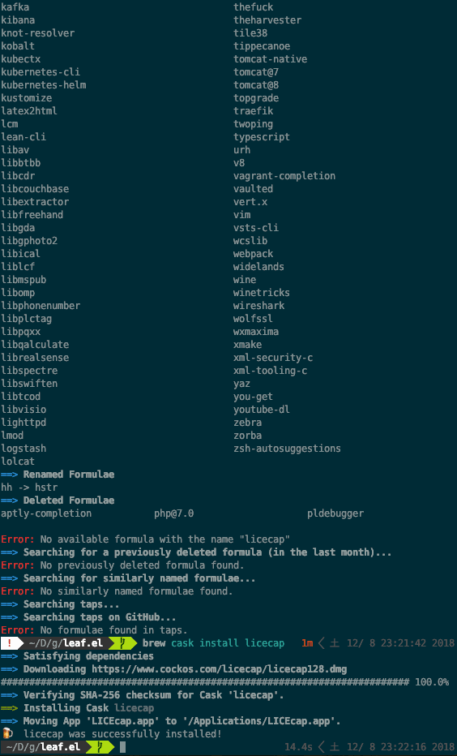

** モチベーション
「[[https://s.conao3.com/blog/2018/07b41c][Makefileで.emacs.dの理想的なディレクトリ構造を生成する話]]」で紹介したように、私はレガシーEmacsでも「程々に」動くようにしたいという動機でEmacs-22から動作する[[https://github.com/jwiegley/use-package][use-package]]と同様のDSLを提供する[[https://github.com/conao3/leaf.el][leaf.el]]を開発しています。

さて、ソフトウェアを開発する際はデグレードがよく発生します。単純なデグレードを防ぐには、あるコミットまでに達成できたケースをアップデートしたソフトでも変わらず実行できるか確かめる方法があります。

テストとマージを短い間隔で行う開発手法を「継続的インテグレーション」と呼ぶ？あまり詳しくないので避けると、とりあえずテストケースは正常に動くことが保証されたソフトが開発できます。

Travis CIを使いますが、使っているのはただ単にGitHubのトップページに「build:passing」のバッジがついてるとかっこいいなと思うからです。はい動機終わり。

なお、個人のEmacsのパッケージ等はビルドとテストにかかる時間も短いので、私は「すべてのコミットの前にターゲットバージョンですべてのテストが通る」ことを確認しています。そんなコミットする前にいちいちテストの終了を待つなんて意識高いなと思わないでください。ただ単にTravis CIでfailした履歴を残したくないだけです。

** Ertとの違い
EmacsにはEmacs-24から標準添付されているErtというユニットテストフレームワークが存在します。leaf.elは初期の段階ではErtを使用しており、Emacs-23とEmacs-22のテストはまた後で考えればいいやと思っていました。

しかしErtを使っていた時に、「[[https://travis-ci.org/conao3/leaf.el/jobs/451882801][明らかにpassするはずなのにfailする]]」「[[https://travis-ci.org/conao3/leaf.el/builds/449134718][Emacs-24だけfailする]]」「[[https://travis-ci.org/conao3/leaf.el/jobs/449134720][結局どこを直せばいいのか情報が得られない]]」などのきっかけで自分で作ることになってしまいました。

「結局どこを直せばいいのか情報が得られない」からひとつだけ出力を抜き出します。さて、このテストケースを通すためには一体何をすればいいのか、この出力からは全くと言っていいほどわかりません。

#+begin_src emacs-lisp
0.35s$ make test
/tmp/emacs/bin/emacs -Q --batch -L ./ -l leaf-tests.el -f leaf-run-tests-batch-and-exit
test with ert.
GNU Emacs 24.5.1 (x86_64-unknown-linux-gnu)
 of 2016-04-24 on testing-worker-linux-docker-199c7fe1-3369-linux-7
Running 10 tests (2018-11-01 00:33:55+0000)
Test leaf-test/:if-1 backtrace:
  pcase--u1(((match val quote (if t (progn (require (quote foo) nil ni
  pcase--u((((match val quote (if t (progn (require (quote foo) nil ni
  pcase--expand((expand-minimally (if t (progn (require (quote foo) ni
  #[385 "\301\"@\232\203 \211A@\262\232\203 \211\211AA\262\
  macroexpand((pcase (expand-minimally (if t (progn (require (quote fo
  ert--expand-should-1((should (pcase (expand-minimally (if t (progn (
  ert--expand-should((should (pcase (expand-minimally (if t (progn (re
  #[257 "\300\301D\302#\207" [ert--expand-should should #[771 "\300
  (should (pcase (expand-minimally (if t (progn (require (quote foo) n
  (match-expansion (if t (progn (require (quote foo) nil nil))) (quote
  (closure (t) nil (match-expansion (if t (progn (require (quote foo)
  #[0 "\306\307!r\211q\210\310\311\312\313\314\315!\316\"\317\320%DC
  funcall(#[0 "\306\307!r\211q\210\310\311\312\313\314\315!\316\"\31
  ert--run-test-internal([cl-struct-ert--test-execution-info [cl-struc
  #[0 "r\304 q\210\305 )\306\307\310\311\312\313!\314\"\315\316%DC\2
  funcall(#[0 "r\304 q\210\305 )\306\307\310\311\312\313!\314\"\315\
  ert-run-test([cl-struct-ert-test leaf-test/:if-1 nil (closure (t) ni
  ert-run-or-rerun-test([cl-struct-ert--stats t [[cl-struct-ert-test l
  ert-run-tests(t #[385 "\306\307\"\203D\211\211G\310U\203\211@\20
  ert-run-tests-batch(nil)
  ert-run-tests-batch-and-exit()
  leaf-run-tests-batch-and-exit()
  command-line-1(("-L" "./" "-l" "leaf-tests.el" "-f" "leaf-run-tests-
  command-line()
  normal-top-level()
Test leaf-test/:if-1 condition:
    (error "Unknown upattern `(quote (if t (progn (require (quote foo) nil nil))))'")
   FAILED   1/10  leaf-test/:if-1
#+end_src

GUIからインタラクティブにテスト実行できるのですが、テストの宣言場所までジャンプするくらいの機能だけしか発見できず、Ertを使うのは諦めてしまいました。。

私の作ったcort.elでは荒削りなものの、デバッグのきっかけになりそうな情報は与えてくれます。

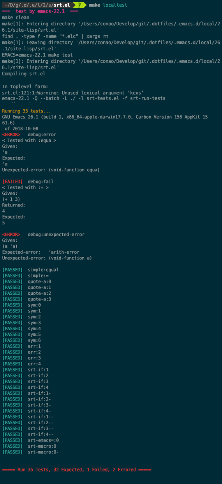

- 1つ目 =<ERROR>= となっているので「エラーが起こったのだな」とすぐ分かります。エラーの詳細は =Unexpected-error: (void-function equa)= と出力されており、よく見ると =Tested with :equa= とあります。

  つまり =(equal 'a 'a)= というテストケースを定義したつもりだったものの、 =(equa 'a 'a)= を実行しているということです。タイポですか。。

- 2つ目 =[FAILED]= となっているので、実行は出来たものの、期待する値にならなかったということです。 =(+ 1 3)= が与えられ、その返り値として =4= が返ってきた。期待する値は =5= 。
  （2つの値の比較は === で行った）という情報が得られ、すぐデバッグできます。

- 3つ目 =<ERROR>= となっているのでエラーが起こっていますが、このテストケースは後述するように「特定のエラーを期待するテストケース」です。それを示すように =Expected-error: 'arith-error= と表示されています。

  しかしその下には =Unexpected-error: (void-function a)= と表示されており、期待しないエラーが起こっていることが一目瞭然です。このテストケースにおいても、実行したS式がわかりやすく示されており、デバッグに必要な情報を得ることが出来ます。

パッケージのテストを行う時は、ほとんどの方が「-q」や「-Q」オプションを付けられていると思います。これは自分のローカル設定を読み込まず、起動を早くする側面もあると思いますが、第一には問題の切り分けをしやすくするためだと思います。

その点、cort.elは1ファイルで完結しており、ごてごてしたパッケージをパッケージマネージャでダウンロードして、、、という過程を踏む必要がありません。
基本的にはcort.elをユーザーの方のレポジトリに放り込んでもらうことを想定してます。もちろんsubmoduleで持ってもいいんですが、たかだか1ファイルにそこまでする？という思いがします。

** build:passingしたい！
とりあえず =build:passing= したい！という方もいると思うので、まずは場面設定から。

*** Makefile
昨日の記事に次いでMakefile作ります。特にやることもなく、素直に書きます。

EMACSの等号が =?== なのはタイポではなく、「外部から値を与えられた場合、その値を採用する」という意味に解釈されます。

コメントに書かれていますが、例えば単に =make check= と実行すると、 =emacs= で実行されます。 =EMACS=emacs-26.1 make check= と実行すると、 =emacs-26.1= でテストが実行されるようになります。

#+begin_src makefile
TOP       := $(dir $(lastword $(MAKEFILE_LIST)))

EMACS     ?= emacs

LOAD_PATH := -L $(TOP)
BATCH     := $(EMACS) -Q --batch $(LOAD_PATH)

ELS       := cort.el         # compiling .el list
ELCS      := $(ELS:.el=.elc)

all: build

build: $(ELCS)

%.elc: %.el
          @printf "Compiling $<\n"
          @$(BATCH) -f batch-byte-compile $<

check: build
# If byte compile for specific emacs,
# set EMACS such as `EMACS=emacs-26.1 make check`.
          $(BATCH) -l cort-tests.el -f cort-run-tests

clean:
          -find . -type f -name "*.elc" | xargs rm
#+end_src

*** .travis.yml
use-packageの.travis.ymlを多分に参考にして、このように書きます。実際よくわかってません。

#+begin_src sh
language: generic
sudo: false

env:
  global:
    - CURL="curl -fsSkL --retry 9 --retry-delay 9"
  matrix:
  - EMACS_VERSION=23.4
  - EMACS_VERSION=24.5
  - EMACS_VERSION=25.3
  - EMACS_VERSION=26.1
  - EMACS_VERSION=master
install:
  - $CURL -O https://github.com/npostavs/emacs-travis/releases/download/bins/emacs-bin-${EMACS_VERSION}.tar.gz
  - tar xf emacs-bin-${EMACS_VERSION}.tar.gz -C /
  - export EMACS=/tmp/emacs/bin/emacs

script:
  - make
  - make check
#+end_src

*** cort-test.el
cort.elが検証するテストケースをつらつら書きます。キーワードは後述するので、雰囲気を感じ取ってもらえれば。

#+begin_src emacs-lisp
;; require depends package
(require 'cort)

;; if you need temporary functions for test, define this.
(defun quote-a ()
  'a)

(defmacro sym (x)
  `',x)

;; define test cases.
(cort-deftest simple:equal
  (:equal '(a b c) '(a b c)))

(cort-deftest simple:=
  (:= 100 100))

(cort-deftest quote-a:0
  (:eq 'a 'a))

(cort-deftest quote-a:1
  (:eq (quote-a) 'a))

(cort-deftest sym:1
  (:eq (sym a) 'a))

(cort-deftest sym:4
  (:equal (sym (a b c)) '(a b c)))

(cort-deftest error-test
  (:= (+ 1 2) 5))

(cort-deftest err:1
  (:cort-error 'void-function
          (a 'a)))

(cort-deftest err:3
  (:cort-error 'arith-error
          (/ 1 0)))

(cort-deftest cort-if:2
  (:eq 'a
       ('b
        :cort-if (nil 'c)
        :cort-if (t 'a))))

(cort-deftest cort-emacs=:0
  (:= 10
      (0
       :cort-emacs> (0 10))))
;; ...cort-test.el
#+end_src

=:cort-if= や =:cort-eamcs= キーワードを除いて、結構読みやすいテストケース定義が実現できていると思います。条件分岐キーワードは慣れないと見づらいかもしれません。cort.elのテストケースでも、クオートがついているS式はその値のまま保存され、クオートのついていないS式は評価されます。

こうやってcort.elと設定ファイル2つを準備することによって、Travis CIで自動テストさせることが出来ます。Travis CIの使い方やバッジの貼り方などは他の人の記事に譲り、cort.elのシンタックスを説明したいと思います。

** シンタックス
*** はじめに
=cort-deftest= は基本的に次の構成になっています。

#+begin_src emacs-lisp
(cort-deftest TESTCASE-NAME
  (SEXP))
#+end_src

そして =(SEXP)= が =t= になることを期待します。 =TESTCASE-NAME= はわかりやすい名前をつけて貰えればと。

**** =(SEXP)= の構造
=(SEXP)= は =(:SYMBOL GIVENFORM EXPECTFORM)= になっています。

=:SYMBOL= がcort.elが解釈する特別なキーワードでない場合、 =:SYMBOL= から =:= を取った、 =(SYMBOL GIVENFORM EXPECTFORM)= を実行し、このS式が =t= を返せばpassします。

=:SYMBOL= としているのはキーワードシンボルとして認識されるので、赤色になって見やすいからです。それ以上の意味はなかったのですが、 =eq=, =eql=, =equal=, === など自分の好きな関数を比較関数として実行でき、とても自由度の高いテストケース表記ができるようになったかなと思います。

**** =FORM=
=GIVENFORM= と =EXPECTFORM= をまとめて =FORM= と記述することにします。 =FORM= は定数式、関数、マクロの形式を受け取ります。

つまり =GIVENFORM= が定数で =EXPECTFORM= が評価されるべき式を指定しても普通に動きます。混乱するのでやめたほうが良いと思いますが。。

マクロが渡された場合、展開して評価されます。まぁ普通のマクロと同じです。マクロの展開だけをテストしたい場合は =(macroexpand MACRO)= を渡せばよいです。この動作を実現する便利マクロは後述します。

*** =:cort-error= キーワード
=:cort-error= を =SYMBOL= の位置に置くとそのテストケースはエラーを期待するテストケースとなります。実際には =GIVENFORM= を実行したときに =EXPECTFORM= に指定したエラーが出ることを検証します。

=EXPECTFORM= におけるエラーの型は[[https://www.gnu.org/software/emacs/manual/html_node/elisp/Standard-Errors.html#Standard-Errors][Appendix F Standard Errors]]を参照してください。

*** =:cort-if= キーワード
=FORM= を条件式によって分岐させたい場面があると思います。たとえばあるオプションを有効にしているときのパッケージの挙動のテストなどです。

私が遭遇したのはやはりEmacs-23以前で =(macroexpand-1)= が定義できないので =EXPECTFORM= をバージョンで分岐させたいという動機でした。

さて、 =FORM= は即値（そのまま評価できる）か =:cort-if= で分岐されるべき2つ以上の値かになるわけですが、その両立にめちゃくちゃ悩んで次の文法にしました。

#+begin_src emacs-lisp
;; cort-ifを使わない場合。このテストケースはfailします。
(cort-deftest cort-if-test:1
  (:eq 'a
       'b))

;; cort-ifを使う場合。
;; cort-ifは (COND FORM-A) を受け取り、CONDがtのときFORM-AをFORMの値として採用します。
;; すべてのcort-ifのCONDがnilの場合、一番最初に書かれた値をFORMとして採用します。
(cort-deftest cort-if-test:2
  (:eq 'a
       ('b
        :cort-if (t 'a))))
#+end_src

はい。妥協です。もっと簡潔な表現を考えついたぜ！というかたはぜひ[[https://github.com/conao3/cort.el/issues][issueを書いて]]もらえると助かります。 =:corf-if= のCONDはもちろん関数やマクロが受け取れます。

また =:cort-if= は複数置くこともできます。その場合は全ての =:cort-if= のCONDがnilになった場合、一番最初のデフォルト値を採用します。

*** =:cort-emacs= キーワード
実際には下記のキーワードです。

- =:cort-emacs<=
- =:cort-emacs<==
- =:cort-emacs==
- =:cort-emacs>==
- =:cort-emacs>=

Emacsのバージョンで分岐するのはよくあるケースなので、特別なキーワードを用意しました。

#+begin_src emacs-lisp
(cort-deftest cort-emacs:a0
  (:= 10
      (0
       :cort-emacs> (0 10))))

(cort-deftest cort-emacs:a1
  (:= 10
      (0
       :cort-if ((not
                 (funcall (intern "version<") emacs-version "0"))
                10))))

;;;;;;;;;;;;;;;;;;;;;;;;;;;;;;;;;;;;;;;;;;;;;;;;;;

(cort-deftest cort-emacs:b0
  (:= 10
      (0
       :cort-emacs<= (0 10))))

(cort-deftest cort-emacs:b1
  (:= 10
      (0
       :cort-if (((funcall (intern "version<=") emacs-version "0")
                 10)))))
#+end_src

内部的には =:cort-emacs= キーワードは単なる =:cort-if= キーワードに置き換えられて実行されます。つまりcort-emacs:a0テストケースはcort-emacs:a1と同じテストケースということになります。

cort-emacs:b0もcort-emacs:b1と同じように解釈されます。 =version<= という関数があるので、その方向の比較はそのまま展開されますが、 =version>= という関数はないので、a1の方では =not= を使って等価な条件式を自動生成していますね。

** マクロでのテストケースの生成の例
*** =match-expansion=
テストケースにおいて何度も使われる部分がある場合、マクロで生成したくなると思います。例えばleaf.elというパッケージを書いていたときは、下記のようなテストケースが多発しました。

#+begin_src emacs-lisp
(cort-deftest leaf-test/:if-1
  (:equal
   (macroexpand-1 '(leaf foo :if t))
   '(if t
         (progn
           (require (quote foo))))))

(cort-deftest leaf-test/:if-2
  (:equal
   (macroexpand-1 '(leaf foo :if (and t t)))
   '(if (and t t)
         (progn
           (require (quote foo))))))

(cort-deftest leaf-test/:if-3
  (:equal
   (macroexpand-1 '(leaf foo :if nil))
   '(if nil
         (progn
           (require (quote foo))))))
#+end_src

これを見ると、 =GIVENFORM= は与えられた[[https://github.com/conao3/leaf.el][leaf.el]]を =macroexpand-1= し、 =equal= で =EXPECTFORM= と比較しています。

そこで次のようなテストケースを生成するマクロを定義することができ、これは期待通りに動きます。この例で閉じたものにするために、leaf.elの簡略版も定義します。

#+begin_src emacs-lisp
;; test target macro
(defmacro package-require (package)
  `(require ,package))

;; Macro to expand FORM and compare it with EXPECT for equal test case
(defmacro match-expansion (form expect)
  (if (fboundp 'macroexpand-1)
      `(:equal (macroexpand-1 ',form) ,expect)
    `(:equal (macroexpand ',form) ,expect)))

(cort-deftest match-expansion0
  (match-expansion
   (package-require 'use-package)
   '(require 'use-package)))

(cort-deftest match-expansion1
  (:equal (macroexpand '(package-require 'use-package))
           '(require 'use-package)))
#+end_src

この例では =match-expansion0= と =match-expansion1= は同じテストケースとして解釈されます。
=match-expansion0= のほうがテストケースに本当に必要な部分が書かれており、 =:equal= や =macroexpand= を隠蔽できているのでテストを簡単に書くことができます。

*** =leaf-match=
前述したようにEmacs-22やEmacs-23では =macroexpand-1= が定義できません。そのため必ず =:cort-emacs= キーワードでテストケースの分岐をしないといけないのですが、その指定を隠蔽できます。

#+begin_src emacs-lisp
(defmacro leaf-match (form expect)
  "Return testcase for cort.
Since `macroexpand-1' is not defined in Emacs below 23.0, use this macro.
EXPECT is (expect-default expect-24)"
  `(match-expansion
    ,form
    (,(car expect)
     :cort-if ((not (fboundp 'macroexpand-1)) ,(cadr expect)))))

(cort-deftest leaf-test/:simple-when
  (leaf-match
   (leaf foo :when t)
   ('(when t
       (progn
         (require 'foo)))
    '(if t
         (progn
           (progn
             (require 'foo)))))))

(cort-deftest leaf-test/:simple-when-without-macro
  (match-expansion
   (leaf foo :when t)
   ('(when t
       (progn
         (require 'foo)))
    :cort-if ((not (fboundp 'macroexpand-1))
              '(if t
                   (progn
                     (progn
                       (require 'foo))))))))
#+end_src

実際にはバージョンではなく、 =macoroexpand-1= が定義されているかどうかで分岐しています。このようにマクロを使って本質的なところだけを抽出して効率的にテストケースを記述できます。

** おまけ
*** 複数バージョンでのテスト
レガシーEmacsをサポートするという縛りプレイを行う時は、コマンド一発ですべてのバージョンのテストが実行できると嬉しいです。
そこで実際には下記のMakefileを使っています。

#+begin_src makefile
all:

include Makefunc.mk

TOP        := $(dir $(lastword $(MAKEFILE_LIST)))
EMACS_RAW  := $(filter-out emacs-undumped, $(shell compgen -c emacs- | xargs))
ALL_EMACS  := $(strip $(sort $(EMACS_RAW)))

EMACS      ?= emacs

LOAD_PATH  := -L $(TOP)
ARGS       := -Q --batch $(LOAD_PATH)
BATCH      := $(EMACS) $(ARGS)

ELS        := leaf.el
ELCS       := $(ELS:%.el=%.elc)

LOGFILE    := .make-test.log

##################################################

all: git-hook build

git-hook:
# cp git hooks to .git/hooks
        cp -a git-hooks/* .git/hooks/

build: $(ELCS)

%.elc: %.el
        @printf "Compiling $<\n"
        @$(BATCH) -f batch-byte-compile $<

check: # build
# If byte compile for specific emacs,
# set specify EMACS such as `EMACS=emacs-26.1 make check`.
        $(MAKE) clean --no-print-directory
        $(BATCH) -l leaf-tests.el -f cort-run-tests

allcheck: $(ALL_EMACS:%=.make-check-%)
        @echo ""
        @cat $(LOGFILE) | grep =====
        @rm $(LOGFILE)

.make-check-%:
        EMACS=$* $(MAKE) check --no-print-directory 2>&1 | tee -a $(LOGFILE)

# silent `allcheck' job
test: $(ALL_EMACS:%=.make-test-%)
        @echo ""
        @cat $(LOGFILE) | grep =====
        @rm $(LOGFILE)

.make-test-%:
        EMACS=$* $(MAKE) check --no-print-directory 2>&1 >> $(LOGFILE)

updatecort:
        cp -f ../cort.el/cort.el ./

clean:
        -find . -type f -name "*.elc" | xargs rm
#+end_src

テスト数が多くなってくると表示が煩雑になるので、通常は静かな =make test= を使っています。
あと、冒頭のアニメーションGIFは =make allcheck= と =make test= を録画したものです。

*** コミット前にテストする
僕が開発しているパッケージは「テストが通らないコミットはしない」運用になっています。

わざとレビュワーがブランチ切って通らないテストケースを書いて、コミッタがそのテストを通るように直した後マージする方法もあると思いますが、これは個人開発でテストも軽いため、この運用にしています。

さて、gitにはcommitなどの前にスクリプトを実行させることが出来て、そのスクリプトが異常終了した際にcommitなどを拒否する設定にできます。
実際には次のファイルを =pre-commit= という名前で実行権限を付けて =.git/hooks/= に配置するだけです。

#+begin_src shell
#!/bin/sh
#

make test
#+end_src

私のMakefileでは =all= ジョブでプロジェクトのルートに =git-hooks= というディレクトリがあって、その中にあるファイル群を =.git/hooks/= にコピーするようになっています。

実際この運用で多くのデグレードを未然に避けることが出来たので、条件が許す際はぜひ使ってみてもらえるといいかなと思います。

* org-publishを使ってorgでブログを書く話
:properties:
:export_file_name: generated/contents/blog/2018/611299
:export_date: 2018-12-14
:end:

** はじめに
この記事は [[https://qiita.com/advent-calendar/2018/emacs][Emacs Advent Calendar 2018 - Qiita]] の14日目の記事です。
前日はtakuchalleさんの「[[https://blog.takuchalle.me/post/2018/12/13/emacs_dart_setup/][Emacs で Dart 開発環境をセットアップ]]」でした。

** モチベーション
私はOrg-Modeで日常のほとんどすべての文書作成を行っており、そもそも私は「Org-Modeを使うためにEmacs入門した」ほど大きな存在です。

最初にOrg-Modeの公式サイトで紹介されている[[https://www.jstatsoft.org/article/view/v046i03][論文]]から画像を引用します。

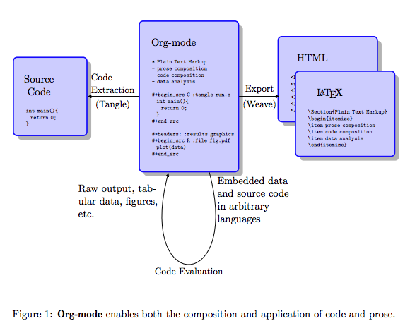

この画像の通り、Org-Modeはそれ自身が高性能なマークアップ言語でありながら、[[http://misohena.jp/blog/2017-10-26-how-to-use-code-block-of-emacs-org-mode.html][任意の言語のコード実行]]、さらには[[http://lioon.net/org-table-tutorial][表計算]]！などを用いて文書を作成し、それを[[https://orgmode.org/manual/Exporting.html][任意のフォーマットへのアウトプット]]が可能で、すべての文書のハブともいうべき存在になっています。これを万能文書と呼ぶことにします。（21フォーマットのエクスポーターが標準添付（contrib）され、MELPAにはさらに29種ものエクスポーターが登録されています）

例えば現代においてはHTMLをタグ直書きで文書を書いている人はほとんどいないと思います。なぜならHTMLタグは人間が書くには冗長すぎる他（閉じタグなど）、本質的でないメタ情報が文書中に散らばり（head, id, class）、文書の再利用性が極端に低くなるからです。

よって賢明な方ならばPHPのようなテンプレート言語で生成したり、マークダウンから[[https://pandoc.org/][pandoc]]で変換したりすると思います。これによりメタ情報部と文書部が分離でき、再利用性が上がり、保守性も向上します。

つまりHTMLとかいう冗長で扱いづらいフォーマットは動的に生成されるべきターゲットであって、人間はもっと書きやすい別のフォーマットで文書を作成するべきなのです。

一方、マークダウンには根強いファンがあり、そしてpandocにより万能文書としての機能を備えてきたように思えますが、いろいろ[[https://note.solarsolfa.net/n/n697389a6be3b][苦悩している]]ようです。

Orgユーザーからすれば、なぜそんな茨の道を進もうとしているのか理解できません。
Org文書で作成しさえすれば豊富なターゲットフォーマット、つまりWebには静的HTMLやHugo, Wordpress, Qiitaにより公開し、印刷にはLaTeXから生成したPDF、スライドにはブラウザで表示する[[https://revealjs.com/#/][Reveal.js]]や[[http://ayapin-film.sakura.ne.jp/LaTeX/Slides/Beamer-tutorial.pdf][LaTeX+Beamer]]で生成したスライド投影用のPDFを使用でき、編集時にもOrg-Modeが提供するOrg文書のための様々なコマンドが利用できます。
こんな悲しい事態にはならなくてすむのです。 +（この講義、今期末まであるの辛い。。）+

#+begin_quote
今受けてる授業大学4年間で最悪の可能性ある。環境の意味で。

数学記号変な意味でつかうし、「Wordで」作ったA4の資料を「そのまま」プロジェクターで写すから、いちいち写真撮ってデジタルズームしないと読めない。そして読めるとは限らない。つらすぎる、、 [[https://t.co/QDRQIOD6ZL][pic.twitter.com/QDRQIOD6ZL]]

— Conao (@conao_3) [[https://twitter.com/conao_3/status/1073019805936971776?ref_src=twsrc%5Etfw][2018年12月13日]]
#+end_quote

さて、あるOrg文書を変換するのはとても簡単で、例えばこの[[https://raw.githubusercontent.com/conao3/shogi-detect/master/Readme.org][Org文書]]からこの[[https://github.com/conao3/shogi-detect/blob/master/report.pdf][PDFファイル]]をコマンド1発で変換できます。（内容はやっつけなので(ry...）

上の文書には数式や表が含まれていませんが、私は電気系の学生として毎期の実験レポートをOrg文書から生成したLaTeXから変換したPDFですべてのレポートを提出しましたし、卒論を[[http://d.hatena.ne.jp/r_takaishi/20100209/1265680490][書いた人]]や[[http://akisute3.hatenablog.com/entry/2013/12/28/144918][作成入門を書かれている方]]もいます。

一方Org文書が複数に渡る場合、（最終的に1つのファイルにするならinclude文を使えばよいだけなのですが、それぞれを違うファイルとして変換したい場合）Org文書同士のリンクやOrg文書へのリンクを張るメタ的なOrg文書を生成したくなったりと途端に難しくなります。

この操作を実現するのがorg-publishです。ただ、設定に癖があるのでその設定を紹介するとともに、もっとOrg-Modeのユーザーが増えたらいいなと布教をするものです。

** マニュアル
日本語マニュアルは少々古いですが[[https://takaxp.github.io/org-ja.html#g_t_00e5_0085_00ac_00e9_0096_008b][ここ]]、英語のマニュアルは[[https://orgmode.org/manual/Publishing.html][ここ]]においてあります。

** なにがどうなるのか
=<root>/src/= 下に自由にフォルダやOrg文書を作成して配置します。そしてPublishコマンドを発行することにより =<root>/src/= 下のすべてのOrg文書を「その階層を保存した上で」 =<root>/archives/= にHTMLで書き出すことが出来ます。

#+begin_example
~/public_html/orglyth/
   ├── index.inc
   ├── index.org
   ├── archives/
   ├── parts/
   │   └── index.html
   └── src/
       ├── index.inc
       └── index.org
       ├── elisp/
       │   ├── index.inc
       │   ├── index.org
       │   ├── boolean.org
       │   └── with-temp-file.org
       └── emacs/
           ├── index.inc
           ├── index.org
           ├── install.org
           └── org-mode
               ├── index.inc
               ├── index.org
               ├── basis-syntax.org
               ├── org-list.html
               ├── org-list.org
               └── ox-publish.org
#+end_example

org-publishを使用する第一の利点として[[https://conao3.com/archives/sitemap.html][sitemapを自動生成]]させることが出来ます。

別途 =<root>= に置いた =.htaccess= の設定をすれば、例えば([[https://conao3.com/archives/blog/advent/emacs/org-publish-blog]])にアクセスすると普通にHTMLを閲覧させてarchivesの部分をsrcに変更した([[https://conao3.com/src/blog/advent/emacs/org-publish-blog]])にアクセスするとソースのOrg文書を見せることも出来ます。

#+begin_src emacs-lisp
AddDefaultCharset utf-8
AddType "text/plain" org

ErrorDocument 503 /archives/error/maintenance.html
ErrorDocument 404 /archives/error/404.html
DirectoryIndex index.html index.org

SetEnvIf REDIRECT_HTTPS (.*) HTTPS=$1
<IfModule mod_rewrite.c>
RewriteEngine on
RewriteCond %{ENV:HTTPS} !on
RewriteRule .* https://%{HTTP_HOST}%{REQUEST_URI} [R=301,L]
</IfModule>

# temporary-maintenance
# RewriteCond %{REQUEST_URI} !=/archives/error/maintenance.html
# RewriteRule ^.*$ - [R=503,L]


RewriteEngine on
RewriteCond %{REQUEST_FILENAME} !-d
RewriteCond %{REQUEST_FILENAME}\.org -f
RewriteRule ^(/src/.*)$ $1.org [L]

RewriteCond %{REQUEST_FILENAME} !-d
RewriteCond %{REQUEST_FILENAME}\.html -f
RewriteRule ^(/archives/.*)$ $1.html [L]
#+end_src

=archive= を =src= に変えてソースのOrg文書を見せることはすでに出来ているのですが、例えば =archive= を =pdf= に変えたら記事のPDFをダウンロードさせることも簡単にできると思います。

もちろん文書間リンクや画像リンクなどはいつもどおり書いたものをorg-publishがWebで表示できるように、よしなに変更してくれます。具体的には =.org= へのリンクは =.html= へのリンクに変更され、メディアはそのままターゲットディレクトリの対応するパスにコピーします。（orglyth.elでは =orglyth-html-default-resources-option= で制御してます）

** init.elの設定
私は今init.elの大改革（[[https://s.conao3.com/blog/2018/07b41c][.emacs.dの構造から見直したり]]、 [[https://github.com/conao3/leaf.el][use-packageの別実装を作ったり]]（Qiita記事は21日目に予約済み）、[[https://s.conao3.com/blog/2018/48bb55][新しいテストフレームワークを作ったり]]）を行っていて、init.elの編集まで作業が追いついていないのですがとりあえずOrg-Modeに関する今の設定は以下です。

新しいパッケージマネージャ(feather.el)の開発が終わり次第、シームレスに設定できるようになりますが、現状では伝統的なパッケージ管理のように =site-lisp= にレポジトリをクローンして =load-path= を通す必要があります。

- [[https://github.com/conao3/leaf.el][leaf.el]] - Emacs-22から利用できる =use-package= の別実装
- [[https://github.com/conao3/feather.el][feather.el]](開発中) - Emacs-22から利用できる全く新しいパッケージマネージャ
- [[https://github.com/conao3/orglyth.el][orglyth.el]] - ox-*の設定集

#+begin_src emacs-lisp
(leaf org
  :init
  (leaf org-plus-contrib :ensure t :require nil)

  :setq
  ((org-directory                         . "~/Documents/org/")
   (org-default-notes-file                . "~/Documents/org/notes.org")
   (org-agenda-files                      . "~/Documents/org/notes.org")
   (org-return-follows-link               . t)
   (org-startup-indented                  . t)
   (org-indent-mode-turns-on-hiding-stars . t)
   (org-indent-indentation-per-level      . 2)
   (org-src-window-setup                  . 'other-window)
   (org-use-sub-superscripts              . '{})
   (org-image-actual-width                . nil)
   (org-highlight-latex-and-related       . '(latex script entities)))

  :config
  (leaf ob
    :setq ((org-confirm-babel-evaluate . nil))
    :config
    (leaf ob-ipython
      :when (executable-find "jupyter")
      :ensure t
      :config
      ;; depend of jypyter, ipython
      (add-hook 'org-babel-after-execute-hook 'org-display-inline-images 'append))

    (leaf ob-plantuml
      :when (executable-find "plantuml")
      :ensure t
      :setq ((org-plantuml-jar-path . plantuml-jar-path))
      :setq ((org-confirm-babel-evaluate . nil)))

    (org-babel-do-load-languages 'org-babel-load-languages
                                 '((ipython . t)
                                   (plantuml . t)
                                   (org . t)
                                   (R . t)
                                   (C . t)
                                   (emacs-lisp . t))))
  (leaf ox
    :config
    (leaf orglyth
      :config
      (leaf orglyth-html
        :setq
        ((orglyth-html-enable-option    . t)
         (orglyth-html-use-ftp          . nil)
         (orglyth-html-local-root-path  . "~/Documents/sakura/orglyth/")
         (orglyth-html-remote-root-path . "~/Documents/sakura/remote/")
         (orglyth-html-ftp-root-path    . "/ftp:conao3@conao3.com:~/www/orglyth/"))
        :config
        (orglyth-html-init)
        (orglyth-html-project-init))

      (leaf orglyth-latex
        :setq ((orglyth-latex-enable-option . t))
        :config
        (orglyth-latex-init)))))
#+end_src

この設定は拙作の[[https://github.com/conao3/leaf.el][leaf.el]]により以下に変換されます。

#+begin_src emacs-lisp
(progn
  (progn
    (progn
      (leaf-backend/:ensure-package 'org-plus-contrib 'org-plus-contrib)
      (progn)))
  (progn
    (require 'org)
    (setq org-directory "~/Documents/org/")
    (setq org-default-notes-file "~/Documents/org/notes.org")
    (setq org-agenda-files "~/Documents/org/notes.org")
    (setq org-return-follows-link t)
    (setq org-startup-indented t)
    (setq org-indent-mode-turns-on-hiding-stars t)
    (setq org-indent-indentation-per-level 2)
    (setq org-src-window-setup 'other-window)
    (setq org-use-sub-superscripts '{})
    (setq org-image-actual-width nil)
    (setq org-highlight-latex-and-related
          '(latex script entities))
    (progn
      (require 'ob)
      (setq org-confirm-babel-evaluate nil)
      (if
          (executable-find "jupyter")
          (progn
            (leaf-backend/:ensure-package 'ob-ipython 'ob-ipython)
            (progn
              (require 'ob-ipython)
              (add-hook 'org-babel-after-execute-hook 'org-display-inline-images 'append))))
      (if
          (executable-find "plantuml")
          (progn
            (leaf-backend/:ensure-package 'ob-plantuml 'ob-plantuml)
            (progn
              (require 'ob-plantuml)
              (setq org-plantuml-jar-path plantuml-jar-path)
              (setq org-confirm-babel-evaluate nil))))
      (org-babel-do-load-languages 'org-babel-load-languages
                                   '((ipython . t)
                                     (plantuml . t)
                                     (org . t)
                                     (R . t)
                                     (C . t)
                                     (emacs-lisp . t))))
    (progn
      (require 'ox)
      (progn
        (require 'orglyth)
        (progn
          (require 'orglyth-html)
          (setq orglyth-html-enable-option t)
          (setq orglyth-html-use-ftp nil)
          (setq orglyth-html-local-root-path "~/Documents/sakura/orglyth/")
          (setq orglyth-html-remote-root-path "~/Documents/sakura/remote/")
          (setq orglyth-html-ftp-root-path "/ftp:conao3@conao3.com:~/www/orglyth/")
          (orglyth-html-init)
          (orglyth-html-project-init))
        (progn
          (require 'orglyth-latex)
          (setq orglyth-latex-enable-option t)
          (orglyth-latex-init))))))
#+end_src

Orgの命名規則として =ob-*= はbabel（任意コード実行）などコードブロック関連、 =ox-*= はエクスポート関連のパッケージとなっています。

=ox= ブロックは実験レポートを日常的に書いていたこともあり、いろいろとカオスだったのですが[[https://github.com/conao3/orglyth.el][orglyth.el]]というパッケージに括りだすことでinit.elの見通しを良くすることが出来ました。

orglyth.elの設定部を抜き出すと以下になります。このように少しの変数のみを定義するのみです。後はorglyth.elに丸投げします。

- =orglyth-html-enable-option= : tの時、 =(orglyth-html-init)= をした時に関連する変数を変更します。(何を変えるかはソースを見たほうが早いです)
- =orglyth-html-use-ftp= : tの時、プロジェクト:websiteの設定がftp転送したサーバー上になります。 遅いのでnilにしてます。
- =orglyth-html-local-root-path= : ローカルのOrg文書ルートフォルダです。
- =orglyth-html-remote-root-path= : プロジェクト:websiteのターゲットフォルダです。
- =orglyth-html-ftp-root-path= : プロジェクト:websiteのターゲットフォルダです。
- =(orglyth-html-init)= : 変数の初期化
- =(orglyth-html-project-init)= : orglyth.elのプロジェクトをOrgに登録する。

#+begin_src emacs-lisp
(leaf orglyth
  :config
  (leaf orglyth-html
    :setq
    ((orglyth-html-enable-option    . t)
     (orglyth-html-use-ftp          . nil)
     (orglyth-html-local-root-path  . "~/Documents/sakura/orglyth/")
     (orglyth-html-remote-root-path . "~/Documents/sakura/remote/")
     (orglyth-html-ftp-root-path    . "/ftp:conao3@conao3.com:~/www/orglyth/"))
    :config
    (orglyth-html-init)
    (orglyth-html-project-init))

  (leaf orglyth-latex
    :setq ((orglyth-latex-enable-option . t))
    :config
    (orglyth-latex-init)))
#+end_src

=(orglyth-html-projet-init)= はpublishターゲットを複数持っていると、候補が溢れて管理しづらくなる（かもしれない）ので必要な時に登録できるようにしています。私はorg-publishを他の用途には使っていないので起動時に登録するようにしています。

** 使い方
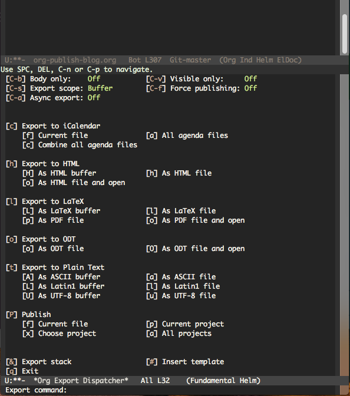
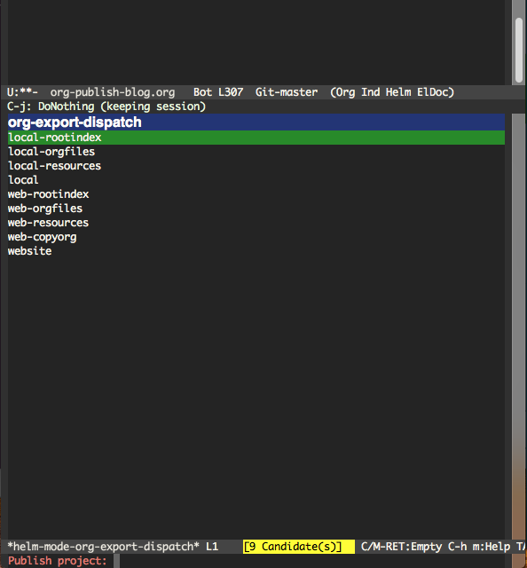

前段の設定を行うと =C-c C-e (org-export-dispatch)= を押し、ディスパッチャに入り、 =P x= を押すと登録されているプロジェクトが確認できます。

様々なプロジェクトが登録されていますが、我々が実行するのは一般的に =local= か =website= のメタプロジェクトです。

org-publishの思想から言うと =local= で変換結果を確認してその後 =website= を実行してftpで転送させたいのでしょうが、遅すぎてその間Emacsのメインスレッドがブロックされるので、実際には =local= を実行してその後ターミナルでサーバーに =rsync= しています。

** まとめ
=org-publish= により静的HTMLサイトを構築する方法を説明しました。

私はもともと =org2blog= を使ってWordpressに投稿していたのですが、過去記事が編集しづらかったり、そもそもWordpressが嫌いになってしまったりと使うのを諦めてしまいました。

最近Org-Mode界隈では =ox-hugo= を用いてブログを書くのがブームになっている([[https://pxaka.tokyo/blog/categories/hugo/][takaxp]]さんなど)ようですが、あまり日の目を見ない =org-publish= でも同様のことができることを知ってもらえればと。

Org文書変換前や変換後に任意のElisp関数を登録できたりと、とても自由度高そうなので =org-publish= でブログを書いてみるのも面白いかもしれません。

プログラマたる者、素人の方が作られた[[http://abehiroshi.la.coocan.jp/][阿部寛さんのHP]]より高速なウェブページを構築したいですよね？実際それは[[https://qiita.com/Morix1500/items/0eac072a027d478a6b83][けっこう大変らしい]]のですが、org-publishでは静的HTMLを吐くので、表示速度追求も面白いかと思います。

AMP対応してGoogleのサーバーにホスティングしてもらうのも手かもしれません。（orglyth.elで将来的に対応予定）

（ちなみに[[https://github.com/rubikitch/daily-emacs-jp][るびきちさん]]に触発されて、私もブログのソースを[[https://github.com/conao3/orglyth-src][GitHubに公開]]してます。実際、URLの =archive= を =src= に変えれば見えるんですが、一覧したいときなどに利用ください。）

* use-packageからの移行のすゝめ - leaf.elでバージョン安全なinit.elを書く
:properties:
:export_file_name: generated/contents/blog/2018/8aa938
:export_date: 2018-12-21
:end:

** はじめに
この記事は [[https://qiita.com/advent-calendar/2018/emacs][Emacs Advent Calendar 2018 - Qiita]] の21日目の記事です。
前日は@hyaktさんの「[[https://qiita.com/hyakt/items/f4468facec0478e06f7a][Dashboardで起動画面を素敵にしよう✨]]」でした。
翌日は@gongoさんの「[[http://gongo.hatenablog.com/entry/2018/12/22/190540][Emacs で NES エミュレータを実装している話]]」です。

[[github:conao3/leaf.el::Emacs Lisp][Flexible, declarative, and modern init.el package configuration]]

** モチベーション
私は[[https://github.com/conao3/dotfiles/commit/fd06cea5dd040ec1fb34225a3f3202200e00801e][8月]]から.emacs.d/init.elの大改革を行っており、その副産物としての成果物をEmacs Advent Calendarで共有させていただいていました。

まず「[[https://s.conao3.com/blog/2018/07b41c][.emacs.dの理想的なディレクトリ構造]]」(7日目)について考え、一番カオスになっていた「[Org-Modeのエクスポート関連の設定] ([[https://s.conao3.com/blog/2018/611299]]) - ([[https://github.com/conao3/orglyth.el][orglyth.el]])」(14日目)を見直し、「[[https://github.com/jwiegley/use-package][use-package]]の細かなストレスを解消するために作り直し - ([[https://github.com/conao3/leaf.el][leaf.el]])」(この記事(21日目))、そのサポートのために「並列パッケージダウンロードを実現するパッケージ - ([[https://github.com/conao3/feather.el][feather.el]])」と「[[https://s.conao3.com/blog/2018/48bb55][新しいElispテストフレームワーク]] - ([[https://github.com/conao3/cort.el][cort.el]])」(8日目)を開発しています。

これらのパッケージとディレクトリ構造により、私のinit.elはEmacs-22からEmacs-26までのEmacsでエラーなく動作 +し+ （する予定です（泣）feather.elの開発が間に合わなかったので、package.elに依存しているため、現状Emacs-24以上でしか動作しません。）、それらの環境は完全に分離されています。

そのためEmacs-26を常用し、いつもは各パッケージをHEADで利用している（melpaのデフォルト）が、よくわからないエラーが起こってそのハンドリングが煩わしい時、とりあえずEmacs-24に逃げて一段落するまで作業を続ける。みたいなことが出来ます。

また実行バイナリがそもそも異なり、それぞれで環境（Emacsから見える =user-emacs-directory= ）が完全に分離されているので、init.elの編集をEmacs-25で行い、その動作確認をEmacs-26を起動したり落としたりしてする。といったことが簡単にできます。

また現状考えられる最古のバージョンである、Emacs-22という化石にも対応しているため、Emacs-22でもほどほどに使うことが出来ます。

[[http://dotfiles.conao3.com/]] というURLでインストール用のシェルスクリプトをホスティングしているので、押し付けられたパソコンで実行するべきは =curl dotfiles.conao3.com | sh= というワンライナーでいつもの環境が整うことになります。（上記URLはshのMIMEタイプをhtmlにしているのでブラウザで表示できます。これもTipsとしては面白い話題かと思います。）

私のinit.elの大改革は今年中に終わらないと思います。。そして副産物の各パッケージもまだまだ発展途上ですが、開発を続けるので暇な時に覗いていただければと思います。

** 定義
この記事タイトルは煽りですが、本記事で「バージョン安全」とは「ターゲットとするそれぞれのEmacsで同一のinit.elをエラーなく実行できること」とします。そのため「ブランチなりディレクトリを分けて、Emacs-24用、Emacs-26用の異なるinit.elを用意する」方法はこの記事の範囲外です。

実際、この運用はしたことがあって、異なるブランチを見ているdotfilesフォルダを2つ用意して =-l= オプションで起動時に分ける運用をした事があるのですが、Emacs標準添付のパッケージへの設定などを2つのブランチで管理することになり、破綻してしまいました。

*** use-packageについて
[[https://github.com/jwiegley/use-package][use-package]]は素晴らしいパッケージであって、多彩なキーワードをサポートし、初心者の方が避けがちなautoloadを上手く隠蔽してくれます。 =require= ベースから =use-package= ベースにinit.elを代えるだけでEmacsの起動が早くなることもザラです。

また私にとっては、use-packageによって今までコメントで区切っていた各パッケージごとの設定が、見やすく分離されることも良い副産物でした。

#+begin_src emacs-lisp
;;;;;;;;;;;;;;;; smartparens ;;;;;;;;;;;;;;;;

(require 'smartparens)
(require 'smartparens-config)
(sp-pair "$" "$")
(sp-use-smartparens-bindings)
(smartparens-global-strict-mode t)
(show-smartparens-global-mode t)
(smartparens-global-mode t)

;;;;;;;;;;;;;;;; auto-complete ;;;;;;;;;;;;;;;;

(require 'auto-complete)
(setq ac-auto-show-menu   0
      ac-delay            0
      ac-quick-help-delay 1
      ac-menu-height      15
      ac-auto-start       1
      ac-use-menu-map     t)
#+end_src

use-package導入前は上記のように設定しており、ブロックを分かりやすくするために =require= を明示的に実行していました。しかしuse-package導入後は以下のようになります。

#+begin_src emacs-lisp
(use-package smartparens :ensure t :diminish ""
  :init (use-package markdown-mode :ensure t)
  :config
  (use-package smartparens-config)
  (sp-pair "$" "$")

  (sp-use-smartparens-bindings)
  (smartparens-global-strict-mode t)
  (show-smartparens-global-mode t)
  (smartparens-global-mode t))

(use-package auto-complete :ensure t :demand t :diminish ""
  :bind (:map ac-menu-map
              ("C-n" . ac-next)
              ("C-p" . ac-previous))
  :init
  (use-package fuzzy   :ensure t)
  (use-package pos-tip :ensure t)

  :config
  (use-package auto-complete-config)
  (ac-config-default)
  (setq ac-auto-show-menu   0
        ac-delay            0
        ac-quick-help-delay 1
        ac-menu-height      15
        ac-auto-start       1
        ac-use-menu-map     t)
#+end_src

このようにコメントや =require= 文によって明示的にブロックを区切らなくても、関連する設定群をわかりやすく見ることが出来ます。

S式を折りたたむ、[[http://syohex.hatenablog.com/entry/20110706/1309965284][hs-minor-mode]]との親和性も最高でした。全S式を折りたたむ =hs-hide-all= を実行すれば、設定しているパッケージを一覧することが出来ます。

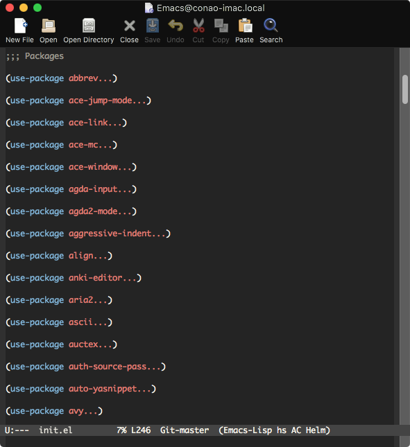

気になるパッケージを見つけたらその部分だけ表示することも可能です

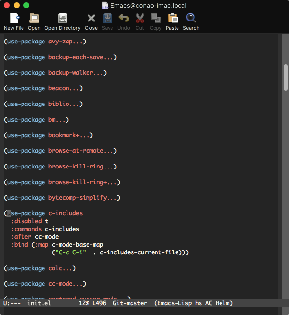

そしてuse-packageの中が長くなる場合は、折りたたむ階層を代えることで以下の表示にもでき、編集するべき箇所をすばやく見つけることができます。

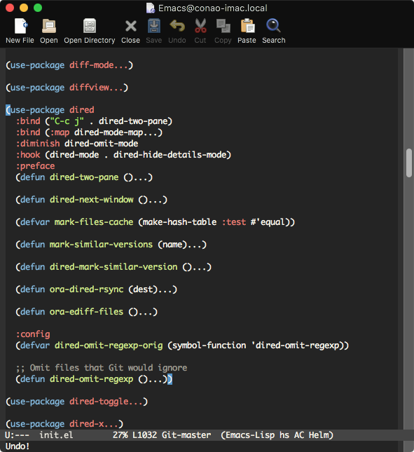

そしてuse-packageをuse-packageの中に書けることを知り、ブロックの定義のように使うようになりました。use-packageには =:no-require= キーワードがあり、指定されたパッケージを =require= しないことにできるので、自由な見出しとして利用できるのです。

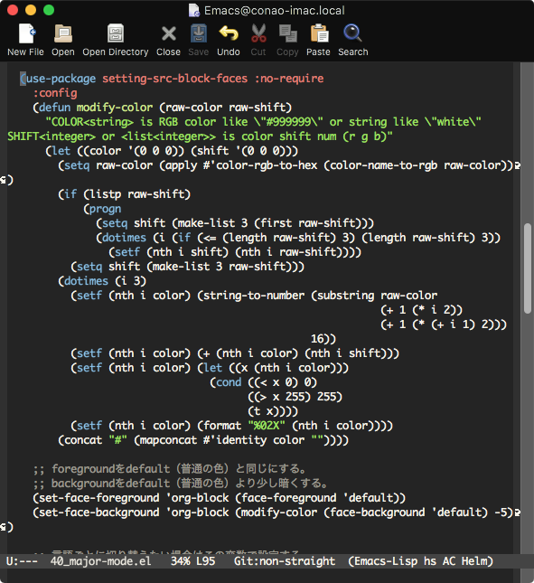

こうすることで、 =hs-hide-all= したときに見出しを目で探して、そこだけ展開して編集する。というふうに運用していました。

*** use-packageの（に付随する）問題点
このように私のinit.elはuse-packageに深く依存していて、実際その文法は大好きでした。しかし不満点は出てくるもので、それは以下のようなものです。

**** :if や :disabled キーワードの直感に反した動作
=ob-ipython= や =migemo= のように外部コマンドに依存するパッケージは、use-packageに =:if= キーワードが用意してあるので 次のように書けます。

#+begin_src emacs-lisp
(use-package migemo
  :if (executable-find "cmigemo")
  :ensure t
  :config
  ;; depend on latest cmigemo
  ;; $ brew install cmigemo --HEAD
  (setq migemo-command "cmigemo")
  (setq migemo-options '("-q" "--emacs"))
  (setq migemo-dictionary "/usr/local/share/migemo/utf-8/migemo-dict")

  (setq migemo-user-dictionary nil)
  (setq migemo-regex-dictionary nil)
  (setq migemo-coding-system 'utf-8-unix)
  (migemo-init))

(use-package ob-ipython :ensure t
  :if (executable-find "jupyter")
  :config
  (add-hook 'org-babel-after-execute-hook 'org-display-inline-images 'append))
#+end_src

use-packageの =:if= キーワードはS式を受け取り、評価結果がnilの場合、他のキーワードをすべて無視し、そのuse-package節全体を =nil= に変換するキーワードです。そのため =ob-ipyhon= の例で言えば、 =jupyter= が見つからない時、そのすべての設定は =nil= の虚空に吸い込まれると思うし、[[https://github.com/jwiegley/use-package#prevent-loading-if-dependencies-are-missing][マニュアルにもそう書いてあります]]。

またinit.elの設定を軽く行って、動かしてみたところ動作が不安定な時、use-packageユーザーは =:disabled= キーワードを使用すると思います。このように。

#+begin_src emacs-lisp
(use-package elscreen-persist :ensure t :disabled t
    :config
    (elscreen-persist-mode 1)

    ;; desktop.el settings
    (setq desktop-files-not-to-save "")
    (setq desktop-restore-frames nil)
    (desktop-save-mode t))
#+end_src

(=:disabled= キーワードはそれが指定された瞬間にuse-package節を =nil= に変換します。つまり =:disabled= も =:disabled nil= も =:disabled t= もすべて =nil= になります。しかし私は統一性を重視して明示的に指定していました。)

しかしコマンドが見つからない状況であっても =migemo= や =jupyter= はなぜか読み込まれ、起動時にエラーになる他、 =elscreen-persist= は当時バグっておりぐちゃぐちゃなウィンドウ構成を復元してきました。

scratchバッファで =macroexpand= してもきちんと =nil= になっており、当時Elisp初心者だった私は解決できない問題としてelpaディレクトリを全削除して対処していました。
全削除してもう一度世界をやり直すと、エラーなく起動することも理解不能でした。

（今考えると =(package-initialize)= でダウンロード済みのパッケージが全て読み込まれることが原因だと分かります。
実際、 =(package-initialize t)= とするとpackage.elの初期化だけ行って各パッケージの初期化は行わないモードになります。
しかしこのオプションを使っている人はいるのでしょうか？

またpackage.elを読むと特定のパッケージのみを初期化する変数を見つけたのですが、そのドキュメントは整備されているのでしょうか。。feather.elを作る過程でpackage.elを読んでいて気づいたので、後の祭り感がすごかったです。）

**** 新しいキーワードを追加するのが困難
=use-package= はそれ自体、拡張されることをよく考えられていて、キーワードを追加することは簡単である。というのはよく語られていたと思いますが、実際そのAPIを外部から利用したものは当時[[https://github.com/quelpa/quelpa-use-package][Quelpa]]しかありませんでした。現在は[[https://github.com/raxod502/straight.el][straight.el]]もuse-package用のフロントエンドを提供していますね。

私はuse-packageに参考URLを書ける、 =:url= を追加したかったのですが、elispに親しんでなかったこともあって、1週間悩んで諦めてしまいました。（コメントは暗い文字になるので、文字列として書けたら読みやすくなるかなというアイデア）

結局 =(add-to-list 'use-package-keywords= でGitHub全体を検索して、同じことをしている人の[[https://github.com/0x7c48/emacs.d/blob/c3f020d2e38f0f13a95a426e819cdd0216b589c1/emacs-lisp/system/_use-package.el][コード]]を見つけることができました。

**** あるパッケージだけ違うディストリビューションからダウンロード出来ない
これはuse-packageというよりpackage.elの問題です。パッケージはすべて =:ensure t= でmelpaからダウンロードしていたのですが、例えば「[[https://qiita.com/zk_phi/items/e70bc4c69b5a4755edd6][{Emacs} key-chord.el を改良してキーバインドし放題になった話]]」という記事を読んで、zkさんのフォーク版の =key-chord= を使いたい！と思ったとします。

package.elはGitHubからのダウンロードができない？ので =:init= 節に =el-get= を用いてダウンロードします。

#+begin_src emacs-lisp
(use-package key-chord
  :init  (el-get-bundle zk-phi/key-chord)
  :config
  (setq key-chord-two-keys-delay 0.15
        key-chord-safety-interval-backward 0.1
        key-chord-safety-interval-forward  0.25)
  (key-chord-mode 1))
#+end_src

こんな柔軟に書けるuse-package素晴らしい！と思っても、次のパッケージの設定によって儚く壊れてしまいます。

#+begin_src emacs-lisp
(use-package use-package-chords :ensure t)
#+end_src

これは全く問題がないと思われますが、 =use-package-chords= は =key-chord= に依存しており、package.elからはインストールしていないと判断されるので、package.elによってアップストリームの =key-chord= がダウンロードされます。

zkさんの =key-chord= を読み込んでいる場合、melpaの =key-chord= は多重ロードされませんが、次回起動時 =(package-initialize)= によってmelpaの =key-chord= が読み込まれてしまいます。。

これを防ぐには、あるパッケージを別のフォーク版に代えた場合、それに依存している全パッケージを自分でel-getにより管理しなければなりません。つらい。。

何がどんなパッケージに依存しているか意識せずインストールできるpackage.elの利点が失われてしまいました。
こういう、いろいろよしなにしてくれるパッケージは抽象化されすぎていて少し変わったことをすると破綻してしまうパターンがあります。

**** use-packageに依存したinit.elをEmacs-22で読み込む（と骨抜きになる）
前段のように私のinit.elはuse-packageに深く依存していて、それは一般的には問題ないのですが、私のようにEmacs-22という化石でも動かしたいとなると難しくなってきます。

一般的な解決方法は =use-package= の読み込みに失敗したら、use-package節をすべて =nil= に変換することにすることです。（[[https://qiita.com/kai2nenobu/items/5dfae3767514584f5220#use-package-%25E3%2581%258C%25E5%25AD%2598%25E5%259C%25A8%25E3%2581%2597%25E3%2581%25AA%25E3%2581%2584%25E5%25A0%25B4%25E5%2590%2588][出典]]）

#+begin_src emacs-lisp
(when (or (version< emacs-version "24.0")
          (unless (require 'use-package nil t)))
  (defmacro use-package (&rest args)))
#+end_src

これは起動しているEmacsが24より下の場合、use-packageというマクロを上書き定義し、use-package節をすべて =nil= に変換してしまうことにします。Emacs-23は =package.el= も満足に動かないし、外部パッケージの設定をすべて =nil= に変換してしまっても一般的には問題ないと思います。

しかし私はEmacs標準添付パッケージもすべて =use-package= で設定を行っており、 =use-package= をすべて =nil= に変換してしまっては =-q= オプションで起動したときとほぼ変わらないEmacsが起動してしまいます。。。

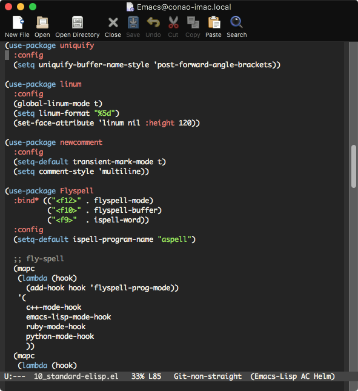

なんのために同じinit.elを読み込んでいるのかわかりません。

この時代にその解決方法として、ブランチを切って標準添付パッケージについては =use-package= を使わないinit.elを用意する運用を行っていました。この運用は前段に書いたとおり、同じコードがブランチに散らばり、すぐに管理不能になりました。。

** use-packageに代わるパッケージ, leaf.el
これらの問題点を解決するべく私が開発しているのが[[https://github.com/conao3/leaf.el][leaf.el]]です。use-packageに心酔している私が開発しているので、基本的にはuse-packageと同様の記述を提供します。

開発が追いついていないこともあり、現在実現していないことも多々ありますが、将来的に実現する予定です。

命名は「設定の『葉っぱ』を設定できるパッケージ」に由来します。Melpaに登録する時、分かりづらいので変えてくれと言われたら変わるかもしれません。

use-packageはpackageの設定を行うことを念頭に置いているのでその命名になっていますが、私の使い方ではpackageだけにとどまっていません。
前述のように何か一つの目的のために多くの行を割くようであったら、それをleafで囲みますし、また別の区切りもあるかもしれません。

現在の私のinit.elではCソース1ファイルずつにleafを割り当てて設定を行っています。

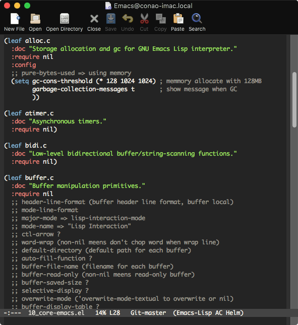

「一つ一つの『葉っぱ』が定義することは少ないかもしれないが、それが集まることによりEmacsがより手に馴染み、それぞれの唯一無二のエディタになる」という期待を込めています。

なお「feather.el」は「fetcher」につづりが似てるからそう命名しました。「羽のように軽快にパッケージをダウンロードするから」みたいにしておいたほうがかっこいいかもしれません。完全に後付けですが。

*** Emacs-22からの動作を保証
use-packageから離れる原因となった大きな理由を解消します。実際、lispなのでEmacs-22で動くようなコードを書くことはあまり障害になりません。

*** feather.elとの連携（開発中）
前段でpackage.elの不満点が出てきました。そういえばpackage.elはダウンロードするバージョンの固定ができないし、なぜか1つずつダウンロードするし、なぜかコンパイルする間、次のパッケージをダウンロードしません。

ということで新しいパッケージマネージャの開発に着手しました。tadsanさんに教えていただいたのですが、PHPでもこういう思想で作られた[[http://blog.tojiru.net/article/432944706.html][ソフトがある]]ようです。

feather.elは依存関係をきちんと考慮した上で、並列にパッケージをダウンロード・コンパイルします。そして[[https://qiita.com/takaxp/items/c01fb7737496af9a8fcd#%25E3%2583%25AD%25E3%2583%25BC%25E3%2583%2589%25E3%2583%2591%25E3%2582%25B9%25E3%2582%2592%25E3%2582%2580%25E3%2582%2584%25E3%2581%25BF%25E3%2581%25AB%25E5%25A2%2597%25E3%2582%2584%25E3%2581%2595%25E3%2581%25AA%25E3%2581%2584][load-pathが必要以上に長くなると起動時間が遅くなる]]というtakaxpさんの知見を活かし、コンパイルされたファイルは全て一つのディレクトリに保存されます。

もちろん投げっぱなしではなく、パッケージの削除を指示すると複数ファイルの管理をきちんと行ってくれます。

leaf.elはfeather.elをデフォルトで =:ensure= キーワードのバックエンドとして使用し、ユーザーとしては =use-package= を =leaf= に置換するだけでfeather.elのパワフルなパッケージマネージメントを利用できるようになる予定です。

*** ユーザーによる自由なキーワード追加
use-packageはキーワードの引数をnormalizeとhandlerの2つの関数で管理していますが、それが処理が見づらい原因になっていると思います。

leaf.elはhandlerの一つだけの関数で処理を行っており、とても素直な実装になっています。
さらにhandlerは必ずリストを返し、受け取り側では必ず =,@= でリストを開いて結合するルールになっており、統一性のあるコードになっていると思います。マクロ展開なので、バッククオートとカンマが多く、マクロに慣れていないと読みづらい可能性があります。。

逆にleaf.elへのキーワード追加を通してlispのマクロに親しむきっかけにもなると思います。まだ途中で英語のみですが、分かりやすいドキュメントを書く予定です。

ほしいキーワードがあったらissueを書いていただくほうがより簡単かもしれません。本体に入れるかはさておき、レポジトリを分けたとしてもleaf.elにとっては本体のキーワードと同様に処理できます。

** まとめ
時間に追われて尻すぼみになってしまいました。興味を持っていただけたらぜひ[[https://github.com/conao3/leaf.el][leaf.el]]や[[https://github.com/conao3/feather.el][feather.el]]をウォッチしていただければと思います。

* lispの同図像性とその周辺 ― leaf.el, seml-mode.elの内部構造に触れながら
:properties:
:export_file_name: generated/contents/blog/2019/13c1f0
:export_date: 2019-04-16
:end:

** はじめに
「EmacsのためにEmacsを使っている」事に最近気づいたconao3です。

とりあえず私の脳内スタックを紹介します。

- 競プロしたい！
- 当然Emacs使うでしょ
  - init.el編集して、 ~flycheck~ とか動かしたいな。。
  - 当然 ~use-package~ 使うでしょ
    - ~use-package~ がEmacs-22で動かない \arrow ~leaf.el~ 開発
      - Emacs-22で動くテストフレームワークが存在しない \arrow ~cort-test.el~ 開発
      - Emacs-22で動くパッケージマネージャが存在しない \arrow ~feather.el~ 開発
        - MELPAのレシピをあらかじめ変換しておきたい \arrow ~feather-recipes.el~ 開発
        - そもそもMELPAが提供しているjsonが壊れている \arrow ~feather-melpa~ 開発
        - .tar.gzをダウンロードさせるだけでいんじゃないか \arrow ~feather-server.el~ 開発
      - CUIベースの ~custom~ ではなく、Webブラウザベースで設定したい \arrow ~leaf-browser.el~ 開発
        - 当然HTMLを素で書く気にならないので、S式から変換させたい \arrow ~seml-mode.el~ 開発
  - ~org-publish~ のセクションが肥大化している \arrow ~orglyth.el~ 開発

つまりここに挙げたパッケージ群をちゃっちゃと開発し、どんどんスタックを ~pop~ していかないと、
「競プロしたい！」という当初の目的まで辿り着けないという状況になっています。辛い。

そもそもがinit.elの編集から木が深くなっているので、 ~leaf.el~ 開発当初はほぼ裸のEmacsで編集していました。
最近は ~leaf.el~ が結構便利になってきたので、快適に開発ができるようになってきています。

これだけのパッケージを開発していると、そこそこにアウトプットできるような知見が貯まってくるのですが、
今回、[[https://tokyo-emacs.connpass.com/event/128038/][東京Emacs勉強会 端午の節句]]に15分の発表の機会を得ることが出来たので、
その時間を考慮して、そのなかでも「Lispの同図像性」について発表するものです。

** Lispの評価器について
*** Lispの評価
Elispに限らず、lisp処理系は次のような仕組みを持っています。[fn:1][fn:2][fn:3][fn:4]

「式」を次で定義します。

- アトムを「数値」と「文字列」と「シンボル」とする。
- コンスセルを「(car . cdr)」と記述し、carとcdrに「アトム」か「コンスセル」が代入されるとする。
- リストを「(a b ... x)」と記述し、「空リスト」か、「末尾のコンスセルのcdr部に ~nil~ が代入されたもの」とする。
- 式を「アトム」か「コンスセル」か「リスト」さらに「式のリスト」とする。

なお、コンスセルのドットは字面上の意味がありますが、リストの3点リーダはシンボル群の略記です。
さらに「 ~nil~ 」は「アトム」であり、「空リスト」であるとします。

そして与えられた式を次のように評価 (~eval~) します。[fn:5]

1. 式が、アトムの場合、以下のように処理する。
   1. シンボルならば、そのシンボルの値を返却する。
   2. それ以外（数値、文字列など）ならば、それ自身を返却する。
2. 式が、リストフォームならば、リストフォームの先頭データの種類によって、以下のように処理する。
   1. スペシャルフォームならば、第2引数以降のデータを評価せずに渡し、それぞれ固有の処理を行い、結果を返却する。
   2. マクロならば、第2引数以降のデータを評価せずに渡し、評価後のS式を改めて評価 (~eval~) し、結果を返却する。
   3. 関数ならば、第2引数以降のデータを順に評価 (~eval~) した上で、関数に渡 (~apply~) し、結果を返却する。

スペシャルフォームとは処理系内部にLispとは異なる言語で定義されたものです。
Elispの場合、C言語で実装されている関数はすべてスペシャルフォームです。

スペシャルフォームの最たる例は条件分岐 ~(if COND THEN-PART ELSE-PART...)~ で、 ~COND~ が真の場合、 ~ELSE-PART~ は評価されません。
この性質は関数の場合と決定的に異なっており、例えば条件によって0除算エラーが起こってしまうなどのクリティカルな状況を回避することが出来ます。

条件分岐のような制御構造は通常の言語であれば、拡張不可(処理系のアップデートが必要)ですが、Lispであればマクロを使用することで自分で定義することが出来ます。

# Elispにおけるスペシャルフォームのすべてを示します。
# - 条件分岐
#   - and
#   - or
#   - if
#   - cond
# - 繰り返し
#   - while
# - 大域脱出とエラー処理
#   - catch
#   - condition-case
#   - unwind-protect
# - Lispオブジェクト生成
#   - quote
#   - function
#   - lambda
#   - setq
#   - setq-default
#   - defvar
#   - defconst
# - シーケンス
#   - prog1
#   - prog2
#   - progn
# - ローカル変数
#   - let
#   - let*
# - Emacsに特有の操作
#   - interactive
#   - save-current-buffer
#   - save-excursion
#   - save-restriction
#   - track-mouse
*** 3種類のマクロ
1. リーダマクロ
2. マクロ
3. コンパイラマクロ

** leaf.elの概略
[[https://github.com/conao3/leaf.el][leaf.el]]はjwiegley氏の[[https://github.com/jwiegley/use-package][use-package]]と同様に、Emacsのinit.elで頻出のイディオムを隠蔽し、編集しやすく、そして管理しやすくするものです。
~use-package~ はとても良く出来ていて、愛用していたのですが、問題もありました。（省略するので、別途[[https://s.conao3.com/blog/2018/8aa938][Qiita記事]]を参照）

- ~:if~ ~:disabled~ で無効化されているパッケージがなぜか読み込まれている。
- 新しいキーワードを追加するのが困難。
- あるパッケージだけ違うディストリビューションからダウンロードできない。
- (use-packageに依存したinit.elをEmacs-22で読み込むと骨抜きになる。)

主に最初の3つが大きな不満点でした。
最後の点は許容できたのですが、作り直すなら縛りプレイをすることにしました。

さて、説明のために次の簡単なマクロを定義した上で、

#+begin_src emacs-lisp
  (defmacro p (form)
    `(progn
       (pp (macroexpand-1 ',form))
       nil))

  (defmacro po (form)
    `(progn
       (pp ,form)
       nil))
#+end_src

~leaf.el~ は次のような変換をするマクロを提供するものです。

#+begin_src emacs-lisp
  (p
   (leaf yasnippet
     :ensure t
     :custom ((yas-indent-line . 'fixed))
     :bind (:map yas-minor-mode-map
                 ("C-c y i" . yas-insert-snippet)
                 ("C-c y n" . yas-new-snippet)
                 ("C-c y v" . yas-visit-snippet-file)
                 ("C-c y l" . yas-describe-tables)
                 ("C-c y g" . yas-reload-all))
     :config
     (leaf yasnippet-snippets :ensure t)
     (leaf yatemplate :ensure t)
     (yas-global-mode 1)))
  ;; => (progn
  ;;      (leaf-meta-backend/:ensure 'yasnippet '(t))
  ;;      (leaf-meta-backend/:bind 'yasnippet
  ;;                               '((:map yas-minor-mode-map
  ;;                                       ("C-c y i" . yas-insert-snippet)
  ;;                                       ("C-c y n" . yas-new-snippet)
  ;;                                       ("C-c y v" . yas-visit-snippet-file)
  ;;                                       ("C-c y l" . yas-describe-tables)
  ;;                                       ("C-c y g" . yas-reload-all))))
  ;;      (custom-set-variables '(yas-indent-line 'fixed))
  ;;      (leaf yasnippet-snippets :ensure t)
  ;;      (leaf yatemplate :ensure t)
  ;;      (yas-global-mode 1))
#+end_src

#+begin_src emacs-lisp
  (p
   (leaf yasnippet
     :disabled t
     :ensure t
     :custom ((yas-indent-line . 'fixed))))
  ;; => nil
#+end_src

~leaf~ はマクロなのでElisp処理系は、実際の評価の前にマクロが展開し、その後、評価器が実際の評価を行います。

** Footnotes
[fn:1] 東京大学 - [[http://www.jsk.t.u-tokyo.ac.jp/~inamura/lecture/download/20051205_soft3_lisp1.pdf][ソフトウェア第三 講義資料 - Lisp処理系, リスト処理]]
[fn:2] Paren-holic - [[https://booth.pm/ja/items/1317263][3つのLisp 3つの世界]]
[fn:3] STUART C. SHAPIRO - [[https://cse.buffalo.edu/~shapiro/Commonlisp/commonLisp.pdf][Common lisp - An Interactive approach]]
[fn:4] Harold Abelson 他 著 和田 栄一 訳 - [[https://sicp.iijlab.net/fulltext/xcont.html][計算機プログラムの構造と解釈]]
[fn:5] Richard Stallman 他 著 Ayatakesi 訳 - [[https://ayatakesi.github.io/lispref/24.5/elisp.html#Evaluation][GNU Emacs Lisp Reference Manual]]

* COMMENT 続・leaf.elを使おう
:properties:
:export_file_name: generated/contents/blog/2019/69b273
:export_date: 2019-05-31
:end:

** leafとは
use-packageはinit.el記述において、素晴らしいブレイクスルーを起こしました。
パッケージ

* COMMENT leaf.elを使う - Emacs初心者のためのEmacs拡張入門
:properties:
:export_file_name: generated/contents/blog/2019/34401b
:export_date: 2019-06-01
:end:

** 背景
先日MELPAにleaf.elがマージされ、導入のコストが最小限になりました。
  - [[https://s.conao3.com/blog/2019/2b6cbf][{正式リリース}leaf.elで雑然としたEmacs設定ファイル「init.el」をクリーンにする]]

その折にQiitaで紹介記事を書いたのですが、実際どの様に使えばいいのか、そもそもEmacsにパッケージをどの様にインストールすればよいのか、
そういう視点での補足記事が必要であろうと思ったので、この記事を書く次第です。

なお、この記事では簡潔さを重視して、説明を省く箇所があることをご了承下さい。
省くのは歴史的な経緯によって、互換性のために残されている機能で、現代では使用されないものです。

例えば、ホームディレクトリに ~.emacs~ という「ファイル」を置く方法と、
~.emacs.d~ という「ディレクトリ」を置いて、その中に ~init.el~ というファイルを置く方法がありますが、
現代ではほとんど後者のみが用いられているため、前者に関する説明は省略します。

** Emacsのインストール
Emacsのインストールは各々の環境とEmacsに何を求めるかによって、いろいろな方法があり、Emacs-JPでも「標準インストール」という手順を定められずにいます。

ひとまず、ここでは一つの方法を示すので、またコミュニティの共通認識が出てくれば変更することにします。

*** Mac
私は現在パッチなし、標準ローカルビルドのEmacs-26.2を使用していますが、やはり ~brew~ で導入できるのは簡便さの面で大きなメリットがあります。
複数バージョンをローカルに持っておかないといけないといった珍しい状況を除けば、 ~brew~ を選択するのは十分合理的だと思います。

#+begin_src bash
  brew tap railwaycat/emacsmacport
  brew install emacs-mac
#+end_src

*** Ubuntu
環境がないので分かりませんが、ローカルビルドしても大きな手間ではないと思います。
~apt~ で入れる場合はデフォルトではバージョンが古いため、アーカイブサイトを追加した後にインストールする必要があります。
  - http://ubuntuhandbook.org/index.php/2019/04/gnu-emacs-26-2-released-install-in-ubuntu-18-04/

#+begin_src bash
  sudo add-apt-repository ppa:kelleyk/emacs
  sudo apt update
  sudo apt install emacs26
#+end_src

*** Windows
環境がないので全く分かりません。私が高校の時はgnupackのdevelを使っていましたが、MSYS2の方が良いという情報もあり、良く分かりません。
  - https://ja.osdn.net/projects/gnupack/
  - https://www.msys2.org/

** 必要最低限のEmacs知識
*** 画面の要素
Emacsでの「ウィンドウ」は一般的な意味での「ウィンドウ」とは意味が異なっており、誤解していると意味を取り違えてしまいます。

さらに「ポイント」は一般的な用語での「カーソル」です。「ポイント」の直前に文字が挿入されます。
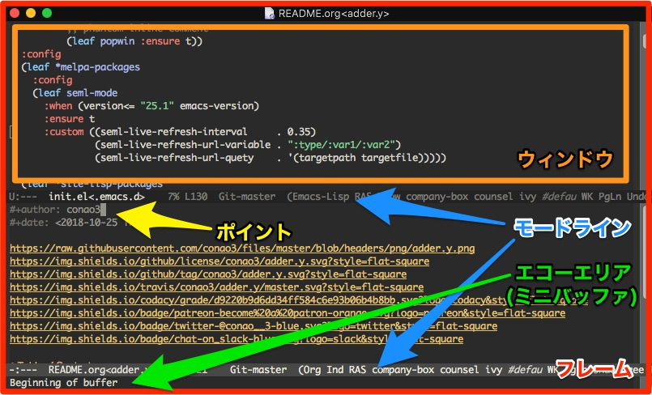

*** ショートカットキー
歴史的な経緯により ~Alt~ キーを ~Meta~ と呼びます。

さらに修飾キーの一文字を取って ~Ctrl~, ~Shift~, ~Meta~ を ~C~, ~S~, ~M~ と表記します。
つまり ~M-S-5 (query-replace)~ は ~Meta(Alt)~ キーと ~Shift~ を押しながら ~5~ を押すことを示します。
また ~S-5~ は ~%~ と等価なので、 ~M-% (query-replace)~ と表現することがあります。

なお、2つのコンビネーションを続けて書いた場合は、続けてそれらのキーを押すことになります。
つまり ~C-x C-f (find-file)~ は ~Ctrl~ と ~x~ を押した後に、 ~Ctrl~ と ~f~ を押すことを示しています。

*** Emacsの起動と終了
ターミナルを開き、 ~emacs~ と打つことでEmacsが起動します。

初期化ファイルなしで起動するには ~emacs -q~, デバッグ情報を表示するには ~emacs --debug-init~ で起動します。

~C-x C-c (save-buffers-kill-terminal)~
*** 困ったら
とりあえず ~C-g (keyboard-quit)~ を連打します。これは今の作業を中断して、通常の入力状態に戻すことを意味します。
「あれ？」っと思ったら、すぐに ~C-g~ を何回かタイプすることを覚えておくといいと思います。

さらに、ユーザーが普段使うコマンドはショートカットを覚えていなくても、 ~M-x~ を実行することでコマンドの名前を検索して実行できます。

** 初期化ファイルの作成
MacやLinuxならホームディレクトリの場所は疑いようがありませんが、Windowsの場合、選んだ処理系によってホームディレクトリが違うので注意する必要があります。

~C-x C-f (find-file)~ をした後にミニバッファで「Find file: 」とプロンプトが出るので、

* COMMENT leafはなぜ動くのか - lisp特有の特徴「同図像性」を読み解く
:properties:
:export_file_name: generated/contents/blog/2019/73938b
:export_date: 2019-06-01
:end:

** 背景
leafは私の初めて書いたパッケージですが、初めて書いた題材ながら、「lispらしい力」を使えるいい題材だったと思います。
lisp歴の浅い私が「lispらしい力」を語るのはお笑い種かもしれませんが、lispでない言語で同じ仕組みを実装するのは困難を極めたことは確実でしょう。

lispは極めて先進的な機能を多く有しており、GCや高階関数など多言語に取り入れられた特徴も多いです。
私が取り上げる「同図像性」は多言語では実装の難しい、lisp独自の特徴です。

この特徴を使えることが私がlisp系言語を使う理由であり、ぜひ布教に努めていきたい所存です。

なお、この記事ではElispの実行例を示します。

** leafとは
leafとはEmacsの拡張パッケージであり、その説明記事はこちらで読むことが出来ます。
- [[https://s.conao3.com/blog/2019/2b6cbf][{正式リリース}leaf.elで雑然としたEmacs設定ファイル「init.el」をクリーンにする]]

Emacs初心者の方でもleafを使うことで、「パッケージの設定」に集中できますし、出力するコードを読んでみることでElisp力を

** 同図像性
同図像性は「データとプログラムが同じ形式で書ける性質」で、lisp以外の言語では無理矢理、文字列をリード/実行によって実現することになると思います。

多言語との比較は私には出来ないので、ぜひお読みの方の得意な言語ではどうやって実現できるか考えてもらえればと思います。

* [正式リリース]leaf.elで雑然としたEmacs設定ファイル「init.el」をクリーンにする
:properties:
:export_file_name: generated/contents/blog/2019/2b6cbf
:export_date: 2019-06-15
:end:

私は去年の[[https://github.com/conao3/dotfiles/commit/fd06cea5dd040ec1fb34225a3f3202200e00801e][8月]]から.emacs.d/init.elの大改革を行っており、その副産物としての成果物を[[https://qiita.com/advent-calendar/2018/emacs][Emacs Advent Calendar 2018]]や[[https://tokyo-emacs.connpass.com/event/128038/][東京Emacs勉強会 端午の節句]]などで共有させて頂いていました。

私の関わっているパッケージは多数ありますが、一番力を入れている =leaf.el= がやっとMELPAに仲間入りすることができたので、ダイレクトマーケティング記事を書く次第です。

GitHubへのリンクはこちら
[[https://github.com/conao3/leaf.el][file:./resources/public/img/2b6cbf-leaf.el.png]]

[[github:conao3/leaf.el::Emacs Lisp][Flexible, declarative, and modern init.el package configuration]]

** 背景
Emacsを使っている方ならば、自分のinit.elに採用するかはさておき、jwiegleyさんの[[https://github.com/jwiegley/use-package][use-package]]というパッケージの存在を知っていらっしゃると思います。

Qiitaでは @kai2nenobu さんの「[[https://qiita.com/kai2nenobu/items/5dfae3767514584f5220][use-packageで可読性の高いinit.elを書く]]」というとても分かりやすい記事がありますし、るびきちさんも「[[http://emacs.rubikitch.com/use-package-2/][use-package.el: Emacsの世界的権威が行っている最先端ラクラクinit.el整理術]]」という記事を書いていらっしゃいます。

私もこれらの記事を見ながらinit.elを書きなおしたのですが、init.elは個性の塊であるがゆえに、次第にjwiegleyさんが想定していない方法で =use-package= を使うようになってしまいました。そして =use-package= に自分が欲しいキーワードを自由に追加したいと思うようになりました。

=use-package= は素晴らしいパッケージですが、多くのコントリビューターを受け入れたことによるか、そもそもの設計の問題か、内部は複雑怪奇になっており、単純に読むだけでも困難を極めました。

そのため私が拡張したいように拡張するために、そして書きたいようにinit.elを書くために新しい =use-package= を作る必要がありました。

まぁ後から動機を分析してみたらこういう風な動機があった。と思うだけで、開発当時はOn Lispの「[[http://www.asahi-net.or.jp/~kc7k-nd/onlispjhtml/macros.html][マクロ]]」の項を読んで、 =use-package= に対して単なる技術的な興味を持っただけだったのかもしれません。

とにかく私は =leaf= を作ることによりlispの力の片鱗を感じとれ、Emacs-jpの勉強会で登壇できるくらいのノウハウを得ることができました。Emacs-lisp、そしてLispの演習としては、とても良い題材だったのではないかなと振り返っています。

なお、記事中で使うために、次のユーティリティーマクロを定義します。

#+begin_src emacs-lisp
(prog1 "conao3 utility"
  (defmacro p (form)
    "Output pretty `macroexpand-1'ed given FORM."
    `(progn
       (pp (macroexpand-1 ',form))
       nil))

  (defmacro po (form)
    "Output pretty given FORM."
    `(progn
       (pp ,form)
       nil))

  (defmacro pl (form &optional stream)
    "Output list"
    `(progn
       (with-temp-buffer
         (insert (prin1-to-string ,form))
         (goto-char (point-min))
         (forward-char)
         (ignore-errors
           (while t (forward-sexp) (insert "\n")))
         (delete-char -1)
         (princ (buffer-substring-no-properties (point-min) (point-max))
                (or ,stream standard-output))
         (princ "\n"))
       nil)))
#+end_src

** use-packageの問題点
=use-package= を使っていて、ストレスだった点をつらつら書きます。[[https://s.conao3.com/blog/2018/8aa938][年末のAdvent Calendar]]にも少し書いたのですが、それに加えて、話の流れとしてもう少し書きます。

*** use-packageが想定していなかった使い方
=use-package= は「パッケージ設定」のためのパッケージです。そのため、「パッケージのインストールとその設定」を考えるel-getとは一線を画しています。そのため「el-getでは。。」という[[https://github.com/jwiegley/use-package/issues/470][issueは1レスで閉じられ]]ます。もちろんjwiegleyさんの方針は理解できます。OSSでは風見鶏な運営をするとすぐ破綻してしまうので、ばっさり閉じられたことに意見はありません。

さて、 =leaf= は一体どういう方針なのかというと、 =leaf= は「パッケージ設定フォルダ」を提供するためのパッケージです。

=leaf= のネーミングはそもそもそういう使い方を想定しています。ひとつひとつの「葉」が集まってEmacs上に「大樹」を作るイメージです。「葉」は複数の「葉」によって構成されていても良く、それは平易に言い換えれば「パッケージ設定フォルダ」として機能します。

Spacemacsは使っていないのですが、言語毎、目的毎に =Layer= が管理されており、それを有効にするか無効にするかによって典型的な設定を行うという薄い知識があります。 =leaf= はひとつの「葉」に複数のパッケージの設定を内包することが出来ることから、Spacemacsのそれと同様な使い方が可能です。

なぜ一つの =use-package= に複数のパッケージの設定を書くようになったのかというと、その書き方がS式の折り畳みをするパッケージとの相性がとても良いからです。その話については年末のAdvent Calendarで[[https://s.conao3.com/blog/2018/8aa938][leafの記事の一部]]として書いています。

また条件分岐キーワードとの相性もとても良くなります。例えば =:disabled= や =:when= キーワードで、ある親パッケージを無効にすると、そのパッケージに依存する子パッケージも同時に無効にすることができます。

しかし =use-package= は本来1パッケージ-1 =use-package= が想定されているため、 =use-package= を単に設定フォルダとして使おうと思うと、逐一 =:no-require= キーワードが必要になります。キーワードを省略した時、 =require= に変換されるからです。

一方 =leaf= ではそのようなキーワードを別途指定する必要はありません。キーワードを省略した場合は空の =prog1= に変換されるからです。そのため次のような設定を簡単に書くことができます。

#+begin_src emacs-lisp
(leaf *minor-mode
  :config
  (leaf posframe
    :ensure t
    :when (version<= "26.1" emacs-version)
    :when window-system
    :config
    (leaf ivy-posframe
      :doc "Using posframe to show Ivy"
      :after ivy
      :ensure t
      :custom ((ivy-posframe-mode . t)
               (ivy-posframe-height-alist . '((swiper . 30) (t . 40)))
               (ivy-posframe-display-functions-alist
                . '((swiper . nil) (t . ivy-posframe-display-at-frame-center)))
               (ivy-posframe-parameters . '((left-fringe . 10)))))

    (leaf company-posframe
      :doc "Use a posframe as company candidate menu"
      :ensure t
      :after company
      :custom ((company-posframe-mode . t)))

    (leaf flycheck-posframe
      :ensure t
      :after flycheck
      :custom ((flycheck-posframe-mode . t)))

    (leaf which-key-posframe
      :ensure t
      :after which-key
      :custom ((which-key-posframe-mode . t)))

    (leaf ddskk-posframe
      :doc "Show Henkan tooltip for ddskk via posframe"
      :after skk
      :el-get conao3/ddskk-posframe.el
      :custom ((ddskk-posframe-mode . t))))

  ;; other minor-mode packages...
  )
#+end_src

これは私のinit.elに実際に存在する設定です。 =*minor-mode= という =leaf= ブロックでくくることによって、折り畳みパッケージの恩恵が受けやすくなり、やろうと思えばマイナーモードを全オフにしたEmacsを立ち上げることも容易です。

また、 =posframe= はEmacs-26に依存していますが、その条件が満されない場合、同時に =ivy-posframe=, =company-posframe=, =flycheck-posframe=, =which-keyposfrme=, =ddskk-posframe= の設定を無視させることが出来るようになります。

このようにパッケージ設定の階層構造を表現することがとても簡単にできます。

本来、エディタの設定にはあまり時間をかけられるものではありません。パッケージの設定を階層管理することによって、設定したパッケージが全体においてどんな位置付けなのか、素早く理解し編集することが可能になります。

*** use-packageのキーワード解釈の非統一性
例えばこれらのキーワードは不釣り合いです。

- =:defer= キーワードは「パッケージシンボル」か「それのリスト」 が受け取れるが、 =:ensure= キーワードはリストは受け取れない。
- =:if=, =:when=, =:unless= は真偽値と解釈され得るS式を期待するが、 =:disabled= キーワードは引数なしで活性化する。
- =:hook= や =:bind= は「ドット対」と「ドット対のリスト」を期待するが、 =:custom= キーワードは通常のリストを期待する。

具体的には次のような混乱があります。

#+begin_src emacs-lisp
(p (use-package ddskk-posframe
     :after posframe ddskk))            ; シンボル指定ok
;; => (eval-after-load 'ddskk
;;      '(eval-after-load 'posframe
;;         '(require 'ddskk-posframe nil nil)))

(p (use-package ddskk-posframe
     :after (posframe ddskk)))          ; リスト指定ok
;; => (eval-after-load 'ddskk
;;      '(eval-after-load 'posframe
;;         '(require 'ddskk-posframe nil nil)))
;;

(p (use-package ddskk-posframe
     :ensure posframe))                 ; シンボル一つなら処理できる
;; => (progn
;;      (use-package-ensure-elpa 'ddskk-posframe '(posframe) 'nil)
;;      (require 'ddskk-posframe nil nil))

(p (use-package ddskk-posframe
     :ensure posframe ddskk))           ; シンボルが2つ以上だとエラー
;; => Debugger entered--Lisp error: (error "use-package: :ensure wants exactly one argument")

(p (use-package ddskk-posframe
     :ensure (posframe ddskk)))         ; リスト指定でもエラー
;; => Debugger entered--Lisp error: (error "use-package: :ensure wants an optional package name (an unquoted symbol name), or (<symbol> :pin <string>)")

;;;;;;;;;;;;;;;;;;;;;;;;;;;;;;;;;;;;;;;;;;;;;;;;;;

(p (use-package posframe
     :when (version<= "26.1" emacs-version) ; あらゆるS式を処理できる
     :config (use-package ivy-posframe)))
;; => (when (version<= "26.1" emacs-version)
;;      (require 'posframe nil nil)
;;      (require 'ivy-posframe nil nil)
;;      t)

(p (use-package posframe
     :when
     window-system
     (version<= "26.1" emacs-version)       ; 受け取れるS式は一つのみ
     :config (use-package ivy-posframe)))
;; (error "use-package: :if wants exactly one argument")

(p (use-package posframe
     :disabled                              ; キーワードを書いただけで活性化
     :config (use-package ivy-posframe)))
;; => nil

(p (use-package posframe
     :disabled t                            ; tだと活性化
     :config (use-package ivy-posframe)))
;; => nil

(p (use-package posframe
     :disabled nil                          ; nilでも活性化
     :config (use-package ivy-posframe)))
;; => nil

(p (use-package posframe
     :disabled (version<= "26.1" emacs-version) ; 指定された要素は無視される
     :config (use-package ivy-posframe)))
;; => nil

;;;;;;;;;;;;;;;;;;;;;;;;;;;;;;;;;;;;;;;;;;;;;;;;;;

(p (use-package org
     :bind (("M-o o c" . org-capture)
            ("M-o o a" . org-agenda)
            ("M-o o l" . org-store-link)))) ; ドット対のリストを与える
;; => (progn
;;      (unless (fboundp 'org-capture) (autoload #'org-capture "org" nil t))
;;      (unless (fboundp 'org-agenda) (autoload #'org-agenda "org" nil t))
;;      (unless (fboundp 'org-store-link) (autoload #'org-store-link "org" nil t))
;;      (bind-keys :package org
;;                 ("M-o o c" . org-capture)
;;                 ("M-o o a" . org-agenda)
;;                 ("M-o o l" . org-store-link)))

(p (use-package real-auto-save
     :hook (find-file . real-auto-save-mode))) ; ドット対を与える
;; => (progn
;;     (unless (fboundp 'real-auto-save-mode) (autoload #'real-auto-save-mode "real-auto-save" nil t))
;;     (add-hook 'find-file-hook #'real-auto-save-mode))

(p (use-package real-auto-save
     :custom ((real-auto-save-interval . 0.3)))) ; ドット対を与えるとエラー
;; => Debugger entered--Lisp error: (wrong-type-argument listp 0.3)

(p (use-package real-auto-save
     :custom ((real-auto-save-interval 0.3))))   ; リストを与える必要がある
;; => (progn
;;      (customize-set-variable 'real-auto-save-interval 0.3 "Customized with use-package real-auto-save")
;;      (require 'real-auto-save nil nil))
#+end_src

このように =use-package= はキーワードごとに受理できる形式が異なっており、キーワードごとにどんな形式で与えるか考える必要があります。

その点、 =leaf= は注意深くハンドラーと受理形式を設計しているため、キーワードごとに余計な考慮をしなくて済みます。

そのため =leaf= のキーワードは全体として調和を保ち、整然とinit.elを記述できます。

#+begin_src emacs-lisp
(p (leaf ddskk-posframe
     :after posframe ddskk              ; 複数シンボル指定ok
     :config (ddskk-posframe-init)))
;; => (prog1 'ddskk-posframe
;;      (eval-after-load 'ddskk
;;        '(eval-after-load 'posframe
;;           '(progn
;;              (ddskk-posframe-init)))))

(p (leaf ddskk-posframe
     :after (posframe ddskk)            ; リスト指定ok
     :config (ddskk-posframe-init)))
;; => (prog1 'ddskk-posframe
;;      (eval-after-load 'ddskk
;;        '(eval-after-load 'posframe
;;           '(progn
;;              (ddskk-posframe-init)))))

(p (leaf ddskk-posframe
     :ensure posframe))                 ; シンボル指定ok
;; => (prog1 'ddskk-posframe
;;      (leaf-handler-package ddskk-posframe posframe nil))

(p (leaf ddskk-posframe
     :ensure posframe ddskk))           ; 複数シンボルok
;; => (prog1 'ddskk-posframe
;;      (leaf-handler-package ddskk-posframe posframe nil)
;;      (leaf-handler-package ddskk-posframe ddskk nil))

(p (leaf ddskk-posframe
     :ensure (posframe ddskk)))         ; リスト指定でもok
;; => (prog1 'ddskk-posframe
;;      (leaf-handler-package ddskk-posframe posframe nil)
;;      (leaf-handler-package ddskk-posframe ddskk nil))

;;;;;;;;;;;;;;;;;;;;;;;;;;;;;;;;;;;;;;;;;;;;;;;;;;

(p (leaf posframe
     :when (version<= "26.1" emacs-version) ; あらゆるS式を処理できる
     :config (leaf ivy-posframe)))
;; => (prog1 'posframe
;;      (when (version<= "26.1" emacs-version)
;;        (leaf ivy-posframe)))

(p (leaf posframe
     :when
     window-system
     (version<= "26.1" emacs-version)       ; 複数のS式を処理できる
     :config (leaf ivy-posframe)))
;; => (prog1 'posframe
;;      (when (and window-system
;;               (version<= "26.1" emacs-version))
;;        (leaf ivy-posframe)))

(p (leaf posframe
     :disabled                              ; キーワードを書いただけで活性化しない
     :config (leaf ivy-posframe)))
;; => (prog1 'posframe
;;      (leaf ivy-posframe))

(p (leaf posframe
     :disabled t                            ; tだと活性化
     :config (leaf ivy-posframe)))
;; => (prog1 'posframe)

(p (leaf posframe
     :disabled nil                          ; nilだときちんと非活性化
     :config (leaf ivy-posframe)))
;; => (prog1 'posframe
;;      (leaf ivy-posframe))

(p (leaf posframe
     :disabled (version<= "26.1" emacs-version) ; 指定された要素は評価され、きちんと活性化
     :config (leaf ivy-posframe)))
;; => (prog1 'posframe)

(p (leaf posframe
     :disabled (version<= "30.1" emacs-version) ; 指定された要素は評価され、きちんと非活性化
     :config (leaf ivy-posframe)))
;; => (prog1 'posframe
;;      (leaf ivy-posframe))

;;;;;;;;;;;;;;;;;;;;;;;;;;;;;;;;;;;;;;;;;;;;;;;;;;

(p (leaf org
     :bind (("M-o o c" . org-capture)
            ("M-o o a" . org-agenda)
            ("M-o o l" . org-store-link))))         ; ドット対を与える
;; => (prog1 'org
;;      (autoload #'org-capture "org" nil t)
;;      (autoload #'org-agenda "org" nil t)
;;      (autoload #'org-store-link "org" nil t)
;;      (leaf-keys
;;       (("M-o o c" . org-capture)
;;        ("M-o o a" . org-agenda)
;;        ("M-o o l" . org-store-link))))

(p (leaf real-auto-save
     :hook (find-file-hook . real-auto-save-mode))) ; ドット対を与える
;; => (prog1 'real-auto-save
;;      (autoload #'real-auto-save-mode "real-auto-save" nil t)
;;      (add-hook 'find-file-hook #'real-auto-save-mode))

(p (leaf real-auto-save
     :custom ((real-auto-save-interval . 0.3))))    ; ドット対を与える
;; => (prog1 'real-auto-save
;;      (custom-set-variables
;;       '(real-auto-save-interval 0.3 "Customized with leaf in real-auto-save block")))
#+end_src

*** :bindキーワードのインデント
=use-package= を使っていろいろなパッケージの設定を行うと、ある種類のパッケージで =:bind= のインデントが壊れてしまうことに気づくと思います。それはグローバルに割り当てがなく、特定のモードマップへの割り当てのみが存在する場合です。

=leaf= はその問題が起こることが分かっていたので、インデントが壊れない受理形式を設計することができました。

マイナーモードの指定にはシンボルとキーワードのどちらでも使うことができます。シンボルは定義ジャンプが可能で、キーワードは視認性に優れています。これは好みでユーザーに選んでもらえればと思います。

#+begin_src emacs-lisp
(use-package term
  :bind (("C-c t" . term)
         :map term-mode-map
         ("M-p" . term-send-up)         ; good indent
         ("M-n" . term-send-down)))

(use-package term
  :bind (:map term-mode-map
              ("M-p" . term-send-up)    ; indent broken
              ("M-n" . term-send-down)))

;;;;;;;;;;;;;;;;;;;;;;;;;;;;;;;;;;;;;;;;;;;;;;;;;;

(leaf term
  :bind (("C-c t" . term)
         (term-mode-map
          ("M-p" . term-send-up)        ; good indent
          ("M-n" . term-send-down))))

(leaf term
  :bind ((term-mode-map
          ("M-p" . term-send-up)        ; good indent
          ("M-n" . term-send-down))))

;;;;;;;;;;;;;;;;;;;;;;;;;;;;;;

(leaf term
  :bind (("C-c t" . term)
         (:term-mode-map                ; キーワードで指定しても良い
          ("M-p" . term-send-up)
          ("M-n" . term-send-down))))

(leaf term
  :bind ((:term-mode-map
          ("M-p" . term-send-up)
          ("M-n" . term-send-down))))
#+end_src

=use-package= の形式のさらに悪い点は「どこまでがマイナーモードの割り当てか分かりづらい」ことです。キーマップへの割り当てが一つなら許容できますが、2つ以上になると読み辛くなります。

これは =:map= が暗黙的な影響範囲を持っているからです。対してleafの形式はリストで指定するため、影響範囲は明白ですし、キーマップへの割り当ての後にグローバルマップへの割り当てが可能です。

#+begin_src emacs-lisp
(p (use-package smartparens
     :bind (("C-c s" . smartparens-mode)
            :map smartparens-mode-map
            ;; basic (fbnp-ae)
            ("C-M-f" . sp-forward-sexp)
            ("C-M-b" . sp-backward-sexp)
            ("C-M-n" . sp-next-sexp)
            ("C-M-p" . sp-previous-sexp)
            ("C-M-a" . sp-beginning-of-sexp)
            ("C-M-e" . sp-end-of-sexp)             ; smartparens-mode-mapへの割り当てはここまで?
            :map lisp-mode
            :package lisp-mode
            ("C-c s" . smartparens-strict-mode))))
;; => (progn
;;      (unless (fboundp 'smartparens-mode) (autoload #'smartparens-mode "smartparens" nil t))
;;      (unless (fboundp 'sp-forward-sexp) (autoload #'sp-forward-sexp "smartparens" nil t))
;;      (unless (fboundp 'sp-backward-sexp) (autoload #'sp-backward-sexp "smartparens" nil t))
;;      (unless (fboundp 'sp-next-sexp) (autoload #'sp-next-sexp "smartparens" nil t))
;;      (unless (fboundp 'sp-previous-sexp) (autoload #'sp-previous-sexp "smartparens" nil t))
;;      (unless (fboundp 'sp-beginning-of-sexp) (autoload #'sp-beginning-of-sexp "smartparens" nil t))
;;      (unless (fboundp 'sp-end-of-sexp) (autoload #'sp-end-of-sexp "smartparens" nil t))
;;      (unless (fboundp 'smartparens-strict-mode) (autoload #'smartparens-strict-mode "smartparens" nil t))
;;      (bind-keys :package smartparens
;;                 ("C-c s" . smartparens-mode)
;;                 :map smartparens-mode-map
;;                 ("C-M-f" . sp-forward-sexp)
;;                 ("C-M-b" . sp-backward-sexp)
;;                 ("C-M-n" . sp-next-sexp)
;;                 ("C-M-p" . sp-previous-sexp)
;;                 ("C-M-a" . sp-beginning-of-sexp)
;;                 ("C-M-e" . sp-end-of-sexp)
;;                 :map lisp-mode :package lisp-mode
;;                 ("C-c s" . smartparens-strict-mode)))

;;;;;;;;;;;;;;;;;;;;;;;;;;;;;;;;;;;;;;;;;;;;;;;;;;

(p (leaf smartparens
     :bind (("C-c s" . smartparens-mode)             ; global-mapへの割り当て
            (:smartparens-mode-map                   ; smartparens-mode-mapへの割り当ての開始
             ;; basic (fbnp-ae)
             ("C-M-f" . sp-forward-sexp)
             ("C-M-b" . sp-backward-sexp)
             ("C-M-n" . sp-next-sexp)
             ("C-M-p" . sp-previous-sexp)
             ("C-M-a" . sp-beginning-of-sexp)
             ("C-M-e" . sp-end-of-sexp))
            (:lisp-mode-map                          ; lisp-mode-mapへの割り当ての開始
             :package lisp-mode
             ("C-c s" . smartparens-strict-mode)))))
;; => (prog1 'smartparens
;;      (autoload #'smartparens-mode "smartparens" nil t)
;;      (autoload #'sp-forward-sexp "smartparens" nil t)
;;      (autoload #'sp-backward-sexp "smartparens" nil t)
;;      (autoload #'sp-next-sexp "smartparens" nil t)
;;      (autoload #'sp-previous-sexp "smartparens" nil t)
;;      (autoload #'sp-beginning-of-sexp "smartparens" nil t)
;;      (autoload #'sp-end-of-sexp "smartparens" nil t)
;;      (autoload #'smartparens-strict-mode "smartparens" nil t)
;;      (leaf-keys
;;       (("C-c s" . smartparens-mode)
;;        (:smartparens-mode-map :package smartparens
;;                               ("C-M-f" . sp-forward-sexp)
;;                               ("C-M-b" . sp-backward-sexp)
;;                               ("C-M-n" . sp-next-sexp)
;;                               ("C-M-p" . sp-previous-sexp)
;;                               ("C-M-a" . sp-beginning-of-sexp)
;;                               ("C-M-e" . sp-end-of-sexp))
;;        (:lisp-mode :package smartparens
;;                    ("C-c s" . smartparens-strict-mode)))))
#+end_src

** leaf.elとは
Yet another use-packageです。スクラッチから書きなおし、内部構造を完全に刷新することによって =use-package= の使い勝手をそのままに、高い柔軟性と拡張性を備えています。

典型的な例については =use-package= と同様に使うことができます。しかし =use-package= を使っていてストレスに感じた点は修正しているので、その点は逆に移行を考える際は注意する必要がある点になります。

*** ダウンロード・インストール
ここまで読んでいて頂いて、未だダウンロードコードすら載せていないことに軽く戦慄するのですが、私が推奨しているインストールコードを次に示します。

#+begin_src emacs-lisp
(prog1 "prepare leaf"
  (prog1 "package"
    (custom-set-variables
     '(package-archives '(("org"   . "https://orgmode.org/elpa/")
                          ("melpa" . "https://melpa.org/packages/")
                          ("gnu"   . "https://elpa.gnu.org/packages/"))))
    (package-initialize))

  (prog1 "leaf"
    (unless (package-installed-p 'leaf)
      (unless (assoc 'leaf package-archive-contents)
        (package-refresh-contents))
      (condition-case err
          (package-install 'leaf)
        (error
         (package-refresh-contents)       ; renew local melpa cache if fail
         (package-install 'leaf))))

    (leaf leaf-keywords
      :ensure t
      :config (leaf-keywords-init)))

  (prog1 "optional packages for leaf-keywords"
    ;; optional packages if you want to use :hydra, :el-get,,,
    (leaf hydra :ensure t)
    (leaf el-get :ensure t
      :custom ((el-get-git-shallow-clone  . t)))))
#+end_src

これをinit.elの冒頭に書いて、まず =leaf= をロードします。 =leaf= の文法に慣れた今となっては、冗長すぎて嫌気がさすのですが、もちろん =leaf= を読み込む前には =leaf= を使うことはできません。

=prog1= は設定のフォルダ分けの意味で書いてあります。無い方が良ければ削除しても構いません。

このブロックの後であれば、自由に =leaf= のパワフルなパワーを使ってパッケージの設定を書くことができるようになります。

*** 使い方
leafの[[https://github.com/conao3/leaf.el][README]]は =leaf= のtestファイルから参考になるテストケースを抜き出したものです。「テストファイルを見た方が早い」というのは私の持論ですがテストケースであるがゆえに全ての受理形式が書かれているので、かえってどう書けばいいのか困惑するかもしれません。

=leaf= がいろいろな形式の引数を受け取れるとはいえ、経験から言える一定の「型」のようなものは存在します。

この記事ではその典型的な引数の形式について書きます。

しかし、例示にはやはりテストケースを使います。拙作の[[https://github.com/conao3/cort-test.el][テストフレームワーク]]が受理する以下の形式を使います。マクロ展開の結果、 =FORM= に書かれたS式が =EXPECT= の位置に書かれたS式と一致することを期待します。

#+begin_src emacs-lisp
(cort-deftest-with-macroexpand TESTCASE-NAME
  '((FORM             ; will be expand by `macroexpand-1'
     EXPECT)          ; expect FORM's expansion will be EXPECT (test by `equal')

    (FORM
     EXPECT)

    ...))

(cort-deftest-with-macroexpand-let TESTCASE-NAME
    LETFORM
  '((FORM             ; will be expand by `macroexpand-1' in LETFORM
     EXPECT)          ; expect FORM's expansion will be EXPECT (test by `equal')

    (FORM
     EXPECT)

    ...))
#+end_src

また、簡単のために、 =leaf= 全体を =leafブロック=, leafブロックの名前を =leaf--name=, leafブロック全体の引数を =leaf--raw= と呼ぶことにします。

#+begin_src emacs-lisp
(leaf leaf--name
  leaf--raw)
#+end_src

*** 基本的なキーワード
**** none
=leaf= は =use-package= *とは違って、* キーワードを全く指定しなかった場合、 =require= *ではなく* 空の =prog1= に変換します。

#+begin_src emacs-lisp
(cort-deftest-with-macroexpand leaf/none
  '(((leaf leaf)
     (prog1 'leaf))))
#+end_src

つまり、 =leaf--name= は =leaf--name= を省略された引数のデフォルト値として使うキーワード(後述)を使わない限り、自由につけていいということです。

しかし無用のトラブルを避けるために、単に =leaf= をまとめるためだけの =leaf= の名前はアスタリスク =*= を付与し、 =:config= キーワードのみを使うようにしたほうが良いと思います。

以下の =*grep-tools= はパッケージの設定をまとめるだけの =メタleaf= とも呼ぶべき、leafブロックを作っています。そのためアスタリスクを前置し、 =:config= キーワードのみを使用しています。

一方、leafブロック =ag= は子の =leaf= を持っていますが、これは単なる親子関係で、 =ag= というパッケージが実際に存在しているため、アスタリスクは付与していません。

#+begin_src emacs-lisp
(leaf *grep-tools
    :config
    (leaf wgrep
      :ensure t
      :custom ((wgrep-enable-key . "e")
               (wgrep-auto-save-buffer . t)
               (wgrep-change-readonly-file . t)))

    (leaf ag
      :ensure t
      :custom ((ag-highligh-search . t)
               (ag-reuse-buffers . t)
               (ag-reuse-window . t))
      ;; :bind (("M-s a" . ag-project))
      :config
      (leaf wgrep-ag
        :ensure t
        :hook ((ag-mode-hook . wgrep-ag-setup))))

    (leaf migemo
      :disabled t
      :doc "Japanese incremental search through dynamic pattern expansion"
      :when (executable-find "cmigemo")
      :commands migemo-init
      :config
      (setq migemo-command (executable-find "cmigemo"))
      (autoload 'migemo-init "migemo" nil t)
      (migemo-init)))
#+end_src

**** :require
さて、 =use-package= ではキーワードを指定しないことをもって =require= 文に変換していましたが、 =leaf= はメタleafを簡単に作るためにデフォルトでは =require= 文を生成しません。

現代のEmacsパッケージ界隈は「[[https://github.com/melpa/melpa/blob/master/CONTRIBUTING.org][善いパッケージ作法]]」がきちんと広まって、ユーザーが =require= を実行しなければいけない場面はまれです。([[https://qiita.com/tadsan/items/431899f76f3765892abd#1-require-feature][参考]])

そういう事情もあって、 =leaf= はデフォルトでは =require= を生成しませんが、例えば開発者が設定のプロトタイプを提供してくれている場合はユーザーが =require= を実行する必要があります。

=leaf= では =require= 文を生成させるために =:require= キーワードを使う必要があります。これは =use-package= において =require= 文を生成しないように =:no-require= キーワードを使用することと全く逆です。

なお、 =t= を指定した場合は =leaf--name= を =require= します。複数のパッケージを =require= したい場合は、単にシンボルを書き連ねていけば良いです。

#+begin_src emacs-lisp
(cort-deftest-with-macroexpand leaf/require
  '(((leaf cort-test
       :load-path `,(locate-user-emacs-file "site-lisp/cort-test.el")
       :require t)
     (prog1 'cort-test
       (add-to-list 'load-path "~/.emacs.d/local/26.2/site-lisp/cort-test.el")
       (require 'cort-test)))

    ((leaf smartparens
       :doc "Automatic insertion, wrapping and  navigation with user defined pairs"
       :url "https://github.com/Fuco1/smartparens/wiki/Working-with-expressions"
       :url "https://github.com/Fuco1/smartparens/wiki/Tips-and-tricks"
       :when window-system
       :ensure t
       :require smartparens-config)
     (prog1 'smartparens
       (when window-system
         (leaf-handler-package smartparens smartparens nil)
         (require 'smartparens-config))))

    ((leaf skk
       :ensure ddskk
       :require t skk-study skk-hint
       :bind (("C-x j" . skk-auto-fill-mode)))
     (prog1 'skk
       (autoload (function skk-auto-fill-mode) "skk" nil t)
       (leaf-handler-package skk ddskk nil)
       (leaf-keys (("C-x j" . skk-auto-fill-mode)))
       (eval-after-load 'skk
         '(progn
            (require 'skk)
            (require 'skk-study)
            (require 'skk-hint)))))))
#+end_src

**** :ensure, :package, :el-get, :straight
=use-package= と同様に =:ensure= キーワードを使って、Emacs付属のパッケージマネージャ =package.el= を用いてパッケージをインストールすることができます。

=:require= と同じように =t= は =leaf--name= と解釈し、シンボルが与えられた場合、そのパッケージをインストールします。個人的には使いどころが分かりませんが、複数のシンボルも受理でき、それぞれをインストールできます。(ただ、依存関係はパッケージマネージャが解決してくれるので、本当に使いどころが分からない。)

#+begin_src emacs-lisp
(cort-deftest-with-macroexpand leaf/package
  '(((leaf treemacs
       :when (version<= "25.2" emacs-version)
       :ensure t)
     (prog1 'treemacs
       (when (version<= "25.2" emacs-version)
         (leaf-handler-package treemacs treemacs nil))))

    ((leaf skk
         :ensure ddskk
         :require t skk-study skk-hint
         :bind (("C-x j" . skk-auto-fill-mode)))
       (prog1 'skk
         (autoload (function skk-auto-fill-mode) "skk" nil t)
         (leaf-handler-package skk ddskk nil)
         (leaf-keys (("C-x j" . skk-auto-fill-mode)))
         (eval-after-load 'skk
           '(progn
              (require 'skk)
              (require 'skk-study)
              (require 'skk-hint)))))

    ((leaf ivy-posframe
       :ensure posframe ivy
       :custom ((ivy-posframe-mode . t)))
     (prog1 'ivy-posframe
       (leaf-handler-package ivy-posframe posframe nil)
       (leaf-handler-package ivy-posframe ivy nil)
       (custom-set-variables
        '(ivy-posframe-mode t "Customized with leaf in ivy-posframe block"))))))
#+end_src

=leaf= を使う上で必要な知識ではないですが、 =leaf-handler-package= とはパッケージインストールのためのルーチンをまとめたマクロです。展開すると下記のようになります。

キャッシュを検索し、存在しない場合はローカルレシピの更新を行った後にパッケージのインストールを行ないます。
キャッシュが存在したとしてもMELPAに登録された、バージョン名を含めたパッケージ名は時々刻々変わるため、一度インストールに失敗したらレシピの更新を行った後でもう一度ダウンロードを試行します。

#+begin_src emacs-lisp
(cort-deftest-with-macroexpand leaf/handler-package
  '(((leaf macrostep :ensure t)
     (prog1 'macrostep
       (leaf-handler-package macrostep macrostep nil)))

    ((leaf-handler-package macrostep macrostep nil)
     (unless (package-installed-p 'macrostep)
       (unless (assoc 'macrostep package-archive-contents)
         (package-refresh-contents))
       (condition-case err
           (package-install 'macrostep)
         (error
          (condition-case err
              (progn
                (package-refresh-contents)
                (package-install 'macrostep))
            (error
             (signal 'error
                     (format "In `macrostep' block, failed to :package of macrostep.  Error msg: %s"
                             (error-message-string err)))))))))))
#+end_src

この復帰動作は =use-package= が出力するコードに含まれていません。Emacs起動時にパッケージインストールに失敗して、手動でレシピを更新した後にEmacsを再起動した経験は一度や二度ではないと思います。 =leaf= ではそのようなことは起こりません。

また、 =leaf= は元々 =:ensure= キーワードで =package.el= のみをサポートしていましたが、leaf-keywordsパッケージによるキーワード追加の恩恵を得ることで =:el-get=, =:straight= のキーワードを使用することができるようになりました。そのため =package.el= 専用のキーワードとして =:package= というキーワードを用意しました。

=:package= キーワードは =:ensure= キーワードと全く同じです。 =package.el= を使うことを強くアピールしたい時はこのキーワードを使うことができます。ただ将来的に =:ensure= キーワードを「パッケージをインストールする」という意味の汎用的なキーワードにして、処理するバックエンドをカスタマイズできるようにするかもしれません。その場合でも =:ensure= を処理するデフォルトのパッケージは =package.el= にするので、動作が意図せず変わることはないです。

さて、 =el-get= と =straight= の使い方は他の記事に譲りますが、 =leaf= はこれらの全機能を =leaf= から使用することができます。

- el-get: [[https://tarao.hatenablog.com/entry/20150221/1424518030][Caskはもう古い、これからはEl-Get - いまどきのEmacsパッケージ管理]]
- straight: [[https://nukosuke.hatenablog.jp/entry/straight-el][Emacsパッケージマネージャ決定版：これからのパッケージ管理はstraight.elで決まり！]]

典型的な使い方は以下に示すとおりです。特にこだわりがない場合は、 =package.el= でインストールできるパッケージは =:ensure= を使って、GitHubにしか置いていないパッケージを =:el-get= でインストールするようにする方針が手軽だと思います。

#+begin_src emacs-lisp
(cort-deftest-with-macroexpand leaf/el-get
  '(((leaf leaf
       :el-get t)
     (prog1 'leaf
       (eval-after-load 'el-get
         '(progn
            (el-get-bundle leaf)))))

    ((leaf leaf
       :el-get conao3/leaf.el leaf-polyfill)
     (prog1 'leaf
       (eval-after-load 'el-get
         '(progn
            (el-get-bundle conao3/leaf.el)
            (el-get-bundle leaf-polyfill)))))

    ((leaf leaf
       :init (leaf-pre-init)
       :el-get
       (yaicomplete :url "https://github.com/tarao/elisp.git"
                    :features yaicomplete)
       (zenburn-theme :url "https://raw.githubusercontent.com/bbatsov/zenburn-emacs/master/zenburn-theme.el"
                      (load-theme 'zenburn t))
       (kazu-yamamoto/Mew :name mew :build ("./configure" "make"))
       :config (leaf-init))
     (prog1 'leaf
       (eval-after-load 'el-get
         '(progn
            (el-get-bundle yaicomplete :url "https://github.com/tarao/elisp.git" :features yaicomplete)
            (el-get-bundle zenburn-theme :url "https://raw.githubusercontent.com/bbatsov/zenburn-emacs/master/zenburn-theme.el"
              (load-theme 'zenburn t))
            (el-get-bundle kazu-yamamoto/Mew :name mew :build ("./configure" "make"))))
       (leaf-pre-init)
       (leaf-init)))))

(cort-deftest-with-macroexpand leaf/straight
  '(((leaf leaf
       :straight t)
     (prog1 'leaf
       (eval-after-load 'straight
         '(progn
            (straight-use-package 'leaf)))))

    ((leaf leaf
       :straight leaf leaf-polyfill)
     (prog1 'leaf
       (eval-after-load 'straight
         '(progn
            (straight-use-package 'leaf)
            (straight-use-package 'leaf-polyfill)))))

    ((leaf leaf
       :init (leaf-pre-init)
       :straight
       (zenburn-theme :type git :host github :repo "fake/fake")
       (yaicomplete :type git :host github :repo "fake/faker")
       (mew :type git :host gitlab :repo "fake/fakest" :no-build)
       :config (leaf-init))
     (prog1 'leaf
       (eval-after-load 'straight
         '(progn
            (straight-use-package '(zenburn-theme :type git :host github :repo "fake/fake"))
            (straight-use-package '(yaicomplete :type git :host github :repo "fake/faker"))
            (straight-use-package '(mew :type git :host gitlab :repo "fake/fakest" :no-build))))
       (leaf-pre-init)
       (leaf-init)))))
#+end_src

**** :preface, :init, :config
言語実装ガチ勢からの指摘は怖いですが、これまで見た通り、 =leaf= は =leaf= 独自のDSLからEmacsが理解可能なElispに変換するトランスパイラとして、ある面は見ることができると思います。

トランスパイラなら、そのトランスパイラが対応していない機能に対して、ネイティブに記述する方法が何かしら用意されているもので、 =leaf= もそれにもれず実装しています。

3つのキーワードはその展開位置の差異のみです。

- =:preface= は =:if=, =:when=, =:unless= の展開より先に展開されます。つまり、条件分岐に関係なく、常に実行されます
- =:init= は =:require= の展開よりも先に展開されます。
- =:config= は =:require= の展開より後に展開されます。

#+begin_src emacs-lisp
(cort-deftest-with-macroexpand leaf/preface
  '(((leaf leaf
       :preface
       (defun leaf-availablep ()
         (version<= "22.1" emacs-version))
       (defun leaf-keywords-availablep ()
         (version<= "24.4" emacs-version))
       :when (leaf-availablep) (leaf-keywords-availablep)
       :init
       (leaf-pre-init1)
       (leaf-pre-init2)
       :require t
       :config
       (leaf-init-1)
       (leaf-init-2))
     (prog1 'leaf
       (defun leaf-availablep nil
         (version<= "22.1" emacs-version))
       (defun leaf-keywords-availablep nil
         (version<= "24.4" emacs-version))
       (when
           (and
            (leaf-availablep)
            (leaf-keywords-availablep))
         (leaf-pre-init1)
         (leaf-pre-init2)
         (require 'leaf)
         (leaf-init-1)
         (leaf-init-2))))))
#+end_src

ここで =leaf= の展開順について説明します。 =leaf= は柔軟な入力を受け取るがゆえに、受け取ったままの状態ではほとんどの作業が行えません。また =leaf= は「キーワード自体の重複」もきちんと扱うことができます。そのため =:config= や =:when= キーワードが2つ以上ある場合なども正常に処理を行うことを求められます。

そのため =leaf= が最初に行う作業は、きちんと「キーとそれに対する引数が一対一で対応」し、「重複したキーが存在しない」典型的なplistに変換することです。plistにできれば、そのplistをスタックとして考え、無くなるまでどんどんpopしていけば全ての引数の処理ができたことになります。

さらに、「:prefaceは条件分岐キーワードより先に展開したい」などの順序に関する問題を解決するために、 =leaf= は整形されたplistを「善い順番」に並び替えます。

その「善い順番」は内部変数のleaf-keywordsの並び順で、 =*scratch*= で =(pl (leaf-available-keywords))= を評価することで得ることができます。

#+begin_src emacs-lisp
(pl (leaf-available-keywords))
;; => (:disabled              ; :disabledはここ
;;     :leaf-protect
;;     :load-path
;;     :leaf-autoload
;;     :doc
;;     :file
;;     :url
;;     :defun
;;     :defvar
;;     :preface               ; :prefaceはここ
;;     :when                  ; 条件分岐キーワードはここ
;;     :unless
;;     :if
;;     :ensure
;;     :package
;;     :straight
;;     :el-get
;;     :after
;;     :commands
;;     :bind
;;     :bind*
;;     :mode
;;     :interpreter
;;     :magic
;;     :magic-fallback
;;     :hook
;;     :advice
;;     :advice-remove
;;     :hydra
;;     :combo
;;     :combo*
;;     :smartrep
;;     :smartrep*
;;     :chord
;;     :chord*
;;     :leaf-defer
;;     :pre-setq
;;     :init                  ; :initはここ
;;     :require               ; :requireはここ
;;     :custom
;;     :custom-face
;;     :setq
;;     :setq-default
;;     :diminish
;;     :delight
;;     :config)               ; :configはここ
#+end_src

このリストを見ればこの節で説明した展開順は自明で、それは内部変数leaf-keywordsの並び順に由来していることが分かります。

**** :commands
Emacsには起動を早くするために、起動時にはある「エントリーポイント」が列挙されたファイルのみを読み込み、その関数が実行されたときに実際のパッケージのロードを行うようにする仕組みがあります。

「善いパッケージ」はユーザーがエントリーポイントとして実行する関数についてきちんとマジックコメントを記載し、パッケージマネージャに指示を与えますが、メンテナンス状況が良くないパッケージなどはそのマジックコメントが正しく記載されていない場合があります。

その限られた場合にこのキーワードを使い、 =leaf--name= の関数としてautoloadを設定します。

また、後述しますが、バインド系のキーワードに設定された関数は全て =:commands= と同じ形式でautoloadを設定されます。さらに言えば、このautoloadがきちんと設定される副作用を目的として、 =leaf= のキーワードを使うメリットがあります。

#+begin_src emacs-lisp
(cort-deftest-with-macroexpand leaf/commands
  '(((leaf lingr :ensure t :commands lingr-login)
     (prog1 'lingr
       (autoload (function lingr-login) "lingr" nil t)
       (leaf-handler-package lingr lingr nil)))

    ((leaf leaf
       :commands leaf leaf-pairp leaf-plist-get)
     (prog1 'leaf
       (autoload #'leaf "leaf" nil t)
       (autoload #'leaf-pairp "leaf" nil t)
       (autoload #'leaf-plist-get "leaf" nil t)))))
#+end_src

**** :after
パッケージにはそれぞれ、動作するための前提条件があり、他のパッケージに依存するパッケージは極めて一般的です。その場合、lazy-loadを考慮した上で、あるパッケージが読み込まれた「後に」ロードや設定を行う必要があることがあります。

=:after= キーワードは単に数個のシンボルを指定するだけで、強力な =eval-after-load= 文を生成します。

#+begin_src emacs-lisp
(cort-deftest-with-macroexpand leaf/after
  '(((leaf leaf-browser
       :after leaf
       :require t
       :config (leaf-browser-init))
     (prog1 'leaf-browser
       (eval-after-load 'leaf
         '(progn
            (require 'leaf-browser)
            (leaf-browser-init)))))

    ((leaf leaf-browser
       :after leaf org orglyth
       :require t
       :config (leaf-browser-init))
     (prog1 'leaf-browser
       (eval-after-load 'orglyth
         '(eval-after-load 'org
            '(eval-after-load 'leaf
               '(progn
                  (require 'leaf-browser)
                  (leaf-browser-init)))))))))
#+end_src

**** :bind, :bind*
これまでにも数回出てきていますが、 =:bind=, =:bind*= キーワードは =use-package= との大きな差異の一つです。

=:bind= は通常のglobal-mapとキーマップへのキーバインドです。 =:bind*= はEmacsにおける、より優先度の高いキーマップに登録するキーワードで、他のマイナーモードのキーバインドより優先して実行されます。

特定のキーマップにバインドする場合は、 *リストの先頭に、シンボルかキーワードとして* キーマップを指定します。キーワードで指定するのは視認性に優れていますが、定義ジャンプができません。シンボルで指定すると可能になります。

またキーマップが定義されるより前に、キーマップへのバインドを行おうとすると未定義エラーになるので、その場合はキーマップの指定に続けて、 =:package= キーワードを =:bind= キーワードの中で使用します。当該パッケージがロードされた後にキーバインドの設定を行うように設定できます。

#+begin_src emacs-lisp
(cort-deftest-with-macroexpand leaf/bind
  '(((leaf color-moccur
       :bind (("M-s" . nil)
              ("M-s o" . isearch-moccur)
              ("M-s i" . isearch-moccur-all)))
     (prog1 'color-moccur
       (autoload #'isearch-moccur "color-moccur" nil t)
       (autoload #'isearch-moccur-all "color-moccur" nil t)
       (leaf-keys (("M-s")
                   ("M-s o" . isearch-moccur)
                   ("M-s i" . isearch-moccur-all)))))

    ((leaf color-moccur
       :bind (("M-s O" . moccur)
              (:isearch-mode-map
               :package isearch
               ("M-o" . isearch-moccur)
               ("M-O" . isearch-moccur-all))))
     (prog1 'color-moccur
       (autoload #'moccur "color-moccur" nil t)
       (autoload #'isearch-moccur "color-moccur" nil t)
       (autoload #'isearch-moccur-all "color-moccur" nil t)
       (leaf-keys (("M-s O" . moccur)
                   (:isearch-mode-map
                    :package isearch
                    ("M-o" . isearch-moccur)
                    ("M-O" . isearch-moccur-all))))))

    ;; you also use symbol instead of keyword to specify keymap
    ((leaf color-moccur
       :bind (("M-s O" . moccur)
              (isearch-mode-map
               :package isearch
               ("M-o" . isearch-moccur)
               ("M-O" . isearch-moccur-all))))
     (prog1 'color-moccur
       (autoload #'moccur "color-moccur" nil t)
       (autoload #'isearch-moccur "color-moccur" nil t)
       (autoload #'isearch-moccur-all "color-moccur" nil t)
       (leaf-keys (("M-s O" . moccur)
                   (isearch-mode-map
                    :package isearch
                    ("M-o" . isearch-moccur)
                    ("M-O" . isearch-moccur-all))))))))
#+end_src

**** :hydra, :chord, :chord*, :smartrep, :combo
Emacsに新しいキーバインドを提供するパッケージは多数あり、それらに関するキーワードです。selectedは専用の関数が用意されていないためキーワードはありませんが、selected専用のキーマップに登録することで設定できます。

- hydra: [[https://qiita.com/Ladicle/items/feb5f9dce9adf89652cf#%E5%B0%8F%E6%8C%87%E3%82%92%E9%85%B7%E4%BD%BF%E3%81%9B%E3%81%9A%E3%81%8B%E3%81%A4%E3%82%AD%E3%83%BC%E3%83%90%E3%82%A4%E3%83%B3%E3%83%89%E3%81%AE%E3%82%AC%E3%82%A4%E3%83%89%E3%82%92%E5%87%BA%E3%81%99----hydra][小指を酷使せず、かつキーバインドのガイドを出す -- hydra - Emacsモダン化計画 -かわEmacs編-]]
- hydra: [[https://medium.com/@mopemope/hydra-%E3%81%AE%E3%82%B9%E3%82%B9%E3%83%A1-88a4168f945c][Hydra のススメ]]
- key-chord: [[https://qiita.com/tadsan/items/9cc262e1772edb630dd9][物覚えが悪いから同時に押す]]
- smartrep: [[https://qiita.com/ongaeshi/items/5bf6c4a623290752ed70][highlight-symbolをsmartrepを使ってキー消費を抑えながらバインドする]]
- key-combo: [[https://qiita.com/yynozk/items/0141c92dca0992732af8][ソースコードを書いているときに "=" の前後にスペースを自動で挿入してくれる key-combo.el]]
- selected: [[https://qiita.com/takaxp/items/00245794d46c3a5fcaa8][selected.el で「選択して右クリック」的な概念を]]

それぞれについての設定例はleaf-keywords.elのREADMEを参照してもらえればと思います。

- hydra: [[https://github.com/conao3/leaf-keywords.el#hydra-keyword][:hydra keyword - leaf-keywords.el README]]

- key-chord: [[https://github.com/conao3/leaf-keywords.el#hydra-keyword][:chord, :chord* keywords - leaf-keywords.el README]]

- smartrep: [[https://github.com/conao3/leaf-keywords.el#hydra-keyword][:smartrep, :smartrep* keywords - leaf-keywords.el README]]

- key-combo: [[https://github.com/conao3/leaf-keywords.el#hydra-keyword][:combo, :combo* keywords -leaf-keywords.el README]]

- selected

  #+begin_src emacs-lisp
  (leaf selected
      :ensure t
      :custom ((selected-global-mode . t))
      :leaf-autoload nil
      :preface
      (defun c/eval-region ()
        (interactive)
        (when mark-active
          (eval-region (region-beginning) (region-end) t)))
      :bind ((:selected-keymap
              ("g" . google-this-noconfirm)
              (";" . comment-dwim)
              ("=" . count-words-region)
              ("f" . describe-function)
              ("v" . describe-variable)
              ("e" . c/eval-region)
              ("w" . osx-dictionary-search-pointer)
              ("5" . query-replace-from-region)
              ("q" . keyboard-quit)
              ("t" . org-table-convert-region))))
  #+end_src

**** :advice, :advice-remove
Emacsには関数のアドバイス機構が用意されており、advice-addとadvice-removeでそれを設定できます。個人的には =:around= のみ覚えておけば、それで必要十分だと思っています。

関数定義は =:preface= で行ない、アドバイスの付与と削除を =:advice= と =:advice-remove= で行ないます。 =lambda= も登録できますが、関数を定義して設定した方がアドバイスの修正がしやすいと思います。

#+begin_src emacs-lisp
(cort-deftest-with-macroexpand leaf/advice
  '(((leaf leaf
       :preface
       (defun matu (x)
         (princ (format ">>%s<<" x))
         nil)
       (defun matu-around0 (f &rest args)
         (prog2
             (princ "around0 ==>")
             (apply f args)
           (princ "around0 <==")))
       (defun matu-before0 (&rest args)
         (princ "before0:"))
       :advice
       (:around matu matu-around0)
       (:before matu matu-before0))
     (prog1 'leaf
       (autoload #'matu-around0 "leaf" nil t)
       (autoload #'matu-before0 "leaf" nil t)
       (defun matu (x)
         (princ
          (format ">>%s<<" x))
         nil)
       (defun matu-around0
           (f &rest args)
         (prog2
             (princ "around0 ==>")
             (apply f args)
           (princ "around0 <==")))
       (defun matu-before0
           (&rest args)
         (princ "before0:"))
       (advice-add 'matu :around #'matu-around0)
       (advice-add 'matu :before #'matu-before0)))))

(cort-deftest-with-macroexpand leaf/advice-remove
  '(((leaf leaf
       :advice-remove ((:around matu matu-around0)
                       (:before matu matu-before0)))
     (prog1 'leaf
       (autoload #'matu "leaf" nil t)
       (advice-remove ':around #'matu)
       (advice-remove ':before #'matu)))))
#+end_src

*** 変数設定のためのキーワード
**** :custom, :custom-face
値設定系の指定は全てドット対で設定することにしたので、 =use-package= *とは違って、* ドット対で変数と値を設定します。「複数のドット対」と「ドット対のリスト」が指定できますが、常に「ドット対のリスト」を指定することで十分だと思います。

また、好みの問題で、 =custom-set-faces= に関数ではないリストを指定するのは座りが悪く見えるので、 *クオートが必要* な点は注意する必要があります。

#+begin_src emacs-lisp
(cort-deftest-with-macroexpand leaf/custom
  '(((leaf paren
       :custom ((show-paren-delay . 0.0)
                (show-paren-mode  . t)))
     (prog1 'paren
       (custom-set-variables
        '(show-paren-delay 0.0 "Customized with leaf in paren block")
        '(show-paren-mode t "Customized with leaf in paren block"))))))

(cort-deftest-with-macroexpand leaf/custom-face
  '(((leaf eruby-mode
       :custom-face
       (eruby-standard-face . '((t (:slant italic)))))
     (prog1 'eruby-mode
       (custom-set-faces
        '(eruby-standard-face ((t (:slant italic)))))))))
#+end_src

また、 =show-paren-mode= に =t= を指定して有効にしていますが、この内部の仕組みについては別途記事が必要だと思います。とりあえず、マイナーモードの有効化については、この様に =custom-set-variables= を使って有効化できるので、簡単に =:custom= キーワードを使って有効化できます。

=:setq= や =:pre-setq= キーワードも用意されていますが、 =defvar= で宣言された変数も =custom-set-variables= を使って有効化できるので、簡単に =:custom= キーワードを使って設定できます。

**** :mode, :interpreter, :magic, :magic-fallback
現在、パッケージ作者がきちんと =auto-mode-alist= の設定を行ってくれているので、このキーワードを使用する機会は少ないかもしれませんが、普通の割り当てではない割り当てを行う場面では必要になるかもしれません。

私のinit.elでは =web-mode= のみがこのキーワードを使用しています。通常ドット対を期待しますが、ドット対のcdrを省略した場合、 =leaf--name= を指定されたものとして変換します。

#+begin_src emacs-lisp
(cort-deftest-with-macroexpand leaf/mode
  '(((leaf web-mode
       :mode "\\.js\\'" "\\.p?html?\\'")
     (prog1 'web-mode
       (autoload #'web-mode "web-mode" nil t)
       (add-to-list 'auto-mode-alist '("\\.js\\'" . web-mode))
       (add-to-list 'auto-mode-alist '("\\.p?html?\\'" . web-mode))))

    ((leaf web-mode
       :mode (("\\.html\\'" . web-mode)
              (("\\.js\\'" "\\.p?html?\\'") . web-mode)))
     (prog1 'web-mode
       (autoload #'web-mode "web-mode" nil t)
       (add-to-list 'auto-mode-alist '("\\.html\\'" . web-mode))
       (add-to-list 'auto-mode-alist '("\\.js\\'" . web-mode))
       (add-to-list 'auto-mode-alist '("\\.p?html?\\'" . web-mode))))))

(cort-deftest-with-macroexpand leaf/interpreter
  '(((leaf ruby-mode
       :mode "\\.rb\\'" "\\.rb2\\'" ("\\.rbg\\'" . rb-mode)
       :interpreter "ruby")
     (prog1 'ruby-mode
       (autoload #'ruby-mode "ruby-mode" nil t)
       (autoload #'rb-mode "ruby-mode" nil t)
       (add-to-list 'auto-mode-alist '("\\.rb\\'" . ruby-mode))
       (add-to-list 'auto-mode-alist '("\\.rb2\\'" . ruby-mode))
       (add-to-list 'auto-mode-alist '("\\.rbg\\'" . rb-mode))
       (add-to-list 'interpreter-mode-alist '("ruby" . ruby-mode))))))
#+end_src

=:interpreter= キーワードはファイル冒頭のシバンを見てメジャーモードを決定します。Emacsが開くファイルに対してどの様にメジャーモードを決定しているかは以下のページが詳しいです。

- [[https://qiita.com/fj_/items/a540b02441ebffb8973c][emacsのauto-mode-alistが動かない！？]]

同じ使い方で =:magic= と =:magic-fallback= キーワードも用意されています。それぞれ、上の記事でも紹介されていた、 =magic-mode-alist= と =magic-fallback-mode-alist= に対するキーワードです。

- [[https://github.com/conao3/leaf.el#magic-magic-fallback-keywords][:magic, :magic-fallback keywords - leaf.el README]]

**** :hook
hookを設定するキーワードです。 =use-package= *とは違って、* hookの全体のシンボルを指定する必要があります。これは =use-package-hook-name-suffix= が =""= に設定してある場合の挙動と同じです。これは定義ジャンプをしやすくする効果があります。

=:mode= などと同じように、ドット対を期待してますが、ドット対のcdrを省略した場合、 =leaf--name= を指定されたものとして変換します。

#+begin_src emacs-lisp
(cort-deftest-with-macroexpand leaf/hook
  '(((leaf ace-jump-mode
       :hook cc-mode-hook
       :config (ace-jump-mode))
     (prog1 'ace-jump-mode
       (autoload #'ace-jump-mode "ace-jump-mode" nil t)
       (add-hook 'cc-mode-hook #'ace-jump-mode)
       (eval-after-load 'ace-jump-mode
         '(progn
            (ace-jump-mode)))))

    ((leaf ace-jump-mode
       :hook cc-mode-hook (prog-mode-hook . my-ace-jump-mode))
     (prog1 'ace-jump-mode
       (autoload #'ace-jump-mode "ace-jump-mode" nil t)
       (autoload #'my-ace-jump-mode "ace-jump-mode" nil t)
       (add-hook 'cc-mode-hook #'ace-jump-mode)
       (add-hook 'prog-mode-hook #'my-ace-jump-mode)))

    ((leaf ace-jump-mode
       :hook ((cc-mode-hook prog-mode-hook) . my-ace-jump-mode))
     (prog1 'ace-jump-mode
       (autoload #'my-ace-jump-mode "ace-jump-mode" nil t)
       (add-hook 'cc-mode-hook #'my-ace-jump-mode)
       (add-hook 'prog-mode-hook #'my-ace-jump-mode)))))
#+end_src

**** :load-path
load-pathへの値の追加を行うキーワードです。 =use-package= *とは違って、* load-pathに指定する値の全体を指定する必要があります。 =use-package= のように =.emacs.d= からの相対パスで指定したい場合、バッククオートを使用して関数に変換させます。

#+begin_src emacs-lisp
(cort-deftest-with-macroexpand leaf/load-path
  '(((leaf leaf
       :load-path "~/.emacs.d/elpa-archive/leaf.el/"
       :require t
       :config (leaf-init))
     (prog1 'leaf
       (add-to-list 'load-path "~/.emacs.d/elpa-archive/leaf.el/")
       (require 'leaf)
       (leaf-init)))

    ((leaf leaf
       :load-path `(,(mapcar (lambda (elm)
                               (concat "~/.emacs.d/elpa-archive/" elm "/"))
                             '("leaf.el" "leaf-broser.el" "orglyth.el")))
       :require t
       :config (leaf-init))
     (prog1 'leaf
       (add-to-list 'load-path "~/.emacs.d/elpa-archive/leaf.el/")
       (add-to-list 'load-path "~/.emacs.d/elpa-archive/leaf-broser.el/")
       (add-to-list 'load-path "~/.emacs.d/elpa-archive/orglyth.el/")
       (require 'leaf)
       (leaf-init)))))
#+end_src

*** 条件分岐キーワード
**** :disabled
=use-package= *とは違って、* キーワードを指定しただけでは活性化しません。また複数の値を指定した場合、より上で指定した値のみが採用されます。

活性化の判断は =unless= を使っているので、活性化させるために厳密に =t= を指定する必要はありません。いわゆる =non-nil= の値として理解されれば、 =:disabled= は活性化し、leafブロック全体が =nil= に変換されます。

評価後の値を判断するので、おもむろに変数や関数を渡すことができます。

#+begin_src emacs-lisp
(defvar leaf-keywords
  (cdt
   '(:dummy
     :disabled (unless (eval (car leaf--value)) `(,@leaf--body))
     ...)))
#+end_src

#+begin_src emacs-lisp
(cort-deftest-with-macroexpand leaf/disabled
  '(((leaf leaf :disabled t       :config (leaf-init))
     nil)

    ((leaf leaf :disabled nil     :config (leaf-init))
     (prog1 'leaf
       (leaf-init)))

    ((leaf leaf :disabled nil t   :config (leaf-init))
     (prog1 'leaf
       (leaf-init)))

    ((leaf leaf :disabled t :disabled nil :config (leaf-init))
     nil)))
#+end_src

**** :if, :when, :unless
leafブロックを指定されたキーワードに対応する関数でくくります。これらの条件分岐に利用したい関数などは、この条件分岐より前に展開する必要があるので、 =:preface= キーワードを使ってください。

複数の値を指定した場合は、 =and= 関数によって接続します。

=unless= キーワードと =:disabled= キーワードの違いですが、「複数の値の扱い方」と「 =:preface= が実行されるか」が異なります。

=:disabled= は一番上の値しか見ず、 =and= で全ての値を考慮することはありません。そして =:preface= より早く評価されるので、 =:disabled= が活性化された場合は =:preface= ごとnilとして虚空に消える点が異なります。

#+begin_src emacs-lisp
(cort-deftest-with-macroexpand leaf/if
  '(((leaf leaf
       :if leafp
       :require t
       :config (leaf-init))
     (prog1 'leaf
       (if leafp
           (progn
             (require 'leaf)
             (leaf-init)))))

    ((leaf leaf
       :if leafp leaf-avairablep (window-system)
       :require t
       :config (leaf-init))
     (prog1 'leaf
       (if (and leafp leaf-avairablep (window-system))
           (progn
             (require 'leaf)
             (leaf-init)))))

    ((leaf leaf
       :if leafp leaf-avairablep (window-system)
       :when leaf-browserp
       :require t
       :config (leaf-init))
     (prog1 'leaf
       (when leaf-browserp
         (if (and leafp leaf-avairablep (window-system))
             (progn
               (require 'leaf)
               (leaf-init))))))))

(cort-deftest-with-macroexpand leaf/when
  '(((leaf leaf
       :when leafp
       :require t
       :config (leaf-init))
     (prog1 'leaf
       (when leafp
         (require 'leaf)
         (leaf-init))))

    ((leaf leaf
       :when leafp leaf-avairablep (window-system)
       :require t
       :config (leaf-init))
     (prog1 'leaf
       (when (and leafp leaf-avairablep (window-system))
         (require 'leaf)
         (leaf-init))))))

(cort-deftest-with-macroexpand leaf/unless
  '(((leaf leaf
       :unless leafp
       :require t
       :config (leaf-init))
     (prog1 'leaf
       (unless leafp
         (require 'leaf)
         (leaf-init))))

    ((leaf leaf
       :unless leafp leaf-avairablep (window-system)
       :require t
       :config (leaf-init))
     (prog1 'leaf
       (unless (and leafp leaf-avairablep (window-system))
         (require 'leaf)
         (leaf-init))))))
#+end_src

*** バイトコンパイラキーワード
**** :defun, :defvar
init.elをバイトコンパイルする際にワーニングが出る場合は =declare-function= と =defvar= によってワーニングを抑制する必要があります。

=:defun= もドット対(やそのリスト)を期待していますが、ドット対のcdrを省略した場合は =leaf--name= の関数として登録を行います。

=:defvar= はただ変数を定義するだけなので、シンボル(のリスト)を期待します。

#+begin_src emacs-lisp
(cort-deftest-with-macroexpand leaf/defun
  '(((leaf leaf
       :defun leaf leaf-normalize-plist leaf-merge-dupkey-values-plist)
     (prog1 'leaf
       (declare-function leaf "leaf")
       (declare-function leaf-normalize-plist "leaf")
       (declare-function leaf-merge-dupkey-values-plist "leaf")))

    ((leaf leaf
       :defun ((lbrowser-open lbrowser-close) . leaf-browser))
     (prog1 'leaf
       (declare-function lbrowser-open "leaf-browser")
       (declare-function lbrowser-close "leaf-browser")))))

(cort-deftest-with-macroexpand leaf/defvar
  '(((leaf leaf
       :defvar leaf leaf-normalize-plist leaf-merge-dupkey-values-plist)
     (prog1 'leaf
       (defvar leaf)
       (defvar leaf-normalize-plist)
       (defvar leaf-merge-dupkey-values-plist)))

    ((leaf leaf
       :defvar (leaf leaf-normalize-plist leaf-merge-dupkey-values-plist))
     (prog1 'leaf
       (defvar leaf)
       (defvar leaf-normalize-plist)
       (defvar leaf-merge-dupkey-values-plist)))))
#+end_src

*** ドキュメントキーワード
**** :doc, :file, :url
展開結果に影響を及ぼさない、ドキュメントのためのキーワードです。ポイント下のURLを開いたり、ファイルパスのファイルを開いたりするパッケージと相性が良いと思います。

#+begin_src emacs-lisp
(cort-deftest-with-macroexpand leaf/doc
  '(((leaf leaf
       :doc "Symplify init.el configuration"
       :config (leaf-init))
     (prog1 'leaf
       (leaf-init)))

    ((leaf leaf
       :file "~/.emacs.d/elpa/leaf.el/leaf.el"
       :config (leaf-init))
     (prog1 'leaf
       (leaf-init)))

    ((leaf leaf
       :url "https://github.com/conao3/leaf.el"
       :config (leaf-init))
     (prog1 'leaf
       (leaf-init)))

    ((leaf leaf
       :doc "Symplify init.el configuration"
       :file "~/.emacs.d/elpa/leaf.el/leaf.el"
       :url "https://github.com/conao3/leaf.el"
       :config (leaf-init))
     (prog1 'leaf
       (leaf-init)))

    ((leaf leaf
       :doc "Symplify init.el configuration"
       "
(leaf leaf
  :doc \"Symplify init.el configuration\"
  :config (leaf-init))
 => (progn
      (leaf-init))"
       "
(leaf leaf
  :disabled nil
  :config (leaf-init))
 => (progn
      (leaf-init))"
       :file "~/.emacs.d/elpa/leaf.el/leaf.el"
       :url "https://github.com/conao3/leaf.el"
       :config (leaf-init))
     (prog1 'leaf
       (leaf-init)))))
#+end_src

*** システムキーワード
=leaf= はそれぞれのleafブロックに対して自動で付与するキーワードがあります。対応するキーワードに対して =nil= を設定することで対応する機能をブロック単位で無効にできます。

**** :leaf-defer
=leaf-defer-keywords= に指定されたキーワードに値を設定すると、 =leaf= は =require= 文や =:config= キーワードを =eval-after-load= でくくって、遅延ロードしようとします。

=:leaf-defer= に =nil= を指定することによって、この機能をオフにできます。これはキーバインドを設定したものの、Emacs起動時に必ず読み込みたいパッケージなどに有用です。

また、これは =use-package= における =:demand= キーワードに対応しています。

#+begin_src emacs-lisp
(defcustom leaf-defer-keywords (cdr '(:dummy
                                      :bind :bind*
                                      :mode :interpreter :magic :magic-fallback
                                      :hook :commands))
  "Specifies a keyword to perform a deferred load.
`leaf' blocks are lazily loaded by their package name
with values for these keywords."
  :type 'sexp
  :group 'leaf)

(cort-deftest-with-macroexpand leaf/leaf-defer
  '(((leaf leaf
       :commands leaf
       :config (leaf-init))
     (prog1 'leaf
       (autoload #'leaf "leaf" nil t)
       (eval-after-load 'leaf
         '(progn
            (leaf-init)))))

    ((leaf leaf
       :leaf-defer nil
       :commands leaf
       :config (leaf-init))
     (prog1 'leaf
       (autoload #'leaf "leaf" nil t)
       (leaf-init)))))
#+end_src

**** :leaf-protect
=leaf= はあるパッケージの設定に失敗したとしても、エラーを報告するのみで、そこでinit.elの評価を止めることはしないようにコードを生成します。

なぜなら =leaf= はパッケージごとの設定に分かれているため、一つのパッケージの設定に失敗したとしても、他のパッケージのロードや設定を試みる価値があるからです。

このキーワードを =nil= に設定すると、この機能をオフにします。あるパッケージのロードに失敗したら、全体のロードを取り止めたいパッケージなどに設定すると良いと思います。

#+begin_src emacs-lisp
(cort-deftest-with-macroexpand-let leaf/leaf-protect
    ((leaf-expand-leaf-protect t))
  '(((leaf leaf
       :config (leaf-init))
     (prog1 'leaf
       (leaf-handler-leaf-protect leaf
         (leaf-init))))

    ((leaf leaf
       :leaf-protect nil
       :config (leaf-init))
     (prog1 'leaf
       (leaf-init)))

    ((leaf-handler-leaf-protect leaf
       (leaf-load)
       (leaf-init))
     (condition-case err
         (progn
           (leaf-load)
           (leaf-init))
       (error
        (leaf-error "Error in `leaf' block.  Error msg: %s"
                    (error-message-string err)))))))
#+end_src

**** :leaf-autoload
=leaf= はキーバインドのキーワードなどで、関数を =leaf--name= の関数として自動的に =autoload= として登録するようにコードを生成します。

このキーワードを =nil= に設定すると、この機能をオフにします。個人的に使いどころが分かりません。。

#+begin_src emacs-lisp
(cort-deftest-with-macroexpand leaf/leaf-autoload
  '(((leaf leaf
       :commands leaf
       :config (leaf-init))
     (prog1 'leaf
       (autoload #'leaf "leaf" nil t)
       (eval-after-load 'leaf
         '(progn
            (leaf-init)))))

    ((leaf leaf
       :leaf-autoload nil
       :commands leaf
       :config (leaf-init))
     (prog1 'leaf
       (eval-after-load 'leaf
         '(progn
            (leaf-init)))))))
#+end_src

** こまごまとしたこと
*** 実践例
私のinit.elはGitHubで公開しており、全てのパッケージの設定をleafで行なっているinit.elです。キーワードの使い方は具体例と一緒に紹介しましたが、実践的な設定方法は私のinit.elを見るのが一番早いかもしれません。

- [[https://github.com/conao3/dotfiles/blob/master/.dotfiles/.emacs.d/init.el][dotfiles/.dotfiles/.emacs.d/init.el - conao3/dotfiles]]

*** パッケージへの貢献について
leafはEmacs標準添付を目指しているので、PRを採用する際にはFSFへのサインが必要になりますが、外部パッケージにごりごりに依存しているleaf-keywords.elならその心配はありません。

新しいキーワードを追加したいという時にはぜひPRを送っていただけると幸いです。

- [[https://github.com/conao3/leaf.el][leaf.el - conao3/leaf.el]]
- [[https://github.com/conao3/leaf-keywords.el#hydra-keyword][leaf-keywords.el - conao3/leaf-keywords.el]]

*** 困ったことについて
なにかバグや改善すべきことがあれば、気軽にGitHubでissueを開いてもらえればと思います。しかし、「そもそもissueを開く問題なのか」が分からなかったり、「もっと気軽に相談したい」ということがあれば[[https://conao3-support.slack.com/join/shared_invite/enQtNjUzMDMxODcyMjE1LWUwMjhiNTU3Yjk3ODIwNzAxMTgwOTkxNmJiN2M4OTZkMWY0NjI4ZTg4MTVlNzcwNDY2ZjVjYmRiZmJjZDU4MDE][専用のSlack]]を用意しているので、そちらで連絡をとれればと思います。

これが日本人が作っているパッケージの強みでもあるので、ぜひ初心者の方でも気軽に =leaf= を使ってもらえればと思います。

*** 寄付について
日本で、こういう宣伝は卑しく受け止められるとは思ってはいますが、私は大学生で収入もほとんど無く、新しくオライリーの本を買うにも躊躇することが多々あります。このleafを面白いと思っていただけたり、他にも様々なEmacs関連パッケージを作っている私を金銭的にサポートしてあげてもいいと思ってもらえる人がいれば、ぜひ[[https://www.patreon.com/conao3][Patreon]]になって頂ければと思います。

私が関わったものは全てGitHubで公開しており、代表的なものは以下のものです。

- リリースしたもの
  - [[https://github.com/conao3/leaf.el/blob/master/leaf.el][leaf.el]]: use-packageを発展させた、シンプルで拡張性の高い、パッケージ設定のためのパッケージ
  - [[https://github.com/conao3/leaf-keywords.el][leaf-keywords.el]]: leaf.elのための外部パッケージに関する追加キーワード
  - [[https://github.com/conao3/seml-mode.el][seml-mode.el]]: S式からHTMLを生成するジェネレータとそのメジャーモード
  - [[https://github.com/conao3/ddskk-posframe.el][ddskk-posframe.el]]: ddskkの変換ポップアップをposframeで表示
  - [[https://github.com/conao3/cort-test.el][cort-test.el]]: Elispパッケージのための、シンプルなテストフレームワーク
- メンテナンスを行っているもの
  - [[https://github.com/tumashu/ivy-posframe][ivy-posframe]]: ivyをposframeで表示するためのパッケージ
- 開発中のもの
  - [[https://github.com/conao3/leaf-browser.el][leaf-browser.el]]: leaf.elの設定を最近のリッチエディタのように、ブラウザ上でGUIで行うパッケージ
  - [[https://github.com/conao3/feather.el][feather.el]]: 並列ダウンロード/並列バイトコンパイルを備えた、新しいパッケージマネージャ
  - [[https://github.com/conao3/liskk.el][liskk.el]]: スクラッチから実装している、Emacsで動作する新しいSKK
  - [[https://github.com/conao3/navbar.el][navbar.el]]: Emacsに「本来の」タブバーを追加するパッケージ

また6月からGitHubには「毎日コミット」を行なっており、毎日空いた時間を見つけながら精力的に活動を行なっています。


これらのパッケージにこれからも関われるように、そして更なる新しいパッケージを作るために、ぜひ[[https://www.patreon.com/conao3][Patreonでサポート]]をお願いします。

*** まとめ
=use-package= のストレスを解消するために、スクラッチから新しい =use-package= 実装を作ってしまいました!

MELPAで公開されたので導入のハードルも極めて低くなりました。ぜひ =leaf= を使って、整然として編集しやすいinit.elを書きましょう!

* COMMENT そうは言ってもちょっと気になる人のための、ゆるやかなEmacs再入門
:properties:
:export_file_name: generated/contents/blog/2019/3f8b40
:export_date: 2019-06-17
:end:

** Emacsとは
初心者研修もとっくに終わり、どんどん業務に取りかかろうとしている季節だと思います。
EmacsやVimの説明を受ける機会や上司からそれらを押しつけられた機会があり、Twitterに恨み節を書き込んだ経験もあろうかと思います。

しかし、あなたの中には「Emacsは挫折したけど、使いこなせるとすごいんだろうな」「実際、EmacsとVimは素養として身に付けておきたいな」
といった気持ちがあるのではないでしょうか。

そして、Emacsをもし使えるようになれば、その副作用として、何の苦もなく「エンジニア」との話題を一つ確保できることになります。
「Emacsなんか古めかしい。時代はVSCodeだ。」や、「おっ。Emacs使ってるの。昔はEmacsのMewでメールを打ってたものだ」など
どの方向に行くかはさておき、雑談の話題を一つ得ることができます。

さらに言えば「Emacsを使っている」という共通点だけでEmacs-JPのようなさまざまな業種のエンジニアが集まるユーザーコミュニティに
参加することができたり、Emacsの拡張をしようと思うなら「関数型言語」であるLispの知識も得ることができ、
Emacsの魅力もさることながら、その副作用もとても大きなものだと思っています。

ぜひこの記事があなたのEmacsへの恐怖心を少しでも取り除き、Emacsに再入門するきっかけとなれば幸いです。

(なお、私は高校1年生のときに、大学に訪問する機会があり、そこでお会いしたコンパイラを専門にしている教授から実際の「Emacs」を見せて頂きました。
「Emacs」というエディタは名だたるスーパーハッカーに愛されていたことは知っていましたが、使ってみたことはありませんでした。

高校では年1回、入門してそれぞれで3回挫折しました。
私が本格的にEmacsを使うようになったのは、大学に入ってからです。

今ではEmacsは私にとってなくてはならない存在となり、各国のエンジニアと一緒にEmacsのパッケージを作ったりメンテナンスをしたり、
Emacs-JPの勉強会で登壇したりと、とても楽しい経験を間接的にも直接的にももたらしてくれたツールになりました。

Emacsはあなたにも少なからざるものを与えてくれると信じています。)

そして私はVim/Emacs論争に加担することはありません。
私も両方使えますし、上に書いたとおり、VimとEmacsが使えることはエンジニアの素養だと思います。

しかし私は基本操作だけしか使えないので、私はEmacsの記事を書きます。

** カーソル移動について

* 依存関係をスマートに解決しつつ「GitHub Actions」でCIを無料でぶん回す
:properties:
:export_file_name: generated/contents/blog/2019/a95917
:export_date: 2019-12-01
:end:

** tl;dr
- =run:= セクションでは一時的なPATHの追加しか出来ない。
- ワークフローに依存関係がある場合、 =setup-*= を作ると簡単に解決できる。
- [[https://github.com/conao3/setup-cask][setup-cask]]を作った!
- 「GitHub Actions」便利なので、みんな使おう!

** GitHub Actionsについて
「GitHub Actions」は2018/10/16に発表[fn:1]され、2019/11/13に正式リリース[fn:2]されました。

当初はブロックを繋いでワークフローを作っていました[fn:1]が、現在ではYAMLでのワークフロー定義[fn:3]になり開発者にとって、再利用しやすく、簡潔にワークフローを定義できるようになりました。

パブリックレポジトリであれば、並列数20でLinux, macOS, Windowsが無料で使え、有効化は =.github/workflows/test.yml= にワークフローの定義を書いて =push= するだけです。

さらに、体感ですが、Travis CIよりJobの起動が早い気がします。バックエンドとしてGCPでなくAzureを使っている影響かもしれません。

Emacs畑でも、MELPAの管理をしているpurcellさんがActionsでEmacsが使えるようにする、[[https://github.com/purcell/setup-emacs][setup-emacs]]を作成したりと盛り上がっています。

** 出来上がったもの
完成形を示します。新しいプロジェクトでActionsを使うときは、下記手順を踏むことで簡単に複数バージョンでのCIが走ります。すごい!!

1. 下記スニペットを =.github/workflows/test.yml= で保存する。([[https://github.com/flylint/flylint/blob/master/.github/workflows/test.yml][ファイル]])

   #+begin_src yaml
   name: Main workflow
   on: [push]

   jobs:
     build:
       runs-on: ubuntu-latest
       strategy:
         matrix:
           emacs_version:
             - '26.1'
             - '26.2'
             - '26.3'
             - 'snapshot'
           include:
             - emacs_version: 'snapshot'
               allow_failure: true
       steps:
       - uses: actions/checkout@v1
       - uses: actions/setup-python@v1.1.1
       - uses: purcell/setup-emacs@master
         with:
           version: ${{ matrix.emacs_version }}
       - uses: conao3/setup-cask@master

       - name: Run tests
         if: matrix.allow_failure != true
         run: 'make test'

       - name: Run tests (allow failure)
         if: matrix.allow_failure == true
         run: 'make test || true'
   #+end_src

2. CommitしてGitHubにPush

3. 自動でActionsがキックされ、CIが回る。([[https://github.com/flylint/flylint/commit/eba699022622cb9a3300e000c8e6106b3601c4b5/checks?check_suite_id=335468421][ログ]])

** setup-caskの作成
*** setup-caskがなぜ必要なのか
今回例に挙げたプロジェクトは =Emacs=, =Cask= (=Python=) に依存しており、CIを回すためにはそれらのソフトウェアをどうにかして動くようにする必要があります。

しかし、EmacsとPythonにはそれぞれ =setup-emacs=, =setup-python= が用意されていましたが、Cask用の =setup-cask= を作っている人がいませんでした。

Caskのインストールは簡単で、 =cask/cask= をホームディレクトリに =.cask= としてCloneしてPATHを通すだけです。このようにインストールする野良ソフトは多いと思いますが、GitHub Actionsでは動きません。PATHの変更が *一つのステージしか適用されない* からです。

確認のため、次の =test.yml= でActionsを動かします。

#+begin_src yaml
name: Main workflow
on: [push]

jobs:
  build:
    runs-on: ubuntu-latest
    steps:
    - uses: actions/checkout@v1
    - name: Echo path
      run: echo $PATH

    - uses: actions/setup-python@v1.1.1

    - name: Add path
      run: export PATH="$HOME/.cask/bin:$PATH"; echo $PATH
    - name: Echo path
      run: echo $PATH
#+end_src

ログは次のようになりました。([[https://github.com/conao3/playground/commit/72b504ff0ee417378809442231b6996b22e1a102/checks?check_suite_id=336251823][Raw]])

- Set up job

- Set up job

- Run actions/checkout@v1

- Echo path

  #+begin_src shell
  /usr/share/rust/.cargo/bin:/usr/local/sbin:/usr/local/bin:/usr/sbin:/usr/bin:/sbin:/bin:/snap/bin~
  #+end_src

- Run echo $PATH

  #+begin_src shell
  /usr/share/rust/.cargo/bin:/usr/local/sbin:/usr/local/bin:/usr/sbin:/usr/bin:/sbin:/bin:/snap/bin~
  #+end_src

- Run actions/[[mailto:setup-python@v1.1.1][setup-python@v1.1.1]]

  #+begin_src shell
  Added matchers: 'python'. Problem matchers scan action output for known warning or error strings and report these inline.
  #+end_src

- Add path

  #+begin_src shell
  /home/runner/.cask/bin:/opt/hostedtoolcache/Python/3.8.0/x64/bin:/opt/hostedtoolcache/Python/3.8.0/x64:/usr/share/rust/.cargo/bin:/usr/local/sbin:/usr/local/bin:/usr/sbin:/usr/bin:/sbin:/bin:/snap/bin
  #+end_src

- Run export PATH="$HOME/.cask/bin:$PATH"; echo $PATH

  #+begin_src shell
  /home/runner/.cask/bin:/opt/hostedtoolcache/Python/3.8.0/x64/bin:/opt/hostedtoolcache/Python/3.8.0/x64:/usr/share/rust/.cargo/bin:/usr/local/sbin:/usr/local/bin:/usr/sbin:/usr/bin:/sbin:/bin:/snap/bin
  #+end_src

- Echo path

  #+begin_src shell
  /opt/hostedtoolcache/Python/3.8.0/x64/bin:/opt/hostedtoolcache/Python/3.8.0/x64:/usr/share/rust/.cargo/bin:/usr/local/sbin:/usr/local/bin:/usr/sbin:/usr/bin:/sbin:/bin:/snap/bin
  #+end_src

- Run echo $PATH

  #+begin_src shell
  /opt/hostedtoolcache/Python/3.8.0/x64/bin:/opt/hostedtoolcache/Python/3.8.0/x64:/usr/share/rust/.cargo/bin:/usr/local/sbin:/usr/local/bin:/usr/sbin:/usr/bin:/sbin:/bin:/snap/bin
  #+end_src

- Complete job

このように =Add path= で追加した =home/runner.cask/bin/= が次のステージでは消えてしまっています。しかし、 =setup-python= によって追加されたPython関連のPATHは次のステージでも保存されていることが分かると思います。

そのため =setup-cask= を作成する必要がありました。

*** setup-caskの作成
今回作成した =setup-cask= は[[https://github.com/conao3/setup-cask][こちら]]に置いてあります。

まず[[https://github.com/actions/setup-python][setup-python]]をフォークし、それとpurcellさんの[[https://github.com/purcell/setup-emacs][setup-emacs]]と見比べながら作成しました。

なおCask本体はバージョニングされていますが、依存関係のバージョニングはされておらず、常に最新版に依存することになっています。そのためキャッシュ機能を省くことにしました。結果として簡単にPython用の =setup-python= からCask用に変換することができました。

本体は =src/main.ts= です。CaskのReleaseページからzipを落として、解凍し、PATHを通すだけです。

#+begin_src typescript
import * as core from '@actions/core';
import * as exec from '@actions/exec';
import * as io from '@actions/io';
import * as path from 'path';
import * as os from 'os';

async function run() {
  try {
    const version =
      core.getInput('version') == 'snapshot'
        ? 'master'
        : core.getInput('version');
    const archive_name =
      core.getInput('version') == 'snapshot' ? 'master.zip' : `v${version}.zip`;
    const home = os.homedir();
    const tmp = os.tmpdir();

    core.startGroup('Fetch Cask');
    await exec.exec('curl', [
      '-L',
      `https://github.com/cask/cask/archive/${archive_name}`,
      '-o',
      `${tmp}/${archive_name}`
    ]);
    await exec.exec('unzip', [`${tmp}/${archive_name}`, '-d', `${tmp}`]);
    const options = {recursive: true, force: false};
    await io.mv(`${tmp}/cask-${version}`, `${home}/.cask`, options);
    core.addPath(`${home}/.cask/bin`);
    core.endGroup();

    core.startGroup('Install dependency');
    await exec.exec('cask', ['--version']);
    core.endGroup();

    // show Cask version
    await exec.exec('cask', ['--version']);
  } catch (err) {
    core.setFailed(err.message);
  }
}

run();
#+end_src

Actionsに依存した処理については[[https://github.com/actions/toolkit][actions/toolkit]]にあるライブラリを使用することができます。 =actions/toolkit= はさらに以下のツールによって構成されています。

- [[https://github.com/actions/toolkit/blob/master/packages/core][@actions/core]]
- [[https://github.com/actions/toolkit/blob/master/packages/exec][@actions/exec]]
- [[https://github.com/actions/toolkit/blob/master/packages/io][@actions/io]]
- [[https://github.com/actions/toolkit/blob/master/packages/tool-cache][@actions/tool-cache]]
- [[https://github.com/actions/toolkit/blob/master/packages/github][@actions/github]]

=core.startGroup= と =core.endGroup= で囲んだところのログは折り畳み表示されます。しかしセットアップの最後でバージョンを表示する際はグループで囲わない方が出力が見やすいと思います。

** 使用例
=setup-cask= はEmacsとPythonに依存しています。つまり =setup-cask= を実行する前に =setup-emacs= と =setup-python= を =uses:= セクションとして記述する必要があります。

この設計により、 =setup-cask= としてはCaskのバージョンのみ受け取ればよく、考えることを減らせます。

*** Basic testing
#+begin_src yaml
jobs:
  build:
    runs-on: ubuntu-latest
    steps:
      - uses: actions/checkout@v1
      - uses: actions/setup-python@v1.1.1
        with:
          python-version: '3.6'
          architecture: 'x64'
      - uses: purcell/setup-emacs@master
        with:
          version: '26.3'

      - uses: conao3/setup-cask@master
        with:
          version: 'snapshot'

      - name: Run tests
        run: make test
#+end_src

この例ではElispパッケージは次の環境でテストされます。

- Emacs: =26.3=
- Python: =3.6 (x64)=
- Cask: =snapshot= (HEAD)

*** Matrix testing
#+begin_src yaml
jobs:
  build:
    runs-on: ubuntu-latest
    strategy:
      matrix:
        emacs_version:
          - '26.1'
          - '26.2'
          - '26.3'
          - 'snapshot'
        cask_version:
          - '0.8.0'
          - '0.8.4'
          - 'snapshot'
    steps:
      - uses: actions/checkout@v1
      - uses: actions/setup-python@v1.1.1
        with:
          python-version: '3.6'
          architecture: 'x64'
      - uses: purcell/setup-emacs@master
        with:
          version: '26.3'

      - uses: conao3/setup-cask@master
        with:
          version: 'snapshot'

      - name: Run tests
        run: make test
#+end_src

この例ではElispパッケージは次の環境でテストされます。

- Emacs: =26.1=, =26.2=, =26.3=
- Python: =3.6 (x64)=
- Cask: =0.8.0=, =0.8.4=, =snapshot= (HEAD)

*** Simplest testing
#+begin_src yaml
jobs:
  build:
    runs-on: ubuntu-latest
    steps:
      - uses: actions/checkout@v1
      - uses: actions/setup-python@v1.1.1
      - uses: purcell/setup-emacs@master
        with:
          version: '26.3'
      - uses: conao3/setup-cask@master

      - name: Run tests
        run: make test
#+end_src

この例ではElispパッケージは次の環境でテストされます。

- Emacs: =26.3=
- Python: =3.x (x64)=
- Cask: =snapshot= (HEAD)

PythonとCaskのバージョンを明示的に指定していません。

明示的に指定しなかった場合の処理は各setupの実装に依存しますが、 =setup-python= ではVersionとして =3.x=, Architectureとして =x64= が指定されたものとして処理されます。 (see [[https://github.com/actions/setup-python/blob/master/action.yml][setup-python/action.yml]])

=setup-cask= ではVersionとして =snapshot= が指定されたものとして処理されます。 (see [[https://github.com/conao3/setup-cask/blob/master/action.yml][setup-cask/action.yml]])

=setup-emacs= でもバージョン指定を省略したいのですが、[[https://github.com/purcell/setup-emacs/pull/1][PRを出したところ]]却下されました。そのためEmacsのバージョンは明示的に指定する必要があります。

** まとめ
MSの資金力によってどんどんGitHubの機能が増えていきますね。パブリックレポジトリに限定されますが、並列数20でLinux, macOS, Windowsが無料で使えるのは驚異的です。

なお、「GitHub Actions」は発表当初、バッジが用意されていないとしてショックなニュースになっていましたが、現在では[[https://help.github.com/en/actions/automating-your-workflow-with-github-actions/configuring-a-workflow#adding-a-workflow-status-badge-to-your-repository][用意されています]]。

さらにShields.ioでも先週[[https://github.com/badges/shields/pull/3898][バッジリクエストがマージ]]され、使えるようになりました。

#+begin_quote
We now support badges for [[https://twitter.com/hashtag/GitHub?src=hash&ref_src=twsrc%5Etfw][#GitHub]] Actions, allowing you to display the status of your workflows (e.g. [[https://t.co/xfHbwoLqpx]]). Thanks calebcartwright for the implementation! Don't waste a minute, start adding them to your Readmes! 🚀

— Shields (@Shields_io) [[https://twitter.com/Shields_io/status/1200540112368611328?ref_src=twsrc%5Etfw][November 29, 2019]]
#+end_quote

GitHubのバッジより豊富なスタイル指定ができることが特徴です。詳細は[[https://shields.io/][shields.io]]を参照してください。

また、[[https://www.patreon.com/conao3][Patreon]]でご支援を頂ける方を募集しています。普段はElispパッケージなどを中心にOSS活動をしつつ、学生をしています。ぜひよろしくお願いします。

[[https://www.patreon.com/conao3]]

** Footnotes
[fn:1] GitHubが「GitHub Actions」を発表、開発者が好きな機能を使ってワークフローを自動化 - [[https://www.atmarkit.co.jp/ait/articles/1810/17/news067.html]]

[fn:2] モバイルアプリ版GitHub発表、GitHub Actions正式リリース、コードアーカイブ…GitHubの多面性が見えたGitHub Universe Keynote - [[https://codezine.jp/article/detail/11818]]

[fn:3] GitHub Actions now supports CI/CD, free for public repositories - [[https://github.blog/2019-08-08-github-actions-now-supports-ci-cd/]]

* 魔改造によってSolarized.elがEmacs最強のカラーテーマになってしまった件
:properties:
:export_file_name: generated/contents/blog/2019/b9700c
:export_date: 2019-12-02
:end:

** はじめに
この記事は「Emacs Advent Calendar 2019」の3日目の記事として書いたのです。
昨日は私の「[[https://s.conao3.com/blog/2019/3279ec][{2019年アップデート} leaf.elで雑然としたEmacs設定ファイル「init.el」をクリーンにする]]」でした。

まだ空きがあるので、ぜひ参加頂ければと思います!

[[github:bbatsov/solarized-emacs::Emacs Lisp][The Solarized colour theme, ported to Emacs.]]

** Emacsのカラーテーマについて
Emacsは「An extensible, customizable, free/libre text editor」です。
その中でカラーテーマはプログラマの個性が一番出る所で、Emacsも当然 *細かく* 設定できます。

。。。しかし、細かすぎるのです。そして細かすぎるがゆえにどうやって好みの色にしていくのか設定箇所も多岐に渡ります。

その状況をどのように脱却するかについて @zk-phi さんが興味深い考察と実践をされています。
- {Emacs} メタ・カラースキームとしての solarized
- カラースキームスキームとしてのカラースキーム

そのアイデアを元にsolarized-emacsにこれらのPRを送り、無事(大小の衝突がありつつ、、)マージされました。

最初の提案
- [[https://github.com/bbatsov/solarized-emacs/pull/330][#330 {New Feature} solarized.el as multi color scheme]]

#330に関連する修正/わざと分けた修正など。
- [[https://github.com/bbatsov/solarized-emacs/pull/342][#342 fix indentation see #330]]
- [[https://github.com/bbatsov/solarized-emacs/pull/343][#343 Add Cask and Makefile]]
- [[https://github.com/bbatsov/solarized-emacs/pull/345][#345 Fix package-lint warnings/error]]
- [[https://github.com/bbatsov/solarized-emacs/pull/346][#346 Remove turning on rainbow-mode magic comment]]
- [[https://github.com/bbatsov/solarized-emacs/pull/350][#350 Include pkg file information into solarized-theme.el]]
- [[https://github.com/bbatsov/solarized-emacs/pull/351][#351 call color-rgb-to-hex with 3 arguments when emacs<26]]
- [[https://github.com/bbatsov/solarized-emacs/pull/353][#353 Enable lexical-binding and some code-refactoring]]
- [[https://github.com/bbatsov/solarized-emacs/pull/355][#355 add description to create color-theme]]
- [[https://github.com/bbatsov/solarized-emacs/pull/361][#361 Fix wrong function name in readme]]
- [[https://github.com/bbatsov/solarized-emacs/pull/362][#362 Fix readme for usage of child theme]]
- [[https://github.com/bbatsov/solarized-emacs/pull/363][#363 Change user-emacs-directory in minimal-init.el]]
- [[https://github.com/bbatsov/solarized-emacs/pull/364][#364 Fix file local variables]]
- [[https://github.com/bbatsov/solarized-emacs/pull/367][#367 fix BODY to solarized-definition]]
- [[https://github.com/bbatsov/solarized-emacs/pull/372][#372 Merge *color-blend-rgb to *color-blend]]
- [[https://github.com/bbatsov/solarized-emacs/pull/373][#373 Remove solarized-color-lightness]]

この記事はsolarizedにマージされた、この新しい機能をどうやって使うのかについて解説をするものです。

** Emacsのカラーテーマの仕事
Emacsのカラーテーマの仕事は多くありません。
下記はカラーテーマのテンプレートです。

1. ~deftheme~ によってテーマの名前を宣言し、
2. ~custom-theme-set-faces~ と ~custom-set-variables~ によってフェイスと変数の設定を行い、
3. ~provide-theme~ と ~provide~ を実行し、Emacsから利用できるようにする。

しかし2.の手順がとても面倒なのです。

Emacs24のときに現在のテーマの仕組みが導入され、以前のcolor-theme.elから移行する必要があったとき、
emacs-jpの有志によって大量のカラーテーマが変換されました。(ここの経緯はよく分かりませんが。。)

そのカラーテーマ群は[[https://github.com/emacs-jp/replace-colorthemes][emacs-jp/replace-colorthemes]]に置いてあり、MELPAから ~color-theme-modern~ というパッケージ名でインストールできます。

その中の数テーマを眺めてもらえれば、テーマによって ~custom-theme-set-faces~ と ~custom-set-variables~ の充実度合いが違うことに気づくと思います。

一方で[[https://github.com/bbatsov/solarized-emacs/blob/master/solarized-faces.el][solarizedのフェイス定義]]はとても充実していることが分かります。

この作業は一人で管理するものではなく、逆にEmacsコミュニティで共同編集し、共有するものだと思います。
同じようなソースがバラバラに存在するのは嘆かわしいことです。

MELPAで「theme」と検索すると現在[[https://melpa.org/#/?q=theme][257パッケージがヒット]]します。それぞれにこの定義が書いてあるというのは恐ろしいと思います。管理できないし、報われない。。

** solarized-zenburn
「[[https://pawelbx.github.io/emacs-theme-gallery/][Emacs Theme Gallery]]」から1位のzenburnをsolarizedのAPIを使って再現してみます。

私も作りながら記事を書いているので、ぜひ一緒に作ってみるとどうやって使うのか分かりやすいと思います。

*** コアパレットの用意
zenburnは[[https://github.com/bbatsov/zenburn-emacs][bbatsov/zenburn-emacs]]に置かれており、色の定義は[[https://github.com/bbatsov/zenburn-emacs/blob/cf3b33c6807a6d72172a5b2164e3513c70dc7b28/zenburn-theme.el#L104-L157][こちら]]です。
#+begin_src emacs-lisp
  (defvar zenburn-default-colors-alist
    '(("zenburn-fg-1"     . "#656555")
      ("zenburn-fg-05"    . "#989890")
      ("zenburn-fg"       . "#DCDCCC")
      ("zenburn-fg+1"     . "#FFFFEF")
      ("zenburn-fg+2"     . "#FFFFFD")
      ("zenburn-bg-2"     . "#000000")
      ("zenburn-bg-1"     . "#2B2B2B")
      ("zenburn-bg-08"    . "#303030")
      ("zenburn-bg-05"    . "#383838")
      ("zenburn-bg"       . "#3F3F3F")
      ("zenburn-bg+05"    . "#494949")
      ("zenburn-bg+1"     . "#4F4F4F")
      ("zenburn-bg+2"     . "#5F5F5F")
      ("zenburn-bg+3"     . "#6F6F6F")
      ("zenburn-red-6"    . "#6C3333")
      ("zenburn-red-5"    . "#7C4343")
      ("zenburn-red-4"    . "#8C5353")
      ("zenburn-red-3"    . "#9C6363")
      ("zenburn-red-2"    . "#AC7373")
      ("zenburn-red-1"    . "#BC8383")
      ("zenburn-red"      . "#CC9393")
      ("zenburn-red+1"    . "#DCA3A3")
      ("zenburn-red+2"    . "#ECB3B3")
      ("zenburn-orange"   . "#DFAF8F")
      ("zenburn-yellow-2" . "#D0BF8F")
      ("zenburn-yellow-1" . "#E0CF9F")
      ("zenburn-yellow"   . "#F0DFAF")
      ("zenburn-green-5"  . "#2F4F2F")
      ("zenburn-green-4"  . "#3F5F3F")
      ("zenburn-green-3"  . "#4F6F4F")
      ("zenburn-green-2"  . "#5F7F5F")
      ("zenburn-green-1"  . "#6F8F6F")
      ("zenburn-green"    . "#7F9F7F")
      ("zenburn-green+1"  . "#8FB28F")
      ("zenburn-green+2"  . "#9FC59F")
      ("zenburn-green+3"  . "#AFD8AF")
      ("zenburn-green+4"  . "#BFEBBF")
      ("zenburn-cyan"     . "#93E0E3")
      ("zenburn-blue+3"   . "#BDE0F3")
      ("zenburn-blue+2"   . "#ACE0E3")
      ("zenburn-blue+1"   . "#94BFF3")
      ("zenburn-blue"     . "#8CD0D3")
      ("zenburn-blue-1"   . "#7CB8BB")
      ("zenburn-blue-2"   . "#6CA0A3")
      ("zenburn-blue-3"   . "#5C888B")
      ("zenburn-blue-4"   . "#4C7073")
      ("zenburn-blue-5"   . "#366060")
      ("zenburn-magenta"  . "#DC8CC3"))
    "List of Zenburn colors.
  Each element has the form (NAME . HEX).
  `+N' suffixes indicate a color is lighter.
  `-N' suffixes indicate a color is darker.")
#+end_src

ここから、下記の色を抜き出します。
- 最暗色・最明色
- ハイライト8色 (~yellow~ ~orange~ ~red~ ~magenta~ ~violet~ ~blue~ ~cyan~ ~green~)

とりあえず下記の色にしました。
- #3F3F3F #FFFFFD
- #F0DFAF #DFAF8F #CC9393 #DC8CC3 #6C3333 #8CD0D3 #93E0E3 #7F9F7F

*** init.elの編集
init.elに下記のleafを書きます。

#+begin_src emacs-lisp
  (leaf solarized-theme
    :ensure t
    :when (version<= "24.1" emacs-version)
    :custom ((solarized-distinct-fringe-background . t))
    :defun (solarized-create-theme-file-with-palette solarized-color-blend)
    :require t
    :preface
    (defun c/reload-theme ()
      (interactive)
      (let ((theme-name (save-excursion
                          (goto-char (point-min))
                          (re-search-forward "deftheme \\([^ ]*\\)")
                          (substring-no-properties (match-string 1)))))
        (eval-buffer)
        (load-theme (intern theme-name) t)))
    :config
    (solarized-create-theme-file-with-palette 'dark 'solarized-zenburn-dark
        '("#3F3F3F" "#FFFFFD"           ; base03 (02 01 00 0 1 2) base3
          "#F0DFAF" "#DFAF8F"           ; yellow orange
          "#CC9393" "#DC8CC3"           ; red    magenta
          "#6C3333" "#8CD0D3"           ; violet blue
          "#93E0E3" "#7F9F7F"           ; cyan   green
          ))
    (load-theme 'solarized-zenburn-dark 'no-confirm))
#+end_src

なお、私は以下のinit.elを、 ~/.debug.emacs.d/solarized-theme/init.el~ に保存し、
~emacs -q -l ~/.debug.emacs.d/solarized-theme/init.el~ で読み込みました。
#+begin_src emacs-lisp
  ;; ~/.debug.emacs.d/solarized-theme/init.el

  ;; you can run like 'emacs -q -l ~/.debug.emacs.d/{{pkg}}/init.el'
  (when load-file-name
    (setq user-emacs-directory
          (expand-file-name (file-name-directory load-file-name))))

  (prog1 "leaf"
    (prog1 "install leaf"
      (custom-set-variables
       '(package-archives '(("org"   . "https://orgmode.org/elpa/")
                            ("melpa" . "https://melpa.org/packages/")
                            ("gnu"   . "https://elpa.gnu.org/packages/"))))
      (package-initialize)
      (unless (package-installed-p 'leaf)
        (package-refresh-contents)
        (package-install 'leaf))))

  (leaf solarized-theme
    :ensure t
    :when (version<= "24.1" emacs-version)
    :custom ((solarized-distinct-fringe-background . t))
    :defun (solarized-create-theme-file-with-palette solarized-color-blend)
    :require t
    :preface
    (defun c/reload-theme ()
      (interactive)
      (let ((theme-name (save-excursion
                          (goto-char (point-min))
                          (re-search-forward "deftheme \\([^ ]*\\)")
                          (substring-no-properties (match-string 1)))))
        (eval-buffer)
        (load-theme (intern theme-name) t)))
    :config
    (solarized-create-theme-file-with-palette 'dark 'solarized-zenburn-dark
        '("#3F3F3F" "#FFFFFD"           ; base03 (02 01 00 0 1 2) base3
          "#F0DFAF" "#DFAF8F"           ; yellow orange
          "#CC9393" "#DC8CC3"           ; red    magenta
          "#6C3333" "#8CD0D3"           ; violet blue
          "#93E0E3" "#7F9F7F"           ; cyan   green
          ))
    (load-theme 'solarized-zenburn-dark 'no-confirm))
#+end_src

* [2019年アップデート] leaf.elで雑然としたEmacs設定ファイル「init.el」をクリーンにする
:properties:
:export_file_name: generated/contents/blog/2019/3279ec
:export_date: 2019-12-02
:end:

** はじめに
この記事は「[[https://qiita.com/advent-calendar/2019/emacs][Emacs Advent Calendar 2019]]」の2日目の記事として書いたものです。昨日は私の「[[https://s.conao3.com/blog/2019/a95917][依存関係をスマートに解決しつつ「GitHub Actions」でCIを無料でぶん回す]]」でした。

まだ空きがあるので、ぜひ参加頂ければと思います!

[[github:conao3/leaf.el::Emacs Lisp][Flexible, declarative, and modern init.el package configuration]]

** leafについて
[[https://github.com/conao3/leaf.el][leaf.el]]はjwiegleyさんの[[https://github.com/jwiegley/use-package][use-package]]を2.5年使った上で、私が感じていたストレスを解消するためにスクラッチから開発したパッケージです。Qiitaでもプレリリースとリリース時に記事を書きましたが、半年経つと新機能も増えてきます。

- プレリリース記事: [[https://s.conao3.com/blog/2018/8aa938][use-packageからの移行のすゝめ - leaf.elでバージョン安全なinit.elを書く]]
- リリース記事: [[https://s.conao3.com/blog/2019/2b6cbf][{正式リリース}leaf.elで雑然としたEmacs設定ファイル「init.el」をクリーンにする]]

リリースしたときの記事に追記しようかと思いましたが、別記事にすることにしました。

** leafのバージョニングについて
leaf.elの[[https://github.com/conao3/leaf.el/issues?utf8=%E2%9C%93&q=][issues/pulls]]を見てもらえれば分かりますが、 =v1.0.0= を付けたときからmasterへのcommitを禁止しており、issueを立てて、そのissueに対するPRを自分でマージする形でアップデートをしています。さらに、1つのPRで =0.0.1= バージョンが上がるようにしているので、バージョンを見るだけでどれだけアップデートされたかが分かるようになっています。

リリース記事を見ると、2019/06/15に投稿されており、この記事には2019/06/14にマージした「[[https://github.com/conao3/leaf.el/issues/253][Treat pair which car is list in :hook, :defun etc]]」までの情報で書かれています。

これは =:hook= や =:modes=, =:defun= の分配指定の機能です。[[https://s.conao3.com/blog/2019/2b6cbf][leaf.elとは/変数設定のためのキーワード/:hook]]の章で紹介されている、3つ目の例がちゃんと動くようにしたPRでした。(これはuse-packageでも実装されている機能なので、これをマージしないと記事として収まりが悪かった。)

#+begin_src emacs-lisp
(cort-deftest-with-macroexpand leaf/hook
  '(((leaf ace-jump-mode
       :hook cc-mode-hook
       :config (ace-jump-mode))
     (prog1 'ace-jump-mode
       (autoload #'ace-jump-mode "ace-jump-mode" nil t)
       (add-hook 'cc-mode-hook #'ace-jump-mode)
       (eval-after-load 'ace-jump-mode
         '(progn
            (ace-jump-mode)))))

    ((leaf ace-jump-mode
       :hook cc-mode-hook (prog-mode-hook . my-ace-jump-mode))
     (prog1 'ace-jump-mode
       (autoload #'ace-jump-mode "ace-jump-mode" nil t)
       (autoload #'my-ace-jump-mode "ace-jump-mode" nil t)
       (add-hook 'cc-mode-hook #'ace-jump-mode)
       (add-hook 'prog-mode-hook #'my-ace-jump-mode)))

    ((leaf ace-jump-mode
       :hook ((cc-mode-hook prog-mode-hook) . my-ace-jump-mode))
     (prog1 'ace-jump-mode
       (autoload #'my-ace-jump-mode "ace-jump-mode" nil t)
       (add-hook 'cc-mode-hook #'my-ace-jump-mode)
       (add-hook 'prog-mode-hook #'my-ace-jump-mode)))))
#+end_src

このPRでは =v3.2.5= が付けられています。現在の[[https://github.com/conao3/leaf.el/commit/57b99052f949f34471265f8b010549ee4725c320][HEAD]]は =v3.6.8= が付けられているので、単純には43件のPRがマージされたことになります。実際には外部の方のPRなどで、バージョンを上げてもらうことを言い忘れてマージしたことがあるので、少し誤差がありますが。。

*** leaf.el
**** Issue
Issueは期間中に55件ありました。

- [[https://github.com/conao3/leaf.el/issues/253][#253 Treat pair which car is list in :hook, :defun etc]]
- [[https://github.com/conao3/leaf.el/issues/255][#255 Add leaf-expand-minimally variable]]
- [[https://github.com/conao3/leaf.el/issues/257][#257 What is difference between use-package and leaf?]]
- [[https://github.com/conao3/leaf.el/issues/258][#258 Add leaf-available-keywords function]]
- [[https://github.com/conao3/leaf.el/issues/260][#260 make leaf-avairable-keywords interacrive function]]
- [[https://github.com/conao3/leaf.el/issues/262][#262 Use dockerize Emacs when running test]]
- [[https://github.com/conao3/leaf.el/issues/263][#263 Fix readme; fix english error]]
- [[https://github.com/conao3/leaf.el/issues/265][#265 {Question} What is the replacement for `use-package-always-ensure`?]]
- [[https://github.com/conao3/leaf.el/issues/266][#266 Eager macro-expansion failure: (error "leaf: Unrecognized keyword :bind-keymap")]]
- [[https://github.com/conao3/leaf.el/issues/267][#267 {Help} Unable to use leaf to initialize navbar]]
- [[https://github.com/conao3/leaf.el/issues/270][#270 :config not working when :bind is used?]]
- [[https://github.com/conao3/leaf.el/issues/271][#271 fix patreon logo]]
- [[https://github.com/conao3/leaf.el/issues/273][#273 request: don't defer keymap bindings when :leaf-defer is nil]]
- [[https://github.com/conao3/leaf.el/issues/274][#274 fix install code]]
- [[https://github.com/conao3/leaf.el/issues/276][#276 Setting or customizing variables from plstore]]
- [[https://github.com/conao3/leaf.el/issues/277][#277 not use leaf-error and leaf-warn at expansion form]]
- [[https://github.com/conao3/leaf.el/issues/279][#279 Why don't :setq, :custom, etc. distribute when normalizing?]]
- [[https://github.com/conao3/leaf.el/issues/281][#281 Disable indent-tabs-mode in emacs-lisp-mode via .dir-locals.el]]
- [[https://github.com/conao3/leaf.el/issues/283][#283 Add default plstore variable and get from it if value omitted]]
- [[https://github.com/conao3/leaf.el/issues/285][#285 Align code and testfile]]
- [[https://github.com/conao3/leaf.el/issues/287][#287 Move :advice and :advice-remove documents to misc keyword]]
- [[https://github.com/conao3/leaf.el/issues/289][#289 Add leaf-key-bindlist visualization]]
- [[https://github.com/conao3/leaf.el/issues/291][#291 Update README]]
- [[https://github.com/conao3/leaf.el/issues/293][#293 Fix :diminish expansion]]
- [[https://github.com/conao3/leaf.el/issues/294][#294 :ensure keyword with package-selected-packages integration]]
- [[https://github.com/conao3/leaf.el/issues/295][#295 :hook cannot handle lambda with multiple expressions]]
- [[https://github.com/conao3/leaf.el/issues/296][#296 :hook should not autoload lambda expressions]]
- [[https://github.com/conao3/leaf.el/issues/299][#299 :after should accept `t' symbol]]
- [[https://github.com/conao3/leaf.el/issues/301][#301 Don't provide a leaf-tests feature]]
- [[https://github.com/conao3/leaf.el/issues/303][#303 Fix leaf-handler-package error handling]]
- [[https://github.com/conao3/leaf.el/issues/305][#305 :custom should expnad behind of :leaf-defer]]
- [[https://github.com/conao3/leaf.el/issues/306][#306 init.el with leaf as a practical example]]
- [[https://github.com/conao3/leaf.el/issues/308][#308 Sort expansion order, :init and :config keyword]]
- [[https://github.com/conao3/leaf.el/issues/310][#310 Refactoring imenu support feature]]
- [[https://github.com/conao3/leaf.el/issues/312][#312 Refactoring: mapcan declare when compile time]]
- [[https://github.com/conao3/leaf.el/issues/314][#314 Remove :dummy list element]]
- [[https://github.com/conao3/leaf.el/issues/316][#316 Refactoring; code sorting, adding docstring]]
- [[https://github.com/conao3/leaf.el/issues/319][#319 Add leaf expand visualization feature]]
- [[https://github.com/conao3/leaf.el/issues/322][#322 lambda function does not accepted by :bind keyword]]
- [[https://github.com/conao3/leaf.el/issues/323][#323 Not working leaf-to-string with error]]
- [[https://github.com/conao3/leaf.el/issues/326][#326 Suppress byte-compiler warnings, unused lexical variable, err]]
- [[https://github.com/conao3/leaf.el/issues/328][#328 expand :init before :leaf-defer]]
- [[https://github.com/conao3/leaf.el/issues/330][#330 Do configure autoload if not have already set autoload]]
- [[https://github.com/conao3/leaf.el/issues/332][#332 Create :leaf-defun, auto declare function feature]]
- [[https://github.com/conao3/leaf.el/issues/334][#334 Add :leaf-defvar keyword]]
- [[https://github.com/conao3/leaf.el/issues/336][#336 fix :leaf-defvar expand statement]]
- [[https://github.com/conao3/leaf.el/issues/338][#338 add auth-* keywords as alias of pl-* keywords]]
- [[https://github.com/conao3/leaf.el/issues/340][#340 align keywords]]
- [[https://github.com/conao3/leaf.el/issues/342][#342 Remove unneeded quote in plstore example]]
- [[https://github.com/conao3/leaf.el/issues/346][#346 use with-output-to-temp-buffer to create leaf-expand buffer]]
- [[https://github.com/conao3/leaf.el/issues/347][#347 add :let keyword]]
- [[https://github.com/conao3/leaf.el/issues/348][#348 Add debug code in eval-after-load]]
- [[https://github.com/conao3/leaf.el/issues/349][#349 Add vector test-case for :bind]]
- [[https://github.com/conao3/leaf.el/issues/351][#351 update slack url]]
- [[https://github.com/conao3/leaf.el/issues/353][#353 use shields.io badge for GitHub Actions]]

**** Pull request
Pull requestは期間中に45件ありました。つまりバージョン上げるのを2回見落としてます。。

- [[https://github.com/conao3/leaf.el/pull/254][#254 feature#253]]
- [[https://github.com/conao3/leaf.el/pull/256][#256 feature#255]]
- [[https://github.com/conao3/leaf.el/pull/259][#259 feature#258]]
- [[https://github.com/conao3/leaf.el/pull/261][#261 feature#260]]
- [[https://github.com/conao3/leaf.el/pull/264][#264 feature#263]]
- [[https://github.com/conao3/leaf.el/pull/268][#268 feature#262]]
- [[https://github.com/conao3/leaf.el/pull/269][#269 Correctly eval cdr]]
- [[https://github.com/conao3/leaf.el/pull/272][#272 feature#271]]
- [[https://github.com/conao3/leaf.el/pull/275][#275 feature#274]]
- [[https://github.com/conao3/leaf.el/pull/278][#278 feature#277]]
- [[https://github.com/conao3/leaf.el/pull/280][#280 Implement plstore-related keywords]]
- [[https://github.com/conao3/leaf.el/pull/282][#282 feature#279]]
- [[https://github.com/conao3/leaf.el/pull/284][#284 feature#281]]
- [[https://github.com/conao3/leaf.el/pull/286][#286 feature#285]]
- [[https://github.com/conao3/leaf.el/pull/288][#288 feature#287]]
- [[https://github.com/conao3/leaf.el/pull/290][#290 feature#283]]
- [[https://github.com/conao3/leaf.el/pull/292][#292 feature#291]]
- [[https://github.com/conao3/leaf.el/pull/297][#297 feature#296]]
- [[https://github.com/conao3/leaf.el/pull/298][#298 feature#295]]
- [[https://github.com/conao3/leaf.el/pull/300][#300 Add imenu support feature.]]
- [[https://github.com/conao3/leaf.el/pull/302][#302 feature#301]]
- [[https://github.com/conao3/leaf.el/pull/304][#304 feature#303]]
- [[https://github.com/conao3/leaf.el/pull/307][#307 feature#305]]
- [[https://github.com/conao3/leaf.el/pull/309][#309 feature#308]]
- [[https://github.com/conao3/leaf.el/pull/311][#311 feature#310]]
- [[https://github.com/conao3/leaf.el/pull/313][#313 feature#312]]
- [[https://github.com/conao3/leaf.el/pull/315][#315 feature#314]]
- [[https://github.com/conao3/leaf.el/pull/317][#317 feature#316]]
- [[https://github.com/conao3/leaf.el/pull/318][#318 feature#289]]
- [[https://github.com/conao3/leaf.el/pull/320][#320 Typo Corrections: faether.el and feathre.el -> feather.el]]
- [[https://github.com/conao3/leaf.el/pull/324][#324 feature#323]]
- [[https://github.com/conao3/leaf.el/pull/325][#325 feature#319]]
- [[https://github.com/conao3/leaf.el/pull/327][#327 feature#326]]
- [[https://github.com/conao3/leaf.el/pull/329][#329 feature#328]]
- [[https://github.com/conao3/leaf.el/pull/331][#331 feature#330]]
- [[https://github.com/conao3/leaf.el/pull/333][#333 feature#332]]
- [[https://github.com/conao3/leaf.el/pull/335][#335 Feature#334]]
- [[https://github.com/conao3/leaf.el/pull/337][#337 feature#336]]
- [[https://github.com/conao3/leaf.el/pull/339][#339 feature#338]]
- [[https://github.com/conao3/leaf.el/pull/341][#341 feature#340]]
- [[https://github.com/conao3/leaf.el/pull/343][#343 feature#342]]
- [[https://github.com/conao3/leaf.el/pull/344][#344 Fix uncountable nouns]]
- [[https://github.com/conao3/leaf.el/pull/345][#345 Fix expressions in contributing.org]]
- [[https://github.com/conao3/leaf.el/pull/350][#350 feature#349]]
- [[https://github.com/conao3/leaf.el/pull/352][#352 feature#351]]

*** leaf-keywords.el
[[https://github.com/conao3/leaf-keywords.el/][leaf-keywords.el]]は外部パッケージに依存するキーワードをまとめたパッケージです。

leaf.elをEmacs本体に入れるという野望のために分けてありますが、基本的にはleaf.elとleaf-keywords.elは両方入れることを前提にしてます。

**** Issue
- [[https://github.com/conao3/leaf-keywords.el/issues/42][#42 add autoload magic comment]]
- [[https://github.com/conao3/leaf-keywords.el/issues/44][#44 Add :selected keyword]]
- [[https://github.com/conao3/leaf-keywords.el/issues/45][#45 Add :quelpa keyword]]
- [[https://github.com/conao3/leaf-keywords.el/issues/46][#46 fix patreon logo]]
- [[https://github.com/conao3/leaf-keywords.el/issues/48][#48 degrade with leaf-pair fixed]]
- [[https://github.com/conao3/leaf-keywords.el/issues/51][#51 Fix :diminish expansion]]
- [[https://github.com/conao3/leaf-keywords.el/issues/52][#52 Don't provide a leaf-keywords-tests feature]]
- [[https://github.com/conao3/leaf-keywords.el/issues/55][#55 :diminish does not work]]
- [[https://github.com/conao3/leaf-keywords.el/issues/56][#56 Automatically require packages feature]]
- [[https://github.com/conao3/leaf-keywords.el/issues/58][#58 Fix auto require feature]]
- [[https://github.com/conao3/leaf-keywords.el/issues/60][#60 Refactoring: code sorting, adding docstring]]
- [[https://github.com/conao3/leaf-keywords.el/issues/62][#62 Remove eval-after-load statement]]
- [[https://github.com/conao3/leaf-keywords.el/issues/64][#64 Remove straight from auto require packages]]
- [[https://github.com/conao3/leaf-keywords.el/issues/67][#67 update slack url]]
- [[https://github.com/conao3/leaf-keywords.el/issues/69][#69 Use Github Action instead of travis]]

**** Pull request
- [[https://github.com/conao3/leaf-keywords.el/pull/70][#70 feature#69]]
- [[https://github.com/conao3/leaf-keywords.el/pull/68][#68 feature#67]]
- [[https://github.com/conao3/leaf-keywords.el/pull/66][#66 feature#55]]
- [[https://github.com/conao3/leaf-keywords.el/pull/65][#65 feature#64]]
- [[https://github.com/conao3/leaf-keywords.el/pull/63][#63 feature#62]]
- [[https://github.com/conao3/leaf-keywords.el/pull/61][#61 feature#60]]
- [[https://github.com/conao3/leaf-keywords.el/pull/59][#59 feature#58]]
- [[https://github.com/conao3/leaf-keywords.el/pull/57][#57 feature#56]]
- [[https://github.com/conao3/leaf-keywords.el/pull/54][#54 feature#34]]
- [[https://github.com/conao3/leaf-keywords.el/pull/53][#53 feature#52]]
- [[https://github.com/conao3/leaf-keywords.el/pull/50][#50 feature#51]]
- [[https://github.com/conao3/leaf-keywords.el/pull/49][#49 feature#48]]
- [[https://github.com/conao3/leaf-keywords.el/pull/47][#47 feature#46]]
- [[https://github.com/conao3/leaf-keywords.el/pull/43][#43 feature#42]]

** 追加された機能
*** Add imenu support feature
- [[https://github.com/conao3/leaf.el/pull/300][#300 Add imenu support feature.]]
- [[https://github.com/conao3/leaf.el/issues/310][#310 Refactoring imenu support feature]]

この半年の目玉機能は、間違いなくgrugrutさんに提案頂いた、leafのImenu integrationでしょう。

これを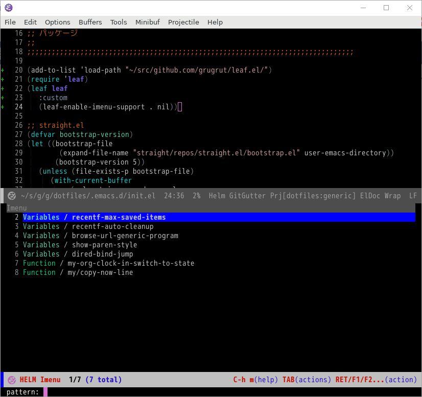

こうします。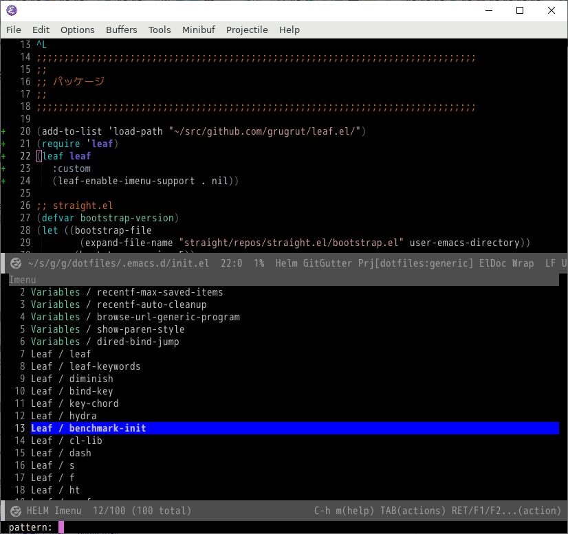

use-packageにもあるみたいですが、どうやらバグっているとのことなので、leaf.elでしか使えません。便利すぎるので、デフォルトでオンにしてあります。

そもそもEmacsには[[https://ayatakesi.github.io/emacs/temp/html/Imenu.html][imenuという機能]]があり、 =M-x imenu= で起動できます。ファイルをスキャンして関数定義や変数定義などの主要な定義についてのリストを提供し、その場所へのジャンプを提供します。

私はこのPRを受けて、この機能を知り、とても便利だったので =C-s= を =counsel-imenu= にあげることにしました。

=ivy= の =isearch= 相当は =swiper= なのですが、最近 =helm-swoop= のメンテナになったので、 =helm-swoop= を =C-S-s= に割り当てて使っています。

#+begin_src emacs-lisp
(leaf ivy
  :ensure t
  :diminish ivy-mode
  :custom ((ivy-re-builders-alist . '((t      . ivy--regex-fuzzy)
                                      (swiper . ivy--regex-plus)))
           (ivy-use-selectable-prompt . t)

           (ivy-mode     . t)
           (counsel-mode . t))
  :init
  (leaf *ivy-requirements
    :config
    (leaf swiper
      :disabled t
      :ensure t
      :bind (([remap isearch-forward] . swiper)))
    (leaf counsel
      :ensure t
      :diminish counsel-mode
      :bind (([remap isearch-forward] . counsel-imenu)
             ("C-x C-r" . counsel-recentf)))))

(leaf helm
  :ensure t
  ;; :require helm-config
  :config
  (leaf helm-swoop
    :load-path `,(locate-user-emacs-file "site-lisp/helm-swoop")
    :custom (helm-swoop-pre-input-function
             . (lambda ()
                 (if mark-active
                     (buffer-substring-no-properties (mark) (point))
                   "")))
    :bind ((helm-swoop-map   ("C-s" . helm-multi-swoop-all-from-helm-swoop))
           ("C-S-s" . helm-swoop)
           ("C-c f" . hydra-helm-swoop/body))))
#+end_src

*** Implement plstore-related keywords
- [[https://github.com/conao3/leaf.el/issues/276][#276 Setting or customizing variables from plstore]]
- [[https://github.com/conao3/leaf.el/pull/280][#280 Implement plstore-related keywords]]
- [[https://github.com/conao3/leaf.el/issues/283][#283 Add default plstore variable and get from it if value omitted]]
- [[https://github.com/conao3/leaf.el/issues/338][#338 add auth-* keywords as alias of pl-* keywords]]

目玉機能その2です。機密情報をEmacsの外に保存して、動的に復号し、Emacsの中で使う =auth-sources= のleafキーワードです。

この機能についてはちょっと説明が必要なので、別記事にし +てAdvent Calendarの穴埋めをし+ ます。

*** Add leaf-key-bindlist visualization
- [[https://github.com/conao3/leaf.el/issues/289][#289 Add leaf-key-bindlist visualization]]

目玉機能その3です。leafの =:bind= や =:bind*= で設定したキーバインドのリストを表示します。もしEmacsデフォルトのキーバインドを上書きしている場合は上書き前の関数名も表示されます。

これも、もともとuse-packageに実装されている =describe-personal-bindings= の移植です。

しかし、use-packageでは単にbufferにフォーマットされた文字列を表示するだけですが、 =leaf-key-describe-bindings= ではEmacsビルトインの表データ表示ライブラリ、 =tabulated-list= を使用して表示します。

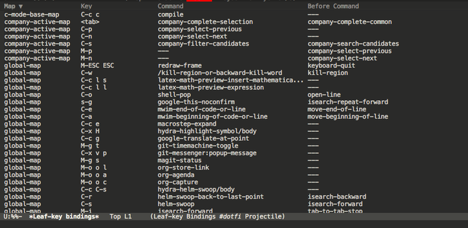

それによって各列での昇順、降順のソートなどができることで、use-packageのそれより使いやすく/見やすくなっていると思います。

*** Add leaf-expand-minimally variable
- [[https://github.com/conao3/leaf.el/issues/255][#255 Add leaf-expand-minimally variable]]

=leaf-emapand-minimally= という変数を追加しました。これは、use-packageにもある =use-package-expannd-minimally= の移植です。移植といいつつ、機能だけの移植でどうやって実装されているかまで見ていません。

leafの =leaf-expand-minimally= の実装は =leaf-expand-minimally-suppress-keywords= に指定されたキーワードに対して、優先度最大で、 =nil= を指定するというものです。

今のところ =leaf-expand-minimally-suppress-keywords= には =:leaf-protect= のみが指定されているので、有効にした場合は[[https://s.conao3.com/blog/2019/2b6cbf][:leaf-protect]]だけが無効化されます。

#+begin_src emacs-lisp
(defmacro p (form)
  "Output FORM processed `macroexpand-1' and `pp'."
  `(progn
     (pp (macroexpand-1 ',form))
     nil))
;;=> p

(p (leaf ace-window
     :ensure t
     :bind (("M-o a w" . ace-window))))
;;=> (prog1 'ace-window
;;     (leaf-handler-leaf-protect ace-window
;;       (unless
;;           (fboundp 'ace-window)
;;         (autoload #'ace-window "ace-window" nil t))
;;       (declare-function ace-window "ace-window")
;;       (leaf-handler-package ace-window ace-window nil)
;;       (leaf-keys
;;        (("M-o a w" . ace-window)))))

(let ((leaf-expand-minimally t))
  (p (leaf ace-window
       :ensure t
       :bind (("M-o a w" . ace-window)))))
;;=> (prog1 'ace-window
;;     (unless
;;         (fboundp 'ace-window)
;;       (autoload #'ace-window "ace-window" nil t))
;;     (declare-function ace-window "ace-window")
;;     (leaf-handler-package ace-window ace-window nil)
;;     (leaf-keys
;;      (("M-o a w" . ace-window))))
#+end_src

ただ、leafの展開形を知りたいだけなら後述する =leaf-expand= の方が使いやすいと思います。

*** Add leaf expand visualization feature
- [[https://github.com/conao3/leaf.el/issues/319][#319 Add leaf expand visualization feature]]

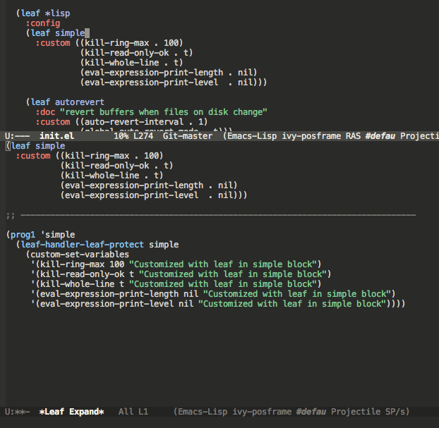

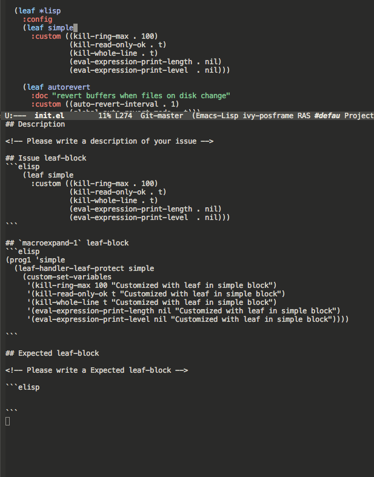

=M-x leaf-expand= と =M-x leaf-create-issue-template= を実装しました。

=leaf-expand= は現在のポイントから上のS式をスキャンして、一番最初に見つかったleafを =macroexpand-1= で展開し、新しいバッファに表示します。

=leaf-create-issue-template= はついでに実装したものです。展開前と展開後のleafをmd形式で新しいバッファに表示します。これをコピペすれば簡単にissueが書けるのではないかなと思います。

*** Add leaf-available-keywords
- [[https://github.com/conao3/leaf.el/issues/258][#258 Add leaf-available-keywords function]]
- [[https://github.com/conao3/leaf.el/issues/260][#260 make leaf-avairable-keywords interacrive function]]

=leaf-available-keywords= を追加しました。

lispプログラムから実行すると、単に現在使用できるキーワードのリストを返し、 =M-x leaf-avairable-keywords= と実行するとエコーエリアに表示します。

@@ image @@

あれ、どんなキーワードが使えるんだっけ。ってときに使えるかもしれません。このコマンドを実行する前にドキュメントを見てしまいそうですが。。

*** Why don't :setq, :custom, etc. distribute when normalizing?
- [[https://github.com/conao3/leaf.el/issues/279][#279 Why don't :setq, :custom, etc. distribute when normalizing?]]
- [[https://github.com/conao3/leaf.el/pull/282][#282 feature#279]]

=:hook= や =:mode= 以外のキーワードの分配代入のサポートの提案です。結局、下記のキーワードの全てで分配代入をサポートしました。

#+begin_example
:ensure :package
:hook :mode :interpreter :magic :magic-fallback :defun
:pl-setq :pl-pre-setq :pl-setq-default :pl-custom
:auth-custom :auth-pre-setq :auth-setq :auth-setq-default
:setq :pre-setq :setq-default :custom :custom-face
#+end_example

同じ値を複数の変数に設定するときに便利かもしれません。ただあんまり記述量変わらないし、変数名も長いので2行に渡ることもあり、私はあまり使ってません。

ただ、やっぱり =:hook= や =:mode= では便利。

*** Automatically require packages feature
- [[https://github.com/conao3/leaf-keywords.el/issues/56][#56 Automatically require packages feature]]
- [[https://github.com/conao3/leaf-keywords.el/issues/58][#58 Fix auto require feature]]
- [[https://github.com/conao3/leaf-keywords.el/issues/64][#64 Remove straight from auto require packages]]

leaf-keywords.elの追加機能です。leaf-keywords.elで使えるパッケージがインストールされていた場合、 =(leaf-keywords-setup)= をしたときに自動でrequireするようにしました。

この機能を使うには =(leaf-keywords-setup)= をする前に =el-get=, =hydra=, =key-combo=, =smartrep=, =key-chord=, =diminish=, =delight= のうちどれかをpackage.elなどでインストールしておく必要があります。

*** Remove eval-after-load statement
- [[https://github.com/conao3/leaf-keywords.el/issues/62][#62 Remove eval-after-load statement]]

leaf-keywords.elの追加機能です。leaf-keywords.elによって出力されたS式は、追加パッケージがrequireされたときに発火するように =eval-after-load= で囲われていました。

しかしこのおせっかい機能によって、 =:diminish= キーワードを使用しているのに =diminish= をインストールし忘れているという事故が起こっていました。

そこでエイヤッと取っぱらってしまいました。エラーによってきちんとユーザーに報告した方が良いだろうという判断です。なお =leaf-protect= で囲われている限り、エラーは起こりますが内部のエラーは全てワーニングに変換されるので、その後のパッケージは読み込もうとします。

** 修正された機能
*** Correctly eval cdr
- [[https://github.com/conao3/leaf.el/pull/269][#269 Correctly eval cdr]]

私は「ドット対のリスト」を指定するのが好みで、それをずっと使っていましたが、単に「ドット対」を渡したときに盛大にバグっていたことを教えて頂きました。

- 動く

  #+begin_src emacs-lisp
  (leaf some-mode
    :hook ((t . other-mode)))
  #+end_src

- 動かない

  #+begin_src emacs-lisp
  (leaf some-mode
    :hook (t . other-mode))
  #+end_src

leafは結構大きなDSL解析器になっていて、デバッグも大変になってきています。とりあえず、テストケースは全部通ることを確認しているので、見つけ次第追加していくしかないですね。。

なお、Readmeや私が書くleafの記事で紹介しているものはテストケースから抜き出したものなので、動くことが保証されています。

*** Fix install code
- [[https://github.com/conao3/leaf.el/issues/274][#274 fix install code]]

Readmeにおいて =leaf= のダウンロードに失敗したら =package-refresh= してもう一度ダウンロードを試すようにしていましたが、通常、leafは一番最初にダウンロードされるだろうということを仮定してインストールコードを簡略化しました。

ついでに =leaf-keywords.el= のインストールコードも =prog1= を使わない形に変えました。

- before

  #+begin_src emacs-lisp
  (prog1 "prepare leaf"
    (prog1 "package"
      (custom-set-variables
       '(package-archives '(("org"   . "https://orgmode.org/elpa/")
                            ("melpa" . "https://melpa.org/packages/")
                            ("gnu"   . "https://elpa.gnu.org/packages/"))))
      (package-initialize))

    (prog1 "leaf"
      (unless (package-installed-p 'leaf)
        (unless (assoc 'leaf package-archive-contents)
          (package-refresh-contents))
        (condition-case err
            (package-install 'leaf)
          (error
           (package-refresh-contents)       ; renew local melpa cache if fail
           (package-install 'leaf))))

      (leaf leaf-keywords
        :ensure t
        :config (leaf-keywords-init)))

    (prog1 "optional packages for leaf-keywords"
      ;; optional packages if you want to use :hydra, :el-get,,,
      (leaf hydra :ensure t)
      (leaf el-get :ensure t
        :custom ((el-get-git-shallow-clone  . t)))))
  #+end_src

- after

  #+begin_src emacs-lisp
  (prog1 "leaf"
    (prog1 "install leaf"
      (custom-set-variables
       '(package-archives '(("org"   . "https://orgmode.org/elpa/")
                            ("melpa" . "https://melpa.org/packages/")
                            ("gnu"   . "https://elpa.gnu.org/packages/"))))
      (package-initialize)
      (unless (package-installed-p 'leaf)
        (package-refresh-contents)
        (package-install 'leaf)))

    (leaf leaf-keywords
      :ensure t
      :config
      ;; optional packages if you want to use :hydra, :el-get,,,
      (leaf hydra :ensure t)
      (leaf el-get :ensure t
        :custom ((el-get-git-shallow-clone . t)))

      ;; initialize leaf-keywords.el
      (leaf-keywords-init)))
  #+end_src

*** Byte compile
- [[https://github.com/conao3/leaf.el/issues/326][#326 Suppress byte-compiler warnings, unused lexical variable, err]]
- [[https://github.com/conao3/leaf.el/issues/332][#332 Create :leaf-defun, auto declare function feature]]
- [[https://github.com/conao3/leaf.el/issues/334][#334 Add :leaf-defvar keyword]]
- [[https://github.com/conao3/leaf.el/issues/336][#336 fix :leaf-defvar expand statement]]

leafを使用したinit.elをバイトコンパイルしたときにワーニングが出たので直しました。バイトコンパイルについては少しコツがあるので、また別記事にするかもしれません。

*** Do configure autoload if not have already set autoload
- [[https://github.com/conao3/leaf.el/issues/330][#330 Do configure autoload if not have already set autoload]]

二重にautoloadされることを防止するためにautoloadする前に =fboundp= するようにしました。実はuse-packageの出力結果では =fboundp= してautoloadしていたのですが、そのチェックは本当に必要なんだろうか。と思ってチェックを外していたのです。

しかし、実際のところpackage.elによって設定された正しいautoloadをleafが上書きしていることが分かったので、設定する前にチェックするようにしました。

*** :hook should not autoload lambda expressions
- [[https://github.com/conao3/leaf.el/issues/295][#295 :hook cannot handle lambda with multiple expressions]]
- [[https://github.com/conao3/leaf.el/issues/296][#296 :hook should not autoload lambda expressions]]

=:hook= でlambda式を指定したときに、複数式だと動かないことと、変なautoloadが生成されていることの報告を受けて直しました。

この変更によって =:hook= で正常にlambda式を使用できるようになりました。

なお、 =:bind=, =:bind*= ではlambda式をバインドすることが[[https://github.com/conao3/leaf.el/issues/322][現状できない]]ので、 =:preface= で関数を宣言してバインドしてもらえればと思います。。

** まとめ
leafはIssueやPRを放置することなく、後方互換性を保った上で精力的に機能拡張を行なっています。ぜひこの記事や[[https://s.conao3.com/blog/2019/2b6cbf][リリース記事]]を参考にして、leafで快適なEmacs生活を送って頂ければと思います。

なお、12/18には「[[https://qiita.com/advent-calendar/2019/emacs][Emacs Advent Calendar 2019]]」の18日目の記事として @keita44_f4 さんによるleafの記事がでるようなので、それも参考にしていただければと思います。

最後になりますが、Patreonでご支援を頂ける方を募集しています。普段はleafなどのElispパッケージなどを中心にOSS活動をしつつ、学生をしています。ぜひよろしくお願いします。

[[https://www.patreon.com/conao3]]

* COMMENT dash.elの置き換え
:properties:
:export_file_name: generated/contents/blog/2019/84b8f6
:export_date: 2019-12-03
:end:

** はじめに
この記事は「[[https://qiita.com/advent-calendar/2019/emacs][Emacs Advent Calendar 2019]]」の2日目の記事として書いたものです。
昨日は私の「[[https://s.conao3.com/blog/2019/3279ec][{2019年アップデート} leaf.elで雑然としたEmacs設定ファイル「init.el」をクリーンにする]]」でした。

まだ空きがあるので、ぜひ参加頂ければと思います!

** dashとは
dashとはmagnarsさんによって作られ、現在は主にFuco1さんによってメンテナンスされています。
[[https://qiita.com/pogin503/items/01005402dc7cfd375b55][Emacsのモダンなライブラリ4+1選 (2013年版)]]にも取り上げられる他、 その使いやすさから[[https://melpa.org/#/dash][440のパッケージ]]から参照されており、
[[https://melpa.org/#/?sort=downloads&asc=false][ダウンロードランキング]]では唯一100万ダウンロードを達成し、 4000を越えるElispパッケージの堂々たる頂点に君臨しています。

しかし、dashは本当に依存すべきパッケージなのでしょうか。
あなたのElispパッケージがdashに依存することによって、どれだけのメリットを生んでいるのでしょうか。
dashがもし仕様変更したとき、あなたのElispパッケージが壊れるデメリットを甘受できるでしょうか。

dashの理念はプレフィックスのない関数を数多く宣言してしまう悪名高い =ci= パッケージに依存しないということでした。
しかし =ci= パッケージは =ci-lib= パッケージとして整理され、 Emacsビルトインの =subr= パッケージも大きく進化しています。
一方でdashはMELPA登録パッケージが解決すべきであるpackage-lint/checkdocのエラー/ワーニングを[[https://github.com/magnars/dash.el/pull/327][470件も放置し]]、 [[https://github.com/magnars/dash.el/pull/328][CIは一ヶ月前から通っていません]]。

dashの関数を既に大量に使っている場合は[[https://github.com/bbatsov/projectile/pull/1046][こんな感じで大変]]ですが、これからのElispパッケージを作る場合はdash非依存で作ってみてはいかがでしょうか。

* leaf.elに依存したEmacs設定ファイル「init.el」をバイトコンパイルして爆速にする
:properties:
:export_file_name: generated/contents/blog/2019/6c5374
:export_date: 2019-12-03
:end:

** はじめに
この記事は「[[https://qiita.com/advent-calendar/2019/emacs][Emacs Advent Calendar 2019]]」の3日目の記事として書いたものです。昨日は私の「[[https://s.conao3.com/blog/2019/3279ec][{2019年アップデート} leaf.elで雑然としたEmacs設定ファイル「init.el」をクリーンにする]]」でした。

まだ空きがあるので、ぜひ参加頂ければと思います!

[[github:conao3/leaf.el::Emacs Lisp][Flexible, declarative, and modern init.el package configuration]]

** バイトコンパイルとは
Elispはバイトコンパイルすることができ、通常の =.el= から =.elc= にコンパイルすることができます[fn:1]。

バイトコンパイルすることにより、より効率的にElispコードを実行できるようになります。init.elでバイトコンパイルの恩恵はあまり得られないことは言われていますが、しかし数msでも早くなるならやっておきたいのが人情というもの。実際どれだけ早くなるのか分からないのだから、試してみるしかないのです。

しかしleaf.elを使っている場合、そのままではバイトコンパイルできません。なお、[[https://github.com/conao3/leaf.el][leaf.elのReadme]]でもバイトコンパイルのことには全く触れていません。[[https://github.com/conao3/leaf.el#byte-compile-keywords][バイトコンパイルキーワード]]として実装されていることは紹介していますが、実際どのようにしたらいいのか書いてないのです。その方法を解説するものです。

** leaf.elとは
[[https://github.com/conao3/leaf.el][leaf.el]]はjwiegleyさんの[[https://github.com/jwiegley/use-package][use-package]]を2.5年使った上で、私が感じていたストレスを解消するためにスクラッチから開発したパッケージです。本体の説明はQiitaに何回か記事を書いたので、そちらを参照してください

- プレリリース記事: [[https://s.conao3.com/blog/2018/8aa938][use-packageからの移行のすゝめ - leaf.elでバージョン安全なinit.elを書く]]
- リリース記事: [[https://s.conao3.com/blog/2019/2b6cbf][{正式リリース}leaf.elで雑然としたEmacs設定ファイル「init.el」をクリーンにする]]
- 2019年アップデート記事: [[https://s.conao3.com/blog/2019/3279ec][{2019年アップデート} leaf.elで雑然としたEmacs設定ファイル「init.el」をクリーンにする]]

** let's バイトコンパイル
*** お題について
お題のinit.elを紹介します。私はこのinit.elを =/.debug.emacs.d/leaf/init.el= に保存しました。

#+begin_src emacs-lisp
;;; init.el --- leaf bytecompile sample   -*- lexical-binding: t; -*-

;;; Commentary:

;; leaf bytecompile sample

;;; Code:

;; ~/.debug.emacs.d/leaf/init.el

;; you can run like 'emacs -q -l ~/.debug.emacs.d/{{pkg}}/init.el'
(when load-file-name
  (setq user-emacs-directory
        (expand-file-name (file-name-directory load-file-name))))

(prog1 "leaf"
  (prog1 "install leaf"
    (custom-set-variables
     '(package-archives '(("org"   . "https://orgmode.org/elpa/")
                          ("melpa" . "https://melpa.org/packages/")
                          ("gnu"   . "https://elpa.gnu.org/packages/"))))
    (package-initialize)
    (unless (package-installed-p 'leaf)
      (package-refresh-contents)
      (package-install 'leaf)))

  (leaf leaf-keywords
    :ensure t
    :config
    ;; optional packages if you want to use :hydra, :el-get,,,
    (leaf hydra :ensure t)
    (leaf el-get :ensure t
      :custom ((el-get-git-shallow-clone . t)))

    ;; initialize leaf-keywords.el
    (leaf-keywords-init)))



(load (locate-user-emacs-file "../essentials.el"))

(leaf magit
  :when (version<= "25.1" emacs-version)
  :ensure t
  :preface
  (defun c/git-commit-a ()
    "Commit after add anything."
    (interactive)
    (shell-command "git add .")
    (magit-commit-create))
  :bind (("M-=" . hydra-magit/body))
  :hydra (hydra-magit
          (:hint nil :exit t)
          "
^^         hydra-magit
^^------------------------------
 _s_   magit-status
 _C_   magit-clone
 _c_   magit-commit
 _d_   magit-diff-working-tree
 _M-=_ magit-commit-create"
          ("s" magit-status)
          ("C" magit-clone)
          ("c" magit-commit)
          ("d" magit-diff-working-tree)
          ("M-=" c/git-commit-a)))

;;; init.el ends here
#+end_src

お題のinit.elにはleafとleaf-keywordsのインストール、magitをpackage.elによってインストール、 =:hydra= キーワードも含まれています。お題としてはまぁまぁではないでしょうか。

*** とりあえずやってみる
さて、このinit.elをバイトコンパイルするにあたって、注意するべきなのは、「leaf.elがマクロである」ということです。

マクロはバイトコンパイル時には既にコンパイラが定義を知っておく必要があります。

なお、flycheckのエラーも大変なことになっています。これでは重要なエラーを見落としてしまいます。

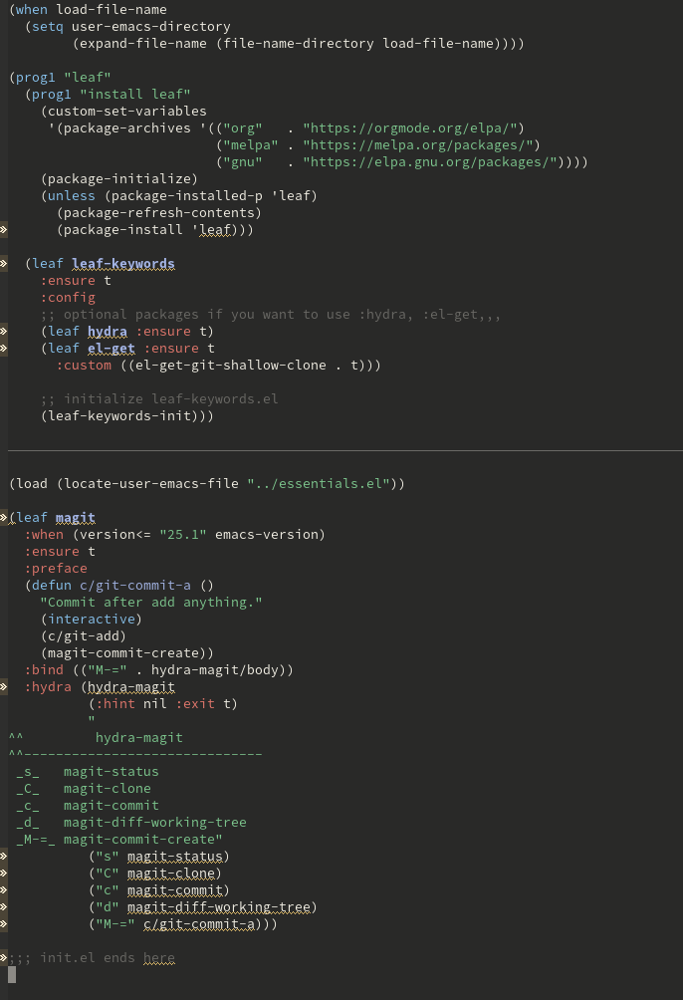

とりあえずやってみるということなので、バイトコンパイルしてみます。バイトコンパイルはいろいろな方法がありますが、簡単には外部のコンソールからバッチ処理モードでEmacsを起動してバイトコンパイルすることです。

#+begin_src shell
$ emacs --version
GNU Emacs 26.3
Copyright (C) 2019 Free Software Foundation, Inc.
GNU Emacs comes with ABSOLUTELY NO WARRANTY.
You may redistribute copies of GNU Emacs
under the terms of the GNU General Public License.
For more information about these matters, see the file named COPYING.


$ emacs -Q --batch -f batch-byte-compile init.el
In toplevel form:
init.el:25:25:Warning: ‘(el-get-git-shallow-clone . t)’ is a malformed
    function
init.el:27:9:Warning: reference to free variable ‘leaf-keywords’
init.el:31:11:Warning: reference to free variable ‘hydra’
init.el:32:11:Warning: reference to free variable ‘el-get’
init.el:42:1:Warning: ‘("M-=" . hydra-magit/body)’ is a malformed function
init.el:42:1:Warning: ‘"s"’ is a malformed function
init.el:42:1:Warning: ‘"C"’ is a malformed function
init.el:42:1:Warning: ‘"c"’ is a malformed function
init.el:42:1:Warning: ‘"d"’ is a malformed function
init.el:42:1:Warning: ‘"M-="’ is a malformed function
init.el:42:7:Warning: reference to free variable ‘magit’
init.el:52:11:Warning: ‘:hint’ called as a function
init.el:62:16:Warning: reference to free variable ‘magit-status’
init.el:63:16:Warning: reference to free variable ‘magit-clone’
init.el:64:16:Warning: reference to free variable ‘magit-commit’
init.el:65:16:Warning: reference to free variable ‘magit-diff-working-tree’
init.el:66:18:Warning: reference to free variable ‘c/git-commit-a’

In end of data:
init.el:69:1:Warning: the following functions are not known to be defined:
    package-installed-p, leaf, leaf-keywords-init, c/git-add,
    magit-commit-create, hydra-magit, :hint
#+end_src

なお、バイトコンパイルされた =elc= はメジャーバージョンをまたいでの互換性はないので、 =emacs= と起動したときにどのバージョンが起動されているのか確認することは重要です。さて、バイトコンパイルは大量のワーニングを出してバイトコンパイルできたようです。

。。。できてしまった。

いや、実行はできないはず。。。

#+begin_src emacs-lisp
emacs -q -l ~/.debug.emacs.d/leaf/init.el
#+end_src

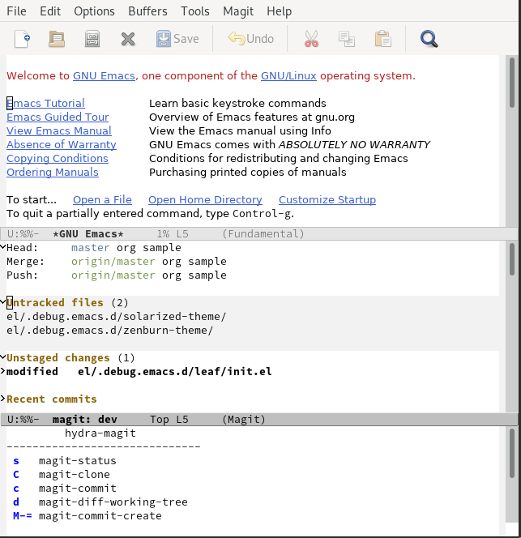

実行できてしまった。。

あれ、この記事の存在意義が良く分からなくなってしまったのですが、とりあえずワーニングでるの良くないよねということで、「ワーニングなしでバイトコンパイルする方法を紹介すること」に方針転換します。。

*** バイトコンパイル中の評価 - その1
「[[https://ayatakesi.github.io/lispref/24.5/elisp-ja.html#Eval-During-Compile][コンパイル中の評価]]」にある通り、バイトコンパイルのときにコンパイラに実行して欲しい式がある場合、 =eval-when-compile= で囲むことによって実現できます。

つまりleafのインストールをバイトコンパイル中にしてしまえばいいのです。そういえば[[https://github.com/jwiegley/use-package#getting-started][use-packageの推奨インストール]]はそもそもそうやって書かれていたのでした。

#+begin_src diff
modified   el/.debug.emacs.d/leaf/init.el
@@ -13,17 +13,21 @@
   (setq user-emacs-directory
         (expand-file-name (file-name-directory load-file-name))))

-(prog1 "leaf"
-  (prog1 "install leaf"
-    (custom-set-variables
-     '(package-archives '(("org"   . "https://orgmode.org/elpa/")
-                          ("melpa" . "https://melpa.org/packages/")
-                          ("gnu"   . "https://elpa.gnu.org/packages/"))))
-    (package-initialize)
-    (unless (package-installed-p 'leaf)
-      (package-refresh-contents)
-      (package-install 'leaf)))
+(eval-when-compile
+  (setq user-emacs-directory
+        (expand-file-name (file-name-directory default-directory))))

+(eval-when-compile
+  (prog1 "leaf"
+    (prog1 "install leaf"
+      (custom-set-variables
+       '(package-archives '(("org"   . "https://orgmode.org/elpa/")
+                            ("melpa" . "https://melpa.org/packages/")
+                            ("gnu"   . "https://elpa.gnu.org/packages/"))))
+      (package-initialize)
+      (unless (package-installed-p 'leaf)
+        (package-refresh-contents)
+        (package-install 'leaf))))
   (leaf leaf-keywords
     :ensure t
     :config
#+end_src

このように修正しました。バイトコンパイルしてみます。一度目はleafやleaf-keywords, hydraのインストールなどが行なわれると思います。出力が見づらいので、2回目を引用すると以下のようになります。

#+begin_src shell
$ emacs -Q --batch -f batch-byte-compile init.el

In end of data:
init.el:73:1:Warning: the following functions might not be defined at runtime
:
    package-installed-p, hydra-default-pre, hydra-keyboard-quit,
    hydra--call-interactively-remap-maybe, hydra-show-hint,
    hydra-set-transient-map
init.el:73:1:Warning: the function ‘magit-commit-create’ is not known to be
    defined.
#+end_src

どうやらまだワーニングが出ているようです。ワーニングは英語の意味そのままで、「バイトコンパイル中には定義を知っているが、実行時には多分知らないよ(実行時エラーになるよ)」ということです。実行時、それらの関数がきちんと使えることをバイトコンパイラに伝える必要がありそうです。

なお、 =user-emacs-diretory= の設定を =eval-when-compile= で囲った上で一つ増やしました。これはバイトコンパイル中も =user-emacs-directory= を変更しないとホームディレクトリの =.emacs.d= を使ってしまうからです。

別ディレクトリのクリーンな環境で実行しているからこそ、見落とさずに変更することができました。

*** バイトコンパイル中の評価 - その2
実行時に評価されないとバイトコンパイラに注意されたので、実行時にも評価するように変更します。

=eval-when-compile= を =eval-and-compile= に変更するだけです。これでバイトコンパイル中にも、実行時にも評価されることを宣言できます。

#+begin_src diff
modified   el/.debug.emacs.d/leaf/init.el
@@ -17,7 +17,7 @@
   (setq user-emacs-directory
         (expand-file-name (file-name-directory default-directory))))

-(eval-when-compile
+(eval-and-compile
   (prog1 "leaf"
     (prog1 "install leaf"
       (custom-set-variables
#+end_src

さて、バイトコンパイルしてみましょう。

#+begin_src shell
$ emacs -Q --batch -f batch-byte-compile init.el

In end of data:
init.el:73:1:Warning: the function ‘magit-commit-create’ is not known to be
    defined.
#+end_src

ワーニングがずいぶん少なくなりました!最後に残ったのは =magit-commit-create= が定義されていないというワーニングです。

これは =:preface= で宣言している =c/git-commit-a= で使用しているmagitの内部関数ですね。では最後にこのワーニングが出ないようにすればお題クリアです。

*** バイトコンパイル中の評価 - その3
前章で =magit-commit-create= が定義されていないというワーニングがでていました。ここで、ようやくleafのバイトコンパイルキーワードの出番です。

バイトコンパイルキーワードは2種類あり、 =:defun= は関数の宣言、 =:defvar= は変数の宣言を行います。今回は関数の未定義エラーがでているので、 =:defun= を使用します。

#+begin_src diff
modified   el/.debug.emacs.d/leaf/init.el
@@ -46,6 +46,7 @@
 (leaf magit
   :when (version<= "25.1" emacs-version)
   :ensure t
+  :defun (magit-commit-create)
   :preface
   (defun c/git-commit-a ()
     "Commit after add anything."
#+end_src

さて、もう一度バイトコンパイルしてみましょう。

#+begin_src shell
$ emacs -Q --batch -f batch-byte-compile init.el
#+end_src

出力がなにもありません。ワーニングなしでコンパイルできたようです!

flycheckのワーニングも全てなくなりました。これでflycheckのワーニングが価値あるものになりました。

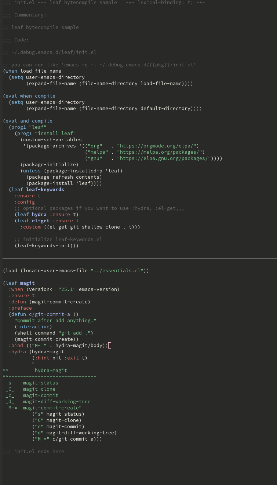

** まとめ
leaf.elを使っているinit.elをバイトコンパイルする方法を紹介しました。しかしこれは一番簡単な場合で、もし「init.elを複数のバージョンで読み込む可能性がある」場合は今回の方法は使えません。メジャーバージョン間で =elc= の互換性は存在しないので、エラーになってしまいます。

とはいえ、そんな状況で使っている人はまれで、多くの人はホームディレクトリの =.emacs.d= にinit.elを置いて単一バージョンで使っていると思います。この記事が参考になれば幸いです。

最後になりますが、Patreonでご支援を頂ける方を募集しています。普段はleafなどのElispパッケージなどを中心にOSS活動をしつつ、学生をしています。ぜひよろしくお願いします。

[[https://www.patreon.com/conao3]]

** Footnotes
[fn:1] GNU Emacs Lisp Reference Manual - バイトコンパイル [[https://ayatakesi.github.io/lispref/24.5/elisp-ja.html#Byte-Compilation]]

* Re: Makefileで.emacs.dの理想的なディレクトリ構造を生成する話
:properties:
:export_file_name: generated/contents/blog/2019/183c16
:export_date: 2019-12-04
:end:

** はじめに
この記事は「[[https://qiita.com/advent-calendar/2019/emacs][Emacs Advent Calendar 2019]]」の4日目の記事として書いたものです。

昨日は私の「[[https://s.conao3.com/blog/2019/6c5374][leaf.elに依存したEmacs設定ファイル「init.el」をバイトコンパイルして爆速にする]]」でした。

まだ空きがあるので、ぜひ参加頂ければと思います!

** 去年のディレクトリ構造
去年、私は「[[https://s.conao3.com/blog/2018/07b41c][Makefileで.emacs.dの理想的なディレクトリ構造を生成する話]]」を「[[https://qiita.com/advent-calendar/2018/emacs][Emacs Advent Calendar 2018]]」に投稿しました。

そこで提案したのは以下の構造でした。

#+begin_example
.
├── Makefile
├── Makefunc.mk
├── init.el
├── conf/
│   ├── 00_leaf.el
│   ├── 01_core-emacs.el
│   ├── 10_standard-elisp.el
│   ├── 20_editor.el
│   ├── 30_utility.el
│   └── 40_major-mode.el
├── site-lisp/
│   ├── cort.el/
│   ├── dash.el/
│   ├── f.el/
│   ├── feather.el/
│   ├── leaf.el/
│   ├── org-mode/
│   ├── orglyth.el/
│   ├── s.el/
│   └── use-package/
├── snippets/
├── templete/
└── local/
    ├── conao-mixed-raw.el
    ├── conao-mixed.el
    ├── 22.1/
    │   ├── build/
    │   │   ├── conao-mixed.el -> ../../conao-mixed.el
    │   │   └── conao-mixed.elc
    │   │   snippets/ -> ../../snippets/
    │   │   templete/ -> ../../templete/
    │   └── site-lisp/
    │       ├── cort.el/
    │       ├── ...
    │       └── use-pacakge/
    ├── 23.4/
    ├── 24.5/
    ├── 25.3/
    └── 26.1/
#+end_example

また、自動生成される前はこの構造です。

#+begin_example
.
├── Makefile
├── Makefunc.mk
├── init.el
├── conf/
│   ├── 00_leaf.el
│   ├── 01_core-emacs.el
│   ├── 10_standard-elisp.el
│   ├── 20_editor.el
│   ├── 30_utility.el
│   └── 40_major-mode.el
├── snippets/
└── templete/
#+end_example

** 今年のディレクトリ構造
さて、1年使ってみると考えも変わってきます。大きく変わったのは「モダンなinit.elはファイル分割する」という観点です。実際、ファイル分割によって見通しのよいinit.el群の管理と読み込み順の管理、さらには条件付きの設定が実現できていました。

しかし、leaf.elの開発によって、巨大なinit.elを一つだけもっていたとしても[[https://s.conao3.com/blog/2019/3279ec][imenuですぐにジャンプ]]できますし、leaf.elには[[https://s.conao3.com/blog/2019/2b6cbf][強力な条件分岐キーワード]]があります。

よって、現在ではこのようなディレクトリ構造になっています

#+begin_example
.
├── Makefile
├── Makefunc.mk
├── init.el
├── conf.el
├── site-lisp/
│   ├── cort-test.el/
│   ├── feather.el/
│   ├── orglyth.el/
│   └── leaf.el/
├── snippets/
├── templetes/
└── local/
  ├── 22.1/
  ├── 23.4/
  ├── 24.5/
  ├── 25.3/
  ├── 26.1/
  ├── 26.2/
  └── 26.3/
      ├── Makefile
      ├── conf.el -> ../../conf.el
      ├── conf.elc
      ├── elpa/
      ├── snippets/ -> ../../snippets/
      ├── templetes/ -> ../../templetes/
      └── site-lisp/ -> ../../site-lisp/
#+end_example

なお自動生成前はこのようなディレクトリ構造です。つまりこの構造が[[https://github.com/conao3/dotfiles/tree/master/.dotfiles/.emacs.d][GitHubで見えて]]います。

#+begin_example
.
├── Makefile
├── Makefile-local.mk
├── init.el
├── conf.el
├── snippets/
└── templete/
#+end_example

このディレクトリ構造は以下の特徴を持っています。

- メジャーバージョンの異なる、複数のEmacsを同時に使用できる。
- (M)ELPAからダウンロード、コンパイルしたパッケージは =local/[ver]/elpa/= 以下に置かれる。(異なるバージョン間で混同しない)
- site-lispは全バージョンで同じディレクトリを使用する。(開発中のパッケージを置いてるので、いちいちコピーするのが面倒)
- Emacsパッケージが保存するセンシティブな情報を一括で.gitignoreできる。

去年は気づいていませんでしたが、特に最後の特徴は重要な意味を持つことに気付きました。データの永続化のために =user-emacs-directory= (通常は =$HOME/.emacs.d= )にファイルを保存するEmacsパッケージは多く存在しており、その情報は取り扱いに注意が必要なものもあります。

やばそう(普通他人に見せない)なものの代表例はこちらです。

- [[https://github.com/search?utf8=%E2%9C%93&q=path%3A.emacs.d+filename%3Asession&type=Code&ref=advsearch&l=&l=][session]]
- [[https://github.com/search?q=path%3A.emacs.d+filename%3A.emacs.desktop&type=Code][.emacs.desktop]]
- [[https://github.com/search?utf8=%E2%9C%93&q=path%3A.emacs.d+filename%3Atramp&type=Code&ref=advsearch&l=&l=][tramp]]
- [[https://github.com/search?utf8=%E2%9C%93&q=path%3A.emacs.d+filename%3Arecentf&type=Code&ref=advsearch&l=&l=][recentf]]
- [[https://github.com/search?q=path%3A.emacs.d+filename%3Ajisyo&type=Code][jisyo]] (ddskk)

これらはおそらく =.gitignore= 漏れだと思います。(意図してgit管理している場合もあるのでしょうが。。)

重要なのは、「どのEmacsパッケージが、どんな名前で情報を保存するのかは分からない」という点です。

この状況でブラックリスト管理するのは無理があります。たしかに =.gitignore= にもホワイトリスト管理する方法がありますが、簡単なのは 「 =user-emacs-directory= を =local= 以下に変更して、 =local= を =.gitignore= する」という方法です。

これなら =user-emacs-directory= 以下にどれだけセンシティブな情報を保存したとしてもまとめてignoreされます。

** Makefile
現在のMakefileを紹介します。これを見ると、[[https://s.conao3.com/blog/2018/07b41c][去年]]よりは簡単になっています。

#+begin_src makefile
## Makefile

all:

XARGS := xargs $(shell if ( echo | xargs -r > /dev/null 2>&1 ); then echo "-r"; else echo ""; fi)

DEV_PKGS := leaf.el leaf-keywords.el orglyth.el cort-test.el seml-mode.el navbar.el
DEV_PKGS  += feather.el feather-server.el leaf-browser.el solarized-emacs
DEV_PKGS  += liskk.el
DEV_PKGS  += phantom-inline-comment annotate.el point-history
DEV_PKGS  += ivy-posframe helm-swoop flylint

EMACS_LST_RAW := 22.0 22.1 22.2 22.3
EMACS_LST_RAW  += 23.0 23.1 23.2 23.3 23.4
EMACS_LST_RAW  += 24.0 24.1 24.2 24.3 24.4 24.5
EMACS_LST_RAW  += 25.0 25.1 25.2 25.3
EMACS_LST_RAW  += 26.0 26.1 26.2 26.3
EMACS_LST_RAW  += 27.0

EMACS_LST := $(shell echo $(EMACS_LST_RAW) | sed "s/ /\n/g" | $(XARGS) -I% sh -c "if type emacs-% >/dev/null 2>&1; then echo %; fi")
DIRS := local

export XARGS
export DEV_PKGS

##################################################

.PHONY: all clean
.PRECIOUS: site-lisp/%
all: $(DIRS) $(DEV_PKGS:%=site-lisp/%) $(EMACS_LST:%=local/%)
    @$(call ECHO_YELLOW,"make job:all completed!!","\n","\n")

$(DIRS):
    mkdir -p $@

##############################

site-lisp/%:
    @mkdir -p $(@D)
    $(if $(wildcard ~/dev/repos/$*), cd site-lisp; ln -sf ~/dev/repos/$*,\
    $(if $(wildcard ~/dev/forks/$*), cd site-lisp; ln -sf ~/dev/forks/$*,\
    cd site-lisp; git clone https://github.com/conao3/$*.git))

local/%: local conf.el Makefile-local.mk
    mkdir -p $@
    cp -f Makefile-local.mk $@/Makefile
    cp -f conf.el $@/conf.el
    $(MAKE) -C $@

##############################

clean-elc:
    find site-lisp -follow -name "*.elc" | $(XARGS) rm -rf

clean:
    -rm -rf local
    @$(call ECHO_CYAN,"make job:clean completed!!","\n","\n")
#+end_src

#+begin_src makefile
## Makefile-local

all:

EMACS ?= emacs-$(shell basename $$(pwd))
XARGS ?=

SYMS := latex-math-preview-cache lice snippets templates conf.el

##################################################

all: conf.elc $(SYMS)

%.elc: %.el site-lisp
    $(EMACS) -Q --batch -f batch-byte-compile $<

%.el: ../../%.el

$(SYMS):
    ln -sf ../../$@
#+end_src

** バイトコンパイルについて
昨日の記事、「[[https://s.conao3.com/blog/2019/6c5374][leaf.elに依存したemacs設定ファイル「init.el」をバイトコンパイルして爆速にする]]」の[[https://s.conao3.com/blog/2019/6c5374][まとめ]]でも触れましたが、バイトコンパイルした後の =elc= はメジャーバージョンをまたいでの互換性はありません。

つまり異なるメジャーバージョンのEmacsを同時に動かそうとすると =elc= にコンパイルできませんでした。

しかし、 =.emacs.d/init.el= はバージョン間で共通にしておいて、本体を別のファイルにしておけば、そのファイルはバイトコンパイルできることに気付きました。

ということでディレクトリ構成もそうなっていて、 =.emacs.d/init.el= は全バージョン共通(バイトコンパイルしない)、 =conf.el= は =.emacs.d/local/{{ver}}/conf.el= からシンボリックリンクを張り、それぞれのバージョンで =conf.elc= にバイトコンパイルすることになっています。

よって、[[https://github.com/conao3/dotfiles/blob/master/.dotfiles/.emacs.d/init.el][init.el]]は以下のように、 =user-emacs-directory= を変更して、 =conf.elc= を読み込むだけです。

#+begin_src emacs-lisp
;;; init.el

(prog1 "Change user-emacs-directory"
  ;; enable debug
  (setq debug-on-error  t
        init-file-debug t)

  ;; you can run like 'emacs -q -l ~/hoge/init.el'
  (when load-file-name
    (setq user-emacs-directory
          (expand-file-name (file-name-directory load-file-name))))

  ;; change user-emacs-directory
  (setq user-emacs-directory
        (expand-file-name
         (format "local/%s.%s/"
                 emacs-major-version emacs-minor-version)
         user-emacs-directory)))

(condition-case err
    (load (expand-file-name "conf" user-emacs-directory))
  (error
   (error "You need `make' before running Emacs! Raw err: %s" err)))
#+end_src

[[https://github.com/conao3/dotfiles/blob/master/.dotfiles/.emacs.d/conf.el][conf.el]]の先頭ではleafの初期化を行って、あとは気のむくままにパッケージの設定を書いていきます。

注意点として、私はleafの開発版をsite-lispに持っているので、少しインストールコードが異なっています。

#+begin_src emacs-lisp
(eval-when-compile
  (setq user-emacs-directory
        (expand-file-name (file-name-directory default-directory))))

(eval-and-compile
  (defvar package-archives)
  (setq package-archives '(("org"   . "https://orgmode.org/elpa/")
                           ("melpa" . "https://melpa.org/packages/")
                           ("gnu"   . "https://elpa.gnu.org/packages/")))
  (package-initialize)

  (add-to-list 'load-path (locate-user-emacs-file "site-lisp/leaf.el"))
  (add-to-list 'load-path (locate-user-emacs-file "site-lisp/leaf-keywords.el"))

  (require 'leaf)

  (leaf leaf
    :config
    (leaf leaf-keywords
      :require t
      :init
      (leaf package
        :init
        (leaf *elpa-workaround
          :when (or (version= "26.1" emacs-version)
                    (version= "26.2" emacs-version))
          :custom ((gnutls-algorithm-priority . "NORMAL:-VERS-TLS1.3")))
        :config
        (leaf *elsa-workaround
          :custom ((package-user-dir . "/home/conao/.emacs.d/local/26.3/elpa"))))

      (leaf hydra
        :ensure t
        :config
        (leaf *hydra-posframe
          :when (version<= "26.1" emacs-version)
          :when window-system
          :custom `((hydra-hint-display-type . 'posframe)
                    (hydra-posframe-show-params
                     . ',(list :internal-border-width 1
                               :internal-border-color "red"
                               :poshandler 'posframe-poshandler-window-bottom-right-corner)))))

      (leaf el-get
        :ensure t
        :init (unless (executable-find "git")
                (warn "'git' couldn't found. el-get can't download any packages"))
        :custom ((el-get-git-shallow-clone  . t)))

      (leaf diminish
        :ensure t)

      (leaf cus-edit
        :custom `((custom-file . ,(locate-user-emacs-file "custom.el"))))

      :config
      (leaf-keywords-init)))

  (leaf *libraries
    :config
    (leaf dash :ensure t :require t)
    (leaf ts :ensure t :require t)
    (leaf buttercup :ensure t :require t)
    (leaf ert-async :ensure t :require t)))

  ;; あとはパッケージの設定を書く
  (leaf ...)
#+end_src

** まとめ
色んなバージョンのEmacsを使うために、このディレクトリ構造にしましたが、思いがけず不要なファイルをgit管理しない構造になっていたことを発見しました。

この構造にメリットを見いだす人はわずかだとは思いますが、備忘録として残しておきます。

なお、Emacs-27からは =early-init.el= のロードが追加されており、[[https://www.reddit.com/r/emacs/comments/7yns85/emacs_adds_support_for_a_second_read_earlier_init/][クラスタは色めきあって]]います。さらにEmacs-27から[[https://specifications.freedesktop.org/basedir-spec/basedir-spec-latest.html][XDG Base Directory Specification]]にのっとり、 =.config/emacs/init.el= を最優先で読み込むようになっているようです。([[https://github.com/emacs-mirror/emacs/commit/4118297ae2fab4886b20d193ba511a229637aea3][該当コミット]] / [[https://github.com/emacs-mirror/emacs/blob/4118297ae2fab4886b20d193ba511a229637aea3/etc/NEWS#L135-L142][NEWS]])
(tomoyaさんが最初の報告、コミットとNEWSはelimさんが探してくださり、[[https://emacs-jp.github.io/][emacs-jpのSlack]]で共有して頂いた情報です。)

[[https://wiki.archlinux.jp/index.php/XDG_Base_Directory_%E3%82%B5%E3%83%9D%E3%83%BC%E3%83%88][ArchのWiki]]でもEmacsは「ハードコードされているソフトウェア」にリストされていますが、修正が必要になるかもしれません。

これらのupstreamの修正により私のdotfilesも変更を迫られるでしょうが、過度に保守的にならず、現在も修正が加えられているというのは喜ばしいことです。

[[https://lists.gnu.org/archive/html/emacs-devel/2019-11/msg00970.html][Emacs-27ももうすぐリリース]]されるようです(tak.kunihiroさんに共有して頂いた情報)。Emacsコントリビュータの人に感謝しつつ、いつか本体に貢献したいなと思っています。

最後になりますが、Patreonでご支援を頂ける方を募集しています。普段はleafなどのElispパッケージなどを中心にOSS活動をしつつ、学生をしています。ぜひよろしくお願いします!

[[https://www.patreon.com/conao3]]

* COMMENT pp.elの拡張パッケージ; ppp.elをMELPAに登録した話
:properties:
:export_file_name: generated/contents/blog/2019/981fee
:export_date: 2019-12-25
:end:

** はじめに
この記事は「[[https://qiita.com/advent-calendar/2019/emacs][Emacs Advent Calendar 2019]]」の23日目の記事として書いたものです。
昨日は @maebaru さんの「[[https://qiita.com/maebaru/items/f7163b70625865b32e68][Emacsユーザ向けChrome拡張機能を公開してみた]]」でした。

** pp.elについて
Elispに限らず、様々な言語

* COMMENT ox-hugoのwarningをなおす
:properties:
:export_file_name: generated/contents/blog/2020/c8afa7
:export_date: 2020-01-01
:end:

* COMMENT Emacsにおける.dir-locals.elについて
:properties:
:export_file_name: generated/contents/blog/2020/00a837
:export_date: 2020-01-01
:end:

** 背景
個々のファイルを汚さないためにも ~.dir-locals.el~ を活用していきたいものです。
しかし、歴史的な経緯により、 ~.el~ でサフィックスされているのに文法はElispではなく ~.dir-locals.el~ 独自のものとなっています。
それが ~.dir-locals.el~ をよく分からないものにしている一因んだと思われます。
この記事は様々な ~.dir-locals.el~ の具体例を示し、 ~.dir-locals.el~ の効果的な利用方法を見つけて頂く一助となればと思うものです。

** .dir-locals.elの仕組み
~.dir-locals.el~ はEmacs本体の ~lisp/files.el~ で処理されています。

なんと ~.dir-locals.el~ のファイル名は変数で管理されており、変更することができます(おすすめできませんが)。([[https://github.com/emacs-mirror/emacs/blob/emacs-27.1/lisp/files.el#L4106-L4120][GitHub - emacs-mirror/emacs - lisp/files.el]])

#+begin_src emacs-lisp
(defconst dir-locals-file ".dir-locals.el"
  "File that contains directory-local variables.
It has to be constant to enforce uniform values across different
environments and users.

A second dir-locals file can be used by a user to specify their
personal dir-local variables even if the current directory
already has a `dir-locals-file' that is shared with other
users (such as in a git repository).  The name of this second
file is derived by appending \"-2\" to the base name of
`dir-locals-file'.  With the default value of `dir-locals-file',
a \".dir-locals-2.el\" file in the same directory will override
the \".dir-locals.el\".

See Info node `(elisp)Directory Local Variables' for details.")
#+end_src

変数のドキュメントに記載があるように ~.dir-locals.el~ と ~.dir-locals-2.el~ が同時にディレクトリに存在する場合、後者が優先されるようですね。(知らなかった)
使用法としては、これも変数のドキュメントに記載のとおり、gitで ~.dir-locals.el~ が共有されていて、気に入らない値が設定されているとき ~.dir-locals.el~ を置くことで前者を無視することができるということです。
そういうユースケースなので、 ~.dir-locals-2.el~ はglobalの.gitignoreでignoreしておくといいのかもしれません。

~dir-locals-file~ を使っている ~dir-locals--all-files~ に適当にデバッガを仕込んでバックトレースを取ると次の情報が得られました。

#+begin_src emacs-lisp
  dir-locals--all-files("~/dev/dir-locals-test/")
  locate-dominating-file("/home/conao/dev/dir-locals-test/" dir-locals--all-files)
  dir-locals-find-file("/home/conao/dev/dir-locals-test/.dir-locals.el")
  hack-dir-local-variables()
  hack-local-variables(no-mode)
  run-mode-hooks(emacs-lisp-mode-hook)
  emacs-lisp-mode()
  set-auto-mode-0(emacs-lisp-mode nil)
  set-auto-mode()
  normal-mode(t)
  after-find-file(t t)
  find-file-noselect-1(#<buffer .dir-locals.el> "~/dev/dir-locals-test/.dir-locals.el" nil nil "~/dev/dir-locals-test/.dir-locals.el" nil)
  find-file-noselect("/home/conao/dev/dir-locals-test/.dir-locals.el" nil nil nil)
  find-file("/home/conao/dev/dir-locals-test/.dir-locals.el")
#+end_src

つまり、 ~find-file~ でファイルを開いたり、 ~revert-buffer~ で開き直せば ~normal-mode~ が呼ばれるので、 ~.dir-locals.el~ の設定内容を反映できるようですね。
~revert-buffer~ で反映できるのは ~.dir-locals.el~ のデバッグをするときには便利なので覚えておいて頂ければと思います。

* COMMENT Emacs --batchで標準エラー出力に出力する方法
:properties:
:export_file_name: generated/contents/blog/2020/fe6cf9
:export_date: 2020-01-01
:end:

https://stackoverflow.com/questions/22455366/how-can-i-write-to-standard-output-in-emacs

* COMMENT Elispにおけるquote(')とfunction(#')の使い分け
:properties:
:export_file_name: generated/contents/blog/2020/ab9c6e
:export_date: 2020-01-01
:end:

ネタ元はEmacs-jp。

functionを使うとバイトコンパイル時に関数が見つからない旨、警告を出してくれる。(kakiさんから)

chuntaroさん
#+begin_example
24 で lexical binding を実装するまでは一緒だったけど、24 から function の方にクロージャを生成すると言う機能が追加されてて、
'(lambda () ...)
#'(lambda () ...)
とした時に違いがあります。
詳しくは一応↓このツイートに書いてあります。
https://twitter.com/shima_tetsuo/status/1056030917284622336
ちなみに、シンボルに対しては (quote symbol) (function symbol) は単にシンボルを返すだけだから、全く同じです。
#+end_example

defun した関数は (function hoge) の様にするのみなので、これは単にシンボル hoge が返るだけですね。
ちなみに、ソース(C言語)を見てみると

#+begin_src C
  DEFUN ("function", Ffunction, Sfunction, 1, UNEVALLED, 0,
         doc: /* Like `quote', but preferred for objects which are functions.
  In byte compilation, `function' causes its argument to be handled by
  the byte compiler.  `quote' cannot do that.
  usage: (function ARG)  */)
    (Lisp_Object args)
  {
    Lisp_Object quoted = XCAR (args);

    if (!NILP (XCDR (args)))
      xsignal2 (Qwrong_number_of_arguments, Qfunction, Flength (args));

    if (!NILP (Vinternal_interpreter_environment)
        && CONSP (quoted)
        && EQ (XCAR (quoted), Qlambda))
      { /* This is a lambda expression within a lexical environment;
       return an interpreted closure instead of a simple lambda.  */
        Lisp_Object cdr = XCDR (quoted);
        Lisp_Object tmp = cdr;
        if (CONSP (tmp)
        && (tmp = XCDR (tmp), CONSP (tmp))
        && (tmp = XCAR (tmp), CONSP (tmp))
        && (EQ (QCdocumentation, XCAR (tmp))))
      { /* Handle the special (:documentation <form>) to build the docstring
           dynamically.  */
        Lisp_Object docstring = eval_sub (Fcar (XCDR (tmp)));
        CHECK_STRING (docstring);
        cdr = Fcons (XCAR (cdr), Fcons (docstring, XCDR (XCDR (cdr))));
      }
        return Fcons (Qclosure, Fcons (Vinternal_interpreter_environment,
                       cdr));
      }
    else
      /* Simply quote the argument.  */
      return quoted;
  }
#+end_src

ちょっと分かり難いけど… (lambda ...) となっているコンスセルのみに反応するようになってるのが分かると思います。

* COMMENT andがapplyできない。。Lispでリストの全てが条件を満たすか調べる方法
:properties:
:export_file_name: generated/contents/blog/2020/e13065
:export_date: 2020-01-01
:end:

* COMMENT Arch Linuxでいい感じに揃ったスクリーンショットを撮り、管理する方法
:properties:
:export_file_name: generated/contents/blog/2020/f0aaa7
:export_date: 2020-01-01
:end:


[[https://s.conao3.com/blog/2020/0a23fb][Netlify + Hugo + ox-hugoでブログを始める第一歩]]

* COMMENT mewが遅い件について
:properties:
:export_file_name: generated/contents/blog/2020/fd31b6
:export_date: 2020-01-01
:end:


nom  12:24
もうずっと Mew を使っていますが，IMAP の fetch は確かに遅い気がします．
サーバが Gmail の場合，読むのは Web UI で，返事書くのを Mew で書いたりすることもあります．
nom  12:40
最新100件だけ fetch するのであれば， i (inc) ではなく，s (scan) して，range に last:100 のようにする方法がありますね．

* COMMENT Lispとは何なのか。LISt Processerの力
:properties:
:export_file_name: generated/contents/blog/2020/761276
:export_date: 2020-01-01
:end:

** 背景
この記事は[[https://cammel.connpass.com/event/185099/][Momiji-LT#1]]の発表の草稿です。
Lispを触ったことのない人に「Lispとは何か」を紹介し、魅力を伝えようとするものです。

** まとめ

** 参考
-

* COMMENT VMにArch Linux入れて初期設定するまで
:properties:
:export_file_name: generated/contents/blog/2020/72ce3b
:export_date: 2020-01-01
:end:

** intro

* COMMENT mustacheのwarningをなおす
:properties:
:export_file_name: generated/contents/blog/2020/cdbc75
:export_date: 2020-01-01
:end:

* COMMENT base64の画像をEmacsで表示する方法
:properties:
:export_file_name: generated/contents/blog/2020/089941
:export_date: 2020-01-01
:end:

ネタ元はROCKTAKEYさんのEmacs-jpでの発言。
(create-image
   (base64-decode-string "base64エンコードの画像")
    nil t :width nil)

* COMMENT org-modeから始めるEmacs入門
:properties:
:export_file_name: generated/contents/blog/2020/0bb7dc
:export_date: 2020-01-01
:end:

** はじめに
*** 自己紹介
- 山下 直哉 (@conao3)
- 学業
  - 広島大学先進理工系科学研究科@@html:<br>@@パターン認識研究室 (栗田・宮尾研究室)
    - 機械学習を用いた単眼動画像の深度予測
- 趣味
  - Emacsの布教活動 ([[https://emacs-jp.github.io/][Emacs-jp]]メンバー)
  - Emacsのパッケージ開発 ([[https://github.com/conao3/leaf.el][leaf.el]], [[https://github.com/conao3/seml-mode.el][seml-mode.el]],,,)
  - GitHubの草を生やす (OSS活動)
  - Link: [[https://github.com/conao3/][GitHub]], [[https://www.emacswiki.org/emacs/Conao3][Emacs Wiki]], [[https://twitter.com/conao_3][Twitter]], [[https://conao3.com/][conao3.com]]

** 界隈の最近
*** 2020年代のEmacs入門[fn:0bb7dc-3]
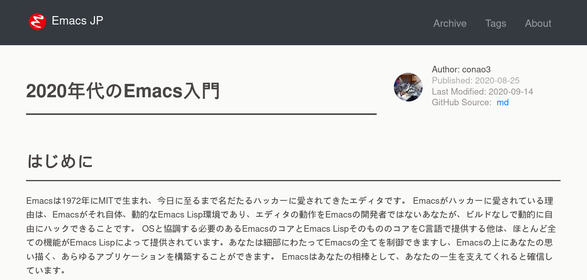

*** Emacsに一生入門できねえ2020[fn:0bb7dc-4]
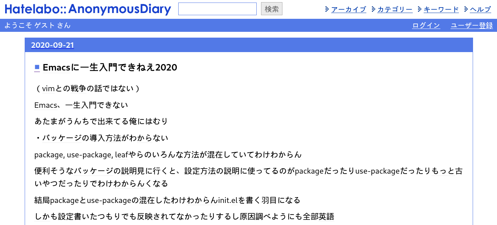

*** 風になりたい奴だけがEmacsを使えばいい 2020[fn:0bb7dc-5]


*** 最近のEmacsJP
- 事実として、他コミュニティのような流量はない
  - vim-jp, Ruby-jp, Rust-jp,
  - プログラミング言語処理系が好きな人の集まり,,,
- しかし、数多くの心強いつよつよハッカー達が集まっている
  - ぜひ気軽に質問をしてください!
  - 「Emacs-jp」で検索!
- Windows周辺の情報のまとめ、現在進行中!

** それはそれとして
*** Zenn
#+attr_html: :style margin-top:8rem;


https://zenn.dev/

*** Zenn
- 概要
  - Qiita的な技術情報ブログサイト
  - Note的な投げ銭システム
  - とても簡単な「本」の出版 (公開)
  - ローカルプレビューのためのcliの提供
  - GitHub連携
- システム
  - 個人開発 (CatNoseさん)
    - Zenn needs help[fn:0bb7dc-6]
  - Next.js, Rails, GCP, Vercel

** org-mode
*** org-mode
- markdown的なstructuredプレーンテキスト
- Emacsでプレーンテキストを扱うならこれ
- org-tangle, org-export, org-publish, org-agenda, org-clock, org-capture, org-table 等々の便利機能
  - Emacs界のキラーパッケージ
  - (しかしでかすぎて全容を把握できない)
- @@html:<div style="margin-top:2rem;"></div>@@org-export周辺だけでも、とても便利!
- 卒論をorgで書いた
  - org -> LaTeX -> pdf
- ブログ(conao3.com)もorg (ox-hugo)

*** [markdown] / org-mode
- 思想は同じ
  - structuredかつ簡単なスタイルを付けたプレーンテキスト
- markdownの進化
  - 本来のmarkdownの仕様は小さく、(需要に対して)不十分だった
    - 言語名付きのソースブロックはGFM拡張
  - 最初の実装はperlスクリプト
  - 「俺のmarkdown」(方言)の大量発生
  - 基本的にCommonMarkに収束
  - 空行やインデントの扱いなど、多くの実装依存な部分

*** markdown / [org-mode]
- org-modeの進化
  - Elispでの実装がずっとメンテナンスされている
    - 方言はない
  - Emacsで使うことを前提に、ノートテイキング、タスク管理などの機能
  - 文芸的プログラミングのさきがけ
    - jupyter notebookで有名に
  - 任意のフォーマットへの変換機能!
    - text, md, rst, LaTeX, beamer, html, odt(word)
    - このスライドもorg形式 -> reveal.js向けのhtml

*** org文書のイメージ[fn:0bb7dc-8]
[[./resources/public/img/0bb7dc-3a06eb01-f1c0-49e2-8f44-1eafd6b29004.png]]

*** 文芸的プログラミング
#+attr_html: :width 200px :style float:left;margin-bottom:20rem


#+attr_html: :style display:block;margin-left:14rem;
- Donald Ervin Knuth (1938-) 提唱
- (狭義)ドキュメントとコードを同じファイルに書く
- 狭義では単に埋め込みドキュメントも該当してしまう
  - コード断片の評価及び返り値参照
  - コード断片のマクロ展開
    - 記述順に依存しない

*** orgの文芸的プログラミング
#+html_attr: :style font-fize:0.8rem
org-tangle: org文書からプログラムを出力

#+attr_html: :width 80%
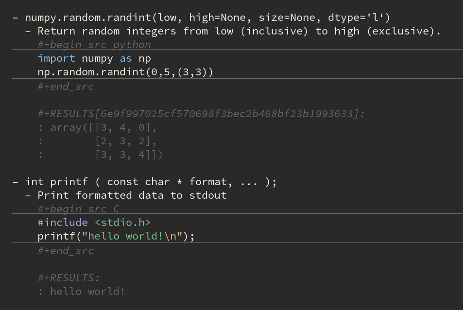

**** COMMENT サンプル

- numpy.random.randint(low, high=None, size=None, dtype='l')
  - Return random integers from low (inclusive) to high (exclusive).
    #+begin_src python
    import numpy as np
    np.random.randint(0,5,(3,3))
    #+end_src

    #+RESULTS[6e9f997025cf570698f3bec2b468bf23b1993633]:
    : array([[3, 4, 0],
    :        [2, 3, 2],
    :        [3, 3, 4]])

- int printf ( const char * format, ... );
  - Print formatted data to stdout
    #+begin_src C
    #include <stdio.h>
    printf("hello world!\n");
    #+end_src

    #+RESULTS:
    : hello world!

#+begin_src elisp
(-take 5 (leaf-available-keywords))
#+end_src

#+RESULTS:
| :disabled | :leaf-protect | :load-path | :load-path* | :leaf-autoload |

*** ox-zenn
- orgからzenn形式のmarkdownへ変換
- 今日! MELPAにマージ (23パッケージ目)
- ox-zennの開発期間は2日 (開発1日、修正1日)
- なぜそんなに早く開発できたのか
  - 中間表現はすでに提供されている
  - 多くの関連パッケージの存在
- 使い方はzennで公開[fn:0bb7dc-7]
- 作り方も公開予定

*** ox-zenn
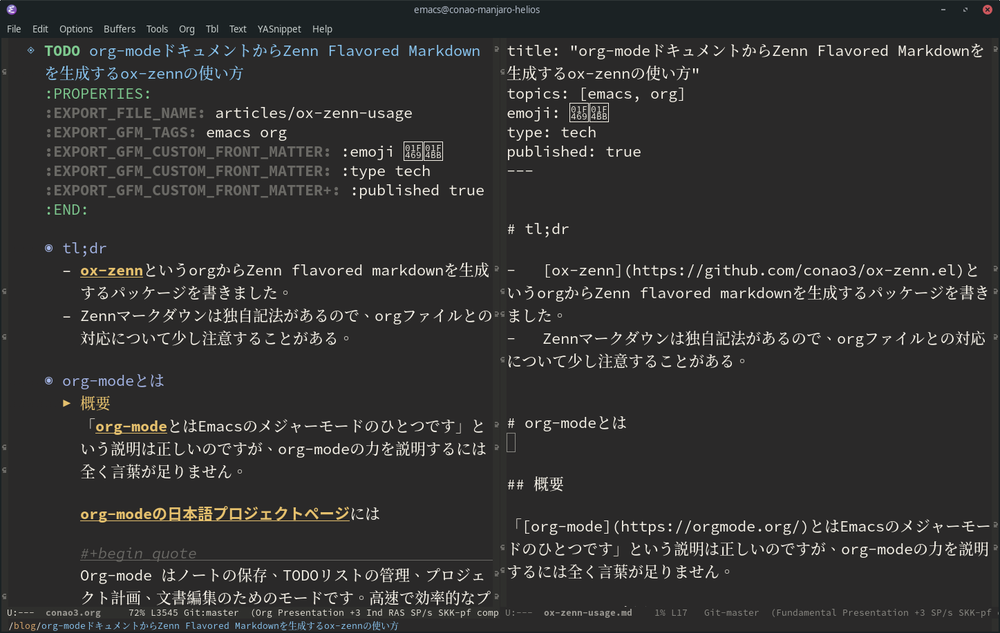

** まとめ
*** まとめ
- org-modeの紹介
  - org-tangle, org-export, org-publish
- zennの紹介とox-zennを作った話

#+REVEAL_HTML: <div style="height:1em"></div>
#+attr_html: :style font-size:1.8rem
今回、時間の (そして私の知識の) 関係で、@@html:<br>@@
orgの他の大部分の機能 (特にタスク管理)@@html:<br>@@
については紹介できませんでした。

#+attr_html: :style font-size:1.8rem
しかし、orgのドキュメント変換機能は単体でもとても便利です。

#+attr_html: :style font-size:1.8rem
私はorg-modeを使いたくてEmacsに入門しました。@@html:<br>@@
ぜひ皆さんもorg-modeを使ってみて、そのパワフルさを感じてください!

#+attr_html: :style font-size:1.8rem
Emacsに入門する際にはEmacsJPで支えますので、@@html:<br>@@
ぜひSlackに入ってみてください!@@html:<br>@@
https://emacs-jp.slack.com

*** 脚注
#+attr_html: :style font-size:1.5rem
1. 2020年代のEmacs入門 - https://emacs-jp.github.io/tips/emacs-in-2020.html
2. Emacsに一生入門できねえ2020 - https://anond.hatelabo.jp/20200921040234
3. 風になりたい奴だけがEmacsを使えばいい 2020 - https://blog.tomoya.dev/posts/only-those-who-want-to-be-the-wind-should-use-emacs-2020/
4. Zenn needs help - https://catnose99.com/zenn-needs-help/
5. Eric Schulte, Dan Davison, Thomas Dye, et.al., "A Multi-Language Computing Environment for Literate Programming and Reproducible Research" https://www.jstatsoft.org/article/view/v046i03
6. ox-zennの使い方 - https://s.conao3.com/blog/2020/6dae6b

[fn:0bb7dc-3] 2020年代のEmacs入門 - https://emacs-jp.github.io/tips/emacs-in-2020.html
[fn:0bb7dc-4] Emacsに一生入門できねえ2020 - https://anond.hatelabo.jp/20200921040234
[fn:0bb7dc-5] 風になりたい奴だけがEmacsを使えばいい 2020 - https://blog.tomoya.dev/posts/only-those-who-want-to-be-the-wind-should-use-emacs-2020/
[fn:0bb7dc-6] Zenn needs help - https://catnose99.com/zenn-needs-help/
[fn:0bb7dc-7] ox-zennの使い方 - https://s.conao3.com/blog/2020/6dae6b
[fn:0bb7dc-8] Eric Schulte, Dan Davison, Thomas Dye, et.al., "A Multi-Language Computing Environment for Literate Programming and Reproducible Research" https://www.jstatsoft.org/article/view/v046i03

* COMMENT Arch printer
:properties:
:export_file_name: generated/contents/blog/2020/c2b49e
:export_date: 2020-01-01
:end:

http://cocu.hatenablog.com/entry/2016/07/19/225308

* COMMENT Emacs-26.3新機能 add-variable-watcherを使ってみる
:properties:
:export_file_name: generated/contents/blog/2020/e6f3b1
:export_date: 2020-01-01
:end:

chuntaro  16:58
#+begin_src emacs-lisp
  26.1 から add-variable-watcher なんてのが追加されてたんだな。
  (defvar my-var 1)
  my-var
  (add-variable-watcher 'my-var (lambda (symbol newval operation where)
                                  (print (list symbol newval operation where))))
  nil
  (setq my-var 2)
  (my-var 2 set nil) ; ← こんな事が分かる
  2
  (let ((my-var 3))
    (print my-var))
  (my-var 3 let nil) ; let でも反応する
  3
  (my-var 2 unlet nil) ; 元に戻す事は unlet って言うのか
  3
#+end_src
https://www.gnu.org/software/emacs/manual/html_node/elisp/Watching-Variables.html

chuntaro  17:00
add-variable-watcher を使うと、setq だけで処理を進められる邪悪なコーディングが出来てしまうから、あくまでもデバッグ目的で使うのが良いのかもね。
ただ、ビューアー的なものを作る場合は特定の変数の変化に対応出来るから便利かもしれない。

* COMMENT serch-forwardについて
:properties:
:export_file_name: generated/contents/blog/2020/d415bc
:export_date: 2020-01-01
:end:


roswell  22:23
"point がある行で、引数で指定した文字列の先頭に pointを移動"
というような処理が必要なので、以下のような関数で動作確認はできたのですが ...
point がある行を読み取るのは、 (thing-at-point 'line) でもできますが、もっと適切な関数等ありますでしょうか？
文字列検索 search-forward , word-search-forward は、文字列の最後に point 移動するので、string-match を使いましたが、指定文字列の先頭に point 移動するような関数ありますでしょうか？
1.,2. 組み合わせれば、もっと簡潔な記述できるような気がしていますが、もっと簡潔な記述ありますでしょうか？
(defun my-move-point-to-begining-of-string-in-line (string)
  (interactive "sSearch String: ")
  (let ((pos (string-match string (thing-at-point 'line)))) ; point がある行の、引数で指定した文字列の先頭に pointを移動
    (if pos
	(move-to-column pos))))

zk-phi  11:15
2. について、 `search-forward` した後は `match-beginning` で開始位置がとれるので、そこに `goto-char` してしまう手はありそうです。すると 1. の「 point のある行を文字列として切り出す」必要がなくなるぶん、気持ち簡潔になりますかね…？
(and (search-forward string (point-at-eol) nil t)
     (goto-char (match-beginning 0))
でもこれくらいしか思いつかないです （編集済み）

* COMMENT push, setcdrについて
:properties:
:export_file_name: generated/contents/blog/2020/cbcd64
:export_date: 2020-01-01
:end:

roswell  14:36
list  の指定した位置のセルとセルの間に、セルを追加する場合、
例えば、下記の (0 1 2 3) の 1 と 2 の間に、 'a を追加する場合、
(setq xlist '(0 1 2 3))
=> (0 1 2 3)
(setcdr (nthcdr 1 xlist) (cons 'a (nthcdr 2 xlist)))
=>(a 2 3)
xlist
=>(0 1 a 2 3)
の様に記述しているのですが、
もっと簡単な記述とかあればご教示いただけますでしょうか？
指定した位置に追加できる様な、関数など有りますでしょうか？ （編集済み）

smzht  16:34
他にも方法はあると思いますが、こんなのとか。
(setq xlist '(0 1 2 3))

(defmacro add-to-list-2 (list element)
  `(setf ,list (cons ,element ,list)))

(add-to-list-2 (nthcdr 2 xlist) 'a)

smzht  16:52
これでできるようです。
(push 'a (nthcdr 2 xlist))
（編集済み）

roswell  17:32
@smzht さんご教示ありがとうございます。
defmacro の例より push の方が簡単に記述できるので
気に入りました。
info だと
 (setq l '(a b))
               ⇒ (a b)
          (push 'c l)
               ⇒ (c a b)
          l
               ⇒ (c a b)
リストの先頭に追加する例だったので、
途中に追加した際に、その前の部分と接続がされるのか
想像にも及びませんでした。 （編集済み）

kosh  18:55
http://www.ic.unicamp.br/~meidanis/courses/mc336/2006s2/funcional/L-99_Ninety-Nine_Lisp_Problems.html
L-99 の21問目が参考になるかも（ちょっとしたリスト遊びや再帰の勉強にもなる
lisp
(insert-at 'alfa '(a b c d) 2) ;=> (A ALFA B C D)

kaki  22:38
push is a Lisp macro in `subr.el'.

(push NEWELT PLACE)

Add NEWELT to the list stored in the generalized variable PLACE.
This is morally equivalent to (setf PLACE (cons NEWELT PLACE)),
except that PLACE is only evaluated once (after NEWELT).
とのことなので、 setf が使える対象には push も使えるみたいですね。これでちゃんとリストが繋がるのは、あとはコンスセルの構造を考えれば分かります。

* COMMENT EmacsでHTMLをいい感じにバッファに表示する方法
:properties:
:export_file_name: generated/contents/blog/2020/cc96da
:export_date: 2020-01-01
:end:

shr-render-buffer/shr-render-region

* COMMENT AtCoderのjsonAPIについて
:properties:
:export_file_name: generated/contents/blog/2020/80ae56
:export_date: 2020-01-01
:end:

https://atcoder.jp/contests/abc086/standings/json にアクセスするとAC状況が見れる。
情報源はこのブログ http://tatsumack.hatenablog.com/entry/2018/12/09/113908 。* man

* COMMENT Test
:properties:
:export_file_name: generated/contents/blog/2020/0665b5
:export_date: 2020-01-01
:end:

test test test

test test test

平方根の高さを揃える $\sqrt{g}$ に \$\sqrt{h}$ は \mathstrut と \smash コマンドを使って $\ssqrt{g}$ と $\ssqrt{h}$ のように表示できる。

test

$$a$$

$$\RR$$

$$\div a$$

$$\sin(\frac{a}{b})$$

$$a \between b$$

* COMMENT 競技プログラミングのためのC++リファレンス
:properties:
:export_file_name: generated/contents/blog/2020/5afd3d
:export_date: 2020-01-01
:end:

cppは得意ではありませんが、競技プログラミングにおいては最強です。
特にClangの最適化の恩恵を得られることは大きいです。
コンテスト中にあちこちを見て回るのは時間の無駄なので、過去問演習中に必要だった情報をまとめておきます。

* COMMENT スクリーンショットコマンドscrot(1)のオプションと使い方
:properties:
:export_file_name: generated/contents/blog/2020/5c7232
:export_date: 2020-01-01
:end:

| Short | Long | Description |
|-------+------+-------------|
|       |      |             |

* Emacs入門から始めるleaf.el入門
:properties:
:export_file_name: generated/contents/blog/2020/d22aed
:export_date: 2020-04-16
:end:

** 背景
[[https://github.com/conao3/leaf.el][leaf.el]]の日本語情報は比較的充実していると思いますが、やはり多少の背後情報が必要です。Emacsの設定はどのファイルで行なうのか、マクロとは、バイトコンパイルとは、、、
leafが設定の簡略化をしてくれるとはいえ、基本的なEmacsのしくみについて知っておく必要があります。

この記事では初期状態のEmacsからleaf.elの導入と利用までを解説します。この記事を読んだ後なら、下記のleafの記事をスムーズに読むことができ、Emacsの動作をあなたの好きなようにカスタマイズできるようになると思います。

- 公式ドキュメント: [[https://github.com/conao3/leaf.el][conao3/leaf.el]]
- プレリリース記事: [[https://s.conao3.com/blog/2018/8aa938][use-packageからの移行のすゝめ - leaf.elでバージョン安全なinit.elを書く]]
- リリース記事: [[https://s.conao3.com/blog/2019/2b6cbf][[正式リリース]leaf.elで雑然としたEmacs設定ファイル「init.el」をクリーンにする]]
- 2019年アップデート記事: [[https://s.conao3.com/blog/2019/3279ec][[2019年アップデート] leaf.elで雑然としたEmacs設定ファイル「init.el」をクリーンにする]]

また、leafも一定の知名度を得てきたようで、レポジトリは[[https://github.com/conao3/leaf.el][記念すべき100スター]]を達成し、[[https://melpa.org/#/?q=conao3&sort=downloads&asc=false][MELPAでは3万ダウンロード]]を達成しました!

気に入ってもらえればレポジトリのスターとleafのダウンロードをしていただければ泣いて喜びます!

[[github:conao3/leaf.el::Emacs Lisp][Flexible, declarative, and modern init.el package configuration]]

** Emacsのインストール
まずEmacs-26.3をどうにかしてインストールします。もしEmacs-22とかいう化石を使っている場合はすぐEmacs-26.3に移行してください。(自戒)

leaf.elは24.4から動きますが、とても便利な[[https://github.com/conao3/leaf-convert.el][leaf-convert.el]]はEmacs-26.1を要求します。

Emacs-26.1とEmacs-26.2はELPAからのダウンロードに問題があります。結局Emacs-26.3を使うしか選択肢がありません。

各OSでのインストール方法は他の記事に譲り、下のような出力が得られたら次に進みます。

#+begin_src shell
$ emacs --version
GNU Emacs 26.3
Copyright (C) 2019 Free Software Foundation, Inc.
GNU Emacs comes with ABSOLUTELY NO WARRANTY.
You may redistribute copies of GNU Emacs
under the terms of the GNU General Public License.
For more information about these matters, see the file named COPYING.
#+end_src

もし =M-x leaf-available-keywords= と記事に書かれていたときにどういう意味か分からない場合は、ここでEmacsに慣れておいた方が良いかもしれません。少し鬼軍曹[fn:1]な気はありますが、「[[https://qiita.com/namn1125/items/5cd6a9cbbf17fb85c740][Emacs教習所に行ってきた(チートシート付き) - Qiita]]」が参考になるかもしれません。

** Emacs設定ファイル
*** init.elの作成
Emacsの設定ファイルは =~/.emacs.d/init.el= です。既にディレクトリがある場合は =~/.emacs.d/= を =~/.emacs.d.old= などにリネームした上で新しくディレクトリを作成してください。 =~/.emacs.d/init.el= にファイルを作成し、その先頭にleafの[[https://github.com/conao3/leaf.el#install][インストールコード]]を貼り付けます[fn:2]。

なお、現在では =leaf= のimenuインテグレーションのおかげでファイル分割しないinit.el管理がトレンドです。

#+begin_src emacs-lisp
;;; init.el --- My init.el  -*- lexical-binding: t; -*-

;; Copyright (C) 2020  Naoya Yamashita

;; Author: Naoya Yamashita <conao3@gmail.com>

;; This program is free software: you can redistribute it and/or modify
;; it under the terms of the GNU General Public License as published by
;; the Free Software Foundation, either version 3 of the License, or
;; (at your option) any later version.

;; This program is distributed in the hope that it will be useful,
;; but WITHOUT ANY WARRANTY; without even the implied warranty of
;; MERCHANTABILITY or FITNESS FOR A PARTICULAR PURPOSE.  See the
;; GNU General Public License for more details.

;; You should have received a copy of the GNU General Public License
;; along with this program.  If not, see <http://www.gnu.org/licenses/>.

;;; Commentary:

;; My init.el.

;;; Code:

;; this enables this running method
;;   emacs -q -l ~/.debug.emacs.d/{{pkg}}/init.el
(eval-and-compile
  (when (or load-file-name byte-compile-current-file)
    (setq user-emacs-directory
          (expand-file-name
           (file-name-directory (or load-file-name byte-compile-current-file))))))

(eval-and-compile
  (customize-set-variable
   'package-archives '(("org"   . "https://orgmode.org/elpa/")
                       ("melpa" . "https://melpa.org/packages/")
                       ("gnu"   . "https://elpa.gnu.org/packages/")))
  (package-initialize)
  (unless (package-installed-p 'leaf)
    (package-refresh-contents)
    (package-install 'leaf))

  (leaf leaf-keywords
    :ensure t
    :init
    ;; optional packages if you want to use :hydra, :el-get, :blackout,,,
    (leaf hydra :ensure t)
    (leaf el-get :ensure t)
    (leaf blackout :ensure t)

    :config
    ;; initialize leaf-keywords.el
    (leaf-keywords-init)))

;; ここにいっぱい設定を書く

(provide 'init)

;; Local Variables:
;; indent-tabs-mode: nil
;; End:

;;; init.el ends here
#+end_src

*** init.elのバイトコンパイル
init.elのバイトコンパイルは以下のように行ないます。バイトコンパイルによる実行速度への寄与は少ないですが、コンパイラのワーニング(未定義変数の参照、未定義関数の評価など)を受け取るためにもバイトコンパイルをした方が良いです。ただ、バイトコンパイルした =.elc= とバイトコンパイル前の =.el= は =.elc= の方が優先度が高いので、init.elを編集した後は必ずバイトコンパイルを忘れないようにしましょう。

初回にはleafやhydraのインストールが入るのでログが大量に流れます。

コンパイラのワーニングが見づらいようでしたら、もう一度実行することをお勧めします。出力がなければ正常終了であり、ワーニングなしでバイトコンパイルできたことを示します。

#+begin_src shell
$ cd .emacs.d
$ emacs --batch -f batch-byte-compile init.el
Importing package-keyring.gpg...
Importing package-keyring.gpg...done
Contacting host: orgmode.org:443
Contacting host: orgmode.org:443
Contacting host: melpa.org:443
Contacting host: elpa.gnu.org:443
Package refresh done
Setting ‘package-selected-packages’ temporarily since "emacs -q" would overwrite customizations
Setting ‘package-selected-packages’ temporarily since "emacs -q" would overwrite customizations
Contacting host: melpa.org:443
Generating autoloads for leaf.el...
Generating autoloads for leaf.el...done
Wrote /home/conao/.emacs.d/elpa/leaf-20200415.417/leaf-autoloads.el
...
Wrote /home/conao/.emacs.d/elpa/blackout-20200404.1550/blackout-autoloads.el
Checking /home/conao/.emacs.d/elpa/blackout-20200404.1550...
Compiling /home/conao/.emacs.d/elpa/blackout-20200404.1550/blackout-autoloads.el...
Compiling /home/conao/.emacs.d/elpa/blackout-20200404.1550/blackout-pkg.el...
Compiling /home/conao/.emacs.d/elpa/blackout-20200404.1550/blackout.el...
Done (Total of 1 file compiled, 2 skipped)

$ emacs --batch -f batch-byte-compile init.el
#+end_src

*** Emacsの起動
コマンドラインからEmacsを起動します。

#+begin_src shell
emacs
#+end_src

=M-x leaf-available-keywords= を実行して、 =leaf= の使えるキーワードを表示できるはずです。

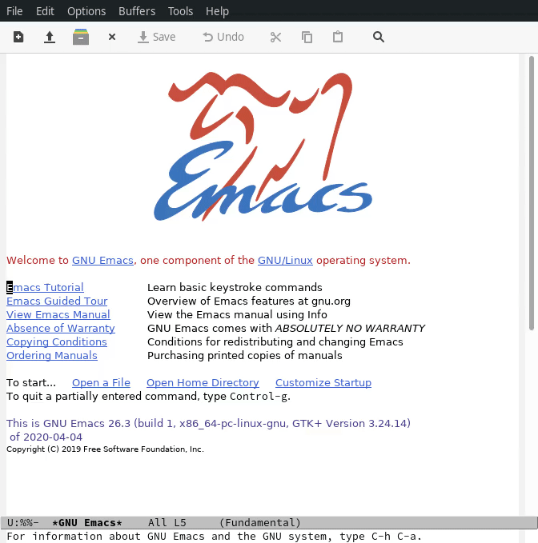

** 便利パッケージのインストール
leaf.elを使うにあたって、相性の良いパッケージがいくつかあります。早速leafを使ってインストールしてみましょう。

- [[https://github.com/conao3/leaf-keywords.el][leaf-keywords]] (インストール済)
  - [[https://github.com/dimitri/el-get][el-get]] (インストール済)
  - [[https://github.com/raxod502/blackout][blackout]] (インストール済)
- [[https://github.com/conao3/leaf-convert.el][leaf-convert]]
- [[https://github.com/conao3/leaf-tree.el][leaf-tree]]
- [[https://github.com/joddie/macrostep][macrostep]]

先程の =;; ここにいっぱい設定を書く= の場所に以下の設定を書きます。

#+begin_src emacs-lisp
(leaf leaf
  :config
  (leaf leaf-convert :ensure t)
  (leaf leaf-tree
    :ensure t
    :custom ((imenu-list-size . 30)
             (imenu-list-position . 'left))))

(leaf macrostep
  :ensure t
  :bind (("C-c e" . macrostep-expand)))
#+end_src

迷子防止のために今回だけinit.elの全文を貼ります。一緒のコードになりましたでしょうか？

#+begin_src emacs-lisp
;;; init.el --- My init.el  -*- lexical-binding: t; -*-

;; Copyright (C) 2020  Naoya Yamashita

;; Author: Naoya Yamashita <conao3@gmail.com>

;; This program is free software: you can redistribute it and/or modify
;; it under the terms of the GNU General Public License as published by
;; the Free Software Foundation, either version 3 of the License, or
;; (at your option) any later version.

;; This program is distributed in the hope that it will be useful,
;; but WITHOUT ANY WARRANTY; without even the implied warranty of
;; MERCHANTABILITY or FITNESS FOR A PARTICULAR PURPOSE.  See the
;; GNU General Public License for more details.

;; You should have received a copy of the GNU General Public License
;; along with this program.  If not, see <http://www.gnu.org/licenses/>.

;;; Commentary:

;; My init.el.

;;; Code:

;; this enables this running method
;;   emacs -q -l ~/.debug.emacs.d/{{pkg}}/init.el
(eval-and-compile
  (when (or load-file-name byte-compile-current-file)
    (setq user-emacs-directory
          (expand-file-name
           (file-name-directory (or load-file-name byte-compile-current-file))))))

(eval-and-compile
  (customize-set-variable
   'package-archives '(("org"   . "https://orgmode.org/elpa/")
                       ("melpa" . "https://melpa.org/packages/")
                       ("gnu"   . "https://elpa.gnu.org/packages/")))
  (package-initialize)
  (unless (package-installed-p 'leaf)
    (package-refresh-contents)
    (package-install 'leaf))

  (leaf leaf-keywords
    :ensure t
    :init
    ;; optional packages if you want to use :hydra, :el-get, :blackout,,,
    (leaf hydra :ensure t)
    (leaf el-get :ensure t)
    (leaf blackout :ensure t)

    :config
    ;; initialize leaf-keywords.el
    (leaf-keywords-init)))

;; ここにいっぱい設定を書く

(leaf leaf
  :config
  (leaf leaf-convert :ensure t)
  (leaf leaf-tree
    :ensure t
    :custom ((imenu-list-size . 30)
             (imenu-list-position . 'left))))

(leaf macrostep
  :ensure t
  :bind (("C-c e" . macrostep-expand)))


(provide 'init)

;; Local Variables:
;; indent-tabs-mode: nil
;; End:

;;; init.el ends here
#+end_src

編集後にはバイトコンパイルを忘れないでください。バイトコンパイルが終わったらEmacsを再起動します。

*** leaf-convert
leaf-convertはプレーンなElispやuse-packageからleafへの変換機能を提供します。目玉機能は2つです。

- =M-x leaf-convert-replace-pop=, =M-x leaf-convert-replace-region=

  選択したS式をleafブロックに変換し、 =M-x leaf-convert-replace-pop= は別バッファーに表示します。 =M-x leaf-convert-replace-region= は変換したleafブロックで置換します。

  leafの第1引数は =prog1= の第1引数に渡すことで指定できます。gifではひとつのS式しか選択していませんが、複数S式を同時に選択して変換することも可能です。

  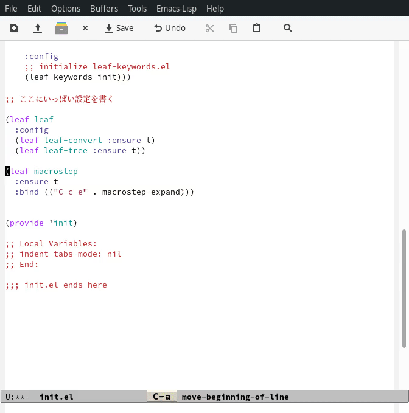

- =M-x leaf-convert-insert-template=

  =package.el= が持っている情報からよさげなleafブロックを生成し、挿入します。ただ、自動生成された =:after= キーワードと引数については削除した方が事故が少ないかもしれません。

  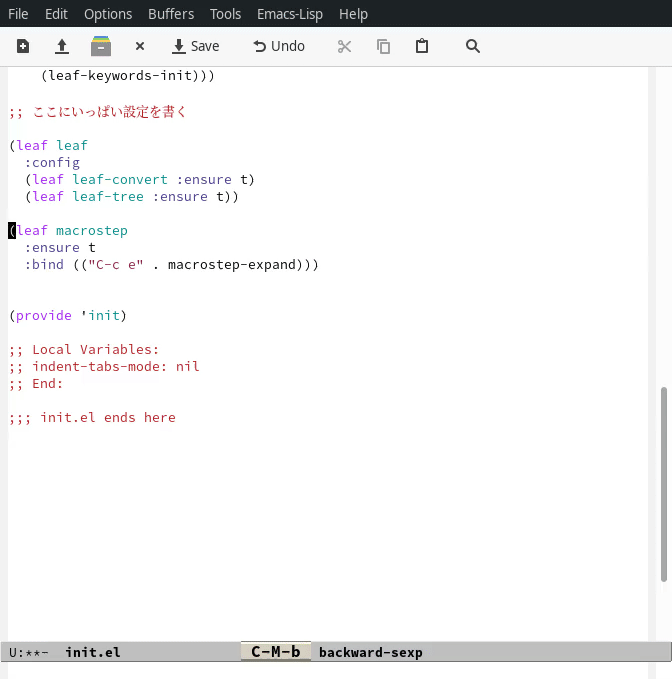

*** leaf-tree
leaf.elで書かれたinit.elを開き、 =M-x leaf-tree-mode= を実行することでクリックできるサイドバーを表示します。サイドバーはリアルタイムに更新され、現在のポインターがあるアイテムがハイライトされます。

サイドバーのアイテムをクリックすると、そのleafブロックにジャンプします。

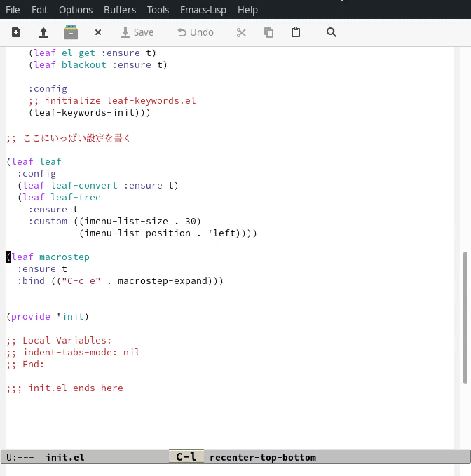

*** macrostep
leafに限らず、マクロを1ステップごとに展開することができます。

標準キーバインディングでは、展開したいS式で =C-c e= すると =macro-step-mode= という特殊なモードになります。バッファは読み取り専用となり、 =n= と =p= でさらに展開するS式を選び、 =e= を押すと展開されます。 =c= を押すと展開を元に巻き戻すことができます。 =C-g= で =macro-step-mode= から抜けることができます。

この =macrostep= による確認はleafで何かうまくいかないときに最初に取る行動です。leafに何を入力したら、どんなS式が生成されるかを意識するのは重要です。

leafは単なるマクロであり、雑多で典型的なS式を自動生成するためのパッケージにすぎないからです。

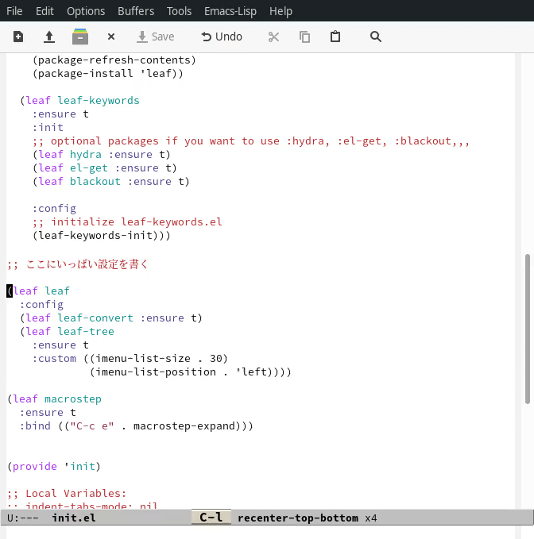

** 実践的なあれこれ
*** 変数の変更について
パッケージで公開されている変数の変更には、全ての場合について =setq= ではなく =custom-set-variables= で設定するべきです。ネットを検索すると以下の記事があり、公開順から「結局、setqを使う方が良い選択だ」となってしまっています。

- [[https://memo.sugyan.com/entry/20120104/1325604433][defcustomで定義された変数はcustom-set-variablesで変更すべき？ - 2012-01-04]]
- [[http://kawamuray.hatenablog.com/entry/2013/11/03/180543][defcustomで定義された変数はsetqではなくcustom-set-variablesで設定すべき理由 - 2013-11-03]]
- [[https://abicky.net/2013/12/30/184239/][custom-set-variables は使わない方が良いかもしれない - 2013-12-30]]

しかし時代は変わりました。「ユーザーが変更できる変数」はほとんどの場合で =defcustom= で宣言され、 =defvar= で宣言されたものは「パッケージの内部変数である」という慣習を多くのパッケージ開発者が守っています。

=require= 前に値をセットしておくことでパッケージの動作が変更されるのは悪い設計であり、そのような設計を現在あえて採用するパッケージはありません。

また、実際には =custom-set-variables= での変更は最終的に =set= を実行するので =defvar= で宣言された変数も問題なく変更できます。

ということで常に =custom-set-variables= を使うべきであり、leafでは =:setq= ではなく、 =:custom= を使うほうが良いということになります。

問題はcustomがinit.elに次のようなダンプを出力する点です。このダンプにより、leafの =:custom= で管理している場合、2箇所を修正する必要が生じます。

#+begin_src emacs-lisp
(custom-set-variables
 ;; custom-set-variables was added by Custom.
 ;; If you edit it by hand, you could mess it up, so be careful.
 ;; Your init file should contain only one such instance.
 ;; If there is more than one, they won't work right.
 '(ag-highligh-search t t)
 '(ag-reuse-buffers t t)
 '(ag-reuse-window t t)
 ;;...
 )
#+end_src

この動作については =custom-file= という変数を変えれば出力先を変更でき、そのファイルを =load= しないことで単に無視することができます。

そのため、次のような設定を書いておくことはleafの全ユーザーに勧められます。

#+begin_src emacs-lisp
(leaf cus-edit
  :doc "tools for customizing Emacs and Lisp packages"
  :tag "builtin" "faces" "help"
  :custom `((custom-file . ,(locate-user-emacs-file "custom.el"))))
#+end_src

なお、動的な値をleafで設定するには上記のようにバッククオートとカンマを使うことによって実現します。

*** パッケージインストーラについて
基本的に =M-x leaf-convert-insert-template= の出力を参考にします。MELPAかELPAに存在するパッケージは自動的に =:ensure t= が展開されます。 =:ensure= はpackage.elを使用してパッケージをインストールする設定です。

存在しないパッケージの場合は、 =:el-get {user}/{repo}= が展開されるので、 *GitHubにある場合* 、 ={user}= を調べて置換するだけで設定が完了します。例えば、point-undoは =emacsmirror/point-undo= にあるので、 =emacsmirror= を追加するだけで大丈夫です。

しかし、 *GitLabにある場合* 、きちんとリストにしてgitのurlを指定する必要があります。これはleafの使い方ではなく、どちらかというとel-getの使い方です。

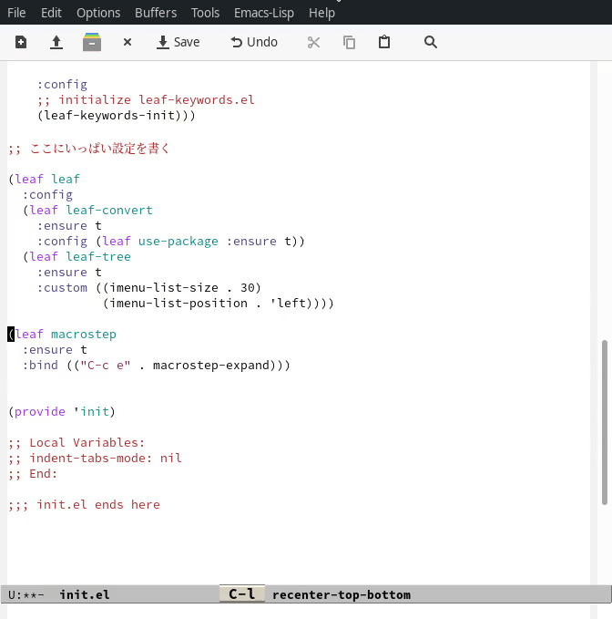

*** とりあえず:config
leafには与えられたS式をそのまま展開するキーワードがあり、 =:preface=, =:init=, =:config= の3種類が用意されています。それぞれ以下の場所に展開されます

- =:preface= は =:if=, =:when=, =:unless= の前
- =:init= は =:if=, =:when=, =:unless= と =:require= の間
- =:config= は =:require= の後

3種類ありますが、基本的には =:config= を使用します。 =:config= のS式はそのまま展開されるので、最初にleafを使う際はとりあえず =:config= に書いておくのは良い方針だと思います。

なお、leaf-convertはleafからleafへの変換も可能なので、変換してみると、よりよいキーワードを使ったleafに変換してくれる可能性もあります。

=:custom= で =nil= を設定する設定の変換結果は、ただのリストになってしまい、手で直す必要がありました。これは難しい問題ですが、将来的に解決したい問題ではあります。

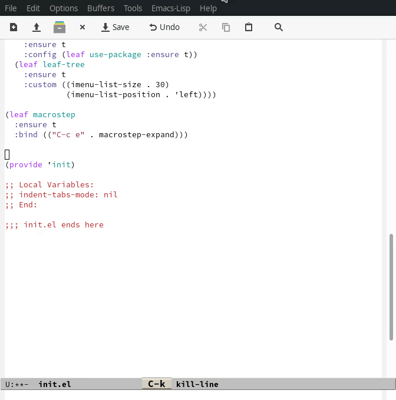

*** leaf-convertについて
leaf-convertを手に入れたおかげで、use-packageの設定例があればleafに変換できるようになりました。例えば [[https://qiita.com/Ladicle/items/feb5f9dce9adf89652cf#%E3%82%B3%E3%83%BC%E3%83%89%E3%81%8C%E8%AA%AD%E3%81%BF%E3%82%84%E3%81%99%E3%81%84%E3%83%86%E3%83%BC%E3%83%9E----doom-emacs-themesdoom-dracula][Emacsモダン化計画 -かわEmacs編- - コードが読みやすいテーマ]] を参考にして、下記のuse-package設定例があるとします。

#+begin_src emacs-lisp
(use-package doom-themes
  :custom
  (doom-themes-enable-italic t)
  (doom-themes-enable-bold t)
  :custom-face
  (doom-modeline-bar ((t (:background "#6272a4"))))
  :config
  (load-theme 'doom-dracula t)
  (doom-themes-neotree-config)
  (doom-themes-org-config))
#+end_src

この場合、コード貼り付け、範囲選択、 =M-x leaf-convert-region-replace= を実行することでleafに変換できます。 =use-package= を一度展開する必要があるので、 =use-package= をインストールする必要があることに注意する必要があります。

ここで注目したいのは、これまでleaf移行で鬼門となっていた =:custom= や =:custom-face= の引数の微妙な違いをleaf-convertに任せることができるようになった点です。

ただ、 =:custom-face= の変換結果の =quote= は見た目を気にすると、手で直す必要があります。これも難しい問題ですが、将来的に解決したいです。

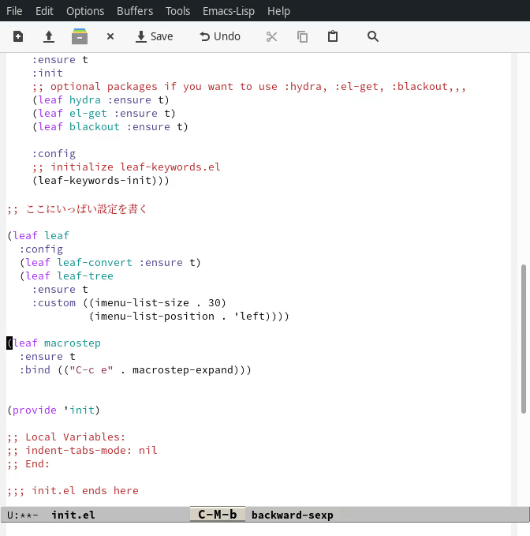

** まとめ
空のinit.elを作るところからleafの入門記事を書きました。leafを使うことによってEmacsのパッケージ設定を簡潔に宣言的に行うことができ、init.elの簡略化を実現できます。

また高速化についてはあまり意識していなかったのですが、実際のところleafに移行したことで高速化したことが複数人から報告があります。

-

  #+begin_quote
  use-package.elからleaf.elに移行したらEmacsの起動時間が半分になった。移行時に多少のリファクタを含むから、単純な移行による改善ではないけれでも。しかし、こんな早くなるか？？？はて

  — よんた (@keita44_f4) [[https://twitter.com/keita44_f4/status/1197064768999153666?ref_src=twsrc%5Etfw][November 20, 2019]]
  #+end_quote

  - [[https://qiita.com/keita44_f4/items/5cb5cfb78edd4244fa8b#%E8%89%AF%E3%81%8B%E3%81%A3%E3%81%9F-2][use-package.elからleaf.elに移行した]]

    #+begin_quote
    - 移行しただけでEmacsの起動時間が半分になった
      - use-package.elでは:defer tで遅延読み込みの指定がいるが、 leaf.elではデフォルトで遅延読み込みなのも効いていそう
      - use-package.elは起動時間の統計をとるなどリッチな機能を持っており、 そもそも遅いのも効いていそう
      - 詳細な原因調査はしていない
      - な に も し て な い の に Emacs が は や く な り ま し た
    #+end_quote

- [[https://www.ncaq.net/2020/03/16/18/57/27/#%E8%B5%B7%E5%8B%95%E3%81%8C%E6%97%A9%E3%81%8F%E3%81%AA%E3%81%A3%E3%81%9F%E6%B0%97%E3%81%8C%E3%81%97%E3%81%BE%E3%81%99][私の.emacs.dをelpaをgit管理下に入れる気の狂った管理方法からleafに移行させました]]

  #+begin_quote
  起動が早くなった気がします
  init-loaderをやめたからなのかわかりませんが,何故か起動が早くなった気がします.
  #+end_quote

参考として私のinit.elを読み込んだ場合、223パッケージ(elpaディレクトリには =archive= と =gnupg= ディレクトリがあるのを忘れていた)インストールされたEmacsを4.2秒で起動できています。 HDDの環境なので、測定には悪条件ですが5秒未満なら十分に耐えられます。

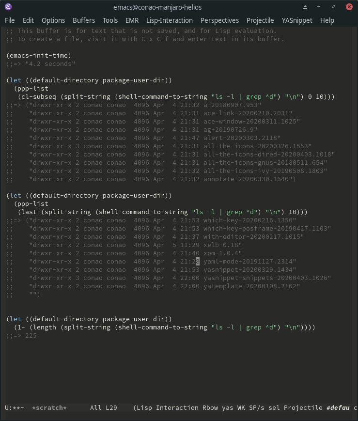

これはleafが =prog1= に展開されて、use-packageのように =require= を標準では展開しないからだと思われます。

use-packageが作られた当時はきちんとautoloadをパッケージ開発者が書いていなかったので =require= に展開することが求められていましたが、現代では善いパッケージ作法が広く知られているので問題はありません。

--------------

最後にpatreonの宣伝をします。

私はleaf.elやleaf-keywords、leaf-tree、leaf-convertといったleaf関連のEmacsパッケージ、他にもseml-modeやpppといったEmacsパッケージを書いています。作成した全てのパッケージと管理を手伝っているパッケージとリンクについては[[https://www.emacswiki.org/emacs/Conao3][Emacswikiのページ]]、アクティビティに関しては[[https://github.com/conao3][GitHubのユーザーページ]]を参照して頂ければと思います。


支援を頂くことで、これまでよりも気軽にオライリーの本をポチることができ、バイトの時間を減らしコーディングの時間を増やすことができます。

また、去年から先週までpatreonになることのメリットが全くなかった;;のですが、さすがに申し訳なくなってしまったので、これまでGitHubの[[https://github.com/conao3/dotfiles][conao3/dotfiles]]で公開していたdotfilesをプライベートに設定し、patreon限定でダウンロードできるようにしました。

ぜひ下記URLからご支援いただければと思います。よろしくお願いします!

[[https://www.patreon.com/conao3]]

** Footnotes
[fn:1] : 実際に[[https://qiita.com/zonkyy/items/c090d0733ec6ccab4724][鬼軍曹.elというパッケージがあり]]、インストールすることで軍曹の指導を受けることができる。

[fn:2] : leafのインストールコードには書いてませんが、別途 =user-emacs-directory= の設定を加えました。理由はコメントのような起動方法ができるからです。参考ブログ: [[http://peccu.hatenablog.com/entry/20130218/trial_init][Emacsでお試しinit.elの指針 - peccu.hatenablog]]

* Netlify + Hugo + ox-hugoでブログを始める第一歩
:properties:
:export_file_name: generated/contents/blog/2020/0a23fb
:export_date: 2020-05-05
:end:

** Intro
HTMLジェネレータの[[https://github.com/conao3/seml-mode.el][seml-mode.el]]とOrg->HTMLジェネレータ拡張の[[https://github.com/conao3/orglyth.el][orglyth.el]]を作っていて、自分のブログくらいはそれらを使って構築しようと思っていました。

しかし結局落ち着かないまま1年が経過し、[[https://github.com/conao3/leaf.el][leaf.el]]のドキュメントや、専門分野のまとめなどネットで公開したいものだけ溜まっていました。

[[https://conao3.com][conao3.com]]のドメインも2017年から持っていますが、3年もの間まともなコンテンツは提供されませんでした。

ここらへんで諦めてさっさとHugoとNetlifyで公開してしまえということで、きちんと整備されたツールを使わせてもらい、この度ようやく[[https://conao3.com][conao3.com]]でまともなコンテンツを提供できるようになりました。

** Netlify
よい情報で溢れているので省略します。

NetlifyはDNSも提供しているようなので、「さくらのドメイン」で取得したconao3.comをNetlify DNSで解決させるようにしました。

また、デフォルトでは古いHugoが動いているようなので、「Build & Deploy」->「Environment」->「Environment variables」で「HUGO_VERSION」をローカルのバージョンで設定します。
私の場合「0.69.2」でした。

** Hugo
*** Hugoのインストール
[[https://gohugo.io/getting-started/installing/][Install Hugo]]を参考にHugoをインストールします。

記載がありませんが、Archの場合はpacmanで簡単に入ります。([[https://www.archlinux.jp/packages/community/x86_64/hugo/][Archlinux - Package]])

#+begin_src shell
  # pacman -S hugo
  $ hugo version
  Hugo Static Site Generator v0.69.2/extended linux/amd64 BuildDate: unknown
#+end_src

*** ブログテンプレートの展開
[[https://gohugo.io/getting-started/quick-start/][Quick Start]]を参考にテンプレートを展開します。

私はローカルのレポジトリ置き場は =~/dev/repos= にしています。

#+begin_src shell
  $ cd ~/dev/repos
  $ hugo new site netlify-src
#+end_src

以下、 =netlify-src= はhugoサイトのルートディレクトリということにします。

*** ブログテーマの適用
[[https://themes.gohugo.io/][Hugo themes]]からいい感じのテーマを探し、submoduleでレポジトリに持ちます。

テーマはローカルで簡単にカスタマイズできる仕組みがあるので、多少気に入らないところがあっても大丈夫です。

#+begin_src shell
  $ cd quickstart
  $ git init
  $ git submodule add https://github.com/lxndrblz/anatole.git themes/anatole
#+end_src

テーマごとにカスタマイズする方法が違うので、テーマのREADMEを読んで設定をして下さい。

なお、私は当時ローカルで簡単にカスタマイズできる機構を知らず、forkでカスタマイズするしかないと思っていたので、「[[https://zwbetz.com/make-a-hugo-blog-from-scratch/][Make a Hugo blog from scratch]]」を参考に0からテーマを作りました。

私が作ったテーマは[[https://github.com/conao3/anatole-ext][conao3/anatole-ext]]で公開しています。

*** サンプル記事の追加
サンプルの記事を追加します。

テーマが =exampleSite= というフォルダを持っている場合は、それらのファイルを =netlify-src/= にコピーするだけでいいです。

コマンドでテンプレートを作成するには次のコマンドを実行します。
実行後、 =content/blog/my-first-post.md= が作成されているので、よしなに編集します。

#+begin_src shell
  $ hugo new blog/my-first-post.md
#+end_src

*** ローカルサーバーの起動
Hugoは簡単にローカルサーバーを起動でき、さらに依存ファイルが変更されたときに自動でブラウザにリロードさせることができます。

#+begin_src shell
  $ hugo server -D
#+end_src

サーバーを起動すると =localhost:1333= で配信されます。

*** 静的サイトのビルド
サイト全体のビルドは下記で行います。

Netlifyで公開するならローカルでビルドする必要はないのですが、最終的にどんなツリーになっているかを確認することができます。

#+begin_src shell
  $ hugo
#+end_src

** ox-hugo
*** ox-hugoのインストールと設定
[[https://github.com/kaushalmodi/ox-hugo][ox-hugo]]をインストールし、適宜設定を行ないます。

「[[https://pxaka.tokyo/blog/categories/hugo/][hugo | IMADENALE]]」を参考に無難な構成を考えましたが、もっといい方法がある気がします。
とりあえず私は下記の設定と方針でしばらくやってみます。

#+begin_src emacs-lisp
  (leaf ox-hugo
    :doc "Hugo Markdown Back-End for Org Export Engine"
    :req "emacs-24.4" "org-9.0"
    :tag "docs" "markdown" "org" "emacs>=24.4"
    :added "2020-05-05"
    :url "https://ox-hugo.scripter.co"
    :emacs>= 24.4
    :ensure t
    :after ox
    :custom ((org-hugo-front-matter-format . "yaml")))
#+end_src

*** orgファイル管理の方針
ox-hugo用のorgファイルは =netlify-src/org/{{user}}.org= に持つことにしました。

#+begin_src org
  ,#+title: Hugo blog source
  ,#+author: conao3
  ,#+date: <2020-05-05 Tue>
  ,#+options: ^:{}

  ,#+hugo_base_dir: ../
  ,#+hugo_section: blog

  ,#+link: files file+sys:../static/files/

  ,* blog
  :PROPERTIES:
  :EXPORT_HUGO_SECTION: blog
  :END:

  ,** DONE test                                                      :meta:hugo:
  CLOSED: [2020-05-05 Tue 19:21]
  :PROPERTIES:
  :EXPORT_FILE_NAME: test
  :EXPORT_DATE: 2020-05-05T00:00:00+09:00
  :EXPORT_HUGO_LASTMOD: [2020-05-05 Tue 16:20]
  :END:

  testestest.
#+end_src

もし将来的にこのorgファイルが超巨大なファイル(1万行~)になれば、適宜 =netlify-src/org/archive-{{user}}-{{num}}.org= に移すことにします。

レベル1は[[https://gohugo.io/content-management/sections/][セクション]]の分類に使い、レベル2のheadingから記事のツリーと解釈されます。

*** 静的ファイル管理の方針
filesのlinkは「[[https://pxaka.tokyo/blog/2018/a-test-of-images/][画像の埋め込みテスト | imadenale]]」を参考にしました。

スクリーンショットやPDFは =netlify-src/static/files= 以下に持つことにします。

=netlify-src/static= はレポジトリ肥大化を避けて[[https://github.com/conao3/netlify-src][conao3/netlify-src]]から[[https://github.com/conao3/netlify-src-blob][conao3/netlify-src-blob]]に切り出し、submoduleで持つことにします。

参考記事ではfilesのリンクをURLで設定していましたが、「[[https://qiita.com/takaxp/items/96629bbcc4a9403f0213][Org Modeのリンク機能で情報集約 | Qiita]]」を参考に =file+sys:= 指定を使うとorgの画像インライン表示もできますし、きちんとox-hugoによってリンクが修正され、正しいマークダウンが出力されました。

- Input
  #+begin_src org
    ,#+link: files file+sys:../static/files/

    ,#+attr_html: :width 128px
    [[files:logo.jpg]]
  #+end_src

- Output
  #+begin_src markdown
    
  #+end_src

- Rendering
  #+attr_html: :width 128px
  [[./resources/public/img/0a23fb-logo.jpg]]

** Deploy
NetlifyのデプロイはGitHubにpushするだけです!

Hugoのビルドはとても早く、pushしてNetlifyのログを見に行くともう終わっています。

ビルドできたら個人Slackに通知飛ばしたりするのをまた今度やりたいと思っています。

** Conclusion
Netlify + Hugo + ox-hugoで快適なブログ執筆環境を整えることができました!

ようやく情報発信する環境が整ったので、どんどん情報を発信していきたいと思います。

まずは見やすいleaf.elのドキュメントを書きます!

また、執筆現在は[[https://github.com/conao3/netlify-src][conao3/netlify-src]]と[[https://github.com/conao3/netlify-src-blob][conao3/netlify-src-blob]]をパブリックレポジトリとしていますが、後でプライベートレポジトリに変更し、[[https://www.patreon.com/conao3][Patreon]]の特典にします。

本来公開するものを非公開にすることでしか価値を付けられないことをお許しください。

ぜひ[[https://www.patreon.com/conao3][Patreon]]で私の活動のサポートをして頂けるとうれしいです!

* 個人ブログのパーマリンクに関する最適戦略について
:properties:
:export_file_name: generated/contents/blog/2020/0bc44c
:export_date: 2020-05-06
:end:

** Intro
Webで情報を公開するにあたって、パーマリンクの設計は将来に渡って重要なものです。

このブログは人生において3つめのブログであり、これまでの2つのブログは勝手にアーカイブしてネットから消してしまいました。

しかしこのブログは今のところ死ぬまで付き合うつもりであり、それが出来るようにコンテンツの少ない今、設計する必要があります。

ブログ管理の裏側については「[[https://s.conao3.com/blog/2020/0a23fb][Netlify + Hugo + ox-hugoでブログを始める第一歩]]」に書きましたが、パーマリンクの設計は表側の設計であり、ブログの人生の中で途中で変えることは許されていません。

もし無理矢理変えれば、これまでシェアしてもらったURLの意味は失くなり、404ページに多くの読者を案内してしまうことになります。

さて、このブログではどのようにパーマリンクを設計すると良いのでしょうか。

** 調査
パーマリンクの設計といっても選択肢は多くありません。

そもそも使える情報が =タイトル= と =公開日時= と =連番= くらいしかないので、代表的なものは以下のような形式か、その組み合わせです。

- ={{base-url}}= / ={{title}}= /
- ={{base-url}}= / ={{short-title}}= /
- ={{base-url}}= / ={{category}}= / ={{short-title}}= /
- ={{base-url}}= / ={{num}}= /
- ={{base-url}}= / ={{year}}= / ={{month}}= / ={{day}}= /

={{title}}= はそのまま記事のタイトルを使う方法です。
日本語のタイトルはそのままURLエンコードされ、URLになるパターンです。

={{short-title}}= はSEOに強い、記事ごとにつけられた短いタイトルを使う方法です。
あえて日本語を使う理由もなく、普通は英数字のみで長くても30文字くらいでまとめます。

={{category}}= は記事ごとに設定されたカテゴリーを使う方法です。

={{num}}= はサイトごとにカウンタを持っておいて、その連番をURLに使用する方法です。

={{year}}=, ={{month}}=, ={{day}}= は記事の公開日です。

** 評価
さて、これらの方法のなかで、どれがよいのでしょうか。

大きく分けると2つの分類ができ、記事ごとに新たに考える方法と自動で生成する方法です。

- 記事ごとに新たに考える方法
  - ={{short-title}}=
    - メリット
      - SEOやURLシェアの観点から最高の選択肢
    - デメリット
      - 記事ごとに短いタイトルを英語でつけなおさなければならない
      - 記事を少ない英単語で表現するのは一般的に難しく、長くなってしまう場合もある
      - 少ない英単語で命名するため、URL衝突を考慮する必要がある
      - もし、Emacsと命名した記事より、もっと適切な記事を書いた場合にその名前はもう使えない
  - ={{category}}=
    - メリット
      - URLから得られる情報がある
      - カテゴリー名は記事名に比べて、ずっと少ないので、命名はあまり苦でない
    - デメリット
      - [[https://ja.wikipedia.org/wiki/%E3%81%93%E3%81%86%E3%82%82%E3%82%8A%E5%95%8F%E9%A1%8C][こうもり問題]]の発生 (カテゴリ管理の問題点)

- 自動で生成する方法
  - ={{title}}=
    - メリット
      - 記事ごとに考えなくてよい
    - デメリット
      - 日本語のタイトルをつけるとURLが長大になる
  - ={{num}}=
    - メリット
      - 記事ごとに考えなくてよい
      - キリ番記事が作りやすい (100記事達成記事など)
    - デメリット
      - 記事を後から非公開にすると、欠番が生じる
      - URLから得られる情報が少ない
  - ={{year}}=, ={{month}}=, ={{day}}=
    - メリット
      - 記事ごとに考えなくてよい
      - URLを見れば公開日が分かる (技術系記事において新しい記事は重要)
    - デメリット
      - URLから得られる情報が少ない

というところでしょうか。
それぞれにメリットとデメリットがあるので、それを評価した後は好みの問題となります。

** 決定
前段の評価に基づいて、私はこのブログのパーマリンクを以下のように設計しました。

- ={{base-url}}= / blog / ={{year}}= / ={{random}}=

まず、私はとてもものぐさなので、記事ごとにショートタイトルを与える方法は難しいです。
いくらSEOやURLシェアの観点から最良の選択だと言っても、記事を書くモチベーションを失っては元も子もありません。

タイトルをそのまま付ける方法は、記事ごとに自動で決定できるので魅力的ですがきびしいです。各見出しの =id= は日本語をURLエンコードしたものをしかたなく使うとして、2つの要素をURLエンコードすると簡単に256文字を超えます。もちろん現代ではURLの長さに制限はないですが、限度はあると思います。

カテゴリー管理も同じような階層が現われ、破綻することが目に見えています。
実は前回のブログはそれで破綻したのです。 =/emacs/= と =/blog/emacs/=, =blog/advent/emacs/= などが乱立し、新たな記事をどの階層に作ればよいのか混乱する要因になりました。


連番を付ける方法も魅力的ですが、欠番が発生することに耐えられません。これは気分の問題です。

日付を使用する方法はとても良いと思います。
URLから得られる情報もありますし、後述するランダム値の衝突について「永遠」を考えなくてすみます。

ここまで、日付を使うことが決まり、タイトルもだめ、ショートタイトルもだめ、連番もだめといろいろな物を拒否した結果、一意性を確保するものとして使えるものはランダム値しかありません。

** まとめ
使用するパーマリンクを設計することができました。
しかし、 ={{random}}= はどれだけのビット数を使い、どのようなフォーマットを使うべきでしょうか。

その考察は次の記事「[[https://s.conao3.com/blog/2020/9383f3][誕生日のパラドックスから考察する、個人ブログURLに必要なランダムビット数]]」に譲るとして、この記事ではパーマリンク設計について大きな決定ができたので、とても満足しています。

なお、例外的に ={{base-url}}= / emacs / ={{package-name}}= というURLを使おうと思っています。
これはるびきちさんの[[http://emacs.rubikitch.com/#outline-container-9b95cd58a36fa4354dfb22f76d9b2460][パーマリンク設計]]を踏襲しています。
るびきちさんと同じようにEmacsのパッケージ紹介記事ではこのURLを使用しようと思います。

* ox-hugo用のorg-captureテンプレートについて
:properties:
:export_file_name: generated/contents/blog/2020/e6234e
:export_date: 2020-05-07
:end:

** Intro
下記のブログの記事で考えて、ようやく記事を新規作成するために必要な情報が整いました。

- 「[[https://s.conao3.com/blog/2020/0a23fb][Netlify + Hugo + ox-hugoでブログを始める第一歩]]」
- 「[[https://s.conao3.com/blog/2020/0bc44c][個人ブログのパーマリンクに関する最適戦略について]]」
- 「[[https://s.conao3.com/blog/2020/9383f3][誕生日のパラドックスから考察する、個人ブログURLに必要なランダムビット数]]」

org-captureはいつも設定しておきながら、設定したことを忘れているのですが、ox-hugoを使うにあたってきちんと入門したいと思います。

** org-capture
[[https://orgmode.org/org.html#Capture-and-Attachments-1][org-capture]]はEmacsのどこにいてもorgでメモを取るためのフロントエンドです。

org-captureのユーザーはたくさんおり、設定例も溢れていますが、
「自分でグローバルバインドを設定しなければならない」という点が性に合わず、結局使わずじまいでした。

少し本題からずれますが、そもそも =C-c= につづくアルファベット、修飾キー付きのアルファベット、プレフィックスを自由に設定できるとして、覚えられる気がしません。

私のglobal-mapは[[https://github.com/conao3/transient-dwim.el][transient-dwim]]だけを設定しており、他のバインドはマイナーモード、メジャーモードのキーマップのみです。
transient-dwimは[[https://github.com/magit/transient][transient]]を利用したキーバインド管理パッケージです。

transient-dwimを =M-== に設定している場合、org-captureは =M-== =M-o M-o= で起動できます。

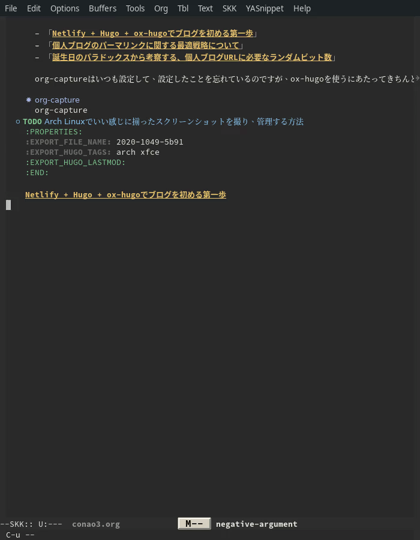

** ox-hugoの設定
「[[https://pxaka.tokyo/blog/2018/44febe88-04a5-9bc4-6bfb-678a8477a0ed/][ファイル名をUUIDで自動生成するテスト - IMADENELE]]」と「[[https://pxaka.tokyo/blog/2018/58e5bcee-1fb9-48a4-628b-a80692983bfe/][最終変更日の手動設定 - IMADENELE]]」を参考にテンプレートを調整しました。

#+begin_src emacs-lisp
  (leaf ox-hugo
    :doc "Hugo Markdown Back-End for Org Export Engine"
    :req "emacs-24.4" "org-9.0"
    :tag "docs" "markdown" "org" "emacs>=24.4"
    :added "2020-05-05"
    :url "https://ox-hugo.scripter.co"
    :emacs>= 24.4
    :ensure t
    :after org
    :require t
    :defun (org-set-property)
    :custom ((org-hugo-front-matter-format . "yaml"))
    :config
    (defun c/ox-hugo-add-lastmod nil
      "Add `lastmod' property with the current time."
      (interactive)
      (org-set-property "EXPORT_HUGO_LASTMOD"
                        (format-time-string "[%Y-%m-%d %a %H:%M]")))

    (leaf *ox-hugo--capture
      :require org-capture
      :defvar (org-capture-templates)
      :config
      (add-to-list 'org-capture-templates
                   '("b" "Create new blog post" entry
                     (file+headline "~/dev/repos/netlify-src/org/conao3.org" "blog")
                     "** TODO %?
  :PROPERTIES:
  :EXPORT_FILE_NAME: %(apply #'format \"%s-%s-%s\"
          (format-time-string \"%Y\")
          (let ((sha1 (sha1 (shell-command-to-string \"head -c 1k /dev/urandom\"))))
            (cl-loop for (a b c d) on (cdr (split-string sha1 \"\")) by #'cddddr repeat 2 collect (concat a b c d))))
  :EXPORT_HUGO_TAGS:
  :EXPORT_HUGO_LASTMOD:
  :END:
  "))
      (add-to-list 'org-capture-templates
                   '("p" "Create new package post" entry
                     (file+headline "~/dev/repos/netlify-src/org/conao3.org" "emacs")
                     "** TODO %?
  :PROPERTIES:
  :EXPORT_FILE_NAME:
  :EXPORT_HUGO_TAGS: emacs
  :EXPORT_HUGO_LASTMOD:
  :END:
  "))))
#+end_src

=p= はパッケージの紹介用で =emacs= ツリー以下に展開されます。

=b= は簡単なブログ用で =:EXPORT_FILE_NAME= は「[[https://s.conao3.com/blog/2020/9383f3][誕生日のパラドックスから考察する、個人ブログURLに必要なランダムビット数]]」をもとに8桁の16進数を使って自動生成します。

8桁の16進数は =/dev/urandom= から1KB読んで、それのsha1の先頭8桁のみを取ることにしました。
この乱数は衝突するときわめて面倒なことになるので、できるだけ均質なランダム値を得る必要があります。
この仕組みを作った後は衝突しないことをもう祈るしかない。。(もし衝突すると単に新しい記事で古い記事が上書きされて、特に警告は出ない。。)

** まとめ
org-captureの設定をすることによってブログ記事を書くハードルがとても下がりました。

これから情報発信に努めていきたいと思います!

* 誕生日のパラドックスから考察する、個人ブログURLに必要なランダムビット数
:properties:
:export_file_name: generated/contents/blog/2020/9383f3
:export_date: 2020-05-07
:end:

** tl;dr
- ブログのURLにランダム値を使うとして、必要なビット数は何桁だろうか
- ハッシュ衝突の問題は「誕生日のパラドックス」と同じ状況設定
- 数学的な裏付けの元で、ランダムビットを28桁確保すれば十分

** Intro
「[[https://s.conao3.com/blog/2020/0bc44c][個人ブログのパーマリンクに関する最適戦略について]]」において、

- ={{base-url}}= / blog / ={{year}}= / ={{random}}=

というURLをこのブログに使うことに決めました。しかし、 ={{random}}= はどれだけのビット数を使い、どのようなフォーマットを使うべきでしょうか。

幸い、 ={{year}}= を入れているので、「永遠」を考える必要はありません。
せいぜい「1年」でどれだけの記事を書くのかを見積れば良いことになります。

毎日、1記事を書いたとして $365$ 記事、多めに見積もって $400$ 記事とします。
さらに毎日、 $5$ 記事書くことを上限と仮定すると $5 \times 400 = 2000$ 記事となり、せいぜい $2000$ 記事がある場合に必要なランダムビット数を求めたいと思います。

** 誕生日のパラドックス
「[[https://ja.wikipedia.org/wiki/%E8%AA%95%E7%94%9F%E6%97%A5%E3%81%AE%E3%83%91%E3%83%A9%E3%83%89%E3%83%83%E3%82%AF%E3%82%B9][誕生日のパラドックス - Wikipedia]]」より、
#+begin_quote
誕生日のパラドックス（たんじょうびのパラドックス、英: birthday paradox）とは「何人集まれば、その中に誕生日が同一の2人（以上）がいる確率が、50%を超えるか?」という問題から生じるパラドックスである。鳩の巣原理より、366人（閏日も考えるなら367人）集まれば確率は100%となるが、しかしその5分の1に満たない70人しか集まらなくても確率は99.9%を超え、50%を超えるのに必要なのはわずか23人である。

誕生日のパラドックスは論理的な矛盾に基づいているという意味でのパラドックスではなく、結果が一般的な直感と反しているという意味でのパラドックスである。
#+end_quote

Wikipediaでも計算してありますが、ここでも計算しておきます。

きちんと問題として整理すると以下のようになります。

#+begin_quote
Aさんを含め、n人がいる。一年を365日とし、誕生日は全ての日で等確率とする。

1. Aさんと同じ誕生日の人が存在する確率 $P_1$
2. 同じ誕生日の人が存在する確率 $P_2$
3. $P_1$ と $P_2$ が $50$ %を超えるのにそれぞれ必要な人数 $n_\text{min1}$, $n_\text{min2}$
#+end_quote

1. Aさんと同じ誕生日の人が存在する確率 $P_1$

   余事象で求める。

   Aさん以外の人は $\frac{364}{365}$ の確率でAさんの誕生日と衝突しない。
   Aさん以外の人は $n-1$ 人存在するので、

   $$ P_1 = 1 - \qty(\frac{364}{365})^{n-1} $$

2. 同じ誕生日の人が存在する確率 $P_2$

   余事象で求める。

   n人の誕生日が異なる確率は
   $$ \frac{364}{365}\cdot\frac{363}{365}\cdot\frac{362}{365}\cdots\frac{365-(n-1)}{365} = \frac{{}_{364}\mathrm{P}_{n-1}}{365^{n-1}} = \frac{{}_{365}\mathrm{P}_n}{365^n}$$

   よって
   $$ P_2 = 1 - \frac{{}_{365}\mathrm{P}_n}{365^n} $$

3. $P_1$ と $P_2$ が $50$ %を超えるのにそれぞれ必要な人数 $n_\text{min1}$, $n_\text{min2}$

   $n_\text{min1}$ については計算できる。

   \begin{aligned}
     P_1 = 1 - \qty(\frac{364}{365})^{n-1} &> 0.5 \\
     0.5 &> \qty(\frac{364}{365})^{n-1} \\
     \log_2(0.5) &> (n-1)\log_2\qty(\frac{364}{365}) \\
     -1 &> (n-1)(-0.003958) \\
     253.65 &< n
   \end{aligned}

   よって $n_\text{min1}=254$ となる。

   $n_\text{min2}$ については面倒なので、Pythonを用いて図示する。

   #+begin_src python
     import matplotlib.pyplot as plt
     import numpy as np

     memo = np.full(400, -1.0)
     def NPn (n):
         """
         余事象の確率
         n人の誕生日が異なる確率
         """
         if n == 0 or n == 1:
             memo[0] = 1
             return memo[0]
         elif n >= 366:
             return 1;
         elif memo[n] != -1:
             return memo[n]
         else:
             p = NPn(n-1) * ((365-(n-1))/365.0)
             memo[n] = p
             return memo[n]

     def Pn (n):
         """
         n人のうち、2人以上誕生日が同じ確率
         """
         return 1 - NPn(n)

     n = 70
     with plt.style.context(('science-transparent')):
         y = [Pn(i) for i in range(n)]
         plt.plot(y)

         plt.xlabel('n')
         plt.ylabel('P_n')

         plt.axhline(0.5, color='C1')
         n_min2 = np.searchsorted(y, 0.5)
         plt.annotate('({}, {:.2f})'.format(n_min2, y[n_min2]),
                      (n_min2, y[n_min2]), (n_min2-15, 0.8),
                      arrowprops = dict(arrowstyle='-|>', mutation_scale=20))

         plt.show()
   #+end_src

   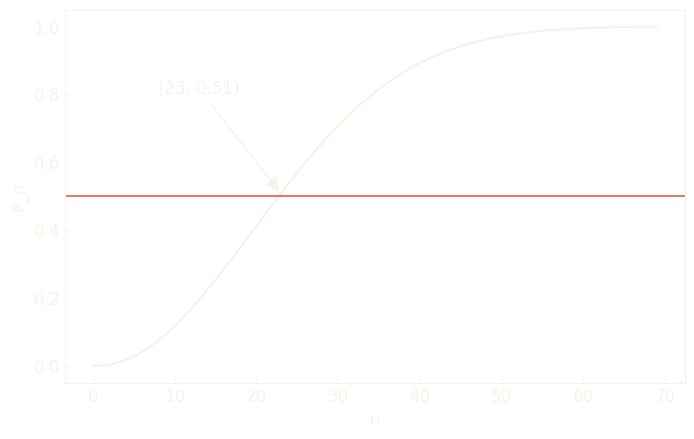

   グラフから、 $n_\text{min2} = 23$ 。

上記のとおり $n_\text{min1} = 254$, $n_\text{min2} = 23$ となり $P_\text{min2}$ は直感よりも少ないように思います。

直感との乖離の理由は「自分と同じ誕生日の人が存在する確率」と「同じ誕生日の組が存在する確率」を混同してしまうからです。

** ランダム値の衝突
今回問題にしているようなランダム値の衝突については、
「あるひとつのランダム値が衝突する事象」ではなく、「どれでもいいのでランダム値が衝突する事象」を考える必要があるので、
まさに誕生日のパラドックスと同じ状況設定となります。

誕生日のパラドックスでは365個の集合でしたが、今回は変数 $N$ とします。

前段の $P_2$ を参考に、 $N$ 個の集合から $n$ 個ランダム値を取ってきたときに、同じ値が存在する確率 $p$ は次の形となります。

\begin{aligned}
  p &= 1 - \frac{N-1}{N}\cdot\frac{N-2}{N}\cdot\frac{N-3}{N}\cdots\frac{N-(n-1)}{N} \\
    &= 1 - \qty(\qty(1-\frac{1}{N})\qty(1-\frac{2}{N})\qty(1-\frac{3}{N})\qty(1-\frac{n-1}{N})) \\
    &= 1 - \prod_{m=1}^{n-1}\qty(1-\frac{m}{N})
\end{aligned}

ここで、ネイピア数のテイラー展開は次の形です。 $x$ が十分小さいときは1次までの近似が使えます。

\begin{aligned}
  e^{-ax} &= 1 - ax + a^2\frac{x^2}{2!} - a^3\frac{x^3}{3!} + a^4\frac{x^4}{4!} + \cdots \\
         &\approx 1 - ax
\end{aligned}

$N$ はランダム値の全体総数なので、 $\frac{i}{N}$ は十分小さく、ネイピア数のテイラー展開から近似を使えます。

\begin{aligned}
  p = 1 - \prod_{m=1}^{n-1}\qty(1-\frac{1}{N}m) &\approx 1 - \prod_{m=1}^{n-1}\exp\qty(-\frac{1}{N}m) \\
   &= 1 - \exp\qty(\sum_{m=1}^{n-1}\qty(-\frac{m}{N})) \\
   &= 1 - \exp\qty(-\frac{1}{N}\sum_{m=1}^{n-1}m) \\
   &= 1 - \exp\qty(-\frac{n(n-1)}{2N})
\end{aligned}

さらに $n$ について変形します。途中、 $n$ が十分大きいことから、定数の減算を無視しました。

\begin{aligned}
  \exp\qty(-\frac{n(n-1)}{2N}) &= 1-p \\
  -\frac{n(n-1)}{2N} &= \ln(1-p) \\
  n(n-1) &= -2N\ln(1-p) \\
  n^2 &\approx 2N\ln\qty(\frac{1}{1-p}) \\
  n &= \sqrt{2N\ln\qty(\frac{1}{1-p})}
\end{aligned}

** 数値計算
*** Nが与えられている場合
ランダム値の大きさ($N$)が与えられている場合、何個ランダム値を取り出したら($n$)衝突するでしょうか。
なお $p=0.5$ とします。

\begin{aligned}
  n = \sqrt{2N\ln\qty(\frac{1}{1-0.5})} &= \sqrt{2N\ln2} \\
   &\approx 1.1774\sqrt{N} \\
   &\approx \sqrt{N}
\end{aligned}

最後の近似はオーダーを見積もるためにとても雑な近似を行いました。

もしランダムビットが *64bit* の場合、ランダム値の集合は $2^{64}$ となり、
$2^{32} = (42.9\text{億})$ 個([[https://www.wolframalpha.com/input/?i=2%5E%2832%29][WolframAlpha]])のランダム値を生成したら、確率 $0.5$ で衝突することになります。

*** Nを求めたい場合
逆に今回私は試行回数、1年 $2000$ 記事($n=2000$)からランダム値の大きさ($N$)を求めたいと思っています。
なお、ランダム値の大きさ $N$ はビット数 $b$ を用いて $N=2^b$ と書けます。

衝突する確率 $p$ は $1$ %と仮定します。

\begin{aligned}
  n &= \sqrt{2N\ln\left(\frac{1}{1-0.01}\right)} \\
  2000 &= \sqrt{2N\ln\left(\frac{1}{0.99}\right)} \\
  2000^2 &= 2N \cdot 0.0100 \\
  N = 2^b &= 1000 \cdot 2000 \cdot 100 \\
  b &= 27.5
\end{aligned}

以上、ランダムビット数は28桁あれば十分ということになります。

16進数の表記を使えば1文字で4ビットの自由度があるので、結局、8文字あれば十分ということが分かりました。

** まとめ
誕生日のパラドックスを導入としてランダム値の衝突問題(ハッシュ衝突問題)について考えました。

長々書いてきましたが、数学的な裏付けのもとで必要なランダムビット数が分かり、パーマリンクのフォーマットを決めることができました。

次の記事「[[https://s.conao3.com/blog/2020/e6234e][ox-hugo用のorg-captureテンプレートについて]]」ではこのフォーマットを実現するためのox-hugoの運用について書きたいと思います。

** 参考
- [[https://ja.wikipedia.org/wiki/%E8%AA%95%E7%94%9F%E6%97%A5%E3%81%AE%E3%83%91%E3%83%A9%E3%83%89%E3%83%83%E3%82%AF%E3%82%B9][誕生日のパラドックス - Wikipedia]]
- [[https://ja.wikipedia.org/wiki/%E8%AA%95%E7%94%9F%E6%97%A5%E6%94%BB%E6%92%83][誕生日攻撃 - Wikipedia]]
- [[https://mathtrain.jp/birthday][同じ誕生日の二人組がいる確率について - 高校数学の美しい物語]]
- [[https://qiita.com/ta_ta_ta_miya/items/1f8f71db3c1bf2dfb7ea][UUID(v4) がぶつかる可能性を考えなくていい理由 - Qiita]]
- [[https://tex2e.github.io/blog/crypto/birthday-attack][誕生日攻撃 (Birthday Attack) - 晴耕雨読]]

* 令和時代のEmacsカラーテーマの作り方
:properties:
:export_file_name: generated/contents/blog/2020/91b392
:export_date: 2020-05-10
:end:

** Intro
昨日の夜あまりにも進捗が出ないので、寝てしまおうと思ったらこんな感じのツイートを不覚にも見てしまいました。

#+begin_export html
<blockquote class="twitter-tweet"><p lang="ja" dir="ltr">1000とかすごいですね! おめでとうございます!<br>これMITライセンスということはIcebergなEmacsのカラーtheme作ってもいいわけですね〜! やったー</p>&mdash; Nyoho (@NeXTSTEP2OSX) <a href="https://twitter.com/NeXTSTEP2OSX/status/1258757464582795264?ref&#95;src=twsrc%5Etfw">May 8, 2020</a></blockquote> <script async src="https://platform.twitter.com/widgets.js" charset="utf-8"></script>
#+end_export

ちょっと興味を引かれたので、さっとEmacsポートを作る気になりました。
今のSolarizedなら簡単にできるはずです。

「今の」というのは、私が出したパッチ「[[https://github.com/bbatsov/solarized-emacs/pull/330][[new feature] solarized.el as multi color scheme]]」が入ったSolarized。

いろいろ議論を大きくしてしまいましたが、結局私のコードは元気に動いており、私もいつも自作カラーパレットでSolarizedを使っています。

今回、iceberg-theme.elをどのように作ったのか、まとめておきます。

成果物はこちら。[[https://github.com/conao3/iceberg-theme.el][iceberg-theme.el]]

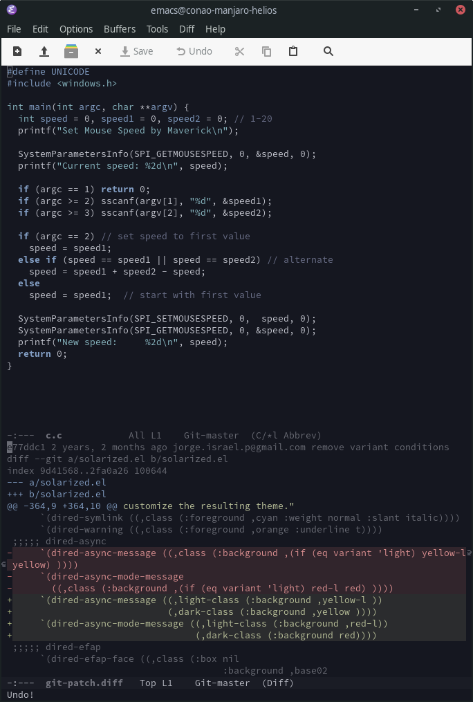

** 前提知識
*** Emacsにおけるface
=face= とは下記のように =defface= で各パッケージで定義されており、ユーザーのディスプレイ環境に応じて様々な色を設定できるようになっています。

下記の =face= の例において、 =feather= の例では =background= が =dark= か =light= かで色の分岐を行なっていますし、Emacs標準添付パッケージの =isearch= では =background= 判定に加え、最大表示色数も考慮されています。

#+begin_src emacs-lisp
(defface feather-dashboard-header
  '((((background dark))
     :background "#223377"
     :foreground "white"
     :weight bold :height 1.3 :family "Sans Serif")
    (((background light))
     :background "#abd7f0"
     :foreground "black"
     :weight bold :height 1.3 :family "Sans Serif"))
  "Face for feather-dashboard header."
  :group 'feather)

(defface isearch-fail
  '((((class color) (min-colors 88) (background light))
     (:background "RosyBrown1"))
    (((class color) (min-colors 88) (background dark))
     (:background "red4"))
    (((class color) (min-colors 16))
     (:background "red"))
    (((class color) (min-colors 8))
     (:background "red"))
    (((class color grayscale))
     :foreground "grey")
    (t (:inverse-video t)))
  "Face for highlighting failed part in Isearch echo-area message."
  :version "23.1")
#+end_src

あとはこの =face= を言語をパース後、ある意味のところに貼り付けたり、オーバーレイである文字のところに適用したりして使います。

*** Emacsにおけるカラーテーマ
Emacsのカラーテーマはこれらパッケージが提供する =face= を一括で変更してしまうものです。

具体例は[[https://github.com/emacs-jp/replace-colorthemes][emacs-jp/replace-colorthemes]]にたくさんあります。

このように =face= の名前と対応するスタイルを逐一変更するものがEmacsのカラーテーマです。

例えば[[https://github.com/emacs-jp/replace-colorthemes/blob/master/aalto-dark-theme.el][aalto-dark-theme]]の冒頭はこのようになっています。

#+begin_src emacs-lisp
  (deftheme aalto-dark
    "aalto-dark theme")

  (custom-theme-set-faces
   'aalto-dark

   '(default ((t (:background "DeepSkyBlue3" :foreground "white"))))
   '(mouse ((t (:foreground "black"))))
   '(cursor ((t (:background "yellow"))))
   '(border ((t (:foreground "black"))))

   '(bold ((t (:bold t :background "blue3" :foreground "white"))))
   '(bold-italic ((t (:italic t :bold t :foreground "blue3"))))
   '(calendar-today-face ((t (:underline t))))
   '(diary-face ((t (:foreground "red"))))
   '(font-lock-builtin-face ((t (:foreground "LightSteelBlue"))))
   '(font-lock-comment-face ((t (:foreground "OrangeRed"))))
   ;; ...
   )

  (provide-theme 'aalto-dark)
#+end_src

カラーテーマパッケージがどのようなことをしているか掴めてきましたでしょうか。

*** カラーテーマの問題点
さて、Emacsの =face= は先程のようにパッケージごとに定義されています。
もし、パッケージが増えた場合、カラーテーマはどのように対応するべきでしょうか。

簡単ですね。新しいパッケージが増えたら、その都度 =face= の設定を書き足すのです。。

例えば[[https://github.com/emacs-jp/replace-colorthemes/blob/master/andreas-theme.el][andreas-theme]]では =gnus= や =paren= というパッケージに対応していることが分かります。

このようにカラーテーマごとに「対応しているパッケージ」が異なっており、メンテナンスされていないカラーテーマを使っていると、パッケージが決めたデフォルトの色がそのまま表示されることになります。

そのため「色が暗い」「色がビビッドすぎる」「そもそも見えない」などの問題が発生します。

** Solarized
*** Solarizedのface定義
Emacsコミュニティによって長年メンテナンスされているSolarizedはどうなっているでしょうか。

実際のファイルは[[https://github.com/bbatsov/solarized-emacs/blob/master/solarized-faces.el][solarized-emacs/solarized-faces.el]]です。

=face= の再定義は2000行に及び、もし新しいパッケージが生まれたとしても有志の手によって速やかに追加されています。

これをSolarizedだけで使うのはもったいありません。

Solarizedも内部では基本となる10色を定義し、その色で =face= を再定義しています。

では、基本となる10色を外部から指定できるようにしたらSolarizedの仕組みに乗った上で簡単にカラーテーマが作れるのではないか。

それを提案したのがzk_phiさんの「[[https://qiita.com/zk_phi/items/35097fbb3dde4253d428][[Emacs] メタ・カラースキームとしての solarized]]」であり、私のパッチはそれを本家で実現したものです。

*** Solarizedから作るカラーテーマ
SolarizedのAPIで使いやすいのは =solarized-create-theme-file-with-palette= です。
この関数は最暗色、最明色に加え、アクセントカラー8色を指定することでSolarizedの =face= 定義を使うカラーテーマファイルを生成し、 =.emacs/themes= 以下に保存します。

早速icebergからアクセントカラーを貰ってカラーテーマを生成しましょう!

#+begin_src emacs-lisp
  (solarized-create-theme-file-with-palette 'dark 'solarized-iceberg-dark
    '("#161821" "#c6c8d1"
      "#e2a478" "#e27878" "#e27878" "#a093c7" "#b4be82" "#84a0c6" "#89b8c2" "#84a0c6"))
#+end_src

上記で書いた色はVim Scriptのソースからではなく[[https://speakerdeck.com/cocopon/creating-your-lovely-color-scheme?slide=51][講演資料]]から色を貰いました。


なお、icebergではアクセントカラーが6色のようなので、Solarizedが求めているアクセントカラー8色に足りません。そのため2色をダブらせて生成しました。

関数を実行して =.emacs/themes= 以下に保存されたテーマファイルは =load-theme= でロードできます。

** 微調整の仕方
Emacsの本文部分は =default= という =face= が当てられているのですが、solarizedのデフォルトでは文字色が最明色になりません。。

まずそこからカスタマイズしていきます。

=solarized-create-theme-file-with-palette= の第3引数にS式のリストを渡すことでテーマのカスタマイズができます。

#+begin_src emacs-lisp
  (solarized-create-theme-file-with-palette 'dark 'solarized-iceberg-dark
    '("#161821" "#c6c8d1"
      "#e2a478" "#e27878" "#e27878" "#a093c7" "#b4be82" "#84a0c6" "#89b8c2" "#84a0c6")
    '((custom-theme-set-faces
       theme-name
       `(default ((,class (:foreground ,base3 :background ,base03)))))))
#+end_src

カスタマイズはSolarizedの内部で色がどのように管理されているかを少し知っておく必要があります。

基本的に次のように色の名前が管理されています。

#+begin_example
<brightest                                 darkest>
base03 base02 base01 base00 base0 base1 base2 base3

<accent colors>
yellow orange red magenta violet blue cyan green
#+end_example

さらに色のバリエーションとして =yellow-d= や =yellow-l= という色も定義されており、第3引数で使用できます。

これらは =solarized-create-color-palette= という関数の中で自動生成されています。

** 完成形
本家のiceberg.vimのスクショと比較しながら、間違っている =face= を =describe-face= で確認して直す。。という作業を繰り返すと徐々に本家に近づいていきます。

最終的に次のような形になりました。

#+begin_src emacs-lisp
  (defun iceberg-theme-create-theme-file ()
    "Create iceberg-theme color theme using solarized API.

  Solarized pallete.

  brightest                                   darkest
  base03 base02 base01 base00 base0 base1 base2 base3

  yellow orange red magenta violet blue cyan green"
    (solarized-create-theme-file-with-palette 'dark 'solarized-iceberg-dark
      '("#161821" "#c6c8d1"
        "#e2a478" "#e27878" "#e27878" "#a093c7" "#b4be82" "#84a0c6" "#89b8c2" "#84a0c6")
      '((custom-theme-set-faces
         theme-name
         `(default ((,class (:foreground ,base3 :background ,base03))))
         `(vertical-border ((,class (:foreground ,base03))))
         `(mode-line ((,class (:foreground ,base2 :background ,base02))))
         `(mode-line-inactive ((,class (:foreground ,base0 :background ,base03))))

         `(font-lock-comment-delimiter-face ((,class (:foreground "#6b7089"))))
         `(font-lock-comment-face ((,class (:foreground "#6b7089"))))
         `(font-lock-preprocessor-face ((,class (:foreground ,green)))) ; yellow
         `(font-lock-type-face ((,class (:foreground ,cyan)))) ; yellow
         `(font-lock-builtin-face ((,class (:foreground ,green)))) ; base0

         `(diff-function ((,class (:foreground ,violet-1fg))))
         `(diff-header ((,class (:foreground ,green))))
         `(diff-hunk-header ((,class (:foreground ,green))))
         `(diff-file-header ((,class (:background ,base03 :foreground ,green))))
         `(diff-added ((,class (:background ,violet-1bg :foreground ,violet-1fg))))
         `(diff-indicator-added ((t (:foreground ,violet))))
         `(markdown-header-face ((,class (:foreground ,yellow))))
         `(markdown-header-rule-face ((,class (:foreground ,green))))
         `(markdown-markup-face ((,class (:inherit default))))
         `(markdown-url-face ((,class (:foreground ,magenta))))
         `(markdown-link-face ((,class (:foreground ,green :underline t))))
         `(markdown-inline-code-face ((,class (:foreground ,cyan))))
         `(markdown-pre-face ((,class (:foreground ,cyan))))
         `(sh-quoted-exec ((,class (:foreground ,violet))))
         `(haskell-type-face ((,class (:inherit default))))
         `(haskell-constructor-face ((,class (:inherit default))))
         `(haskell-operator-face ((,class (:foreground ,green))))
         `(haskell-definition-face ((,class (:inherit default))))
         `(web-mode-block-delimiter-face ((,class (:inherit default))))
         `(web-mode-html-attr-value-face ((,class (:foreground ,cyan))))
         `(web-mode-mode-type-face ((,class (:inherit default))))
         `(web-mode-function-call-face ((,class (:inherit default))))
         `(web-mode-keyword-face ((,class (:foreground ,green))))
         `(web-mode-constant-face ((,class (:foreground ,cyan))))
         `(web-mode-variable-name-face ((,class (:foreground ,cyan))))
         `(web-mode-html-tag-bracket-face ((,class (:foreground ,green))))
         `(org-verbatim ((,class (:foreground ,cyan))))
         `(php-php-tag ((,class (:inherit default))))
         `(php-constant ((,class (:inherit default))))
         `(php-paamayim-nekudotayim ((,class (:foreground ,green))))
         `(php-object-op ((,class (:foreground ,cyan))))
         `(php-variable-name ((,class (:foreground ,cyan))))
         `(php-variable-sigil ((,class (:foreground ,cyan))))))))
#+end_src

テーマを作る関数にしているのは「requireしただけでEmacsの動作を変えない」というパッケージ作成のルールに従うためです。

これでユーザーはiceberg-themeをインストール後、 =iceberg-theme-create-theme-file= を実行した後で =M-x load-theme solarized-iceberg-dark= と実行できるはずです。

** まとめ
現在ではSolarizedの資産を生かし、簡単にカラーテーマを作成することができます。

ぜひ独創的かつ目にやさしいカラーテーマを作っていただき、日々のEmacs生活がよりよいものになれば良いなと思っています。

* Archのrsyncで転送できないときに確認すること
:properties:
:export_file_name: generated/contents/blog/2020/55bf86
:export_date: 2020-05-11
:end:


** Intro
[[http://celpa.conao3.com/][celpa.conao3.com]]は私が契約している100GBの「さくらのレンタルサーバー」を向いているのだけど、その公開ディレクトリにGitHub Actionsからrsyncでデプロイしたい。

もちろん、GitHubのワーカーに秘密鍵をアップロードすることになるので、その秘密鍵は上手い具合に制限を設ける必要があります。

ローカルで試していたとき上手くいかなかったので、そのメモ。

** 普通のrsync
rsyncは接続先のサーバーにrsyncを起動して、そのプロセスと通信します。

どんなコマンドが実行されているかは =-vvv= オプションを付けることで表示されます。

#+begin_src shell
  $ rsync -vvv -an README.md conao3@conao3.sakura.ne.jp:/home/conao3/
  opening connection using: ssh -l conao3 conao3.sakura.ne.jp rsync --server -vvvnlogDtpre.iLsfxC . /home/conao3/  (9 args)
  sending incremental file list
  [sender] make_file(README.md,*,0)
  ...

  sent 60 bytes  received 368 bytes  285.33 bytes/sec
  total size is 15,379  speedup is 35.93 (DRY RUN)
  [sender] _exit_cleanup(code=0, file=main.c, line=1189): about to call exit(0) (DRY RUN)
#+end_src

=opening connection using= の行の =rsync= 以降が接続先で実行されているコマンドです。

そのため、そのコマンドだけ実行できる鍵を登録するには以下のように =authorized_keys= に登録します。 (=-vvv= はいらないので削る)

#+begin_src fundamental
command="rsync --server -nlogDtpre.iLsfxC . /home/conao3/",no-port-forwarding,no-X11-forwarding,no-agent-forwarding ssh-rsa AAAA...
#+end_src

** rsyncdを使ったrsync
*** 鍵の作成
rsync用の鍵を新しく作る。
GitHub Actionsのsshが古く、Openssh形式の秘密鍵が読めなかったのでPEM形式で出力するようにオプションを付けた。

鍵の名前は =sakura-rsync_rsa= と入力した。

#+begin_src shell
  cd .ssh
  ssh-keygen -t rsa -b 4096 -m PEM -C ""
#+end_src

*** 鍵の登録
ファイルをやりとりしたいサーバーにログインし、 =authorized_keys= に公開鍵 =sakura-rsync_rsa.pub= を登録する。

#+begin_src fundamental
  command="rsync --server --daemon --config=/home/conao3/.rsyncd.conf .",no-port-forwarding,no-X11-forwarding,no-agent-forwarding ssh-rsa AAAA...
#+end_src

*** rsyncd.confの作成
私が使っているのは共有サーバーなので、当然、ユーザーホーム以下しか触れない。
そのため =rsyncd.conf= は =~/.rsyncd.conf= に作成することにしました。

#+begin_src conf
  use chroot = no
  read only = yes

  [www]
    read only = no
    write only = yes
    path = /home/conao3/www

  [cache]
    path = /home/conao3/www/files/cache-40bbae27
#+end_src

*** 使ってみる
なぜかファイル転送されない。。。
#+begin_src shell
$ rsync -vvv -e "ssh -i sakura-rsync_rsa" /home/conao/dev/template/elisp conao3@conao3.sakura.ne.jp::foo/
opening connection using: ssh -i sakura-rsync_rsa -l conao3 conao3.sakura.ne.jp rsync --server --daemon .  (10 args)
sending daemon args: --server -vvve.LsfxC . foo/  (4 args)
skipping directory elisp
send_file_list done
send_files starting
send_files phase=1
send_files phase=2
send files finished
total: matches=0  hash_hits=0  false_alarms=0 data=0

sent 16 bytes  received 11 bytes  18.00 bytes/sec
total size is 0  speedup is 0.00
[sender] _exit_cleanup(code=0, file=main.c, line=1189): about to call exit(0)
#+end_src

=-a= オプションを付けると転送された。
#+begin_src shell
$ rsync -a -vvv -e "ssh -i sakura-rsync_rsa" /home/conao/dev/template/elisp conao3@conao3.sakura.ne.jp::foo
opening connection using: ssh -i sakura-rsync_rsa -l conao3 conao3.sakura.ne.jp rsync --server --daemon .  (10 args)
sending daemon args: --server -vvvlogDtpre.iLsfxC . foo/  (4 args)
sending incremental file list
[sender] make_file(elisp,*,0)
send_file_list done
[sender] pushing local filters for /home/conao/dev/template/elisp/
[sender] make_file(elisp/README.org,*,2)
[sender] make_file(elisp/Makefile,*,2)
[sender] make_file(elisp/elisp-template.el,*,2)
[sender] make_file(elisp/.github,*,2)
[sender] make_file(elisp/elisp-template-tests.el,*,2)
[sender] make_file(elisp/git-hooks,*,2)
[sender] make_file(elisp/.gitignore,*,2)
[sender] make_file(elisp/LICENSE,*,2)
[sender] make_file(elisp/Cask,*,2)
send_files starting
#+end_src

*** GitHub Actionsから使う
こんなファイルを =.github/workflows/test.yml= に保存すればできる。

「[[https://qiita.com/shimataro999/items/b05a251c93fe6843cc16][GitHub ActionsでSSHを使う - Qiita]]」で紹介されていた =shimataro/ssh-key-action= を使わせてもらいました。

#+begin_src yaml
  name: Main workflow
  on:
    push:
      branches:
        - master
    pull_request:
      branches:
        - master

  jobs:
    build:
      runs-on: ubuntu-latest
      strategy:
        matrix:
          emacs_version:
            - '26.3'
      steps:
        - uses: actions/checkout@v1
        - uses: actions/setup-python@v1.1.1
        - uses: purcell/setup-emacs@master
          with:
            version: ${{ matrix.emacs_version }}
        - uses: conao3/setup-cask@master
        - name: Install SSH key
          uses: shimataro/ssh-key-action@v1
          with:
            private-key: ${{ secrets.SSH_KEY }}
            public-key: ${{ secrets.SSH_KEY_PUBLIC }}
            known-hosts: ${{ secrets.KNOWN_HOSTS }}

        - name: Cache fetch
          run: |
            rsync -av --progress -e 'ssh' conao3@conao3.sakura.ne.jp::cache/celpa.tar.gz /tmp/
            rm -rf working
            tar xf /tmp/celpa.tar.gz

        - name: Build
          run: |
            make

        - name: Deploy
          run: |
            rsync -av -e 'ssh' --delete --exclude=working ./ conao3@conao3.sakura.ne.jp::www/celpa/

        - name: Cache push
          run: |
            rm /tmp/celpa.tar.gz
            tar czf /tmp/celpa.tar.gz working
            rsync -av --progress -e 'ssh' /tmp/celpa.tar.gz conao3@conao3.sakura.ne.jp::cache/
#+end_src

** まとめ
rsyncを使ってサイトをGitHub Actionsからデプロイできるようになりました。

** 参考
- [[https://jyn.jp/rsync-daemon-over-ssh/][rsync+sshはdaemonモードを使うと更に安全になる - 純規の暇人趣味ブログ]]
- [[https://qiita.com/shimataro999/items/b05a251c93fe6843cc16][GitHub ActionsでSSHを使う - Qiita]]
- [[https://amasuda.xyz/post/2019-07-27-ssh-keygen-openssh-to-pem/][ssh-keygen で生成された OPENSSH フォーマットの秘密鍵を pem フォーマットへ変換する - Think Abstract]]
- [[https://machua.hatenadiary.org/entry/20110809/1312899353][SSHの秘密鍵について - 禿散らかしてました]]

* Emacsで最終行にポイントを動かさないようにするアドバイス
:properties:
:export_file_name: generated/contents/blog/2020/33dbfa
:export_date: 2020-05-23
:end:

** Intro
Elispのadviceはとても便利。

#+begin_export html
<blockquote class="twitter-tweet"><p lang="ja" dir="ltr">でも気をつけないとバグの温床になりますっ！（笑</p>&mdash; Takaaki Ishikawa (@takaxp) <a href="https://twitter.com/takaxp/status/1263646615543275520?ref&#95;src=twsrc%5Etfw">May 22, 2020</a></blockquote> <script async src="https://platform.twitter.com/widgets.js" charset="utf-8"></script>
#+end_export

** 末尾にポイントを移動しない
Emacs-jpのスレッドで次のような質問があった。

# from $toyboot4
#+begin_quote
こんにちは！
2 行のファイルがあったとき、 3 行目にカーソル移動できないようにしたいです
何か方法は無いでしょうか
#+end_quote

このような細かい挙動はアドバイスで簡単に実現できる。

#+begin_src emacs-lisp
  (leaf simple
    :preface
    (defun c/advice-next-line (fn &rest args)
      (let ((maxline (count-lines (point-min) (point-max))))
        (if (< maxline (line-number-at-pos (line-beginning-position 2)))
            (message "restricted! (next-line)")
          (apply fn args))))
    (defun c/advice-forward-char (fn &rest args)
      (let ((maxline (count-lines (point-min) (point-max))))
        (if (< maxline (line-number-at-pos (+ (point) 1)))
            (message "restricted! (forward-char)")
          (apply fn args))))
    :advice ((:around next-line c/advice-next-line)
             (:around forward-char c/advice-forward-char)))

  (leaf simple
    :advice-remove ((next-line c/advice-next-line)
                    (forward-char c/advice-forward-char)))
#+end_src

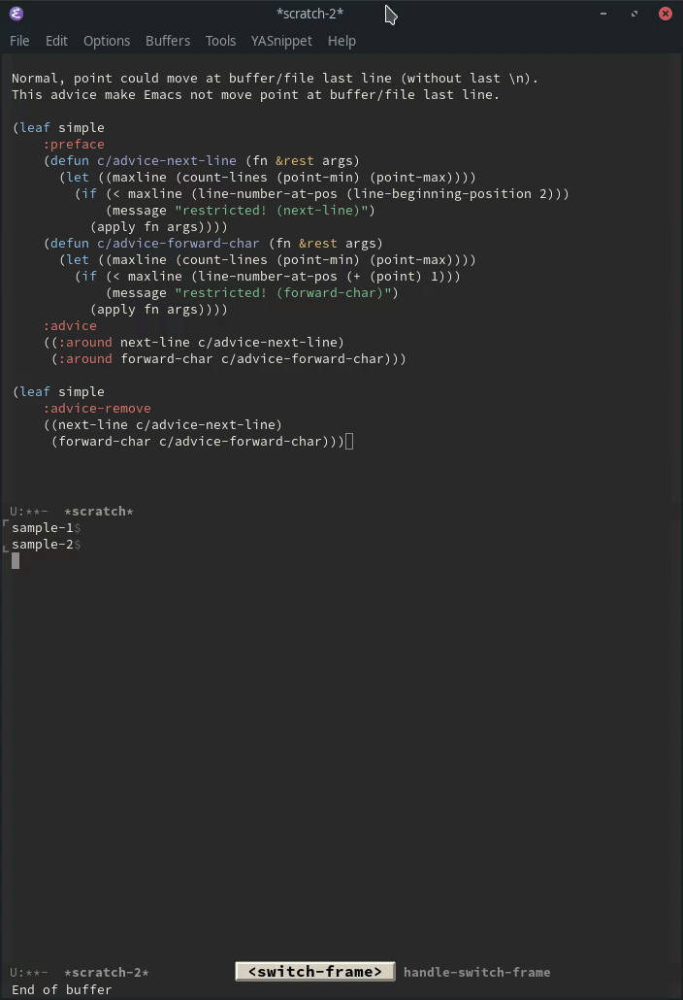

** 末尾にポイントを移動しようとしたら改行する
さらに、仕様を変えて、「最終行以上にポイントを動かそうとしたときに、自動で改行を入れる」ことも簡単に実現できる。

#+begin_src emacs-lisp
  (leaf simple
    :preface
    (defun c/advice-next-line (fn &rest args)
      (let ((maxline (count-lines (point-min) (point-max))))
        (if (< maxline (line-number-at-pos (line-beginning-position 2)))
            (progn (goto-char (line-beginning-position 2))
                   (save-excursion (insert "\n")))
          (apply fn args))))
    (defun c/advice-forward-char (fn &rest args)
      (let ((maxline (count-lines (point-min) (point-max))))
        (if (< maxline (line-number-at-pos (+ (point) 1)))
            (insert "\n")
          (apply fn args))))
    :advice ((:around next-line c/advice-next-line)
             (:around forward-char c/advice-forward-char)))

  (leaf simple
    :advice-remove ((next-line c/advice-next-line)
                    (forward-char c/advice-forward-char)))
#+end_src

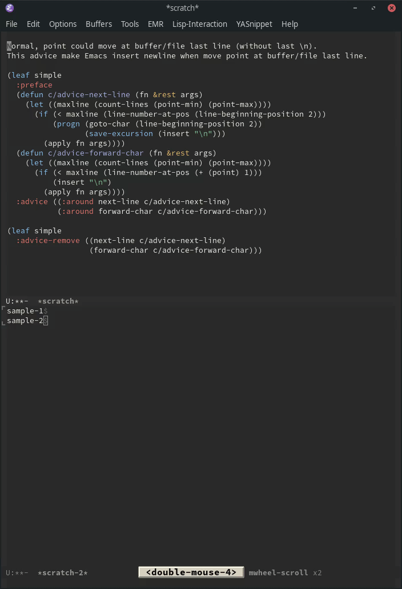

これらのアドバイスで「ファイル末尾に必ず改行がある」ことを強制できる。

** まとめ
ただ、今回の要求については「ファイル保存時に改行がない場合、末尾改行を付加する」というオプションがあり、私はこれを使っている。

#+begin_src emacs-lisp
  (leaf files
    :custom `((require-final-newline . t)))
#+end_src

とはいえ、このようなオプションがないときElispのアドバイスはとても便利。

細かい挙動がストレスになることもあるので、簡単にカスタマイズできるEmacsは良いエディタ。

* 制御記号付きのmake-processの出力をいい感じに処理する方法
:properties:
:export_file_name: generated/contents/blog/2020/5fb67c
:export_date: 2020-05-23
:end:

** Intro
Emacsからプロセスを実行できます。

実行する方法は[[https://qiita.com/tadsan/items/17d32514b81f1e8f208a][いろいろあります]]が、最も低レベルな関数は =make-process= です。

最もユーザーに近い関数は =shell-command= で、 =M-!= に割り当てられています。
この関数はコマンド文字列を渡すだけで、お手軽に実行できます。

** make-process
[[https://www.gnu.org/software/emacs/manual/html_node/elisp/Asynchronous-Processes.html#Asynchronous-Processes][make-process]]は非同期プロセスを作成します。

必須のオプションは =:name= で、プロセスオブジェクトを返却します。
さらに =:buffer=, =:command=, =:coding=, =:connection-type=, =:noquery=, =:stop=, =:filter=, =:sentinel=, =:stderr= オプションが存在し、細かくプロセスの管理方法を制御できます。

基本的に =:name=, =:buffer=, =:command= を指定することになります。

#+begin_src emacs-lisp
  (setq proc
        (make-process
         :name "sh"
         :buffer (get-buffer-create "*proc*")
         :command '("hub" "clone" "conao3/celpa")))

  (progn
    (delete-process proc)
    (shell-command "rm -rf celpa"))
#+end_src

ただ、コマンドから送られてきた文字列を素朴に出力するため、gitのように =CR= を利用してリッチに出力するコマンドの出力は盛大に壊れます。

=CR= を解釈しながら賢く処理をすれば良いのですが、とても面倒です。

Emacs-jpで助けを求めると、eshellの関数を利用すれば良いのではという助言があり、調べてみると、きちんと出力できました。

eshellの仕組みに乗っかるので、 =eshell-mode= にしなければフィルター関数を使えないかと思いましたが、よく見ればいくつかのマーカーを設定するだけで使えました。

#+begin_src emacs-lisp
  (with-current-buffer (get-buffer-create "*proc*")
    (set (make-local-variable 'eshell-last-input-start) (point-marker))
    (set (make-local-variable 'eshell-last-input-end) (point-marker))
    (set (make-local-variable 'eshell-last-output-start) (point-marker))
    (set (make-local-variable 'eshell-last-output-end) (point-marker))
    (set (make-local-variable 'eshell-last-output-block-begin) (point)))

  (setq proc
        (make-process
         :name "sh"
         :buffer (get-buffer-create "*proc*")
         :command '("hub" "clone" "conao3/celpa")
         :filter (lambda (proc string)
                   (eshell-output-filter proc string))))

  (progn
    (delete-process proc)
    (shell-command "rm -rf celpa"))
#+end_src

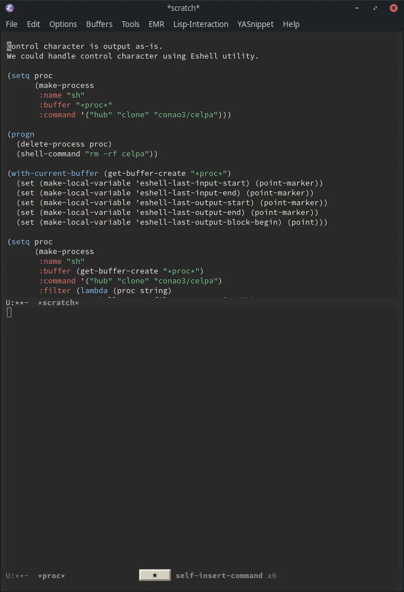

** まとめ
Emacsは良いエディタで、Elispは強力ですが、GitをElispで実装するのは現実的ではありません。

このように外部コマンドとElispを有効に協調させながら作業しやすい環境を整えていきましょう。

* CELPA (Conao3's Emacs Lisp Package Archive) をデプロイした話
:properties:
:export_file_name: generated/contents/blog/2020/7b1dc7
:export_date: 2020-05-24
:end:

** Intro
[[https://github.com/melpa/melpa/pull/6892][MELPA]]のレビューが遅い。

MELPAのメンテナの方には感謝してもしきれないが、実際のところ、レシピ追加PRを出して2週間から3週間音沙汰ないまま放置されたり、先方のレビューを反映して修正しても、そこから2週間、3週間待たされることがままあり、ストレスを抱えていました。

私はあまりinit.elを大きくしたくなく、ある程度の大きさになるとパッケージで切りだして =(leaf hoge)= で簡単にアクティベートしたいと考えているため、MELPAに入れてもらえないと =el-get= で取ってこないといけませんでした。

ここでさらに問題があり、 =el-get= は =package= との相性が悪く、微妙な評価タイミングの違いがとても重要になります。

init.elを自分で全てコントロールしていたとしても、おまじないの部分が増えるし、[[https://github.com/conao3/leaf-manager.el][leaf-manager]]で自動管理している場合は原理的に不可能でした。

そのためMELPAっぽく、さらにレシピの追加を自分でコントロールできるアーカイブが必要となり、今回、[[https://celpa.conao3.com/][celpa.conao3.com]]をデプロイしました。

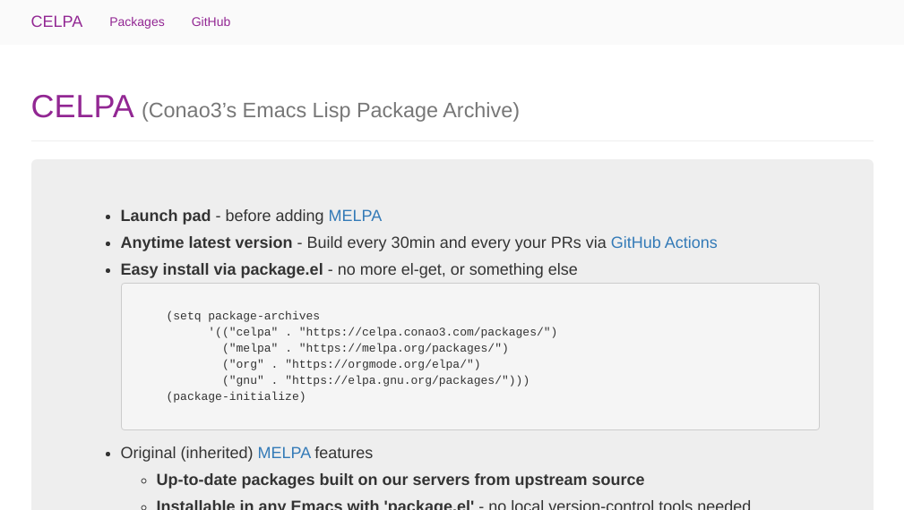

[[github:conao3/celpa::Emacs Lisp][Conao3’s Emacs Lisp Package Archive]]

** MELPAの仕組み
[[https://melpa.org/#/][MELPA]]は単に利用するもので、自分でMELPAを作りたい場合、どこから手をつけたら良いか分かりませんでした。

ただ、takaxpさんが[[https://qiita.com/takaxp/items/ede36da846099d2e5cf2][wikiを翻訳]]して下さっており、この通り進めればなんとかなりました。

もちろんwiki([[https://github.com/melpa/melpa/wiki/Custom-Melpa-Archive][Custom Melpa Archive]], [[https://github.com/melpa/melpa/wiki/melpa-and-package-build][Melpa and package build]])も参照しました。

** MELPAソースの修正
*** レシピの削除
MELPAのクローンを作ろうとしているわけではないので、MELPAに既に登録されているレシピは必要ありません。
[[https://github.com/conao3/celpa/commit/0308bcf9157cd9ba07c55edfb32e006783d15cf7][全部削除]]してしまいます。

*** レシピの追加
欲しいパッケージのレシピを[[https://github.com/conao3/celpa/commit/b1793475d891874f855068046cd8dffa54152877][おもむろに追加]]します。もちろんMELPAの形式と一緒のものです。

*** サーバーの用意
いい感じのサーバーとドメインを用意し、rsyncでよしなに同期できるようにします。
その話については「[[https://s.conao3.com/blog/2020/55bf86][Archのrsyncで転送できないときに確認すること]]」に書きました。

*** index.htmlの修正
いい感じに[[https://github.com/conao3/celpa/blob/master/html/index.html][index.html]]を修正します。
おそらくjsonが足らない(CELPAではダウンロード数の記録はしてない)らしく、MELPAに付属しているjavascriptが動きません。

適当にjsを書いたり、リンクを修正したりします。

*** GitHub Actionsの設定ファイル追加
GitHub Actionsで30分ごとにビルドが走るようにします。
#+begin_src yaml
  name: Main workflow
  on:
    push:
      branches:
        - master
    pull_request:
      branches:
        - master
    schedule:
      - cron: '*/30 * * * *'

  jobs:
    build:
      runs-on: ubuntu-latest
      strategy:
        matrix:
          emacs_version:
            - '26.3'
      steps:
        - uses: actions/checkout@v1
        - uses: actions/cache@v1
          with:
            path: working
            key: ${{ runner.os }}-working
        - uses: actions/setup-python@v1.1.1
        - uses: purcell/setup-emacs@master
          with:
            version: ${{ matrix.emacs_version }}
        - uses: conao3/setup-cask@master

        - name: Build
          run: |
            git status
            make add-package-build-remote
            make pull-package-build
            make
        - name: Install SSH key
          if: github.ref == 'refs/heads/master'
          uses: shimataro/ssh-key-action@v1
          with:
            private-key: ${{ secrets.SSH_KEY }}
            public-key: ${{ secrets.SSH_KEY_PUBLIC }}
            known-hosts: ${{ secrets.KNOWN_HOSTS }}

        - name: Deploy
          if: github.ref == 'refs/heads/master'
          run: |
            rsync -av -e 'ssh' --delete --exclude=.git --exclude=working ./ conao3@conao3.sakura.ne.jp::www/celpa/
#+end_src

** まとめ
振り返ってみるとMELPAをCELPAとして動かせるように修正するのは簡単でした。

やはりミスが許されず、時間がかかるのは秘密鍵/権限回りで、その部分で半分以上の時間を費やしました。

レシピを直接pushできるというのはMELPAを使っていた頃には考えられない快適さです。

ぜひみなさんもオレオレMELPAをデプロイして、package.elだけでパッケージを管理できるようにしましょう!

* Emacsで競技プログラミング | ojのラッパーパッケージを書いた話
:properties:
:export_file_name: generated/contents/blog/2020/5739d9
:export_date: 2020-05-24
:end:

** Intro
ちょっとEmacsで競技プログラミングをしてみようかと思いました。

どうやら[[https://github.com/online-judge-tools/oj][oj]]、[[https://github.com/online-judge-tools/template-generator][oj-template]]という便利なツールがあるようなので、Emacsから簡単に実行できるよう[[https://github.com/conao3/oj.el][oj.el]]というパッケージを作成しました。

[[github:conao3/oj.el::Emacs Lisp][Competitive programming tools client for AtCoder, Codeforces]]

** oj, oj-template
[[https://github.com/online-judge-tools/oj][oj]]は多数のオンラインジャッジに対応しているCLIツールです。

オンラインジャッジによって実装されている機能に制限はありますが、サンプルケースのダウンロード、テスト、提出、ランダムインプットの生成などの機能があります。

[[https://user-images.githubusercontent.com/2203128/34708715-568b13c0-f557-11e7-97ef-9f6b646e4776.gif]]

さらに[[https://github.com/online-judge-tools/template-generator][oj-template]]は入出力サンプルからそれっぽいcppとpythonファイルを生成してくれます。

また、 =oj-prepare= はコンテストURLを指定すると、そのコンテストの全ての問題について =oj download= と =oj-template= をしてくれます。

コンテスト中は時間との戦いなので、これらのコマンドによる時短は大きなものになると思います。

** oj.el
[[https://github.com/conao3/oj.el][oj.el]]は先般の =oj=, =oj-template= をEmacsから実行できるようにしたものです。

#+begin_src emacs-lisp
  (leaf oj
    :ensure t
    :custom ((oj-compiler-c . "clang")
             (oj-compiler-python . "pypy")
             (oj-default-online-judge . "atcoder")))
#+end_src

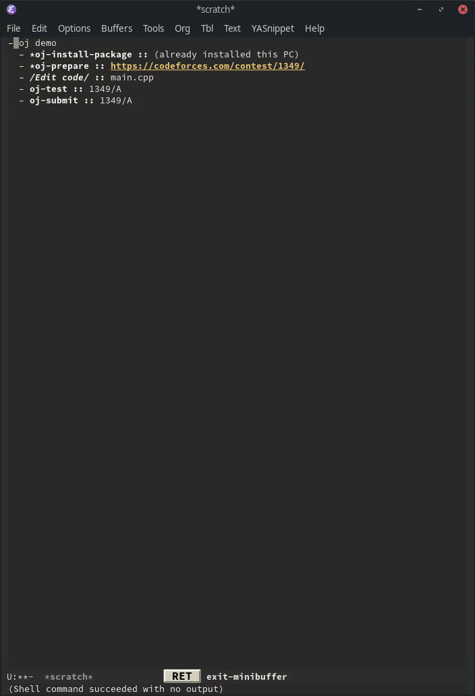

単に関数にバインドしただけでなく、多少の改善を入れています。

例えば =oj= はダウンロードするためにURL全体を指定する必要がありますが、 =oj-default-online-judge= で設定されているオンラインジャッジを既定のものと考え、入力を省略できるようにしています。
(CLIツールとしての[[https://online-judge-tools.readthedocs.io/en/master/introduction.ja.html#id7][方針]]と干渉するものではなく、エディタの拡張としての求められる機能として盛りこんだものです。)

例えば =atcoder= デフォルトに設定されている状況で、 =M-x oj-prepare= に =abc167= を入力すると下記コマンドが実行されます。

#+begin_src shell
  oj-template https://atcoder.jp/contests/abc167
#+end_src

さらに、 =abc167/a= と入力すると下記コマンドが実行されます。

#+begin_src shell
  oj-template https://atcoder.jp/contests/abc167/tasks/abc167_a
#+end_src

このように推測できる部分については、より推測するように実装しています。

詳しい使い方については[[https://github.com/conao3/oj.el#usage][README]]を参照して下さい。
基本的に =oj-install-package=, =oj-prepare=, =oj-test=, =oj-submit= の順にコマンドを実行すればいい感じに動くはずです。

** まとめ
ojをEmacsから使いやすくするラッパーパッケージを書きました。

こういう方向のパッケージもお手軽で良いですね。

* Emacs Lisp の文字列操作まとめ
:properties:
:export_file_name: generated/contents/blog/2020/8e5d61
:export_date: 2020-05-26
:end:

[[http://emacs.g.hatena.ne.jp/kiwanami/20110809/1312877192][元記事]]の[[https://web.archive.org/web/20150325073218/http://emacs.g.hatena.ne.jp/kiwanami/20110809/1312877192][アーカイブ]]のアーカイブ。なにか問題があれば教えて下さい。以下、アーカイブ。

-----

基本的には Emacs Lisp の Info を読むと何となくパーツはそろっていることは分かる。
ただ、パーツが特殊だったりしてよく使い方を忘れるのでよく見る情報をメモ。

** 基本的情報源
以下の情報はローカルにブックマークするなどして即引けるようにしておくと便利。

- Info 4 Strings and Characters
  - 4. 文字列と文字
  - 文字列の操作、比較、変換など
- Info 32.2 Examining Buffer Contents
  - 31.2 バッファの内容を調べる
  - バッファの文字列取得
- Info 32.19 Text Properties
  - 31.19 テキスト属性
  - テキストプロパティ（テキスト属性）のいろいろ
- Info 34 Searching and Matching
  - 33. 探索と一致
  - 探索、正規表現
- Info 38.10 Width
  - 38.9 表示幅
  - 非 ASCII 文字列を含む文字や文字列の幅（画面上の長さ）、端っこ切る
- 逆引き Emacs Lisp 文字列
  - それなりに数が多い
- no title
  - 実は必要なことはここに大体書いてあったりする

** Ruby との文字列操作対応表
参照: 文字列操作の比較表: Ruby, Python, JavaScript, Perl, C++ - bkブログ
基本的に破壊的操作は無し。

| Ruby (String)         | Emacs Lisp                                                 | 注釈                                                                                 |
|-----------------------+------------------------------------------------------------+--------------------------------------------------------------------------------------|
| s = "abc"             | (setq s "abc")                                             | 変数にバインドするならlet使う方が一般的                                              |
| s = x + y             | (concat x y)                                               |                                                                                      |
| s == x                | (equal s x)                                                | string-equal が正式                                                                  |
| s % [x, y]            |                                                            |                                                                                      |
| sprintf(s, x, y)      | (format s x y)                                             |                                                                                      |
| [x, y, z].join(s)     | (mapconcat 'identity (list x y z) s)                       | 単に結合するなら (apply 'concat (list x y z)) もアリ                                 |
| s.capitalize          | (capitalize s)                                             |                                                                                      |
| s.capitalize!         |                                                            |                                                                                      |
| s.center(x)           | (cfw:render-center x s)                                    | calfw.el 参照                                                                        |
| s.chomp               | (regexp-in-string "[\n\r]+$" "" s)                         |                                                                                      |
| s.chomp!              |                                                            |                                                                                      |
| s.chop                | (substring s 0 -1)                                         | 改行文字の扱いが違う                                                                 |
| s.chop!               |                                                            |                                                                                      |
| s.clear               | (clear-string s)                                           |                                                                                      |
| s.concat(x)           |                                                            |                                                                                      |
| s.count(x)            |                                                            | ループで回すか、一時バッファを使ってre-search-forward で回数を数えるとか             |
| s.crypt(x)            |                                                            | rot13-string とか、 EPA とか                                                         |
| EzCrypt               |                                                            |                                                                                      |
| s.delete!(x)          | (regexp-in-string x "" s)                                  | 破壊的には行えない                                                                   |
| s.downcase            | (downcase s)                                               |                                                                                      |
| s.downcase!           |                                                            |                                                                                      |
| s.each_byte { x ... ) | (loop for x across s do … )                                | 文字単位でループ、xは文字コード（数値）文字コードからstringにするには char-to-string |
| s.each_line { x ... ) | (loop for x in (split-string s "[\n\r]") do … )            |                                                                                      |
| s.empty?              | (= 0 (length s))                                           | nullチェックが必要                                                                   |
| s.end_with?(x)        | (string-match (concat x "$") s)                            | sに改行が入らないことが前提                                                          |
| s.gsub(x, y)          | (regexp-in-string x y s)                                   |                                                                                      |
| s.gsub!(x, y)         |                                                            |                                                                                      |
| s.hex                 |                                                            |                                                                                      |
| s.to_i(16)            | (string-to-number s 16)                                    |                                                                                      |
| s.include?(x)         | (string-match x s)                                         | もし見つかれば開始位置が返ってくる                                                   |
| s.index(x)            | (string-match x s)                                         |                                                                                      |
| s.insert(i, x)        |                                                            | 一時バッファでやるか、自分でちぎってつなげるか                                       |
| s.intern              |                                                            |                                                                                      |
| s.to_sym              | (intern s)                                                 | シンボルテーブルに登録したくなければ make-symbol                                     |
| s.length              |                                                            |                                                                                      |
| s.size                | (length s)                                                 | 文字数が返る                                                                         |
| s.ljust(x)            | (cfw:render-left x s)                                      | calfw.el 参照                                                                        |
| s.lstrip              | (regexp-in-string "^[ \t]+" "" s)                          | sに改行が入らないことが前提                                                          |
| s.lstrip!             |                                                            |                                                                                      |
| s.match(x)            |                                                            |                                                                                      |
| x.match(s)            | (string-match x s)                                         | マッチ結果はグローバルに保持している match-string, match-beginning, match-end 等参照 |
| s.next!               |                                                            |                                                                                      |
| s.succ!               |                                                            |                                                                                      |
| s.oct                 |                                                            |                                                                                      |
| s.to_i(8)             | (string-to-number s 8)                                     |                                                                                      |
| s.partition(x)        |                                                            | string-matchで自分でちぎる                                                           |
| s.replace(x)          |                                                            |                                                                                      |
| s.reverse             | (apply 'string (reverse (append s nil)))                   |                                                                                      |
| s.reverse!            |                                                            |                                                                                      |
| s.rindex(x)           |                                                            | 一時バッファで search-backward 等を使う                                              |
| s.rjust(x)            | (cfw:render-right x s)                                     | calfw.el 参照                                                                        |
| s.rpartition(x)       |                                                            | string-matchで自分でちぎる                                                           |
| s.rstrip              | (regexp-in-string "[ \t]+$" "" s)                          | sに改行が入らないことが前提                                                          |
| s.rstrip!             |                                                            |                                                                                      |
| s.scan(x) { ... }     |                                                            | 一時バッファで re-search-forward 等を使う                                            |
| s[i]                  |                                                            |                                                                                      |
| s.slice(i)            | (aref s i)                                                 | 文字コード（数値）が返ってくる文字コードからstringにするには char-to-string          |
| s[i..-1]              |                                                            |                                                                                      |
| s.slice(i..-1)        | (substring s i)                                            |                                                                                      |
| s[i, l]               |                                                            |                                                                                      |
| s.slice(i, l)         | (substring s i (+ i l))                                    |                                                                                      |
| s[i..j]               |                                                            |                                                                                      |
| s.slice(i..j)         | (substring s i (1+ j))                                     |                                                                                      |
| s[i...j]              |                                                            |                                                                                      |
| s.slice(i...j)        | (substring s i j)                                          |                                                                                      |
| s.split(x)            | (split-string s x)                                         |                                                                                      |
| s.start_with?(x)*4    | (string-match (concat "^" x) s)                            | sに改行が入らないことが前提                                                          |
| s.strip               | (regexp-in-string "\\(^[ \t\n\r]+\\  [ \t\n\r]+$\\)" "" s) | sに改行が入らないことが前提                                                          |
| s.strip!              |                                                            |                                                                                      |
| s.sub(x, y)           |                                                            | string-match を使って自分で初回を取ってくる                                          |
| s.sub!(x, y)          |                                                            |                                                                                      |
| s.swapcase            |                                                            |                                                                                      |
| s.to_f                | (string-to-number s)                                       | 整数に見える場合は整数が返る                                                         |
| s.to_i                | (string-to-number s)                                       |                                                                                      |
| s.to_s                | (substring s 0)                                            |                                                                                      |
| s.tr!(x, y)           |                                                            |                                                                                      |
| s.tr_s!(x, y)         |                                                            |                                                                                      |
| s.unpack(x)           |                                                            | bindatを使う                                                                         |
| s.upcase              | (upcase s)                                                 |                                                                                      |
| s.upcase!             |                                                            |                                                                                      |
| Regexp.escape(s)      |                                                            |                                                                                      |
| Regexp.quote(s)       | (regexp-quote s)                                           |                                                                                      |
#+TBLFM:
※もし間違いを見つけたら教えてください。

*** 表示幅について
format の桁指定（"%5s" など）で表示幅のパディングが出来るが、あふれた文字列は切り落とされずに全部表示されてしまう。

指定幅で切り取りたい場合は、自分であらかじめ文字列の長さを見て切り落と(truncate)しておく必要がある。

切り落としには substring とかではなくて、全角文字などについても適切に幅を見てくれる truncate-string-to-width を使うと良い感じ。

*** 文字列内の複雑な検索、置換など
replace-regexp-in-string を使えば大抵のことが出来る。関数も取れるので Ruby の gsub 相当も出来る。

ただ、複雑な正規表現をこねくり回したい場合は以下のように一時バッファを使う。

#+begin_src emacs-lisp
  ;; input に文字列が入っている
  ;; output に変換後の文字列を入れたい
  (setq output
    (with-temp-buffer
      (insert input)
      (goto-char (point-min))
      (while (re-search-forward REGEXP nil t)
          ;; ここで match-string などを使って何かする
       )
      (buffer-string)))
#+end_src

*** テキストプロパティについて
HTML の DOM オブジェクトに独自属性を付加するように、自由に属性を入れることが出来る。
HTML とは違って1文字単位でプロパティが設定できるが、大抵はまとまった領域にプロパティを設定する。

テキスト属性を使えるようになると、かなり複雑なアプリケーションが作れるようになる（と思う）。

*** アプリケーションからの利用
テキストプロパティに必要な値をごっそり入れておき、キー操作でカーソル上の文字列からテキストプロパティを取ってきて必要なアクションを行うというような方法が一般的に行われている。大抵は、行全体や必要な領域全体にプロパティをつけておいて、キー操作で取得するときは行頭の1文字目のプロパティを見るということがよく行われている。

Dired や orgmode など、多くのプログラムがこのような設計になっている。しかしながら、場当たり的にテキストプロパティを使い始めると、テキストプロパティを舞台にしたスパゲティコードになるため、本格的に使う場合はあらかじめ構造化したデータを代表して入れておく等の工夫をした方がよいと考えている。

*** はまりポイントなど
属性は文字列の操作などでもそのままコピーされてしまうので、欲しくない場合は substring-no-properties などで消す。

属性の操作は破壊的なので、うっかり変えてはいけないところまで変えてしまうことがある。また、ソースコードリテラルの文字列オブジェクトには属性の操作ができない。なので、外から来た文字列に対して属性を操作する場合は、文字列をコピーしておくと安全。

font-lock が有効なバッファで face に何か入れても速攻でクリアされてしまう。そんなときは font-lock-face に入れる。

テキスト属性のループパターン
バッファの中の特定のテキストプロパティについてループを書きたいときがある。そんなときは next-property-change または next-single-property-change などを使う。 Info の next-property-change にループのサンプルがある。

以下は face の付いている領域についてループするイディオム。

#+begin_src emacs-lisp
  (defun iterate-text-prop (prop func)
    (loop with pos = (point-min)
          for next = (next-single-property-change pos prop)
          for text-val = (and next (get-text-property next prop))
          while next do
          (when text-val
            (funcall func pos next text-val))
          (setq pos next)))

  (iterate-text-prop 'face
    (lambda (begin end val)
      (and val (message ">> %S : %S" val (buffer-substring-no-properties begin end)))))
#+end_src

N オーダーではあるけどもなかなか高速に動作するので、 O(N^2) のアルゴリズムでなければ問題なさそう。

* Emacsに存在するwithプレフィックスのマクロ一覧
:properties:
:export_file_name: generated/contents/blog/2020/8f0b12
:export_date: 2020-05-26
:end:


=with= マクロは便利。

=with-temp-buffer= や =with-current-buffer= は超基本マクロだし、helmなども =with-helm-buffer= という同じ文脈のマクロを提供している。

ふと、 =with= プレフィックスのマクロがどれだけEmacsに用意されているのか気になったので調べた。

ppp, promise, asyncに依存して、次のコード片を実行すれば調べられる。

31シンボル見つかった。

#+begin_src emacs-lisp
  emacs-version
  ;;=> "26.3"

  (ppp-list
   (promise-wait-value
    (promise-wait 5
      (promise:async-start
       (lambda ()
         (let (res)
           (mapatoms
            (lambda (elm)
              (when (and (fboundp elm)
                         (string-prefix-p "with-" (symbol-name elm)))
                (push elm res))))
           (sort res (lambda (a b) (string< (symbol-name a) (symbol-name b))))))))))
  ;;=> (with-auto-compression-mode
  ;;    with-case-table
  ;;    with-category-table
  ;;    with-coding-priority
  ;;    with-connection-local-profiles
  ;;    with-current-buffer
  ;;    with-current-buffer-window
  ;;    with-demoted-errors
  ;;    with-displayed-buffer-window
  ;;    with-electric-help
  ;;    with-eval-after-load
  ;;    with-file-modes
  ;;    with-help-window
  ;;    with-isearch-suspended
  ;;    with-local-quit
  ;;    with-mutex
  ;;    with-no-warnings
  ;;    with-output-to-string
  ;;    with-output-to-temp-buffer
  ;;    with-selected-frame
  ;;    with-selected-window
  ;;    with-silent-modifications
  ;;    with-syntax-table
  ;;    with-temp-buffer
  ;;    with-temp-buffer-window
  ;;    with-temp-file
  ;;    with-temp-message
  ;;    with-timeout
  ;;    with-timeout-suspend
  ;;    with-timeout-unsuspend
  ;;    with-wrapper-hook)
#+end_src

先のコード片で面倒なことをやっているのは、いわゆる =emacs -q= で実行した結果を得たいため。
今起動しているEmacsでの結果が欲しい場合はpromiseを消せば良い。

82シンボル見つかった。

#+begin_src emacs-lisp
  (ppp-list
   (let (res)
     (mapatoms
      (lambda (elm)
        (when (and (fboundp elm)
                   (string-prefix-p "with-" (symbol-name elm)))
          (push elm res))))
     (sort res (lambda (a b) (string< (symbol-name a) (symbol-name b))))))
  ;;=> (with-auto-compression-mode
  ;;     with-buffer-modified-unmodified
  ;;     with-case-table
  ;;     with-category-table
  ;;     with-coding-priority
  ;;     with-connection-local-profiles
  ;;     with-current-buffer
  ;;     with-current-buffer-window
  ;;     with-decoded-time-value
  ;;     with-demoted-errors
  ;;     with-displayed-buffer-window
  ;;     with-editor
  ;;     with-editor*
  ;;     with-editor--setup
  ;;     with-editor-async-shell-command
  ;;     with-editor-cancel
  ;;     with-editor-debug
  ;;     with-editor-emacsclient-path
  ;;     with-editor-emacsclient-version
  ;;     with-editor-emulate-terminal
  ;;     with-editor-export-editor
  ;;     with-editor-export-git-editor
  ;;     with-editor-export-hg-editor
  ;;     with-editor-finish
  ;;     with-editor-kill-buffer-noop
  ;;     with-editor-locate-emacsclient
  ;;     with-editor-locate-emacsclient-1
  ;;     with-editor-mode
  ;;     with-editor-output-filter
  ;;     with-editor-process-filter
  ;;     with-editor-read-envvar
  ;;     with-editor-return
  ;;     with-editor-server-window
  ;;     with-editor-set-process-filter
  ;;     with-editor-shell-command
  ;;     with-editor-shell-command-read-args
  ;;     with-editor-usage-message
  ;;     with-electric-help
  ;;     with-eval-after-load
  ;;     with-feather-dashboard-buffer
  ;;     with-file-modes
  ;;     with-helm-after-update-hook
  ;;     with-helm-alive-p
  ;;     with-helm-buffer
  ;;     with-helm-current-buffer
  ;;     with-helm-default-directory
  ;;     with-helm-display-marked-candidates
  ;;     with-helm-in-frame
  ;;     with-helm-quittable
  ;;     with-helm-temp-hook
  ;;     with-helm-time-after-update
  ;;     with-helm-window
  ;;     with-help-window
  ;;     with-httpd-buffer
  ;;     with-isearch-suspended
  ;;     with-ivy-window
  ;;     with-local-quit
  ;;     with-lsp-workspace
  ;;     with-lsp-workspaces
  ;;     with-mutex
  ;;     with-no-warnings
  ;;     with-output-to-string
  ;;     with-output-to-temp-buffer
  ;;     with-parsed-tramp-file-name
  ;;     with-ppp--working-buffer
  ;;     with-selected-frame
  ;;     with-selected-window
  ;;     with-silent-modifications
  ;;     with-slots
  ;;     with-syntax-table
  ;;     with-temp-buffer
  ;;     with-temp-buffer-window
  ;;     with-temp-file
  ;;     with-temp-message
  ;;     with-timeout
  ;;     with-timeout-suspend
  ;;     with-timeout-unsuspend
  ;;     with-tramp-connection-property
  ;;     with-tramp-file-property
  ;;     with-tramp-progress-reporter
  ;;     with-vc-properties
  ;;     with-wrapper-hook)
#+end_src

* Emacsのキーマップlookup順序について
:properties:
:export_file_name: generated/contents/blog/2020/40023a
:export_date: 2020-05-26
:end:

[[http://emacs.g.hatena.ne.jp/kiwanami/20110606/1307385847][元記事]]の[[https://web.archive.org/web/20110612063312/http://emacs.g.hatena.ne.jp/kiwanami/20110606/1307385847][アーカイブ]]のアーカイブ。なにか問題があれば教えて下さい。以下、アーカイブ。

-----

何となく忘れてしまうのでメモ。

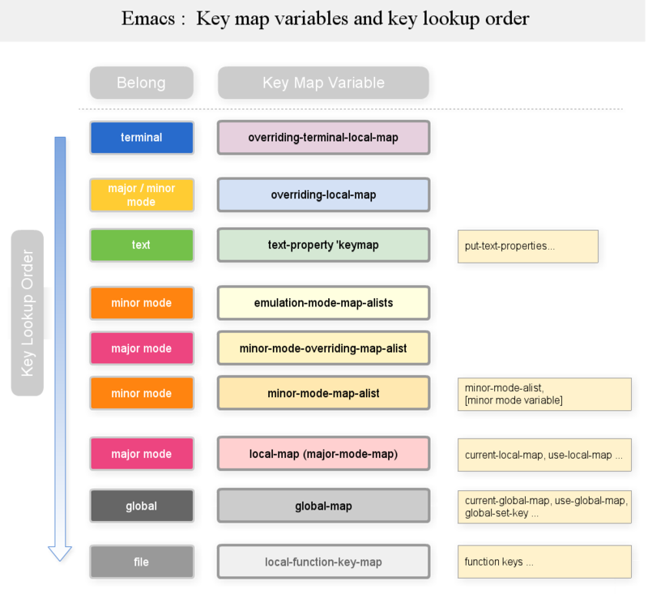

Info の 22.8 Searching the Active Keymaps, 22.9 Controlling the Active Keymaps などから。

「belong」は誰がその変数を管理するかとか、変数の所属先という感じ。

** 基本
全バッファ共通は =global-map= 、メジャーモードは =local-map= を設定する。

マイナーモードはまとめて =minor-mode-map-alist= に入っていて、マイナーモードの変数が =on= か =off= で有効無効が決まる。
このリストの順番も重要。

テキストには文字単位で keymap と言う属性をつけて、キーバインドを設定できる。

あと、これらのどれにもヒットしなければ、 =local-function-key-map= でキーの変換が行われる。
例えば、環境によって =C-i= （タブ文字） と =<tab>= は区別されているが、実質は同じと見なした方が便利なのでここで変換される。

優先順位は見たまま。 =text-property 'keymap= > =minor-mode-map-alist= > =local-map= > =global-map= > =local-function-key-map=

** override
この優先順位を少し覆すことが出来るしくみが overriding 関係。
CSS の =important!= のような感じ。

まず、メジャーモードよりマイナーモードの方が優先されてしまうので、これを覆す仕組みが =minor-mode-overriding-map-alist= 。
ただ、覆そうとしているマイナーモードの名前を知らないといけない。

次に、文字単位の keymap をメジャーモードやマイナーモードから覆す仕組みが =overriding-local-map= 。

最後に、端末入力の最上位で入力を乗っ取る仕組みが =overriding-terminal-local-map= 。
これは影響範囲がその端末だけ。

=emulation-mode-map-alists= は他のメジャーモードやマイナーモードが別のモードのキーマップを乗っ取ったり、 =remap= で挙動を変えたりする場合に使うもの。
検索してもあまり情報がない (cua, viper とかぐらい)。

* Emacsでプレフィックスキーにバインドする方法
:properties:
:export_file_name: generated/contents/blog/2020/609573
:export_date: 2020-05-26
:end:

ネタ元はEmacs-jp。
#+begin_quote
namnium  06:43
すみません、とても小さい質問なのですが、検索ワードが思いつかなかったので質問させてください。
yasnippetでキーバインド C-x i i  をスニペット挿入に割り当てたところ、今まで使用していた insert-file C-x i  を打てなくなってしまったのですが、このようにキーバインドを途中で打ち切りたくなった時はどうすればいいのでしょうか?
とりあえず現在は M-x insert-file  で諦めています...

conao3  08:18
インタラクティブなら、C-x i iにnilをバインドした後にC-x iを再バインドします。
インタラクティブでなくていいなら、init.elの該当行を削除して再起動するだけです。

namnium  09:48
両立って無理な感じですか?

conao3  09:50
うーん、、独自にキーを待つ関数をC-x iに登録したら実現できるかもしれませんが、、
#+end_quote

ということでEmacsにできないことはないので、実装してみた。

#+begin_src emacs-lisp
  (leaf async-await
    :ensure t
    :config
    (leaf c/insert-file
      :leaf-defer nil
      :pre-setq ((c/insert-file-enable . t)
                 (c/insert-file-delay . 1.0))
      :bind (("C-x i" . nil)
             ("C-x i i" . yas-insert-snippet))
      :config
      (funcall
       (async-lambda ()
         (while c/insert-file-enable
           (await (promise:delay c/insert-file-delay))
           (warn "%s" (prin1-to-string
                       (which-key--this-command-keys)))
           (when (equal [24 105] (which-key--this-command-keys))
             (warn "Detect: C-x i")
             (await (promise:delay c/insert-file-delay))
             (when (equal [24 105] (which-key--this-command-keys))
               (warn "Redetect: C-x i")
               (call-interactively #'insert-file))))))))
  (setq c/insert-file-enable nil)
#+end_src

async-awaitとwhich-keyに依存しています。

ループを止める手段が用意されてないので、外から =c/insert-file-enable= を =nil= に設定することで止めます。

あと =call-interactively= を =quit= すると無限ループが止まってしまうんですが、なぜだろう。。

=C-x i= を打って、Redetectされる前に =i= を素早く入力すると、 =yas-insert-snippet= が実行されます。
Redetectされると =insert-file= が実行されます。

* Lispでスペシャルフォームのorやandをapplyする方法
:properties:
:export_file_name: generated/contents/blog/2020/6e67e4
:export_date: 2020-05-26
:end:


=or= や =and= を =apply= したい。

つまり、いろんな操作によって得られたリストに対して =or= や =and= がとりたい。

#+begin_export html
<blockquote class="twitter-tweet"><p lang="ja" dir="ltr">なんでこんな面倒なことをしてるんだと思ったら、andがsubrだからapplyできないのか。<br>この問題、CLerはどうやって解決するんだろう <a href="https://twitter.com/hashtag/lisp?src=hash&amp;ref&#95;src=twsrc%5Etfw">#lisp</a> <a href="https://t.co/cmwx3p8ABm">pic.twitter.com/cmwx3p8ABm</a></p>&mdash; Conao3 (@conao&#95;3) <a href="https://twitter.com/conao&#95;3/status/1243861782352912385?ref&#95;src=twsrc%5Etfw">March 28, 2020</a></blockquote> <script async src="https://platform.twitter.com/widgets.js" charset="utf-8"></script>
<blockquote class="twitter-tweet"><p lang="ja" dir="ltr">(every #&#39;identity &lt;list&gt;) というのも。</p>&mdash; Shiro Kawai (@anohana) <a href="https://twitter.com/anohana/status/1243863766619410432?ref&#95;src=twsrc%5Etfw">March 28, 2020</a></blockquote> <script async src="https://platform.twitter.com/widgets.js" charset="utf-8"></script>
#+end_export

河合さんに =every= を教えてもらいました。

#+begin_src emacs-lisp
  (mapcar #'featurep '(emacs leaf use-package-leaf))
  ;;=> (t t nil)

  (cl-every #'identity (mapcar #'featurep '(emacs leaf use-package-leaf)))
  ;;=> nil

  (cl-every #'identity (mapcar #'featurep '(emacs leaf)))
  ;;=> t
#+end_src

たしかに上手くいっている。 =every= は =and= 相当だったので、 =some= は =or= 相当となる。

#+begin_src emacs-lisp
  (cl-some #'identity (mapcar #'featurep '(emacs leaf)))
  ;;=> t

  (cl-some #'identity (mapcar #'featurep '(use-package-leaf use)))
  ;;=> nil
#+end_src

もちろん、今回の方法はスペシャルフォームではないので、評価してはいけない式が後続している場合、普通にエラーになる。

#+begin_src emacs-lisp
  (or nil t (/ 1 0))
  ;;=> t

  (cl-some #'identity (list nil t (/ 1 0)))
  ;;=> Debugger entered--Lisp error: (arith-error)
  ;;     /(1 0)
  ;;     (list nil t (/ 1 0))
  ;;     (cl-some (function identity) (list nil t (/ 1 0)))
  ;;     eval((cl-some (function identity) (list nil t (/ 1 0))) nil)
  ;;     scratch-comment--elisp--eval-last-sexp(t)
  ;;     scratch-comment--eval-last-sexp(t)
  ;;     scratch-comment-eval-sexp()
  ;;     funcall-interactively(scratch-comment-evalp-sexp)
  ;;     call-interactively(scratch-comment-eval-sexp nil nil)
  ;;     command-execute(scratch-comment-eval-sexp)
#+end_src

* リストに関数を適用して最初にnon-nilを返した値を得る方法
:properties:
:export_file_name: generated/contents/blog/2020/cec89c
:export_date: 2020-05-26
:end:


このような関数をさくっと使いたい。
3つのポイントがあり、「リストに関数を適用して」「最初にnon-nilが返ってきた」「その値を得る」ということ。

2つめのポイントまでなら =cl-find-if= がそのまま使える。
=cl-find-if= は「リストに関数を適用して」「最初にnon-nilが返ってきた」「元の値を得る」ことができる。

#+begin_src emacs-lisp
  (cl-find-if (lambda (elm) (when (<= 3 elm) (* elm elm))) '(1 2 3 4))
  ;;=> 3
#+end_src

私が欲しいのはこういう関数です。
#+begin_src emacs-lisp
  (defun first-value (fn lst)
    "Apply FN for LST and return first non-nil value."
    (funcall fn (cl-find-if fn lst)))
  ;;=> first-value

  (first-value (lambda (elm) (when (<= 3 elm) (* elm elm))) '(1 2 3 4))
  ;;=> 9
#+end_src

Emacs-jpで聞いたところ、koshさんに =seq-some= を教えてもらいました。

#+begin_src emacs-lisp
  (seq-some (lambda (elm) (when (<= 3 elm) (* elm elm))) '(1 2 3 4))
  ;;=> 9
#+end_src

便利。

* MELPAのパッケージページにHomepageリンクが追加
:properties:
:export_file_name: generated/contents/blog/2020/cbf3fd
:export_date: 2020-05-27
:end:

MELPAの公式がツイートしてた。

#+begin_export html
<blockquote class="twitter-tweet"><p lang="en" dir="ltr">We changed the MELPA website&#39;s package pages so that &quot;Homepage&quot; links go to the URL named in the package&#39;s Homepage or URL header, instead of directly to the source code. Hope that helps you explore more conveniently!</p>&mdash; MELPA (@melpa&#95;emacs) <a href="https://twitter.com/melpa&#95;emacs/status/1265125454282801153?ref&#95;src=twsrc%5Etfw">May 26, 2020</a></blockquote> <script async src="https://platform.twitter.com/widgets.js" charset="utf-8"></script>
#+end_export

どうやらこの[[https://github.com/melpa/melpa/commit/02163bf1d920d076f927803796b0f86e3f13ef9b][コミット]]らしい。この[[https://github.com/melpa/melpa/issues/6914][issue]]が引用されています。
さらにこの[[https://lists.gnu.org/archive/html/emacs-devel/2020-05/msg02470.html][ML]]の投稿がリンクされている。投稿者は[[https://www.gnu.org/software/emms/][Emms]]のメンテナであるYoniさん。

ポイントは以下。
#+begin_example
What the MEPLA people are doing that I don't like:

    * Never communicate with the developers of the Emms in any way.

    * Omit many files that come with Emms.

    * Associate Emms with several Emms extensions that live only on
      MELPA and that we, the Emms developers, have never heard
      about. This would give anyone accessing Emms via MELPA that those
      extensions are somehow a part of Emms, when they are not.

      Maybe those extensions are good, in which case I would love for
      the developers to contact us, the Emms developers. But Maybe those
      extensions are bad, don't work, are out of date, or connect with
      non-free services.

    * Not even linking to the Emms home page
      (https://www.gnu.org/software/emms/).
#+end_example

#+begin_example
Ideas for improvement:

    * Encourage people to speak to the developers of a project before
      packaging it.

    * Find a way of packaging a project as-is. For instance, Emms could
      be distributed as is, and the M/ELPA software could simply point
      at where Emms keeps its .el files for Emacs to find. This is
      instead of how I see ELPA working now, which is to force the
      software through a kind of a sieve (I think ELPA calls it a
      recipe) where only a select few files come out the other end.

      Emms doesn't need a recipe; it already comes organized and
      packaged for working with Emacs.

      It makes me think of taking bread, crumbling it up, the mushing
      those crumbs back together to re-form a new loaf of bread.
#+end_example

この投稿を受けて、MELPAにHomepageリンクの追加が提案されました。

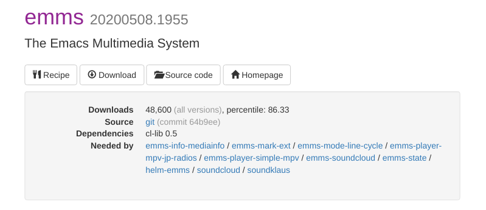

このようにHomepageというボタンが追加されました。

ただ、、MLは個人的にあまり使いたくない。。

そもそも[[https://lists.gnu.org/archive/html/emacs-devel/2020-05/threads.html][量が膨大]]すぎるし、この量をさばくUIもない。
本家の開発に参加したいのは山々なのですが、本質とは関係ないところで敷居を高くしている気がします。

* Elispファイルをタブ/スペース混在インデントからスペースインデントに修正する方法
:properties:
:export_file_name: generated/contents/blog/2020/67a1dc
:export_date: 2020-08-01
:end:

** インデントの話
そもそもEmacsはタブ/スペース混在インデントが初期設定です。

そのためEmacs本体のソースなどはすべて混在インデントでインデントされています。
しかし「空白8つよりタブ1つにしてファイル容量を削減しなくては」という時代は明らかに終わったので、スペースでインデントしましょう。して下さい(泣)。

[[https://github.com/bbatsov/emacs-lisp-style-guide#source-code-layout--organization][Emacs lisp style guide]]にもスペースでインデントすることが太字で記載されていますし、 =white-space-mode= での見た目も良いです。

(ということでほとんどのユーザーはグローバルで =indent-tabs-mode= を =nil= に設定しています。
そのため本体のソースはタブ/スペース混在インデントの部分とスペースインデントの部分が混在しています。カオス。)

これからパッケージを作り始めるときはさておき、歴史のあるソースで修正するのは多少の痛みを伴います。
しかし、Blameで一回変なコミットを見てしまうことを甘んじて受け入れてでもスペースでインデントして欲しいのです。

そもそも[[https://git-scm.com/docs/git-log][git log]]や[[https://git-scm.com/docs/git-blame][git blame]]には空白の変更を無視するオプション( =-w= )があるので履歴の面でもデメリットは無視できます。
Magitのblameでは =-w= はデフォルトで指定されていますし、[[https://github.blog/2018-05-01-ignore-white-space-in-code-review/][GitHubのdiffでも無視]]することができます。

メリットとデメリットは以上です。
** インデントの変更
「よし、スペースインデントにしてやるぜ。」とタブ/スペース混在インデントから考えを変えて下さった方。ありがとうございます。

しかし、すでに成長しきっているプロジェクトで数十のファイルがあるんだけど。。というときには次のスニペットを使って頂ければと思います。

1. diredでElispだけをフィルタリング([[http://emacs.rubikitch.com/dired-filter/][dired-filter]])して、
2. 最初のファイルにポインタを合わせ、
3. 次のスニペットを =M-:= から実行するだけです。

   #+begin_src emacs-lisp
     (while (dired-get-filename nil 'no-error)
       (let ((file (dired-get-filename))
             (indent-tabs-mode nil))
         (with-temp-file file
           (insert-file-contents file)

           (emacs-lisp-mode)
           (delete-trailing-whitespace)
           (untabify (point-min) (point-max))
           (indent-region (point-min) (point-max)))
         (dired-next-line 1)))
   #+end_src

多少時間がかかるかもしれませんが、diredでリストされているファイルの末尾まで処理を実行してくれます。
** 今後の悲劇を防止する
タブ/スペース混在インデントでソースが管理されていたということは、レポジトリオーナーやコントリビュータによって、また混在インデントによるコミットが行われる可能性が高いです。

あるディレクトリ以下で特定の設定を強制することができます。 =.dir-locals.el= です。

以下の =.dir-locals.el= をレポジトリルートに置いて今後の悲劇を防止できます。この方法は[[https://github.com/magit/magit/blob/master/.dir-locals.el][magitのレポジトリ]]でも採用されています。

#+begin_src emacs-lisp
  ((emacs-lisp-mode
    (indent-tabs-mode . nil))
#+end_src

=.dir-locals.el= をレポジトリルートに置きたくないんだけど。という場合には以下を各Elispファイルの末尾付近に置いておけば大丈夫です。
#+begin_src emacs-lisp
  ;; Local Variables:
  ;; indent-tabs-mode: nil
  ;; End:
#+end_src

なお、いろいろなプロジェクトを見て慣習を探ったのですが、 =provide= と =ends here= の間に置くことが多いようです。
#+begin_src emacs-lisp
  (provide '{{pkg-name}})

  ;; Local Variables:
  ;; indent-tabs-mode: nil
  ;; End:

  ;;; {{pkg-name}}.el ends here
#+end_src
** まとめ
タブ/スペース混在インデントは役目を終えました。

Emacsは後方互換性を重視しているためデフォルト値が変更される望みは薄いですが、コミュニティとしてはスペースインデントを使うということでなにとぞ。。

* Elispでstring-trimの代替を用意する方法
:properties:
:export_file_name: generated/contents/blog/2020/dc06b0
:export_date: 2020-08-10
:end:

** 背景
~string-trim~ とは与えた文字列の先頭と末尾の空白文字っぽいものを削除してくれる ~subr-x~ に定義されている便利関数です。
しかし、 ~string-trim~ が ~subr-x~ に追加されたのはEmacs-24.4からなので、Emacs-24.4未満で動かしたいエクストリームパッケージはその恩恵を得ることができません。
簡単な関数なので何度か作ったのですが、いちいち自分のパッケージをgrepするのが面倒なので、ブログポストとして残しておきます。

** 実装
~string-trim~ はサブルーチンとして ~string-left~ と ~string-right~ を組み合わせて実装されています。

#+begin_src emacs-lisp
(defsubst string-trim-left (string &optional regexp)
  "Trim STRING of leading string matching REGEXP.

REGEXP defaults to \"[ \\t\\n\\r]+\"."
  (if (string-match (concat "\\`\\(?:" (or regexp "[ \t\n\r]+") "\\)") string)
      (substring string (match-end 0))
    string))

(defsubst string-trim-right (string &optional regexp)
  "Trim STRING of trailing string matching REGEXP.

REGEXP defaults to  \"[ \\t\\n\\r]+\"."
  (let ((i (string-match-p (concat "\\(?:" (or regexp "[ \t\n\r]+") "\\)\\'")
                           string)))
    (if i (substring string 0 i) string)))

(defsubst string-trim (string &optional trim-left trim-right)
  "Trim STRING of leading and trailing strings matching TRIM-LEFT and TRIM-RIGHT.

TRIM-LEFT and TRIM-RIGHT default to \"[ \\t\\n\\r]+\"."
  (string-trim-left (string-trim-right string trim-right) trim-left))
#+end_src

つまり、これらを連結すればできます。

#+begin_src emacs-lisp
(defun my--string-trim (str &optional trim-left trim-right)
  "Trim STR of leading and trailing strings matching TRIM-LEFT and TRIM-RIGHT.

TRIM-LEFT and TRIM-RIGHT default to \"[ \\t\\n\\r]+\".
Original function is `string-trim'.
This function is polyfill for Emacs<24.4."
  (let ((res str))
    (setq res (replace-regexp-in-string (or trim-left "\\`[ \t\n\r]*") "" res))
    (setq res (replace-regexp-in-string (or trim-right "[ \t\n\r]*\\'") "" res))
    res))
#+end_src

また、この実装では ~replace-regexp-in-string~ を2回実行していますが、正規表現を工夫すれば1回で良いです。

#+begin_src emacs-lisp
  (defun my--string-trim (str)
    "Trim STR of leading and trailing space like strings.

  TRIM-LEFT and TRIM-RIGHT default to \"[ \\t\\n\\r]+\".
  Original function is `string-trim'.
  This function is polyfill for Emacs<24.4."
    (replace-regexp-in-string "\\`[ \t\n\r]*\\|[ \t\n\r]*\\'" "" str))
#+end_src

** まとめ
~string-trim~ を実装しました。
もう一度書きますが、この関数は ~subr-x~ に定義されている関数なので、「Emacs-24.4未満で動かしたいんだけど」というエクストリームパッケージ用です。
正攻法としてはEmacsの要求バージョンを上げてしまうのが一番早いので、そこは留意して頂ければと思います。

* GitHub Actionsで全てのジョブの実行を強制する方法
:properties:
:export_file_name: generated/contents/blog/2020/0fb03f
:export_date: 2020-08-11
:end:

** 背景
GitHub Actions便利ですね。
着々とMSの資金力に囲われている気がしますが、便利なものには乗っかってしまった方がいいのが事実。

困っていたのはmatrixで複数バージョンのテストを走らせたときに、ひとつ失敗するとまだ終わってないジョブが強制的にキャンセルされてしまうこと。
([[https://github.com/conao3/cort.el/actions/runs/202646423][実際のActions]])

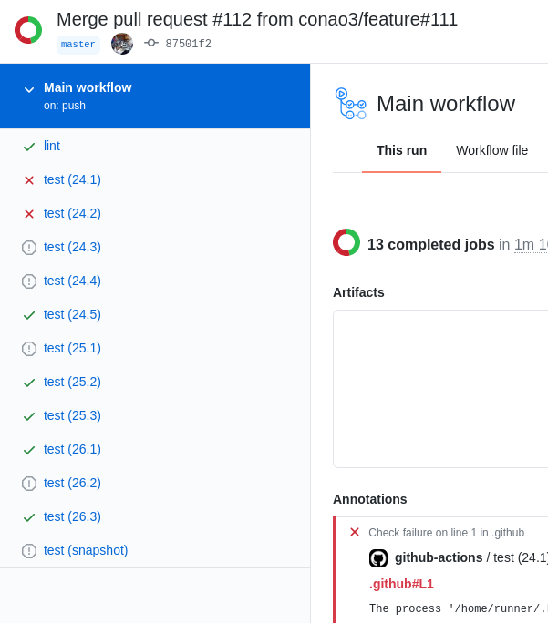

この例だとバージョンの違いでCIが失敗することが分かりますが、その境界が分かりません。これは困る。

ドキュメントを良く見ると、この動作を変える方法が載ってたので紹介する次第です。

** 方法
ドキュメントの該当箇所は 「[[https://docs.github.com/en/actions/reference/workflow-syntax-for-github-actions#jobsjob_idstrategyfail-fast][Workflow syntax for GitHub Actions - jobs.<job_id>.strategy.fail-fast]]」です。

~strategy.fail-fast-~ に ~false~ を指定するだけです。全体はこんな感じ。([[https://github.com/conao3/cort.el/actions/runs/202649689/workflow][実際のActions]])

#+begin_src yaml
name: Main workflow
on:
  push: {branches: [master]}
  pull_request: {branches: [master]}

jobs:
  lint:
    runs-on: ubuntu-latest
    steps:
    - uses: actions/checkout@v1
    - uses: purcell/setup-emacs@master
      with:
        version: '26.3'
    - uses: conao3/setup-keg@master
    - name: Run lint
      run: 'make lint'

  test:
    runs-on: ubuntu-latest
    strategy:
      fail-fast: false
      matrix:
        emacs_version:
          - '24.1'
          - '24.2'
          - '24.3'
          - '24.4'
          - '24.5'
          - '25.1'
          - '25.2'
          - '25.3'
          - '26.1'
          - '26.2'
          - '26.3'
          - 'snapshot'
        include:
          - emacs_version: 'snapshot'
            allow_failure: true
    steps:
    - uses: actions/checkout@v1
    - uses: purcell/setup-emacs@master
      with:
        version: ${{ matrix.emacs_version }}
    - uses: conao3/setup-keg@master

    - name: Run tests
      if: matrix.allow_failure != true
      run: 'make test'

    - name: Run tests (allow failure)
      if: matrix.allow_failure == true
      run: 'make test || true'
#+end_src

この設定をすることで以下の結果を得ることができました。
境界はEmacs-24.3とEmacs-24.4の間でしたね。

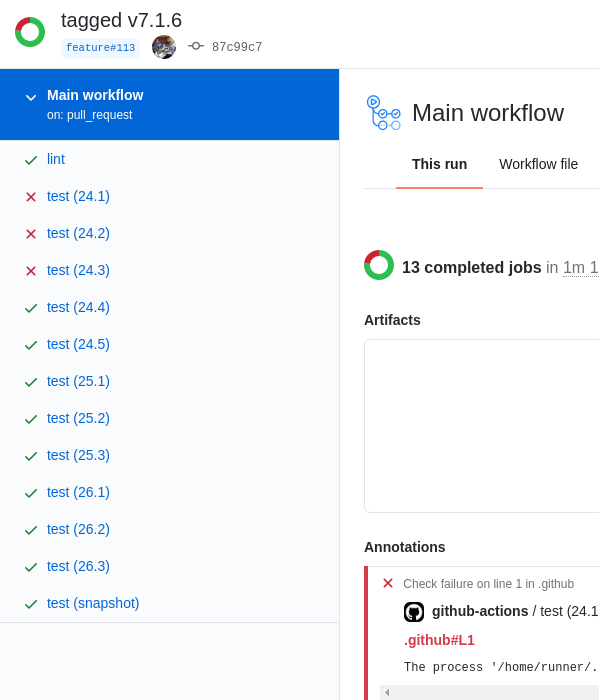

** まとめ
マシンを貸し出す側からしたらさっさとジョブを中止したいのだと思いますが、
ユーザーからすると ~strategy.fail-fast~ を ~false~ に設定するのは必須かもしれません。

パブリックレポジトリでのActionsは無料なのでどんどん使ってバグをmasterに入れないようにしましょう!

** 参考
- [[https://docs.github.com/en/actions/reference/workflow-syntax-for-github-actions][GitHub Docs - Workflow syntax for GitHub Actions]]

* Elispでplist-getをsetfに対応させる方法
:properties:
:export_file_name: generated/contents/blog/2020/48c25c
:export_date: 2020-08-17
:end:

** 背景
~setf~ という便利な関数があります。

これは汎変数に対する ~setq~ と説明できるのですが、この短い紹介では表せないほどの汎用性と利便性を提供してくれます。

汎変数についてはkawabataさんの神記事([[https://qiita.com/kawabata@github/items/9a1a1e211c57a56578d8#%E6%B1%8E%E5%A4%89%E6%95%B0%E3%81%AE%E5%AE%9A%E7%BE%A9%E6%96%B9%E6%B3%95][Qiita - Emacs Lispの汎変数（とその他）]])があるので、まずそちらを参照していただければと思います。

さて、問題は ~alist-get~ は汎変数として定義されているのに、なぜか ~plist-get~ の汎変数が定義されていないことです。

~alist~ も ~plist~ もlispの基本構造で、本質的に同じなので ~alist~ だけ使えて ~plist~ だけ使えないというのは
無意味な非対称性を感じます。

今回は ~plist~ に対して ~setf~ を使えるようにすることを目的とします。

** 汎変数の定義
magit などの大きな(そして注意深く実装されている)パッケージを読んでいると、いきなり ~gv-~ から始まるS式を見ることがあります。

これが汎変数の定義であり、標準で提供されていない汎変数を独自に定義することができます。

汎変数の定義についてもkawabataさんの記事([[https://qiita.com/kawabata@github/items/9a1a1e211c57a56578d8#%E6%B1%8E%E5%A4%89%E6%95%B0%E3%81%AE%E5%AE%9A%E7%BE%A9%E6%96%B9%E6%B3%95][Qiita - Emacs Lispの汎変数（とその他）#汎変数の定義方法]])に記載があります。

ここでは ~gv.el~ の実装を参考に、汎変数を定義する方法を解説します。

*** gv-define-simple-setter
最も簡単なのは ~gv-define-simple-setter~ を使用できる場合です。
セッターを組み立てる際、 ~get~ <-> ~set~ / ~put~ の対応が取れている関数が用意されている場合で、単に関数シンボルを替えるだけで良い場合に使用できます。

#+begin_src emacs-lisp
(gv-define-simple-setter aref aset)
(gv-define-simple-setter car setcar)
(gv-define-simple-setter cdr setcdr)
(gv-define-simple-setter get put)
(gv-define-simple-setter default-value set-default)
(gv-define-simple-setter process-get process-put)
#+end_src

~setf~ や ~rotatef~ はこのように展開され、意図通りにリストが変更されます。
#+begin_src emacs-lisp
(ppp-macroexpand-all
 (let ((target '(a b c)))
   (setf (car target) 'modify)
   target))
;;=> (let ((target '(a b c)))
;;     (let* ((v target))
;;       (setcar v 'modify))
;;     target)

(let ((target '(a b c)))
  (setf (car target) 'modify)
  target)
;;=> (modify b c)

;;;;;;;;;;;;;;;;;;;;;;;;;;;;;;;;;;;;;;;;;;;;;;;;;;

(ppp-macroexpand-all
 (let ((target '(a b c)))
   (cl-rotatef (car target) (cadr target))
   target))
;;=> (let ((target '(a b c)))
;;     (let* ((v target)
;;            (--cl-rotatef-- (car v)))
;;       (progn
;;         (setcar v
;;                 (let* ((v target))
;;                   (prog1 (car (cdr v))
;;                     (setcar
;;                      (cdr v)
;;                      --cl-rotatef--))))
;;         nil))
;;     target)

(let ((target '(a b c)))
  (cl-rotatef (car target) (cadr target))
  target)
;;=> (b a c)
#+end_src

*** gv-define-setter
~gv-define-setter~ はセッターを組み立てる際に、単に関数シンボル置き換えでは実現できない場合に使用します。

基本的にはこのマクロを使うことになるかと思います。
なお、先程の ~gv-define-simple-setter~ は ~gv-define-setter~ を生成するマクロとして定義されていました。

#+begin_src emacs-lisp
(gv-define-setter caar (val x) `(setcar (car ,x) ,val))
(gv-define-setter cadr (val x) `(setcar (cdr ,x) ,val))
(gv-define-setter cdar (val x) `(setcdr (car ,x) ,val))
(gv-define-setter cddr (val x) `(setcdr (cdr ,x) ,val))
(gv-define-setter elt (store seq n)
  `(if (listp ,seq) (setcar (nthcdr ,n ,seq) ,store)
     (aset ,seq ,n ,store)))
(gv-define-setter gethash (val k h &optional _d)
 `(puthash ,k ,val ,h))
#+end_src

~gv-define-setter~ の使用方法は眺めていると分かってきますが、
第1引数に汎変数を定義する関数シンボル、第2引数に関数の引数、第3引数にマクロ展開部を指定します。
第2引数は先頭に変更先の値を受け取って、その後に関数の引数を並べることになっているようです。

~setf~ や ~rotatef~ はこのように展開され、意図通りにリストが変更されます。

#+begin_src emacs-lisp
(ppp-macroexpand-all
 (let ((target '(a b c)))
   (setf (cadr target) 'modify)
   target))
;;=> (let ((target '(a b c)))
;;     (let* ((v target))
;;       (setcar (cdr v) 'modify))
;;     target)

(let ((target '(a b c)))
  (setf (cadr target) 'modify)
  target)
;;=> (a modify c)

;;;;;;;;;;;;;;;;;;;;;;;;;;;;;;;;;;;;;;;;;;;;;;;;;;

(ppp-macroexpand-all
 (let ((target '(a b c)))
   (cl-rotatef (cadr target) (caddr target))
   target))
;;=> (let ((target '(a b c)))
;;     (let* ((v target)
;;            (--cl-rotatef-- (car (cdr v))))
;;       (progn
;;         (setcar
;;          (cdr v)
;;          (let* ((v (cdr (cdr target))))
;;            (prog1 (car v)
;;              (setcar v --cl-rotatef--))))
;;         nil))
;;     target)

(let ((target '(a b c)))
  (cl-rotatef (cadr target) (caddr target))
  target)
;;=> (a c b)
#+end_src

*** gv-define-expander
~gv-define-expander~ はセッターを生成する際にセッターを使いたい場合など、特別な処理を要する関数に使用します。

~alist-get~ の汎変数はこのマクロで定義されています。

なお、先程の ~gv-define-setter~ は ~gv-define-expander~ を生成するマクロとして定義されていました。

#+begin_src emacs-lisp
(gv-define-expander alist-get
  (lambda (do key alist &optional default remove testfn)
    (macroexp-let2 macroexp-copyable-p k key
      (gv-letplace (getter setter) alist
        (macroexp-let2 nil p `(if (and ,testfn (not (eq ,testfn 'eq)))
                                  (assoc ,k ,getter ,testfn)
                                (assq ,k ,getter))
          (funcall do (if (null default) `(cdr ,p)
                        `(if ,p (cdr ,p) ,default))
                   (lambda (v)
                     (macroexp-let2 nil v v
                       (let ((set-exp
                              `(if ,p (setcdr ,p ,v)
                                 ,(funcall setter
                                           `(cons (setq ,p (cons ,k ,v))
                                                  ,getter)))))
                         `(progn
                            ,(cond
                             ((null remove) set-exp)
                             ((or (eql v default)
                                  (and (eq (car-safe v) 'quote)
                                       (eq (car-safe default) 'quote)
                                       (eql (cadr v) (cadr default))))
                              `(if ,p ,(funcall setter `(delq ,p ,getter))))
                             (t
                              `(cond
                                ((not (eql ,default ,v)) ,set-exp)
                                (,p ,(funcall setter
                                              `(delq ,p ,getter))))))
                            ,v))))))))))
#+end_src

~alist-get~ の汎変数の定義がこのように複雑になっているのは、「alistに存在しないキーに対して ~setf~ したときにコンスセルごと追加する」という処理があるからです。

#+begin_src emacs-lisp
(ppp-macroexpand-all
 (let ((target '((a ."a") (b . "b") (c . "c"))))
   (setf (alist-get 'd target) "modify")
   target))
;;=> (let ((target '((a . "a") (b . "b") (c . "c"))))
;;     (let* ((p (if (and nil (not (eq nil 'eq)))
;;                   (assoc 'd target nil)
;;                 (assq 'd target))))
;;       (progn
;;         (if p
;;             (setcdr p "modify")
;;           (setq target (cons (setq p (cons 'd "modify")) target)))
;;         "modify"))
;;     target)

;;;;;;;;;;;;;;;;;;;;;;;;;;;;;;;;;;;;;;;;;;;;;;;;;;

(let ((target '((a ."a") (b . "b") (c . "c"))))
  (setf (alist-get 'a target) "modify")
  target)
;;=> ((a . "modify") (b . "b") (c . "c"))

(let ((target '((a ."a") (b . "b") (c . "c"))))
  (setf (alist-get 'd target) "modify")
  target)
;;=> ((d . "modify") (a . "a") (b . "b") (c . "c"))
#+end_src

「alistに存在しないキーに対して ~setf~ したときにコンスセルごと追加する」という処理が必要ない場合、 ~gv-define-setter~ を使って簡単に定義することができます。
(さらに簡単のため、 ~alist-get~ の ~default~ 、 ~remove~ 、 ~testfn~ 引数も無視します。)

#+begin_src emacs-lisp
(gv-define-setter alist-get (val key alist &optional _default _remove _testfn)
  `(setcdr (assq ,key ,alist) ,val))
;;=> ...

(ppp-macroexpand-all
 (let ((target '((a ."a") (b . "b") (c . "c"))))
   (setf (alist-get 'a target) "modify")
   target))
;;=> (let ((target '((a . "a") (b . "b") (c . "c"))))
;;     (let* ((v target))
;;       (setcdr (assq 'a v) "modify"))
;;     target)

;;;;;;;;;;;;;;;;;;;;;;;;;;;;;;;;;;;;;;;;;;;;;;;;;;

(let ((target '((a ."a") (b . "b") (c . "c"))))
  (setf (alist-get 'a target) "modify")
  target)
;;=> ((a . "modify") (b . "b") (c . "c"))

(let ((target '((a ."a") (b . "b") (c . "c"))))
  (setf (alist-get 'd target) "modify")
  target)
;;=> Debugger entered--Lisp error: (wrong-type-argument consp nil)
;;     setcdr(nil "modify")
;;     (let* ((v target)) (setcdr (assq 'd v) "modify"))
;;     (setf (alist-get 'd target) "modify")
;;     (let ((target '((a . "a") (b . "b") (c . "c")))) (setf (alist-get 'd target) "modify") target)
;;     (progn (let ((target '((a . "a") (b . "b") (c . "c")))) (setf (alist-get 'd target) "modify") target))
;;     eval((progn (let ((target '((a . "a") (b . "b") (c . "c")))) (setf (alist-get 'd target) "modify") target)) t)
#+end_src

このように簡単に定義できますが、alistに存在しないキーに対して作用させようとするとエラーになってしまいます。
~alist-get~ の汎変数はこのような要件を満たすために複雑な定義になっています。

なお、 ~gv-define-expander~ は ~gv-define-setter~ から生成されるので、 ~gv-define-setter~ がどのような式を生成するかを眺めることでも使用法を予想することができます。

#+begin_src emacs-lisp
(ppp-macroexpand
  (gv-define-setter cddr (val x) `(setcdr (cdr ,x) ,val)))
;;=> (gv-define-expander cddr
;;     (lambda (do &rest args)
;;       (declare-function gv--defsetter "gv"
;;                         (name setter do args &optional vars))
;;       (gv--defsetter 'cddr
;;                      (lambda (val x) `(setcdr (cdr ,x) ,val))
;;                      do args)))
#+end_src

**** alist-getの汎変数余談
~gv-define-setter~ は分かりやすいので、どうにかして ~alist-get~ の汎変数を ~gv-define-setter~ で定義できないでしょうか。
まず思いつくのはこのような定義です。

(~macroexp-let2~ は第1引数が ~nil~ のときに、第2引数の名前で ~make-symbol~ したものに第3引数の値をlet束縛するものです。

これはマクロ展開のイディオムを簡略化するものであり、望まない変数捕捉を避けるものです。(マクロの変数捕捉についてはOnlisp([[http://www.asahi-net.or.jp/~kc7k-nd/onlispjhtml/variableCapture.html][Onlisp - 変数捕捉]])参照))

#+begin_src emacs-lisp
(gv-define-setter alist-get (val key alist &optional _default _remove _testfn)
  (macroexp-let2 nil p `(assq ,key ,alist)
    `(if ,p
         (setcdr ,p ,val)
       (setq ,alist (cons (cons ,key ,val) ,alist)))))
;;=> ...

(ppp-macroexpand-all
 (let ((target '((a ."a") (b . "b") (c . "c"))))
   (setf (alist-get 'a target) "modify")
   target))
;;=> (let ((target '((a . "a") (b . "b") (c . "c"))))
;;     (let* ((v target)
;;            (p (assq 'a v)))
;;       (if p
;;           (setcdr p "modify")
;;         (setq v (cons (cons 'a "modify") v))))
;;     target)
;;   nil

;;;;;;;;;;;;;;;;;;;;;;;;;;;;;;;;;;;;;;;;;;;;;;;;;;

(let ((target '((a ."a") (b . "b") (c . "c"))))
  (setf (alist-get 'a target) "modify")
  target)
;;=> ((a . "modify") (b . "b") (c . "c"))

(let ((target '((a ."a") (b . "b") (c . "c"))))
  (setf (alist-get 'd target) "modify")
  target)
;;=> ((a . "a") (b . "b") (c . "c"))
#+end_src

しかし上手く動いてないようです。マクロ展開結果を注意深く見れば分かるのですが、letで一時的に束縛された変数にsetqしてしまっています。
これではグローバルの値を変更できていません。

先程確認したように ~gv-define-setter~ は ~gv--defsetter~ を展開し、これに含まれる ~macroexp-let2~ によりalistをlet束縛してしまいます。
~gv-define-expander~ を直接使うことで ~macroexp-let2~ を展開せず、 ~gv-letplace~ でグローバル値のセッターを得ることができます。

#+begin_src emacs-lisp
(defun gv--defsetter (name setter do args &optional vars)
  "Helper function used by code generated by `gv-define-setter'.
NAME is the name of the getter function.
SETTER is a function that generates the code for the setter.
NAME accept ARGS as arguments and SETTER accepts (NEWVAL . ARGS).
VARS is used internally for recursive calls."
  (if (null args)
      (let ((vars (nreverse vars)))
        (funcall do `(,name ,@vars) (lambda (v) (apply setter v vars))))
    ;; FIXME: Often it would be OK to skip this `let', but in general,
    ;; `do' may have all kinds of side-effects.
    (macroexp-let2 nil v (car args)
      (gv--defsetter name setter do (cdr args) (cons v vars)))))

(ppp-macroexpand
 (gv-define-setter alist-get (val key alist &optional _default _remove _testfn)
   (gv-letplace (getter setter) alist
     (macroexp-let2 nil p `(assq ,key ,alist)
       `(if ,p
            (setcdr ,p ,val)
          ,(funcall setter `(cons (cons ,key ,val) ,getter)))))))
;;=> (gv-define-expander alist-get
;;     (lambda (do &rest args)
;;       (declare-function gv--defsetter "gv"
;;                         (name setter do args &optional vars))
;;       (gv--defsetter 'alist-get
;;                      (lambda (val key alist &optional _default _remove _testfn)
;;                        (gv-letplace (getter setter) alist
;;                          (macroexp-let2 nil p `(assq ,key ,alist)
;;                            `(if ,p
;;                                 (setcdr ,p ,val)
;;                               ,(funcall setter `(cons (cons ,key ,val)
;;                                           ,getter))))))
;;                      do args)))
;;   nil

(ppp-macroexpand
 (gv-define-expander alist-get
   (lambda (do key alist &optional _default _remove _testfn)
     (gv-letplace (getter setter) alist
       (macroexp-let2 nil p `(assq ,key ,alist)
         (funcall do '_getter
                  (lambda (val)
                    `(if ,p
                         (setcdr ,p ,val)
                       ,(funcall setter `(cons (cons ,key ,val) ,getter))))))))))
;;=> (function-put 'alist-get 'gv-expander
;;                 (lambda (do key alist &optional _default _remove _testfn)
;;                   (gv-letplace (getter setter) alist
;;                     (macroexp-let2 nil p `(assq ,key ,alist)
;;                       (funcall do '_getter
;;                                (lambda (val)
;;                                  `(if ,p
;;                                       (setcdr ,p ,val)
;;                                     ,(funcall setter `(cons (cons ,key ,val)
;;                                                 ,getter)))))))))
;;   nil
#+end_src

次に示すように、 ~gv-define-setter~ では上手くいかず、 ~gv-define-expander~ を使うと上手くいきます。

#+begin_src emacs-lisp
(gv-define-setter alist-get (val key alist &optional _default _remove _testfn)
  (gv-letplace (getter setter) alist
    (macroexp-let2 nil p `(assq ,key ,alist)
      `(if ,p
           (setcdr ,p ,val)
         ,(funcall setter `(cons (cons ,key ,val) ,getter))))))
;;=> ...

(ppp-macroexpand-all
 (let ((target '((a ."a") (b . "b") (c . "c"))))
   (setf (alist-get 'd target) "modify")
   target))
;;=> (let ((target '((a . "a")
;;                   (b . "b")
;;                   (c . "c"))))
;;     (let* ((v target)
;;            (p (assq 'd v)))
;;       (if p
;;           (setcdr p "modify")
;;         (setq v (cons (cons 'd "modify") v))))
;;     target)
;;   nil

(let ((target '((a ."a") (b . "b") (c . "c"))))
  (setf (alist-get 'd target) "modify")
  target)
;;=> ((a . "a") (b . "b") (c . "c"))

;;;;;;;;;;;;;;;;;;;;;;;;;;;;;;;;;;;;;;;;;;;;;;;;;;

(gv-define-expander alist-get
  (lambda (do key alist &optional _default _remove _testfn)
    (gv-letplace (getter setter) alist
      (macroexp-let2 nil p `(assq ,key ,alist)
        (funcall do '_getter
                 (lambda (val)
                   `(if ,p
                        (setcdr ,p ,val)
                      ,(funcall setter `(cons (cons ,key ,val) ,getter)))))))))
;;=> ...

(ppp-macroexpand-all
 (let ((target '((a ."a") (b . "b") (c . "c"))))
   (setf (alist-get 'd target) "modify")
   target))
;;=> (let ((target '((a . "a")
;;                   (b . "b")
;;                   (c . "c"))))
;;     (let* ((p (assq 'd target)))
;;       (if p
;;           (setcdr p "modify")
;;         (setq target (cons (cons 'd "modify") target))))
;;     target)
;;   nil

(let ((target '((a ."a") (b . "b") (c . "c"))))
  (setf (alist-get 'd target) "modify")
  target)
;;=> ((d . "modify") (a . "a") (b . "b") (c . "c"))
#+end_src

** まとめ
~setf~ はとても便利なので、ぜひ使いこなして頂ければと思います。

今回、汎変数を定義する方法についてまとめたので、自作パッケージでも汎変数を定義しておいてあげるとユーザーが便利に使えるパッケージになると思います。

なお、今回の目的である ~plist-get~ の汎変数については ~gv-define-setter~ を使って、次のように定義しました。

後でemacs-develにも投稿しておきたいと思います。
本家に取り入れられればこのパッチなしで ~plit-get~ に対する ~setf~ を使用できるようになります。

#+begin_src emacs-lisp
(gv-define-expander plist-get
  (lambda (do plist prop)
    (macroexp-let2 macroexp-copyable-p key prop
      (gv-letplace (getter setter) plist
        (macroexp-let2 nil p `(plist-member ,getter ,key)
          (funcall do
                   `(cadr ,p)
                   (lambda (val)
                     `(if (plist-member ,plist ,key) (setcar (cdr (plist-member ,plist ,key)) ,val)
                        ,(funcall setter `(cons ,key (cons ,val ,getter)))))))))))
;;=> ...

(ppp-macroexpand-all
 (let ((target '(:a "a" :b "b" :c "c")))
   (setf (plist-get target :a) "modify")
   target))
;;=> (let ((target '(:a "a" :b "b" :c "c")))
;;     (let* ((p (plist-member target :a)))
;;       (if (plist-member target :a)
;;           (setcar
;;            (cdr (plist-member target :a))
;;            "modify")
;;         (setq target (cons :a (cons "modify" target)))))
;;     target)
;;   nil

;;;;;;;;;;;;;;;;;;;;;;;;;;;;;;;;;;;;;;;;;;;;;;;;;;

(let ((target '(:a "a" :b "b" :c "c")))
  (setf (plist-get target :a) "modify")
  target)
;;=> (:a "modify" :b "b" :c "c")

(let ((target '(:a "a" :b "b" :c "c")))
  (cl-rotatef (plist-get target :a) (plist-get target :c))
  target)
;;=> (:a "c" :b "b" :c "a")

(let ((target '(:a "a" :b "b" :c "c")))
  (setf (plist-get target :d) "modify")
  target)
;;=> (:d "modify" :a "a" :b "b" :c "c")
#+end_src

** 参考
- [[https://qiita.com/kawabata@github/items/9a1a1e211c57a56578d8#%E6%B1%8E%E5%A4%89%E6%95%B0%E3%81%AE%E5%AE%9A%E7%BE%A9%E6%96%B9%E6%B3%95][Qiita - Emacs Lispの汎変数（とその他）]]
- [[https://github.com/emacs-mirror/emacs/blob/emacs-27.1/lisp/emacs-lisp/gv.el][Emacs source - gv.el]]
- [[https://github.com/emacs-mirror/emacs/blob/emacs-27.1/lisp/emacs-lisp/macroexp.el][Emacs source - macroexp.el]]

* ピクシブ夏インターンシップ「PIXIV SUMMER BOOT CAMP 2020」体験記
:properties:
:export_file_name: generated/contents/blog/2020/8ecc43
:export_date: 2020-09-24
:end:


** はじめに
ピクシブさんのインターンシップ「[[https://www.pixiv.co.jp/news/recruit/article/10019/][PIXIV SUMMER BOOT CAMP 2020]]」へ参加してきました!

期間は8日間という短い期間でしたが、短い期間ながら、とても濃い経験が出来たと思います。

インターン最終日に発表した資料はこちら。

#+html: <script async class="speakerdeck-embed" data-id="3491c9ab20ef40938119aecadb06f1c6" data-ratio="1.77777777777778" src="//speakerdeck.com/assets/embed.js"></script>

** 感想
アウトプットはピクシブ百科事典のオレオレフレームワークからPSR-7/15/17ベースのPHPへ(一部のクラスだが)移行したこと。
触らせて頂いたgitレポジトリのヒストリーだと、cvsからgitへ移行した最初のコミットが9年前、dispatcherやrouter、index.phpには多少手が入ることはあっても抜本的に手が入るのはこれが初めてでした。

最終発表ではこの「9年前」ということに対して、「いやもっと前。。。」というコメントもあったので、長らく「いつか改善したいなぁ」とピクシブのエンジニアさんが思っていたところを作業でき、そのコードに貢献できたのはとても嬉しいことでした。
技術的なことと、その変更をしているときに詰まったところなどは発表資料を参照して頂ければと。

メンターをして頂いたtadsanさんからのコメントです。
インターンで取り組んだ課題の背景などもスレッドで投稿されています。

#+html: <blockquote class="twitter-tweet"><p lang="ja" dir="ltr">ピクシブ百科事典のPSR-7/15/17化が圧倒的進捗しました💪 <a href="https://t.co/bhrbCcIgLe">https://t.co/bhrbCcIgLe</a></p>&mdash; ぞぬ頃し半分子 (@tadsan) <a href="https://twitter.com/tadsan/status/1306904083576401921?ref_src=twsrc%5Etfw">September 18, 2020</a></blockquote> <script async src="https://platform.twitter.com/widgets.js" charset="utf-8"></script>


ノベルティもたくさん頂きました。
現地で参加できれば、このパーカーを着て作業していたらしいですが。。とても残念!

世界的な疫病の拡大により、インターンに係る全ての作業はリモートで行なわれ、初めてのインターンではあるものの不思議な感覚でした。。

そもそも広島からのリモートでのインターン参加を認めて下さったこと、さらにはインターネットの不調により急遽モバイルルータを手配して頂くなど、手厚いサポートを頂きました。

このピクシブのインターンで「圧倒的猛者」になれました!! 本当にありがとうございました!

* org-modeドキュメントからZenn Flavored Markdownを生成するox-zennの使い方
:properties:
:export_file_name: generated/contents/blog/2020/6dae6b
:export_date: 2020-09-25
:end:

** tl;dr
- [[https://github.com/conao3/ox-zenn.el][ox-zenn]]というorgからZenn flavored markdownを生成するパッケージを書きました。
- Zennマークダウンは独自記法があるので、orgファイルとの対応について少し注意することがある。

[[github:conao3/ox-zenn.el::Emacs Lisp]]

** org-modeとは
*** 概要
「[[https://orgmode.org/][org-mode]]とはEmacsのメジャーモードのひとつです」という説明は正しいのですが、org-modeの力を説明するには全く言葉が足りません。

[[https://orgmode.org/ja/][org-modeの日本語プロジェクトページ]]には

#+begin_quote
Org-mode はノートの保存、TODOリストの管理、プロジェクト計画、文書編集のためのモードです。高速で効率的なプレーンテキストのシステムを使ってファイルを編集します。
#+end_quote

と説明されています。

この説明でとても重要なのはorgドキュメントが「プレーンテキスト」であるという点です。

「プレーンテキスト」はロックインを避けるための究極の選択肢です。

「org-mode」にロックインしてるじゃないか。という手痛い指摘が飛んできそうですが、それには当たりません。なぜならorg-modeが編集の対象にしているのは「プレーンテキスト」であり、もしorg-modeが明日なくなったとしても普通のエディタで編集や読み書きができ、様々なUnixコマンドによる処理が容易にできるからです。

*** 万能のドキュメントソース
org-modeはとても大きく、私も全容を把握できていません。
しかしつまみ食いをするだけでもとても大きなメリットがある機能があります。
それがorgのエクスポート機能とコード実行機能[fn:1]です。

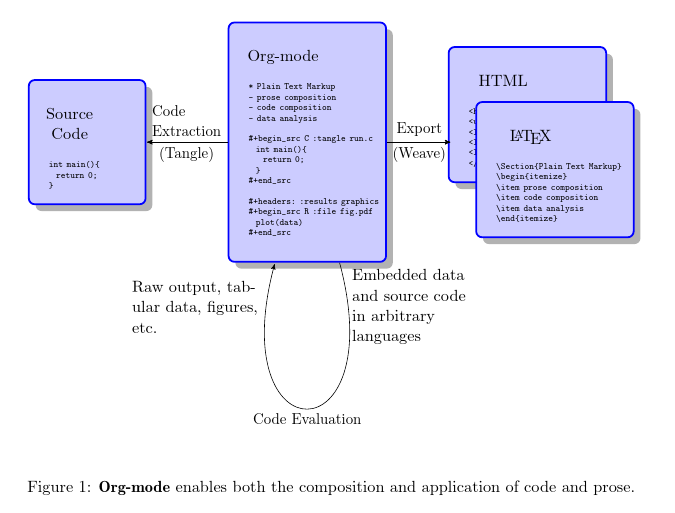

このようにorgドキュメントを中心として、HTMLやLaTeX、Wordドキュメント生成や、実行可能なソースコードを生成する。ドキュメントの中で任意の言語のコード実行を伴なうこともできます。

LSP(Language Server Protocol Support)にも似た思想を感じます。
LSPも各言語に対するプログラミング支援環境を各エディタにそれぞれ実装するのは無駄が多いからという理由で現代では主流といっても良い、勢いとシェアがあります。

私がorgドキュメントとorg-modeを使う理由も同じです。
もうHTMLを、LaTeXを、Wordを、PowerPointをそれぞれのファイルフォーマットで編集する時代は終わっているのです。
私が編集するドキュメント形式はorgドキュメントだけであり、orgドキュメントに情報を集約することで情報の再利用性と利便性が向上するのです。

** ox-zenn
orgはorgドキュメントをパースし、それぞれの「意味」でどのような「出力」にするのか制御することでエクスポート先のファイルを生成します。

つまり我々がorgドキュメントから新しいフォーマットで出力したい場合はorgが解釈した「意味」からどのような出力にするのかというエクスポートバックエンドのみを作成すれば良いことになります。
それがこちら「[[https://github.com/conao3/ox-zenn.el][ox-zenn]]」です。

ox-zennの作り方については別の記事にするとして、この記事では使い方を説明します。

*** org-modeとox-zennのインストール
[[https://github.com/conao3/leaf.el][leaf]]を使ってインストールします。
また、orgはEmacsに標準添付されているのですが、upstreamがとても活発に改善されているので、この手順に従い、最新版を入れることをおすすめします。

現状、ox-zennがまだ[[http://celpa.conao3.com/][celpa]]にしか入っていないので、celpaのURLを ~package-archives~ に追加する必要があることに注意する必要があります。

#+begin_src elisp
(eval-and-compile
  (customize-set-variable
   'package-archives '(("gnu" . "https://elpa.gnu.org/packages/")
                       ("melpa" . "https://melpa.org/packages/")
                       ("celpa" . "https://celpa.conao3.com/packages/")
                       ("org" . "https://orgmode.org/elpa/")))
  (package-initialize)
  (unless (package-installed-p 'leaf)
    (package-refresh-contents)
    (package-install 'leaf))

  (leaf leaf-keywords
    :ensure t
    :config
    (leaf-keywords-init)))

(leaf org
  :ensure org-plus-contrib
  :custom ((org-startup-indented . t)
           (org-return-follows-link . t)
           (org-src-window-setup . 'other-window)
           (org-highlight-latex-and-related . '(latex script entities))))

(leaf ox-zenn
   :ensure t
   :after org
   :require t)
#+end_src

*** 基本のorg記法
orgのプロジェクトページに[[https://orgmode.org/worg/dev/org-syntax.html][org-syntax]]のページがあるので参照して頂ければと。

*** ox-zenn拡張記法
Zenn公式による[[https://zenn.dev/zenn/articles/markdown-guide][Markdownの解説記事]]があります。
Zennは基本的に今時のマークダウン、つまり[[https://github.github.com/gfm/][GFM(GitHub Flavored Markdown)]]を受け取るように見えます。
さらにZenn独自の記法として[[https://zenn.dev/zenn/articles/markdown-guide#zenn%E7%8B%AC%E8%87%AA%E3%81%AE%E8%A8%98%E6%B3%95][独自拡張のブロック要素]]と[[https://zenn.dev/zenn/articles/markdown-guide#%E5%A4%96%E9%83%A8%E3%82%B3%E3%83%B3%E3%83%86%E3%83%B3%E3%83%84%E3%81%AE%E5%9F%8B%E3%82%81%E8%BE%BC%E3%81%BF][コンテンツ埋め込み用のショートコード]]をサポートしています。

残念ながらorgには対応している記法が存在しないのでox-zennが特別に解釈する文法を追加しました。
もちろん、他のバックエンドは解釈しないのでドキュメントの可搬性が落ちることに留意する必要があります。

**** frontmatter
マークダウンの上にYAMLのfrontmatterが書けるのは、どのマークダウンが始めたのか分かりませんが、Zennのマークダウンもfrontmatterでタイトルなどのメタ要素を指定することができます。

Zennはfrontmatterで次の要素を指定することができます。
- ~title~
- ~topics~
- ~emoji~
- ~type~
- ~published~

orgドキュメントでは次のように指定すると、

#+begin_src org
  ,#+title: ZennのMarkdown記法

  ,#+gfm_tags: markdown zenn
  ,#+gfm_custom_front_matter: :emoji 👩‍💻 :type tech
  ,#+gfm_custom_front_matter: :published true
#+end_src

次のようにマークダウンに出力されます。

#+begin_src markdown
---
author: Naoya Yamashita
title: "ZennのMarkdown記法"
last_modified: 2020-09-24
emoji: 👩‍💻
type: tech
topics: [markdown, zenn]
published: true
---
#+end_src

~gfm_tags~ は空白区切りです。
~gfm_custom_front_matter~ はplist風に空白区切りで指定します。
それぞれ、一行が長くなる場合、複数行に分けて指定しても正しく解釈されます。

~author~ と ~last_modified~ は自動で追加されるので、それらは ~options~ で無効化できます。

#+begin_src org
  ,#+title: ZennのMarkdown記法
  ,#+options: broken-links:mark toc:nil author:nil last-modified:nil

  ,#+gfm_tags: markdown zenn
  ,#+gfm_custom_front_matter: :emoji 👩‍💻 :type tech
  ,#+gfm_custom_front_matter: :published true
#+end_src

ZennではサイドバーにToCが表示されているので、 ~toc:nil~ を指定しておくのも便利です。
~:topics~ の指定において、空白が含まれる値を設定する都合上、若干トリッキーになっているので注意する必要があります。

**** ブロック要素
ブロック要素はブロッククオートにhtml属性を付けることで対応しました。
このように定義することで他のバックエンドで出力した際にも多少は意味を保てると思います。

- message :: ブロッククオートに ~#+attr_html:~ で ~x-type~ に ~message~ を指定します。

  #+begin_src org
    ,#+attr_html: :x-type message
    ,#+begin_quote
    メッセージをここに
    ,#+end_quote
  #+end_src

  これは次のようにマークダウンに変換され、

  #+begin_src markdown
  :::message
  メッセージをここに
  :::
  #+end_src

  次のように表示されます。

  #+attr_html: :x-type message
  #+begin_quote
  メッセージをここに
  #+end_quote

- alert :: ブロッククオートに ~#+attr_html:~ で ~x-type~ に ~alert~ を指定します。

  #+begin_src org
    ,#+attr_html: :x-type alert
    ,#+begin_quote
    メッセージをここに
    ,#+end_quote
  #+end_src

  これは次のようにマークダウンに変換され、

  #+begin_src markdown
  :::alert
  メッセージをここに
  :::
  #+end_src

  次のように表示されます。

  #+attr_html: :x-type alert
  #+begin_quote
  メッセージをここに
  #+end_quote

- details :: ブロッククオートに ~#+attr_html:~ で ~x-type~ に ~details~ を指定します。summaryを指定したい場合は ~x-summary~ にサマリを指定します。

  #+begin_src org
    ,#+attr_html: :x-type details :x-summary タイトル
    ,#+begin_quote
    表示したい内容
    ,#+end_quote
  #+end_src

  これは次のようにマークダウンに変換され、

  #+begin_src markdown
    :::details タイトル
    表示したい内容
    :::
  #+end_src

  次のように表示されます。

  #+attr_html: :x-type details :x-summary タイトル
  #+begin_quote
  表示したい内容
  #+end_quote

  なお、 ~x-summary~ 要素を省略した場合は ~details~ をサマリに指定したと解釈されます。

**** 埋め込みショートコード
ショートコードは悩んだ結果、それぞれのサービス名をschemeとして指定するリンクを特別に解釈することにしました。

つまりorgで次のように記述した場合、

#+begin_src org
[[tweet://https://twitter.com/conao_3/status/1308747297790898176]]
[[youtube://jNa3axo40qM]]
[[codepen://https://codepen.io/alphardex/pen/poyOMgr]]
[[slideshare://866aBtwVYswXvu]]
[[speakerdeck://3491c9ab20ef40938119aecadb06f1c6]]
[[jsfiddle://https://jsfiddle.net/chrisvfritz/50wL7mdz]]
#+end_src

次のようにマークダウンで出力され、

#+begin_src markdown
@[tweet](https://twitter.com/conao_3/status/1308747297790898176)
@[youtube](jNa3axo40qM)
@[codepen](https://codepen.io/alphardex/pen/poyOMgr)
@[slideshare](866aBtwVYswXvu)
@[speakerdeck](3491c9ab20ef40938119aecadb06f1c6)
@[jsfiddle](https://jsfiddle.net/chrisvfritz/50wL7mdz)
#+end_src

次のように表示されます。

[[https://twitter.com/conao_3/status/1308747297790898176]]

[[https://www.youtube.com/watch?v=jNa3axo40qM]]

[[https://codepen.io/alphardex/pen/poyOMgr]]

[[https://www.slideshare.net/slideshow/embed_code/key/866aBtwVYswXvu]]

[[https://speakerdeck.com/player/3491c9ab20ef40938119aecadb06f1c6]]

[[https://jsfiddle.net/chrisvfritz/50wL7mdz]]

なお、この拡張は他のバックエンドで動きません。
またデフォルトの状態ではこのリンクは未定義要素へのリンクとして解釈されるため、他のドキュメントへのエクスポートが途中で止まってしまいます。。

これは未定義要素へのリンクを無視するように指定することで回避できます。
orgドキュメントの上の方に ~#+options: broken-links:mark~ と記述します。

**** 画像の拡張記法
orgにおいて、画像を表示するにはdescriptionなしのリンクで表現します。

さらにZennは独自の記法により[[https://zenn.dev/zenn/articles/markdown-guide#%E7%94%BB%E5%83%8F][画像の横幅を指定]]できるようになっています。
この機能については ~#+attr_html~ で ~alt~ 属性と ~width~ 属性を指定すると適切に出力するようにしました。

つまりこのorgフォーマットは
#+begin_src org
  [[https://raw.githubusercontent.com/conao3/files/master/blob/headers/png/ox-zenn.el.png]]

  ,#+attr_html: :alt image
  [[https://raw.githubusercontent.com/conao3/files/master/blob/headers/png/ox-zenn.el.png]]

  ,#+attr_html: :alt image :width 250px
  [[https://raw.githubusercontent.com/conao3/files/master/blob/headers/png/ox-zenn.el.png]]
#+end_src

このように変換され、

#+begin_src markdown


#+end_src

このように表示されます。


#+attr_html: :alt image


#+attr_html: :alt image :width 250px


注意点は画像っぽいリンク、正確に言えば ~org-html-inline-image-rules~ にマッチするリンクでないとインライン表示されず、単なるリンクになってしまいます。

#+begin_src elisp
org-html-inline-image-rules
;;=> (("file" . "\\.\\(jpeg\\|jpg\\|png\\|gif\\|svg\\)\\'")
;;    ("attachment" . "\\.\\(jpeg\\|jpg\\|png\\|gif\\|svg\\)\\'")
;;    ("http" . "\\.\\(jpeg\\|jpg\\|png\\|gif\\|svg\\)\\'")
;;    ("https" . "\\.\\(jpeg\\|jpg\\|png\\|gif\\|svg\\)\\'"))
#+end_src

*** org-publishサポート
この章はオプショナルです。

ox-zennはorg-publishをサポートしているので、若干の設定が必要になりますが、こちらの方が便利だという向きもあるかもしれません。

#+begin_src elisp
  (leaf ox-zenn
    :ensure t
    :after org
    :require t ox-publish
    :defun zenn/f-parent org-publish
    :defvar org-publish-project-alist
    :preface
    (defvar zenn/org-dir "~/dev/repos/zenn-src/org")

    (defun zenn/org-publish (arg)
      "Publish zenn blog files."
      (interactive "P")
      (let ((force (or (equal '(4) arg) (equal '(64) arg)))
            (async (or (equal '(16) arg) (equal '(64) arg))))
        (org-publish "zenn" arg force async)))

    :config
    (setf
     (alist-get "zenn" org-publish-project-alist nil nil #'string=)
     (list
      :base-directory (expand-file-name "" zenn/org-dir)
      :base-extension "org"
      :publishing-directory (expand-file-name "../" zenn/org-dir)
      :recursive t
      :publishing-function 'org-zenn-publish-to-markdown)))
#+end_src

こうすれば次のようなディレクトリ構成にした上で、orgディレクトリ以下のorgドキュメントを一括でarticlesディレクトリとbooksディレクトリにマークダウンに変換できます。(1記事/1orgドキュメント)

#+begin_src shell
~/dev/repos/zenn-src/
├── articles/
│   ├── (ox-zenn-usage.md)
│   ├── (ox-publish-usage.md)
│   ├── (ox-odt-usage.md)
│   └── (ox-html-usage.md)
├── books/
│   └── ox-zenn-book/
│       ├── (1.md)
│       ├── (2.md)
│       ├── (3.md)
│       ├── (config.yml)
│       └── (cover.png)
├── org/
│   ├── articles/
│   │   ├── ox-zenn-usage.org
│   │   ├── ox-publish-usage.org
│   │   ├── ox-odt-usage.org
│   │   └── ox-html-usage.org
│   └── articles
│       └── ox-zenn-book/
│           ├── 1.org
│           ├── 2.org
│           ├── 3.org
│           ├── config.yml
│           └── cover.png
└── README.org
#+end_src

()で囲われたファイルが生成対象のファイル群です。
orgディレクトリでのディレクトリ構造のままファイルがpublishされていることが分かります。

*** subtreeスタイル
この章もオプショナルです。

私はこの方法でZennコンテンツを管理することにしました。

ディレクトリ構造はこのようになります。

#+begin_src shell
~/dev/repos/zenn-src/
├── articles/
│   ├── (ox-zenn-usage.md)
│   ├── (ox-publish-usage.md)
│   ├── (ox-odt-usage.md)
│   └── (ox-html-usage.md)
├── books/
│   └── ox-zenn-book/
│       ├── (1.md)
│       ├── (2.md)
│       ├── (3.md)
│       ├── config.yml
│       └── cover.png
├── main.org
└── README.org
#+end_src

()で囲われたファイルが生成対象のファイル群です。

main.orgに全てのコンテンツを集中させる方法(多記事/1orgドキュメント)です。
ox-hugoのような積極的なサポートではないですが、org標準の機能を使ってもこのように記事を管理できます。

main.orgは次のような形です。
#+begin_src org
  ,#+title: Zenn blog source
  ,#+author: conao3
  ,#+date: <2020-09-24 Thu>
  ,#+options: ^:{} toc:nil

  ,* articles
  ,** org-modeドキュメントからZenn Flavored Markdownを生成するox-zennの使い方
  :PROPERTIES:
  :EXPORT_FILE_NAME: articles/ox-zenn-usage
  :EXPORT_GFM_TAGS: markdown zenn
  :EXPORT_GFM_CUSTOM_FRONT_MATTER: :emoji 👩‍💻 :type tech
  :EXPORT_GFM_CUSTOM_FRONT_MATTER+: :published true
  :END:

  ,*** org-modeとは
  ,**** 概要
  「[[https://orgmode.org/][org-mode]]とはEmacsのメジャーモードのひとつです」という説明は正しいのですが、org-modeの力を説明するには全く言葉が足りません。
  ...
#+end_src

単一orgドキュメントで管理するようになるので、各記事は第2レベルをトップレベルとするようになり、記事ごとのオプションはプロパティドロワで設定するようになります。

プロパティには ~EXPORT_~ が前置されることに注意してください。

エクスポートは記事タイトル(つまり第2レベルの見出し)にポイントを乗せた上で、 ~C-c C-e C-s z z~ という呪文()を入力すれば出力できます。

** まとめ
ox-zennを使うことでorgドキュメントからZenn拡張の含まれたマークダウンを出力できるようになりました。
ぜひみなさんもこのバックエンドを使ってorgからZennの記事を書いてもらえればと思います。

気に入ってもらえたら、ぜひzennか[[https://www.patreon.com/conao3][patreon]]でサポートを頂ければと思います!

** Footnotes

[fn:1] Eric Schulte, Dan Davison, Thomas Dye, et.al., "A Multi-Language Computing Environment for Literate Programming and Reproducible Research" https://www.jstatsoft.org/article/view/v046i03

* COMMENT EmacsにおけるOOPであるところのEIEIOと、DBをElispで扱いながらEIEIOオブジェクトを保存するまで
:properties:
:export_file_name: generated/contents/blog/2020/958847
:export_date: 2020-12-25
:end:


この記事は[[https://qiita.com/advent-calendar/2020/emacs][Emacs Advent Calendar 2020]]の1日目の記事です。投稿日時は(ｯｽｩｰ...)

(さらに予約してあった「CUIのEmacsを再考する」はお蔵入りになりました。再考できずにGUIに戻ってしまったのでアドベントカレンダーに書けるだけのノウハウが溜まりませんでした;;
アドベントカレンダー外でなら書けると思いますので、時間が取れたら書きます;;)

翌日はmkt3「[[https://mako-note.com/python-emacs-ide/][自分のemacsでのpython開発環境をまとめてみる]]」でした

さて、最近ゴリラさんのgh.vimに触発されて、はちゃめちゃ便利そうだったのでEmacsでも使いたいなと思い、細々と[[https://github.com/conao3/reforge.el][reforge]]というパッケージを開発しています。

実は既にForgeというパッケージがある(「[[https://qiita.com/eggc/items/5ce3de89fa4234fe9bbe][Emacs forge 入門 - Qiita]]」)のですが、GitHubから全ての情報を一度に取ってこようとするため[[https://github.com/melpa/melpa][melpa/melpa]]などのまぁまぁ大きなレポジトリだと初回フェッチに5分くらいEmacsがハングするという残念な仕様になっています。

#+begin_quote
一方の不満点はレスポンスの遅さ、サクサク感が足りないところです。
現在仕事で使っているプルリクエストと issue の総数は1万件を超えて
おり、初回の M-x forge-pull だけで30分近くかかってしまうような状
態でした。
#+end_quote

PRを送りたいだけなのに、なぜこんなに待たないといけないのか。。
そのためForgeを入れておきながら、PRには ~M-! hub pull-request &~ を実行する運用になっていました。(EDITORはemacs-clientにしているので、雰囲気EmacsでPRを書いている気分にはなれる。)

さらに[[https://en.wikipedia.org/wiki/Forge_(software)][Forge]]という名のとおり多くのホスティングサービスに対応しようとしており、結果的に最小公倍数であるIssueとPRの登録、その他少ししか対応していませんでした。

非同期処理は全部[[https://github.com/chuntaro/emacs-promise][promise]]で書きたいという思いもあり、全部書き直すことにしました。パッケージ名は適当に[[https://github.com/conao3/reforge.el][reforge]]ということにしました。(スター頂けると喜びます!)

開発の過程でEIEIOとEIEIOのクラスをDBに保存する方法について調べたので、備忘録としてまとめるものです。

** EIEIOとは
[[https://www.gnu.org/software/emacs/manual/html_node/eieio/][EIEIO]](Enhanced Implementation of Emacs Interpreted Objects)はElispで実装された[[https://lisphub.jp/common-lisp/cookbook/index.cgi?%E3%82%AA%E3%83%96%E3%82%B8%E3%82%A7%E3%82%AF%E3%83%88%E3%82%B7%E3%82%B9%E3%83%86%E3%83%A0%28CLOS%29][CLOS]](Common Lisp Object System)です。

といいつつ、CommonLisperの方には「[[https://g000001.cddddr.org/3692638429][#:g1: Emacs LispのEIEIOはCLOSではない]]」という記事を書かれてしまっているので、CLOSとしてのEIEIOというよりEIEIOをそのまま受け入れた方がいいのかもしれません。

EIEIOのドキュメントは短いので、この章ではそれ(と補足)を駆け足で再編成して紹介します。

[[https://ja.wikipedia.org/wiki/%E3%82%AA%E3%83%96%E3%82%B8%E3%82%A7%E3%82%AF%E3%83%88%E6%8C%87%E5%90%91%E3%83%97%E3%83%AD%E3%82%B0%E3%83%A9%E3%83%9F%E3%83%B3%E3%82%B0][オブジェクト指向プログラミング]](OOP)は「カプセル化 (encapsulation)」、「継承 (inheritance)」、「多態性 (polymorphism)」に特徴付けられるらしいので、その観点でまとめます。
(この分野、全く詳しくないので、間違いがあれば教えて下さい。)

*** カプセル化
「一定の関連性を持つ属性と、それらを操作するメソッドをひとまとめにしてオブジェクトとし、公開したいものを公開し、それ以外を内部に隠蔽する機能」です。

~:protection~ が隠蔽に対応するのかなと思いましたが。。

#+begin_src emacs-lisp
(defclass my-cpu-class ()
  ((name :initarg :name)
   (base-clock :initarg :base-clock)
   (thread-num :initarg :thread-num))
  "My CPU Baseclass.")
;;=> my-cpu-class

(setq my-obj-1 (make-instance 'my-cpu-class
                              :name "Snapdragon 888"
                              :base-clock "1.8Ghz"
                              :thread-num 8))
;;=> #s(my-cpu-class "Snapdragon 888" "1.8Ghz" 8)

(oref my-obj-1 :name)
;;=> "Snapdragon 888"

;;;;;;;;;;;;;;;;;;;;;;;;;;;;;;;;;;;;;;;;;;;;;;;;;;

(defclass my-cpu-secret-class ()
  ((name :initarg :name)
   (base-clock :initarg :base-clock)
   (thread-num :initarg :thread-num)
   (secret-slot :initarg :secret-slot :protection :private))
  "My CPU Baseclass.")
;;=> my-cpu-secret-class

(setq my-obj-2 (make-instance 'my-cpu-secret-class
                              :name "Snapdragon 888"
                              :base-clock "1.8Ghz"
                              :thread-num 8
                              :secret-slot "secret!!"))
;;=> #s(my-cpu-secret-class "Snapdragon 888" "1.8Ghz" 8 "secret!!")

(oref my-obj-2 :secret-slot)
;;=> "secret!!"
#+end_src

[[https://www.gnu.org/software/emacs/manual/html_node/eieio/Slot-Options.html][とのこと]]で、 ~protection~ は飾りです。
#+begin_quote
:protection

    This is an old option that is not supported any more.

    When using a slot referencing function such as slot-value, and the value behind slot is private or protected, then the current scope of operation must be within a method of the calling object.

    This protection is not enforced by the code any more, so it’s only useful as documentation.
#+end_quote

*** 継承
「既存オブジェクトのデータ構成とメソッド構成を引き継いで、新しい派生オブジェクトを定義する機能」です。

こんな感じに継承できます。
~defclass~ の第2引数は親クラスです。何も指定しない場合、ベースクラスとなります。

#+begin_src emacs-lisp
(defclass my-cpu-class ()
  ((name :initarg :name)
   (base-clock :initarg :base-clock)
   (thread-num :initarg :thread-num))
  "My CPU Baseclass.")
;;=> my-cpu-class

(defclass my-cpu-amd-class (my-cpu-class)
  ((zen3-arch :initarg :zen3-arch))
  "My CPU AMD class.")
;;=> my-cpu-amd-class

(defclass my-cpu-intel-class (my-cpu-class)
  ((intel-hyper-threading :initarg :intel-hyper-threading))
  "My CPU Intel class.")
;;=> my-cpu-intel-class

(make-instance 'my-cpu-class
               :name "Snapdragon 888"
               :base-clock "1.8Ghz"
               :thread-num 8)
;;=> #s(my-cpu-class "Snapdragon 888" "1.8Ghz" 8)

(make-instance 'my-cpu-amd-class
               :name "Ryzen 5 5600X"
               :base-clock "3.7Ghz"
               :thread-num 12
               :zen3-arch t)
;;=> #s(my-cpu-amd-class "Ryzen 5 5600X" "3.7Ghz" 12 t)

(make-instance 'my-cpu-intel-class
               :name "Intel Core i5-10400F"
               :base-clock "2.9Ghz"
               :thread-num 12
               :intel-hyper-threading t)
;;=> #s(my-cpu-intel-class "Intel Core i5-10400F" "2.9Ghz" 12 t)
#+end_src

下記のように、親クラスは複数指定できます。

#+begin_src emacs-lisp
(defclass my-cpu-meta-class (my-cpu-amd-class my-cpu-intel-class)
  ((sale-p :initarg :sale-p))
  "My CPU meta class.")
;;=> my-cpu-meta-class

(make-instance 'my-cpu-meta-class
               :name "Ryzen 5 5600X/Intel Core i5-10400F"
               :base-clock "3.7Ghz/2.9Ghz"
               :thread-num 12
               :intel-hyper-threading t
               :sale-p t)
;;=> #s(my-cpu-meta-class "Ryzen 5 5600X/Intel Core i5-10400F" "3.7Ghz/2.9Ghz" 12 unbound t t)
#+end_src

~:initarg~ を指定しないと ~make-instance~ 時に指定できません(なぜ。。)。スロット名と異なるシンボルでも多分大丈夫ですが、混乱すると思います。

スロットには様々な引数を指定できます。詳しくは[[https://www.gnu.org/software/emacs/manual/html_node/eieio/Slot-Options.html][ドキュメントを参照]]して頂ければと。

*** 多態性
「異なる種類のオブジェクトに同一の操作インターフェースを持たせる機能」です。

制限として、現在のEIEIOは[[https://ufcpp.net/study/csharp/sp4_multipledispatch.html][多重ディスパッチ]]には[[https://www.gnu.org/software/emacs/manual/html_node/eieio/Introduction.html][対応していません]]。つまり、ディスパッチは引数の組み合わせではなく、必ず第1引数の型により決定されます。

しかし、cl-generic(Emacs-25からcl-libに付属)は[[https://www.reddit.com/r/emacs/comments/5u7rsu/bbdb_on_eieio_an_introduction_to_objectoriented/ddtk2sn/?utm_source=reddit&utm_medium=web2x&context=3][対応してる]]みたいです。
~cl-defmethod~ と ~cl-defgeneric~ が両方 ~cl-generic~ に定義されていて混乱するのですが、どうやら ~cl-defgeneric~ は複数の ~cl-defmethod~ を定義できるようです。

#+begin_src emacs-lisp
(defclass thing-one ()
  nil)
;;=> thing-one

(defclass thing-two ()
  nil)
;;=> thing-two

(cl-defmethod foo ((obj thing-one))
  (message "ONE.foo on %s" obj))
;;=> foo

(cl-defmethod foo ((obj thing-two))
  (message "TWO.foo on %s" obj))
;;=> foo

(foo (make-instance 'thing-one))
;;=> "ONE.foo on #s(thing-one)"

(foo (make-instance 'thing-two))
;;=> "TWO.foo on #s(thing-two)"
#+end_src

#+begin_src emacs-lisp
(defclass thing-three ()
  nil)
;;=> thing-three

(cl-defmethod bar ((obj-a thing-one) (obj-b thing-two))
  (message "(ONE, TWO).bar on %s, %s" obj-a obj-b))
;;=> bar

(cl-defmethod bar ((obj-a thing-two) (obj-b thing-three))
  (message "(TWO, THREE).bar on %s, %s" obj-a obj-b))
;;=> bar

(bar (make-instance 'thing-one) (make-instance 'thing-two))
;;=> "(ONE, TWO).bar on #s(thing-one), #s(thing-two)"

(bar (make-instance 'thing-two) (make-instance 'thing-three))
;;=> "(TWO, THREE).bar on #s(thing-two), #s(thing-three)"
#+end_src

#+begin_src emacs-lisp
(cl-defgeneric hoge (obj-a obj-b)
  "bar function"
  (:method ((obj-a thing-one) (obj-b thing-two))
           (message "(ONE, TWO).hoge on %s, %s" obj-a obj-b))
  (:method ((obj-a thing-two) (obj-b thing-three))
           (message "(TWO, THREE).hoge on %s, %s" obj-a obj-b)))
;;=> hoge

(hoge (make-instance 'thing-one) (make-instance 'thing-two))
;;=> "(ONE, TWO).hoge on #s(thing-one), #s(thing-two)"

(hoge (make-instance 'thing-two) (make-instance 'thing-three))
;;=> "(TWO, THREE).hoge on #s(thing-two), #s(thing-three)"
#+end_src

さらにadviceのように ~:around~, ~:after~, ~before~ を使って関数をカスタマイズできるようですが、これは[[https://ericabrahamsen.net/tech/2016/feb/bbdb-eieio-object-oriented-elisp.html#org36435cd][参考リンク]]を貼るだけにします。

*** (インスタンス生成)
これまで ~make-instance~ 関数によりインスタンスを生成していましたが、クラス名と同名の関数が定義されているので、それを使っても同じ結果になります。
#+begin_src emacs-lisp
  (defclass my-cpu-class ()
    ((name :initarg :name)
     (base-clock :initarg :base-clock)
     (thread-num :initarg :thread-num))
    "My CPU Baseclass.")

  (make-instance 'my-cpu-class
                 :name "Snapdragon 888"
                 :base-clock "1.8Ghz"
                 :thread-num 8)
  ;;=> #s(my-cpu-class "Snapdragon 888" "1.8Ghz" 8)

  (my-cpu-class :name "Snapdragon 888"
                :base-clock "1.8Ghz"
                :thread-num 8)
  ;;=> #s(my-cpu-class "Snapdragon 888" "1.8Ghz" 8)
#+end_src

** 参考資料
- [[https://ericabrahamsen.net/tech/2016/feb/bbdb-eieio-object-oriented-elisp.html][BBDB on EIEIO – An Introduction to Object-Oriented Emacs Lisp]]

* COMMENT EmacsのGitクライアントMagitのプラグイン紹介
:properties:
:export_file_name: generated/contents/blog/2020/c23057
:export_date: 2020-12-25
:end:

[[https://github.com/magit/magit][Magit]]という超便利パッケージがあります。

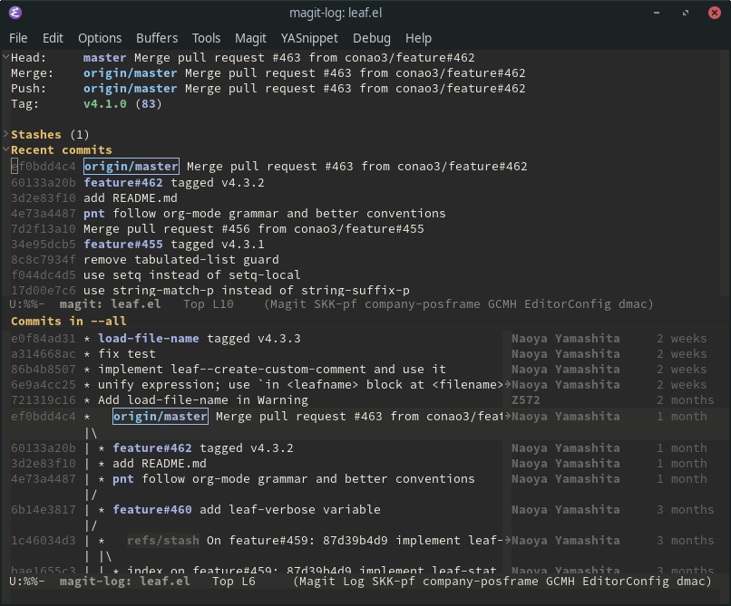

私がEmacsから離れられないのは、この[[https://github.com/magit/magit][magit]]と[[https://orgmode.org/][org-mode]]、[[https://www.gnu.org/software/emacs/manual/html_mono/eintr.html][emacs-lisp]]なので、magitはとても大きなウェイトを占めています。

magitは[[https://github.com/tarsius][tarsius]]さんの代表的なパッケージで、

* leaf-defaultsというはちゃめちゃ便利キーワードをleafに追加した話
:properties:
:export_file_name: generated/contents/blog/2020/5fc05c
:export_date: 2020-12-25
:end:

この記事は[[https://qiita.com/advent-calendar/2020/emacs][Emacs Advent Calendar 2020]]の16日目の記事です。投稿日時は見てはいけません()
前日はTakesxiSximadaさんの「EmacsでPlantUMLを使う」、翌日はfiboさんの「[[https://qiita.com/fibo/items/174898ffc447542f7786][emacs -nw のコピペ事情]]」でした。

今回、[[https://github.com/conao3/leaf.el][leaf]]という自作パッケージに新しいキーワードを追加したので、その紹介をするものです。
(スター200越えました...! やる気に影響するので、よさげなツールだなぁと思っていただければ、ぜひスターを頂ければと...!)

[[github:conao3/leaf-keywords.el::Emacs Lisp][Additional leaf.el keywords for external packages]]

** leafの紹介
leafを使っていらっしゃる方も、use-packageからの移行を悩んでおられる方も、素のElispでEmacsの設定をされている方もおられるかと思います。

まず、leafがどのようなメリットを提供するのか軽く紹介します。

- 統一されたフォーマットでのEmacsパッケージ設定
  - パッケージ設定に係る「イディオム」を隠蔽し、簡潔でメンテナンスしやすくなる
- パッケージの設定が一つのS式になり、一目で設定の区切りを認識できる
- キーワードを(比較的)簡単に追加でき、leafを自分で拡張できる
- use-packageのおせっかい?な挙動や文法上の問題を修正している。
- Emacs-jpでleafについての質問が日本語で出来る。

とりあえず5点挙げました。素のElispで管理されている方には全ての点が、既にuse-packageで書かれている方はleafに移行することによって後半の3点のメリットを享受できるようになります。

今回は「キーワードを(比較的)簡単に追加でき、leafを自分で拡張できる」の点を使って =leaf-defaults= という機能を追加したので、その紹介をしたいと思います。

** leaf-defaults
*** きっかけ
=leaf= は確かにイディオムを隠蔽してくれるが、「それ以上」が欲しい。
具体的には *各パッケージのおすすめ設定* を特殊なキーワードを指定したら *勝手に設定してくれる* 機能を入れられないだろうか。
何なら各ユーザーのおすすめ設定をどこかにアップロードしてもらって、特殊なキーワードから指定したら *自動でダウンロードする* 機能とかどうだろうか。と考えたのがきっかけでした。

元はleaf-defaultsという別パッケージにして配布する予定でした。具体的にいつ、この機能を思いついていたのかは忘れましたが、どうやら[[https://github.com/conao3/leaf-defaults.el][2年前にはレポジトリを作っていた]]ようでした。

ただ、Emacsの設定をアップロード/ダウンロードするとかは結構(というかかなり)セキュリティに問題がある気がしたので断念した結果、その特殊なキーワードを既存の[[https://github.com/conao3/leaf-keywords.el][leaf-keywords]]に入れるということで当初の目的の8割ぐらいを実現したものになります。

(こういうきっかけがあるので、この記事や他で言及するときは「leaf-defaults」として言及しますが、特にそういう名前のパッケージがあるわけではないです。leaf-keywordsの中に実装された一つのキーワードです。)

*** ユースケース
私はEmacsを使いながら、Emacsのパッケージを趣味で書いていますし、気に入ったパッケージがあればその紹介記事を書いたりすることもあります。「[[https://emacs-jp.github.io/tips/emacs-in-2020.html][2020年代のEmacs入門 - Emacs-jp]]」とかは分散していたおすすめ入門パッケージを一つにした記事ですね。

この記事、書く方は、まぁ順当に大変なのですが、読む方も結構大変だと思います。
実際、私が最近新しい環境に放り込まれたので、この記事を見ながらEmacsの最小限のセットアップをしたのですが、コードブロックが分かれていてコピペが非常に面倒でした。

leaf-defaultsを使えば、このように書けます!

#+begin_src emacs-lisp
(leaf leaf-keywords-defaults
  :require t
  :config
  (leaf-keywords-defaults-basic-dependency)
  (leaf-keywords-defaults--leaf-defaults/base))
#+end_src

これで「[[https://emacs-jp.github.io/tips/emacs-in-2020.html][2020年代のEmacs入門 - Emacs-jp]]」の設定の8割方を自分のEmacsに反映することができます!

さらに「[[https://emacs-jp.github.io/packages/ddskk-posframe][ddskk-posframe: ddskkツールチップposframeフロントエンド]]」という紹介記事には冒頭に設定例が書いてある例が多いですが、このような場合、

#+begin_src emacs-lisp
(leaf skk :defaults t)
(leaf posframe :defaults t)
(leaf ddskk-posframe :defaults t)
#+end_src

と書くことで設定が完了します! (この記事の場合、 =ddskk-posframe= が =skk= と =posframe= に依存しているので3つのS式に分かれてますが、普通の記事だと1つのS式になるはず)

*** 仕組み
leaf-defaultsは設定を隠蔽しているだけなので、設定の本体があるはずです。あります。[[https://github.com/conao3/leaf-keywords.el/blob/6e0d407768e1adf7953fbd20e8b91ad5ecfbfd5c/leaf-keywords-defaults.el][leaf-keywords.el/leaf-keywords-defaults.el]]です。このファイルは[[https://github.com/conao3/leaf-manager.el][leaf-manager]]を使って半自動で編集されている、私が管理している設定ファイルです。

さらっと見ると =:convert-defaults= という見慣れないキーワードがあります。まずこれを説明します。

(マクロ展開に拙作のpppを使います。ローカルで結果を確認したい方はインストールしてもらえればと。
さらに結果を簡潔にするために =(setq leaf-expand-minimally t)= しています。)

**** :convert-defaultsキーワード
leafはマクロなので、leafが受け取ったS式を *自由に変換して* Emacsに解釈させることができます。普段は個人用の設定を書くために使うものなので、生成するS式の順序を変更したり、イディオムを生成するだけです。

普段のleaf。 =:doc= などのドキュメントキーワードの引数を消したり、 =:emacs>== キーワードからバージョン判定式を生成したり、 =:bind= から =autoload= 式を生成したりなどしています。

#+begin_src emacs-lisp
(ppp-macroexpand
 (leaf company
   :doc "Modular text completion framework"
   :emacs>= 24.3
   :ensure t
   :blackout t
   :leaf-defer nil
   :bind ((company-active-map
           ("C-n" . company-select-next)
           ("C-p" . company-select-previous))
          (company-search-map
           ("C-n" . company-select-next)
           ("C-p" . company-select-previous)))
   :custom ((company-tooltip-limit . 12)
            (company-idle-delay . 0))
   :global-minor-mode global-company-mode))
;;=> (prog1 'company
;;     (unless (fboundp 'global-company-mode)
;;       (autoload #'global-company-mode "company" nil t))
;;     (unless (fboundp 'company-select-next)
;;       (autoload #'company-select-next "company" nil t))
;;     (unless (fboundp 'company-select-previous)
;;       (autoload #'company-select-previous "company" nil t))
;;     (when (version<= "24.3" emacs-version)
;;       (leaf-handler-package company company nil)
;;       (leaf-keys
;;        ((company-active-map :package company
;;                             ("C-n" . company-select-next)
;;                             ("C-p" . company-select-previous))
;;         (company-search-map :package company
;;                             ("C-n" . company-select-next)
;;                             ("C-p" . company-select-previous))))
;;       (customize-set-variable 'company-tooltip-limit 12 "Customized with leaf in company block")
;;       (customize-set-variable 'company-idle-delay 0 "Customized with leaf in company block")
;;       (global-company-mode 1)
;;       (with-eval-after-load 'company
;;         (blackout 'company-mode nil))))
#+end_src

しかし、もっと大きく結果を変えることもできます。 =:convert-defaults= キーワードを指定するとこうなります。

#+begin_src emacs-lisp
(ppp-macroexpand
 (leaf company
   :convert-defaults t
   :doc "Modular text completion framework"
   :emacs>= 24.3
   :ensure t
   :blackout t
   :leaf-defer nil
   :bind ((company-active-map
           ("C-n" . company-select-next)
           ("C-p" . company-select-previous))
          (company-search-map
           ("C-n" . company-select-next)
           ("C-p" . company-select-previous)))
   :custom ((company-tooltip-limit . 12)
            (company-idle-delay . 0))
   :global-minor-mode global-company-mode))
;;=> (prog1 'company
;;     (defun leaf-keywords-defaults--leaf/company nil
;;       "Default config for leaf/base."
;;       (unless (fboundp 'global-company-mode)
;;         (autoload #'global-company-mode "company" nil t))
;;       (unless (fboundp 'company-select-next)
;;         (autoload #'company-select-next "company" nil t))
;;       (unless (fboundp 'company-select-previous)
;;         (autoload #'company-select-previous "company" nil t))
;;       (when (version<= "24.3" emacs-version)
;;         (leaf-handler-package company company nil)
;;         (leaf-keys
;;          ((company-active-map :package company
;;                               ("C-n" . company-select-next)
;;                               ("C-p" . company-select-previous))
;;           (company-search-map :package company
;;                               ("C-n" . company-select-next)
;;                               ("C-p" . company-select-previous))))
;;         (customize-set-variable 'company-tooltip-limit 12 "Customized with leaf in company block")
;;         (customize-set-variable 'company-idle-delay 0 "Customized with leaf in company block")
;;         (global-company-mode 1)
;;         (with-eval-after-load 'company
;;           (blackout 'company-mode nil)))))
#+end_src

なにが変わっているでしょうか。

そうですね。leafが生成したS式全体が =defun= で囲われており、以前は *S式の実行* だったものが、 *関数の宣言* に変わりました。

この仕組みにより設定集を =leaf-keywords= に添付しても各ユーザーにとっては単に関数が宣言されているだけで、その中の設定は反映されることはありません。

=:convert-defaults= に =t= ではなくシンボルを渡した場合、そのシンボル名を使って関数が定義されます。

#+begin_src emacs-lisp
(ppp-macroexpand
 (leaf company
   :convert-defaults t
   :global-minor-mode global-company-mode))
;;=> (prog1 'company
;;     (defun leaf-keywords-defaults--leaf/company nil
;;       "Default config for leaf/company."
;;       (unless (fboundp 'global-company-mode)
;;         (autoload #'global-company-mode "company" nil t))
;;       (global-company-mode 1)))

(ppp-macroexpand
 (leaf company
   :convert-defaults conao3
   :global-minor-mode global-company-mode))
;;=> (prog1 'company
;;     (defun leaf-keywords-defaults--conao3/company nil
;;       "Default config for conao3/company."
;;       (unless (fboundp 'global-company-mode)
;;         (autoload #'global-company-mode "company" nil t))
;;       (global-company-mode 1)))
#+end_src

最後はこの自動生成した関数を呼び出す仕組みを作るだけです。

**** :defaultsキーワード
=:defaults= キーワードは =:convert-defaults= キーワードで生成された関数を実行するS式を生成するキーワードです。これまでに書いたように =t= やシンボルを与えることができます。

#+begin_src emacs-lisp
(ppp-macroexpand-all
 (leaf company :defaults nil))
;;=> (prog1 'company)

(ppp-macroexpand-all
 (leaf company :defaults t))
;;=> (prog1 'company
;;     (leaf-keywords-defaults--leaf/company))

(ppp-macroexpand-all
 (leaf company :defaults conao3))
;;=> (prog1 'company
;;     (leaf-keywords-defaults--conao3/company))
#+end_src

=nil= はキーワード無効化、 =t= はleafが提供している設定を反映、 シンボルはユーザー名を想定しており、 =conao3= だとconao3が提供している設定を反映することになります。

**** パッケージグループ機能
[[https://github.com/conao3/leaf-keywords.el/blob/6e0d407768e1adf7953fbd20e8b91ad5ecfbfd5c/leaf-keywords-defaults.el][leaf-keywords-defaults]]には多くのパッケージ設定が登録される予定です。パッケージを一つずつ反映するのではなく、パッケージ設定例をまとめた「パッケージグループ」のようなものを定義できたら便利ではないでしょうか。

ということで、[[https://github.com/conao3/leaf-keywords.el/blob/6e0d407768e1adf7953fbd20e8b91ad5ecfbfd5c/leaf-keywords-defaults.el#L111-L112][ここ]]で =base= パッケージグループを定義しています。これまでも例示していた =(leaf-keywords-defaults--leaf-defaults/base)= を実行すると、どうやら下記のパッケージ群が設定されることが分かります。

- cus-edit
- cus-start
- delsel
- files
- paren
- simple
- startup
- flycheck
- company

(このパッケージ群は変わる可能性があります、が、ほとんど必須と言って良いパッケージのみ登録する予定です。
例えばhelmとivyについては各ユーザーの好みがあると思うので、baseパッケージグループには(現状では)入りません。)

*** 拡張
Emacsユーザーは拡張性を重視します。leaf-defaultsも拡張しやすいように設計されています。
leafが提供する設定例を変えたい場合、色々な方法で変えることができます。

=:convert-deafults= で生成されるのは「関数」であることに注意すれば下記の方法があります。

1. leafの設定キーワードを使う

   =:defaults= は =:when= や =:if= などの条件分岐キーワードの後に展開されます。
   ということで、普通に =:config= キーワードや =:custom= キーワードを使うことで提供されている設定例から少し変えることができます。

   #+begin_src emacs-lisp
   (leaf company
     :defaults t
     :custom ((company-idle-delay . 0)))
   #+end_src

2. アドバイスで変える

   関数なのでアドバイスをかけられます。

   #+begin_src emacs-lisp
   (leaf company
     :preface
     (defun my/advice--leaf-keywords-defaults--leaf/company (fn &rest args)
       (apply fn args)
       (setq company-idle-delay 0))
     :advice (:around leaf-keywords-defaults--leaf/company
                        my/advice--leaf-keywords-defaults--leaf/company))

   (leaf company :defaults t)                ; :defaults より :advice の方が遅いので注意
   #+end_src

3. 上書きで変える

   関数なので、同名で定義してしまえば新しい定義で上書きできます。

   #+begin_src emacs-lisp
   (leaf company
     :convert-defaults t                   ; leafの設定例を上書き
     :custom ((company-idle-delay . 0))
     :global-minor-mode global-company-mode)

   (leaf company :defaults t)              ; 上書きした設定を読み込み
   #+end_src

4. PRで変える

   [[https://github.com/conao3/leaf-keywords.el][leaf-keywords]]にPRすればデフォルトの設定例を変更できます!()

** まとめ
leaf-defaultsについて紹介しました。2年前から構想はしていたものの、形になるまで結構な時間がかかったパッケージになりました。

これでEmacsパッケージ紹介記事がより読み易くなればいいなと思っています。

もちろん、紹介記事を書けば =:defaults= が使えるわけではありません。パッケージ紹介記事を書き、 =:defaults= キーワードで読者に設定させてみたいなという奇特な方がいらっしゃいましたら、設定例を[[https://github.com/conao3/leaf-keywords.el][leaf-keywords]]にPRしてもらえればと思いますー!
(当然、PRされた設定例はleaf公認としてリリースするので、レビューが入ります。)

* dioxus-tui入門 - 0.2.2
:properties:
:export_file_name: generated/contents/blog/2022/6b4afc
:export_date: 2022-12-16
:end:

** はじめに
この記事はRustアドベントカレンダー16日目の記事です。
昨日はyukinaritさんの「[[https://zenn.dev/yukinarit/articles/71bb4a01a8e58e][PGOでRustで書かれた広告サーバを早くする]]」でした。

RustでTUIアプリケーションを作りたいなーっと思っていろいろ探していると dioxus-tui というライブラリを見つけたので、使ってみた記事を書きます。

今回の記事で作ったレポジトリは [[https://github.com/conao3/rust-dioxus-tui-sample][conao3/rust-dioxus-tui-sample]] に置いてあります。

** dioxusとは
TUIアプリケーション専用ではなく、仮想DOMを使ってWebフロントエンド、デスクトップアプリ、モバイルアプリを書き出すクレート。

日本語記事ではここらへんを参照

- [[https://zenn.dev/mizchi/scraps/449f0591e2cee9][dioxus web やってみる - Zenn/mizchi]]
- [[https://qiita.com/uwattotaitai/items/4d262e46c2165e01f477][Rust UIライブラリ「Dioxus」をReact+Typescriptと比較してみた - Qiita/uwattotaitai]]

この記事ではdioxusを使ってTUIアプリを作ってみます。

** Getting Started
適当なRustプロジェクトを作って遊んでみます。
#+begin_src sh
mkdir rust-dioxus-tui-sample
cd rust-dioxus-tui-sample
cargo init --name dioxus-tui-sample
#+end_src

cargoで取ってきます。
#+begin_src sh
cargo add dioxus dioxus-tui
#+end_src

=src/main.rs= を以下で置き換えます。
#+begin_src rust
use dioxus::prelude::*;

fn main() {
    dioxus_tui::launch(app);
}

fn app(cx: Scope) -> Element {
    cx.render(rsx! {
        div {
            width: "100%",
            height: "10px",
            background_color: "red",
            justify_content: "center",
            align_items: "center",
            "Hello world!"
        }
    })
}
#+end_src

cargoで起動します。
#+begin_src sh
cargo run
#+end_src

起動できたら成功です! :tada:
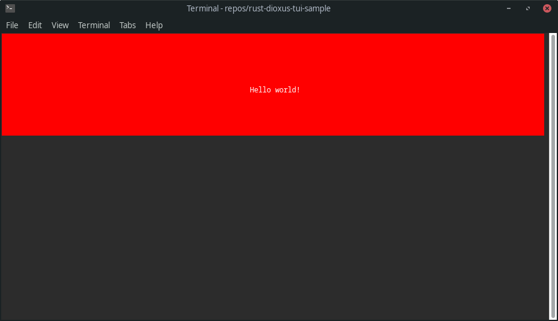

** rsx!マクロ
*** rsx
JSXのようなインターフェースを提供するマクロ。次のようなサンプルが動きます。

#+begin_src rust
use dioxus::prelude::*;

fn main() {
    dioxus_tui::launch(app);
}

fn app(cx: Scope) -> Element {
    let val = 42;
    let name = if val == 42 { "Jack" } else { "Bob" };

    cx.render(rsx! (
        div {
            "hello world"
            "hello {val}"
            "hello {name}"
        }
    ))
}
#+end_src

なおJSXのように ={}= の中に任意の式を書くことはできないようです。一旦rsxマクロの外で計算しておくのがおすすめとのこと。

*** rsx - bool.then()
一方でこういうのはできるようです。

#+begin_src rust
let show_title = true;
rsx!(
    div {
        // Renders nothing by returning None when show_title is false
        show_title.then(|| rsx!{
            "This is the title"
        })
    }
)
#+end_src

*** rsx - Option.map()
=Option= に対する =map= 風のAPIも使えます。

#+begin_src rust
let user_name = Some("bob");
rsx!(
    div {
        // Renders nothing if user_name is None
        user_name.map(|name| rsx!("Hello {name}"))
    }
)
#+end_src

*** rsx - iter
動的に =rsx!= を作ることもできます。

#+begin_src rust
let names = ["jim", "bob", "jane", "doe", "a"];

cx.render(rsx! (
    ul {
        names.iter().map(|name| rsx!{
            li { "{name}" }
        })
    }
))
#+end_src

が、tuiのレンダラは上手く表示できないようです。(改行せずに上書き表示されてる？)
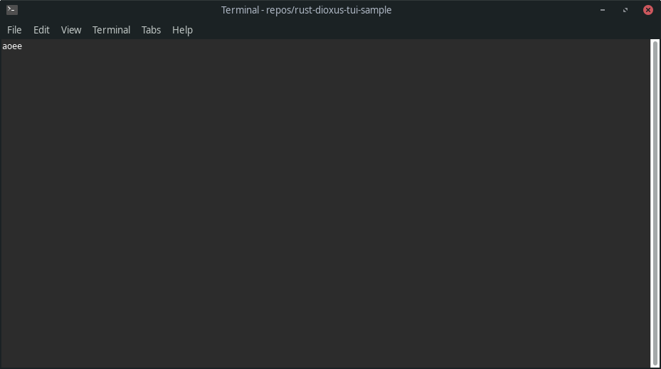

*** rsx - Components
Componentの実装

#+begin_src rust
#![allow(non_snake_case)]

use dioxus::prelude::*;

#[derive(Props)]
struct TitleCardProps<'a> {
    title: &'a str,
}

fn TitleCard<'a>(cx: Scope<'a, TitleCardProps<'a>>) -> Element {
    cx.render(rsx!{
        h1 { "{cx.props.title}" }
    })
}

fn main() {
    dioxus_tui::launch(app);
}

fn app(cx: Scope) -> Element {
    cx.render(rsx! (
        TitleCard {
            title: "hello world"
        }
    ))
}
#+end_src

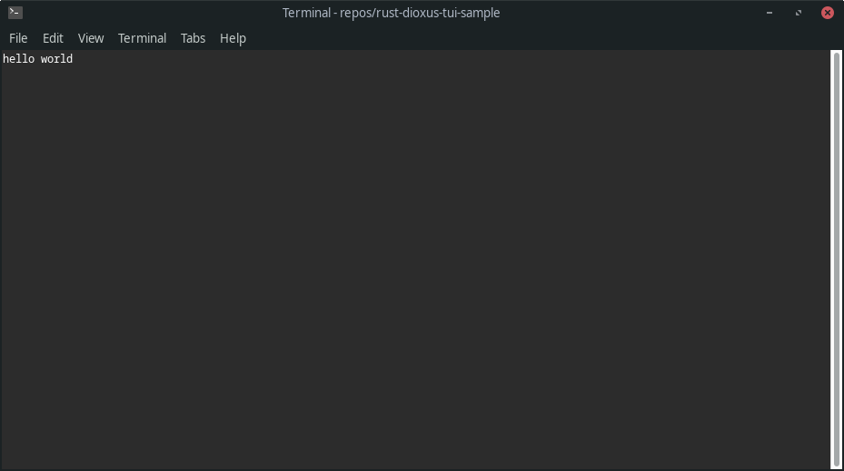

** hooks
React風のhookが利用できます。

*** useState
=use_state= はReactと全く同じです。

#+begin_src rust
let count = use_state(&cx, || 0);

cx.render(rsx! (
    div {
        "count: {count}"
    }
))
#+end_src

本来ならボタンを追加して値の更新をするのですが。。dioxus-tuiにはまだボタンが実装されていなく確かめられませんでした。

*** useFuture
dioxusの拡張。async関数を取って、非同期で実行してくれます。

#+begin_src rust
use dioxus::prelude::*;

fn main() {
    dioxus_tui::launch(app);
}

fn app(cx: Scope) -> Element {
    let count = use_state(&cx, || 0);

    use_future(&cx, (), move |_| {
        let count = count.to_owned();
        let update = cx.schedule_update();
        async move {
            loop {
                count.with_mut(|f| *f += 1);
                tokio::time::sleep(std::time::Duration::from_millis(1000)).await;
                update();
            }
        }
    });

    cx.render(rsx! {
        div { width: "100%",
            div {
                width: "50%",
                height: "5px",
                background_color: "blue",
                justify_content: "center",
                align_items: "center",
                "Hello {count}!"
            }
            div {
                width: "50%",
                height: "10px",
                background_color: "red",
                justify_content: "center",
                align_items: "center",
                "Hello {count}!"
            }
        }
    })
}
#+end_src


良く見るとこのサンプル、背景赤の場所に表示されるべき文字が左に出てますね。。

** Events
=on*= を使ってイベントを処理できる。。らしい。が、dioxus-tui(0.2.2)ではpanicしてしまった。

#+begin_src rust
let log_event = move |event: Event| {
    events.write().push(event);
};


cx.render(rsx! {
    div {
        width: "100%",
        height: "100%",
        flex_direction: "column",
        div {
            width: "80%",
            height: "50%",
            border_width: "1px",
            justify_content: "center",
            align_items: "center",
            background_color: "hsl(248, 53%, 58%)",

            onmousemove: move |event| log_event(Event::MouseMove(event.data)),
            onclick: move |event| log_event(Event::MouseClick(event.data)),
            ondblclick: move |event| log_event(Event::MouseDoubleClick(event.data)),
            onmousedown: move |event| log_event(Event::MouseDown(event.data)),
            onmouseup: move |event| log_event(Event::MouseUp(event.data)),

            onwheel: move |event| log_event(Event::Wheel(event.data)),

            onkeydown: move |event| log_event(Event::KeyDown(event.data)),
            onkeyup: move |event| log_event(Event::KeyUp(event.data)),
            onkeypress: move |event| log_event(Event::KeyPress(event.data)),

            onfocusin: move |event| log_event(Event::FocusIn(event.data)),
            onfocusout: move |event| log_event(Event::FocusOut(event.data)),

            "Hover, click, type or scroll to see the info down below"
        },
        div {
            width: "80%",
            height: "50%",
            flex_direction: "column",
            events_rendered,
        },
    },
})
#+end_src


https://github.com/DioxusLabs/dioxus/blob/fc2aaa7df5/packages/tui/examples/tui_all_events.rs

レポジトリに置いてあるHEADのサンプルも同じくpanicしてしまうのでどこかのコミットで壊れてそのままになってる。。かなにか動かし方を間違えてるようです。

動かせた人は教えてくれると嬉しいです。

** まとめ
dioxusという意欲的なプロジェクトを見つけたのでちょっと動かしてみました。

TUIのレンダラはまだまだ発展途上のようですが、React文化をTUIに持ってくるのは普通に便利だと思うので期待してます。

(ユーザーとしては素直にnodeの[[https://github.com/vadimdemedes/ink][ink]]を使った方がいいかもしれない。ただ俺はRustでTUIを作りたいんだ。。!)

v1がリリースされたらまたチャレンジしてみようかなと思います。

* Hello Astro
:properties:
:export_file_name: generated/contents/blog/2023/b81579
:export_date: 2023-03-12
:end:

** Intro
エンジニアは2~3年ごとにブログを作りなおす。私もその習性に従って新しいブログを作った。

前回のブログで[[https://s.conao3.com/blog/2020/0a23fb][新しいブログ作ったよ記事]]が2020年の5月だったので、まぁそれくらいの周期でやってくる。

技術まわりの備忘録を書いておいて、また3年経ったらこの記事を参照することになるだろう。

なお、筆者はフロント周りの技術に疎いので、雰囲気で書いていることを添えておく。

** Astro
ベースの技術は[[https://astro.build/][Astro]]だ。
Hugoと同じように静的サイトを生成するライブラリで、基本的にビルド成果物をぽん置きするだけで動く。便利。

=.astro= ファイルというHTMLとJSXを悪魔合体させたようなもの (そもそもJSXがJSとHTMLを悪魔合体させたようなものだが) が提供されており、
これを使ってコンポーネントベースでページを作る。

一方でReactやVueのようなUIフレームワークを使うこともできる。その場合でも =astro build= するとjsファイルなしで静的サイトが生成される。

*** Getting Started
[[https://docs.astro.build/ja/getting-started/][公式のGetting started]]が丁寧に書いてあるのでそれに従う。厨二なのでyarnを使った。(最近はnpmへの揺り戻しが起こっているらしい)

#+begin_src bash
yarn create astro
#+end_src

して、適当にプロンプトに答えるとastroプロジェクトが生成される。

#+begin_src bash
yarn dev
#+end_src

でローカルサーバーが立つ。すばらしい。


(絵文字が豆腐になっているが、これはOSに絵文字に対応したフォントをインストールしてないからである。)

Nextのようにファイルベースルーティングを採用しているので、 =content/blog= 配下にmdファイルを置くとそのままブログ記事になる。

当然のこと (便利な世の中になった) ながら、ライブリロードが入っているので、mdファイルを編集すると即座にブラウザに反映される。

*** .astro入門
現在時点の公式ブログテンプレートにはなぜか =draft= の対応が入っていない。ので、この対応をすることで =.astro= の基本的な使い方を紹介する。

まずは =src/content.config.ts= でfrontmatterに =draft= があるということを定義する。デフォルトは =false= (公開) にしておく。

#+begin_src diff
 import { defineCollection, z } from 'astro:content';

 const blog = defineCollection({
   // Type-check frontmatter using a schema
   schema: z.object({
     title: z.string(),
     // Transform string to Date object
     pubDate: z
       .string()
       .or(z.date())
       .transform((val) => new Date(val)),
     updatedDate: z
       .string()
       .optional()
       .transform((str) => (str ? new Date(str) : undefined)),
     heroImage: z.string().optional(),
+    draft: z.boolean().default(false),
    }),
 });
#+end_src

そして =src/pages/blog/index.astro= で =draft= が =false= な記事のみをリストするように修正する。

#+begin_src diff
 ---
 import BaseHead from '../../components/BaseHead.astro';
 import Header from '../../components/Header.astro';
 import Footer from '../../components/Footer.astro';
 import { SITE_TITLE } from '../../consts';
 import { getCollection } from 'astro:content';
 import FormattedDate from '../../components/FormattedDate.astro';

 const posts = (
-    (await getCollection('blog'))
+    (await getCollection('blog', ({ data }) => !data.draft))
     .sort((a, b) => a.data.pubDate.valueOf() - b.data.pubDate.valueOf())
 )
 ---
#+end_src

これで完了だ。便利。

[追記] =src/pages/blog/[...slug].astro= にもdraft対応が必要。

#+begin_src diff
 export async function getStaticPaths() {
 	return (
-        (await getCollection('blog'))
+        (await getCollection('blog', ({ data }) => !data.draft))
         .map((post) => ({
             params: { slug: post.slug },
             props: post,
         }))
     );
 }
#+end_src

*** Reactとの連携
そもそも =.astro= ファイルでコンポーネントを使いつつ、propを渡して、、ということができるので、静的に決まるならReactは不要。とはいえミーハーなので動作確認くらいはしておく。

ドキュメントの[[https://docs.astro.build/ja/core-concepts/framework-components/][UIフレームワークのページ]]や[[https://docs.astro.build/ja/guides/integrations-guide/react/][@astrojs/react]]を参照しつつ、Reactのコンポーネントを使ってみる。

まず =astro add= する。

#+begin_src bash
yarn astro add react
#+end_src

題材はなんでも良いが、動的な要素がないコンポーネントを実装したい。
今回は[[https://quarto.org/docs/authoring/callouts.html][CalloutBlock]]を実装してみる。

=src/components/SimpleCalloutBlock.tsx= を以下の内容で作る。色は[[https://spectrum.adobe.com/page/color-palette/][Adobe Spectrum]]からもらった。

#+begin_src tsx
type SimpleCalloutBlockProps = {
  title: string;
  children: React.ReactNode;
};

export function SimpleCalloutBlock(props: SimpleCalloutBlockProps) {
  const divheader = (
    <div style={{
      backgroundColor: "rgb(255, 221, 214)",  // Red 200
      padding: "0.25rem",
      fontWeight: "bold",
    }}>{props.title}</div>
  )
  const divcontent = (
    <div style={{
      padding: "0.25rem",
    }}>{props.children}</div>
  )

  return <>
    <div style={{
      borderRadius: "0.25rem",
      border: "1px solid",
      borderColor: "rgb(213, 213, 213)",  // Gray 300
      borderLeft: "5px solid",
      borderLeftColor: "rgb(247, 92, 70)",  // Red 800
    }}>
      {divheader}
      {divcontent}
    </div>
  </>
}
#+end_src

=.astro= ファイルでは以下のように利用できる。

#+begin_src astro
import SimpleCalloutBlock from '../../components/SimpleCalloutBlock.tsx';
---
<SimpleCalloutBlock title="This is Important">Danger, callouts will really improve your writing.</SimpleCalloutBlock>
#+end_src

さらにAstroはmdxをサポートしているので、なんとmdの中に直接tsxを書くこともできる

#+begin_src mdx
import SimpleCalloutBlock from '../../components/SimpleCalloutBlock.tsx';

<SimpleCalloutBlock title="This is Important">Danger, callouts will really improve your writing.</SimpleCalloutBlock>
#+end_src

レンダリング結果はこんな感じ。

#+begin_quote
*This is Important*

Danger, callouts will really improve your writing.
#+end_quote

=SimpleCalloutBlock= はReactを使って作ったが、ビルドするとjsなしの静的なHTMLとCSSになる。便利。

*** Astro Islands
Astroには[[https://docs.astro.build/ja/concepts/islands/][Astroアイランド]]という概念がある。
これによりページの一部のコンポーネントのみインタラクティブ (jsあり) の領域を作ることができる。

アイランドはそれぞれ独立しており、それぞれは異なるUIフレームワークを使うことができる。
(Spotifyの[[https://engineering.mercari.com/blog/entry/2018-12-06-162827/][マイクロフロントエンド]]みたいなのを想像している)

これも動作確認程度に動かしておく。

Reactで簡単なカウンターを =src/components/SimpleButton.tsx= に実装する。

#+begin_src tsx
import React from "react"

export function SimpleButton() {
  const [count, setCount] = React.useState(0)
  return <button onClick={()=>setCount(count+1)}>Click me: {count}</button>
}
#+end_src

そして利用側でこのように記述する。

#+begin_src md
import { SimpleButton } from '../../../components/SimpleButton';

<SimpleButton client:load />
#+end_src

#+begin_example
Click me: 0
#+end_example

=client:load= を付けることで、このコンポーネントに限り、jsをクライアントで実行するように設定できる。
もし付けなければこれは静的なコンポーネントになるので、カウンターは動かない。

#+begin_example
Click me: 0
#+end_example

jsが読み込まれるタイミングを =client:*= で制御できる。詳細は[[https://docs.astro.build/ja/reference/directives-reference/#client-directives][ドキュメント]]を参照。

** Cloudflare Pages
ホスティングは[[https://www.cloudflare.com/ja-jp/products/pages/][Cloudflare Pages]]を使う。
以前使っていたNetlifyでも良かったが、界隈で[[https://blog.tomoya.dev/posts/i-was-billed-beyond-limits-of-netlify/][Cloudflare Pagesが注目]]されていたのでそれにした。

使い勝手はNetlifyとほぼ同じ。GitHubと連携して、pushすると自動でビルド/デプロイされる。便利。


少し悩んだのが、カスタムドメインの設定。

conao3.comをNetlifyのDNSに置いて、そのままNetlifyを向くように設定していたので新しいastroのブログをどのURLで公開するか悩んだ。

ひとまずNetlifyに置いてあるドメインはそのままにしておいて、CNAME a.conao3.comでastroのブログを見るように設定した。 (=a= は =astro= の =a=)


将来的にはNetlifyに置いてあるブログを h.conao3.com くらいで見れるようにしたらいいのかなと思う。 (=h= は =hugo= の =h=)

ついでにドメインをNetlifyからCloudflareに引っ越しすると良いかもしれない。リダイレクトの設定が面倒なので、また時間が取れるときにやる。

** まとめ
感想としてはAstroが便利すぎる。全部入りで速い。コンテンツ中心のウェブページを作るならこれが最初の選択肢になりそう。

ブログのソースは[[https://github.com/conao3/blog-astro-src][conao3/blog-astro-src]]に置くことにした。
各ページから直接ソースのmdに飛べるようにしたら便利かもしれない。

ひとまずスモールスタートとして直接マークダウンを書いたが、Emacsユーザーとしてはox-hugoと同じように一つのorgファイルから複数のページを生成できるようにしたい。

* 2023年のPython環境構築: pyenv + poetry
:properties:
:export_file_name: generated/contents/blog/2023/d76e1d
:export_date: 2023-03-14
:end:

** Intro
[[https://qiita.com/c60evaporator/items/b6a7394231d1e768ce64][Pythonのパッケージ管理ベストプラクティス - Qiita]]という記事が公開されていた。
とはいえ少々overwhelmingな感があるので、ざっくりといつもやっている手順をまとめる。

お気持ちを書くと結局この記事も同じ轍を踏むので、お気持ちパートは後半で。

** 方針
- =anyenv= を入れる
- =pyenv= でPythonを入れる
- =poetry= でPythonプロジェクトを管理する

これが最短最小のセットアップだ。

私もVMを起動してクリーンな環境で試しつつこの記事を書いてみる。

*** anyenvのインストール
昨今、Pythonだけ必要なことはあまりなく、どうせNodeなどが欲しくなるので、最初からanyenvを入れる。

#+begin_src bash
git clone https://github.com/anyenv/anyenv ~/.anyenv

export PATH="$HOME/.anyenv/bin:$PATH"
echo 'export PATH="$HOME/.anyenv/bin:$PATH"' >> ~/.bash_profile
#+end_src

#+begin_src bash
anyenv init
#+end_src

#+begin_src bash
eval "$(anyenv init -)"
echo 'eval "$(anyenv init -)"' >> ~/.bash_profile
#+end_src

#+begin_src bash
anyenv install --init
#+end_src

これで =anyenv= が使えるようになった。

*** anyenv-updateのインストール
[[https://github.com/znz/anyenv-update][znz/anyenv-update]] をインストールする。
これは =anyenv update= でインストールされている =*env= をアップデートできるようにするプラグイン。

アップデートしないと新しいPythonをインストールできないので、インストール前にはこのサブコマンドが使えると便利。

#+begin_src bash
mkdir -p $(anyenv root)/plugins
git clone https://github.com/znz/anyenv-update.git $(anyenv root)/plugins/anyenv-update
#+end_src

これで =anyenv update= ができるようになった。

*** pyenvのインストール
=anyenv= を手に入れたので、 =pyenv= は =anyenv= 経由でインストールできる。

#+begin_src bash
anyenv install pyenv

eval "$(anyenv init -)"
#+end_src

=pyenv install -l= でインストール可能なPythonのバージョンを確認できる。

使いたいバージョンのPythonを適宜インストールする。強い理由がなければ =x.yy.zz= のフォーマットの最新のバージョンを入れる。最新だからと言って不安定だということは (経験上ほぼ) ない。

コマンドをこねこねすると現在インストールできる最新のバージョンを得ることができる。

#+begin_src bash
$ pyenv install -l | sed -E 's/^ +//' | grep -E '^3\.11\.[0-9]+$' | tail -n1
3.11.2

$ pyenv install -l | sed -E 's/^ +//' | grep -E '^3\.10\.[0-9]+$' | tail -n1
3.10.10

$ pyenv install -l | sed -E 's/^ +//' | grep -E '^3\.9\.[0-9]+$' | tail -n1
3.9.16
#+end_src

さてインストール。。の前に [[https://github.com/pyenv/pyenv/wiki][pyenvのwiki]] にOS別の依存パッケージインストール方法が記載されているのでそれを実行する。

私はArchlinuxを使っているので =pacman= の手順を実行した。

#+begin_src bash
pacman -S --needed base-devel openssl zlib xz tk
#+end_src

さぁ、Pythonをインストールする。

#+begin_src bash
pyenv install 3.11.2
pyenv install 3.10.10
pyenv install 3.9.16
#+end_src

無事インストールできたら =python= で起動するpythonをpyenvでインストールしたものに変更する。

#+begin_src bash
pyenv global 3.11.2 3.10.10 3.9.16
#+end_src

インストールできない場合、pyenv wikiの[[https://github.com/pyenv/pyenv/wiki/Common-build-problems][Common build Problems]]を参照する。
それでもできなかったらおとなしくOSからクリーンインストールした方が早い。

*** poetryのインストール
[[https://python-poetry.org/docs/][poetry]] はPythonのプロジェクト管理ツールである。
プロジェクトに合ったPythonを選んだり、依存関係を解決したり、一回解決したものをロックファイルとして保存/共有することができる。

公式ページのインストール手順に従ってインストールする。

#+begin_src bash
pipx install poetry
#+end_src

poetryのデフォルトではプロジェクトルートに =.venv= を作らないため、プロジェクトルートに作成するように変更する。
VSCodeが自動的に仮想環境を見つけてくれるし、定義ジャンプするときにツリーが見えるので便利。

#+begin_src bash
poetry config virtualenvs.in-project true
#+end_src

これでpoetryがインストールできた。環境構築は以上だ。

** 運用方法
ここでは簡単な =wc= コマンドを実装する。

フォルダを作って =poetry init= すると =pyproject.toml= が作成される。

#+begin_src bash
mkdir pywc
cd pywc
poetry init
#+end_src

本体を実装して、 =pyproject.toml= に =pywc= という名前でエントリポイントを登録する。

#+begin_src bash
mkdir -p src/pywc
touch src/pywc/__init__.py
touch src/pywc/main.py
#+end_src

=src/pywc/main.py= は以下の内容。

#+begin_src python
def cli():
    print(len(input()))
#+end_src

=pyproject.toml= に以下の変更をする。

#+begin_src diff
 authors = ["Your Name <you@example.com>"]
 readme = "README.md"

+[tool.poetry.scripts]
+pywc = "pywc.main:cli"
+
 [tool.poetry.dependencies]
 python = "^3.11"
#+end_src

そして =poetry install= する。

#+begin_src bash
poetry install
#+end_src

すると仮想環境内に =pywc= というコマンドがインストールされる。
仮想環境内のコマンドは =poetry run= で実行できる。

#+begin_src bash
$ echo asdf | poetry run pywc
4
#+end_src

ちゃんと動いている。

もしグローバルでこのコマンドが使いたいなら =~/.local/bin/= にシンボリックリンクを貼る。

#+begin_src bash
$ ln -s "$(poetry run which pywc)" ~/.local/bin/

$ echo asdf | pywc
4
#+end_src

これでいつでも使える。便利だ。

** まとめ
いろいろ思うところがあったのだけど、Twitterで書くよりブログで書いた方が参照しやすくて便利なのでこの形式で公開することにした。

正直Pythonユーザーの半数。いや、7割。。？くらいは[[https://pypi.org/][PyPI]]に自作モジュールを公開なんてせずに単にユーザーとして利用するだけだと思う。
単に使うだけならPythonってこんなに便利なんですよというのを伝えたかった。

モジュールもたくさんあるし、プロトタイピングには最適な言語だと思う。

** お気持ち
*** なぜ公式インストーラではなくpyenvなのか
インストーラでインストールするとシステム領域にインストールされる。もちろん全ての作業は仮想環境を作って行うので問題ないのだが、万一環境が壊れたときにアンインストールが必要になる。

さて、そのアンインストーラはちゃんと動くのだろうか。インストーラが展開したファイルを一つ残らず消してくれるのだろうか。

pyenvならバージョンごとにフォルダ管理されており、コマンドから捨てることができるし、最悪 =~/.anyenv= ごと吹き飛ばせばいい。

「クリーンな状態」をすぐ取り戻せるというのは心の余裕だ。「すぐ戻せる」から壊すハードルを下げることができる。

*** なぜ公式インストーラではなくpyenvなのか2
そもそも、その「公式インストーラ」はどこにあるのだろう。。()

[[https://www.python.org/downloads/][python.org/downloads]]だと思うが、WindowsとmacOSの場合はGUIのインストーラっぽいからぽちぽちしたら入るっぽい。
Linux勢はどうやってインストールするのだろう。各ディストリビューションごとにパッケージ名が違うのをまず調べてからインストールすることになる。

うーん。pyenvならマルチプラットフォームで同じように開発できるのでこちらを取るかな。。

「インストーラ」が何をやっているのか分からないのが嫌なのかもしれない。「アンインストーラ」が信用できないのも。

Linuxのパッケージマネージャでも =pacman= は信用しているが、 =apt= は信用してない。(インストールしてアンインストールしたらちゃんと元に戻るという観点で)

その意味ではmacOS/Linuxの =brew= はちゃんとパッケージマネージャとしての責務を果たしてくれるので好き。

*** なぜvenvを直接使わずpoetryを使うのか
正直 =venv= は難しい。初学者に勧めるのは抵抗がある。もちろん言ってることは分かるし、venvで開発できそうなことは分かったが周辺のノウハウが散らばっているように感じた。

OSSでも =poetry.lock= が置いてあるプロジェクトは本当に貢献しやすい。 =git clone= して =poetry install= 。これで全ての依存が降ってきてすぐ開発できる状況になる。

これは業務で使う場合でも一緒だ。みんながみんなPythonのビルドシステム周りに詳しいわけではない。 =poetry install= して =poetry run hoge= で動く。案内しやすいし便利だ。

ここまで書いたが、 =venv= ももうちょっと分かりやすいサブコマンドがあると良い話なのかもしれない。

| poetry            | venv                              | venv (提案)               |
|-------------------+-----------------------------------+---------------------------|
| =poetry init=     | =python -m venv .venv=            | =python -m venv init=     |
| =poetry add hoge= | =pip install hoge=                | =python -m venv add hoge= |
| =poetry lock=     | =pip freeze > requirements.txt=   | =python -m venv lock=     |
| =poetry install=  | =pip install -r requirements.txt= | =python -m venv install=  |
| =poetry shell=    | =. .venv/bin/activate=            | =python -m venv shell=    |
| =C-d= (exit venv) | =deactivate=                      | =C-d=                     |
| =poetry run hoge= | =.venv/bin/hoge=                  | =python -m venv run hoge= |

提案のvenvなら使えたかもしれない。

仮想環境に入るのを忘れて =pip install= したらもれなくグローバルのPythonにインストールされるのも心証が悪かった。

さらに =. .venv/bin/activate= で仮想環境に入って、出るときは =deactivate= を実行するという非対称性にも耐えられなかった。
=. .venv/bin/deactivate= ならまだ許容できたが、まぁ歴史あるものはしょうがない面もある。

*** なぜPythonがインストールできないときOSのクリーンインストールをするのか

#+begin_quote
インストールできない場合、pyenv wikiのCommon build Problemsを参照する。 それでもできなかったらおとなしくOSからクリーンインストールした方が早い。
#+end_quote

読者の中にはちゃんとビルドできない原因を調べて解明する方が良いと思う人もいると思う。

[[https://github.com/pyenv/pyenv/wiki/Common-build-problems][Common build Problems]]を参照した上でもPythonがビルドすらできない環境というのは十中八九、本人すらも自分のPCの状態が管理できてない状態だと思う。
Pythonのインストーラに限らず、自分で制御できる方法でPCを常にメンテナンスすることが必要で、一旦制御不能になったらもうそれは教訓にして世界をやり直した方が早い。

やり直すのは悪いことではない。どうやったら簡単にやり直せるか考えて整備する。
簡単にやり直せるようになったところで、もう世界をやり直さないと分からないところまで壊れることはほぼなくなっているが、そうやって学ぶのが結局早い。

* COMMENT Astroでbookが書きたい
:properties:
:export_file_name: generated/contents/blog/2023/d23672
:export_date: 2023-03-18
:end:

** Intro
ブログという体裁をとっているが、なにか連載記事のようなものを書きたいときがある。
イメージとしては[[https://zenn.dev/zenn/books/how-to-create-book][Zennの「本」]]。

[[https://zenn.dev/zenn/articles/zenn-cli-guide#cli-%E3%81%A7%E6%9C%AC%EF%BC%88book%EF%BC%89%E3%82%92%E7%AE%A1%E7%90%86%E3%81%99%E3%82%8B][Zennの制御ファイル]]が結構しっかりしてるので、これを参考に作ってみる。

* パッケージをささっと試すためのplayground - Python
:properties:
:export_file_name: generated/contents/blog/2023/7a00d9
:export_date: 2023-03-19
:end:

** はじめに
Pythonには様々なパッケージがあり、簡単にインストールして使うことができます。
しかし、既存のある程度大きなプロジェクトに対していきなり導入すると、もし動かなかったときに切り分けが大変です。

また、パッケージが動く最小構成を試しておくことで後から他のプロジェクトで利用するときにも役立ちます。
パッケージに何か不具合を見つけた場合でも、最小構成を用意しておくことで報告しやすくなります。

この記事を参考にして、パッケージを試すためのplaygroundを作ってみましょう。

** 前提
Pythonの環境はpyenv + poetryで構築されているとします。
[[https://s.conao3.com/blog/2023/d76e1d][2023年の環境構築記事]]が参考になるかもしれません。

** フォルダ構成
playgroundのフォルダ構成は以下のようになります。

#+begin_example
python-hogehoge/
├── hogehoge_sample/
│   ├── __init__.py
│   └── main.py
├── pyproject.toml
└── README.md
#+end_example

=hogehoge_sample= ディレクトリを作成し、その中に =main.py= を作成します。

*** pyproject.toml
=poetry init= で =pyproject.toml= を作成します。

#+begin_example
mkdir python-dataclasses
poetry init
#+end_example

package-nameは =dataclasses-sample= と答えます。
ここで =dataclasses= と答えると、本来の =dataclasses= と名前が被るので、避ける必要があります。

以下の =pyproject.toml= が作成されます。

#+begin_src toml
[tool.poetry]
name = "dataclasses-sample"
version = "0.1.0"
description = ""
authors = ["Naoya Yamashita <conao3@gmail.com>"]
readme = "README.md"
packages = [{include = "dataclasses_sample"}]

[tool.poetry.dependencies]
python = "^3.11"

[build-system]
requires = ["poetry-core"]
build-backend = "poetry.core.masonry.api"
#+end_src

=packages= の指定は必要ないので、削除します。

#+begin_src diff
 [tool.poetry]
 name = "dataclasses-sample"
 version = "0.1.0"
 description = ""
 authors = ["Naoya Yamashita <conao3@gmail.com>"]
 readme = "README.md"
-packages = [{include = "dataclasses_sample"}]

 [tool.poetry.dependencies]
 python = "^3.11"

 [build-system]
 requires = ["poetry-core"]
 build-backend = "poetry.core.masonry.api"
#+end_src

*** src/dataclasses_sample/main.py
一旦、以下の内容で =main.py= を作成します。

#+begin_src python
def main1():
    print('Hello, world!')


if __name__ == '__main__':
    main1()
#+end_src

*** Install / 起動確認
さぁ =poetry install= 。。なのですが、 =README.md= がないと怒られるので作っておきます。

#+begin_example
touch README.md
#+end_example

=poetry install= でインストールします。

#+begin_example
$ poetry install
Installing the current project: dataclasses-sample (0.1.0)
#+end_example

インストールできたら、 =poetry run= で実行できます。
=scripts= は指定してないので、直接モジュール指定で起動することになります。

#+begin_example
$ poetry run python -m dataclasses_sample.main
Hello, world!
#+end_example

これで、playgroundの準備は完了です。

** パッケージを試す
dataclassesを試してみます。
[[https://docs.python.org/ja/3/library/dataclasses.html][公式ドキュメント]]を参考に、以下のように修正します。

#+begin_src diff
+import dataclasses


+@dataclasses.dataclass
+class Person:
+    name: str
+    age: int


 def main1():
     print('Hello, world!')


+def main2():
+    p = Person('John', 30)
+    print(p)


 if __name__ == '__main__':
-    main1()
+    main2()
#+end_src

起動してみるとこのようになります。

#+begin_src bash
$ poetry run python -m dataclasses_sample.main
Person(name='John', age=30)
#+end_src

成功です。これが一番シンプルな =dataclasses.dataclass= の使い方です。

今までの関数を消さずに、新しく追加した関数の中で他のメソッドやクラスなどを記述し、その新しい関数を呼び出すように修正します。

もちろん起動時引数によって起動する関数を変えることもできるのですが、playgroundはこのくらいの気軽さが良いと思います。

** git push
遊んだ後はGitHubにpushしておきましょう。

「はじめに」にも書きましたが、ざざっと書いたものというのは結構助けになります。

私はこういうplaygroundを上げる専用の一人orgを作っていて、そこにpushしています。
今回は [[https://github.com/conao3-playground/python-dataclasses][conao3-playground/python-dataclasses]] にpushしました。

** まとめ
私が最近試しているplaygroundというやり方を紹介しました。

さくっと書いてさくっと動くのがPythonの良いところなので、その良さを活かしていきたいですね。

* Pydantic: 基本的な使用方法
:properties:
:export_file_name: generated/contents/blog/2023/38d15e
:export_date: 2023-03-20
:end:

** はじめに
[[https://docs.pydantic.dev/][Pydantic]]は私が一番好きなPythonのパッケージです。
イメージとしては、builtinの [[https://docs.python.org/ja/3/library/dataclasses.html][dataclasses]] に実行時バリデーションを追加したものです。

「型は飾り」のPythonにおいて、実行時においても型に守られるのはとても嬉しいです。
データの型変換とバリデーションが同時に行われる他、デフォルト値の補完もpydanticに任せることができます。
そのため外界とのインターフェイスにpydanticを置くことで、安心してデータを扱うことができます。

現在は [[https://fastapi.tiangolo.com/ja/][FastAPI]] や [[https://strawberry.rocks/][Strawberry]] などと統合され、人気パッケージとなっています。

サンプルコードは [[https://github.com/conao3-playground/python-pydantic-blog][conao3-playground/python-pydantic-blog]] にあります。

** 基本的な使用方法
*** モデルの定義
まずは基本的なモデルの定義から見ていきます。

=pydantic.BaseModel= を継承してモデルを定義します。

#+begin_src python
class User(pydantic.BaseModel):
    user_cd: str
    name: str
    age: int = 20
#+end_src

初期値を与えることで、デフォルト値を設定することができます。
初期値がないフィールドは必須フィールドとなります。

#+begin_src python
user1 = User(user_cd='u_001', name='Alice')
user2 = User(user_cd='u_002', name='Bob', age=30)

print(user1)
print(user2)
#+end_src

#+begin_example
user_cd='u_001' name='Alice' age=20
user_cd='u_002' name='Bob' age=30
#+end_example

=pydantic.BaseModel= を継承することで、キーワードでの初期化が可能になり、print関数の出力も見やすいフォーマッタが用意されます。

*** pydanticオブジェクトの生成
=pydantic.BaseModel= を継承したモデルのインスタンスを便宜上「pydanticオブジェクト」と呼ぶことにします。

pydanticオブジェクトは複数の方法で生成することができます。

**** キーワード引数での初期化
基本の使い方で見た通り、キーワード引数で初期化することができます。

#+begin_src python
user1 = User(user_cd='u_001', name='Alice')
print(user1)
#+end_src

#+begin_example
user_cd='u_001' name='Alice' age=20
#+end_example

**** dictからの初期化
dictを持っている場合、そのdictからpydanticオブジェクトを生成することができます。

#+begin_src python
user1_dct = {'user_cd': 'u_001', 'name': 'Alice'}
user1 = User.parse_obj(user1_dct)
print(user1)
#+end_src

また、dictは =**= 演算子でキーワード引数に展開できるため、以下のようにも書くことができます。

#+begin_src python
user1_dct = {'user_cd': 'u_001', 'name': 'Alice'}
user1 = User(**user1_dct)
print(user1)
#+end_src

=parse_obj(obj: Any)= は引数を =dict(args: Iterable)= で変換してから =**= 演算子で展開しています。
そのため、実際にはdict以外のオブジェクトを渡すこともできます。

#+begin_src python
user1_data = [('user_cd', 'u_001'), ('name', 'Alice')]
user1 = User.parse_obj(user1_data)
print(user1)
#+end_src

**** JSONからの初期化
JSON文字列を持っている場合、そのJSON文字列からpydanticオブジェクトを生成することができます。

#+begin_src python
user1_json = '{"user_cd": "u_001", "name": "Alice"}'
user1 = User.parse_raw(user1_json)
print(user1)
#+end_src

*** pydanticオブジェクトから取り出し
**** フィールド名での取り出し
pydanticオブジェクトからフィールド名で取り出すことができます。

#+begin_src python
user1 = User(user_cd='u_001', name='Alice')
print(user1.user_cd)
print(user1.name)
print(user1.age)
#+end_src

#+begin_example
u_001
Alice
20
#+end_example

**** dictへの変換
pydanticオブジェクトは =dict()= 関数でdictに変換することができます。

#+begin_src python
user1 = User(user_cd='u_001', name='Alice')
print(type(user1.dict()))
print(user1.dict())
#+end_src

#+begin_example
<class 'dict'>
{'user_cd': 'u_001', 'name': 'Alice', 'age': 20}
#+end_example

**** jsonへの変換
pydanticオブジェクトは =json()= 関数でjsonに変換することができます。

#+begin_src python
user1 = User(user_cd='u_001', name='Alice')
print(type(user1.json()))
print(user1.json())
#+end_src

#+begin_example
<class 'str'>
{"user_cd": "u_001", "name": "Alice", "age": 20}
#+end_example

** まとめ
この記事はほとんど =dataclasses= と同じことをしているだけになってしまいましたが、
次回はバリデーションの話をします。

* 記事の依存関係を管理したいという話
:properties:
:export_file_name: generated/contents/blog/2023/2bff82
:export_date: 2023-03-20
:end:

** SSIA
技術ブログに限らず、何かの事実を伝える際、「事前条件」というのは極めて重要です。

「事前条件」までは双方で同意があり、その上で何か別のことをやってみる。その結果を伝える。
そして結果について考察する。これが基本のプロトコルかと思います。

そして、事前条件がそもそも自明でない場合は、それを説明しないといけないのですが、
そうすると記事が伸びてくるので、別記事に分けてみるか。というのをやってみています。

別記事に分けておくことで、ある事前条件を複数の記事で参照することもできます。

ただ、その依存関係を本文からのリンクで表すというのは書く側も面倒だし、
読者としても把握しづらいですねーというのが今回の話です。

** インターフェースを考える
依存関係がある場合、基本的に子から親に向かってリンクが貼れると便利です。

雰囲気としては店舗マスタがあって、その店舗マスタに紐付く店舗情報とか、入出庫履歴があるという感じです。
この場合も店舗マスタは単体で存在しておいて、店舗情報を作るときに外部キーで紐付けるという順序になると思います。

もちろん子からリンクが貼られたことを検知して、親からもリンクが貼られると便利です。backrefみたいな概念になります。

** 見せ方を考える
インターフェースが決まれば、後はどう見せるかを考えます。
まぁ普通に有向グラフになるので、そこはそこでいいかなと思います。

というか [[https://help.obsidian.md/Plugins/Graph+view][obsidian]] の見せ方がおしゃれすぎるので、こんな感じにしたい。

** まとめ
とりとめのない話でしたが、こういうのを考えているという備忘録でした。
時間が取れたら実装されるかもしれません。

* yarnからpnpmに移行してみる
:properties:
:export_file_name: generated/contents/blog/2023/916227
:export_date: 2023-03-22
:end:

** はじめに
[[https://s.conao3.com/blog/2023/b81579][Hello Astro]]で厨二なのでnpmではなくyarnを使うという話をしましたが、
巷でpnpmが話題になってるので、素振りも兼ねてpnpmに移行してみました。

** なぜpnpmを使うのか
雰囲気でyarnを使っていたので全く気付いてなかったのですが、yarnはv1, v2, v3がそれぞれ生きている状況らしく、
どうやらv2で独自路線に振りすぎたのをv3で揺り戻した？みたいになっているらしく、
そもそも私も今使っているyarnのバージョンが良く分からない。。
結局使っていたのはv1だったのですが、もうこの時点で面倒くさいことになっている。
詳細は 「[[https://zenn.dev/mizchi/articles/yarn-v1-to-v3][yarn v3 の独自機能を避けつつ yarn v1 から v3 へのアップグレードをする - Zenn]]」などを参考。

pnpmは彗星の如く現れたよさげなパッケージマネージャなのですが、これも詳細は 「[[https://zenn.dev/azukiazusa/articles/pnpm-feature][pnpm の特徴 - Zenn]]」などを見てもらうとして、
個人的に気に入ってるのは「厳格なパッケージ管理」のところです。

簡単に言うとAがBに依存してるとき、npmやyarnの場合node_modules内でAとBが同じ階層に配置されるので、Bもまたinclude可能になるのですが、
AがBに依存しなくなったとき、Bをincludeしてたら死ぬよねということです。
Bをincludeしたかったらpackage.jsonに依存を書きなさいと。なるほど。良さそうですね。

** インストール
pnpmのインストールは悩んだのですが、yayでインストールできたのでこれを使うことにしました。

#+begin_src bash
yay -S pnpm
#+end_src

** 移行
以下の記事を参考にしつつ移行します。

- [[https://dev.to/andreychernykh/yarn-npm-to-pnpm-migration-guide-2n04][How to migrate from yarn / npm to pnpm - Dev.]]
- [[https://zenn.dev/mihorin1729/articles/8f4a966b01f93e][yarnからpnpmに移行した時の話 - Zenn]]

*** node_modules削除
とりあえず =node_modules= を削除します。

#+begin_src bash
rm -rf node_modules
#+end_src

*** package.json編集
preinstall scriptsを追加します。

#+begin_src diff
 {
   "scripts": {
+    "preinstall": "npx only-allow pnpm",
     "dev": "next dev",
     "build": "next build",
     "start": "next start",
     "lint": "next lint",
     "format": "prettier --write .",
     "type-check": "tsc --noEmit"
 },
#+end_src

*** pnpm import / install
=pnpm import= で =yarn.lock= から =pnpm-lock.yaml= を生成します。

#+begin_src bash
pnpm import
#+end_src

=yarn.lock= を削除します。

#+begin_src bash
rm -rf yarn.lock
#+end_src

=pnpm install= で =pnpm-lock.yaml= を元に =node_modules= にインストールします

#+begin_src bash
pnpm install
#+end_src

*** ローカルサーバー起動
インストールできたので、 =pnpm run dev= でローカルサーバーを起動してみます。

#+begin_src bash
pnpm run dev
#+end_src

問題なく動きました。

** ビルドコマンドの設定
「[[https://community.cloudflare.com/t/add-pnpm-to-pre-installed-cloudflare-pages-tools/288514/4][Add PNPM to Pre-installed Cloudflare Pages tools]]」
を参考に、ビルドコマンドを =npm run build= から =npm install -g pnpm && pnpm install && pnpm run build= に変更します。

さらに、デフォルトで =npm install= が実行されるので、 =NPM_FLAGS= を =--version= に設定しておくことで、無害なコマンドが実行されるように変更しておきます。

** えいや
えいやでpushします。この記事が公開されてれば成功です。

** まとめ
特に躓くこともなく移行できました。 =pnpm install= が爆速なのはやっぱり良いですね。
プロダクションで使うにはまだちょっとエッジ感がありますが、今のところは良さそうです。

* AstroでReact Flowを使いたいぞという話
:properties:
:export_file_name: generated/contents/blog/2023/bb48a7
:export_date: 2023-03-24
:end:

** はじめに
[[https://reactflow.dev/][React Flow]]に一目惚れしたので、このブログでも使ってみたい。
[[https://s.conao3.com/blog/2023/b81579][Hello Astro]]で素のReactが動くことは確かめたのだけど、このクラスのライブラリが動くかどうかは分からないので、ちょっとチャレンジングな課題。

** pnpm install
まずは、React Flowをインストールする。

#+begin_src bash
pnpm install reactflow
#+end_src

ローカルサーバーを起動してみる。

#+begin_src bash
pnpm run dev
#+end_src

普通に立ち上がってきた。インストールしただけで壊れるということはなかったようです。

** mdxで使ってみる
[[https://reactflow.dev/docs/quickstart/#creating-your-first-flow][Creating your first flow]]の例をやってみる。

#+begin_src jsx
import ReactFlow from 'reactflow';

import 'reactflow/dist/style.css';

const initialNodes = [
  { id: '1', position: { x: 10, y: 10 }, data: { label: '1' } },
  { id: '2', position: { x: 10, y: 100 }, data: { label: '2' } },
];
const initialEdges = [{ id: 'e1-2', source: '1', target: '2' }];

export default function App() {
  return (
    <div style={{ border: '1px solid', width: '100%', height: '500px' }}>
      <ReactFlow nodes={initialNodes} edges={initialEdges} />
    </div>
  );
}
#+end_src

これを =src/components/SimpleReactflow.tsx= で保存して、以下のようにmdxに埋め込む。

#+begin_src mdx
import App from '../../../components/SimpleReactflow.tsx'

<App client:only />
#+end_src


。。。普通に動いてしまった。。なんだこれ、Astro最高だな。

とはいえ実は一回失敗していた。 =cliend:load= を指定するとビルド時にAstroが落ちてしまった。
SSRに対応してないのかな？ということで =client:only= を指定してgot事無き。

** まとめ
予想外にさくっと動いてしまったのでびっくりしてしまいました。

たしかにhugoよりもページ生成速度は少し遅いですが、十分速いですし、出来上がったページはhugoと遜色ないです。(ゼロjsなので)

それでいてこんな感じにReactが普通に動くのは夢が広がります。みなさんも試してみてください。

* AstroでKaTeXを使いたいぞという話
:properties:
:export_file_name: generated/contents/blog/2023/e4b3be
:export_date: 2023-03-25
:end:

** はじめに
Webで数式組版をしたい場合、MathJaxを使うというのが常識でしたが、前回のhugoブログを作った時点でKaTeXの方が速くて良いぞという話になっていました。
今回のAstroブログでもどうにか数式を表示したいということで、さくっと調べてみたのですが、あまり情勢は変わってないようだったので、KaTeXを導入することにします。

** Remark / Rehype
AstroはMarkdownをHTMLにレンダリングする際、Remark/Rehypeを利用しているようです。(ref: [[https://docs.astro.build/ja/guides/markdown-content/#markdown%E3%81%A8mdx%E3%81%AE%E8%A8%AD%E5%AE%9A][MarkdownとMDXの設定]])

Remark/Rehypeの関係は掴み辛いですが、「[[https://unifiedjs.com/learn/guide/introduction-to-unified/][Introduction to unified]]」や「[[https://vivliostyle.github.io/vivliostyle_doc/ja/vivliostyle-user-group-vol2/spring-raining/index.html][Remark で広げる Markdown の世界]]」が分かりやすかったので紹介します。

こんな感じの理解をしてます。

- =unist= というASTがあり、それの特化として =mdast= や =hast= 、 =nlcst= (なぜ =tast= にしなかった。。) がある。
- =*-parse= で =unist= に変換する。
- =*-stringify= で =unist= をそのフォーマットの文字列に変換する。

さらに

- =unist= から =unist= に変換する =transform= を挟むことができ、ここにプラグインを刺す
- =unist= 同士の変換を =remark-rehype= や =rehype-remark= で行う


この一連の流れが =unified= エコシステムで整理されています。
うーん。きれいですね。すばらしい。

** remark-math / rehype-katexの導入
[[https://unifiedjs.com/explore/package/remark-math/][remark-math]]と[[https://unifiedjs.com/explore/package/rehype-katex/][rehype-katex]]を導入します。

=remark-math= がマークダウン中の =$C_L$= のような数式をmdast上で変換し、
=rehype-katex= がhast上でKaTeXを使うように変換します。

Astroでは書き下しませんが、READMEの例が分かりやすかったので引用します。

#+begin_src ts
import {read} from 'to-vfile'
import {unified} from 'unified'
import remarkParse from 'remark-parse'
import remarkMath from 'remark-math'
import remarkRehype from 'remark-rehype'
import rehypeKatex from 'rehype-katex'
import rehypeStringify from 'rehype-stringify'

const file = await unified()
  .use(remarkParse)
  .use(remarkMath)
  .use(remarkRehype)
  .use(rehypeKatex)
  .use(rehypeStringify)
  .process(await read('example.md'))

console.log(String(file))
#+end_src

マークダウンの文字列をmdastに変換して、mdastでmathを変換して、hastに変換して、hastでkatexを変換して、htmlに変換しているのが分かります。

** Astroでの設定
*** astro.config.mjsに追加
Astroから使えるようにするには =astro.config.mjs= に以下のように設定します。

#+begin_src diff
 import { defineConfig } from 'astro/config';
 import mdx from '@astrojs/mdx';
 import sitemap from '@astrojs/sitemap';
+import remarkMath from 'remark-math';
+import rehypeKatex from 'rehype-katex';

 import react from "@astrojs/react";

 export default defineConfig({
   site: 'https://a.conao3.com',
   integrations: [mdx(), sitemap(), react()],
+  markdown: {
+    remarkPlugins: [remarkMath],
+    rehypePlugins: [rehypeKatex],
+  }
 });
#+end_src

*** CSSの追加
[[https://katex.org/docs/browser.html][KaTeXのページ]]からCSSのタグをコピーして良い感じのところに貼り付けます。
私はいろいろ面倒だったので、 =src/component/BaseHeader.astro= に貼り付けて全ページで読み込まれるようにしました。

#+begin_src html
<link rel="stylesheet" href="https://cdn.jsdelivr.net/npm/katex@0.16.4/dist/katex.min.css" integrity="sha384-vKruj+a13U8yHIkAyGgK1J3ArTLzrFGBbBc0tDp4ad/EyewESeXE/Iv67Aj8gKZ0" crossorigin="anonymous">
#+end_src

** 動作確認
=$C_L$= は $C_L$ のようにレンダリングされます。

ブロックスタイルはこんな感じ。

#+begin_src md
$$
\frac{1}{\pi} = \frac{2\sqrt{2}}{99^2}
                \sum_{n=0}^\infty
                \frac{(4n)!}{(4^n n!)^4}
                \frac{1103 + 26390n}{99^{4n}}
$$
#+end_src

$$
\frac{1}{\pi} = \frac{2\sqrt{2}}{99^2}
                \sum_{n=0}^\infty
                \frac{(4n)!}{(4^n n!)^4}
                \frac{1103 + 26390n}{99^{4n}}
$$

ちゃんと動いてそう。すばら。

** まとめ
想像以上に簡単にできた。remark/rehypeというプロジェクトを知れたのも良かった。どんどん使っていきたい。

記事ごとレイアウトを指定すると良いという記事もあったが、多分それは記事のタイトルとか記事の抜粋で
別のページに出たときに壊れる気がするので、今回は全ページで読み込むようにした。

rehype-katexが $\KaTeX$ にレンダリングしているので、おそらくその時だけCSSを追加するようにできると最適化されて良さそう。

** 参考
- [[https://ileumas.com/writing/2022/03/astro-math-katex/][Render Math in Astro Markdown Pages with KaTeX]]

* さくっとpostgreSQLを立ち上げたいときのメモ
:properties:
:export_file_name: generated/contents/blog/2023/17d2f4
:export_date: 2023-03-31
:end:

** はじめに
今SQLを叩きたいぞというときが稀にある。
そもそもそういうときはこの「はじめに」すら読み飛ばすので、さっさと方法を書く。

** プロジェクトに紐付かない場合 (docker)
最短でpostgresを立ち上げたい場合、直接dockerで上げてしまう。

#+begin_src bash
docker run --rm -it -e POSTGRES_PASSWORD=password -p 15432:5432 postgres
#+end_src

以下の情報で接続できる。

- host: =localhost=
- port: =15432=
- db_name: =postgres=
- user: =postgres=
- password: =password=

** プロジェクトに紐付く場合 (docker-compose)
プロジェクトのローカルDB環境としてpostgresを立ち上げたいなら、docker-composeを使ってメンバーと共有した方が良い。
起動方法もdocker-composeに隠蔽されるので便利。

=docker/postgres/Dockerfile= として以下の内容で保存する。

#+begin_src docker
FROM postgres:15

RUN localedef -i ja_JP -c -f UTF-8 -A /usr/share/locale/locale.alias ja_JP.UTF-8
ENV LANG ja_JP.utf8
ENV LC_MESSAGES en_US.utf8
#+end_src

=compose.yml= に以下内容で保存する。

#+begin_src yaml
services:
  db:
    build:
      context: ./docker/postgres
    command: log_statement=all
    ports:
      - ${DB_PORT}:5432
    environment:
      - POSTGRES_DB=${DB_NAME}
      - POSTGRES_USER=${DB_USER}
      - POSTGRES_PASSWORD=${DB_PASSWORD}
#+end_src

最後に =.env= に以下内容を用意しておく。

#+begin_example
DB_PORT=15432
DB_NAME=postgres
DB_USER=postgres
DB_PASSWORD=password
#+end_example

で、以下のコマンドで起動する。

#+begin_src bash
docker-compose up
#+end_src

postgresもlocaleでソート順が変わるという[[https://www.postgresql.jp/document/14/html/locale.html][罠挙動がある]]ので、それを確かめたいときなどはDockerfileを書けると便利。

* COMMENT オイラーの公式から三角関数の世界を再構築できるか
:properties:
:export_file_name: generated/contents/blog/2023/145870
:export_date: 2023-04-01
:end:

** はじめに
三角関数にまつわる公式は数多くあります。
高校数学ではとりあえず加法定理だけ覚えておいて、他の公式を導くというのをやっていたかと思いますが、
何もないところから与えるには少し複雑すぎです。

もう少し分かりやすいものから出発して、なおかつ普段の世界を構築できると良いですね。
ということでオイラーの公式を既知として、三角関数の世界を再構築してみます。

** オイラーの公式の導出
既知にするとはいえ、オイラーの公式を導出しておきます。
いろいろな方法がありますが、今回は私の好きな微分方程式からの導出を紹介します。

まずは以下の微分方程式を考えます。

\[
\frac{\mathrm{d}^2y}{\mathrm{d}x^2} + y = 0
\]

この微分方程式の基本解は

\[
y = \begin{cases}
\sin x \\
\cos x \\
\end{cases}
\]

であるため、一般解はこの基本解の線形結合により与えられる。

実際、ロンスキアンは0にならない。

\[
W = \begin{vmatrix}
\sin x & \cos x \\
\cos x & -\sin x \\
\end{vmatrix}
= \cos^2 x - \sin^2 x = 1
\]

一方で、\(e^{ix}\) もこの微分方程式の解である。

基本解は \(\sin x\) と \(\cos x\) であるため、\(e^{ix}\) はこれらの関数の線形結合で表される。

\[
e^{ix} = C_1 \sin x + C_2 \cos x
\]

この式の微分により

\[
ie^{ix} = C_1 \cos x - C_2 \sin x
\]

を得る。それぞれ \(x=0\) を代入し、 \(C_1 = 0\) と \(C_2 = 1\) が分かるので、つまり

\[
e^{ix} = \cos x + i \sin x
\]

を得る。これはオイラーの公式である。

** 加法定理
高校数学では加法定理から全てを構築していたので、オイラーの公式から加法定理が導ければそれでこの記事の目的は達成とも言えます。

オイラーの公式において \(x = \alpha \pm \beta\) を代入すると

\[
e^{i(\alpha \pm \beta)} = \cos(\alpha + \beta) \pm i \sin(\alpha + \beta)
\]

一方で指数法則より

\[
\begin{split} e^{i(\alpha \pm \beta)}
&= e^{i\alpha} e^{\pm i\beta}\\
&= (\cos \alpha + i \sin \alpha) (\cos \beta \pm i \sin \beta)\\
&= (\cos \alpha \cos \beta \mp \sin \alpha \sin \beta) + i (\sin \alpha \cos \beta \pm \cos \alpha \sin \beta)\\
\end{split}
\]

なので、実部と虚部を比較して、

\[
\begin{aligned}
\cos(\alpha \pm \beta) &= \cos \alpha \cos \beta \mp \sin \alpha \sin \beta \\
\sin(\alpha \pm \beta) &= \sin \alpha \cos \beta \pm \cos \alpha \sin \beta
\end{aligned}
\]

これは三角関数の加法定理である。

* COMMENT キ◯トーンが作りたい/その1: 要件
:properties:
:export_file_name: generated/contents/blog/2023/9709e5
:export_date: 2023-04-02
:end:

** はじめに
私はバックエンドが好きなのですが、やはりパソコンに不慣れな人に使ってもらうにはよさげなフロントエンドが必要です。
また、CUIで頑張るよりもやはりブラウザの力を借りてばばっと視覚化した方がパッと見で取得できる情報量が多いことがあります。

ただ、DBがあってそれに対するAPIが用意っされてると仮定しても、フロントエンドはそれぞれの好みに影響されるので、うーんこの要求はもしかしたらこの人だけなんだろうかとか面倒なことになります。

ということでフロントの見た目をユーザーが触れるようにすると、勝手にスケールするので便利ですねということで登場するのがキ◯トーンです。

話には聞いたことがある程度で触ったことはないのですが、Youtubeとかに上がっている動画を見つつ、似たようなものを作りたいですねということです。

** 目標
これです

[[https://www.youtube.com/watch?v=BrebZZvp6a4]]

なんと10年前です。10年前のアプリを現代の技術でさくっと作っちゃいませんかということですね (そんなに上手くいかない)

** 要件
要件もざざっと書き出します。

- high: 複数の組込みウィジェットが用意される。
- high: ウィジェットをドラッグアンドドロップで組み合わせて画面を作ることができる。
- high: ウィジェットの設定を変更することができる。
- high: 画面全体の保存ができる。
- medium: ログイン機能がある。
- medium: ユーザーグループ機能がある。
- medium: データベースに情報を保存できる。
- medium: データベースに保存した情報を一覧できる。
- low: オンライン上で編集できる。
- low: APIで情報を取得できる。
- low: モバイル端末から利用できる。

こんなものですかね。では次回から作っていきたいと思います。

* COMMENT キ◯トーンが作りたい/その2: ドラッグアンドドロップでの並び換え
:properties:
:export_file_name: generated/contents/blog/2023/abe9ab
:export_date: 2023-04-03
:end:

** はじめに
初心者が思い付くことは得てして難しいものだと思います。
この「ドラッグアンドドロップで四角を並び換えたいなー」というのもそうだと思います。どうやってやればいいのかさっぱり分からない。

何事も初めて見たものが親ということで、私は[[https://github.com/adobe/react-spectrum][react-spectrum]]を親だと思っているのですが、これのドキュメントに[[https://react-spectrum.adobe.com/react-spectrum/dnd.html][ドラッグアンドドロップ]]があるのでそれをどうにか使えないかと思っているところです。

** react-spectrumのドキュメント
a

* better shellscriptとしてのdeno
:properties:
:export_file_name: generated/contents/blog/2023/760239
:export_date: 2023-06-04
:end:

** はじめに
denoで一枚ペラのTypeScriptが動きます。
better shellscriptとしてのdenoを考えてみます。

** denoのインストール
どこからかdenoをインストールします。
ArchLinuxならyayでインストールできます。

#+begin_src sh
yay -S deno
#+end_src

#+begin_src sh
$ deno --version
deno 1.32.5 (release, x86_64-unknown-linux-gnu)
v8 11.2.214.9
typescript 5.0.3
#+end_src

他のディストリの場合は[[https://deno.com/manual@v1.34.1/getting_started/installation][公式のインストール方法]]を参照。

** TypeScriptインタプリタとしてのdeno
denoを引数なしで起動するとTypeScriptのREPLが起動します。

#+begin_src sh
$ deno
Deno 1.32.5
exit using ctrl+d, ctrl+c, or close()
REPL is running with all permissions allowed.
To specify permissions, run `deno repl` with allow flags.
> console.log('hello deno')
hello deno
undefined
> function add(a: int, b: int): int { return a+b }
undefined
> add(1,2)
3
> add("a", 2)
"a2"
#+end_src

型宣言も書けますが、特に怒ってくれないのであまり意味がないようです。

** denoでTSファイルの実行
*** deno run
=run= サブコマンドでローカルのTSファイルを実行できます。

#+begin_src typescript
console.log('Hello, deno!')
#+end_src

#+begin_src sh
$ deno run hello.ts
Hello, deno!
#+end_src

さらにURLを指定することで、TSファイルをダウンロードしてその場で実行できます。

#+begin_src sh
$ deno run https://deno.land/std/examples/welcome.ts
Welcome to Deno!
#+end_src

私のブログでもstaticファイルとして置いています。ファイル一覧は [[https://a.conao3.com/static/deno][/static/deno]] で確認できます。

#+begin_src sh
$ deno run https://a.conao3.com/static/deno/hello-world.v1.ts
Hello, deno!
#+end_src

*** 権限管理
denoはnodeの反省を生かしてスクリプトに対して[[https://deno.com/manual@v1.34.1/basics/permissions][与える権限をコントロール]]することができます。
権限を与えないとファイルアクセスやネットワークアクセスができないようになっています。

console.logは権限を与えなくても実行できます。

#+begin_src typescript
console.log('Hello, deno!')
#+end_src

#+begin_src sh
$ deno run hello.ts
Hello, deno!
#+end_src

しかし、ファイルアクセスはできません。

#+begin_src typescript
const decoder = new TextDecoder("utf-8");
const data = await Deno.readFile("hello.ts");
console.log(decoder.decode(data));
#+end_src

実行すると権限を追加で与えるか聞いてきます。

#+begin_src sh
$ deno run readfile.ts
┌ ⚠️  Deno requests read access to "hello.ts".
├ Requested by `Deno.readFile()` API.
├ Run again with --allow-read to bypass this prompt.
└ Allow? [y/n/A] (y = yes, allow; n = no, deny; A = allow all read permissions) >
>
#+end_src

=n= を入力すると拒否でき、 =y= を入力すると許可できます。

#+begin_src sh
> n
┌ ⚠️  Deno requests read access to "hello.ts".
❌ Denied read access to "hello.ts".
error: Uncaught PermissionDenied: Requires read access to "hello.ts", run again with the --allow-read flag
const data = await Deno.readFile("hello.ts");
             ^
    at async Object.readFile (ext:deno_fs/30_fs.js:684:18)
    at async file:///home/conao/dev/tmp/deno/readfile.ts:2:14
#+end_src

#+begin_src sh
> y
┌ ⚠️  Deno requests read access to "hello.ts".
✅ Granted read access to "hello.ts".
console.log('Hello, deno!')
#+end_src

便利。

とはいえ、自分のスクリプトの場合 =-A= を与えることにはなりそうです。

** まとめ
いろいろ単発のサンプルスクリプトを書こうと思ったのですが、永遠に公開できなくなりそうなのでここまでにします。

このブログにdenoのスクリプト置くの結構便利そうなので、また何か書けたら書きます。

* Apollo Clientことはじめ
:properties:
:export_file_name: generated/contents/blog/2023/085ed2
:export_date: 2023-06-05
:end:

** はじめに
GraphQLクライアントのApollo Clientを使ってみたので、そのメモです。

** 環境構築
以下の記事を参考に進めます。

- Nextまわり: [[https://eh-career.com/engineerhub/entry/2023/04/18/093000]]
- Apollo Client: [[https://www.apollographql.com/docs/react/get-started][Get started with Apollo Client]]

*** Create Next app
#+begin_src bash
$ pnpm create next-app react-apollo-client
.../share/pnpm/store/v3/tmp/dlx-3829487  |   +1 +
Packages are hard linked from the content-addressable store to the virtual store.
  Content-addressable store is at: /home/conao/.local/share/pnpm/store/v3
  Virtual store is at:             ../../../.local/share/pnpm/store/v3/tmp/dlx-3829487/node_modules/.pnpm
.../share/pnpm/store/v3/tmp/dlx-3829487  | Progress: resolved 1, reused 1, downloaded 0, added 1, done
✔ Would you like to use TypeScript with this project? … No / Yes: Yes
✔ Would you like to use ESLint with this project? … No / Yes: Yes
✔ Would you like to use Tailwind CSS with this project? … No / Yes: Yes
✔ Would you like to use `src/` directory with this project? … No / Yes: Yes
✔ Use App Router (recommended)? … No / Yes: Yes
✔ Would you like to customize the default import alias? … No / Yes: Yes
✔ What import alias would you like configured? … @/*
Creating a new Next.js app in /home/conao/dev/tmp/git/react-apollo-client.
#+end_src

=pnpm run dev= でローカルサーバーが起動します。

#+begin_src bash
$ cd react-apollo-client
$ pnpm run dev
#+end_src

*** 不要ファイルの削除
publicの画像や不要な設定を削除します。

#+begin_example
5 files changed, 5 insertions(+), 141 deletions(-)
public/next.svg     |   1 -
public/vercel.svg   |   1 -
src/app/globals.css |  24 -----------
src/app/page.tsx    | 112 ++--------------------------------------------------
tailwind.config.js  |   8 +---
#+end_example

*** Apollo Clientのインストール
Apollo Clientをインストールします。

#+begin_src bash
$ pnpm add @apollo/client graphql
#+end_src

単純な読み込みで動作確認します。

#+begin_src ts
import { ApolloClient, InMemoryCache, ApolloProvider, gql } from '@apollo/client';

const client = new ApolloClient({
  uri: 'https://spacex-production.up.railway.app/',
  cache: new InMemoryCache(),
});

client
  .query({
    query: gql`
    {
      launchesPast(limit: 10) {
        mission_name
        launch_date_local
        launch_site {
          site_name_long
        }
        links {
          article_link
          video_link
        }
        rocket {
          rocket_name
        }
      }
    }
    `,
  })
  .then((result) => console.log(result));
#+end_src

=page.tsx= に書いた場合はサーバーで実行されるので、ターミナルに結果が表示されます。

#+begin_src bash
- event compiled client and server successfully in 280 ms (685 modules)
{
  data: {
    launchesPast: [
      [Object], [Object],
      [Object], [Object],
      [Object], [Object],
      [Object], [Object],
      [Object], [Object]
    ]
  },
  loading: false,
  networkStatus: 7
}
#+end_src

*** useQueryの利用
Reactのコンポーネントで利用するために、 =useQuery= を利用します。
適当なところで =ApolloProvider= でラップすることで、その下のコンポーネントで利用できます。

ブラウザのNetworkでリクエストが見たいのでクライアント側からリクエストを送るようにします。
page.tsxの先頭に ='use client'= を追加します。

#+begin_src tsx
'use client';

import { ApolloClient, InMemoryCache, ApolloProvider, gql } from '@apollo/client';
import { LaunchesList } from './components/LaunchesList';

const client = new ApolloClient({
  uri: 'https://spacex-production.up.railway.app/',
  cache: new InMemoryCache(),
});

export default function Page() {
  return (
    <ApolloProvider client={client}>
      <main>
        <div>
          <p className="font-bold underline">Hello, world!</p>
        </div>
        <LaunchesList />
      </main>
    </ApolloProvider>
  )
}
#+end_src

#+begin_src tsx
'use client';

import { useQuery, gql } from '@apollo/client';

const LAUNCHES_LIST = gql`
  {
    launchesPast(limit: 10) {
      id
      mission_name
      launch_date_local
      launch_site {
        site_name_long
      }
      links {
        article_link
        video_link
      }
      rocket {
        rocket_name
      }
    }
  }
  `;

export function LaunchesList() {
  const { loading, error, data } = useQuery(LAUNCHES_LIST);

  if (loading) return <div>loading...</div>
  if (error) return <div>Error: {error.message}</div>

  return (
    <ul>
      {data.launchesPast.map((launch: any) => (
        <li key={launch.id}>{launch.mission_name}</li>
      ))}
    </ul>
  )
}
#+end_src

*** TypeScript統合
[[https://www.apollographql.com/docs/react/development-testing/static-typing][TypeScript with Apollo Client]] を参考にTypeScriptと統合します。

#+begin_src bash
$ pnpm add -D typescript @graphql-codegen/cli @graphql-codegen/client-preset
#+end_src

また、私が生成したときは =@graphql-typed-document-node/core= に依存したコードが生成されたので、それもインストールしておきます。

#+begin_src bash
$ pnpm add -D @graphql-typed-document-node/core
#+end_src

codegen.tsを以下の内容で作成します。URLのところは対象のEndpointに変更が必要です。

#+begin_src ts
import { CodegenConfig } from '@graphql-codegen/cli';

const config: CodegenConfig = {
  schema: '<URL_OF_YOUR_GRAPHQL_API>',
  documents: ['src/**/*.tsx'],
  generates: {
    './src/__generated__/': {
      preset: 'client',
      plugins: [],
      presetConfig: {
        gqlTagName: 'gql',
      }
    }
  },
  ignoreNoDocuments: true,
};

export default config;
#+end_src

package.jsonにジョブを追加します。

#+begin_src json
  "scripts": {
    "gen": "graphql-codegen"
  },
#+end_src

実行します。

#+begin_src bash
$ pnpm run gen

> react-apollo-client@0.1.0 gen /home/conao/dev/tmp/git/react-apollo-client
> graphql-codegen

✔ Parse Configuration
✔ Generate outputs
#+end_src

そうすると =__generated__= フォルダが生成されます。

=__generated__= の =gql= を使うことで型が付きます。便利。

#+begin_src tsx
'use client';

import { useQuery } from '@apollo/client';
import { gql } from '../../__generated__/gql';

const LAUNCHES_LIST = gql(/* GraphQL */`
  query LaunchList {
    launchesPast(limit: 10) {
      id
      mission_name
      launch_date_local
      launch_site {
        site_name_long
      }
      links {
        article_link
        video_link
      }
      rocket {
        rocket_name
      }
    }
  }
`);

export function LaunchesList() {
  const { loading, error, data } = useQuery(LAUNCHES_LIST);

  if (loading) return <div>loading...</div>
  if (error) return <div>Error: {error.message}</div>

  return (
    <ul>
      {data?.launchesPast?.map((launch) => (
        <li key={launch?.id}>{launch?.mission_name}</li>
      ))}
    </ul>
  )
}
#+end_src

* poetryでPyPIにPublishする
:properties:
:export_file_name: generated/contents/blog/2023/7c1a85
:export_date: 2023-11-01
:end:

** はじめに
[[https://s.conao3.com/blog/2023/d76e1d][2023年のPython環境構築: pyenv + poetry]]を書いた当時はPyPIにライブラリを公開することがほとんどなかったので、publishについては意図的に省いていた。
最近やってみると予想外に簡単だったので小物をどんどん公開するようにしている。この記事では私のいつものフローについて解説する。

** プロジェクト作成
ライブラリなので、他のプロジェクトにimportして便利に使えるような機能を考える。
今回はClojureの [[https://clojuredocs.org/clojure.core/-%3E%3E][->>(thread-last)]] をPythonで実装して公開するライブラリを作ってみることにした。

#+begin_example
mkdir python-thread-last
cd python-thread-last
poetry init
#+end_example

=poetry init= のプロンプトは以下の通り。
もし私の様にフォルダ名に =python-= という接頭辞を付けたなら =Package name= のところで =python-= という接頭辞を削ること。

#+begin_example
This command will guide you through creating your pyproject.toml config.

Package name [python-thread-last]:  thread-last
Version [0.1.0]:
Description []:  thread-last for Python
Author [Naoya Yamashita <conao3@gmail.com>, n to skip]:
License []:  Apache-2.0
Compatible Python versions [^3.11]:  ^3.12

Would you like to define your main dependencies interactively? (yes/no) [yes]
You can specify a package in the following forms:
  - A single name (requests): this will search for matches on PyPI
  - A name and a constraint (requests@^2.23.0)
  - A git url (git+https://github.com/python-poetry/poetry.git)
  - A git url with a revision (git+https://github.com/python-poetry/poetry.git#develop)
  - A file path (../my-package/my-package.whl)
  - A directory (../my-package/)
  - A url (https://example.com/packages/my-package-0.1.0.tar.gz)

Package to add or search for (leave blank to skip):

Would you like to define your development dependencies interactively? (yes/no) [yes]
Package to add or search for (leave blank to skip):

Generated file

[tool.poetry]
name = "thread-last"
version = "0.1.0"
description = "thread-last for Python"
authors = ["Naoya Yamashita <conao3@gmail.com>"]
license = "Apache-2.0"
readme = "README.md"
packages = [{include = "thread_last"}]

[tool.poetry.dependencies]
python = "^3.12"


[build-system]
requires = ["poetry-core"]
build-backend = "poetry.core.masonry.api"


Do you confirm generation? (yes/no) [yes]
#+end_example

** おまじないファイル作成
おまじない的に必要なファイル群を作成する。
もし私の様に =-= が含まれるパッケージ名にした場合は =_= に置換してフォルダを作成する。

#+begin_example
mkdir -p src/thread_last
touch src/thread_last/__init__.py
touch src/thread_last/lib.py
echo '# python-thread-last' >> README.md
curl https://www.apache.org/licenses/LICENSE-2.0.txt > LICENSE
echo '.venv' >> .gitignore
echo '__pycache__' >> .gitignore
echo 'dist' >> .gitignore
#+end_example

** pyproject.tomlの編集
これで =poetry install= ができる。。はずなのだが、 =src= というフォルダを掘っているせいでpyproject.tomlと整合性が合わなくなっているので修正する。

#+begin_src diff
diff --git a/pyproject.toml b/pyproject.toml
index f70b45c..a1e31ba 100644
--- a/pyproject.toml
+++ b/pyproject.toml
@@ -5,7 +5,7 @@ description = "thread-last for Python"
 authors = ["Naoya Yamashita <conao3@gmail.com>"]
 license = "Apache-2.0"
 readme = "README.md"
-packages = [{include = "thread_last"}]
+packages = [{include = "src/thread_last"}]

 [tool.poetry.dependencies]
 python = "^3.12
#+end_src

** poetry install
=poetry install= でvenvの作成、インストールを一発でやってくれる。
プロジェクトに問題がなければ成功するはず。

#+begin_example
$ poetry install
The currently activated Python version 3.11.2 is not supported by the project (^3.12).
Trying to find and use a compatible version.
Using python3 (3.12.0)
Creating virtualenv thread-last in /home/conao/dev/repos/python-thread-last/.venv
Installing dependencies from lock file

Installing the current project: thread-last (0.1.0)
#+end_example

** 実装
以下の内容を =src/thread_last/lib.py= に保存する。
(型は諦めました。誰か強い人教えて下さい)

#+begin_src python
import functools
from typing import Any, Callable


def thread_last(x: Any, *fns: Callable[[Any], Any]) -> Any:
    return functools.reduce(lambda v, f: f(v), fns, x)
#+end_src

** publish
いよいよpublishです。
(=--build= は =poetry build= をpublishの直前に実行してくれるオプション)

#+begin_example
poetry publish --build
#+end_example

表示は以下の通り。

#+begin_example
Building thread-last (0.1.0)
  - Building sdist
  - Built thread_last-0.1.0.tar.gz
  - Building wheel
  - Built thread_last-0.1.0-py3-none-any.whl

Publishing thread-last (0.1.0) to PyPI
 - Uploading thread_last-0.1.0-py3-none-any.whl 100%
 - Uploading thread_last-0.1.0.tar.gz 100%
#+end_example

公開できた。[[https://pypi.org/project/thread-last/][thread-last - PyPI]]

** 使ってみる
時間切れ。また後で追記します。

** Appendix
- なぜ =src= というフォルダを掘るのか: [[https://docs.pytest.org/en/7.1.x/explanation/goodpractices.html][Good Integration Practices]]

* leafのつくりかた
:properties:
:export_file_name: generated/contents/blog/2023/32f60d
:export_date: 2023-12-28
:end:

** はじめに
これは[[https://qiita.com/advent-calendar/2023/emacs][Emacsアドベントカレンダー2023]]の15日目の記事です。空いていたのでしゅっと放り込んでおきます。

あまり最新情報を追いかけられてないので、[[https://github.com/conao3/leaf.el][leaf]]を作ったときのノウハウを共有します。

leafがどのように作られているのかを参考に、マクロに親しみを持ってもらえれば幸いです。

この記事で実装される =config= の全文は[[https://github.com/conao3-playground/elisp-config][conao3-playground/elisp-config]]に置いてあります。

[[github:conao3/leaf.el::Emacs Lisp][Flexible, declarative, and modern init.el package configuration]]

** 目標設定
leafの全ての機能を実装することはこの記事では難しいので、leafのサブセットを考えることにします。 leafのサブセット =config= は以下のように動作します。

#+begin_src lisp
(ppp-macroexpand
 (config test
   :config (setq test-config 1)
   :preface (setq test-preface 1)
   :when (executable-find "rg")
   :require t))
;;=> (prog1 'test
;;     (setq test-preface 1)
;;     (when (executable-find "rg")
;;       (require 'test)
;;       (setq test-config 1)))
#+end_src

** マクロとは
disclaimer: ドキュメント等は参照せずに私の理解で勝手に書きます。

configはマクロです。マクロについて恐怖心がある方もいるかもしれないので少し私なりに解説します。

普通の関数は「計算結果」を返しますが、マクロは「計算すべきS式」を返し、その後ランタイムによって実行されるものです。

引数を加算する例を実装してみます。 まずは関数です。applyが難しいかもしれないですが、エスパーで読めると思います。

#+begin_src lisp
(defun add-fn (&rest args)
  (apply #'+ args))
;;=> add-fn

(add-fn 1 2 3)
;;=> 6
#+end_src

この機能をマクロで実装してみましょう。 マクロは「計算すべきS式」を返すため、その設計をする必要があります。

#+begin_src lisp
(add-macro-fn 1 2 3)
;;=> (+ 1 2 3)

(add-macro-fn 42)
;;=> (+ 42)
#+end_src

この結果を返す関数を実装できますでしょうか。

このように構造を作る関数には =`(backquote)= が便利です。 クオートに似ていますが、指示したところだけを評価することができます。

今回の関数はこのように実装できます。

#+begin_src lisp
(defun add-macro-fn (&rest args)
  `(+ ,@args))
;;=> add-macro-fn

(add-macro-fn 1 2 3)
;;=> (+ 1 2 3)

(add-macro-fn 42)
;;=> (+ 42)
#+end_src

ここまでできれば =defun= を =defmacro= に変更するだけでマクロとして動作します。 マクロが返したS式が実行されるため、計算結果が返却されます。

#+begin_src lisp
(defmacro add-macro (&rest args)
  `(+ ,@args))
;;=> add-macro

(add-macro 1 2 3)
;;=> 6

(add-macro 42)
;;=> 42
#+end_src

マクロとして宣言されたまま展開後のS式を確認する方法はあるのでしょうか。 あります。 =macroexpand= です。 ただ、標準の =macroexpand= は指定するマクロをクオートする必要があったり、展開後のS式がフォーマットされず、見辛いので、 [[https://github.com/conao3/ppp.el][ppp]] をおすすめします。

#+begin_src lisp
(ppp-macroexpand (add-macro 1 2 3))
;;=> (+ 1 2 3)
#+end_src

他には [[http://emacs.rubikitch.com/macrostep/][macrostep]] も便利です。 これを使う場合、scratchバッファで評価するのではなく、キーバインドで展開できます。

さらに、少々詰め込みすぎですが、マクロの中身は普通の関数なので、マクロの実装には関数やマクロを使うことができます。 となると =add-macro= の実装として =add-macro-fn= を使うことができます。

#+begin_src lisp
(defmacro add-macro (&rest args)
  (apply #'add-macro-fn args))
;;=> add-macro

(add-macro 1 2 3)
;;=> 6
#+end_src

マクロについて少しでもイメージが掴めたでしょうか。

** キーワード変換基盤の実装
configはuse-packageやleafのようなキーワードとその引数を受け取るようなインターフェイスを持っています。 キーワードを簡単に追加できるように変換する基盤を実装しましょう。

configの引数は簡単のために完全なplistになっています。 そのため引数の扱いは素直にできます。

今回はuse-package方式を採用し、対応する関数を動的にディスパッチするようにします。

最初の一歩の例としてはこのようになります。

#+begin_src lisp
(defun config-normalizer/:require (name key val rest body)
  val)

(defun config-handler/:require (name key val rest body)
  `(,key ,val ,@body))

(defun config-process-keywords (name plist raw)
  (when plist
    (let* ((key (pop plist))
           (val (pop plist))
           (normalizer-fn (intern (format "config-normalizer/%s" key)))
           (handler-fn (intern (format "config-handler/%s" key)))
           body)
      (setq val (funcall normalizer-fn name key val plist body))
      (setq body (config-process-keywords name plist raw))
      (funcall handler-fn name key val plist body))))

(defmacro config (name &rest args)
  (declare (indent defun))
  `(prog1 ',name
     ,@(config-process-keywords name args args)))
#+end_src

現状、このように動きます。

#+begin_src lisp
(ppp-macroexpand
 (config test
   :require t))
;;=> (prog1 'test
;;     (:require t))
#+end_src

=prog1= を使い、キーワードに依存して =config= の返り値がころころ変わらないようにしています。

=intern= して =funcall= するのはメソッド動的ディスパッチのイディオムです。

簡単実装なのでキーワードのソートなどはしていません。そのためキーワードの順番によっては正しく動作しない可能性があります。

しかしこれができれば =config= の心臓部は完成です。あとはキーワードを追加していくだけです。

** :requireキーワードの実装
=:require= はboolを受け取って =require= 式を生成するキーワードです。 そのためnormalizerとhandlerはこのようになります。

#+begin_src lisp
(defun config-normalizer/:require (name key val rest body)
  val)

(defun config-handler/:require (name key val rest body)
 `(,@(when val `((require ',name))) ,@body))
#+end_src

実行してみましょう。

#+begin_src lisp
(ppp-macroexpand
 (config test
   :require t))
;;=> (prog1 'test
;;     (require 'test))

(ppp-macroexpand
 (config test
   :require nil))
;;=> (prog1 'test)
#+end_src

正しく動作しているようです。

** :whenキーワードの実装
=:when= キーワードは =when= 式で囲うキーワードです。 そのためnormalizerとhandlerはこのようになります。

normalizerは現時点で =:require= と同じなので =defalias= で実装を省略します。 (これはまさにuse-packageの実装です。 =:require= のnormalizerを変えたら =:when= が壊れるじゃないかって？まあ、そうですね。。)

#+begin_src lisp
(defalias 'config-normalizer/:when 'config-normalizer/:require)

(defun config-handler/:when (name key val rest body)
 `((when ,val ,@body)))
#+end_src

実行してみましょう。

#+begin_src lisp
(ppp-macroexpand
 (config test
   :when t
   :require t))
;;=> (prog1 'test
;;     (when t
;;       (require 'test)))

(ppp-macroexpand
 (config test
   :when (executable-find "rg")
   :require t))
;;=> (prog1 'test
;;     (when (executable-find "rg")
;;       (require 'test)))
#+end_src

** :preface, :configキーワードの実装
=:preface= と =:config= キーワードは引数をそのまま展開するキーワードです。 展開場所だけが異なり、 =:preface= は =:when= の前に展開され、条件に関係なく実行されます。

#+begin_src lisp
(defalias 'config-normalizer/:preface 'config-normalizer/:require)
(defalias 'config-normalizer/:config 'config-normalizer/:require)

(defun config-handler/:preface (name key val rest body)
 `(,val ,@body))

(defun config-handler/:config (name key val rest body)
 `(,val ,@body))
#+end_src

実行してみましょう。

#+begin_src lisp
(ppp-macroexpand
 (config test
   :preface (setq test-preface 1)
   :when (executable-find "rg")
   :require t
   :config (setq test-config 1)))
;;=> (prog1 'test
;;     (setq test-preface 1)
;;     (when (executable-find "rg")
;;       (require 'test)
;;       (setq test-config 1)))
#+end_src

=config= は引数としてplistを仮定しているので、複数の式を指定したい場合はユーザーが =progn= などで囲む必要があります。

#+begin_src lisp
(ppp-macroexpand
 (config test
   :preface (setq test-preface 1)
   :when (executable-find "rg")
   :require t
   :config
   (progn
     (setq test-config1 1)
     (setq test-config2 2))))
;;=> (prog1 'test
;;     (setq test-preface 1)
;;     (when (executable-find "rg")
;;       (require 'test)
;;       (progn
;;         (setq test-config1 1)
;;         (setq test-config2 2))))
#+end_src

** キーワードのソート機能の実装
=:preface= と =:config= は =:when= の前に展開されるという特徴があります。 一方でhandlerはそのことを意識していません。つまり今の実装ではユーザーが指定した順番で展開されます。

確かめてみましょう。

#+begin_src lisp
(ppp-macroexpand
 (config test
   :config (setq test-config 1)
   :preface (setq test-preface 1)
   :when (executable-find "rg")
   :require t))
;;=> (prog1 'test
;;     (setq test-config 1)
;;     (setq test-preface 1)
;;     (when (executable-find "rg")
;;       (require 'test)))
#+end_src

このように =:config= が =:preface= よりも前に展開されています。 これはユーザーが意図した順番とは異なるので、引数をソートし指定順に依存しないようにしましょう。

plistのソートは今回はこのように実装しました。 =push= して =nreverse= するのはlispのイディオムです。

#+begin_src lisp
(defun config-plist-sort (plist)
  (let (sorted-plist)
    (dolist (key config-keywords)
      (when (plist-member plist key)
        (push key sorted-plist)
        (push (plist-get plist key) sorted-plist)))
    (nreverse sorted-plist)))

(config-plist-sort
 '(:config (setq test-config 1)
   :preface (setq test-preface 1)
   :when (executable-find "rg")
   :require t))
;;=>(:preface (setq test-preface 1)
;;   :when (executable-find "rg")
;;   :require t
;;   :config (setq test-config 1))
#+end_src

これを使ってキーワードの展開前にplistをソートするようにしましょう。

#+begin_src lisp
(defmacro config (name &rest args)
  (declare (indent defun))
  (let ((args* (config-sort-plist args)))
    `(prog1 ',name
       ,@(config-process-keywords name args* args*))))
#+end_src

そうすると先程上手く展開できなかった例が上手く展開できるようになります。

#+begin_src lisp
(ppp-macroexpand
 (config test
   :config (setq test-config 1)
   :preface (setq test-preface 1)
   :when (executable-find "rg")
   :require t))
;;=> (prog1 'test
;;     (setq test-preface 1)
;;     (when (executable-find "rg")
;;       (require 'test)
;;       (setq test-config 1)))
#+end_src

良いですね。

** まとめ
駆け足ですが当初の目標は達成できました。 lispのマクロの強力さを感じることができたのではないでしょうか。 このように目的に合わせたDSLを自由に作れるのがlispの強みです。

読み返してみると =normalizer= は何もしていないので、いらなかったかなと思いましたが、どんどん =config= が発展していくに従って引数の操作部分だけ複数のキーワードで共有したいという場面が出てくるのでそのままにしておきます。

ぜひマクロを怖がらず使ってみてもらえると嬉しいです。

* maturinで始めるRustのPythonバインディング
:properties:
:export_file_name: generated/contents/blog/2024/3ef28c
:export_date: 2024-01-07
:end:

** はじめに
PydanticがRustで[[https://blog.pydantic.dev/blog/2022/07/10/pydantic-v2-plan/][爆速になるぜ]]といって、実際に[[https://blog.pydantic.dev/blog/2023/06/30/pydantic-v2-is-here/][V2がリリース]]されました。
本当に17倍速くなったかはあまり気にしていませんが、多分速くなっているんでしょう。私はAPIがきれいになったので実務的にはそちらの方が嬉しいと思っています。

さて、Rust実装は[[https://github.com/pydantic/pydantic-core][pydantic/pydantic-core]]に置かれており、pydanticはこれを使っているようです。
プロジェクトはmaturinで管理されています。
maturinに興味が出てきたので触ってみると意外と簡単に使えたので、そのメモです。

課題設定としてはRustで実装された便利クレートがあるとして、それをPythonから使いたいというものです。今回は[[https://github.com/cedar-policy/cedar][cedar-policy]]を題材にします。

サンプルコードは以下に置いてあります。

- maturin側: [[https://github.com/conao3-playground/python-maturin-cedar][conao3-playground/python-maturin-cedar]] (PyPI: [[https://pypi.org/project/test-maturin-cedar/][test-maturin-cedar]])
- 利用側: [[https://github.com/conao3-playground/python-maturin-cedar-client][conao3-playground/python-maturin-cedar-client]]

** プロジェクトの作成
*** Install dependency
Python, Rust, maturin, pdmをインストールします。

- Python: [[https://s.conao3.com/blog/2023/d76e1d][2023年のPython環境構築: pyenv + poetry]]
- Rust: [[https://www.rust-lang.org/ja/tools/install][公式ページ]]

#+begin_src bash
# pipx
python3 -m pip install --user pipx
python3 -m pipx ensurepath

# maturin, pdm
pipx install maturin
pipx install pdm
#+end_src

*** maturin init
maturinプロジェクトを生成します。
プロンプトでは =pyo3= を選択します。

#+begin_src bash
mkdir python-maturin-cedar
cd python-maturin-cedar
maturin init
#+end_src

以下の様なファイルが生成されます。
個人的にポイントなのはGitHub Actionsの設定が生成されていることです。
タグを付けると自動で複数環境のwheelを作成し、PyPIにリリースされるようになっています。

#+begin_src bash
$ tree -a
.
├── Cargo.toml
├── .github
│   └── workflows
│       └── CI.yml
├── .gitignore
├── pyproject.toml
└── src
    └── lib.rs
#+end_src

src/lib.rsには以下の様なコードが生成されています。
これももう動くようになっており、加算した結果を文字列で返す関数が定義されています。

#+begin_src rust
use pyo3::prelude::*;

/// Formats the sum of two numbers as string.
#[pyfunction]
fn sum_as_string(a: usize, b: usize) -> PyResult<String> {
    Ok((a + b).to_string())
}

/// A Python module implemented in Rust.
#[pymodule]
fn python_maturin_cedar(_py: Python, m: &PyModule) -> PyResult<()> {
    m.add_function(wrap_pyfunction!(sum_as_string, m)?)?;
    Ok(())
}
#+end_src

私のようにGitHubのレポジトリにプレフィックスを付けたい派の人はフォルダ名とプロジェクト名が一致しないため、ここで直しておきます。
プロジェクト名は =test_maturin_cedar= ということにしました。

#+begin_src diff
$ git diff
diff --git a/Cargo.toml b/Cargo.toml
index 5fa7570..863521b 100644
--- a/Cargo.toml
+++ b/Cargo.toml
@@ -1,11 +1,11 @@
 [package]
-name = "python-maturin-cedar"
+name = "test-maturin-cedar"
 version = "0.1.0"
 edition = "2021"

 # See more keys and their definitions at https://doc.rust-lang.org/cargo/reference/manifest.html
 [lib]
-name = "python_maturin_cedar"
+name = "test_maturin_cedar"
 crate-type = ["cdylib"]

 [dependencies]
diff --git a/src/lib.rs b/src/lib.rs
index db6e797..67edb3e 100644
--- a/src/lib.rs
+++ b/src/lib.rs
@@ -8,7 +8,7 @@ fn sum_as_string(a: usize, b: usize) -> PyResult<String> {

 /// A Python module implemented in Rust.
 #[pymodule]
-fn python_maturin_cedar(_py: Python, m: &PyModule) -> PyResult<()> {
+fn test_maturin_cedar(_py: Python, m: &PyModule) -> PyResult<()> {
     m.add_function(wrap_pyfunction!(sum_as_string, m)?)?;
     Ok(())
 }
#+end_src

*** pdm init
maturinはRust-Python間のみが守備範囲のため、Pythonプロジェクトの管理は別途必要です。
pdmが良さそうなのでこれを使います。

プロンプトは以下で答えました。pyproject.tomlが既にある状態で更新してくれるのはすごいですね。

#+begin_src bash
$ pdm init
pyproject.toml already exists, update it now.
Please enter the Python interpreter to use
0. /home/conao/.anyenv/envs/pyenv/shims/python3 (3.12)
...
Please select (0):
Would you like to create a virtualenv with /home/conao/.anyenv/envs/pyenv/versions/3.12.0/bin/python3? [y/n] (y): y
Virtualenv is created successfully at /home/conao/dev/tmp/git/python-maturin-cedar/.venv
Project name (python-maturin-cedar): test-maturin-cedar
Project version (0.1.0):
Is the project a library that is installable?
If yes, we will need to ask a few more questions to include the build backend [y/n] (n): y
Project description (): cedar-policy bindings
Which build backend to use?
0. pdm-backend
1. setuptools
2. flit-core
3. hatchling
Please select (0):
License(SPDX name) (MIT): Apache-2.0
Author name (Naoya Yamashita):
Author email (conao3@gmail.com):
Python requires('*' to allow any) (>=3.12):
Project is initialized successfully
#+end_src

=.gitignore= にいくつかエントリを追加します。
maturinの.gitignoreは不必要な行が多かったので一旦削除しました。

#+begin_src bash
echo > .gitignore
echo .venv >> .gitignore
echo __pycache__ >> .gitignore
echo dist >> .gitignore
echo .pdm-python >> .gitignore
echo target >> .gitignore
echo '*.so' >> .gitignore
#+end_src

また、srcフォルダにプロジェクトフォルダが追加されているので削除します。(このフォルダはRustのツリーなので)

#+begin_src bash
rm -rf src/test_maturin_cedar
#+end_src

=pyproject.toml= を少し修正します。

- build-backendはmaturinを使うので、pdmに変更されているのを戻します。
- versionがdynamicと設定されているので削除します。

#+begin_src diff
$ git diff
diff --git a/pyproject.toml b/pyproject.toml
index c282aa2..c1fbece 100644
--- a/pyproject.toml
+++ b/pyproject.toml
@@ -1,6 +1,6 @@
 [build-system]
-requires = ["pdm-backend"]
-build-backend = "pdm.backend"
+requires = ["maturin>=1.4,<2.0"]
+build-backend = "maturin"

 [project]
 name = "test-maturin-cedar"
@@ -10,7 +10,6 @@ classifiers = [
     "Programming Language :: Python :: Implementation :: CPython",
     "Programming Language :: Python :: Implementation :: PyPy",
 ]
-dynamic = ["version"]
 version = "0.1.0"
 description = "cedar-policy bindings"
 authors = [
#+end_src

*** 動作確認
=pdm install= でインストールできます。

#+begin_src bash
pdm install
#+end_src

動かせるかPythonのREPLでさくっと確認します。

#+begin_src bash
$ pdm run python
Python 3.12.0 (main, Oct 21 2023, 09:50:40) [GCC 13.2.1 20230801] on linux
Type "help", "copyright", "credits" or "license" for more information.
>>> import test_maturin_cedar
>>> test_maturin_cedar.sum_as_string(1, 3)
'4'
#+end_src

ちゃんと動くのはすごいですね。これでRust界とPython界を繋ぐことができました。

*** 自動テストの整備
pdmを使っているので、簡単にpytestをインストールできます。

#+begin_src bash
pdm add -d pytest pytest-icdiff
#+end_src

=tests/test_maturin_cedar.py= を作成します。

#+begin_src python
import test_maturin_cedar

def test_sum_as_string():
    assert test_maturin_cedar.sum_as_string(1, 3) == "4"
#+end_src

=pdm run pytest= でテストが通ることを確認します。

#+begin_src bash
$ pdm run pytest
================================== test session starts ===================================
platform linux -- Python 3.12.0, pytest-7.4.4, pluggy-1.3.0
rootdir: /home/conao/dev/tmp/git/python-maturin-cedar
plugins: icdiff-0.9
collected 1 item

tests/test_maturin_cedar.py .                                                      [100%]

=================================== 1 passed in 0.02s ====================================
#+end_src

完璧ですね。maturinで作ったモジュールのテストはPython界から行なうと良いのかなと思います。Rustからもできるのですが、maturinのテストの作法が難しく、結局Python側から使えることを確認する必要があるので。

*** pythonレイヤーの追加
maturinで作ったモジュールをPythonから使うことができるようになりましたが、PythonにRustのAPIをそのまま見せると整備が結構大変です。Pythonのモジュールとして使いやすくするために、Rustの手前にPythonレイヤーを追加します。

ドキュメントは[[https://www.maturin.rs/project_layout#mixed-rustpython-project][Project Layout/Mixed Rust/Python project]]を参考にします。

良く読むと冒頭の例より =python= というフォルダを切る方がおすすめのようなので、これを採用します。

pyproject.tomlで =python= フォルダを使うよと教えます。

#+begin_src diff
$ git diff
diff --git a/pyproject.toml b/pyproject.toml
index 30e98af..28bb22f 100644
--- a/pyproject.toml
+++ b/pyproject.toml
@@ -21,6 +21,7 @@ license = {text = "Apache-2.0"}

 [tool.maturin]
 features = ["pyo3/extension-module"]
+python-source = "python"

 [tool.pdm]
 package-type = "library"
#+end_src

あとはさくっと用意します。

#+begin_src bash
mkdir -p python/test_maturin_cedar
touch python/test_maturin_cedar/__init__.py
touch python/test_maturin_cedar/lib.py
#+end_src

=__init__.py= は以下の内容を書きます。

#+begin_src python
from .test_maturin_cedar import *

__doc__ = test_maturin_cedar.__doc__
if hasattr(test_maturin_cedar, "__all__"):
    __all__ = test_maturin_cedar.__all__
#+end_src

=lib.py= は以下の内容を書きます。

#+begin_src python
import itertools

from . import test_maturin_cedar


def list_sum_as_string(*args: int) -> list[str]:
    res: list[str] = []

    for batch in itertools.batched(args, 2):
        a, b, *_ = batch + (0,)
        res.append(test_maturin_cedar.sum_as_string(a, b))

    return res
#+end_src

テストを追加します。

#+begin_src diff
$ git diff
diff --git a/tests/test_maturin_cedar.py b/tests/test_maturin_cedar.py
index 9e89f00..7cf1e57 100644
--- a/tests/test_maturin_cedar.py
+++ b/tests/test_maturin_cedar.py
@@ -1,4 +1,10 @@
 import test_maturin_cedar
+import test_maturin_cedar.lib

 def test_sum_as_string():
     assert test_maturin_cedar.sum_as_string(1, 3) == "4"
+
+
+def test_list_sum_as_string():
+    assert test_maturin_cedar.lib.list_sum_as_string(1, 3, 2, 4) == ["4", "6"]
+    assert test_maturin_cedar.lib.list_sum_as_string(1, 3, 2) == ["4", "2"]
#+end_src

=pdm run pytest= でテストが通ることを確認します。

#+begin_src bash
$ pdm run pytest
============================= test session starts ==============================
platform linux -- Python 3.12.0, pytest-7.4.4, pluggy-1.3.0
rootdir: /home/conao/dev/tmp/git/python-maturin-cedar
plugins: icdiff-0.9
collected 2 items

tests/test_maturin_cedar.py ..                                           [100%]

============================== 2 passed in 0.03s ===============================
#+end_src

動きますね。

*** typing
maturinで作ったモジュールには型情報がないので、教えてあげる必要があります。
Rustの型情報から自動生成できるようになるらしいのですが、今のところは手動で定義する必要があります。

#+begin_src bash
touch python/test_maturin_cedar/py.typed
touch python/test_maturin_cedar/test_maturin_cedar.pyi
#+end_src

=py.typed= は空ファイルです。
PEP561に準拠して型情報があることを示します。

=test_maturin_cedar.pyi= は以下の内容を書きます。

#+begin_src python
def sum_as_string(a: int, b: int) -> str: ...
#+end_src

これで型情報を教えることができ、LSPなどで補完が効くようになります。

*** リリース
ここまでで一旦PyPIにリリースしてみます。

PyPIのトークンの設定をします。usernameは固定値 =__token__= です。passwordにはPyPIのトークンを設定します。

#+begin_src bash
pdm config repository.pypi.username "__token__"
pdm config repository.pypi.password "pypi-xxx"
#+end_src

リリースします。[fn:1]

#+begin_src bash
pdm build --no-wheel
pdm publish --no-build
#+end_src

PyPIにリリースできたら、今回のレポジトリに権限を絞ったトークンを作成できるので作成します。

GitHubの当該レポジトリの [Settings] -> [Secrets and variables] -> [Actions] -> [New repository secret] で登録します。キーの名前は =PYPI_API_TOKEN= です。

先程の手動リリースで =v0.1.0= が消費されたので、 =v0.1.1= とします。

#+begin_src diff
$ git diff
diff --git a/Cargo.toml b/Cargo.toml
index 863521b..34b770d 100644
--- a/Cargo.toml
+++ b/Cargo.toml
@@ -1,6 +1,6 @@
 [package]
 name = "test-maturin-cedar"
-version = "0.1.0"
+version = "0.1.1"
 edition = "2021"

 # See more keys and their definitions at https://doc.rust-lang.org/cargo/reference/manifest.html
diff --git a/pyproject.toml b/pyproject.toml
index 28bb22f..7428e21 100644
--- a/pyproject.toml
+++ b/pyproject.toml
@@ -10,7 +10,7 @@ classifiers = [
     "Programming Language :: Python :: Implementation :: CPython",
     "Programming Language :: Python :: Implementation :: PyPy",
 ]
-version = "0.1.0"
+version = "0.1.1"
 description = "cedar-policy bindings"
 authors = [
     {name = "Naoya Yamashita", email = "conao3@gmail.com"},
#+end_src

GitHub Actionsでリリースするためトリガーを叩きます。

#+begin_src bash
git commit -am 'bump v0.1.1'
git push origin HEAD
git tag v0.1.1
git push origin v0.1.1
#+end_src

しばらく待つとリリースが完了します。素晴らしいですね。


PyPIを見に行くとこの様に各環境のwheelが作成されていることが確認できます。
利用者はこのwheelをダウンロードして利用するため、利用側にはRustのインストールは不要です。便利。


** cedarバインディングの作成
Rustプロジェクトに =cedar-policy= を追加します[fn:2]。

#+begin_src bash
cargo add cedar-policy
#+end_src

後は =src/lib.rs= でPythonとのインターフェースを追加します。
バインディングで =pyo3= を選択したので、実際には [[https://pyo3.rs/v0.20.2/module][=pyo3= のドキュメント]]を参考にしながら実装することになります。

=src/lib.rs= は以下のようになります。いろいろお手軽実装になっていますが、一旦動作はします。

#+begin_src rust
use pyo3::prelude::*;
use cedar_policy as cedar;

/// Formats the sum of two numbers as string.
#[pyfunction]
fn sum_as_string(a: usize, b: usize) -> PyResult<String> {
    Ok((a + b).to_string())
}

#[pyclass]
struct Authorizer(cedar::Authorizer);

#[pymethods]
impl Authorizer {
    #[new]
    fn new() -> Self {
        Self(cedar::Authorizer::new())
    }

    fn is_authorized(&self, request: [Option<&str>; 3], policy_set: &str) -> bool {
        let request = cedar::Request::new(
            request[0].map(|s| s.parse().expect("invalid principal")),
            request[1].map(|s| s.parse().expect("invalid action")),
            request[2].map(|s| s.parse().expect("invalid resource")),
            cedar::Context::empty(),
            None,
        ).expect("invalid request");
        let policy_set = policy_set.parse().expect("invalid policy-set");
        let response = self.0.is_authorized(&request, &policy_set, &cedar::Entities::empty());
        match response.decision() {
            cedar::Decision::Allow => true,
            _ => false,
        }
    }
}

/// A Python module implemented in Rust.
#[pymodule]
fn test_maturin_cedar(_py: Python, m: &PyModule) -> PyResult<()> {
    m.add_function(wrap_pyfunction!(sum_as_string, m)?)?;
    m.add_class::<Authorizer>()?;
    Ok(())
}
#+end_src

Python側の =pyi= はこの様になります。

#+begin_src python
from typing import Optional


def sum_as_string(a: int, b: int) -> str: ...

class Authorizer:
    def is_authorized(
        self,
        request: tuple[Optional[str], Optional[str], Optional[str]],  # principal, action, resource
        policy_set: str
    ) -> bool: ...
#+end_src

テストコードです。

#+begin_src python
def test_cedar_simple():
    request = (
        'User::"alice"',
        'Action::"update"',
        'Photo::"VacationPhoto94.jpg"',
    )
    policy_set = """
permit(
  principal == User::"alice",
  action    == Action::"update",
  resource  == Photo::"VacationPhoto94.jpg"
);
"""
    authorizer = test_maturin_cedar.Authorizer()
    assert authorizer.is_authorized(request, policy_set) == True
#+end_src

さて動くでしょうか。

#+begin_src bash
$ pdm run pytest
============================= test session starts ==============================
platform linux -- Python 3.12.0, pytest-7.4.4, pluggy-1.3.0
rootdir: /home/conao/dev/tmp/git/python-maturin-cedar
plugins: icdiff-0.9
collected 3 items

tests/test_maturin_cedar.py ...                                          [100%]

============================== 3 passed in 0.13s ===============================
#+end_src

動きました! これにて目標達成です。

** まとめ
=maturin= を使うとRustをPythonに簡単にバインディングすることができます。
=maturin= コミュニティの尽力によりリリースも簡単ですし、ドキュメントも豊富です。世界が広がると思うので、ぜひ試してみてください。

最後に[[https://www.cedarpolicy.com/en/tutorial][cedarのサンプルコード]]を比較しようと思います。

#+begin_src rust
use cedar_policy::{Query, PolicySet, Authorizer, Entities, Context, EntityUid};

let principal = EntityUid::from_str("User::\"alice\"").expect("entity parse error");
let action = EntityUid::from_str("Action::\"update\"").expect("entity parse error");
let resource = EntityUid::from_str("Photo::\"VacationPhoto94.jpg\"").expect("entity parse error");

let context_json_val: serde_json::value::Value = serde_json::json!({});
let context = Context::from_json_value(context_json_val, None).unwrap();

let query: Query = Query::new(Some(principal), Some(action), Some(resource), context);

let policies_str = r#"permit(
  principal == User::"alice",
  action    == Action::"update",
  resource  == Photo::"VacationPhoto94.jpg"
);"#;
let policy_set = PolicySet::from_str(policies_str).expect("policy parse error");

let entities_json = r#"[]"#;
let entities = Entities::from_json_str(entities_json, None).expect("entity parse error");

let authorizer = Authorizer::new();
let decision = authorizer.is_authorized(&query, &policy_set, &entities);
#+end_src

一方、今回作成したcedarバインディングで書いたPythonではこんな感じです。

#+begin_src python
import test_maturin_cedar

request = (
    'User::"alice"',
    'Action::"update"',
    'Photo::"VacationPhoto94.jpg"',
)
policy_set = """
permit(
  principal == User::"alice",
  action    == Action::"update",
  resource  == Photo::"VacationPhoto94.jpg"
);
"""

authorizer = test_maturin_cedar.Authorizer()
assert authorizer.is_authorized(request, policy_set) == True
#+end_src

これを見ると、やはりRustのフロントエンド言語としてのPythonという領域は思ったより可能性があると感じます。みなさんはどう思いますか？

[fn:1] =pdm publish= を実行するとwheelを作成してアップロードしようとしてくれるのですが、 =[PublishError]: 400 Client Error: Binary wheel 'test_maturin_cedar-0.1.0-cp312-cp312-linux_x86_64.whl' has an unsupported platform tag 'linux_x86_64'. for url: https://upload.pypi.org/legacy/= で失敗してしまうため、一旦wheelなしでリリースしました。
       初回リリースは単にPyPIで場所を作ってトークンを発行するだけが目的なのでこれで問題ないです。
       (manylinuxにならないといけないっぽいが、なぜlinux_x86_64になってしまうのだろう)

[fn:2] cedar-policyを入れると[[https://github.com/conao3-playground/python-maturin-cedar/actions/runs/7433672158][s390xでのビルドが失敗する]]ようになります。
       そのためGitHub Actionsのマトリクスから除外します。

* 2025年からを生きるためのEmacs入門
:properties:
:export_file_name: generated/contents/blog/2024/d27077
:export_date: 2024-08-04
:end:

[[https://tokyo-emacs.connpass.com/event/321255/][東京Emacs勉強会 サマーフェスティバル2024]] の登壇資料です。

** 自己紹介 - Conao3
#+attr_org: :width 300
[[./resources/public/img/d27077-6c1e2eb9-aeae-4f13-9d3b-9be0e0c39104.jpg]]

- 転職しました！
  - 広島 → 目黒
  - Pythonista → Clojurian
  - せっかく上京してきたので遊んでくれる人募集してます！
    - 具体的にはVim-jpの #event-ramen で「ラーメン行きたい」と呟くと召喚できます！

- 趣味
  - EmacsLisp
    - Author: leaf, seml-mode, org-generate, keg,,,
    - Co-maintainer: ddskk, cask,,,

- 興味
  - Lisp, Type, Compiler, GraphQL

** 2020年代の Emacs 入門
#+attr_org: :width 1500


- 基本構成
  - =ivy=, =flycheck=, =company=

公開時、 =vertico= が新進気鋭で盛り上がっていましたが、あえて保守的なパッケージ選定をしました。
そのおかげか Emacs 入門記事としてはヒットし、 Google 検索でも公式の直後に表示されるようになりました。
(Emacs-JP 名義だったことも多分に影響しています)

#+attr_org: :width 1500


** Emacs で始める Clojure 入門
#+attr_org: :width 1000

Emacs と Clojure の相性はとても良いです。
正確には Clojure hacker たちの時間が大量に Emacs とそのエコシステムに投下されていることにより、この環境があります。

Ref: [[https://batsov.com/articles/2024/02/27/m-x-reloaded-the-second-golden-age-of-emacs/][M-x Reloaded: The Second Golden Age of Emacs - bbatsov]]
  - bbatsov: RuboCop, cider, projectile作者

#+begin_quote
Yesterday I wrote that I think Emacs is currently experiencing its (second) Golden Age.
...
I’m reasonably sure that Clojure played a major role in the success of Emacs in recent years by attracting both new users and new contributors to the project.
#+end_quote

#+begin_quote
昨日、Emacsは現在（2度目の）黄金期を迎えていると思うと書いた。
...
私は、Clojureが新しいユーザーと新しい貢献者の両方をプロジェクトに引き寄せることによって、近年のEmacsの成功に大きな役割を果たしたと確信している。
#+end_quote

実際のところ、 Emacs Lisp を覚えた次に Lisp を使ってなにかスタンドアロンのアプリを作りたいとき、 Clojure はとても良い選択肢になります。
Clojure は イミュータブルなデータ構造を持つ言語として設計されており、 JVM の資産を使いつつ、REPL を通して対話的に爆速開発することができます。

** さて、、 Emacs 使っているよ! という人

** 風になりたい奴だけが Emacs を使えばいい
#+attr_org: :width 1500


私選おすすめ tomoya さん記事。

確かに Emacs の初期学習コストは高い。
しかし、そのコストを乗り越えて余るほどの力を与えてくれます。

風になるかどうか決めるのはあなた次第です！

** Emacs で始める Clojure 入門
*** → Clojure で始める Emacs 入門 (2025年からを生きるためのEmacs入門)
[[https://emacs-jp.github.io/tips/emacs-in-2020][2020年代のEmacs入門]] はプログラミングも初めてですという人向けにあえて保守的なパッケージを選定していました。
一方で、私が既に移行を終えているパッケージがおすすめされており、コミュニティでのサポート時に多少の心苦しさを感じていました。

今回は中級者 (プログラミング経験あり&多少のトラブルは歓迎(?)) を想定し、私が実際に使っているパッケージを紹介し、2025年からのモダン Emacs 環境を構築します。
なお、この記事では [[https://emacs-jp.github.io/tips/emacs-in-2020][2020年代のEmacs入門]] の「Emacs設定ファイル」に対応するところから進めますので、それ以前の章については先の記事を参照して頂ければと思います。

なお、この記事のスニペットをコピペしてできあがる =init.el= は [[https://github.com/conao3/.emacs.d.2025][conao3/.emacs.d.2025]] に置いてあります。

** Build Emacs
Emacs をビルドします。
この方法が一番確実に動きます。

具体的には、Elispの定義ジャンプでEmacsのコアであるC言語のソースに飛ぶ挙動が設定なしで動く。
また、自分でビルドするので、TreesitterやXWidgets、NativeCompile、ImageMagick統合など楽しい機能を有効にできます。

=~/.local/work= を作業ディレクトリとして、 Emacs をビルドします。
=emacs= というフォルダに Emacs のソースツリーをキャッシュとして持っておき、日付付きのフォルダにコピーしてそのフォルダでビルドします。

ビルド後、 Mac の場合はソースツリーの =nextstep= というフォルダに =Emacs.app= ができているはずなので、適宜 =/Applications= 配下にコピーしてインストールします。

#+begin_src bash
mkdir -p ~/.local/work
cd ~/.local/work
git clone https://github.com/emacs-mirror/emacs.git
./build-emacs
#+end_src

=build-emacs= スクリプトは以下です。
=date= コマンドはBSD版とGNU版の差異が大きいので、適宜環境に合わせて下さい。バックアップを取る目的で日付が欲しいだけです。

また、HEADをビルドするようになっていますが、まずは安定版をビルドしても良いかもしれません。
安定版はタグが付いており、 =emacs-xx.y= (yは1以上) が安定版です。

#+begin_src bash
#!/usr/bin/env bash

set -euxo pipefail -o posix

today=$(date +'%Y%m%d')

cd emacs
git fetch --all
git checkout master
git merge origin/master
git clean -fdx
cd ..

rm -rf "emacs-${today}"
cp -r emacs "emacs-${today}"

cd "emacs-${today}"
./autogen.sh
./configure --prefix $HOME/.local --with-tree-sitter --with-xwidgets --with-native-compilation=aot --with-imagemagick
make -j6
make install -j6

echo '=== Build Complete ==='
#+end_src

** leaf - modern =use-package=
Emacs29から =use-package= が builtin になったため、 =leaf= がインストールしやすくなりました (えっ)

#+begin_src elisp :tangle "~/dev/repo/.emacs.d.2025/init.el"
(eval-and-compile
  (customize-set-variable
   'package-archives '(("gnu" . "https://elpa.gnu.org/packages/")
                       ("melpa" . "https://melpa.org/packages/")))
  (package-initialize)
  (use-package leaf :ensure t)

  (leaf leaf-keywords
    :ensure t
    :init
    (leaf blackout :ensure t)
    :config
    (leaf-keywords-init)))

(leaf leaf-convert
  :doc "Convert many format to leaf format"
  :ensure t)
#+end_src

** builtinパッケージの設定
現代のソフトウェアとして求められている挙動に近づくように設定する。

*** cus-edit - customize の設定
#+begin_src elisp :tangle "~/dev/repo/.emacs.d.2025/init.el"
(leaf cus-edit
  :doc "tools for customizing Emacs and Lisp packages"
  :custom `((custom-file . ,(locate-user-emacs-file "custom.el"))))
#+end_src

*** cus-start - EmacsのC言語部分で定義された変数などの定義
#+begin_src elisp :tangle "~/dev/repo/.emacs.d.2025/init.el"
(leaf cus-start
  :doc "define customization properties of builtins"
  :preface
  (defun c/redraw-frame nil
    (interactive)
    (redraw-frame))

  :bind (("M-ESC ESC" . c/redraw-frame))
  :custom '((user-full-name . "Naoya Yamashita")
            (user-mail-address . "conao3@gmail.com")
            (user-login-name . "conao3")
            (create-lockfiles . nil)
            (tab-width . 4)
            (debug-on-error . t)
            (init-file-debug . t)
            (frame-resize-pixelwise . t)
            (enable-recursive-minibuffers . t)
            (history-length . 1000)
            (history-delete-duplicates . t)
            (scroll-preserve-screen-position . t)
            (scroll-conservatively . 100)
            (mouse-wheel-scroll-amount . '(1 ((control) . 5)))
            (ring-bell-function . 'ignore)
            (text-quoting-style . 'straight)
            (truncate-lines . t)
            (use-dialog-box . nil)
            (use-file-dialog . nil)
            (menu-bar-mode . t)
            (tool-bar-mode . nil)
            (scroll-bar-mode . nil)
            (indent-tabs-mode . nil))
  :config
  (defalias 'yes-or-no-p 'y-or-n-p)
  (keyboard-translate ?\C-h ?\C-?))
#+end_src

*** autorevert - Emacs外でファイルが更新されたときに更新する
#+begin_src elisp :tangle "~/dev/repo/.emacs.d.2025/init.el"
(leaf autorevert
  :doc "revert buffers when files on disk change"
  :global-minor-mode global-auto-revert-mode)
#+end_src

*** delsel - 選択状態で入力したときに選択範囲を消す
#+begin_src elisp :tangle "~/dev/repo/.emacs.d.2025/init.el"
(leaf delsel
  :doc "delete selection if you insert"
  :global-minor-mode delete-selection-mode)
#+end_src

*** paren - カッコのハイライト
#+begin_src elisp :tangle "~/dev/repo/.emacs.d.2025/init.el"
(leaf paren
  :doc "highlight matching paren"
  :global-minor-mode show-paren-mode)
#+end_src

*** simple - 編集機能の設定
#+begin_src elisp :tangle "~/dev/repo/.emacs.d.2025/init.el"
(leaf simple
  :doc "basic editing commands for Emacs"
  :custom ((kill-read-only-ok . t)
           (kill-whole-line . t)
           (eval-expression-print-length . nil)
           (eval-expression-print-level . nil)))
#+end_src

*** files - ファイル入出力の設定
#+begin_src elisp :tangle "~/dev/repo/.emacs.d.2025/init.el"
(leaf files
  :doc "file input and output commands for Emacs"
  :global-minor-mode auto-save-visited-mode
  :custom `((auto-save-file-name-transforms . '((".*" ,(locate-user-emacs-file "backup/") t)))
            (backup-directory-alist . '((".*" . ,(locate-user-emacs-file "backup"))
                                        (,tramp-file-name-regexp . nil)))
            (version-control . t)
            (delete-old-versions . t)
            (auto-save-visited-interval . 1)))
#+end_src

*** startup - 起動時の設定
#+begin_src elisp :tangle "~/dev/repo/.emacs.d.2025/init.el"
(leaf startup
  :doc "process Emacs shell arguments"
  :custom `((auto-save-list-file-prefix . ,(locate-user-emacs-file "backup/.saves-"))))
#+end_src

*** savehist - ミニバッファ履歴の保存
#+begin_src elisp :tangle "~/dev/repo/.emacs.d.2025/init.el"
(leaf savehist
  :doc "Save minibuffer history"
  :custom `((savehist-file . ,(locate-user-emacs-file "savehist")))
  :global-minor-mode t)
#+end_src

*** flymake - コード診断機能
#+begin_src elisp :tangle "~/dev/repo/.emacs.d.2025/init.el"
(leaf flymake
  :doc "A universal on-the-fly syntax checker"
  :bind ((prog-mode-map
          ("M-n" . flymake-goto-next-error)
          ("M-p" . flymake-goto-prev-error))))
#+end_src

*** which-key - キーバインドの補完表示
#+begin_src elisp :tangle "~/dev/repo/.emacs.d.2025/init.el"
(leaf which-key
  :doc "Display available keybindings in popup"
  :ensure t
  :global-minor-mode t)
#+end_src

** exec-path-from-shell - シェルから環境変数を引き継ぐ
#+begin_src elisp :tangle "~/dev/repo/.emacs.d.2025/init.el"
(leaf exec-path-from-shell
  :doc "Get environment variables such as $PATH from the shell"
  :ensure t
  :defun (exec-path-from-shell-initialize)
  :custom ((exec-path-from-shell-check-startup-files)
           (exec-path-from-shell-variables . '("PATH" "GOPATH" "JAVA_HOME")))
  :config
  (exec-path-from-shell-initialize))
#+end_src

** ns - Mac用設定
=x= の下のモディファイアキーは =Meta= じゃないとねというこだわりがある人向け
#+begin_src elisp :tangle "~/dev/repo/.emacs.d.2025/init.el"
(leaf ns
  :doc "next/open/gnustep / macos communication module"
  :when (eq 'ns window-system)
  :custom ((ns-control-modifier . 'control)
           (ns-option-modifier . 'super)
           (ns-command-modifier . 'meta)
           (ns-right-control-modifier . 'control)
           (ns-right-option-modifier . 'hyper)
           (ns-right-command-modifier . 'meta)
           (default-frame-alist . '((ns-appearance . dark)
                                    (ns-transparent-titlebar . t)))))
#+end_src

** vertico - 新時代 fuzzy-finder
Anything/Helm → ivy → vertico and friends

*** vertico - 補完候補を縦に並べる
#+begin_src elisp :tangle "~/dev/repo/.emacs.d.2025/init.el"
(leaf vertico
  :doc "VERTical Interactive COmpletion"
  :ensure t
  :global-minor-mode t)
#+end_src

*** marginalia - 補完候補について付随情報を追加する
#+begin_src elisp :tangle "~/dev/repo/.emacs.d.2025/init.el"
(leaf marginalia
  :doc "Enrich existing commands with completion annotations"
  :ensure t
  :global-minor-mode t)
#+end_src

*** consult - 補完候補を生成する
#+begin_src elisp :tangle "~/dev/repo/.emacs.d.2025/init.el"
(leaf consult
  :doc "Consulting completing-read"
  :ensure t
  :hook (completion-list-mode-hook . consult-preview-at-point-mode)
  :defun consult-line
  :preface
  (defun c/consult-line (&optional at-point)
    "Consult-line uses things-at-point if set C-u prefix."
    (interactive "P")
    (if at-point
        (consult-line (thing-at-point 'symbol))
      (consult-line)))
  :custom ((xref-show-xrefs-function . #'consult-xref)
           (xref-show-definitions-function . #'consult-xref)
           (consult-line-start-from-top . t))
  :bind (;; C-c bindings (mode-specific-map)
         ([remap switch-to-buffer] . consult-buffer) ; C-x b
         ([remap project-switch-to-buffer] . consult-project-buffer) ; C-x p b

         ;; M-g bindings (goto-map)
         ([remap goto-line] . consult-goto-line)    ; M-g g
         ([remap imenu] . consult-imenu)            ; M-g i
         ("M-g f" . consult-flymake)

         ;; C-M-s bindings
         ("C-s" . c/consult-line)       ; isearch-forward
         ("C-M-s" . nil)                ; isearch-forward-regexp
         ("C-M-s s" . isearch-forward)
         ("C-M-s C-s" . isearch-forward-regexp)
         ("C-M-s r" . consult-ripgrep)

         (minibuffer-local-map
          :package emacs
          ("C-r" . consult-history))))
#+end_src

*** affe - 非同期で補完候補を生成する
#+begin_src elisp :tangle "~/dev/repo/.emacs.d.2025/init.el"
(leaf affe
  :doc "Asynchronous Fuzzy Finder for Emacs"
  :ensure t
  :custom ((affe-highlight-function . 'orderless-highlight-matches)
           (affe-regexp-function . 'orderless-pattern-compiler))
  :bind (("C-M-s r" . affe-grep)
         ("C-M-s f" . affe-find)))
#+end_src

*** orderless - 順序違いの絞り込みスタイルの提供
#+begin_src elisp :tangle "~/dev/repo/.emacs.d.2025/init.el"
(leaf orderless
  :doc "Completion style for matching regexps in any order"
  :ensure t
  :custom ((completion-styles . '(orderless))
           (completion-category-defaults . nil)
           (completion-category-overrides . '((file (styles partial-completion))))))
#+end_src

*** embark - 補完候補に対するアクションの提供
#+begin_src elisp :tangle "~/dev/repo/.emacs.d.2025/init.el"
(leaf embark-consult
  :doc "Consult integration for Embark"
  :ensure t
  :bind ((minibuffer-mode-map
          :package emacs
          ("M-." . embark-dwim)
          ("C-." . embark-act))))
#+end_src

*** corfu - インライン補完機能の提供
#+begin_src elisp :tangle "~/dev/repo/.emacs.d.2025/init.el"
(leaf corfu
  :doc "COmpletion in Region FUnction"
  :ensure t
  :global-minor-mode global-corfu-mode corfu-popupinfo-mode
  :custom ((corfu-auto . t)
           (corfu-auto-delay . 0)
           (corfu-auto-prefix . 1)
           (corfu-popupinfo-delay . nil)) ; manual
  :bind ((corfu-map
          ("C-s" . corfu-insert-separator))))
#+end_src

*** cape - インライン補完候補の生成
#+begin_src elisp :tangle "~/dev/repo/.emacs.d.2025/init.el"
(leaf cape
  :doc "Completion At Point Extensions"
  :ensure t
  :config
  (add-to-list 'completion-at-point-functions #'cape-file))
#+end_src

** eglot - LSPクライアント
Emacs builtin になった =eglot= を利用します。
[[https://github.com/jdtsmith/eglot-booster][eglot-booster]] というRustのプロジェクトをビルドしてPATHを通すと爆速になります。言語サーバーとのJSON-RPC通信のJSONをバイトコンパイルしてくれる。

eglotには言語サーバーの自動インストール機能はないため、Emacs外で自分でインストールして、 =PATH= を通す必要があります。
この点については私が自動インストール機能を提供するソフトウェアを書く予定なので、完成したら追加します。

#+begin_src elisp :tangle "~/dev/repo/.emacs.d.2025/init.el"
(leaf eglot
  :doc "The Emacs Client for LSP servers"
  :hook ((clojure-mode-hook . eglot-ensure))
  :custom ((eldoc-echo-area-use-multiline-p . nil)
           (eglot-connect-timeout . 600)))

(leaf eglot-booster
  :when (executable-find "emacs-lsp-booster")
  :vc ( :url "https://github.com/jdtsmith/eglot-booster")
  :global-minor-mode t)
#+end_src

** puni - 構造的編集
paredit, smartparens後継。
#+begin_src elisp :tangle "~/dev/repo/.emacs.d.2025/init.el"
(leaf puni
  :doc "Parentheses Universalistic"
  :ensure t
  :global-minor-mode puni-global-mode
  :bind (puni-mode-map
         ;; default mapping
         ;; ("C-M-f" . puni-forward-sexp)
         ;; ("C-M-b" . puni-backward-sexp)
         ;; ("C-M-a" . puni-beginning-of-sexp)
         ;; ("C-M-e" . puni-end-of-sexp)
         ;; ("M-)" . puni-syntactic-forward-punct)
         ;; ("C-M-u" . backward-up-list)
         ;; ("C-M-d" . backward-down-list)
         ("C-)" . puni-slurp-forward)
         ("C-}" . puni-barf-forward)
         ("M-(" . puni-wrap-round)
         ("M-s" . puni-splice)
         ("M-r" . puni-raise)
         ("M-U" . puni-splice-killing-backward)
         ("M-z" . puni-squeeze))
  :config
  (leaf elec-pair
    :doc "Automatic parenthesis pairing"
    :global-minor-mode electric-pair-mode))
#+end_src

** cider - Clojure編集環境
Clojure要素を入れないと。。(義務感)
#+begin_src elisp :tangle "~/dev/repo/.emacs.d.2025/init.el"
(leaf cider
  :doc "Clojure Interactive Development Environment that Rocks"
  :ensure t)
#+end_src

** vim-jp-radio - ポッドキャストクライアント
楽しいのでみんな聞こう！
(Linuxで開発したのだが、Macでの挙動が怪しい -> iTunesどこ？って聞いてくる)
#+begin_src elisp :tangle "~/dev/repo/.emacs.d.2025/init.el"
(leaf vim-jp-radio
  :vc ( :url "https://github.com/vim-jp-radio/vim-jp-radio.el"))
#+end_src

** デモ
ciderを少し使ってみます。

軽量Clojureである =babashka= をインストールします。
インストール方法は [[https://github.com/babashka/babashka#installation][公式]] を参照してください。

*** プロジェクトの作成
#+begin_src bash
mkdir -p ~/dev/tmp/babashka
cd ~/dev/tmp/babashka
touch bb.edn
echo '#!/usr/bin/env bb' > bbdate
chmod +x bbdate
#+end_src

*** cider-jack-in - REPLの接続
=bbdate= ファイルを開き、 =C-c M-j (cider-jack-in)= を実行します。
REPLウィンドウが開き、対話しながら開発することができます。

*** bbdateの編集
以下内容で保存します。
#+begin_src clojure
#!/usr/bin/env bb

(defn main [args]
  (let [date (java.time.LocalDateTime/now)
        formatter (java.time.format.DateTimeFormatter/ofPattern (first args))]
    (format. date formatter)))

(println (main *command-line-args*))
#+end_src

*** 実行
#+begin_src bash
$ ./bbdate yyyyMMdd
20240804

$ time ./bbdate yyyyMMdd
20240804
real 0.02
user 0.00
sys 0.01
#+end_src

** Happy hacking, with Emacs
Emacsこわくないよ！
なにか質問等あれば Emacs-jp or Vim-jp(#tech-emacs) にて！

近々Clojureの勉強会をしようと思っているので、興味がある方はVim-jpの #tech-lisp にぜひぜひ参加お願いします!

- スライド(記事) :: https://s.conao3.com/blog/2024/d27077
- スライド(元ソース) :: [[https://github.com/conao3/blog-astro-src/blob/master/src/content/blog/2024/_7c7c265.org][https://github.com/conao3/blog-astro-src/.../src/content/blog/2024/_7c7c265.org]]

* COMMENT tree-sitter入門とEmacsにおけるtree-sitter
:properties:
:export_file_name: generated/contents/blog/2024/ee6a20
:export_date: 2024-10-18
:end:

[[https://tokyo-emacs.connpass.com/event/330572/][東京Emacs勉強会 オクトーバーフェスティバル2024]] の登壇資料です。

** 自己紹介 - Conao3


- 転職しました！

  - 広島 → 目黒
  - Pythonista → Clojurian
  - せっかく上京してきたので遊んでくれる人募集してます！
    - 具体的にはVim-jpの #event-ramen で「ラーメン行きたい」と呟くと召喚できます！

- 趣味

  - EmacsLisp
    - Author: leaf, seml-mode, org-generate, keg,,,
    - Co-maintainer: ddskk, cask,,,

- 興味

  - Lisp, Type, Compiler, GraphQL

** Tree-sitterとは
** Tree-sitterパーサ
[[https://github.com/conao3/tree-sitter-clojure]]

*** tree-sitter init
#+begin_src bash
npx tree-sitter init
#+end_src

で生成します。

プロンプトは以下で回答しました。

#+begin_example
✔ Parser name · clojure
✔ CamelCase name · Clojure
✔ Description · Clojure parser
✔ Repository URL · https://github.com/conao3/tree-sitter-clojure
✔ TextMate scope · source.clojure
✔ File types (space-separated) · .clj .cljs .cljc .edn
✔ Version · 0.1.0
✔ License · Apache-2.0
✔ Author name · Naoya Yamashita
✔ Author email · conao3@gmail.com
✔ Author URL · https://a.conao3.com
#+end_example

*** 文法ファイル
最初の状態。

#+begin_src js
/**
 ,* @file Clojure parser
 ,* @author Naoya Yamashita <conao3@gmail.com>
 ,* @license Apache-2.0
 ,*/

/// <reference types="tree-sitter-cli/dsl" />
// @ts-check

module.exports = grammar({
  name: "clojure",

  rules: {
    // TODO: add the actual grammar rules
    source: $ => "hello"
  }
});
#+end_src

サンプルファイル

#+begin_example
hello
#+end_example

動かしてみる

#+begin_example
npx tree-sitter generate
npx tree-sitter parse example-file.conao3
#+end_example

動いた。

#+begin_example
(source [0, 0] - [1, 0])
#+end_example

ある形式の繰り返しが受け取れるようにする。

#+begin_src js
  rules: {
    source: $ => repeat($._form),

    _form: $ => choice(
      $.symbol,
    ),

    symbol: $ => /[a-zA-Z*+!_?'<>=][a-zA-Z0-9*+!_?'<>=.]*/,
  }
#+end_src

デフォルトで空白は無視される。

#+begin_example
hello clojure
a  b c
#+end_example

#+begin_example
(source [0, 0] - [2, 0]
  (symbol [0, 0] - [0, 5])
  (symbol [0, 6] - [0, 13])
  (symbol [1, 0] - [1, 1])
  (symbol [1, 3] - [1, 4])
  (symbol [1, 5] - [1, 6]))
#+end_example

テストを書く。

#+begin_example
================================================================================
Simple Symbol
================================================================================

hello clojure
a  b c

--------------------------------------------------------------------------------

(source
  (symbol)
  (symbol)
  (symbol)
  (symbol)
  (symbol))
#+end_example

実行

#+begin_example
npx tree-sitter test
#+end_example

** Tree-sitterクライアント

* Clojureで始めるTree-sitter
:properties:
:export_file_name: generated/contents/blog/2024/5d087f
:export_date: 2024-10-26
:end:

東京Emacs勉強会オクトーバーフェスティバル2024の登壇資料です。

** 自己紹介 - Conao3
attr_org: :width 300
[[./resources/public/img/5d087f-6c1e2eb9-aeae-4f13-9d3b-9be0e0c39104.jpg]]

- 転職しました！
  - 広島 → 目黒
  - Pythonista → Clojurian
  - せっかく上京してきたので遊んでくれる人募集してます！
    - 具体的にはVim-jpの #event-ramen で「ラーメン行きたい」と呟くと召喚できます！

- 趣味
  - EmacsLisp
    - Author: leaf, seml-mode, org-generate, keg,,,
    - Co-maintainer: ddskk, cask,,,

- 興味
  - Lisp, Type, Compiler, GraphQL

** アジェンダ
- Emacs meets tree-sitter
- tree-sitterパーサの作り方
- tree-sitterパーサをEmacsから使う

  この記事で紹介するtreesitterパーサ及びEmacsの設定は [[https://github.com/conao3-playground/tree-sitter-conao3-clojure][github.com/conao3-playground/tree-sitter-conao3-clojure]]に置いてあります。

** Emacs meets tree-sitter
Emacs 29でtree-sitterサポートがビルトインになった。

tree-sitterの登場により、エディタそれぞれでハイライトの実装をしなくてよい。
ある種、ハイライト分野のLSP。

速い!!

なお、tree-sitter.elはtreesit.elとしてビルトインされたので、ネット上の情報を調べるのはこの知識があると調べやすい。

** tree-sitterパーサの作り方
[[https://tree-sitter.github.io/tree-sitter/creating-parsers][tree-sitter/creating-parser]] が丁寧に書いてある。

*** tree-sitter-cliのインストール
まず対象の言語を決めて、 =tree-sitter-cli= を入れる。

#+begin_src bash
language=conao3-clojure

mkdir tree-sitter-${language}
cd tree-sitter-${language}

npm init
npm install tree-sitter-cli --save-dev
#+end_src

*** tree-sitter init
initする。

#+begin_src bash
npx tree-sitter init
#+end_src

grammar.jsが文法ファイル。生成時点はこのような内容。
#+begin_src js
module.exports = grammar({
  name: "conao3_bash",

  rules: {
    // TODO: add the actual grammar rules
    source_file: $ => "hello"
  }
});
#+end_src

*** tree-sitter generate
文法ファイルからパーサを生成する。

#+begin_src bash
npx tree-sitter generate
#+end_src

Cで書かれたパーサが生成される。
#+begin_src bash
	new file:   src/grammar.json
	new file:   src/node-types.json
	new file:   src/parser.c
	new file:   src/tree_sitter/alloc.h
	new file:   src/tree_sitter/array.h
	new file:   src/tree_sitter/parser.h
#+end_src

*** tree-sitter parse
使ってみる。

#+begin_src bash
echo hello > tmp
npx tree-sitter parse tmp
#+end_src

このような結果が表示される
#+begin_src bash
(source_file [0, 0] - [1, 0])
#+end_src

*** tree-sitter test
テストランナーが付属している。

=test/corpus/basic.txt= を以下の内容で用意する。
#+begin_src bash
=====
Basic
=====

hello

---

(source_file)
#+end_src

実行
#+begin_src bash
npx tree-sitter test
#+end_src


結果
#+begin_src bash
   basic:
      1. ✓ Basic
#+end_src

実際のところ、テストを実行するためには事前にパーサを生成しておく必要があるので、連続で実行するようにしておくと良い。

#+begin_src bash
npx tree-sitter generate && npx tree-sitter test
#+end_src

*** Clojureの文法ファイル
Clojureをパースするために書いたのはこちら。
#+begin_src js
module.exports = grammar({
  name: "conao3_clojure",

  rules: {
    source_file: $ => repeat($._form),

    _form: $ => choice(
      $.list,
      $.vector,
      $.map,
      $.set,

      $.string,
      $.number,
      $.symbol,
      $.character,
      $.nil,
      $.boolean,
      $.keyword,
    ),

    list: $ => seq("(", repeat($._form), ")"),
    vector: $ => seq("[", repeat($._form), "]"),
    map: $ => seq("{", repeat($._form), repeat($._form), "}"),
    set: $ => seq("#{", repeat($._form), "}"),

    string: $ => /"[^"]*"/,
    number: $ => token(seq(/[+-]?/, choice(/\d+/, /\d*\.\d+/))),
    symbol: $ => /'[^()\[\]{}'"\s]+/,
    character: $ => /\\./,
    nil: $ => "nil",
    boolean: $ => choice("true", "false"),
    keyword: $ => /:[^()\[\]{}'"\s]+/,
  },
});
#+end_src

簡略化されているが、それでもこれくらいのものはパースできるようになっている。

#+begin_src clojure
=====
Basic
=====

"a"
42 3.14
a
\a
nil
true false
:a

---

(source_file
  (string)
  (number) (number)
  (symbol)
  (character)
  (nil)
  (boolean) (boolean)
  (keyword))

===========
Collections
===========

(a b c)
[a b c]
{:a 1 :b 2 :c 3}
#{a b c}

---

(source_file
  (list
    (symbol) (symbol) (symbol))
  (vector
    (symbol) (symbol) (symbol))
  (map
    (keyword) (number)
    (keyword) (number)
    (keyword) (number))
  (set
    (symbol) (symbol) (symbol)))
#+end_src

** tree-sitterパーサをEmacsから使う
*** 設定
#+begin_src elisp
(leaf *treesit
  :custom ((treesit-font-lock-level . 4))
  :config
  (require 'treesit)

  (defvar conao3-clojure-ts-mode--indent-rules
  `((conao3-clojure
     ((parent-is "list") (nth-sibling 1) define))))

  (define-derived-mode conao3-clojure-ts-mode prog-mode "[conao3]Clojure"
    (unless (treesit-language-available-p 'conao3-clojure)
      (treesit-install-language-grammar 'conao3-clojure))

    (setq treesit-primary-parser (treesit-parser-create 'conao3-clojure))

    ;; ここでいろいろ準備する

    (treesit-major-mode-setup))

  (add-to-list 'auto-mode-alist '("\\.clj[sc]?\\'" . clojure-mode))
  (add-to-list 'auto-mode-alist '("\\.edn\\'" . clojure-mode))
  (add-to-list 'major-mode-remap-alist '(clojure-mode . conao3-clojure-ts-mode))
  (add-to-list 'treesit-language-source-alist
               '(conao3-clojure "https://github.com/conao3-playground/tree-sitter-conao3-clojure")))
#+end_src

こんな感じで書く。

*** 使い方
このメジャーモードを実行する。具体的には以下の内容を記述した適当なcljファイルを開く。

#+begin_src clojure
"a"
(a b c)
{:a 1 :b 2 :c 3}
#+end_src

そうするとこのような感じで出力され、自動的にtree-sitterパーサのclone及びコンパイル、インストールが行われる。便利。
#+begin_src txt
Cloning repository
Compiling library
Library installed to /Users/conao/.debug.emacs.d/eglot-clojure-lsp/tree-sitter/libtree-sitter-conao3-clojure.dylib
#+end_src

Emacsがtree-sitterパーサによってどのように理解しているかは =M-x treesit-explore-mode= を見ると分かりやすい。

*** treesit-major-mode-setup
=treesit-major-mode-setup= が便利関数。
ドキュメントを要約するとこんなことをするらしい。

#+begin_src elisp
;; `treesit-font-lock-settings'
;; -> set up fontification and enable `font-lock-mode'.

;; `treesit-simple-indent-rules'
;; -> set up indentation.

;; `treesit-defun-type-regexp' or `defun' is defined in `treesit-thing-settings'
;; -> set up `beginning-of-defun-function' and `end-of-defun-function'.

;; `treesit-defun-name-function'
;; -> set up `add-log-current-defun'.

;; `treesit-simple-imenu-settings'
;; -> set up Imenu.

;; If either `treesit-outline-predicate' or `treesit-simple-imenu-settings'
;; -> setup Outline minor mode.

;; If `sexp', `sentence' are defined in `treesit-thing-settings'
;; -> enable tree-sitter navigation commands for them.
#+end_src

これらの変数を =treesit-major-mode-setup= の前に設定しておくと、関連する設定をいい感じにやってくれて便利

*** コードハイライト
これを追加する。
#+begin_src elisp
(setq-local treesit-font-lock-settings
            (treesit-font-lock-rules
             :language 'conao3-clojure
             :feature 'all
             '(((keyword) @font-lock-keyword-face)
               ((string) @font-lock-string-face)
               ((number) @font-lock-constant-face)
               ((symbol) @font-lock-function-name-face)
               ((boolean) @font-lock-builtin-face)
               ((nil) @font-lock-constant-face))))

(setq-local treesit-font-lock-feature-list '((all)))
#+end_src

*** インデント
これを追加する
#+begin_src elisp
(setq-local treesit-simple-indent-rules
            '((conao3-clojure
               ((parent-is "list") parent-bol 1)
               ((parent-is "vector") parent-bol 1)
               ((parent-is "map") parent-bol 1)
               ((parent-is "set") parent-bol 1)
               (no-node parent-bol 0))))
#+end_src

*** thing-at-point
=treesit-defun-type-regexp= or =defun= is defined in =treesit-thing-settings=
-> set up =beginning-of-defun-function= and =end-of-defun-function=.

わかりませんでした!!

*** treesit-defun-name-function
わかりませんでした!!
そもそも =add-log-current-defun= って何？

*** iMenu
バッファの中で重要そうな行を抽出する機能。
これを追加する。詳細は要調査。

#+begin_src elisp
(setq-local treesit-simple-imenu-settings
            '(("List" "\\`list\\'" nil nil)
              ("Vector" "\\`vector\\'" nil nil)
              ("Map" "\\`map\\'" nil nil)
              ("Set" "\\`set\\'" nil nil)))
#+end_src

*** Outline minor mode
=treesit-simple-imenu-settings= を設定していれば =outline-minor-mode= で使えるようになるらしい。

=M-x outline-minor-mode=, =M-x outline-cycle=

*** コメント
=M-;= でコメント追加するやつ。
これを追加する。

#+begin_src elisp
(setq comment-start "; ")
#+end_src

** まとめ
- tree-sitter (treesit) により、エディタに依存したそれぞれのパーサを作るのではなく、「言語のパーサ」として異なるエディタのユーザーが共同で作りあげられるようになった。
- tree-sitterパーサを作るのは (簡単には) 簡単に作れるので、やってみると便利
- そのtree-sitterパーサに依存したメジャーモードを作るのも簡単
- ぜひやってみてください

** 告知
Clojure学んでみたい。。？本を書きました!!
11/2 (来週日曜日) 池袋です。
「技術書典17 clojure」で検索してみてください。

https://techbookfest.org/product/f7rPGt7NeeDuqxYdE3Teyc

Clojureの標準モジュールであるclojure.coreを網羅的に解説しました。ぜひお手に取ってみてください!

* Hello Stasis
:properties:
:export_file_name: generated/contents/blog/2024/5a7fcc.md
:export_date: 2024-12-21
:end:

私は conao3.com を持っていて、どうせ何回ブログを作っても飽きるので初めからサブドメインで用意するようにしています。
今までのブログはこんな感じ。

- https://conao3.com :: 2020/05~ hugo製
- https://a.conao3.com :: 2023/03~ astro製
- https://s.conao3.com :: 2024/12~ stasis製

このブログは[[https://github.com/magnars/stasis][stasis]]から生成されています。
stasisはClojureの静的ブログ生成ライブラリで、主張がほとんどない薄いフレームワークです。

descriptionには「Some Clojure functions for creating static websites.」とあります。
その説明通り、提供されているのは単なる関数なので、それを自分で組み合わせてオレオレフレームワークを作ろうぜという世界観です。

ソースは[[https://github.com/conao3/blog-stasis-src][conao3/blog-stasis-src]]においてあります。
ひとまずこんなところで。

* ClojureでEcho Server
:properties:
:export_file_name: generated/contents/blog/2024/4d880f.md
:export_date: 2024-12-23
:end:

ClojureでTCPソケットを使ったプログラムを書きたくなりました。
TCPソケットを使おうと思ったら書くのがEcho Serverですね。書きましょう。

ライブラリなしで書くときはとりあえずcoreのドキュメントを参照します。
https://clojure.github.io/clojure/index.html

しかし、ソケット通信のためのAPIは用意されてないので、javaのドキュメントを参照します。
Clojureが利用しているJDKのバージョンは以下で調べることができます

#+begin_src clojure
(System/getProperty "java.version")
;;=> "21.0.5
#+end_src

JDK21のドキュメントはこちらです。
- https://docs.oracle.com/javase/jp/21/index.html
- https://docs.oracle.com/javase/jp/21/docs/api/index.html

=java.net= を使うことで実装できそうです。

** 調査
まずサーバー側のソケットを作り、 =accept= で待ち受けます。
=accept= は通信要求が来るまでブロッキングされます。

#+begin_src clojure
(def server-socket (java.net.ServerSocket. 15390))
;;=> #'user/server-socket

(def client-socket (. server-socket accept))
;;=> #'user/client-socket
#+end_src

なお、クライアントは =telnet= で試すことができます。
=telnet= は =C-]= を押すと通信を止めることができます。

#+begin_src sh
$ telnet localhost 15390
Trying ::1...
Connected to localhost.
Escape character is '^]'.
#+end_src

サーバー側に戻ります。
=client-socket= を得ることができたら、 =io/reader= と =io/writer= により、ioを得ることができます。
#+begin_src clojure
(def input-stream (io/reader client-socket))
;;=> #'user/input-stream

(def output-stream (io/writer client-socket))
;;=> #'user/output-stream
#+end_src

=io/reader= の返り値のため、 =readLine= などを利用することができます。
#+begin_src clojure
(. input-stream readLine)
;;=> "asdf"
#+end_src

=readLine= は ="\n"= が入力されるまでブロッキングします。

** 実装
調査を受けて、実装はこちらです。

#+begin_src clojure
(ns echo-server.core
  (:require
   [clojure.java.io :as io])
  (:import
   [java.net ServerSocket]
   [java.io BufferedReader BufferedWriter])
  (:gen-class))

(defn handle-client [client-socket]
  (let [input-stream ^BufferedReader (io/reader client-socket)
        output-stream ^BufferedWriter (io/writer client-socket)]
    (loop []
      (let [inpt (. input-stream readLine)]
        (println "Received: " inpt)
        (when (and inpt (not= "" inpt))
          (. output-stream write (str inpt "\n"))
          (. output-stream flush))
        (when-not (nil? inpt)         ; nil indicates EOF
          (recur))))))

(defn start-server []
  (println "Listening localhost:15390")
  (let [server-socket (ServerSocket. 15390)]
    (loop []
      (let [client-socket (. server-socket accept)]
        (println "Connection Accepted")
        (handle-client client-socket))
      (recur))))
#+end_src

もうちょっとClojureらしく書かせて欲しいという感情はありますが、とりあえずこれでできました。

* COMMENT Nix with Commonlisp
:properties:
:export_file_name: generated/contents/blog/2024/fa34f6
:export_date: 2024-12-27
:end:

NixでCommonlispプロジェクトを管理する。
taniさんがテンプレを用意してくれているので、それを使わせてもらう。

#+begin_src elisp
(setq inferior-lisp-program "nix develop --command sbcl")
#+end_src

#+begin_src common-lisp
(:source-registry
 (:tree (:home "dev/repos/cl-paip"))
 :inherit-configuration)
#+end_src

load
#+begin_src common-lisp
(asdf:load-system :paip)
#+end_src

test
#+begin_src common-lisp
(asdf:test-system :paip)
#+end_src

* 日本語レポートから始めるorg-modeとEmacs
:properties:
:export_file_name: generated/contents/blog/2025/f84aea
:export_date: 2025-12-02
:end:

この記事は[[https://qiita.com/advent-calendar/2025/emacs][Emacs Advent Calendar 2025]]の4日目の記事です。

[[https://orgmode.org/][org-mode]]は言わずと知れたEmacsのキラーフィーチャーですが、Emacsの学習曲線もさることながら、org-modeの学習曲線も同様に急峻であるため入門したくても踏み切れないという初心者の方がたくさん居るという声を聞きます。
しかし、タイトルにもありますが、日本語レポートから始めるorg-modeでゆるやかにorg-mode、ひいてはEmacsに入門するのは私がとてもおすすめしている入門経路で、実は私もこの経路でorg-modeとEmacsに入門しています。

ぜひ怖がらずに入門してみましょう。

** 日本語レポートの題材
なんでも良いのですが、[[https://tcs.c.titech.ac.jp/csbook/c_lang/chap1.html][東工大のC言語入門]]を見つけたのでこれを使わせてもらうことにします。

** Emacsの起動とファイルの準備
Emacsをインストールして起動してください。
Nixをインストールしている方は以下のコマンドでEmacsがインストールされている環境に入ることができます。

#+begin_src shell
nix shell nixpkgs#emacs
#+end_src

その後、 =emacs= で起動できます。

#+begin_src shell
emacs
#+end_src


=C-x C-f (find-file)= を実行してファイルを開きます。存在しないパスを指定すると空のファイルとして開くことができます。


ここでもしフォルダが存在していない場合は以下のようなメッセージが表示されます。

> Use M-x make-directory RET RET to create the directory and its parents

この通りに実行してフォルダを作ることもできますし、保存時にフォルダを作るか尋ねられるので、そこでyと答えてもOKです。


** org-modeの文法
[[https://orgmode.org/features.html][features]]のページがざっと全体像になっています。
レポートを書くという目的ではheadingの作り方といくつかの文字装飾の方法を学んでおくと良いでしょう。
markdownとの対応で記述します。

*** headingの作り方
markdownでは =#= を使いますが、org-modeでは =*= を利用します。 =M-RET= で挿入することができ、heading上にポインタがある状態で =M-←= や =M-→= でレベルの変更ができます。

h1は =*= 、h2では =**= というように重ねて深いレベルを表現するところは同じです。

なおmarkdownと同じく、改行は無視され、空行を入れることで段落分けを表現します。
そのため、headingの間は自由な量の空行を入れることができます。

#+begin_src org
,* heading 1
ほんぶん1
,** heading 1.1
ほんぶん1.1
,** heading 1.2
ほんぶん1.2

,* heading 2
,** heading 2.1
,** heading 2.2
#+end_src

*** 文字装飾
(本当はそのまま表示したかったけどレンダリングを止められなかったのでコードブロックで。)

#+begin_src org
| markdown     | org-mode     | rendered   |
|--------------+--------------+------------|
| =`code`=     | ==code==     | =code=     |
| =*emphasis*= | =/emphasis/= | /emphasis/ |
| =**strong**= | =*strong*=   | *strong*   |
| =~~strike~~= | =+strike+=   | +strike+   |
#+end_src

*** リスト
markdownと同じく =-= でリストを作ることができます。
=-= のリスト上にポインタがあるとき、 =M-RET= で追加の =-= を挿入することができます。
headingと同じく、リスト上にポインタを置いた上で =M-←= と =M-→= でリストの深さを変更することができます。

#+begin_src org
- apple
- banana
- orange
  - orange2
#+end_src

- apple
- banana
- orange
  - orange2

*** リンク
markdownでは =[link text](link)= と表現するところ、org-modeでは =[[link][link text]]= と表現します。
逆になっているので注意しましょう。

もしくは =link text= と書いて選択した後、 =C-c C-l (org-insert-link)= を実行することで、対話的にリンクを作ることができます。

[[https://orgmode.org/][org-mode]]へのリンクです。

*** テーブル
テーブルはmarkdownと同じくasciiで表現します。

テーブルヘッダはあってもなくても良く、作る場合は =-= で区切ります。
ただし、この表記を全て自分で整えなくても良く、ある程度書いたら =C-c C-c= を押すことでorg-modeに整えてもらうことができます。

#+begin_src org
| 名前    | 説明         |
|---------+--------------|
| table   | テーブル     |
| caption | キャプション |
#+end_src

| 名前    | 説明         |
|---------+--------------|
| table   | テーブル     |
| caption | キャプション |

*** コードブロック
org-modeでのコードブロックは拡張性があるがゆえに少し冗長に感じるかもしれません。
markdownでは =``` 言語= と =```= で囲むことによって表現しますが、org-modeでは =#+begin_src 言語= と =#+end_src= で囲うことによって表現します。

#+begin_src org
,#+begin_src python
print("hello")
,#+end_src
#+end_src

#+begin_src python
print("hello")
#+end_src

言語の指定がなく、単にコードブロックとして表現したい場合は =#+begin_example= と =#+end_example= で囲います。

#+begin_src org
,#+begin_example
こーど
ブロック
,#+end_example
#+end_src

#+begin_example
こーど
ブロック
#+end_example

*** 脚注
markdownでは =foo[^foo]= と =[^foo]: fooに対しての脚注= と書きますが、org-modeは =foo[fn::fooに対しての脚注]= と表記します。

こんな感じ[fn::どんな感じ？]になります。

*** メタ設定
org文書に対してタイトルなどを指定することができます。
基本的にはファイルの先頭に書くことが多いです。

#+begin_src org
,#+title: 文書のタイトル
,#+author: conao3
,#+date: 2025-12-02
#+end_src

設定できる項目の一覧は[[https://orgmode.org/manual/Export-Settings.html
][ドキュメント]]にあります。
設定できてもエクスポートに利用する形式でサポートされていないと単に無視されることもあります。

** レポートを書こう
ここまで学んだ文法を元にorg-modeでレポートを書いてみましょう。

#+begin_src org
,#+title: C言語入門01 - プログラミングの準備
,#+author: conao3
,#+date: 2025-12-02

,* 演習問題回答
,** 演習1-1
,#+begin_example
以下のプログラムをコンパイル・実行すると、どのような表示がされるか確認してください。

#include <stdio.h>

int main() {
    printf("2 * 8 = %d\n", 2 * 8);
    printf("36 = %d * %d\n", 3, 12);
    return 0;
}
,#+end_example

回答

,#+begin_example
2 * 8 = 16
36 = 3 * 12
,#+end_example

,** 演習1-2
,#+begin_example
以下のプログラムをコンパイルするとコンパイルエラーが発生します。
コンパイルエラーが発生する理由を考えて、修正方法を考えてください。

#include <stdio.h>

int main() {
    printf("The quick brown fox
            jumps over
            the lazy dog.");
    return 0;
}
,#+end_example

文字列の終端なしに行の終わりになっているため、エラーが発生する。
修正方法としては =\= を行末に置き、行継続していることを表現することでエラーを修正できる。

,#+begin_src C
    printf("The quick brown fox\
            jumps over\
            the lazy dog.");
,#+end_src

,** 演習1-3

,#+begin_example
以下のプログラムと同じ表示をするプログラムをprintf 関数を
1 回しか使わずに記述してください。

ヒント: \n は文字列の途中に書くこともできます。

#include <stdio.h>

int main() {
    printf("%d apples\n", 4);
    printf("%d apples\n", 9);
    printf("%d apples\n", 16);
    return 0;
}
,#+end_example

回答

,#+begin_src C
#include <stdio.h>

int main() {
    printf("%d apples\n%d apples\n%d apples\n", 4, 9, 16);
    return 0;
}
,#+end_src

,#+begin_example
4 apples
9 apples
16 apples
,#+end_example
#+end_src

** エクスポートしてみよう
残念ながらorg-modeの形式では教授は受け取ってくれません。
しかし、org-modeから種々のフォーマットに変換することでその問題を解決することができます。

テキストフォーマットはもちろん、markdownやhtml、man形式やLaTeX形式など様々なフォーマットが[[https://orgmode.org/manual/Exporting.html][org-mode本体によりサポート]]されています。
なお、筆者はこの機能でLaTeXにエクスポートし卒論を書きました。

さらにはコミュニティにより他にも様々なフォーマットへの変換がサポートされています。
エクスポートパッケージは =ox=- を付けることが慣習のため、[[https://melpa.org/#/?q=ox-][MELPAでこのクエリを入れて検索]]すると追加で実に40種ほどのエクスポート先を利用することができます。
その中には私が作成した [[https://s.conao3.com/blog/2020/6dae6b][ox-zenn]] もあります。

今回は簡単にテキストフォーマットのエクスポートを試してみましょう。
org-modeの文書を開いた状態で、 =C-c C-t (org-export-dispatch)= を実行します。


そうすると現在エクスポート可能な一覧が表示されるので、今回は =t A= と入力してasciiでのテキストフォーマットにエクスポートしてみましょう。その結果がこちらです。

#+begin_example
                  ____________________________________

                   C言語入門01 - プログラミングの準備

                                 conao3
                  ____________________________________


                               2025-12-02


Table of Contents
_________________

1. 演習問題回答
.. 1. 演習1-1
.. 2. 演習1-2
.. 3. 演習1-3


1 演習問題回答
==============

1.1 演習1-1
~~~~~~~~~~~

  ,----
  | 以下のプログラムをコンパイル・実行すると、どのような表示がされるか確認してください。
  | 
  | #include <stdio.h>
  | 
  | int main() {
  |     printf("2 * 8 = %d\n", 2 * 8);
  |     printf("36 = %d * %d\n", 3, 12);
  |     return 0;
  | }
  `----

  回答

  ,----
  | 2 * 8 = 16
  | 36 = 3 * 12
  `----


1.2 演習1-2
~~~~~~~~~~~

  ,----
  | 以下のプログラムをコンパイルするとコンパイルエラーが発生します。
  | コンパイルエラーが発生する理由を考えて、修正方法を考えてください。
  | 
  | #include <stdio.h>
  | 
  | int main() {
  |     printf("The quick brown fox
  |             jumps over
  |             the lazy dog.");
  |     return 0;
  | }
  `----

  文字列の終端なしに行の終わりになっているため、エラーが発生する。修正方
  法としては `\' を行末に置き、行継続していることを表現することでエラー
  を修正できる。

  ,----
  | printf("The quick brown fox\
  |         jumps over\
  |         the lazy dog.");
  `----
#+end_example

このようにテキストファイルとしてフォーマットされ、目次やタイトルが挿入され、地の文は適切に折り返した状態で出力されます。
編集時はエディタ側で折り返すけれどもエクスポート時はこのように特定の桁で改行を入れておく方がテキストファイルとしては適しています。

UTF-8でエクスポートした結果がこちらです。

#+begin_example
                  ━━━━━━━━━━━━━━━━━━━━━━━━━━━━━━━━━━━━
                   C言語入門01 - プログラミングの準備

                                 conao3
                  ━━━━━━━━━━━━━━━━━━━━━━━━━━━━━━━━━━━━


                               2025-12-02


Table of Contents
─────────────────

1. 演習問題回答
.. 1. 演習1-1
.. 2. 演習1-2
.. 3. 演習1-3


1 演習問題回答
══════════════

1.1 演習1-1
───────────

  ┌────
  │ 以下のプログラムをコンパイル・実行すると、どのような表示がされるか確認してください。
  │ 
  │ #include <stdio.h>
  │ 
  │ int main() {
  │     printf("2 * 8 = %d\n", 2 * 8);
  │     printf("36 = %d * %d\n", 3, 12);
  │     return 0;
  │ }
  └────

  回答

  ┌────
  │ 2 * 8 = 16
  │ 36 = 3 * 12
  └────
#+end_example

このようにUTF-8の文字が使われ、asciiのものと比べると少しリッチなフォーマットになりました。

最後にHTMLでのエクスポートを試してみましょう。 =C-c C-e= の後、 =h o= でHTMLファイルで書き出してブラウザで開くところまでを実行してくれます。


このようなスタイルのWebページを見たことはないでしょうか。もしかしたらそのページはorg-modeから書き出されたページかもしれません。

** 発展
ここまでの内容でも普通に便利にorg-modeを利用できていると言って過言ではないと思います。
ここからorg-modeの機能を少しずつ学んで行くことができるでしょう。

この日本語レポートが書けるようになった読者に次の一歩としておすすめなorgの機能は =babel= です。
babelはいわゆる「文芸的プログラミング」をサポートする機能で、「[[https://www.jstatsoft.org/article/view/v046i03][A Multi-Language Computing Environment for Literate Programming and Reproducible Research]]」で紹介 (というかorg-modeで論文あるのすごくないか) されているところの「Code Evaluation」にあたる機能です。


この機能を使うことで文書内に任意のプログラミング言語のブロックを挿入し、エクスポート時に実行することで実際のエクスポートの内容を決定するということができるようになります。

例えば以下のように記述することでエクスポート時にC言語ソースのコンパイルから実行まで自動で行い、結果をその↓のコードブロックとして挿入するということが実現できます。

#+begin_src org
回答

,#+begin_src C :includes stdio.h :results output :exports results
printf("2 * 8 = %d\n", 2 * 8);
printf("36 = %d * %d\n", 3, 12);
,#+end_src
#+end_src

エクスポートもしくはこのコードブロックで =C-c C-c= を押すと実行され、結果がコードブロックとして埋め込まれた状態がこちらです。

#+begin_src org
,#+begin_src C :includes stdio.h :results output :exports results
printf("2 * 8 = %d\n", 2 * 8);
printf("36 = %d * %d\n", 3, 12);
,#+end_src

,#+RESULTS:
: 2 * 8 = 16
: 36 = 3 * 12
#+end_src

=:exports results= の指定をしてあるため、エクスポートした文書には結果のみが出力されます。
レポートの回答としては結果のみが求められていたのでこれで良いですね。

という感じで =babel= を導入するのはジャンプが少ないかなと思います。
論文の図に戻ると、右側の矢印はExportで既に扱っているため、残すは左の矢印のみです。
これは =tangle= と呼ばれ、このコードブロックを「抽出」してソースファイル化するというものです。

抽出したソースファイルの場所も当然のことながら指定できるため、つまりorg文書というドキュメントから複数のソースファイルを書き出せるという機能です。

tangleの利用例についてはたけてぃが最近は活発に記事を書いてくれているので興味があればぜひ。
https://www.google.com/search?q=tangle+site%253Ahttps%253A%252F%252Fwww.takeokunn.org

org-modeの機能は今回扱った文書としての使い方が大きなものではありますが、同じくらい大きな機能として本格的なGTD (Getting Things Done) での利用に耐えうる程のタスク管理機能があります。
正直筆者もまだ使いこなせていないので手に馴染んだらまた紹介しようと思います。

** まとめ
org-modeから始めるEmacs入門を書きました。
個人的には私のEmacs入門のパスがこれなので、ずっと書きたかった記事です。
Emacsでいきなりコードを書き始めるのではなく、まずは日本語から書いてみてはどうかという趣旨です。

この記事を見てorg-modeに、そしてEmacsに入門してみようかなという人が一人でも増えてくれたらいいなと思います。

* COMMENT ClojureのIO, Stream回りの整理
:properties:
:export_file_name: generated/contents/blog/2025/68a957
:export_date: 2025-11-27
:end:

ClojureはJavaで動作するため、Javaとの相互運用のために便利な仕組みが用意されています。
特にIO回りはホスト言語に依存する要素が多いため専用のネームスペースである =clojure.java.io= も用意されています。

javaの概念とClojureの抽象化がどのように対応しているのか整理します。

なお、この記事においては直近の日本語ドキュメントがあるLTSの[[https://docs.oracle.com/javase/jp/21/index.html][JDK21]]を前提にします。

** JavaのIO
Javaには主要なIOのパッケージが2つあります。 =java.io= と =java.nio= です。
=java.io= は =java.nio= で置き換えられたということではなく、より高パフォーマンスで利便性の高いパッケージとして導入されています。

特にファイル操作に関しては =java.nio= を利用することで便利になりますが、IOについては =java.io= の範囲で十分です。

=java.io= の各クラスの継承関係は[[https://docs.oracle.com/javase/jp/21/docs/api/java.base/java/io/package-tree.html][javadoc]]で見ることができます。

重要クラスは =InputStream=, =OutputStream=, =Reader=, =Writer= です。
これだけに絞って抜き出すとこのような関係になっています。

- InputStream (Closeableを実装)
  - ByteArrayInputStream
  - FileInputStream
  - FilterInputStream
    - BufferedInputStream
    - DataInputStream (DataInputを実装)
    - LineNumberInputStream
    - PushbackInputStream
  - ObjectInputStream (ObjectInput、ObjectStreamConstantsを実装)
  - PipedInputStream
  - SequenceInputStream
  - StringBufferInputStream
- OutputStream (Closeable、Flushableを実装)
  - ByteArrayOutputStream
  - FileOutputStream
  - FilterOutputStream
    - BufferedOutputStream
    - DataOutputStream (DataOutputを実装)
    - PrintStream (java.lang.Appendable、Closeableを実装)
  - ObjectOutputStream (ObjectOutput、ObjectStreamConstantsを実装)
  - PipedOutputStream
- Reader (Closeable、java.lang.Readableを実装)
  - BufferedReader
    - LineNumberReader
  - CharArrayReader
  - FilterReader
    - PushbackReader
  - InputStreamReader
    - FileReader
  - PipedReader
  - lStringReader
- Writer (java.lang.Appendable、Closeable、Flushableを実装)
  - BufferedWriter
  - CharArrayWriter
  - FilterWriter
  - OutputStreamWriter
    - FileWriter
  - PipedWriter
  - PrintWriter
  - StringWriter

=InputStream= がバイト単位で入力できる基本のクラスで、 =Reader= はcharsetを設定して文字列として入力できるという関係になっています。

** java.ioを直接使う
Clojureのinteropを使って、java.ioを直接使ってみましょう。

以下のテキストを =sample.txt= として保存します。
#+begin_src text
あ
#+end_src

=sample.txt= を =java.io.FileInputStream= で読み込みます。

#+begin_src clojure
(import '[java.io FileInputStream])
;;=> java.io.FileInputStream

(def f (java.io/FileInputStream. "sample.txt"))
;;=> #'user/f

(.read f)
;;=> 227

(.read f)
;;=> 129

(.read f)
;;=> 130

(.read f)
;;=> 10

(.read f)
;;=> -1

(.close f)
;;=> nil
#+end_src

このようにバイト単位で読み込み、読み込めるデータがないときは =read()= は =-1= を返却します。
使い終わったら =close()= を呼んで閉じておきましょう。

=FileReader= はReaderのため、charsetを考慮できます。
charsetを渡さない場合は =java.nio.charset.Charset/defaultCharset()= で返却される値が利用されます。

#+begin_src clojure
(do (import '[java.io FileInputStream FileReader])
    (import '[java.nio.charset Charset]))

(java.nio.charset.Charset/defaultCharset)
#object[sun.nio.cs.UTF_8 0xd9f1005 "UTF-8"]

(def f (java.io/FileReader. "sample.txt"))
;;=> #'user/f

(def f (java.io/FileReader. "sample.txt" (java.nio.charset.Charset/forName "UTF-8")))
;;=> #'user/f

(.read f)
;;=> 12354

(.read f)
;;=> 10

(.read f)
;;=> -1

(.close f)
;;=> nil
#+end_src

* COMMENT ClaudeCodeのブラウザフロントエンドを作る
:properties:
:export_file_name: generated/contents/blog/2025/1488a7
:export_date: 2025-12-03
:end:

ClaudeCode

* Nixpkgsでのアップデート作業
:properties:
:export_file_name: generated/contents/blog/2025/b1a436
:export_date: 2025-12-14
:end:

nixpkgsに登録されているclj-kondoが少し古いバージョンだった。
nixpkgsを更新するために調べたのでメモ。

** 結論
[[https://github.com/Mic92/nix-update][nix-update]] を使えば良い。
特にグローバルに入れる必要もなく、nix runから直接起動すると良い。

#+begin_src sh
nix run nixpkgs#nix-update -- clj-kondo --build --commit
#+end_src

** Tips
おそらくこのツールで作られたPRが [[https://github.com/NixOS/nixpkgs/pull/455542][NixOS/nixpkgs#455542]] 。
このPRがnixpkgsの各ブランチにshipされたかどうかを追跡する以下のような便利サイトがある。

- https://nixpk.gs/pr-tracker.html?pr=455542
- https://nixpkgs-tracker.ocfox.me/?pr=455542

* Nixで始めるemacsclient
:properties:
:export_file_name: generated/contents/blog/2026/26583e
:export_date: 2026-01-24
:end:

Emacsを使っていると、シェルから現在のEmacsのインスタンスを使ってファイル編集したいことがあります。

そこで登場するのがemacsclientです。
Emacsをサーバーとして常駐させておき、クライアントから接続することで瞬時にファイルを開くことができます。

この記事ではNixOSのservices.emacsを利用して、簡単にemacsclient環境を構築する方法を紹介します。

ref: [[https://github.com/NixOS/nixpkgs/blob/master/nixos/modules/services/editors/emacs.md][nixpkgs/nixos/modules/services/editors/emacs.md at master · NixOS/nixpkgs · GitHub]]

** emacsclientとは
Emacsはサーバー/クライアントモデルをサポートしています。
通常Emacsを起動すると独立したプロセスとして動作しますが、サーバーモードで起動することでバックグラウンドで常駐させることができます。

その後、emacsclientコマンドを使うことで既に起動しているEmacsサーバーに接続し、新しいフレームやバッファでファイルを開くことができます。

** 検証環境
:PROPERTIES:
:ID:       5bca7858-d433-4930-b520-0d6b78d34b80
:END:
NixOSを使っていない人でも試せるよう、NixのFlakeを使ってQEMU上でNixOS VMを起動する環境を用意します。
もちろんNixOSを既に使っている場合は、自分の =configuration.nix= に直接設定を追加すれば良いです。

今回の検証環境は最小限のXfceデスクトップ環境を持つVMで、Emacsのサーバー/クライアント機能を試すのに十分な環境となっています。

flake.nix
#+begin_src nix
{
  inputs.nixpkgs.url = "github:nixos/nixpkgs/nixos-unstable";

  outputs = { self, nixpkgs }: {
    nixosConfigurations.minimal-vm = nixpkgs.lib.nixosSystem {
      system = "x86_64-linux";
      modules = [ ./configuration.nix ];
    };

    packages.x86_64-linux.default = self.nixosConfigurations.minimal-vm.config.system.build.vm;
  };
}
#+end_src

configuration.nix
#+begin_src nix
{ modulesPath, pkgs, ... }: {
  imports = [ (modulesPath + "/virtualisation/qemu-vm.nix") ];

  system.stateVersion = "24.11";

  users.users.demo = {
    isNormalUser = true;
    extraGroups = [ "wheel" ];
    initialPassword = "demo";
  };

  services.xserver.enable = true;
  services.xserver.desktopManager.xfce.enable = true;
  services.xserver.desktopManager.xfce.enableScreensaver = false;

  environment.systemPackages = with pkgs; [ git ];
}
#+end_src

この2ファイルを置いて、以下のコマンドでVMを起動できます。

#+begin_src shell
QEMU_OPTS="-m 8192 -smp 4" nix run
#+end_src


#+DOWNLOADED: screenshot @ 2026-01-24 14:40:56


以降、基本的にconfiguration.nixを編集することになります。

** 設定
=services.emacs= を有効化することで、ユーザーログイン時に自動的にEmacsサーバーが起動するようになります。

configuration.nix
#+begin_src nix
{
  services.emacs = {
    enable = true;
    defaultEditor = true;
  };
}
#+end_src

この設定でOS起動時に同時にemacsclientを起動することができます。

さらに =defaultEditor= を設定することで =EDITOR= をemacsclientを利用するように設定できるため、 =EDITOR= を利用するソフトウェアとも透過的にemacsclientを利用することができます。

環境変数に設定されるだけのため、 =EDITOR= を =e= として起動できるようにしておくと =e something.txt= でファイルを開くことができるようになります。

#+begin_src nix
{
  environment.shellAliases = {
    e = "$EDITOR";
  };
}
#+end_src

*** services.emacsのオプション
=services.emacs= には他にも便利なオプションがあります。

**** package
使用するEmacsのパッケージを指定できます。
デフォルトは =pkgs.emacs= ですが、emacs-noxやemacs-pgtk、自分でカスタマイズしたEmacsパッケージなども指定できます。

#+begin_src nix
{
  services.emacs = {
    enable = true;
    package = pkgs.emacs-pgtk;
  };
}
#+end_src

** 使い方
*** 起動後
:PROPERTIES:
:ID:       f1a2c804-e101-429a-b0cb-8369353e76ac
:END:
emacsclientはOS起動時に起動しているため、新規フレームを開くことができます。
先ほど =e= を =$EDITOR= のエイリアスとして設定したので、 =e= を実行するだけで新しいフレームが開きます。
=&= を付けてブロックしないようにすると良いです。

#+begin_src shell
e &
#+end_src

もちろん、 =emacsclient -c= を直接実行することもできます。

#+begin_src shell
emacsclient -c &
#+end_src

#+DOWNLOADED: screenshot @ 2026-01-25 10:51:15


*** ファイルを開く
同様に、 =e something.txt= でファイルを開くことができます。
開いたシェルに制御を返すには =C-x #= で編集終了を伝えることができます。

#+begin_src shell
e something.txt
#+end_src

*** emacsclientの主要オプション
**** -c (=--create-frame=)
新しいフレームを作成して開きます。

#+begin_src shell
e -c file.txt
#+end_src

**** -t (=--tty=)
ターミナル内でEmacsを開きます。

#+begin_src shell
e -t file.txt
#+end_src

**** -n (=--no-wait=)
ファイルを開いた後、すぐにシェルに制御を返します。
デフォルトではemacsclientは編集が終わるまで待機しますが、このオプションを付けることでバックグラウンドで開くことができます。

#+begin_src shell
e -n file.txt
#+end_src

*** サーバーの状態確認
Emacsサーバーが正常に動作しているか確認するには =systemctl= を使います。

#+begin_src shell
systemctl --user status emacs
#+end_src

サーバーを手動で再起動したい場合:

#+begin_src shell
systemctl --user restart emacs
#+end_src

*** トラブルシューティング
**** サーバーが起動しない
まずログを確認します。

#+begin_src shell
journalctl --user -u emacs
#+end_src

多くの場合、Emacsの設定ファイル（init.el）にエラーがあることが原因です。
Emacsを通常起動して設定を修正した後、サーバーを再起動します。

**** 複数のサーバーが動いている
何らかの理由で複数のEmacsサーバーが起動してしまった場合、以下のコマンドで全て停止できます。

#+begin_src shell
systemctl --user stop emacs
pkill -u $USER emacs
#+end_src

その後、サーバーを再起動します。

#+begin_src shell
systemctl --user start emacs
#+end_src

**** クリップボードの共有
QEMU VM上でコピーした内容をホスト側でも使えるようにするには、QEMUのGTKバックエンドを使用します。

VM起動時のQEMU_OPTSに =-display gtk= を追加するだけです:

#+begin_src shell
QEMU_OPTS="-m 8192 -smp 4 -display gtk" nix run
#+end_src

これでVM内でコピーした内容がホスト側のクリップボードにも反映されるようになります。

**** tips
どういう設定がされているのか見てみると楽しいです。

systemdのユニットファイルを確認:

#+begin_src shell
systemctl --user cat emacs
#+end_src

環境変数EDITORの内容を確認:

#+begin_src shell
$ echo $EDITOR
emacseditor

$ which $EDITOR
/run/current-system/sw/bin/emacseditor

$ cat $(which $EDITOR)
#!/nix/store/lw117lsr8d585xs63kx5k233impyrq7q-bash-5.3p3/bin/bash
if [ -z "$1" ]; then
  exec /nix/store/3gh804i02baai4yvn4vz99hs4ncvxjdd-emacs-30.2/bin/emacsclient --create-frame --alternate-editor /nix/store/3gh804i02baai4yvn4vz99hs4ncvxjdd-emacs-30.2/bin/emacs
else
  exec /nix/store/3gh804i02baai4yvn4vz99hs4ncvxjdd-emacs-30.2/bin/emacsclient --alternate-editor /nix/store/3gh804i02baai4yvn4vz99hs4ncvxjdd-emacs-30.2/bin/emacs "$@"
fi
#+end_src

=emacsclient= を簡単にラップした =emacseditor= というシェルスクリプトが動いていることが分かります。

** まとめ
NixOSの =services.emacs= を利用することで、emacsclientの環境を簡単に構築できます。
emacsclientに興味がありながらも上手く設定できずに悩んでいた人におすすめです。

* Emacs posframe入門
:properties:
:export_file_name: generated/contents/blog/2025/ba3a31
:export_draft: t
:export_date: 2025-12-17
:end:

posframeはEmacsで独立したポップアップを表示するパッケージです。
裏では単にフレームが使われています。

このフレームに対してミニバッファを消したりモードラインを消したりしてポップアップ「らしさ」を調整し、さらにいろいろなハンドリング関数を追加したものがposframeです。
特にウィンドウ分割関係なく自由な位置に配置できるため、このposframeを使うことで簡単に「Emacsでは通常不可能なリッチな表示」が可能となります。
[[https://melpa.org/#/?q=posframe&sort=downloads&asc=false][posframeに依存しているパッケージ一覧]]を見るとそのイメージが掴みやすいと思います。

ではposframeを触っていきましょう。

** posframeことはじめ
まずここから始めます。

#+begin_src elisp
(leaf posframe :ensure t :require t)
;;=> posframe

(posframe-workable-p)
;;=> t

(posframe-show " *my-posframe-buffer*"
               :string "This is a test"
               :position (point))
;;=> #<frame *scratch* 0xb3c235c30>

(posframe-hide " *my-posframe-buffer*")
;;=> nil
#+end_src

leafでインストールします。
=(posframe-workable-p)= が =t= であることが必要です。
=posframe-show= で表示して =posframe-hide= で隠します。以上です。

** 装飾をしてみよう
posframe-showは以下のような引数を受け取ることができます。

#+begin_src elisp
(cl-defun posframe-show (buffer-or-name
                         &key
                         string
                         position
                         poshandler
                         poshandler-extra-info
                         width
                         height
                         max-width
                         max-height
                         min-width
                         min-height
                         x-pixel-offset
                         y-pixel-offset
                         left-fringe
                         right-fringe
                         border-width
                         border-color
                         internal-border-width
                         internal-border-color
                         font
                         cursor
                         tty-non-selected-cursor
                         window-point
                         foreground-color
                         background-color
                         respect-header-line
                         respect-mode-line
                         initialize
                         no-properties
                         keep-ratio
                         lines-truncate
                         override-parameters
                         timeout
                         refresh
                         accept-focus
                         hidehandler
                         refposhandler
                         &allow-other-keys)
#+end_src

いくつか使ってみるとposframeを装飾することができます。

#+begin_src elisp
(posframe-show " *my-posframe-buffer*"
               :string "表示するテキスト"
               :position (point)
               :background-color "#282a36"
               :foreground-color "#f8f8f2"
               :border-width 1
               :border-color "#6272a4")
#+end_src

** もっとリッチなposframeを表示したい
posframeの装飾はposframe自体の装飾とposframeが表示するバッファに分かれます。
posframe自体の装飾は常識的な範囲に滞まっているので、

* bunsai — Docker不要、単一バイナリのAWSエミュレータをBunで書いた
:properties:
:export_file_name: generated/contents/blog/2026/2653f0
:export_draft: t
:export_date: 2026-06-14
:end:

ローカル開発やCIでAWSをモックするとき、長らくLocalStackが定番でした。
Docker daemonを立てて、 =localstack/localstack= を =docker run= して、 =--endpoint-url= をSDKに食わせる、というやつです。

このやり方の不満をBunで全部書き直したのが [[https://github.com/conao3/bun-bunsai][bunsai]] です。
本記事ではv1.3.0 ( =@conao3/bunsai@1.3.0= )を題材に、何ができて何が違うかを実機で確認しながら紹介します。

[[github:conao3/bun-bunsai::TypeScript][Local AWS API emulator built with Bun (LocalStack alternative)]]

** 何が違うのか
LocalStackと比べた構造的な差は次の3点です。

1. *Docker不要・単一バイナリ起動*。 =bunx @conao3/bunsai= またはGitHub Releasesのlinux-x64 / darwin-arm64バイナリを直接実行できます。コールドスタートは手元で約0.7-1.4秒、RSSは237MB程度。LocalStack 3.8.1の =docker run= は同条件で約3.88秒・404MBでした。
2. *Web dashboardがApache-2.0で同梱*。LocalStackのResource BrowserはPro限定のSaaS ( =app.localstack.cloud= )ですが、bunsaiは =http://localhost:4566/= をブラウザで開くと自前のReact 19製ダッシュボードが立ち上がります。
3. *Lambdaを実プロセスで実行*。Node.jsはBunが直接ハンドラを読み込むので低レイテンシ。Python / Ruby / Java / .NET / Go ( =provided.al*= )はホストにインストールされた言語ランタイムを =Bun.spawn= で起動します。LocalStackがDocker内のLambdaランタイムイメージを別途起動するのに対し、bunsaiは「ホストの =python3= を直接叩く」シンプルな経路です。

** 起動してみる
依存はBunだけです。fresh dirで:

#+begin_src sh
mkdir bunsai-demo && cd bunsai-demo
bun add @conao3/bunsai@1.3.0
bunx bunsai
# bunsai listening on http://localhost:4566/
#   AWS gateway:    POST/GET http://localhost:4566/ (any signed AWS request)
#   Management API: http://localhost:4566/__bunsai/*
#   Dashboard:      http://localhost:4566/__dashboard/
#+end_src

ポートは =4566= の1本だけ。AWS gateway / management API / dashboardが同じoriginに同居していて、SigV4で署名されたリクエストはgatewayへ、 =/__bunsai/*= は管理API、ブラウザでルートを叩くと =/__dashboard/= に302 redirectされます。

AWS CLIから普通に叩けます:

#+begin_src sh
export AWS_ACCESS_KEY_ID=test AWS_SECRET_ACCESS_KEY=test AWS_DEFAULT_REGION=us-east-1
EU=http://localhost:4566

aws --endpoint-url $EU s3 mb s3://demo-bucket
aws --endpoint-url $EU s3 cp /etc/hostname s3://demo-bucket/hostname.txt
aws --endpoint-url $EU sqs create-queue --queue-name jobs
aws --endpoint-url $EU dynamodb create-table --table-name Users \
    --attribute-definitions AttributeName=id,AttributeType=S \
    --key-schema AttributeName=id,KeyType=HASH \
    --billing-mode PAY_PER_REQUEST
aws --endpoint-url $EU secretsmanager create-secret --name db/password \
    --secret-string '{"user":"admin","pass":"hunter2"}'
aws --endpoint-url $EU kms create-key
aws --endpoint-url $EU sns create-topic --name notifications
#+end_src

認証情報は =test= / =test= で構いません(SigV4署名は検証していません)。

** Dashboard
ここからが面白いところで、 =http://localhost:4566/= をブラウザで開くと、いま立てたリソースとリクエストがリアルタイムで見えます。

*** Overview


カードは「実際に呼び出した」「リソースを作った」サービス順に並び、 ``No activity yet'' のサービスは色味を抑えて表示されます。
左上のステータスサマリで全体のヘルスとUptime、上部にUptime / Total Requests / Error Rate / Avg Latencyの4つのKPIが出ます。

*** Resource Browser


サービス横断のリソースツリーで、bucketを開けばオブジェクト一覧、queueを選べばapproximate countとmessage本文が、DynamoDBテーブルを選べば先頭5件のitemが見えます。
状態をブラウザで覗けるのはローカルAWSをやるなら必需品で、これがOSSのbunsaiにそのまま入っているのが大きな差別化軸です。

*** Request Log


呼び出された全API callがSSEでライブストリームされ、service / operation / status / latencyで絞り込んだり検索したりできます。
1行クリックすると右ドロワー(または下部パネル、Settingsで切替可)で生ボディ・ヘッダ・パース後パラメータ・レスポンスが見えます。

** 多言語Lambda
LocalStackのCommunity版でもLambdaは動きますが、bunsaiはホスト直叩き方式を採っています。

#+begin_src sh
# Node.js — Bunが直接ハンドラを実行(低レイテンシ)
cat > index.mjs <<'EOF'
export const handler = async (e) => ({ statusCode: 200, hello: e.name ?? 'world' });
EOF
zip fn.zip index.mjs

aws --endpoint-url $EU lambda create-function --function-name hello \
    --runtime nodejs20.x --role arn:aws:iam::000000000000:role/r \
    --handler index.handler --zip-file fileb://fn.zip

aws --endpoint-url $EU lambda invoke --function-name hello \
    --payload "$(echo -n '{"name":"bunsai"}' | base64)" /tmp/out.json
cat /tmp/out.json
# {"statusCode":200,"hello":"bunsai"}
#+end_src

Pythonを試したいなら =python3= がホストにあればOK:

#+begin_src sh
cat > lambda_function.py <<'EOF'
def lambda_handler(event, context):
    return {"statusCode": 200, "hello": event.get("name", "world")}
EOF
zip py.zip lambda_function.py

aws --endpoint-url $EU lambda create-function --function-name py-fn \
    --runtime python3.13 --role arn:aws:iam::000000000000:role/r \
    --handler lambda_function.lambda_handler --zip-file fileb://py.zip

aws --endpoint-url $EU lambda invoke --function-name py-fn \
    --payload "$(echo -n '{"name":"bunsai"}' | base64)" /tmp/out.json
#+end_src

ホストに =python3= が見つからない場合、bunsaiは正規のAWSエラー =Runtime.NotReady= を返します。 =BUNSAI_LAMBDA_PYTHON= / =_RUBY= / =_JAVA= / =_DOTNET= でインタプリタのパスを上書きできます。

| Runtime                  | 実行方法                                       |
|--------------------------+------------------------------------------------|
| =nodejs*=                | Bunが直接 =import()=                           |
| =python*=                | ホストの =python3= を =Bun.spawn=              |
| =ruby*=                  | ホストの =ruby= を =Bun.spawn=                 |
| =java*=                  | ホストの =java <source>.java= を =Bun.spawn=   |
| =dotnet*=                | ホストの =dotnet= を =Bun.spawn=               |
| =provided.al*= / =go1.x= | zip内の =bootstrap= を直接起動 + AWS Runtime APIシム |

Docker daemonを立ち上げなくていいので、CI runnerの =setup-python= や =setup-ruby= がそのまま使えます。

** サービスカバレッジ
bunsaiは146サービスをbotocoreのservice-2.jsonから取り込んで実装しています。
LocalStack OSS Community(35サービス)とdiffを取ったところ、 ``LocalStackで動くがbunsaiで動かない'' サービスは0でした(v1.2.0で =dynamodbstreams= / =resourcegroupstaggingapi= / =support= / =s3control= / =es= の5サービスを追加してギャップを閉じています)。

| 観点              | LocalStack OSS Community  | bunsai            |
|-------------------+---------------------------+-------------------|
| サービス数        | 35                        | 146               |
| Web Dashboard     | Pro限定SaaS               | 同梱 (Apache-2.0) |
| Lambda runtime    | Docker内のLambdaイメージ  | ホスト直接実行    |
| 起動時間          | ~3.88s (docker run cold)  | ~0.7-1.4s         |
| RSS               | ~404MB                    | ~237MB            |
| Docker依存        | あり                      | なし              |
| 配布形態          | Docker image / pip        | npm + 単一バイナリ |

** スコープ外
bunsaiの差別化のために割り切っている部分も書いておきます。

- *SigV4署名は検証しません*。credential pairは何でも通ります。
- *IAMポリシーの評価はしません*。CRUDだけです。
- *Lambdaのメモリ / CPU隔離なし*。ホストプロセスとして動くので、MemorySizeは記録するだけです。
- *rpcv2Cborは未対応*。AWS SDKがCBORを既定化したら追従予定です。
- *event-stream APIは未対応*(Kinesis =SubscribeToShard= 等)。

これらは「実装してもbunsaiの差別化を毀損する」「LocalStackと併用すれば足りる」ものを意図的に省いた結果です。

** 入手
3経路あります。

#+begin_src sh
# 1) bunx — Bunがあれば一発で起動
bunx @conao3/bunsai

# 2) npm install してCLI起動
npm install -g @conao3/bunsai
bunsai

# 3) GitHub Releasesの単一バイナリ
curl -fLo bunsai https://github.com/conao3/bun-bunsai/releases/latest/download/bunsai-linux-x64
chmod +x bunsai && ./bunsai
#+end_src

ライセンスはApache-2.0、リポジトリは [[https://github.com/conao3/bun-bunsai]] です。
Issue / PR大歓迎です。

* Leanで書く証明付きの日付と税計算
:properties:
:export_file_name: generated/contents/blog/2026/5499a8
:export_date: 2026-11-03 04:36
:end:

控訴期間の末日や所得税の額は、条文を読めば計算の手順が決まります。
それでも、年末年始に当たる末日の繰り下げや、税率の区分の境目のように、手で計算すると間違えやすい所があります。
プログラムに書いた場合も、その計算が条文どおりかを確かめるには手間がかかります。

[[https://github.com/conao3/lean-ritsuryo][lean-ritsuryo]] は、日本の法令が定める期間と税額の計算を Lean 4 で書いたライブラリと CLI です。
ライブラリの関数には、条文どおりに計算することの証明を付けています。
CLI もこの関数を呼んで計算します。

扱う計算は民法の期間計算、祝日の判定、控訴期間などの期限、所得税、相続税、消費税、延滞税、利子税、加算税の税額と、国税の端数処理です。
以下の出力はどれも v0.5.0 の =ritsuryo= で実行した結果です。

[[github:conao3/lean-ritsuryo::Lean][Japanese statutory period computations (民法 期間計算, 年齢計算, 祝日) in Lean 4 with proofs on the shipped functions, and the ritsuryo CLI]]

** 使ってみる
CLI の引数は AWS CLI と同じ文法で書きます。
どのコマンドも計算の結果 (=Result=)、途中の値 (=Steps=)、根拠の条文 (=Basis=)、計算の前提にした条文の読み方 (=Assumptions=) を JSON で出力します。

*** 控訴期間
2026-12-15 に判決の送達を受けたときの控訴期間です。
2 週間の末日は 2026-12-29 ですが、この日は年末年始に当たるので、民事訴訟法 第95条第3項により末日は 2027-01-04 に繰り下がります。

#+begin_src console
$ ritsuryo deadline compute-appeal-deadline --served-date 2026-12-15 \
    | jq '{Result: .Result, RolledOver: [.Steps.RolledOverDays[].Date]}'
{
  "Result": {
    "Deadline": "2027-01-04",
    "Period": "控訴期間",
    "Invariable": true
  },
  "RolledOver": [
    "2026-12-29",
    "2026-12-30",
    "2026-12-31",
    "2027-01-01",
    "2027-01-02",
    "2027-01-03"
  ]
}
#+end_src

=RolledOver= には、繰り下げのときに飛ばした日が並びます。
祝日の判定には内閣府の祝日 CSV を使い、その取得元と SHA-256 を出力の =Data= に書きます。

*** 所得税
2026 年分で課税総所得金額が 7,000,000 円のとき、所得税は 974,000 円になります。
これは国税庁の速算表で求めた額 (7,000,000 × 23% − 636,000) と同じです。

#+begin_src console
$ ritsuryo income-tax compute-tax --tax-year 2026 --taxable-income 7000000 | jq .Result
{
  "IncomeTax": 974000,
  "ReconstructionTax": 20454,
  "DefenseTax": 0,
  "Total": 994454,
  "Payable": 994400
}
#+end_src

2027 年分からは、復興特別所得税が 1.1%、防衛特別所得税が 1% になります。
=--tax-year 2027= を渡すと、 =ReconstructionTax= が 10714、 =DefenseTax= が 9740 になります。

** 条文を写して書く
lean-ritsuryo では、まず計算を条文の構造どおりの定義として書いています。
以下ではこの定義を仕様と呼びます。
Lean の定義は実行できるので、仕様をそのまま計算に使えることがあります。
仕様を実行に使えるかどうかで、書き方は次の 3 通りに分かれました。

*** 仕様をそのまま実行するとき
民事訴訟法 第95条第3項は、期間の末日が日曜日、土曜日、祝日法の休日、1 月 2 日、1 月 3 日、12 月 29 日から 31 日までの日に当たるとき、期間はその翌日に満了すると定めます。
これらの日を判定する仕様は、条文の列挙をそのまま並べた関数です。

#+begin_src lean
def isHolidaySpec (national : Date → Bool) (d : Date) : Bool :=
  HolidayClass.holds national d .sunday || HolidayClass.holds national d .saturday ||
    HolidayClass.holds national d .nationalHoliday || HolidayClass.holds national d .newYear ||
    HolidayClass.holds national d .yearEnd
#+end_src

この関数は十分に速いので、繰り下げの計算はこの仕様をそのまま呼んでいます。
この場合は、ほかに定義を書く必要がありません。

*** 仕様の実行が遅く、速い実装を書くとき
仕様の計算が遅いときは、速く計算できる実装を別に書き、実装が仕様と一致することを証明します。
扱いは、一致がすべての入力で成り立つか、条件付きで成り立つかで分かれます。

**** 実装がすべての入力で仕様と一致するとき
所得税法 第89条は、課税総所得金額を表の区分に分けてそれぞれに税率を掛け、合計した額を税額とします。
この条文を写した仕様が =incomeTaxCentsSpec= で、税率表の区分を 1 つずつたどって税額を積み上げます。
金額は百分の一円を 1 とする整数で表しています。

#+begin_src lean
def table : List Bracket := [
  ⟨some 1950000, 5⟩, ⟨some 3300000, 10⟩, ⟨some 6950000, 20⟩, ⟨some 9000000, 23⟩,
  ⟨some 18000000, 33⟩, ⟨some 40000000, 40⟩, ⟨none, 45⟩]

def incomeTaxCentsSpec (x : Nat) : Nat :=
  progressiveCents table 0 x
#+end_src

国税庁の速算表 (税率 × 金額 − 控除額) を使えば、区分をたどらずに 1 本の式で同じ税額を出せます。

#+begin_src lean
def quickCents (x : Nat) : Nat :=
  if x ≤ 1950000 then 5 * x
  else if x ≤ 3300000 then 10 * x - 9750000
  else if x ≤ 6950000 then 20 * x - 42750000
  else if x ≤ 9000000 then 23 * x - 63600000
  else if x ≤ 18000000 then 33 * x - 153600000
  else if x ≤ 40000000 then 40 * x - 279600000
  else 45 * x - 479600000
#+end_src

仕様と速算表の式がどの金額でも等しいことを証明し、その定理に =@[csimp]= を付けます。

#+begin_src lean
@[csimp]
theorem incomeTaxCentsSpec_eq_quickCents : @incomeTaxCentsSpec = @quickCents := by
  funext x
  simp only [incomeTaxCentsSpec, table, progressiveCents, quickCents]
  repeat' split
  all_goals omega
#+end_src

=@[csimp]= の付いた等式があると、Lean のコンパイラは、左辺の関数を呼ぶ箇所を右辺の関数を呼ぶように書き換えます。
そのため、ライブラリの税額の関数はソースでは仕様の =incomeTaxCentsSpec= を呼んでいても、実行されるのは速算表の式です。


書き換えられたことは、コンパイラが出力する中間表現 (IR) で確かめられます。
次は =incomeTaxCentsSpec x= を返すだけの関数 =probeIncome= の IR です。

#+begin_src console
def probeIncome (x_1 : @& tobj) : tobj :=
  let x_2 : tobj := Ritsuryo.Tax.Income.quickCents x_1;
#+end_src

コンパイラは仕様を呼ぶ関数をコンパイルするときに書き換えるので、 =@[csimp]= の定理はその関数より前に書いておきます。
相続税の税率表も同じ形にしています。

**** 実装が条件付きで仕様と一致するとき
民法 第143条は、週、月、年で定めた期間を暦に従って計算し、応当日の前日に満了すると定めます。
この条文を写した仕様は応当日を次のように求めます。

#+begin_src lean
def correspondingDaySpec (start : Date) : Length → Option Date
  | .days n => some (start.addDaysNaive n)
  | .weeks n => some (weekCorrespondingSpec start n)
  | len =>
    let ym := lastMonthSpec start len
    if start.day ≤ ym.daysInMonth then some ⟨ym.year, ym.month, start.day⟩ else none
#+end_src

日の期間は =addDaysNaive= で翌日を =n= 回たどり、週の期間は =weekCorrespondingSpec= で翌日をたどりながら同じ曜日の日を探します。
月と年の期間も、 =lastMonthSpec= が 1 か月ずつ進めて最後の月を求めます。
どれも、計算の回数が期間の日数か月数に比例して増えます。

実装は日付を通算日 (ある基準日からの日数) に直して計算します。

#+begin_src lean
def correspondingDays (start : Date) : Length → Option Int
  | .days n => some (start.toDays + n)
  | .weeks n => some (start.toDays + 7 * n)
  | len =>
    let ym := lastMonth start len
    if start.day ≤ ym.daysInMonth then some (toDays ⟨ym.year, ym.month, start.day⟩) else none
#+end_src

日と週の期間は通算日に =n= か =7 * n= を足すだけです。
月と年の期間も、 =lastMonth= が月の通し番号に =n= を足して最後の月を求めます。

ライブラリの期間の計算 =compute= はこの実装を使い、その結果が仕様と一致することを定理 PER-1 で証明しています。

#+begin_src lean
theorem per1_compute_eq_spec (event : Date) (h : event.Valid) (startAtMidnight : Bool)
    (len : Length) :
    (compute event startAtMidnight len).start = Civil.startDateSpec event startAtMidnight ∧
      (compute event startAtMidnight len).corresponding =
        Civil.correspondingDaySpec (Civil.startDateSpec event startAtMidnight) len ∧
      (compute event startAtMidnight len).expiry = Civil.expirySpec event startAtMidnight len
#+end_src

仮定の =h : event.Valid= は、出来事の日 =event= が実在する日付であることを表します。
PER-1 が一致を保証するのはこの仮定が成り立つときだけで、 =@[csimp]= はこのような仮定の付いた等式には使えません。
そのため、ライブラリの関数からは実装を直接呼んでいます。
=@[csimp]= を使うには、実在する日付だけを表す型を作り、関数の引数をその型にする必要があります。

*** 仕様が手順ではなく結果の条件を定めるとき
民法 第142条などの繰り下げの規定は、末日が休日なら「その翌日」に満了すると書いています。
翌日も休日のときについては書いていないので、lean-ritsuryo は休日でない最初の日まで繰り下げると読んでいます。
この読み方が定めているのは、計算の手順ではなく、結果が満たすべき条件です。
仕様が実行できる関数ではないので、繰り下げの実装を 1 つ書きました。
実装は通算日を 1 日ずつ進め、休日でない日が見つかったところで止まります。

#+begin_src lean
def rolloverDays (isHoliday : Int → Bool) : Nat → Int → Option Int
  | 0, _ => none
  | fuel + 1, z => if isHoliday z then rolloverDays isHoliday fuel (z + 1) else some z
#+end_src

=fuel= は調べる日数の上限で、上限までに休日でない日がなければ =none= を返します。
定理 ROL-1 は、この実装の結果が次の 2 つの条件を満たすことを証明しています。

- 繰り下げた日は、もとの日以後で休日でない
- もとの日から繰り下げた日の前日までは、すべて休日である

lean-ritsuryo の定理の多くはこの形で、1 つの関数が満たす性質を述べています。
たとえば次のような性質です。

- 期間の末日は起算点についても長さについても単調である
- 所得税は課税所得が増えると減らず、課税所得から所得税を引いた額も減らない
- 消費税の端数処理を品目ごとにしたときと合計でしたときの差は、品目の数から 1 を引いた円以下である
- 民法 第900条の法定相続分の合計は 1 になる

定理には TAX-1 のような ID を付けていて、ID は全部で 35 個あります。
祝日は内閣府の CSV に載っているすべての年について、祝日法 第2条と第3条から導いた日が CSV と一致することを Lean のカーネルで確かめています。
春分の日と秋分の日だけは、CSV から日付を取っています。
定理はすべて =lake build= のときに Lean が検査し、どの証明も =sorry= 、 =admit= 、 =native_decide= を使っていません。

** Lean で防げる誤り
テストは、選んだ入力について結果を確かめます。
定理はすべての入力について述べていて、Lean は =lake build= のたびにその証明を検査します。
そのため、次のような誤りは選んだ入力に現れなくてもビルドの時点でエラーになります。

*** 税率表の写し間違い
速算表の控除額を 1 つ写し間違え、695 万円超 900 万円以下の区分の 636,000 円を 636,500 円にしてみました。

#+begin_src lean
  else if x ≤ 9000000 then 23 * x - 63650000
#+end_src

すると、仕様と速算表の式が等しいという証明が通らず、Lean がエラーを出します。

#+begin_src console
$ lake env lean typo.lean
typo.lean:16:12: error: omega could not prove the goal:
#+end_src

証明は金額を税率表の 7 つの区分で場合分けし、区分ごとに 2 つの式が等しいことを =omega= (整数の 1 次式の等式と不等式を判定する Lean の手続き) で示します。
証明できずに残ったのは、695 万円超 900 万円以下の区分だけでした。
この区分では条文どおりの積み上げが =23 * x - 63600000= になり、書き間違えた =23 * x - 63650000= とはどの金額でも 500 円ずれるので、等式が成り立ちません。

700 万円を例に使うテストでもこの誤りは見つかりますが、4,000 万円を超える区分の誤りは、その金額を例に入れないテストでは見つかりません。
証明は、7 つの区分のどれに誤りがあっても、その区分でエラーになります。

一方、区分の境目の =x ≤ 6950000= を =x < 6950000= に変えても、証明は通りました。
ちょうど 6,950,000 円のときは、20% の区分の式でも 23% の区分の式でも税額が 962,500 円になり、どの金額でも税額が変わらないからです。

*** 繰り下げを 1 日で止める誤り
「その翌日」を文字どおり 1 日だけ繰り下げる関数にすると、翌日も休日のとき、その休日が期間の末日になってしまいます。
次のコードでは、2026-12-29 を 1 日だけ繰り下げた 2026-12-30 も民事訴訟法 第95条第3項の休日に当たることを、Lean のカーネルで確かめています。

#+begin_src lean
def court : Date → Bool := RolloverRule.civilProcedure95.isHoliday Holiday.isHoliday

def rolloverOnce (H : Date → Bool) (d : Date) : Date :=
  if H d then Date.ofDays (d.toDays + 1) else d

example : court (rolloverOnce court ⟨2026, 12, 29⟩) = true := by decide +kernel
#+end_src

この関数は ROL-1 の 1 つ目の条件を満たさないので、ROL-1 は証明できません。
休日なら必ず 2 日進めるような繰り下げすぎる関数も、2 つ目の条件を満たさないので証明できません。

*** 月末をまたぐ期間
2025-01-31 から始まる期間では、1 か月は 2025-02-28 に満了し、続く 1 か月は 2025-03-31 に満了します。
一方、2 か月の期間は 2025-03-30 に満了します。
1 か月の計算を 2 回くり返して 2 か月の期間を求める実装は、この例で 1 日ずれるので、PER-1 を証明できません。

*** 防げない誤り
Lean が確かめるのは、実装が仕様と一致することと、実装が定理に書いた性質を満たすことです。
仕様そのものが条文を読み違えていれば、実装も読み違えたとおりに計算し、証明も通ります。

この誤りを減らすため、仕様は条文の構造どおりに書き、条文と並べて読み比べられるようにしています。
条文の読み方は =docs/interpretation.md= に書き、国税庁のタックスアンサーに載っている計算例とも照らしています。

** 実行時間とバイナリの大きさ
リリースの =ritsuryo= は 3.4 MB の実行ファイル 1 つで (x86_64-linux)、ほかに必要なのは C ライブラリだけです。
1 回の実行は約 6 ms で終わります。

Lean で書いたプログラムは、ライブラリの書き方によってはバイナリが 140 MB になります。
lean-ritsuryo は関数に根拠の条文を記録するために独自の属性を使っています。
この属性を定義するモジュールは =Lean= を import していて、通常の import で読み込むと =Lean= 全体がリンクされます。
lean-ritsuryo はこのモジュールを =meta import= で読み込み、属性をコンパイルのときだけ使うようにしています。

** 入手
[[https://github.com/conao3/lean-ritsuryo/releases][GitHub のリリース]] に、x86_64-linux、aarch64-linux、aarch64-darwin のアーカイブがあります。

#+begin_src sh
curl -sSfL https://github.com/conao3/lean-ritsuryo/releases/download/v0.5.0/ritsuryo-x86_64-linux.tar.gz | tar -xz
./ritsuryo --version
# ritsuryo 0.5.0
#+end_src

Nix を使う場合は =nix run github:conao3/lean-ritsuryo -- help= で実行できます。

ライセンスは Apache-2.0 で、リポジトリは [[https://github.com/conao3/lean-ritsuryo]] です。
条文の読み方の違いや計算の誤りに気づいたら、Issue で教えてください。

* git fetch is Turing complete
:properties:
:export_file_name: generated/contents/blog/2026/1e0718
:export_date: 2026-11-04 01:59
:export_lang: en
:end:

This is a program:

#+begin_src console
$ git fetch loop
#+end_src

Git runs it from a =.git/config= that holds fetch refspecs, a remote group, and one include.
=git fetch= renames a single ref again and again and stops when the computation ends.
With the right config, =git fetch= computes anything a Turing machine can.

In October 2026, Nicolas Seriot showed that curl 8.12 to 8.16 could run a two-counter Minsky machine from its configuration files ([[https://seriot.ch/computation/curl.html][How curl was accidentally Turing-complete for nine months]]).
Git does the same with its own config and starts no hook or alias along the way.
Claude Opus 5.5 found this construction, and the last section tells that story.

The code is at [[https://github.com/conao3/minsky-git][conao3/minsky-git]].
=git-minsky= compiles a small program into a repository, and plain Git runs it.

[[github:conao3/minsky-git::Shell][A two-counter Minsky machine that runs on git fetch refspecs]]

** The big picture

Git uses four ordinary features as the four parts of a computer.

| Part of a computer | Git feature                                                       |
|--------------------+-------------------------------------------------------------------|
| Memory             | the name of a single ref                                          |
| Instructions       | fetch refspecs, which rename refs by a pattern                    |
| Clock              | a remote group that contains itself, so =git fetch= restarts itself |
| Halt               | an include that breaks =.git/config= when a directory appears     |

The figure below shows a complete run of a program that doubles =a = 3= into =b=.
Each box holds the ref name after one step, and the columns on the right decode it into the current instruction and the two counters.
Each step renames the ref.
At =halt=, Git can no longer read its own config, and the fetch stops.


The figure shows a two-counter Minsky machine, and Minsky proved that this kind of machine can simulate any Turing machine.

** The machine to build

A two-counter Minsky machine has two counters, =a= and =b=, that hold non-negative integers, and a numbered list of instructions of three kinds.

- =inc r next=: add one to counter =r= and go to instruction =next=.
- =dec r next zero=: if =r= is positive, subtract one and go to =next=; otherwise go to =zero=.
- =halt=: stop.

=examples/double.prog= is the program in the figure.
Instruction 1 takes one from =a=, instructions 2 and 3 add two to =b=, and the machine halts when =a= reaches zero.

#+begin_src text
1 dec a 2 H
2 inc b 3
3 inc b 1
H halt
#+end_src

On the Git side, I set one rule: the machine uses Git's own behavior and nothing that runs another program.
Git can run programs through hooks, aliases that start with =!=, clean and smudge filters, diff drivers, =core.editor=, =core.pager=, and credential helpers, and the machine uses none of them.

** Memory: one ref name

I store the whole machine in the name of a single ref.


=refs/A/s3xaaybz= means instruction =3= with =a = 2= and =b = 1=.
Each counter appears in unary between two markers: =x= and =y= enclose =a=, and =y= and =z= enclose =b=.
An empty counter leaves two markers side by side, as in =refs/A/s1xaaayz=, where =b = 0=.
All refs point at the same empty commit, and the machine reads their names alone.
The two-fetch step below uses the slot =A=.

** Instructions: refspecs are rewrite rules

The repository has a remote called =self= whose URL is =.=, the repository itself.
A glob refspec such as =+refs/A/s1x*:refs/B/s2xa*= matches a ref name, keeps the part matched by =*=, and replaces the fixed text around it.
A counter machine needs no more than that: it adds or removes one letter at either end of a counter and changes the instruction number.

| Instruction   | Refspecs                                                         |
|---------------+------------------------------------------------------------------|
| =1 inc a 2=   | =+refs/A/s1x*:refs/B/s2xa*=                                      |
| =1 inc b 2=   | =+refs/A/s1x*z:refs/B/s2x*bz=                                    |
| =1 dec a 2 3= | =+refs/A/s1xa*:refs/B/s2x*= and =+refs/A/s1xy*:refs/B/s3xy*=     |
| =1 dec b 2 3= | =+refs/A/s1x*bz:refs/B/s2x*z= and =+refs/A/s1x*yz:refs/B/s3x*yz= |

Pattern matching gives the zero test.
=refs/A/s1xa*= matches when =a= is positive, and =refs/A/s1xy*= matches when =a= is zero.

** One step takes two fetches

The instruction refspecs read from =refs/A= and write to =refs/B=.
=self= has one more refspec, =+refs/B/*:refs/A/*=, and =remote.self.prune = true=.
A fetch from =self= sees the refs that existed before the fetch, writes every destination, and prunes the destination refs that no source produced.
As a result, the ref moves to =refs/B= on one fetch and back to =refs/A= on the next.


One step of the machine takes two fetches from =self=, which is one arrow in the first figure.

** Clock: a remote group that contains itself

Git can fetch a group of remotes with =git fetch <group>=, and a group may list itself.

#+begin_src conf
[remotes]
	loop = self
	loop = loop
#+end_src

=git fetch loop= fetches =self=, then starts a new =git fetch= process for the group =loop=.
Each new process does the same, and this chain of processes ticks the clock until the program halts.
One =git fetch loop= from your shell runs the program to the end.

** Halt: a broken include

The configuration ends with =include.path = refs/H=.
Git resolves this path relative to =.git/= and skips an include file that does not exist without an error.

The =halt= instruction writes one more ref, =refs/H/<counters>=, and the files ref backend creates the directory =.git/refs/H= to store it.
Git then fails to read =.git/config=, the next nested =git fetch= exits with an error, and each parent process exits in turn.

** The whole program

=git-minsky= compiles =double.prog= into the =.git/config= below.
The gray labels on the left show which instruction each refspec implements.


I ran it with =a = 3= and set two environment variables to keep my own Git configuration out of the experiment.

#+begin_src console
$ export GIT_CONFIG_GLOBAL=/dev/null GIT_CONFIG_NOSYSTEM=1
$ bin/git-minsky machine create-repository \
    --repository-path /tmp/m --program file://examples/double.prog --counter-a 3
{"RepositoryPath":"/tmp/m","Ref":"refs/A/s1xaaayz","RefspecCount":7}
$ git -C /tmp/m fetch loop
Fetching self
From .
 - [deleted]         (none)          -> refs/A/s1xaaayz
 * [new ref]         refs/A/s1xaaayz -> refs/B/s2xaayz
Fetching loop
Fetching self
From .
 - [deleted]         (none)         -> refs/B/s2xaayz
 * [new ref]         refs/B/s2xaayz -> refs/A/s2xaayz
...
warning: unable to access '.git/refs/H': Is a directory
fatal: bad config line 24 in file .git/config
error: could not fetch loop
...
$ bin/git-minsky machine describe-state --repository-path /tmp/m
{"State":"H","CounterA":0,"CounterB":6,"Halted":true}
#+end_src

The fetch log doubles as the execution trace.
Each =[new ref]= line records one rename, and its =refs/A= names match the boxes of the first figure.

** Limits

Like the curl construction, this one is Turing complete with unbounded resources, and a real machine sets these limits.

- Each step nests two more =git fetch= processes. On my Linux machine, a program that never halts died after 1,812 fetches (three minutes) with =unable to fork= and =Argument list too long=.
- The files ref backend stores a ref as a file, so a ref name has at most 255 bytes, and =a + b= has to stay below about 250. The reftable backend removes that limit, but the halting trick needs the files backend.
- For a local URL, Git starts =git-upload-pack= through =/bin/sh -c=. That shell runs one command, =git-upload-pack=, as a process outside Git.

** Security impact

I see none.
The program sits in =.git/config=, and =git clone= leaves that file behind, so a remote repository has no way to plant it.
A remote sends refs and objects, and your local refspecs decide what happens to their names.
Anyone who can write =.git/config= can run any command through =core.hooksPath= or an alias that starts with =!=, as the SECURITY section of =git(1)= states.
At worst, this construction fills the machine with nested =git fetch= processes, and the person who wrote the config could do that with a shell loop too.

** How Claude Opus 5.5 found it

I asked Claude Code, in Japanese, whether there were other stories like curl being Turing complete.
Opus 5.5 answered with the well-known list, from sed and sendmail.cf to Magic: The Gathering and GNU find.
Then I asked it to find new examples, since people on the internet love this kind of thing, and a moment later I added "use agents while you explore".
Those two messages made up the whole brief.

Opus 5.5 began by screening dozens of everyday tools for the three things curl had: state it can rewrite, a way to branch, and a way to repeat, all without a shell.
Most tools fail the third test.
ssh_config caps its include depth, Prometheus relabeling runs each rule once, and Terraform rejects a module that calls itself.
tmux passed all three, but willhbr proved it Turing complete in 2024, so Opus 5.5 dropped it.

Opus 5.5 gave each of the two survivors its own agent.

- Web server rewrite rules. Apache's =[N]= flag restarts the rule set after each rewrite, so the rules form a string rewriting system. The same agent took nginx.
- Git. Its configuration has includes and conditions, and its refspecs rename refs.

A third agent took everything else, with orders to list more candidates, screen them the same way, and build the best one.
All three agents followed the same rule: use the tool's own features, with no shell escape or embedded scripting language, and run the result.

The Git agent tried the obvious parts of Git first and found that each lacked writable state, a loop, or both.

- =include.path= and =includeIf= read configuration and cannot change it, and Git stops at an include depth of 10.
- Aliases without =!= expand to one Git command, and Git detects alias loops.
- The todo list of =git rebase -i= moves forward and cannot jump back. =label= and =reset= move =HEAD= but not the position in the list, and a conflict stops the rebase, so the list cannot branch.
- Revision syntax, =for-each-ref --format= with =%(if)=, and mailmap read state and cannot write it.

Fetch refspecs let Git read a name, rewrite it by a pattern, and write it back, and a remote group adds the loop.
About fourteen minutes after it started, the agent reported a working two-counter Minsky machine, the measured recursion limit, and the caveat about =/bin/sh=.

The other two agents also reported back.
Apache's =mod_rewrite= worked too, but s3lph had built a binary adder with it in 2020.
nginx stops after 10 rewrites, and only a rebuild changes that limit.
The third agent made ImageMagick compute Rule 110 in a single =magick= command and confirmed that GNU units rejects recursive definitions.

I asked whether any of this was new.
Opus 5.5 searched again and reported the prior art it found, such as the mod_rewrite adder.
It found no prior art for the Git construction; a search can miss things, so if you know of earlier work, please tell me.
Opus 5.5 also wrote =git-minsky=, its tests, and the first draft of this post.
Each command output in this post comes from a real run, pasted as is.

* Leanの論文をaiXivに投稿した
:properties:
:export_file_name: generated/contents/blog/2026/bfc7fe
:export_date: 2026-11-04 14:43
:end:

[[https://s.conao3.com/blog/2026/5499a8][Leanで書く証明付きの日付と税計算]] で紹介した lean-ritsuryo について、英語の論文を書いて aiXiv に投稿しました。
論文は [[https://aixiv.online/abs/2611.00464][aiXiv:2611.00464]] で読めます。
論文のページには、タイトルと著者のほか、AI の関与の区分 (AI-derived) などが出ます。


** 招待のメール
きっかけは aiXiv の運営から届いた 1 通のメールです。
件名は "Your result on Lean 4 verified Japanese statutory period and tax computations: an invitation to publish on aiXiv.online" でした。
宛先はリポジトリのコミットに記録したメールアドレスで、本文の末尾にもそう書いてあります。
aiXiv の運営は GitHub で公開された結果を見つけて、投稿を勧めるメールを送っているようです。

本文によれば、投稿の手順はアカウントを作り、エージェントに結果をアップロードさせるだけです。
手で投稿する画面もありますが、運営はエージェントからの投稿を勧めています。
結果に至るまでのエージェントのセッションの記録も共有され、あとの研究の役に立つからだそうです。

** aiXiv とは
[[https://aixiv.online][aiXiv]] は AI を使った数学の研究を載せるオープンアーカイブです。
運営は Manifold AI Inc. で、名前は似ていますが arXiv とは関係がありません。

規約と投稿の案内 ([[https://aixiv.online/llms.txt]]) には、次のことが書かれています。

- 載せるのは数学 (=math.*=) と理論・数理物理の研究だけ
- 論文は必須で、公開リポジトリ、エージェントのセッションの記録、AI を使った工程のメモを添えられる
- 投稿は受け付けた時点で UTC の時刻と SHA-256 が付いて公開され、削除の依頼は受け付けない
- 一覧に載るのは審査を通ってからで、審査は研究としての寄与、主張の論証、参考文献の実在などを見る

lean-ritsuryo は法令の計算を Lean 4 で書いたもので、数学の研究とは言いにくい内容です。
それでも、Lean 4 で検証した実行可能なチェッカーの論文が =math.LO= (数理論理学) に載っていたので、同じ分野で出しました。

** 送るもの
aiXiv に送ったのは次の 4 つです。

- 論文: LaTeX で書いた 9 ページの英語の論文。サーバーが pdfLaTeX でコンパイルし直す
- リポジトリ: [[https://github.com/conao3/lean-ritsuryo]]
- AI の関与の申告: 区分は =ai-derived= (人が結果を立て、モデルが証明を出し、人が確かめる)
- 工程のメモ: 範囲と条文の読み方を誰が決め、コードと証明と論文を誰が書いたか

lean-ritsuryo のコードと証明、論文の本文は Claude Code が書きました。
私が決めたのは、扱う条文、条文の読み方、証明する性質です。
申告にはこの分担をそのまま書きました。

論文の参考文献は Crossref と arXiv の記録で実在を確かめてから載せました。
記録で確かめられない巻やページは書いていません。

** セッションは添付しない
投稿の CLI (=npx aixiv@latest publish=) は、既定でそのプロジェクトで動かしたエージェントのセッションファイルを添付します。
サーバーがセッションから消すのは API キー、メールアドレス、IP アドレスだけです。
Claude Code のセッションには、エージェントが読み込んだ個人用のメモや、ほかのリポジトリでの作業の内容も入ります。
そのため、 =--no-sessions= を付けてセッションを添付せずに投稿しました。

CLI は =https://aixiv.online/cli/aixiv.js= をダウンロードし、中身を読んでから node で動かしました。
=--no-sessions= を付けたときは、セッションファイルを読む前に添付の処理を終えることも、このとき確かめました。

ログインは =aixiv login= が出すリンクをブラウザで開いて承認します。
=publish= に =--dry-run= を付けると、サーバーは LaTeX をコンパイルして、LaTeX から読み取ったタイトル、著者、要旨を返すだけで、何も公開しません。
要旨はそのままページに出るので、 =\emph= や自前のマクロは使わないほうがよいです。

** 審査の notes
投稿して約 12 分後に審査が終わり、一覧に載りました。
直すことを求める項目 (=changes_to_make=) はありませんでしたが、notes として本文の直し候補が 4 点付いていました。

- 年末年始の繰り下げの例で、1 月 4 日が土日や祝日に当たるとさらに先へ延びることが書かれていない
- 祝日の検査が比べる行に特別法の休日を含まないことが書かれておらず、検査の所要時間が 2 か所で食い違って見える
- 利子税の根拠に国税通則法 第64条が抜けている
- 1872 年の改暦の法令の種別が正確でない

どれも指摘のとおりだったので、直して第 2 版を出しました。
投稿から十数分で審査の結果が付き、その指摘が実際に直したほうがよい箇所を突いていたことには驚きました。
第 2 版にも notes が 3 点付き、そのうち 1 点は祝日法 第3条の第2項と第3項の改正の経過をまとめすぎているという指摘でした。
この 3 点も直して、第 3 版を出しました。

** 改訂の公開と =--dry-run=
第 2 版を出す前に、直した内容を確かめるつもりで、Claude Code が =--new-version= と =--dry-run= を付けて =publish= を実行しました。
すると、第 2 版がそのまま公開されました。
CLI (v0.4.1) の =publish= に =--new-version= を付けると、 =--dry-run= を付けても新しい版が公開されます。
端末から実行していないときや、 =--json= か =--yes= を付けたときは、公開する前の確認も出ません。
aiXiv は公開した版の削除を受け付けないので、第 2 版の公開は取り消せません。

改訂を出す前に確かめるときは、 =--new-version= を付けずに =aixiv publish <dir> --dry-run= を実行します。
こうすると、コンパイルの結果と、LaTeX から読み取ったタイトル、著者、要旨だけを見られます。

** おわりに
aiXiv では、投稿した論文に時刻とハッシュの付いた記録が残り、審査の結果には具体的な直し候補が付きます。
lean-ritsuryo のように、AI を使って書いたコードと証明をまとめる先として使えました。

論文は [[https://aixiv.online/abs/2611.00464]] 、リポジトリは [[https://github.com/conao3/lean-ritsuryo]] です。

* APIトークンを持たずにGitHub ActionsのビルドをCloudflare Workersへデプロイする
:properties:
:export_file_name: generated/contents/blog/2026/12e5f6
:export_date: 2026-11-04 20:32
:end:

GNU Emacs のマニュアルを日本語に機械翻訳したサイト [[https://emacs-doc.conao3.com]] を、Cloudflare Workers で公開しています。
リポジトリは [[https://github.com/conao3/emacs-doc][conao3/emacs-doc]] (public) です。
このサイトは GitHub にも Cloudflare にも API トークンを置かずにデプロイしています。
ビルドは GitHub Actions で行い、生成物は GitHub の Release の添付ファイルとして置きます。
デプロイは Cloudflare の Workers Builds が、その添付ファイルを取って行います。
この記事では、この構成とその性質を紹介します。


** よくある方法はトークンを Secrets に置く
GitHub Actions から Workers へデプロイする方法は、Cloudflare の公式の手順 ([[https://developers.cloudflare.com/workers/ci-cd/external-cicd/github-actions/][GitHub Actions]]) に書かれています。
この手順では、 =CLOUDFLARE_API_TOKEN= と =CLOUDFLARE_ACCOUNT_ID= をリポジトリの Secrets に置き、 =cloudflare/wrangler-action= に渡します。
po4a で文書を翻訳してサイトを作る [[https://github.com/Netatalk/netatalk.io][Netatalk/netatalk.io]] も、同じようにトークンを Secrets に置いてデプロイしています。

GitHub の OIDC を使えば、クラウドによってはトークンを置かずに済みます。
しかし、Cloudflare は GitHub の OIDC を受け付けません。

** Workers Builds では emacs-doc をビルドできない
Workers Builds は Cloudflare の Git 連携の機能です。
GitHub のリポジトリとつなぐと、監視するブランチへの push のたびに、Cloudflare 側で build command と deploy command (既定は =npx wrangler deploy=) を実行します。
GitHub 側に Cloudflare のトークンを置く必要はありません。

ただし、emacs-doc のサイトは Workers Builds の環境ではビルドできません。
emacs-doc のビルドでは、Texinfo のマニュアルを =makeinfo --html= で HTML にし、po4a で訳を差し込みます。
Workers Builds のビルドイメージ ([[https://developers.cloudflare.com/workers/ci-cd/builds/build-image/][Build image]]) は Ubuntu 24.04 で、Node や Python は入っていますが、texinfo・po4a・gettext は入っていません。
また、1 回のビルドは 20 分までです ([[https://developers.cloudflare.com/workers/ci-cd/builds/limits-and-pricing/][Limits & pricing]])。
emacs-doc では、 =make pot= と =make site= だけでそれぞれ約 5 分かかります。

** ビルドとデプロイを分ける
そこで、ビルドは GitHub Actions、デプロイは Workers Builds に分けました。
2 つをつなぐのは、固定の名前のリリース =site= の添付ファイル =dist.tar.zst= と、その SHA-256 を書いたファイル =SITE_SHA256= です。

*** 1. Actions がサイトを作って Release に上げる
Actions の =Update= ワークフローは手動 (=workflow_dispatch=) で回します。
サイトを =dist/= に作ったあと、 =make package= で tar にします。

#+begin_src makefile
package:
	mkdir -p build
	tar --sort=name --mtime=@0 --owner=0 --group=0 --numeric-owner --pax-option=delete=atime,delete=ctime \
	  -C $(DIST_DIR) -cf build/dist.tar .
	zstd -q -19 -f --rm -o $(SITE_ARCHIVE) build/dist.tar
	sha256sum $(SITE_ARCHIVE) | cut -d" " -f1 > SITE_SHA256
#+end_src

tar のオプションは同じファイルから同じバイト列を作るためのものです。
ファイルを名前の順に並べ、更新時刻と所有者・グループを 0 に固定し、pax ヘッダーからアクセス時刻 (atime) と状態の変更時刻 (ctime) を外します。
手元で作った tar と Actions で作った tar の SHA-256 は一致しました。

できた tar で、リリース =site= の添付ファイルを上書きします。

#+begin_src yaml
- name: Upload the site to the release
  env:
    GH_TOKEN: ${{ github.token }}
  run: |
    gh release view site >/dev/null 2>&1 || gh release create site --title site \
      --notes "The site deployed by Workers Builds (make fetch-site)." --latest=false
    gh release upload site build/dist.tar.zst --clobber
#+end_src

ワークフローの権限は =contents: write= で、Actions が自動で発行する =GITHUB_TOKEN= だけで足ります。

*** 2. SHA-256 を master に commit する
続けて、 =SITE_SHA256= を master に commit して push します。
tar の中身が前回と同じなら =SITE_SHA256= も変わらないので、commit は作りません。
次のステップは PO ファイルの扱いを省いて抜粋したものです。

#+begin_src yaml
- name: Commit the catalogs and the checksum of the site
  run: |
    git config user.name "github-actions[bot]"
    git config user.email "41898282+github-actions[bot]@users.noreply.github.com"
    git add EMACS_REVISION SITE_SHA256 po/*.ja.po
    if ! git diff --cached --quiet; then
      git commit -m "Update the site for Emacs $(cut -c1-10 EMACS_REVISION)"
      git push
    fi
#+end_src

*** 3. Workers Builds が tar を取ってデプロイする
Worker =emacs-doc= は Workers Builds で GitHub の master とつないでいます。
build command は =make fetch-site= 、deploy command は =npx wrangler deploy= です。

#+begin_src makefile
SITE_URL := https://github.com/conao3/emacs-doc/releases/download/site/dist.tar.zst

fetch-site:
	mkdir -p build
	curl -fsSL --retry 3 -o $(SITE_ARCHIVE) $(SITE_URL)
	echo "$$(cat SITE_SHA256)  $(SITE_ARCHIVE)" | sha256sum --check
	rm -rf $(DIST_DIR)
	mkdir $(DIST_DIR)
	tar --zstd -xf $(SITE_ARCHIVE) -C $(DIST_DIR)
#+end_src

public のリポジトリの Release の添付ファイルは、認証なしの curl で取れます。
取った tar を =sha256sum --check= で =SITE_SHA256= と照らし、 =dist/= に展開します。
=wrangler.jsonc= の =assets.directory= が =./dist= なので、 =npx wrangler deploy= は =dist/= を Worker の静的アセットとして上げます。
curl、sha256sum、tar、zstd はどれもビルドイメージに入っているコマンドなので、Workers Builds の環境で動きます。
デプロイが終わると、GitHub の commit に =Workers Builds: emacs-doc= の check run が付きます。

** この構成の性質
- GitHub の Secrets は空で、Cloudflare の API トークンをどこにも置きません。Actions が使うのは =GITHUB_TOKEN= だけです。
- 生成物を git の履歴に入れません。サイトは 2,240 ファイルで、tar にすると 49 MB、zstd で圧縮すると 4.7 MB になります。サイトについて履歴に入るのは、64 文字の SHA-256 だけです。
- tar は同じファイルから同じバイト列になります。サイトの中身が変わらなければ =SITE_SHA256= も変わらず、Actions は commit を作らないので、デプロイも走りません。
- README の修正など、 =SITE_SHA256= を変えない push でも Workers Builds は動きます。このときは同じ tar を取って、同じサイトをデプロイし直します。
- =SITE_SHA256= と Release の tar が食い違うと、 =sha256sum --check= が失敗して build command も失敗します。このとき deploy command は実行されないので、公開中のサイトは前のままです。公開されるのは、 =SITE_SHA256= と一致した tar だけです。

一方で、Release に置く tar は常に最新の 1 つだけです。
古い commit をデプロイし直そうとしても、その commit の =SITE_SHA256= は今の tar と合わないので、ビルドが失敗します。
同じ理由で、Actions が tar を上げてから =SITE_SHA256= を push するまでの間に別の push があると、そのビルドも失敗します。
元に戻すには、元の状態でサイトを作り直して上げるしかありません。

** 似た構成の実例
トークンを置かずに Actions の生成物を公開する実例は、GitHub Pages に多くあります。
=actions/upload-pages-artifact= で生成物を artifact に上げ、 =actions/deploy-pages= が =id-token: write= の OIDC で公開する構成です。
po4a で訳した FreeBSD の文書を公開する [[https://github.com/fierceX/freebsd-doc-cn][fierceX/freebsd-doc-cn]] や、makeinfo でマニュアルを作る [[https://github.com/r0man/beads.el][r0man/beads.el]] がこの形です。

Release の添付ファイルを Workers Builds が取ってデプロイする構成は、GitHub のコード検索と Web 検索では実例が見つかりませんでした。

** おわりに
Workers Builds の環境でビルドできないサイトでも、ビルドを Actions に任せ、生成物を public の Release に置けば、トークンを持たずに Workers へデプロイできます。
ビルドとデプロイの間を SHA-256 でつないでいるので、公開されるのは master の =SITE_SHA256= と一致した tar だけです。
Workers の静的アセットで配りたいけれど、Cloudflare のトークンを GitHub に置きたくないときに使えます。

* PLaMo 3 Translateを手元で動かしてパイプで訳すCLI plamo-tr-localを作った
:properties:
:export_file_name: generated/contents/blog/2026/33d2c2
:export_date: 2026-11-05 02:00
:end:

Preferred Networks (PFN) の翻訳特化 LLM である PLaMo 3 Translate の重みが、2026-11-05 に公開されました。
このモデルを手元の PC で動かして、シェルのパイプで文章を訳すコマンド =plamo-tr-local= を作りました。
リポジトリは [[https://github.com/conao3/rust-plamo-tr-local][conao3/rust-plamo-tr-local]] (public) で、ライセンスは Apache-2.0 です。
記事の中の訳文の例はすべて PLaMo 3 Translate の生成物です。


[[github:conao3/rust-plamo-tr-local::Rust][Translate text from the command line with PLaMo 3 Translate running on your machine]]

** きっかけ
PLaMo 3 Translate は 0.8B・2B・8B・31B の 4 つの大きさで公開され、llama.cpp 向けの GGUF や MLX 向けの量子化版もそろっています ([[https://www.preferred.jp/ja/blog/tech/plamo-3-translate-weight-release][PFN のテックブログ]])。
ただし、重みをダウンロードしただけでは訳せません。
PFML3 という形式でプロンプトを組み、llama.cpp などでモデルを動かす手間があるので、文章を少し訳したいときには使いにくいです。

作ろうと思ったのは、kat0h さんの[[https://x.com/kat0h/status/2118173128207851727][ポスト]]を見たからです。
kat0h さんは、Claude の日本語の言い回しが嫌で、Claude の応答を手元の PLaMo を通して表示するスクリプトを用意したそうです。
手元の翻訳モデルをパイプの 1 段として使えれば、こうした使い方をすぐに試せます。

** 使い方
Nix があれば、インストールせずに実行できます。

#+begin_src console
$ nix run github:conao3/rust-plamo-tr-local -- text translate-text --text 今日はいい天気ですね。
#+end_src

Cargo でもインストールできます。
Cargo はビルドの途中で llama.cpp をコンパイルするので、CMake と C++ コンパイラと libclang が要ります。

#+begin_src console
$ cargo install --git https://github.com/conao3/rust-plamo-tr-local
#+end_src

初回の実行で、Hugging Face の =pfnet/plamo-3-translate-<大きさ>-GGUF= から Q4_K_M の GGUF をキャッシュ (Linux では =~/.cache/plamo-tr-local= ) へ自動でダウンロードします。
アカウントも API キーも要らず、訳す文章は端末の外に出ません。

訳文の言語を指定しなければ、日本語の文は英語に、それ以外の言語の文は日本語に訳します。
既定の出力は JSON です。

#+begin_src console
$ plamo-tr-local text translate-text --text 今日はいい天気ですね。
{
  "TranslatedText": "The weather is nice today, isn't it?",
  "SourceLanguageCode": null,
  "TargetLanguageCode": "en"
}
#+end_src

標準入力から読むときは =--text= を省きます。
訳文だけを取り出すときは、出力の JSON を =jq= に渡します。

#+begin_src console
$ echo "Since it's raining today, I think I'll relax at home and read a book." \
    | plamo-tr-local text translate-text | jq -r .TranslatedText
今日は雨だから、家でゆっくり本を読んでいようと思う。
#+end_src

=--glossary= で語の訳を決め、 =--writing-style= で日本語の常体 (=plain=) と敬体 (=polite=) を選べます。

#+begin_src console
$ plamo-tr-local text translate-text --text "Filter tasks by owner." \
    --glossary Source=owner,Target=担当者 --writing-style polite | jq -r .TranslatedText
担当者でタスクを絞り込みます。
#+end_src

ほかに、周りの段落やページの種類を伝える =--context= と、モデルの大きさを選ぶ =--model-size= があります。
=--model-size= には =0.8b= ・ =2b= ・ =8b= ・ =31b= を指定でき、既定は =2b= です。
小さいモデルほど速く訳し、大きいモデルほど訳の質が上がります。

** AWS CLI 型のコマンド体系
コマンド体系は AWS CLI 型にしました。
=<コマンド> <サブコマンド>= の後に、名前付きの引数を並べます。

** PFML3 のプロンプトを組む
PLaMo 3 Translate へ渡すプロンプトの形式は PFML3 です。
=<|plamo:tag|>= で始まる節を並べ、データセットの種類、参考文脈、用語集、原文、訳文の言語と文体を書きます。
=plamo-tr-local= は GGUF のリポジトリに付く =chat_template.jinja= と同じ形で、引数からこの文字列を組み立てます。
たとえば、参考文脈 "A task list" と用語集 owner → 担当者 を付けて "Filter by owner." を日本語の敬体に訳すときのプロンプトは次のとおりです。
実際は 1 行の文字列で、ここでは読みやすいように節ごとに改行しています。

#+begin_example
<|plamo:tag|>dataset<|plamo:msg|>translation
<|plamo:tag|>context<|plamo:msg|>A task list
<|plamo:tag|>glossary<|plamo:index|>owner<|plamo:item|>担当者
<|plamo:tag|>input<|plamo:msg|>Filter by owner.
<|plamo:tag|>output<|plamo:key|>lang<|plamo:val|>ja<|plamo:key|>form<|plamo:val|>polite<|plamo:msg|>
#+end_example

=input= の節に原文の言語 (=lang=) を書かなければ、モデルが原文の言語を判定します。
モデルは最後の =<|plamo:msg|>= に続けて訳文を生成し、 =plamo-tr-local= は =<|plamo:tag|>= などの区切りのトークンが出たところで生成を止めます。
トークンの選び方は greedy (毎回もっとも確率の高いトークンを選ぶ) です。
原文に =<|plamo:= を含む文字列があると、プロンプトの区切りと見分けられません。
そのとき =plamo-tr-local= は、終了コード 254 で終了します。

** 長い文は段落ごとに訳す
モデルカードによると、モデルが一度に扱えるのは入力と出力を合わせて 32,768 トークンまでです。
=plamo-tr-local= は長い文を空行で段落に分け、4,096 トークン以下になるように段落をまとめて 1 回ずつ訳します。
1 つの段落が 4,096 トークンを超えるときは、行ごとに分けます。
訳した結果は元の文と同じ空行と改行でつなぎ直します。

** 作るときに当たったこと
*** llama-cpp-2 のリビジョンの固定
Rust から llama.cpp を呼ぶのには、[[https://github.com/utilityai/llama-cpp-rs][llama-cpp-rs]] の =llama-cpp-2= クレートを使っています。
ところが、crates.io の 0.1.161 に同梱された llama.cpp では、モデルの読み込みが =unknown tokenizer: 'plamo3'= で失敗しました。
そこで、llama.cpp v0.8.0 を取り込んだ llama-cpp-rs の git のリビジョンに固定しました。

#+begin_src toml
[dependencies.llama-cpp-2]
git = "https://github.com/utilityai/llama-cpp-rs"
rev = "0364f5da1c6a6ee37f507031f116ce4a09b28594"
version = "0.1.162"
#+end_src

Nix でビルドするときは、git から取る依存の中身を固定するために、 =flake.nix= の =cargoLock.outputHashes= にハッシュを書きます。

#+begin_src nix
cargoLock = {
  lockFile = ./Cargo.lock;
  outputHashes."llama-cpp-2-0.1.162" = "sha256-7jI4+6tJ6s69ojMeqUbDHbbUfmlMbnecpvWrTM7iLEM=";
};
#+end_src

*** AVX2 を使うビルド
llama-cpp-sys-2 (=llama-cpp-2= が使う llama.cpp のバインディング) は、llama.cpp の CPU 向けの命令セットを Rust の target feature から決めます。
Rust の x86_64 の既定は SSE2 までなので、そのままビルドすると llama.cpp も AVX2 を使わず、3〜4 倍遅くなりました。
そこで、 =.cargo/config.toml= で x86_64 Linux の target CPU を =x86-64-v3= にしました。
=x86-64-v3= は AVX2 を含む水準で、Intel は Haswell 以降、AMD は Excavator 以降の CPU が当てはまります。

#+begin_src toml
[target.x86_64-unknown-linux-gnu]
rustflags = ["-C", "target-cpu=x86-64-v3"]
#+end_src

*** スレッド数の既定
手元の Intel Core Ultra 5 225U は、性能重視の P コアと省電力の E コアが混ざった CPU で、論理 CPU は 14 個です。
次の節と同じ MIT ライセンスの訳を、2b のモデルでスレッド数を変えて測りました。
4 スレッドは 1 回、ほかは 3 回以上測った中央値です。

| スレッド数 | 最初のトークンまで | 出力 (214 トークン) | 全体    |
|------------+--------------------+---------------------+---------|
|          4 | 4.6 秒             | 13.0 秒             | 21.2 秒 |
|          7 | 3.2 秒             | 10.0 秒             | 17.0 秒 |
|         10 | 2.9 秒             | 9.3 秒              | 15.9 秒 |
|         14 | 2.7 秒             | 10.4 秒             | 16.8 秒 |


入力を読むのは 14 スレッドがもっとも速く、出力の生成は 10 スレッドがもっとも速くなりました。
8・9・11・12 スレッドも測りましたが、出力の生成は 10 スレッドより遅くなりました。
14 スレッドでは、出力の生成が 7 スレッドより遅くなりました。
そこで、スレッド数の既定を論理 CPU の 3/4 (手元では 10) にしました。
環境変数 =PLAMO_TR_LOCAL_THREADS= で変えられます。

** 速さ
MIT ライセンスの本文 (英語 169 語、252 トークンのプロンプト) を日本語に訳す時間を、Intel Core Ultra 5 225U の CPU だけで測りました。
スレッド数は既定の 10 で、どの値も 3 回以上測った中央値です。
各段階の時間は =--debug= が出す値です。

#+begin_src console
$ plamo-tr-local text translate-text --text file://LICENSE | jq -r .TranslatedText
#+end_src

| モデル | 読み込み | 最初のトークンまで | 出力の速さ       | 全体    |
|--------+----------+--------------------+------------------+---------|
| 0.8b   | 2.8 秒   | 0.7 秒             | 71 トークン/秒 | 6.9 秒  |
| 2b     | 3.4 秒   | 2.9 秒             | 23 トークン/秒 | 15.9 秒 |


「最初のトークンまで」はモデルを読み込んだあと、プロンプトを読んで最初のトークンを出すまでの時間です。
グラフの「読み込みなど」は、全体から「最初のトークンまで」と出力の生成の時間を引いた残りで、モデルの読み込みを含みます。
訳文は 0.8b が 229 トークン、2b が 214 トークンでした。
2b の訳文は次のとおりです。

#+begin_quote
MITライセンス

Copyright (c) \lt{}year\gt{} \lt{}copyright holders\gt{}

本ソフトウェアおよび関連ドキュメントファイル（以下「本ソフトウェア」）の複製を取得したすべての者に対し、以下の条件に従い、本ソフトウェアを制限なく取り扱う（本ソフトウェアの使用、複製、改変、結合、公開、頒布、サブライセンス、および／または販売を行う権利、ならびに本ソフトウェアを提供された者が同様の行為を行うことを許可する権利を含むが、これらに限定されない）ことを、無償で許諾する。

上記の著作権表示および本許諾表示は、本ソフトウェアのすべての複製物または実質的な部分に含まれなければならない。

本ソフトウェアは「現状のまま」提供され、明示的か黙示的かを問わず、商品性、特定目的への適合性、および非侵害性に関する保証を含むがこれらに限定されない、いかなる種類の保証も伴わない。いかなる場合においても、著作者または著作権者は、契約上の行為、不法行為、またはその他の事由を問わず、本ソフトウェアに起因し、または本ソフトウェアの使用もしくはその他の取り扱いに関連して生じたいかなる請求、損害、またはその他の責任についても、一切の責任を負わないものとする。
#+end_quote

モデルの読み込みはコマンドを呼ぶたびにかかり、0.8b では全体の 4 割を占めます。
Claude の答えを段落ごとに流して訳すような使い方では、この読み込みの時間が段落の数だけ積み重なります。
モデルを読み込んだまま入力を待つ常駐の形にするのが、次の課題です。

** 文体の指定で試したこと
PLaMo 3 Translate で指定できる文体 (=form=) は、常体 (=plain=) と敬体 (=polite=) の 2 つです。
お嬢様言葉や関西弁に訳せるかを試しました。
llama.cpp の =llama-server= で 2B と 8B の GGUF (Q4_K_M) を動かし、temperature を 0 にして、次の指定を試しました。

- 訳文の言語 (=lang=) に =お嬢様言葉= ・ =関西弁= ・ =Japanese (Kansai dialect)= を入れると、原文の日本語をそのまま返しました。
- =form= に =お嬢様言葉= ・ =ojousama= ・ =kansai= を入れると、常体で訳しました。
- 参考文脈 (=context=) に「お嬢様言葉で訳す」と書くと、ふつうの口調で訳しました。
- お嬢様言葉の対訳の履歴を 2 組、原文の前に置くと、ふつうの口調で訳しました。

2B と 8B のどちらでも、お嬢様言葉や関西弁の訳文は出ませんでした。

一方、日本語から日本語へ ~form=polite~ を付けて訳すと、常体の文を敬体に書き換えられました (2B)。

#+begin_example
今日は雨だから家で本読むわ。
→ 今日は雨だから家で本を読みます。
#+end_example

=plamo-tr-local= は原文と訳文に同じ言語を指定すると止まるので、この書き換えは =llama-server= で試しただけです。

** ライセンス
=plamo-tr-local= のライセンスは Apache-2.0 です。
=plamo-tr-local= がダウンロードするモデルのライセンスは PFN の PLaMo コミュニティライセンス ([[https://huggingface.co/pfnet/plamo-3-translate-8b/raw/main/LICENSE/ja][本文]]) で、要点は次のとおりです。

- 私的な利用と非商用の利用は無償です。
- 商用の利用は PLaMo 商用利用登録フォームで登録したうえで、直近の事業年度の売上が 10 億円以下である間は無償です。
- 生成した訳文を公表するときは、PLaMo の生成物であることを明示します。
- モデルや派生モデル、生成物を第三者に提供するときは「Built with PLaMo」と表示します。 =plamo-tr-local= の README にもこの表示を書いています。

使う前に、ライセンスの本文を読んでください。

** おわりに
文章を端末の外に出さずに訳したいときに使ってください。

* AWS CLI v2と出力が同じで最大550倍速いawsrをRustで作った
:properties:
:export_file_name: generated/contents/blog/2026/f681b9
:export_date: 2026-11-05 18:21
:end:

AWS CLI v2 のコマンドラインをそのまま受け付け、本家とバイト単位で同じ出力を返す CLI =awsr= を Rust で作りました。
リポジトリは [[https://github.com/conao3/rust-awscli][conao3/rust-awscli]] で、ライセンスは Apache-2.0 です。
=awsr sts get-caller-identity= は 6.0ms で終わり、同じ PC で本家の =aws= (2.39.3) は 659ms かかります。
110 倍の差です。
help ページは 380〜550 倍速く出ます。
=awsr= は AWS の公式の製品ではありません。

[[github:conao3/rust-awscli::Rust][A fast, output-compatible Rust reimplementation of the AWS CLI v2]]

** 使い方
=aws= を =awsr= に置き換えて使います。

#+begin_src console
$ awsr sts get-caller-identity
$ awsr dynamodb list-tables --output table
$ awsr ec2 describe-instances \
    --query 'Reservations[].Instances[].InstanceId' --output text
#+end_src

設定ファイル (=~/.aws/config= と =~/.aws/credentials= )、SSO のトークンのキャッシュ、環境変数は本家と同じものを読みます。
json、text、table の出力も =--query= の結果も本家と同じバイト列になるので、 =aws= を呼んでいるシェルスクリプトの出力は変わりません。

=awsr= は本家の 2.39.3 が同梱する botocore のモデルを取り込んでいて、そこにある全サービスの全操作を =awsr <サービス> <操作>= の形で呼べます。
=s3 cp= や =s3 sync= などの高レベルのコマンド、 =configure= 、 =sso login= も本家から移植しました。

** 速さ
手元の PC (Intel Core Ultra 5 225U) で、 =hyperfine -N= を使って平均の実行時間を測りました。
API を呼ぶコマンドはローカルのスタブのサーバーに =--endpoint-url= で向け、静的な認証情報で動かしています。
=awsr= は nix の flake のパッケージ (静的リンク)、本家は公式の Linux 向けのインストーラで入れた 2.39.3 です。


| コマンド                      |  awsr | aws 2.39.3 |     比 |
|-------------------------------+-------+------------+--------|
| =--version=                   | 1.3ms |      497ms | 380 倍 |
| =sts get-caller-identity=     | 6.0ms |      659ms | 110 倍 |
| =dynamodb list-tables=        | 5.3ms |      728ms | 140 倍 |
| =ec2 describe-regions=        | 5.0ms |      936ms | 190 倍 |
| =help=                        | 1.9ms |      759ms | 400 倍 |
| =ec2 help=                    | 1.9ms |     1052ms | 550 倍 |
| =ec2 describe-instances help= | 3.5ms |     1346ms | 380 倍 |

比べる下限として、同じ PC で C の hello world を動かすと、動的リンクで 1.1ms、静的リンクで 0.7ms かかります。
API を呼ぶコマンドの残りの数 ms は、プロセスの起動、エンドポイントのルールの評価、HTTP の送受信にかかっています。

本家は Python で書かれていて、呼ぶたびにインタプリタを起動し、多くのモジュールを import し、plugin を登録し、サービスのモデルの JSON を読み込みます。
=aws= をループで何百回も呼ぶスクリプトや CI では、この 0.5〜1 秒が呼ぶ回数だけ積み重なります。

** 起動を速くする仕組み
=awsr= は、本家が実行のたびに行う準備 (API の呼び出しではモデルの解析、help ではページの整形) をビルド時に済ませておきます。


*** モデルを解析済みの形で埋め込む
botocore は各サービスの API を JSON のモデル (=service-2.json= など) で表していて、本家は呼ぶたびにこれを読み込んで解析します。
モデルが最大の ec2 は、JSON で 3.5MB あります。

=awsr= はビルド時にモデルを、オフセットでたどれる木と、重複を除いた文字列の表からなる形式に変換し、圧縮せずにバイナリへ埋め込みます。
オブジェクトのキーには並べ替えた索引を付け、二分探索で引きます。
実行時は JSON の解析も展開もせず、呼んだ操作が使う shape だけを読むので、ec2 の操作も sts の操作と同じくらいの時間で終わります。

サービスごとの Rust のコードは生成しません。
公式の AWS SDK for Rust はサービスごとに型付きのコードを生成していて、aws-sdk-ec2 だけでビルドに 150〜250 秒かかります ([[https://github.com/awslabs/aws-sdk-rust/issues/113][awslabs/aws-sdk-rust#113]])。
=awsr= はモデルを実行時に解釈するので、Rust のコンパイルの量はサービスの数によって変わりません。

ほかにも起動を速くするために、次のようにしています。

- 引数の解析とエンドポイントのルールの評価では、正規表現をコンパイルせずに照合します。
- tokio のランタイムは最初のリクエストを送るときに作ります。 =--version= と help では作りません。
- 配布するバイナリは glibc を静的リンクし、起動時に動的ローダーを動かしません。
- メモリの割り当てには glibc の malloc を使います。mimalloc に替えたビルドは、どのコマンドも 1.4〜2.3 倍遅くなりました。

*** help ページを groff で整形して埋め込む
本家の =aws help= は、モデルと文書から reStructuredText を組み立て、docutils で man 形式に変換し、groff で整形してページャに渡します。
=awsr= はこの文書の組み立てと docutils の変換を Rust に移植しましたが、整形には本家と同じく手元の groff を使います。
groff を毎回起動すると、 =ec2 help= に 107ms かかります。

そこで、配布するバイナリにはビルド時に groff で整形した全 20,448 ページを埋め込んでいます。
整形したページは合計 732MB (最大は =quicksight update-template= の 36MB) あります。
これを、16 ページに 1 ページを標本にして学習した zstd の辞書を使ってレベル 19 で圧縮すると、35.8MB になります。
埋め込みのページを含めて、flake のパッケージのバイナリは 150MiB です。

groff の出力は groff のバージョンによって変わります。
=awsr= は =PATH= にある groff のバージョン (=groff -v= の 1 行目) を整形に使ったバージョンと比べ、同じで =GROFF= で始まる環境変数もなければ、埋め込みのページを展開して出します。
=groff -v= の結果は groff の実行ファイルごとにキャッシュするので、groff を起動するのはその PC で最初の 1 回だけです (このときの =ec2 help= は 3.8ms)。
GitHub Releases のバイナリは Ubuntu の groff 1.23.0 で、flake のパッケージは nixpkgs の groff で整形しています。
バージョンが違うときは本家と同じく手元の groff で整形し、結果を =~/.cache/awsr/help= に保存して、2 回目からはそれを出します。

** 本家と出力が一致することの確かめ方
*** 差分テスト
出力を本家と一致させるには、Python の値の書式まで合わせる必要があります。
たとえば、浮動小数点数は Python の =repr= と同じ書式 (=1e-05= や =1.0=) で出し、text の出力の真偽値は =True= と =False= にします。
table の出力の文字幅は、本家が同梱する Python の =unicodedata.east_asian_width= に従って数えます。

このような規則を移植した結果を確かめるために、差分テストの道具 =awsr-difftest= を作りました。
=awsr-difftest= は同じコマンドラインで =awsr= と本家を動かし、stdout、stderr、終了コード、ストリーミングで書き出したファイル、スタブのサーバーが受けたリクエストを比べます。
本家は公式のインストーラ (2.39.3) を nix で取り込み、同梱の Python まで含めてバージョンを固定しています。

スタブのサーバーは操作の出力の shape からシード付きの乱数で応答を作ります。
値には、出力の規則が分かれるもの (=1.50= 、 =1e2= 、 =-0= 、多倍長の整数、 =NaN= 、オフセットの異なるタイムスタンプ、全角文字など) を必ず混ぜます。
署名の値のように実行のたびに変わるヘッダーは、比べる対象から外しています。

全サービスの全操作を、シード 4 つと json、text、table の 3 つの出力形式で回すと 233,880 件になり、233,040 件が本家と一致し、一致しない件はありません。
残りの 840 件はスタブのサーバーでは比べられない操作です (CLI のコマンドにならない 552 件、本物のエンドポイントに向かう 144 件、 =session-manager-plugin= を起動する 24 件、イベントストリームの 12 件など)。
除いた理由は [[https://github.com/conao3/rust-awscli/blob/master/difftest/exclusions.txt][difftest/exclusions.txt]] に書いてあります。
本家の実行結果はキャッシュしておき、キャッシュがあれば全件を 2〜5 分で回せます。

*** help の全ページ比較
help は =scripts/compare-help.sh= で本家と比べます。
本家の help のコマンドラインを全部 (20,482 個) 並べて =awsr= と本家で実行し、stdout、stderr、終了コードをバイト単位で比べます。
ビルド時に整形したページを埋め込んだ =awsr= で比べると、20,482 個のすべてが本家と一致しました。

** 配布
GitHub Releases に Linux (x86_64、x86_64 の musl、aarch64) と macOS (x86_64、aarch64) のバイナリを置いています。
nix と Cargo でも入れられます。

#+begin_src console
$ nix profile install github:conao3/rust-awscli
$ cargo install awsr
#+end_src

=cargo install= ではビルド時に help ページを整形しないので、help は最初に開いたときに手元の groff で整形します。

*** crates.io の 10MB の上限
crates.io に上げる .crate は 1 つあたり 10MB までです。
=awsr= が埋め込むモデルは zstd で圧縮しても計 11.4MB あり、1 つの crate には収まりません。
crates.io に上限の引き上げを頼みましたが、認められませんでした。

そこで、モデルをファイルとそのディレクトリだけを持つ 3 つのデータ crate に分けました。

| crate                      | 中身                                             | 大きさ |
|----------------------------+--------------------------------------------------+--------|
| =awsr-models=              | CLI のデータ、エンドポイント、例、help の入力など | 2.1MiB |
| =awsr-models-services-a-l= | 頭文字が a〜l のサービスのモデル                 | 5.2MiB |
| =awsr-models-services-m-z= | 頭文字が m〜z のサービスのモデル                 | 3.7MiB |
| =awsr=                     | 本体                                             | 3.1MiB |

=awsr= は 3 つのデータ crate を build-dependency に取り、 =build.rs= が各 crate のディレクトリのファイルを読んで埋め込みます。
データ crate のバージョンは本家のバージョン (2.39.3) にそろえ、本家のバージョンを上げたときだけ新しいバージョンを出します。
分けたあとも埋め込むデータは分ける前とバイト単位で同じなので、速さも変わりません。
7 つのコマンドを分ける前のバイナリと並べて測ると差は ±0.3ms 以内で、測る順番を入れ替えると速い側も入れ替わりました。

*** trusted publishing で公開する
crates.io への公開は、GitHub Actions の trusted publishing (OIDC) で行っています。
=Publish= の workflow で [[https://github.com/rust-lang/crates-io-auth-action][rust-lang/crates-io-auth-action]] が一時的なトークンを取るので、crates.io の API トークンをリポジトリの secret に置かずに済みます。
workflow は 3 つのデータ crate、 =awsr= の順に、crates.io にまだないバージョンだけを =cargo publish= します。

リリースは =Release= の workflow を手で起動するだけです。
=Release= は =Cargo.toml= のバージョンを上げて commit とタグを push し、5 つのターゲットのバイナリを作って GitHub のリリースに付け、最後に =Publish= を起動します。
crates.io の各バージョンのページには、公開した GitHub Actions の run が記録されます。

** おわりに
=aws= を何度も呼ぶスクリプトや CI で、 =aws= を =awsr= に置き換えて使ってください。

* awsr: the AWS CLI v2 in Rust, with the same output and up to 550 times the speed
:properties:
:export_file_name: generated/contents/blog/2026/87e5cb
:export_date: 2026-11-05 18:56
:export_lang: en
:end:

I wrote =awsr=, a Rust CLI that takes the command line of the AWS CLI v2 and prints the same bytes as the official CLI.
The repository is [[https://github.com/conao3/rust-awscli][conao3/rust-awscli]], under Apache-2.0.
=awsr sts get-caller-identity= finishes in 6.0 ms.
On the same PC, the official =aws= (2.39.3) takes 659 ms, 110 times as long.
Help pages come up 380 to 550 times faster.
=awsr= is not an AWS product.

[[github:conao3/rust-awscli::Rust][A fast, output-compatible Rust reimplementation of the AWS CLI v2]]

** Usage
Type =awsr= where you typed =aws=.

#+begin_src console
$ awsr sts get-caller-identity
$ awsr dynamodb list-tables --output table
$ awsr ec2 describe-instances \
    --query 'Reservations[].Instances[].InstanceId' --output text
#+end_src

=awsr= reads the same config files (=~/.aws/config= and =~/.aws/credentials=), SSO token cache, and environment variables as =aws=.
The json, text, and table output and the result of =--query= match =aws= byte for byte, so your shell scripts that call =aws= print the same thing with =awsr=.

=awsr= carries the botocore models that AWS CLI 2.39.3 ships, and you can call any operation of any service in them as =awsr <service> <operation>=.
I also ported the high-level commands such as =s3 cp= and =s3 sync=, =configure=, and =sso login=.

** Speed
I measured the mean wall time with =hyperfine -N= on my PC (Intel Core Ultra 5 225U).
The commands that call an API ran against a local stub server through =--endpoint-url=, with static credentials.
For =awsr= I used the nix flake package (statically linked), and for =aws= the official Linux installer of 2.39.3.


| Command                       |   awsr | aws 2.39.3 | Speedup |
|-------------------------------+--------+------------+---------|
| =--version=                   | 1.3 ms |     497 ms |    380× |
| =sts get-caller-identity=     | 6.0 ms |     659 ms |    110× |
| =dynamodb list-tables=        | 5.3 ms |     728 ms |    140× |
| =ec2 describe-regions=        | 5.0 ms |     936 ms |    190× |
| =help=                        | 1.9 ms |     759 ms |    400× |
| =ec2 help=                    | 1.9 ms |    1052 ms |    550× |
| =ec2 describe-instances help= | 3.5 ms |    1346 ms |    380× |

As a floor, a C hello world takes 1.1 ms on the same PC when linked dynamically and 0.7 ms when linked statically.
In the commands that call an API, =awsr= spends the remaining few milliseconds on starting the process, evaluating the endpoint rules, and the HTTP round trip.

=aws= runs on Python.
Each call starts the interpreter, imports many modules, registers plugins, and loads the JSON model of the service.
If a script or a CI job calls =aws= hundreds of times in a loop, it pays 0.5 to 1 second for each call.

** How awsr starts fast
=aws= prepares on each run what =awsr= prepares at build time: it parses the models for API calls and formats the pages for help.


*** Models embedded in parsed form
botocore describes the API of each service in a JSON model (=service-2.json= and others), and =aws= loads and parses it on each call.
The largest model, ec2, weighs 3.5 MB as JSON.

At build time, =awsr= converts the models into a tree that it walks by offsets plus a table of deduplicated strings, and embeds the result in the binary uncompressed.
Each object carries a sorted index of its keys, and =awsr= looks keys up by binary search.
At run time =awsr= neither parses nor decompresses anything and reads only the shapes the called operation uses, so an ec2 operation takes about as long as an sts one.

=awsr= generates no Rust code per service.
The official AWS SDK for Rust generates typed code for each service, and aws-sdk-ec2 alone takes 150 to 250 seconds to build ([[https://github.com/awslabs/aws-sdk-rust/issues/113][awslabs/aws-sdk-rust#113]]).
=awsr= interprets the models at run time, so the amount of Rust to compile stays the same however many services AWS adds.

I made a few more choices for a fast start:

- The argument parser and the endpoint rule evaluator match patterns without compiling regular expressions.
- =awsr= builds the tokio runtime when it sends the first request. =--version= and help do not build it.
- The distributed binaries link glibc statically, so no dynamic loader runs at start.
- =awsr= allocates memory with glibc's malloc. A build with mimalloc ran =--version=, the API calls, and help 1.4 to 2.3 times slower.

*** Help pages formatted with groff at build time
=aws help= builds reStructuredText from the model and the docs, converts it to a man page with docutils, formats it with groff, and pipes it to the pager.
I ported the document builder and the docutils conversion to Rust, but =awsr= still formats with the local groff, as =aws= does.
Starting groff on each call makes =ec2 help= take 107 ms.

To skip that cost, the distributed binaries carry all 20,448 pages, formatted with groff at build time.
The formatted pages add up to 732 MB (the largest, =quicksight update-template=, weighs 36 MB).
I trained a zstd dictionary on one page in sixteen and compressed the pages with it at level 19, which brings them down to 35.8 MB.
With the embedded pages, the binary of the flake package weighs 150 MiB.

groff output depends on the groff version.
=awsr= compares the version of the groff on =PATH= (the first line of =groff -v=) with the version that formatted the pages.
If they match and no environment variable starting with =GROFF= is set, =awsr= decompresses and prints the embedded page.
=awsr= caches the result of =groff -v= per groff binary, so it starts groff once per machine (=ec2 help= takes 3.8 ms that time).
The GitHub Releases binaries carry pages formatted by the groff 1.23.0 of Ubuntu, and the flake package carries pages formatted by the groff of nixpkgs.
With a different version, =awsr= formats the page with the local groff as =aws= does, saves the output in =~/.cache/awsr/help=, and prints the saved page from the second time on.

** Checking the output against aws
*** Differential testing
Matching =aws= means matching Python's value formatting.
=awsr= prints floats in the format of Python's =repr= (=1e-05= and =1.0=) and booleans in text output as =True= and =False=.
It counts character widths in table output with =unicodedata.east_asian_width= from the Python that =aws= bundles.

To check the ported rules, I wrote =awsr-difftest=.
It runs =awsr= and =aws= on the same command line and compares stdout, stderr, the exit code, the file a streaming operation writes, and the requests the stub server receives.
I pinned the reference by importing the official installer (2.39.3) with nix, bundled Python included.

The stub server builds each response from the output shape of the operation with a seeded random generator.
The generated values include ones that take different formatting paths: =1.50=, =1e2=, =-0=, big integers, =NaN=, timestamps with various offsets, and full-width characters.
=awsr-difftest= skips headers that change on each run, such as the signature.

Running every operation of every service with 4 seeds and the json, text, and table formats gives 233,880 cases.
233,040 of them match =aws=, and none differ.
The other 840 cases call operations that a stub server cannot compare: 552 operations that the CLI does not expose as commands, 144 that go to the real endpoint, 24 that start =session-manager-plugin=, 12 event streams, and a few more.
[[https://github.com/conao3/rust-awscli/blob/master/difftest/exclusions.txt][difftest/exclusions.txt]] gives the reason for each.
=awsr-difftest= caches the runs of =aws=, and with the cache a full run takes 2 to 5 minutes.

*** The help pages
=scripts/compare-help.sh= compares the help pages with =aws=.
It lists every help command line of =aws= (20,482 of them), runs each with =awsr= and =aws=, and compares stdout, stderr, and the exit code byte for byte.
With an =awsr= that carries the pages formatted at build time, all 20,482 match =aws=.

** Distribution
GitHub Releases carry binaries for Linux (x86_64, x86_64 musl, and aarch64) and macOS (x86_64 and aarch64).
You can also install =awsr= with nix or Cargo.

#+begin_src console
$ nix profile install github:conao3/rust-awscli
$ cargo install awsr
#+end_src

=cargo install= formats no help page at build time, so =awsr= formats each page with the local groff the first time you open it.

*** The 10 MB limit of crates.io
crates.io accepts .crate files of up to 10 MB.
The models that =awsr= embeds weigh 11.4 MB even after zstd compression, more than one crate can hold.
I asked crates.io to raise the limit, and they declined.

I split the models into three data crates that hold only files and their directory.

| Crate                      | Contents                                         |    Size |
|----------------------------+--------------------------------------------------+---------|
| =awsr-models=              | CLI data, endpoints, examples, help inputs, etc. | 2.1 MiB |
| =awsr-models-services-a-l= | models of services from a to l                   | 5.2 MiB |
| =awsr-models-services-m-z= | models of services from m to z                   | 3.7 MiB |
| =awsr=                     | the CLI                                          | 3.1 MiB |

=awsr= takes the three data crates as build dependencies, and =build.rs= reads the files in their directories and embeds them.
The data crates share the version of the reference CLI (2.39.3), and I publish new versions of them only when I move to a new release of the AWS CLI.
After the split, =build.rs= produces the same embedded data byte for byte, and =awsr= runs as fast as before.
I timed seven commands against the binary from before the split: they differed by 0.3 ms or less, and swapping the order of the runs swapped the faster side.

*** Publishing with trusted publishing
A GitHub Actions workflow publishes the crates through crates.io trusted publishing (OIDC).
In the =Publish= workflow, [[https://github.com/rust-lang/crates-io-auth-action][rust-lang/crates-io-auth-action]] gets a short-lived token, so the repository keeps no crates.io API token in its secrets.
The workflow runs =cargo publish= for the three data crates and then =awsr=, skipping versions that crates.io already has.

To release, I start the =Release= workflow by hand.
=Release= bumps the version in =Cargo.toml=, pushes the commit and the tag, builds binaries for five targets, attaches them to the GitHub release, and then starts =Publish=.
The page of each version on crates.io links to the GitHub Actions run that published it.

** Wrapping up
If your scripts or CI jobs call =aws= many times, replace =aws= with =awsr=.

* Lean 4で証明した関数をClojureから呼べるlean-cljを作った
:properties:
:export_file_name: generated/contents/blog/2026/4e5aa2
:export_date: 2026-11-05 20:05
:end:

Lean 4 で書いて証明した関数を Clojure から呼び、Clojure で書いた関数の性質を Lean で証明するためのライブラリとして lean-clj を作りました。
リポジトリは [[https://github.com/conao3/lean-clj][conao3/lean-clj]] で、ライセンスは Apache-2.0 です。
Clojars に =io.github.conao3/lean-clj= として公開していて、この記事は 0.3.0 をもとに書いています。

lean-clj は Lean のコンパイラの中間表現 (IR) を Clojure のソースに変換します。
JVM の上では、Lean の C backend がビルドするのと同じプログラムから型と証明を消したものが動きます。

[[github:conao3/lean-clj::Clojure][Lean 4 IR to Clojure backend and Lean embedded in Clojure via S-expressions]]

** 3 つの使い方
lean-clj には次の 3 つの使い方があります。


1. Clojure のファイルの中に Lean で関数と定理を書き、Clojure から呼ぶ ( =deflean= )。
2. 既存の Lean のプロジェクト (lake のプロジェクト) を、Clojure の namespace の集まりに変換する (CLI)。
3. Clojure で書いた関数を Lean のモデルに変換し、その性質を Lean で証明する ( =lean-clj.typed= )。

1 と 2 は Lean から Clojure への向き、3 は Clojure から Lean への向きです。
以下、この順に例を挙げます。

** Lean で書いて Clojure から呼ぶ
=deps.edn= に lean-clj を追加します。

#+begin_src clojure
{:deps {io.github.conao3/lean-clj {:mvn/version "0.3.0"}}}
#+end_src

=deflean= のブロックを最初に展開するときは、Lean 4.35.0 ( =lean= と =lake= ) と =lean-clj= の CLI が =PATH= に要ります。
CLI は nix でインストールできます。

#+begin_src console
$ nix profile install github:conao3/lean-clj/v0.3.0
#+end_src

=deflean= の本体には Lean の構文を S 式にしたものを書きます。

#+begin_src clojure
(ns demo.core
  (:refer-clojure :exclude [double])
  (:require [lean-clj.core :refer [deflean]]))

(deflean arith
  (def double [n Nat] Nat
    (+ n n))

  (theorem double_eq [n Nat] (= (double n) (* 2 n))
    (by (unfold double) omega))

  (structure Account [owner String balance Nat])

  (def deposit [a Account n Nat] Account
    (with a {:balance (+ (.balance a) n)})))
#+end_src

=def= で関数を、 =theorem= で定理を定義し、 =(by ...)= の中に証明を書きます。
=double_eq= では、 =double= の定義を展開してから、自然数と整数の線形算術を解くタクティク =omega= で等式を示しています。
namespace を読み込むと、lean-clj はブロックを Lean のソースに変換して =lake build= を実行し、証明まで検査します。
検査が通ると、ブロックの関数がその namespace の Clojure の関数になります。
structure の値は keyword を key に持つ map として受け渡します。

#+begin_src clojure
(double 21)                                ;=> 42
(deposit {:owner "ann" :balance 10} 5)     ;=> {:owner "ann", :balance 15}
#+end_src

証明が通らないと、namespace のコンパイルが止まります。
定理の右辺を =(* 3 n)= に書き換えて namespace を読み込むと、次のエラーになります。

#+begin_src text
Syntax error macroexpanding deflean at (demo/wrong.clj:5:1).
lean-clj: Lean rejected deflean arith
error: demo/wrong.clj:9: deflean arith:3:75: omega could not prove the goal:
a possible counterexample may satisfy the constraints
  a ≥ 1
where
 a := ↑n

Lean source of the block:
   1 | def double (n : Nat) : Nat := (n + n)
   2 |
   3 | theorem double_eq (n : Nat) : ((double n) = (3 * n)) := (by unfold double; omega)
#+end_src

エラーのメッセージには Clojure のファイルと行 ( =demo/wrong.clj:9= ) と、ブロックから作った Lean のソースが含まれます。

S 式で書けない構文は =(lean "...")= で Lean のソースを文字列のまま混ぜて書けます。
サンプルの [[https://github.com/conao3/lean-clj/tree/master/samples/word-count][word-count]] は、 =do= 記法の関数をこの形で書いています。
生成した Clojure のコードは =.lean-clj/cache/= に保存されます。
ブロックを変えなければ、2 回目からは Lean を呼ばずにキャッシュから展開するので、キャッシュをリポジトリに入れておけば Lean の無い環境でも動きます。

** Lean のプロジェクトを Clojure の namespace にする
lake のプロジェクトとして書いた Lean のコードも、CLI で Clojure の namespace に変換できます。
サンプルの [[https://github.com/conao3/lean-clj/tree/master/samples/roman-numerals][roman-numerals]] は、整数とローマ数字の変換を Lean で書き、1〜999 の数をローマ数字にして戻すと元の数になることを証明しています。

#+begin_src lean
def toRoman (n : Nat) : String := toRomanAux (n + 13) numerals n

def fromRoman (s : String) : Option Nat :=
  if s.isEmpty then none else fromRomanAux s.toList

theorem roundtrip : ∀ n, n < 1000 → fromRoman (toRoman n) = if n = 0 then none else some n := by
  decide +kernel
#+end_src

=lake build= で証明を検査したあと、CLI で module を namespace に変換します。

#+begin_src console
$ lean-clj module generate-namespace --module-name Roman --namespace roman.core \
    --search-path lean/.lake/build/lib/lean --output-file src/roman/core.clj
#+end_src

公開している関数は名前を kebab-case にした Clojure の関数になります。
=Option= の値は =some= の中身か =nil= になります。

#+begin_src clojure
(require '[roman.core :as roman])

(roman/to-roman 1994)        ;=> "MCMXCIV"
(roman/from-roman "MMXXVI")  ;=> 2026
(roman/from-roman "hello")   ;=> nil
#+end_src

生成した =src/roman/core.clj= は普通の Clojure のファイルなので、リポジトリに commit すれば、使う側に Lean は要りません。
プロジェクトの module をまとめて変換するときは =lean-clj project generate= を使います。

** Clojure で書いて Lean で証明する
3 つ目の使い方では、実装を Clojure で書きます。
次の例では、0 から n までの和を閉じた式で計算する Clojure の関数が、和の定義どおりに再帰する Lean の仕様と等しいことを証明します。

#+begin_src clojure
(ns demo.sum
  (:require [lean-clj.core :refer [deflean]]
            [lean-clj.typed :as lt]))

(lt/defn sum-to-fast [n Nat] Nat
  (quot (* n (inc n)) 2))

(deflean sums
  (clojure sum-to-fast)

  (def sum-to [n Nat] Nat
    (match n
      0 0
      (+ k 1) (+ (sum-to k) (+ k 1))))

  (theorem two-sum-to [n Nat] (= (* 2 (sum-to n)) (* n (+ n 1)))
    (by (on-all (induction n) (simp only [sum-to Nat.mul_add Nat.add_mul] at *) omega)))

  (theorem sum-to-fast-eq [n Nat] (= (sum-to-fast n) (sum-to n))
    (by (simp only [sum-to-fast Clj.quot_nat Clj.mul_nat Clj.inc_nat])
        "have := twoSumTo n"
        omega))

  (theorem ^{:attrs [csimp]} sum-to-eq [] (= (the (-> Nat Nat) sum-to) sum-to-fast)
    (by (funext n) (exact (.symm (sum-to-fast-eq n))))))
#+end_src

=lt/defn= は普通の Clojure の関数を定義し、引数と戻り値の Lean の型 (signature) を var に記録します。
ブロックの中の =(clojure sum-to-fast)= は、その関数を Lean の定義に変換します。
この記事では、変換した Lean の定義をモデルと呼びます。
=quot= や =inc= のような =clojure.core= の関数のモデルは、lean-clj に同梱した Lean のライブラリ =Clj= にあります。

=sum-to-eq= に付けた =@[csimp]= は、 =sum-to= をコンパイルするときに =sum-to-fast= へ置き換えることを Lean に許す属性です。
置き換えてよい根拠は、2 つの関数が等しいという証明です。
そのため、Clojure から =sum-to= を呼ぶと、再帰ではなく Clojure の =sum-to-fast= が実行されます。

#+begin_src clojure
(sum-to 1000000)  ;=> 500000500000
#+end_src

この形は [[https://s.conao3.com/blog/2026/5499a8][Leanで書く証明付きの日付と税計算]] で紹介した lean-ritsuryo の書き方を、Clojure の実装に当てはめたものです。
実装と仕様の関係ごとに、次のサンプルがあります。

| 実装と仕様の関係                         | lean-clj での書き方                                    | サンプル                                    |
|------------------------------------------+--------------------------------------------------------+---------------------------------------------|
| 仕様をそのまま実行する                   | =deflean= の定義を呼ぶ                                 | todo-cli                                    |
| 速い実装がすべての入力で仕様と一致する   | 等しいことを証明し、 =@[csimp]= で置き換える          | verified-clojure ( =sum-to= )               |
| 速い実装が仮定のもとで仕様と一致する     | 仮定付きで証明し、仮定を満たす呼び出し側が実装を呼ぶ | sorted-search                               |
| 実装が結果の条件を満たす                 | 条件を定理にして証明する                               | verified-clojure (挿入ソート)、inventory    |

*** 本物の関数とモデルを生成テストで比べる
証明が示すのはモデルの性質です。
モデルの挙動が Clojure の関数と食い違っていれば、本物の関数では成り立たない定理も証明できてしまいます。
そこで、 =lt/check= を使って本物の関数とモデルを同じ入力で呼び、結果を比べます。

#+begin_src clojure
(lt/check #'sum-to-fast {:seed 1})
;=> {:result true, :pass? true, :num-tests 100, :time-elapsed-ms 7, :seed 1}
#+end_src

=lt/check= は signature から、テストの入力を作る test.check の generator を生成します。
結果が食い違ったときは、引数と両方の戻り値を =:counterexample= に入れて返します。
=lt/defcheck= を使うと、同じ検査を =clojure.test= のテストとして定義できます。
lean-clj のテストでも、 =Clj= のモデルを =clojure.core= の関数と生成テストで照合していて、照合の表は 156 行あります。

定理は Clojure の関数が値を返す呼び出しについて成り立ちます。
=Long= の overflow、0 での除算、範囲外の index のように例外を投げる呼び出しは、モデルの対象外です。

** 生成テストで見つかったモデルの誤り
照合の生成テストで、モデルの誤りがいくつも見つかりました。
誤りの一部は、本物の関数では成り立たない定理を証明できるものでした。

*** 多相の関数の真偽
次の =member?= は、任意の型 =α= のリスト =xs= に =x= があるかを調べます。

#+begin_src clojure
(lt/defn member?
  [(implicit α Type) (inst (BEq α)) x α xs (List α)]
  Bool
  (if-let [y (first xs)]
    (or (= x y) (member? x (rest xs)))
    false))
#+end_src

Clojure の =if-let= は、束縛した値が =false= か =nil= のときに else の分岐を取ります。
そのため、 =false= だけのリストで =false= を探すと =false= を返します。

#+begin_src clojure
(member? 1 [1])          ;=> true
(member? false [false])  ;=> false
#+end_src

以前のモデルは、型の変数 =α= の値を真偽の判定で常に真として扱っていました。
=Nat= や =String= の値は Clojure でも常に真なので、多くの型ではこの扱いで結果が Clojure と同じになります。
しかし =α = Bool= のときは =false= が偽になるので、モデルと Clojure の関数の結果が食い違います。
このモデルでは、「先頭に =x= があれば =member?= は =true= を返す」という次の定理が、すべての =α= について証明できました。

#+begin_src clojure
(theorem member-head [(implicit α Type) (inst (BEq α)) (inst (LawfulBEq α)) (inst (Clj.Truthy α)) x α xs (List α)]
  (= (member? x (cons x xs)) true)
  (by (rw [member?]) simp))
#+end_src

=x = false= のとき、Clojure の関数は =false= を返すので、この定理は本物の関数では成り立ちません。

いまのモデルは、型の変数ごとに =[Clj.Truthy α]= という instance を引数に取り、 =α= に入る具体的な型の instance で値の真偽を決めます。
同じ定理を証明しようとすると、 =x= が真であることを示すゴールが残り、証明が失敗します。

#+begin_src text
error: demo/member.clj:15: deflean proofs:3:128: unsolved goals
...
x : α
xs : List α
⊢ Clj.truthy x = true
#+end_src

サンプルの [[https://github.com/conao3/lean-clj/tree/master/samples/generic-search][generic-search]] は、 =nil= だけを偽とする =if-some= で =member?= を書き、同じ定理を証明しています。

*** そのほかの誤り
ほかにも、生成テストで次の 3 つの Clojure の挙動がモデルと食い違いました。

#+begin_src clojure
(:k {:k nil} 0)                  ;=> nil
(str [12345678901234567890N])    ;=> "[12345678901234567890N]"
(get [0 1] 4294967297)           ;=> 1
#+end_src

- =(:k m default)= は、key があって値が =nil= なら =nil= を返します。default を返すのは key が無いときだけです。モデルは =nil= のときにも default を返していました。
- =str= は vector の中の =BigInt= に =N= を付けます。モデルは =N= を付けていませんでした。generator は =Long= に収まらない整数も作るので、この違いが見つかりました。
- vector の =get= は、index を =int= の下位 32 bit に切り詰めます。 =4294967297= は =2^32 + 1= なので、index 1 の要素を返します。

どれも、モデルを Clojure の挙動に合わせて直しました。

** 作らなかったもの
=Long= の overflow まで含めて、関数が例外を投げないことも証明するモード ( =^:total= ) は作りませんでした。
このモードでは、式全体を =Option= のような例外を表す型の計算として書き直す必要があります。
この書き直しを Lean の =do= 記法で行うと、評価の順序が Clojure と食い違います。

#+begin_src lean
def half (n : Nat) : Option Nat :=
  if n % 2 == 0 then some (n / 2) else none

def g (n : Nat) : Option Bool := do
  pure (n == 1 || (← half n) == 0)

#eval g 1  -- none
#+end_src

Clojure の ~(or (= n 1) ...)~ は、 =n= が 1 なら右辺を評価せずに =true= を返します。
Lean は =(← half n)= を式の外へ出して先に実行するので、右辺の =half 1= が失敗し、 =g 1= は =none= になります。
=and= や =or= のように途中で評価をやめる式を、すべて Clojure と同じ順序で書き直す必要があり、このモードは変換の手間に見合わないと判断しました。

overflow を避けるには任意精度の =+'= の系列を使い、見つけるには =lt/check= に =:throws :fail= を渡して、例外を投げる入力を失敗として数えます。

** 仕組み
生成するコードの形式には、Java のソースや JVM のバイトコードではなく Clojure のソースを選びました。
Lean の =Array= は Clojure の永続ベクタと意味が合い、要素の更新が O(log n) で済みます。
=Nat= の計算は =+'= で =BigInt= に切り替わり、Lean のクロージャは =IFn= を実装した Clojure の値にできます。
JIT がバイトコードを最適化するので、バイトコードを直接生成しても速さの利点は小さいと考えました。

実行時に動くのは JVM だけです。
Lean が動くのは =deflean= のブロックを展開するときと、CLI でモジュールを変換するときだけで、実行時は Lean の C の runtime の代わりに、その関数を Clojure で書き直した runtime を使います。
Lean のプロセスも FFI も別のヒープもないので、2 つの runtime のあいだで状態を共有する場面はありません。
Clojure と生成したコードのあいだで受け渡す値はどれも immutable です。
Lean の可変な状態は Clojure の仕組みで動きます。 =IO.Ref= は atom、 =Task= は future、 =Thunk= は delay になり、標準出力は =*out*= に書くので =binding= で差し替えられます。

生成した Clojure が正しいことは、Lean の C backend との差分テストで確かめています。
同じテスト用の関数を、C backend がビルドした実行ファイルと、生成した Clojure の両方で実行し、出力の 182 行を比べます。
浮動小数点数の無限大を、C は =inf= 、Java は =Infinity= と表示する違いも、このテストで見つかりました。

生成したコードが、JVM の 1 メソッドあたり 64KB という上限を超えたこともありました。
Lean の IR の join point (関数の中で複数の分岐が合流する先) を呼び出し箇所ごとに展開していたため、生成したコードが 36,000 行に膨らみ、 =Std.Format= の関数の読み込みが「Method code too large!」で失敗しました。
いまは呼び出しが 1 か所の join point だけを展開し、2 か所以上のものは =letfn= にしています。
自己末尾呼び出しは =loop= と =recur= に、相互再帰は =trampoline= にして、スタックを積まずに実行します。

** Clojure の型のライブラリとの関係
Clojure には、clojure.spec、malli、Plumatic Schema のように、値を実行時に検査するスキーマのライブラリがあります。
これらは値を検査する述語を組み合わせて書く仕組みで、型の変数を持たず、map は既定で開いていて、整数の固定精度と任意精度を区別しません。
Typed Clojure と clj-kondo の型検査は、それぞれ独自の型の言語と、 =clojure.core= の関数の型の注釈を持っています。

lean-clj では型を Lean で書き、その型から malli のスキーマ、test.check の generator、clj-kondo の型を生成します。
=deflean= で定義した structure =Account= からは、次の malli のスキーマができます。

#+begin_src clojure
(require '[lean-clj.types :as t])

(t/malli-schema 'Account)
;=> [:map {:closed true} [:owner :string] [:balance [:and integer? [:>= 0]]]]
#+end_src

=Nat= は 0 以上の整数に、structure は同じ key を持つ閉じた map になります。
証明を書かなくても、signature からこれらを使えます (サンプルの [[https://github.com/conao3/lean-clj/tree/master/samples/typed-schemas][typed-schemas]])。

近い領域のプロジェクトに、whilo さんの [[https://github.com/replikativ/ansatz][ansatz]] があります。
ansatz は Lean のカーネルを Java で実装し、JVM だけで型の検査を済ませます。
lean-clj は本物の Lean で検査し、Lean の構文と標準ライブラリ、既存の lake のプロジェクトをそのまま使います。
その代わり、 =deflean= の初回の展開には Lean の toolchain が要ります。

** おわりに
lean-clj は Clojars の =io.github.conao3/lean-clj= から入手できます。
[[https://github.com/conao3/lean-clj/tree/master/samples][samples]] には使い方ごとの小さなサンプルがあり、 =deflean= は todo-cli から、Clojure の関数の検証は verified-clojure から読むのがおすすめです。
Issue / PR 大歓迎です。

* lean-clj: call Lean 4 functions from Clojure, and prove Clojure functions in Lean
:properties:
:export_file_name: generated/contents/blog/2026/311be4
:export_date: 2026-11-05 20:05
:export_lang: en
:end:

I wrote lean-clj, a library that lets you call functions written and proved in Lean 4 from Clojure, and prove properties of Clojure functions in Lean.
The repository is [[https://github.com/conao3/lean-clj][conao3/lean-clj]], under Apache-2.0.
You can get it from Clojars as =io.github.conao3/lean-clj=, and this post uses version 0.3.0.

lean-clj compiles the intermediate representation (IR) of the Lean compiler to Clojure source.
The JVM runs the same program that Lean's C backend builds, with types and proofs erased.

[[github:conao3/lean-clj::Clojure][Lean 4 IR to Clojure backend and Lean embedded in Clojure via S-expressions]]

** Three ways to use it
lean-clj supports three uses.


1. Write functions and theorems in Lean inside a Clojure file, and call the functions from Clojure (=deflean=).
2. Compile an existing Lean project (a lake project) to a set of Clojure namespaces (the CLI).
3. Translate a function written in Clojure into a Lean model, and prove its properties in Lean (=lean-clj.typed=).

The first two go from Lean to Clojure, and the third goes from Clojure to Lean.
Each section below gives an example, in the same order.

** Write in Lean, call from Clojure
Add lean-clj to =deps.edn=:

#+begin_src clojure
{:deps {io.github.conao3/lean-clj {:mvn/version "0.3.0"}}}
#+end_src

To expand a =deflean= block for the first time, you need Lean 4.35.0 (=lean= and =lake=) and the =lean-clj= CLI on your =PATH=.
Install the CLI with nix:

#+begin_src console
$ nix profile install github:conao3/lean-clj/v0.3.0
#+end_src

Inside =deflean=, you write Lean syntax as S-expressions:

#+begin_src clojure
(ns demo.core
  (:refer-clojure :exclude [double])
  (:require [lean-clj.core :refer [deflean]]))

(deflean arith
  (def double [n Nat] Nat
    (+ n n))

  (theorem double_eq [n Nat] (= (double n) (* 2 n))
    (by (unfold double) omega))

  (structure Account [owner String balance Nat])

  (def deposit [a Account n Nat] Account
    (with a {:balance (+ (.balance a) n)})))
#+end_src

=def= defines a function, =theorem= states a theorem, and =(by ...)= holds its proof.
The proof of =double_eq= unfolds =double= and then closes the goal with =omega=, the tactic for linear arithmetic over natural numbers and integers.
When the namespace loads, lean-clj turns the block into Lean source, runs =lake build=, and checks the proofs.
If the check passes, lean-clj defines the functions of the block as Clojure functions in the namespace.
You pass and receive a structure as a map with keyword keys.

#+begin_src clojure
(double 21)                                ;=> 42
(deposit {:owner "ann" :balance 10} 5)     ;=> {:owner "ann", :balance 15}
#+end_src

If a proof fails, the namespace does not compile.
Change the theorem to =(* 3 n)=, and you get this error:

#+begin_src text
Syntax error macroexpanding deflean at (demo/wrong.clj:5:1).
lean-clj: Lean rejected deflean arith
error: demo/wrong.clj:9: deflean arith:3:75: omega could not prove the goal:
a possible counterexample may satisfy the constraints
  a ≥ 1
where
 a := ↑n

Lean source of the block:
   1 | def double (n : Nat) : Nat := (n + n)
   2 |
   3 | theorem double_eq (n : Nat) : ((double n) = (3 * n)) := (by unfold double; omega)
#+end_src

The error gives the Clojure file and line (=demo/wrong.clj:9=) and shows the Lean source that lean-clj generated from the block.

For syntax that the S-expressions do not cover, you can pass Lean source as a string with =(lean "...")=.
The [[https://github.com/conao3/lean-clj/tree/master/samples/word-count][word-count]] sample uses it to write a function in =do= notation.
lean-clj stores the generated Clojure code in =.lean-clj/cache/=.
As long as the block does not change, later expansions read the cache and skip Lean.
If you commit the cache, the code runs on machines without Lean.

** Compile a Lean project to Clojure namespaces
The CLI compiles the Lean code of a lake project to Clojure namespaces.
The [[https://github.com/conao3/lean-clj/tree/master/samples/roman-numerals][roman-numerals]] sample converts numbers to and from Roman numerals in Lean, and proves that converting a number from 1 to 999 and back returns the same number.

#+begin_src lean
def toRoman (n : Nat) : String := toRomanAux (n + 13) numerals n

def fromRoman (s : String) : Option Nat :=
  if s.isEmpty then none else fromRomanAux s.toList

theorem roundtrip : ∀ n, n < 1000 → fromRoman (toRoman n) = if n = 0 then none else some n := by
  decide +kernel
#+end_src

After =lake build= checks the proofs, the CLI compiles the module to a namespace:

#+begin_src console
$ lean-clj module generate-namespace --module-name Roman --namespace roman.core \
    --search-path lean/.lake/build/lib/lean --output-file src/roman/core.clj
#+end_src

The CLI turns each public function into a Clojure function with a kebab-case name.
An =Option= turns into the wrapped value or =nil=.

#+begin_src clojure
(require '[roman.core :as roman])

(roman/to-roman 1994)        ;=> "MCMXCIV"
(roman/from-roman "MMXXVI")  ;=> 2026
(roman/from-roman "hello")   ;=> nil
#+end_src

The generated =src/roman/core.clj= is an ordinary Clojure file.
If you commit it, the code that uses it runs without Lean.
=lean-clj project generate= compiles all the modules of a project at once.

** Write in Clojure, prove in Lean
In the third use, you write the implementation in Clojure.
The next example takes a Clojure function that computes the sum from 0 to n in closed form, and proves that it equals a Lean specification that follows the recursive definition of the sum.

#+begin_src clojure
(ns demo.sum
  (:require [lean-clj.core :refer [deflean]]
            [lean-clj.typed :as lt]))

(lt/defn sum-to-fast [n Nat] Nat
  (quot (* n (inc n)) 2))

(deflean sums
  (clojure sum-to-fast)

  (def sum-to [n Nat] Nat
    (match n
      0 0
      (+ k 1) (+ (sum-to k) (+ k 1))))

  (theorem two-sum-to [n Nat] (= (* 2 (sum-to n)) (* n (+ n 1)))
    (by (on-all (induction n) (simp only [sum-to Nat.mul_add Nat.add_mul] at *) omega)))

  (theorem sum-to-fast-eq [n Nat] (= (sum-to-fast n) (sum-to n))
    (by (simp only [sum-to-fast Clj.quot_nat Clj.mul_nat Clj.inc_nat])
        "have := twoSumTo n"
        omega))

  (theorem ^{:attrs [csimp]} sum-to-eq [] (= (the (-> Nat Nat) sum-to) sum-to-fast)
    (by (funext n) (exact (.symm (sum-to-fast-eq n))))))
#+end_src

=lt/defn= defines an ordinary Clojure function and records the Lean types of its parameters and result on the var.
Inside the block, =(clojure sum-to-fast)= translates the function into a Lean definition, which this post calls the function's model.
=Clj=, a Lean library that ships with lean-clj, provides models of =clojure.core= functions such as =quot= and =inc=.

The =@[csimp]= attribute on =sum-to-eq= lets Lean replace =sum-to= with =sum-to-fast= when it compiles a call.
Lean permits the replacement because you proved that the two are equal.
As a result, a call of =sum-to= from Clojure runs the Clojure =sum-to-fast= instead of the recursion.

#+begin_src clojure
(sum-to 1000000)  ;=> 500000500000
#+end_src

lean-ritsuryo, which I introduced in [[https://s.conao3.com/blog/2026/5499a8][a post in Japanese]], relates implementations to specifications in several ways, and lean-clj applies the same ways to implementations in Clojure.
Each relation has a sample:

| How the implementation relates to the specification              | How to write it in lean-clj                                                | Sample                                          |
|------------------------------------------------------------------+----------------------------------------------------------------------------+-------------------------------------------------|
| The specification runs as it is                                  | Call the =deflean= definition                                              | todo-cli                                        |
| A faster implementation equals the specification on every input | Prove the equality, and replace with =@[csimp]=                            | verified-clojure (=sum-to=)                     |
| A faster implementation equals it under an assumption            | Prove it under the assumption; callers that meet it call the implementation | sorted-search                                   |
| The implementation satisfies a property of its result            | State the property as a theorem and prove it                               | verified-clojure (insertion sort), inventory    |

*** Compare the function with its model on generated inputs
Lean proves theorems about the model.
If the model departs from what Clojure does, you can still prove a theorem that the real function breaks.
=lt/check= calls the real function and its model on the same inputs and compares the results:

#+begin_src clojure
(lt/check #'sum-to-fast {:seed 1})
;=> {:result true, :pass? true, :num-tests 100, :time-elapsed-ms 7, :seed 1}
#+end_src

=lt/check= builds test.check generators from the types of the signature.
If the results differ, it returns the arguments and both values in =:counterexample=.
=lt/defcheck= defines the same check as a =clojure.test= test.
lean-clj's own tests compare the =Clj= models with the =clojure.core= functions the same way, in a table of 156 rows.

A theorem holds for the calls where the Clojure function returns a value.
Calls that throw, such as a =Long= overflow, a division by zero, or an index out of range, fall outside what the models describe.

** Model errors that generated tests found
The comparison tests found several errors in the models.
Some of them let Lean prove theorems that do not hold.

*** Truthiness in polymorphic functions
This =member?= checks whether =x= is in a list of elements of any type =α=:

#+begin_src clojure
(lt/defn member?
  [(implicit α Type) (inst (BEq α)) x α xs (List α)]
  Bool
  (if-let [y (first xs)]
    (or (= x y) (member? x (rest xs)))
    false))
#+end_src

Clojure's =if-let= takes the else branch when the bound value is =false= or =nil=.
So on a list of =false=, the function returns =false=:

#+begin_src clojure
(member? 1 [1])          ;=> true
(member? false [false])  ;=> false
#+end_src

The models treated every value of a type variable =α= as truthy.
Values of =Nat= and =String= are always truthy in Clojure, so this is right for most types.
At =α = Bool=, though, =false= is falsy, so the model and the Clojure function give different results.
With that model, you could prove the next theorem, "if =x= is the head, =member?= returns =true=", for every =α=:

#+begin_src clojure
(theorem member-head [(implicit α Type) (inst (BEq α)) (inst (LawfulBEq α)) (inst (Clj.Truthy α)) x α xs (List α)]
  (= (member? x (cons x xs)) true)
  (by (rw [member?]) simp))
#+end_src

At =x = false=, the Clojure function returns =false=, so the theorem does not hold for the real function.

Each type variable of a polymorphic model now comes with a =[Clj.Truthy α]= instance argument, so a test of an =α= value behaves as it does at the caller's type.
The same proof now stops, because it has to show that =x= is truthy:

#+begin_src text
error: demo/member.clj:15: deflean proofs:3:128: unsolved goals
...
x : α
xs : List α
⊢ Clj.truthy x = true
#+end_src

The [[https://github.com/conao3/lean-clj/tree/master/samples/generic-search][generic-search]] sample writes =member?= with =if-some=, which treats only =nil= as false, and proves the same theorem.

*** Other errors
The generated tests also found models that disagreed with these three behaviors of Clojure:

#+begin_src clojure
(:k {:k nil} 0)                  ;=> nil
(str [12345678901234567890N])    ;=> "[12345678901234567890N]"
(get [0 1] 4294967297)           ;=> 1
#+end_src

- =(:k m default)= returns =nil= when the key is there with the value =nil=. The default applies only when the key is missing. The model returned the default for =nil= too.
- =str= adds an =N= to a =BigInt= inside a vector. The model did not. The tests found this because the generators also produce integers beyond =Long=.
- =get= on a vector truncates the index to the low 32 bits of an =int=. =4294967297= is =2^32 + 1=, so the call returns the element at index 1.

Each model now follows what Clojure does.

** What lean-clj does not do
lean-clj has no mode (=^:total=) that also proves that a function never throws, including on =Long= overflow.
Such a mode would have to rewrite every expression as a computation in a type that represents failure, such as =Option=.
If you write that with Lean's =do= notation, the order of evaluation differs from Clojure's:

#+begin_src lean
def half (n : Nat) : Option Nat :=
  if n % 2 == 0 then some (n / 2) else none

def g (n : Nat) : Option Bool := do
  pure (n == 1 || (← half n) == 0)

#eval g 1  -- none
#+end_src

Clojure's ~(or (= n 1) ...)~ returns =true= without evaluating the right side when =n= is 1.
Lean lifts =(← half n)= out of the expression and runs it first, so =half 1= fails and =g 1= is =none=.
The translation would have to rewrite each expression that skips evaluation, like =and= and =or=, to keep Clojure's order, and I decided it was not worth that cost.

To avoid overflow, use the arbitrary-precision =+'= family.
To find it, pass =:throws :fail= to =lt/check=, which then counts an input that throws as a failure.

** How it works
lean-clj emits Clojure source, not Java source or JVM bytecode.
lean-clj maps Lean's =Array= to Clojure's persistent vector, where updating an element takes O(log n).
=Nat= arithmetic moves to =BigInt= through =+'=, and Lean closures become Clojure values that implement =IFn=.
The JIT optimizes the bytecode anyway, so emitting bytecode directly would gain little speed.

At run time, only the JVM runs.
Lean runs only when a =deflean= block expands or when the CLI compiles a module, and a Clojure reimplementation of Lean's runtime functions replaces the C runtime.
No Lean process, FFI, or second heap takes part, so there is no state for two runtimes to share.
The values that cross between Clojure and the generated code are immutable, and Lean's mutable state runs on Clojure's own: =IO.Ref= is an atom, =Task= a future, =Thunk= a delay, and the standard output =*out*=, which =binding= redirects.

A differential test against Lean's C backend checks the generated Clojure.
The test runs the same functions as an executable that the C backend builds and as generated Clojure, and compares 182 lines of output.
This test found that C prints an infinite float as =inf= and Java as =Infinity=.

The backend also ran into the JVM limit of 64 KB per method.
It expanded each join point of Lean's IR (a merge point inside a function) at every jump to it.
The generated code grew to 36,000 lines, and loading the functions of =Std.Format= failed with "Method code too large!".
Now it expands only the join points with one jump, and turns the others into =letfn=.
Self tail calls become =loop= and =recur=, and mutual recursion runs through =trampoline=, so neither grows the stack.

** Clojure's type and schema libraries
Clojure has schema libraries that check values at run time, such as clojure.spec, malli, and Plumatic Schema.
They describe values with predicates: they have no type variables, their maps are open by default, and their integers do not tell fixed precision from arbitrary precision.
Typed Clojure and clj-kondo's type checking each have their own type language and their own annotations of =clojure.core=.

In lean-clj, you write types in Lean, and lean-clj derives malli schemas, test.check generators, and clj-kondo types from them.
For the structure =Account= in the =deflean= block above, it derives this schema:

#+begin_src clojure
(require '[lean-clj.types :as t])

(t/malli-schema 'Account)
;=> [:map {:closed true} [:owner :string] [:balance [:and integer? [:>= 0]]]]
#+end_src

=Nat= becomes a non-negative integer, and a structure becomes a closed map with the same keys.
You get these from the signatures alone, without writing proofs (the [[https://github.com/conao3/lean-clj/tree/master/samples/typed-schemas][typed-schemas]] sample).

A related project is whilo's [[https://github.com/replikativ/ansatz][ansatz]].
ansatz implements Lean's kernel in Java and completes type checking on the JVM.
lean-clj checks with the real Lean, and uses Lean's syntax, its standard library, and existing lake projects as they are.
In exchange, you need the Lean toolchain the first time you expand a =deflean= block.

** Wrapping up
lean-clj is on Clojars as =io.github.conao3/lean-clj=.
The [[https://github.com/conao3/lean-clj/tree/master/samples][samples]] directory holds a small program for each use.
Start with todo-cli for =deflean=, and with verified-clojure for verifying Clojure functions.
I welcome issues and pull requests.

* awsrを本家AWS CLIの新しいバージョンに毎日追従させる
:properties:
:export_file_name: generated/contents/blog/2026/7fe084
:export_date: 2026-11-06 04:27
:end:

[[https://s.conao3.com/blog/2026/f681b9][前の記事]]で紹介した =awsr= は、AWS CLI v2 とバイト単位で同じ出力を返す Rust 製の CLI です。
同じ出力を返し続けるには、本家の新しいバージョンが出るたびに =awsr= も同じバージョンへ上げる必要があります。
本家は 2026-09-30 から 2026-11-05 までの 36 日間に 20 回リリースしていて、平日はほぼ毎日新しいバージョンが出ます。
そこで、本家の新しいバージョンへの追従を GitHub Actions で毎日回すようにしました。
新しいバージョンが出ると、workflow がバージョンを上げる変更を作って本家と比べ、結果を載せた PR を作ります。

[[github:conao3/rust-awscli::Rust][A fast, output-compatible Rust reimplementation of the AWS CLI v2]]

次の画像は、2.39.5 が出たときに workflow が作った PR です。
移植する前の比較の結果が、表に並んでいます。


** バージョンを上げると変わるもの
=awsr= は本家の決まった 1 つのバージョンに合わせて作っていて、そのバージョンを =models/VERSION= に書いています。
=flake.nix= は、同じバージョンの本家のソースと公式の Linux 向けのインストーラを nix で取り込みます。
本家のバージョンを上げると、次の 3 つが変わります。

- botocore のモデル: =awsr= がバイナリに埋め込む、サービスと操作の定義です。
- テストの期待値: コマンドの表、引数の表のハッシュ、help の文書、waiter の説明は、本家のモデルとソースから作っています。
- 本家のコードの変更: 独自の処理を持つコマンドや、認証の処理の変更です。本家の changelog では =api-change= 以外の項目 (=enhancement= や =bugfix=) にあたります。

モデルと期待値は本家から機械で作れますが、本家のコードの変更は Rust へ移植する必要があります。

** バージョンを上げるスクリプト
機械で作れる部分は =scripts/update-reference.sh= で作り直します。

#+begin_src console
$ scripts/update-reference.sh 2.39.5
#+end_src

このスクリプトは次の順に作業します。

1. =nix-prefetch-url= で本家のソースとインストーラのハッシュを取り、 =flake.nix= のバージョンとハッシュを書き換える。
2. 新しいバージョンの devShell に入り、 =scripts/vendor-models.sh= でモデルを取り込み直す。モデルを持つ 3 つのデータ crate のバージョンも、ここで本家のバージョンにそろう。
3. コマンドの表、引数の表のハッシュ、help の文書、waiter の説明を、本家のソースから作り直す。
4. =nix fmt= で整形する。

期待値を作るスクリプトは、2.39.3 のソースで動かすと commit 済みの期待値と同じ中身になることを確かめてから使っています。

** 毎日回す workflow
=Reference= の workflow は、毎日 12:00 UTC に本家の最新のタグを調べます。
=models/VERSION= より新しいバージョンがあれば、上のスクリプトでバージョンを上げてから、次の 4 つで本家と比べます。

- =make check= (fmt、clippy、テスト)
- 差分テスト: モデルが変わったサービスの全操作を =awsr= と本家の両方で動かし、出力とリクエストを比べる。
- help の比較: 同じサービスの help ページを、バイト単位で比べる。
- シナリオと認証の比較: 手で書いたシナリオ、 =s3= コマンドのシナリオ、 =configure= や =sso login= などの認証まわりのコマンドを比べる。

比べ終わると、 =reference/<バージョン>= のブランチを push し、結果の表を載せた PR を作ります。
PR の本文には本家の changelog のうち =api-change= 以外の項目も並べます。
比較が 1 つでも失敗するか移植の要る項目があれば、PR を draft にします。


** 変わったサービスだけを比べる
差分テストを全件回すと、23 万件を超える組み合わせを本家と比べることになります。
本家の実行結果のキャッシュがないと、手元の 14 コアの PC で約 100 分かかりました。
公開リポジトリで使う GitHub Actions の =ubuntu-latest= は 4 コアなので、全件を毎日回すのは現実的ではありません。

そこで、毎日の比較はモデルが変わったサービスに絞ります。
2.39.3 から 2.39.5 では 34 サービスのモデルが変わっていて、その全操作の組み合わせは 48,504 件でした。
このバージョンに上げたときの run は全体で約 71 分かかりました。
そのうち差分テストが release ビルドを含めて約 44 分、help の 4,189 ページの比較が約 18 分です。

** 2.39.5 で移植したもの
2.39.3 から 2.39.5 に上げた PR は [[https://github.com/conao3/rust-awscli/pull/6][conao3/rust-awscli#6]] です。
2.39.4 と 2.39.5 の changelog には、 =api-change= 以外の項目が 9 つありました。
そのうち =awsr= に移植したのは、次の 4 つです。

- Bearer 認証のトークンを、HTTPS 以外の endpoint へ送らない。
- =s3 cp= 、 =s3 mv= 、 =s3 sync= で、手元から S3 への転送に =--tags= を付けられる。
- 転送が =PreconditionFailed= で失敗したとき、 =--no-overwrite= を付けた転送だけを、すでにあるファイルの skip として扱う。
- =deploy install= が書く設定ファイルの権限を 600 にする。

残りの 5 つは、CRT の転送クライアントと Windows での =aws update= の項目です。
=awsr= は classic の転送クライアントだけを実装していて、 =update= のコマンドもまだ実装していないので、この 5 つは移植の対象になりません。

Bearer 認証の変更は、2.39.5 で増えた =account-access-runtime= のサービスで見つかりました。
差分テストはこのサービスの 24 件で一致せず、本家は =Bearer authorization requires an HTTPS endpoint.= で止まり、 =awsr= はリクエストを送っていました。
この変更を移植すると、こんどは 2.39.3 の本家と比べたときに Bearer 認証を使う別のサービスが一致しなくなります。
そのため、本家のバージョンに依存する移植は、バージョンを上げる PR の中で行います。
PR のブランチに master を merge し、その上に移植の commit を積んで、手元ですべての比較が通ってから merge しました。

=--tags= は既存のシナリオでは比べられないので、 =s3= コマンドのシナリオを 6 つ足しました。
足したシナリオがタグを確かに比べていることは、 =awsr= のタグを付ける処理を一時的に外し、upload の 4 つが失敗することで確かめています。

** runner の上でだけ見つかった差分
2.39.5 の PR を作った run では、 =deploy install= と =deploy uninstall= のシナリオが 3 つ失敗しました。
同じシナリオは手元の PC では一致します。

=deploy install= は、EC2 のインスタンスの上では動かないように作られていて、 =169.254.169.254= のメタデータのサービスに問い合わせて EC2 の上かを調べます。
本家は Python の =urlopen= で HTTP の GET を送り、エラーの応答を受けたときは EC2 ではないと判断します。
=awsr= は TCP でつながるかだけを見ていたので、このアドレスに何かのサービスが応答する環境では EC2 の上だと判断していました。
GitHub Actions の runner は Azure か AWS の上で動き、Azure のメタデータのサービスも同じアドレスを使います。
Azure のメタデータのサービスは、 =Metadata: true= のヘッダーがない要求を拒みます。

=awsr= も HTTP の GET を送り、応答のステータスが 400 未満のときだけ EC2 の上と判断するように直しました。
手元では、 =unshare -rnm= で作った user namespace の中に =169.254.169.254= で 400 か 200 を返すサーバーを立て、 =/etc/lsb-release= を Ubuntu のものに差し替えて、本家と =awsr= の出力が同じになることを確かめています。

* COMMENT Local variables
# Local Variables:
# org-download-image-dir: "./resources/public/img"
# End:
