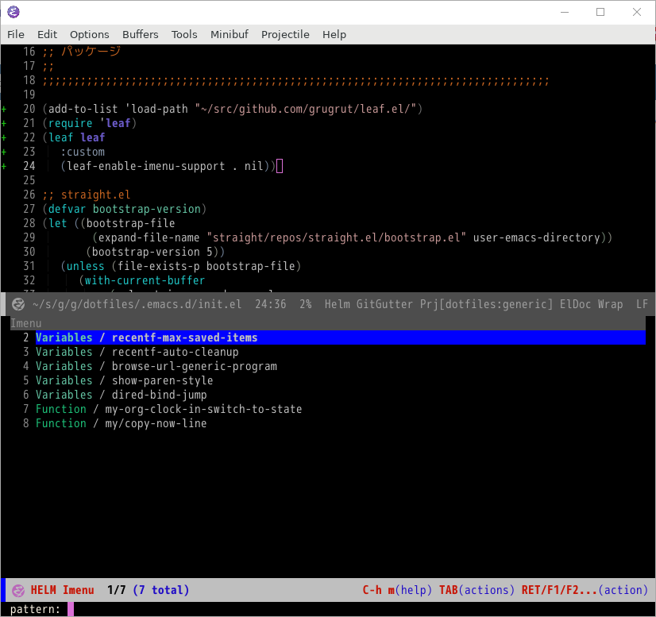
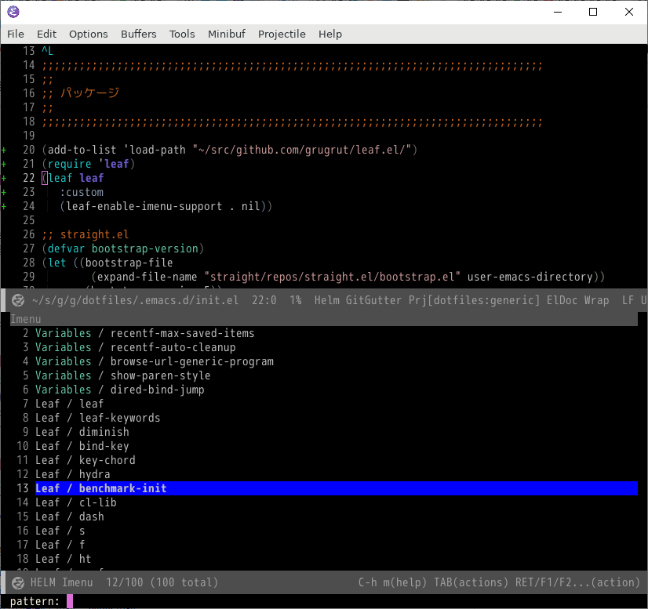
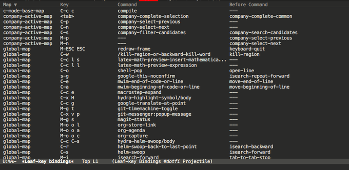
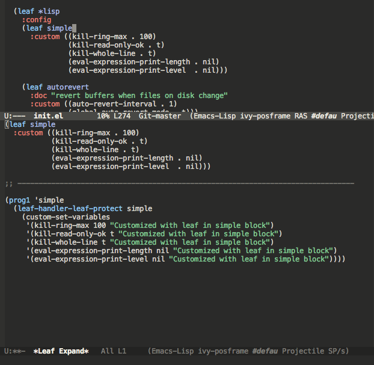
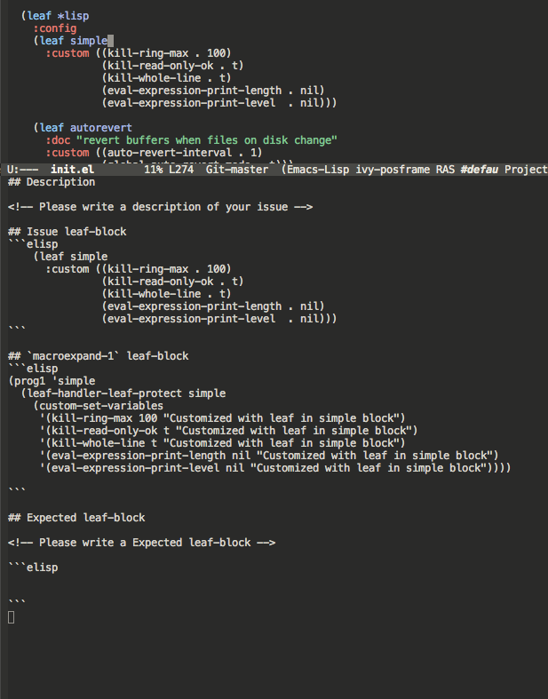

Title: [2019年アップデート] leaf.elで雑然としたEmacs設定ファイル「init.el」をクリーンにする
Date: 2019-12-02


# はじめに

この記事は「[Emacs Advent Calendar 2019](https://qiita.com/advent-calendar/2019/emacs)」の2日目の記事として書いたものです。昨日は私の「[依存関係をスマートに解決しつつ「GitHub Actions」でCIを無料でぶん回す](https://s.conao3.com/blog/2019/a95917)」でした。

まだ空きがあるので、ぜひ参加頂ければと思います!

<div class="github-card"><a href="https://github.com/conao3/leaf.el"><span class="github-card-name"><svg viewBox="0 0 16 16" aria-hidden="true"><path d="M2 2.5A2.5 2.5 0 0 1 4.5 0h8.75a.75.75 0 0 1 .75.75v12.5a.75.75 0 0 1-.75.75h-2.5a.75.75 0 0 1 0-1.5h1.75v-2h-8a1 1 0 0 0-.714 1.7.75.75 0 1 1-1.072 1.05A2.495 2.495 0 0 1 2 11.5Zm10.5-1h-8a1 1 0 0 0-1 1v6.708A2.486 2.486 0 0 1 4.5 9h8ZM5 12.25a.25.25 0 0 1 .25-.25h3.5a.25.25 0 0 1 .25.25v3.25a.25.25 0 0 1-.4.2l-1.45-1.087a.249.249 0 0 0-.3 0L5.4 15.7a.25.25 0 0 1-.4-.2Z"/></svg><span>conao3/<strong>leaf.el</strong></span></span><span class="github-card-description">Flexible, declarative, and modern init.el package configuration</span><span class="github-card-language"><span class="github-card-language-color" style="background-color: #c065db"></span>Emacs Lisp</span></a></div>


# leafについて

[leaf.el](https://github.com/conao3/leaf.el)はjwiegleyさんの[use-package](https://github.com/jwiegley/use-package)を2.5年使った上で、私が感じていたストレスを解消するためにスクラッチから開発したパッケージです。Qiitaでもプレリリースとリリース時に記事を書きましたが、半年経つと新機能も増えてきます。

-   プレリリース記事: [use-packageからの移行のすゝめ - leaf.elでバージョン安全なinit.elを書く](https://s.conao3.com/blog/2018/8aa938)
-   リリース記事: [{正式リリース}leaf.elで雑然としたEmacs設定ファイル「init.el」をクリーンにする](https://s.conao3.com/blog/2019/2b6cbf)

リリースしたときの記事に追記しようかと思いましたが、別記事にすることにしました。


# leafのバージョニングについて

leaf.elの[issues/pulls](https://github.com/conao3/leaf.el/issues?utf8=%E2%9C%93&q=)を見てもらえれば分かりますが、 `v1.0.0` を付けたときからmasterへのcommitを禁止しており、issueを立てて、そのissueに対するPRを自分でマージする形でアップデートをしています。さらに、1つのPRで `0.0.1` バージョンが上がるようにしているので、バージョンを見るだけでどれだけアップデートされたかが分かるようになっています。

リリース記事を見ると、2019/06/15に投稿されており、この記事には2019/06/14にマージした「[Treat pair which car is list in :hook, :defun etc](https://github.com/conao3/leaf.el/issues/253)」までの情報で書かれています。

これは `:hook` や `:modes`, `:defun` の分配指定の機能です。[leaf.elとは/変数設定のためのキーワード/:hook](https://s.conao3.com/blog/2019/2b6cbf)の章で紹介されている、3つ目の例がちゃんと動くようにしたPRでした。(これはuse-packageでも実装されている機能なので、これをマージしないと記事として収まりが悪かった。)

```emacs-lisp
(cort-deftest-with-macroexpand leaf/hook
  '(((leaf ace-jump-mode
       :hook cc-mode-hook
       :config (ace-jump-mode))
     (prog1 'ace-jump-mode
       (autoload #'ace-jump-mode "ace-jump-mode" nil t)
       (add-hook 'cc-mode-hook #'ace-jump-mode)
       (eval-after-load 'ace-jump-mode
         '(progn
            (ace-jump-mode)))))

    ((leaf ace-jump-mode
       :hook cc-mode-hook (prog-mode-hook . my-ace-jump-mode))
     (prog1 'ace-jump-mode
       (autoload #'ace-jump-mode "ace-jump-mode" nil t)
       (autoload #'my-ace-jump-mode "ace-jump-mode" nil t)
       (add-hook 'cc-mode-hook #'ace-jump-mode)
       (add-hook 'prog-mode-hook #'my-ace-jump-mode)))

    ((leaf ace-jump-mode
       :hook ((cc-mode-hook prog-mode-hook) . my-ace-jump-mode))
     (prog1 'ace-jump-mode
       (autoload #'my-ace-jump-mode "ace-jump-mode" nil t)
       (add-hook 'cc-mode-hook #'my-ace-jump-mode)
       (add-hook 'prog-mode-hook #'my-ace-jump-mode)))))
```

このPRでは `v3.2.5` が付けられています。現在の[HEAD](https://github.com/conao3/leaf.el/commit/57b99052f949f34471265f8b010549ee4725c320)は `v3.6.8` が付けられているので、単純には43件のPRがマージされたことになります。実際には外部の方のPRなどで、バージョンを上げてもらうことを言い忘れてマージしたことがあるので、少し誤差がありますが。。


## leaf.el


### Issue

Issueは期間中に55件ありました。

-   [#253 Treat pair which car is list in :hook, :defun etc](https://github.com/conao3/leaf.el/issues/253)
-   [#255 Add leaf-expand-minimally variable](https://github.com/conao3/leaf.el/issues/255)
-   [#257 What is difference between use-package and leaf?](https://github.com/conao3/leaf.el/issues/257)
-   [#258 Add leaf-available-keywords function](https://github.com/conao3/leaf.el/issues/258)
-   [#260 make leaf-avairable-keywords interacrive function](https://github.com/conao3/leaf.el/issues/260)
-   [#262 Use dockerize Emacs when running test](https://github.com/conao3/leaf.el/issues/262)
-   [#263 Fix readme; fix english error](https://github.com/conao3/leaf.el/issues/263)
-   [#265 {Question} What is the replacement for \`use-package-always-ensure\`?](https://github.com/conao3/leaf.el/issues/265)
-   [#266 Eager macro-expansion failure: (error "leaf: Unrecognized keyword :bind-keymap")](https://github.com/conao3/leaf.el/issues/266)
-   [#267 {Help} Unable to use leaf to initialize navbar](https://github.com/conao3/leaf.el/issues/267)
-   [#270 :config not working when :bind is used?](https://github.com/conao3/leaf.el/issues/270)
-   [#271 fix patreon logo](https://github.com/conao3/leaf.el/issues/271)
-   [#273 request: don't defer keymap bindings when :leaf-defer is nil](https://github.com/conao3/leaf.el/issues/273)
-   [#274 fix install code](https://github.com/conao3/leaf.el/issues/274)
-   [#276 Setting or customizing variables from plstore](https://github.com/conao3/leaf.el/issues/276)
-   [#277 not use leaf-error and leaf-warn at expansion form](https://github.com/conao3/leaf.el/issues/277)
-   [#279 Why don't :setq, :custom, etc. distribute when normalizing?](https://github.com/conao3/leaf.el/issues/279)
-   [#281 Disable indent-tabs-mode in emacs-lisp-mode via .dir-locals.el](https://github.com/conao3/leaf.el/issues/281)
-   [#283 Add default plstore variable and get from it if value omitted](https://github.com/conao3/leaf.el/issues/283)
-   [#285 Align code and testfile](https://github.com/conao3/leaf.el/issues/285)
-   [#287 Move :advice and :advice-remove documents to misc keyword](https://github.com/conao3/leaf.el/issues/287)
-   [#289 Add leaf-key-bindlist visualization](https://github.com/conao3/leaf.el/issues/289)
-   [#291 Update README](https://github.com/conao3/leaf.el/issues/291)
-   [#293 Fix :diminish expansion](https://github.com/conao3/leaf.el/issues/293)
-   [#294 :ensure keyword with package-selected-packages integration](https://github.com/conao3/leaf.el/issues/294)
-   [#295 :hook cannot handle lambda with multiple expressions](https://github.com/conao3/leaf.el/issues/295)
-   [#296 :hook should not autoload lambda expressions](https://github.com/conao3/leaf.el/issues/296)
-   [#299 :after should accept \`t' symbol](https://github.com/conao3/leaf.el/issues/299)
-   [#301 Don't provide a leaf-tests feature](https://github.com/conao3/leaf.el/issues/301)
-   [#303 Fix leaf-handler-package error handling](https://github.com/conao3/leaf.el/issues/303)
-   [#305 :custom should expnad behind of :leaf-defer](https://github.com/conao3/leaf.el/issues/305)
-   [#306 init.el with leaf as a practical example](https://github.com/conao3/leaf.el/issues/306)
-   [#308 Sort expansion order, :init and :config keyword](https://github.com/conao3/leaf.el/issues/308)
-   [#310 Refactoring imenu support feature](https://github.com/conao3/leaf.el/issues/310)
-   [#312 Refactoring: mapcan declare when compile time](https://github.com/conao3/leaf.el/issues/312)
-   [#314 Remove :dummy list element](https://github.com/conao3/leaf.el/issues/314)
-   [#316 Refactoring; code sorting, adding docstring](https://github.com/conao3/leaf.el/issues/316)
-   [#319 Add leaf expand visualization feature](https://github.com/conao3/leaf.el/issues/319)
-   [#322 lambda function does not accepted by :bind keyword](https://github.com/conao3/leaf.el/issues/322)
-   [#323 Not working leaf-to-string with error](https://github.com/conao3/leaf.el/issues/323)
-   [#326 Suppress byte-compiler warnings, unused lexical variable, err](https://github.com/conao3/leaf.el/issues/326)
-   [#328 expand :init before :leaf-defer](https://github.com/conao3/leaf.el/issues/328)
-   [#330 Do configure autoload if not have already set autoload](https://github.com/conao3/leaf.el/issues/330)
-   [#332 Create :leaf-defun, auto declare function feature](https://github.com/conao3/leaf.el/issues/332)
-   [#334 Add :leaf-defvar keyword](https://github.com/conao3/leaf.el/issues/334)
-   [#336 fix :leaf-defvar expand statement](https://github.com/conao3/leaf.el/issues/336)
-   [#338 add auth-\* keywords as alias of pl-\* keywords](https://github.com/conao3/leaf.el/issues/338)
-   [#340 align keywords](https://github.com/conao3/leaf.el/issues/340)
-   [#342 Remove unneeded quote in plstore example](https://github.com/conao3/leaf.el/issues/342)
-   [#346 use with-output-to-temp-buffer to create leaf-expand buffer](https://github.com/conao3/leaf.el/issues/346)
-   [#347 add :let keyword](https://github.com/conao3/leaf.el/issues/347)
-   [#348 Add debug code in eval-after-load](https://github.com/conao3/leaf.el/issues/348)
-   [#349 Add vector test-case for :bind](https://github.com/conao3/leaf.el/issues/349)
-   [#351 update slack url](https://github.com/conao3/leaf.el/issues/351)
-   [#353 use shields.io badge for GitHub Actions](https://github.com/conao3/leaf.el/issues/353)


### Pull request

Pull requestは期間中に45件ありました。つまりバージョン上げるのを2回見落としてます。。

-   [#254 feature#253](https://github.com/conao3/leaf.el/pull/254)
-   [#256 feature#255](https://github.com/conao3/leaf.el/pull/256)
-   [#259 feature#258](https://github.com/conao3/leaf.el/pull/259)
-   [#261 feature#260](https://github.com/conao3/leaf.el/pull/261)
-   [#264 feature#263](https://github.com/conao3/leaf.el/pull/264)
-   [#268 feature#262](https://github.com/conao3/leaf.el/pull/268)
-   [#269 Correctly eval cdr](https://github.com/conao3/leaf.el/pull/269)
-   [#272 feature#271](https://github.com/conao3/leaf.el/pull/272)
-   [#275 feature#274](https://github.com/conao3/leaf.el/pull/275)
-   [#278 feature#277](https://github.com/conao3/leaf.el/pull/278)
-   [#280 Implement plstore-related keywords](https://github.com/conao3/leaf.el/pull/280)
-   [#282 feature#279](https://github.com/conao3/leaf.el/pull/282)
-   [#284 feature#281](https://github.com/conao3/leaf.el/pull/284)
-   [#286 feature#285](https://github.com/conao3/leaf.el/pull/286)
-   [#288 feature#287](https://github.com/conao3/leaf.el/pull/288)
-   [#290 feature#283](https://github.com/conao3/leaf.el/pull/290)
-   [#292 feature#291](https://github.com/conao3/leaf.el/pull/292)
-   [#297 feature#296](https://github.com/conao3/leaf.el/pull/297)
-   [#298 feature#295](https://github.com/conao3/leaf.el/pull/298)
-   [#300 Add imenu support feature.](https://github.com/conao3/leaf.el/pull/300)
-   [#302 feature#301](https://github.com/conao3/leaf.el/pull/302)
-   [#304 feature#303](https://github.com/conao3/leaf.el/pull/304)
-   [#307 feature#305](https://github.com/conao3/leaf.el/pull/307)
-   [#309 feature#308](https://github.com/conao3/leaf.el/pull/309)
-   [#311 feature#310](https://github.com/conao3/leaf.el/pull/311)
-   [#313 feature#312](https://github.com/conao3/leaf.el/pull/313)
-   [#315 feature#314](https://github.com/conao3/leaf.el/pull/315)
-   [#317 feature#316](https://github.com/conao3/leaf.el/pull/317)
-   [#318 feature#289](https://github.com/conao3/leaf.el/pull/318)
-   [#320 Typo Corrections: faether.el and feathre.el -> feather.el](https://github.com/conao3/leaf.el/pull/320)
-   [#324 feature#323](https://github.com/conao3/leaf.el/pull/324)
-   [#325 feature#319](https://github.com/conao3/leaf.el/pull/325)
-   [#327 feature#326](https://github.com/conao3/leaf.el/pull/327)
-   [#329 feature#328](https://github.com/conao3/leaf.el/pull/329)
-   [#331 feature#330](https://github.com/conao3/leaf.el/pull/331)
-   [#333 feature#332](https://github.com/conao3/leaf.el/pull/333)
-   [#335 Feature#334](https://github.com/conao3/leaf.el/pull/335)
-   [#337 feature#336](https://github.com/conao3/leaf.el/pull/337)
-   [#339 feature#338](https://github.com/conao3/leaf.el/pull/339)
-   [#341 feature#340](https://github.com/conao3/leaf.el/pull/341)
-   [#343 feature#342](https://github.com/conao3/leaf.el/pull/343)
-   [#344 Fix uncountable nouns](https://github.com/conao3/leaf.el/pull/344)
-   [#345 Fix expressions in contributing.org](https://github.com/conao3/leaf.el/pull/345)
-   [#350 feature#349](https://github.com/conao3/leaf.el/pull/350)
-   [#352 feature#351](https://github.com/conao3/leaf.el/pull/352)


## leaf-keywords.el

[leaf-keywords.el](https://github.com/conao3/leaf-keywords.el/)は外部パッケージに依存するキーワードをまとめたパッケージです。

leaf.elをEmacs本体に入れるという野望のために分けてありますが、基本的にはleaf.elとleaf-keywords.elは両方入れることを前提にしてます。


### Issue

-   [#42 add autoload magic comment](https://github.com/conao3/leaf-keywords.el/issues/42)
-   [#44 Add :selected keyword](https://github.com/conao3/leaf-keywords.el/issues/44)
-   [#45 Add :quelpa keyword](https://github.com/conao3/leaf-keywords.el/issues/45)
-   [#46 fix patreon logo](https://github.com/conao3/leaf-keywords.el/issues/46)
-   [#48 degrade with leaf-pair fixed](https://github.com/conao3/leaf-keywords.el/issues/48)
-   [#51 Fix :diminish expansion](https://github.com/conao3/leaf-keywords.el/issues/51)
-   [#52 Don't provide a leaf-keywords-tests feature](https://github.com/conao3/leaf-keywords.el/issues/52)
-   [#55 :diminish does not work](https://github.com/conao3/leaf-keywords.el/issues/55)
-   [#56 Automatically require packages feature](https://github.com/conao3/leaf-keywords.el/issues/56)
-   [#58 Fix auto require feature](https://github.com/conao3/leaf-keywords.el/issues/58)
-   [#60 Refactoring: code sorting, adding docstring](https://github.com/conao3/leaf-keywords.el/issues/60)
-   [#62 Remove eval-after-load statement](https://github.com/conao3/leaf-keywords.el/issues/62)
-   [#64 Remove straight from auto require packages](https://github.com/conao3/leaf-keywords.el/issues/64)
-   [#67 update slack url](https://github.com/conao3/leaf-keywords.el/issues/67)
-   [#69 Use Github Action instead of travis](https://github.com/conao3/leaf-keywords.el/issues/69)


### Pull request

-   [#70 feature#69](https://github.com/conao3/leaf-keywords.el/pull/70)
-   [#68 feature#67](https://github.com/conao3/leaf-keywords.el/pull/68)
-   [#66 feature#55](https://github.com/conao3/leaf-keywords.el/pull/66)
-   [#65 feature#64](https://github.com/conao3/leaf-keywords.el/pull/65)
-   [#63 feature#62](https://github.com/conao3/leaf-keywords.el/pull/63)
-   [#61 feature#60](https://github.com/conao3/leaf-keywords.el/pull/61)
-   [#59 feature#58](https://github.com/conao3/leaf-keywords.el/pull/59)
-   [#57 feature#56](https://github.com/conao3/leaf-keywords.el/pull/57)
-   [#54 feature#34](https://github.com/conao3/leaf-keywords.el/pull/54)
-   [#53 feature#52](https://github.com/conao3/leaf-keywords.el/pull/53)
-   [#50 feature#51](https://github.com/conao3/leaf-keywords.el/pull/50)
-   [#49 feature#48](https://github.com/conao3/leaf-keywords.el/pull/49)
-   [#47 feature#46](https://github.com/conao3/leaf-keywords.el/pull/47)
-   [#43 feature#42](https://github.com/conao3/leaf-keywords.el/pull/43)


# 追加された機能


## Add imenu support feature

-   [#300 Add imenu support feature.](https://github.com/conao3/leaf.el/pull/300)
-   [#310 Refactoring imenu support feature](https://github.com/conao3/leaf.el/issues/310)

この半年の目玉機能は、間違いなくgrugrutさんに提案頂いた、leafのImenu integrationでしょう。

これを

こうします。

use-packageにもあるみたいですが、どうやらバグっているとのことなので、leaf.elでしか使えません。便利すぎるので、デフォルトでオンにしてあります。

そもそもEmacsには[imenuという機能](https://ayatakesi.github.io/emacs/temp/html/Imenu.html)があり、 `M-x imenu` で起動できます。ファイルをスキャンして関数定義や変数定義などの主要な定義についてのリストを提供し、その場所へのジャンプを提供します。

私はこのPRを受けて、この機能を知り、とても便利だったので `C-s` を `counsel-imenu` にあげることにしました。

`ivy` の `isearch` 相当は `swiper` なのですが、最近 `helm-swoop` のメンテナになったので、 `helm-swoop` を `C-S-s` に割り当てて使っています。

```emacs-lisp
(leaf ivy
  :ensure t
  :diminish ivy-mode
  :custom ((ivy-re-builders-alist . '((t      . ivy--regex-fuzzy)
                                      (swiper . ivy--regex-plus)))
           (ivy-use-selectable-prompt . t)

           (ivy-mode     . t)
           (counsel-mode . t))
  :init
  (leaf *ivy-requirements
    :config
    (leaf swiper
      :disabled t
      :ensure t
      :bind (([remap isearch-forward] . swiper)))
    (leaf counsel
      :ensure t
      :diminish counsel-mode
      :bind (([remap isearch-forward] . counsel-imenu)
             ("C-x C-r" . counsel-recentf)))))

(leaf helm
  :ensure t
  ;; :require helm-config
  :config
  (leaf helm-swoop
    :load-path `,(locate-user-emacs-file "site-lisp/helm-swoop")
    :custom (helm-swoop-pre-input-function
             . (lambda ()
                 (if mark-active
                     (buffer-substring-no-properties (mark) (point))
                   "")))
    :bind ((helm-swoop-map   ("C-s" . helm-multi-swoop-all-from-helm-swoop))
           ("C-S-s" . helm-swoop)
           ("C-c f" . hydra-helm-swoop/body))))
```


## Implement plstore-related keywords

-   [#276 Setting or customizing variables from plstore](https://github.com/conao3/leaf.el/issues/276)
-   [#280 Implement plstore-related keywords](https://github.com/conao3/leaf.el/pull/280)
-   [#283 Add default plstore variable and get from it if value omitted](https://github.com/conao3/leaf.el/issues/283)
-   [#338 add auth-\* keywords as alias of pl-\* keywords](https://github.com/conao3/leaf.el/issues/338)

目玉機能その2です。機密情報をEmacsの外に保存して、動的に復号し、Emacsの中で使う `auth-sources` のleafキーワードです。

この機能についてはちょっと説明が必要なので、別記事にし <del>てAdvent Calendarの穴埋めをし</del> ます。


## Add leaf-key-bindlist visualization

-   [#289 Add leaf-key-bindlist visualization](https://github.com/conao3/leaf.el/issues/289)

目玉機能その3です。leafの `:bind` や `:bind*` で設定したキーバインドのリストを表示します。もしEmacsデフォルトのキーバインドを上書きしている場合は上書き前の関数名も表示されます。

これも、もともとuse-packageに実装されている `describe-personal-bindings` の移植です。

しかし、use-packageでは単にbufferにフォーマットされた文字列を表示するだけですが、 `leaf-key-describe-bindings` ではEmacsビルトインの表データ表示ライブラリ、 `tabulated-list` を使用して表示します。



それによって各列での昇順、降順のソートなどができることで、use-packageのそれより使いやすく/見やすくなっていると思います。


## Add leaf-expand-minimally variable

-   [#255 Add leaf-expand-minimally variable](https://github.com/conao3/leaf.el/issues/255)

`leaf-emapand-minimally` という変数を追加しました。これは、use-packageにもある `use-package-expannd-minimally` の移植です。移植といいつつ、機能だけの移植でどうやって実装されているかまで見ていません。

leafの `leaf-expand-minimally` の実装は `leaf-expand-minimally-suppress-keywords` に指定されたキーワードに対して、優先度最大で、 `nil` を指定するというものです。

今のところ `leaf-expand-minimally-suppress-keywords` には `:leaf-protect` のみが指定されているので、有効にした場合は[:leaf-protect](https://s.conao3.com/blog/2019/2b6cbf)だけが無効化されます。

```emacs-lisp
(defmacro p (form)
  "Output FORM processed `macroexpand-1' and `pp'."
  `(progn
     (pp (macroexpand-1 ',form))
     nil))
;;=> p

(p (leaf ace-window
     :ensure t
     :bind (("M-o a w" . ace-window))))
;;=> (prog1 'ace-window
;;     (leaf-handler-leaf-protect ace-window
;;       (unless
;;           (fboundp 'ace-window)
;;         (autoload #'ace-window "ace-window" nil t))
;;       (declare-function ace-window "ace-window")
;;       (leaf-handler-package ace-window ace-window nil)
;;       (leaf-keys
;;        (("M-o a w" . ace-window)))))

(let ((leaf-expand-minimally t))
  (p (leaf ace-window
       :ensure t
       :bind (("M-o a w" . ace-window)))))
;;=> (prog1 'ace-window
;;     (unless
;;         (fboundp 'ace-window)
;;       (autoload #'ace-window "ace-window" nil t))
;;     (declare-function ace-window "ace-window")
;;     (leaf-handler-package ace-window ace-window nil)
;;     (leaf-keys
;;      (("M-o a w" . ace-window))))
```

ただ、leafの展開形を知りたいだけなら後述する `leaf-expand` の方が使いやすいと思います。


## Add leaf expand visualization feature

-   [#319 Add leaf expand visualization feature](https://github.com/conao3/leaf.el/issues/319)





`M-x leaf-expand` と `M-x leaf-create-issue-template` を実装しました。

`leaf-expand` は現在のポイントから上のS式をスキャンして、一番最初に見つかったleafを `macroexpand-1` で展開し、新しいバッファに表示します。

`leaf-create-issue-template` はついでに実装したものです。展開前と展開後のleafをmd形式で新しいバッファに表示します。これをコピペすれば簡単にissueが書けるのではないかなと思います。


## Add leaf-available-keywords

-   [#258 Add leaf-available-keywords function](https://github.com/conao3/leaf.el/issues/258)
-   [#260 make leaf-avairable-keywords interacrive function](https://github.com/conao3/leaf.el/issues/260)

`leaf-available-keywords` を追加しました。

lispプログラムから実行すると、単に現在使用できるキーワードのリストを返し、 `M-x leaf-avairable-keywords` と実行するとエコーエリアに表示します。

@@ image @@

あれ、どんなキーワードが使えるんだっけ。ってときに使えるかもしれません。このコマンドを実行する前にドキュメントを見てしまいそうですが。。


## Why don't :setq, :custom, etc. distribute when normalizing?

-   [#279 Why don't :setq, :custom, etc. distribute when normalizing?](https://github.com/conao3/leaf.el/issues/279)
-   [#282 feature#279](https://github.com/conao3/leaf.el/pull/282)

`:hook` や `:mode` 以外のキーワードの分配代入のサポートの提案です。結局、下記のキーワードの全てで分配代入をサポートしました。

    :ensure :package
    :hook :mode :interpreter :magic :magic-fallback :defun
    :pl-setq :pl-pre-setq :pl-setq-default :pl-custom
    :auth-custom :auth-pre-setq :auth-setq :auth-setq-default
    :setq :pre-setq :setq-default :custom :custom-face

同じ値を複数の変数に設定するときに便利かもしれません。ただあんまり記述量変わらないし、変数名も長いので2行に渡ることもあり、私はあまり使ってません。

ただ、やっぱり `:hook` や `:mode` では便利。


## Automatically require packages feature

-   [#56 Automatically require packages feature](https://github.com/conao3/leaf-keywords.el/issues/56)
-   [#58 Fix auto require feature](https://github.com/conao3/leaf-keywords.el/issues/58)
-   [#64 Remove straight from auto require packages](https://github.com/conao3/leaf-keywords.el/issues/64)

leaf-keywords.elの追加機能です。leaf-keywords.elで使えるパッケージがインストールされていた場合、 `(leaf-keywords-setup)` をしたときに自動でrequireするようにしました。

この機能を使うには `(leaf-keywords-setup)` をする前に `el-get`, `hydra`, `key-combo`, `smartrep`, `key-chord`, `diminish`, `delight` のうちどれかをpackage.elなどでインストールしておく必要があります。


## Remove eval-after-load statement

-   [#62 Remove eval-after-load statement](https://github.com/conao3/leaf-keywords.el/issues/62)

leaf-keywords.elの追加機能です。leaf-keywords.elによって出力されたS式は、追加パッケージがrequireされたときに発火するように `eval-after-load` で囲われていました。

しかしこのおせっかい機能によって、 `:diminish` キーワードを使用しているのに `diminish` をインストールし忘れているという事故が起こっていました。

そこでエイヤッと取っぱらってしまいました。エラーによってきちんとユーザーに報告した方が良いだろうという判断です。なお `leaf-protect` で囲われている限り、エラーは起こりますが内部のエラーは全てワーニングに変換されるので、その後のパッケージは読み込もうとします。


# 修正された機能


## Correctly eval cdr

-   [#269 Correctly eval cdr](https://github.com/conao3/leaf.el/pull/269)

私は「ドット対のリスト」を指定するのが好みで、それをずっと使っていましたが、単に「ドット対」を渡したときに盛大にバグっていたことを教えて頂きました。

-   動く
    
    ```emacs-lisp
    (leaf some-mode
      :hook ((t . other-mode)))
    ```

-   動かない
    
    ```emacs-lisp
    (leaf some-mode
      :hook (t . other-mode))
    ```

leafは結構大きなDSL解析器になっていて、デバッグも大変になってきています。とりあえず、テストケースは全部通ることを確認しているので、見つけ次第追加していくしかないですね。。

なお、Readmeや私が書くleafの記事で紹介しているものはテストケースから抜き出したものなので、動くことが保証されています。


## Fix install code

-   [#274 fix install code](https://github.com/conao3/leaf.el/issues/274)

Readmeにおいて `leaf` のダウンロードに失敗したら `package-refresh` してもう一度ダウンロードを試すようにしていましたが、通常、leafは一番最初にダウンロードされるだろうということを仮定してインストールコードを簡略化しました。

ついでに `leaf-keywords.el` のインストールコードも `prog1` を使わない形に変えました。

-   before
    
    ```emacs-lisp
    (prog1 "prepare leaf"
      (prog1 "package"
        (custom-set-variables
         '(package-archives '(("org"   . "https://orgmode.org/elpa/")
                              ("melpa" . "https://melpa.org/packages/")
                              ("gnu"   . "https://elpa.gnu.org/packages/"))))
        (package-initialize))
    
      (prog1 "leaf"
        (unless (package-installed-p 'leaf)
          (unless (assoc 'leaf package-archive-contents)
            (package-refresh-contents))
          (condition-case err
              (package-install 'leaf)
            (error
             (package-refresh-contents)       ; renew local melpa cache if fail
             (package-install 'leaf))))
    
        (leaf leaf-keywords
          :ensure t
          :config (leaf-keywords-init)))
    
      (prog1 "optional packages for leaf-keywords"
        ;; optional packages if you want to use :hydra, :el-get,,,
        (leaf hydra :ensure t)
        (leaf el-get :ensure t
          :custom ((el-get-git-shallow-clone  . t)))))
    ```

-   after
    
    ```emacs-lisp
    (prog1 "leaf"
      (prog1 "install leaf"
        (custom-set-variables
         '(package-archives '(("org"   . "https://orgmode.org/elpa/")
                              ("melpa" . "https://melpa.org/packages/")
                              ("gnu"   . "https://elpa.gnu.org/packages/"))))
        (package-initialize)
        (unless (package-installed-p 'leaf)
          (package-refresh-contents)
          (package-install 'leaf)))
    
      (leaf leaf-keywords
        :ensure t
        :config
        ;; optional packages if you want to use :hydra, :el-get,,,
        (leaf hydra :ensure t)
        (leaf el-get :ensure t
          :custom ((el-get-git-shallow-clone . t)))
    
        ;; initialize leaf-keywords.el
        (leaf-keywords-init)))
    ```


## Byte compile

-   [#326 Suppress byte-compiler warnings, unused lexical variable, err](https://github.com/conao3/leaf.el/issues/326)
-   [#332 Create :leaf-defun, auto declare function feature](https://github.com/conao3/leaf.el/issues/332)
-   [#334 Add :leaf-defvar keyword](https://github.com/conao3/leaf.el/issues/334)
-   [#336 fix :leaf-defvar expand statement](https://github.com/conao3/leaf.el/issues/336)

leafを使用したinit.elをバイトコンパイルしたときにワーニングが出たので直しました。バイトコンパイルについては少しコツがあるので、また別記事にするかもしれません。


## Do configure autoload if not have already set autoload

-   [#330 Do configure autoload if not have already set autoload](https://github.com/conao3/leaf.el/issues/330)

二重にautoloadされることを防止するためにautoloadする前に `fboundp` するようにしました。実はuse-packageの出力結果では `fboundp` してautoloadしていたのですが、そのチェックは本当に必要なんだろうか。と思ってチェックを外していたのです。

しかし、実際のところpackage.elによって設定された正しいautoloadをleafが上書きしていることが分かったので、設定する前にチェックするようにしました。


## :hook should not autoload lambda expressions

-   [#295 :hook cannot handle lambda with multiple expressions](https://github.com/conao3/leaf.el/issues/295)
-   [#296 :hook should not autoload lambda expressions](https://github.com/conao3/leaf.el/issues/296)

`:hook` でlambda式を指定したときに、複数式だと動かないことと、変なautoloadが生成されていることの報告を受けて直しました。

この変更によって `:hook` で正常にlambda式を使用できるようになりました。

なお、 `:bind`, `:bind*` ではlambda式をバインドすることが[現状できない](https://github.com/conao3/leaf.el/issues/322)ので、 `:preface` で関数を宣言してバインドしてもらえればと思います。。


# まとめ

leafはIssueやPRを放置することなく、後方互換性を保った上で精力的に機能拡張を行なっています。ぜひこの記事や[リリース記事](https://s.conao3.com/blog/2019/2b6cbf)を参考にして、leafで快適なEmacs生活を送って頂ければと思います。

なお、12/18には「[Emacs Advent Calendar 2019](https://qiita.com/advent-calendar/2019/emacs)」の18日目の記事として @keita44\_f4 さんによるleafの記事がでるようなので、それも参考にしていただければと思います。

最後になりますが、Patreonでご支援を頂ける方を募集しています。普段はleafなどのElispパッケージなどを中心にOSS活動をしつつ、学生をしています。ぜひよろしくお願いします。

<https://www.patreon.com/conao3>

