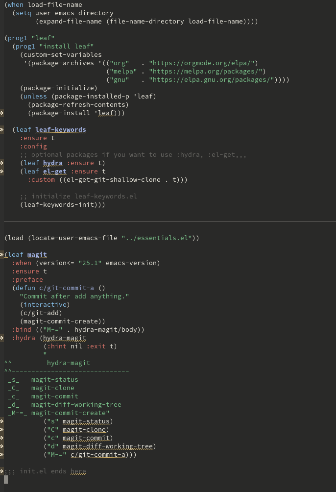
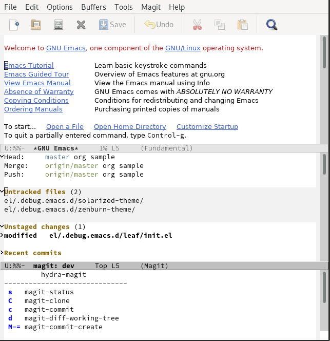
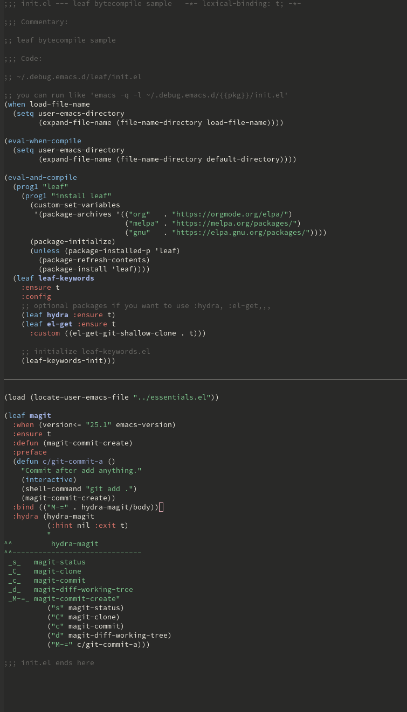

Title: leaf.elに依存したEmacs設定ファイル「init.el」をバイトコンパイルして爆速にする
Date: 2019-12-03


# はじめに

この記事は「[Emacs Advent Calendar 2019](https://qiita.com/advent-calendar/2019/emacs)」の3日目の記事として書いたものです。昨日は私の「[{2019年アップデート} leaf.elで雑然としたEmacs設定ファイル「init.el」をクリーンにする](https://s.conao3.com/blog/2019/3279ec)」でした。

まだ空きがあるので、ぜひ参加頂ければと思います!

<div class="github-card" data-repo="conao3/leaf.el"><a href="https://github.com/conao3/leaf.el"><span class="github-card-name"><svg class="github-card-mark" viewBox="0 0 16 16" aria-hidden="true"><path d="M6.766 11.328c-2.063-.25-3.516-1.734-3.516-3.656 0-.781.281-1.625.75-2.188-.203-.515-.172-1.609.063-2.062.625-.078 1.468.25 1.968.703.594-.187 1.219-.281 1.985-.281.765 0 1.39.094 1.953.265.484-.437 1.344-.765 1.969-.687.218.422.25 1.515.046 2.047.5.593.766 1.39.766 2.203 0 1.922-1.453 3.375-3.547 3.64.531.344.89 1.094.89 1.954v1.625c0 .468.391.734.86.547C13.781 14.359 16 11.53 16 8.03 16 3.61 12.406 0 7.984 0 3.563 0 0 3.61 0 8.031a7.88 7.88 0 0 0 5.172 7.422c.422.156.828-.125.828-.547v-1.25c-.219.094-.5.156-.75.156-1.031 0-1.64-.562-2.078-1.609-.172-.422-.36-.672-.719-.719-.187-.015-.25-.093-.25-.187 0-.188.313-.328.625-.328.453 0 .844.281 1.25.86.313.452.64.655 1.031.655s.641-.14 1-.5c.266-.265.47-.5.657-.656"/></svg><span>conao3/<strong>leaf.el</strong></span></span><span class="github-card-description">Flexible, declarative, and modern init.el package configuration</span><span class="github-card-footer"><span class="github-card-language"><span class="github-card-language-color" style="background-color: #c065db"></span>Emacs Lisp</span><span class="github-card-star"><svg viewBox="0 0 16 16" aria-hidden="true"><path d="M8 .25a.75.75 0 0 1 .673.418l1.882 3.815 4.21.612a.75.75 0 0 1 .416 1.279l-3.046 2.97.719 4.192a.751.751 0 0 1-1.088.791L8 12.347l-3.766 1.98a.75.75 0 0 1-1.088-.79l.72-4.194L.818 6.374a.75.75 0 0 1 .416-1.28l4.21-.611L7.327.668A.75.75 0 0 1 8 .25Z"/></svg><span>Star</span><span class="github-card-star-count" hidden></span></span></span></a></div>


# バイトコンパイルとは

Elispはバイトコンパイルすることができ、通常の `.el` から `.elc` にコンパイルすることができます<span class="footnote"><sup><button type="button" id="fnr.1" class="footref" popovertarget="fnr.1-body">1</button></sup><span class="footnote-body" id="fnr.1-body" popover>GNU Emacs Lisp Reference Manual - バイトコンパイル<https://ayatakesi.github.io/lispref/24.5/elisp-ja.html#Byte-Compilation></span></span>。

バイトコンパイルすることにより、より効率的にElispコードを実行できるようになります。init.elでバイトコンパイルの恩恵はあまり得られないことは言われていますが、しかし数msでも早くなるならやっておきたいのが人情というもの。実際どれだけ早くなるのか分からないのだから、試してみるしかないのです。

しかしleaf.elを使っている場合、そのままではバイトコンパイルできません。なお、[leaf.elのReadme](https://github.com/conao3/leaf.el)でもバイトコンパイルのことには全く触れていません。[バイトコンパイルキーワード](https://github.com/conao3/leaf.el#byte-compile-keywords)として実装されていることは紹介していますが、実際どのようにしたらいいのか書いてないのです。その方法を解説するものです。


# leaf.elとは

[leaf.el](https://github.com/conao3/leaf.el)はjwiegleyさんの[use-package](https://github.com/jwiegley/use-package)を2.5年使った上で、私が感じていたストレスを解消するためにスクラッチから開発したパッケージです。本体の説明はQiitaに何回か記事を書いたので、そちらを参照してください

-   プレリリース記事: [use-packageからの移行のすゝめ - leaf.elでバージョン安全なinit.elを書く](https://s.conao3.com/blog/2018/8aa938)
-   リリース記事: [{正式リリース}leaf.elで雑然としたEmacs設定ファイル「init.el」をクリーンにする](https://s.conao3.com/blog/2019/2b6cbf)
-   2019年アップデート記事: [{2019年アップデート} leaf.elで雑然としたEmacs設定ファイル「init.el」をクリーンにする](https://s.conao3.com/blog/2019/3279ec)


# let'sバイトコンパイル


## お題について

お題のinit.elを紹介します。私はこのinit.elを `/.debug.emacs.d/leaf/init.el` に保存しました。

```emacs-lisp
;;; init.el --- leaf bytecompile sample   -*- lexical-binding: t; -*-

;;; Commentary:

;; leaf bytecompile sample

;;; Code:

;; ~/.debug.emacs.d/leaf/init.el

;; you can run like 'emacs -q -l ~/.debug.emacs.d/{{pkg}}/init.el'
(when load-file-name
  (setq user-emacs-directory
        (expand-file-name (file-name-directory load-file-name))))

(prog1 "leaf"
  (prog1 "install leaf"
    (custom-set-variables
     '(package-archives '(("org"   . "https://orgmode.org/elpa/")
                          ("melpa" . "https://melpa.org/packages/")
                          ("gnu"   . "https://elpa.gnu.org/packages/"))))
    (package-initialize)
    (unless (package-installed-p 'leaf)
      (package-refresh-contents)
      (package-install 'leaf)))

  (leaf leaf-keywords
    :ensure t
    :config
    ;; optional packages if you want to use :hydra, :el-get,,,
    (leaf hydra :ensure t)
    (leaf el-get :ensure t
      :custom ((el-get-git-shallow-clone . t)))

    ;; initialize leaf-keywords.el
    (leaf-keywords-init)))



(load (locate-user-emacs-file "../essentials.el"))

(leaf magit
  :when (version<= "25.1" emacs-version)
  :ensure t
  :preface
  (defun c/git-commit-a ()
    "Commit after add anything."
    (interactive)
    (shell-command "git add .")
    (magit-commit-create))
  :bind (("M-=" . hydra-magit/body))
  :hydra (hydra-magit
          (:hint nil :exit t)
          "
^^         hydra-magit
^^------------------------------
 _s_   magit-status
 _C_   magit-clone
 _c_   magit-commit
 _d_   magit-diff-working-tree
 _M-=_ magit-commit-create"
          ("s" magit-status)
          ("C" magit-clone)
          ("c" magit-commit)
          ("d" magit-diff-working-tree)
          ("M-=" c/git-commit-a)))

;;; init.el ends here
```

お題のinit.elにはleafとleaf-keywordsのインストール、magitをpackage.elによってインストール、 `:hydra` キーワードも含まれています。お題としてはまぁまぁではないでしょうか。


## とりあえずやってみる

さて、このinit.elをバイトコンパイルするにあたって、注意するべきなのは、「leaf.elがマクロである」ということです。

マクロはバイトコンパイル時には既にコンパイラが定義を知っておく必要があります。

なお、flycheckのエラーも大変なことになっています。これでは重要なエラーを見落としてしまいます。



とりあえずやってみるということなので、バイトコンパイルしてみます。バイトコンパイルはいろいろな方法がありますが、簡単には外部のコンソールからバッチ処理モードでEmacsを起動してバイトコンパイルすることです。

```shell
$ emacs --version
GNU Emacs 26.3
Copyright (C) 2019 Free Software Foundation, Inc.
GNU Emacs comes with ABSOLUTELY NO WARRANTY.
You may redistribute copies of GNU Emacs
under the terms of the GNU General Public License.
For more information about these matters, see the file named COPYING.


$ emacs -Q --batch -f batch-byte-compile init.el
In toplevel form:
init.el:25:25:Warning: ‘(el-get-git-shallow-clone . t)’ is a malformed
    function
init.el:27:9:Warning: reference to free variable ‘leaf-keywords’
init.el:31:11:Warning: reference to free variable ‘hydra’
init.el:32:11:Warning: reference to free variable ‘el-get’
init.el:42:1:Warning: ‘("M-=" . hydra-magit/body)’ is a malformed function
init.el:42:1:Warning: ‘"s"’ is a malformed function
init.el:42:1:Warning: ‘"C"’ is a malformed function
init.el:42:1:Warning: ‘"c"’ is a malformed function
init.el:42:1:Warning: ‘"d"’ is a malformed function
init.el:42:1:Warning: ‘"M-="’ is a malformed function
init.el:42:7:Warning: reference to free variable ‘magit’
init.el:52:11:Warning: ‘:hint’ called as a function
init.el:62:16:Warning: reference to free variable ‘magit-status’
init.el:63:16:Warning: reference to free variable ‘magit-clone’
init.el:64:16:Warning: reference to free variable ‘magit-commit’
init.el:65:16:Warning: reference to free variable ‘magit-diff-working-tree’
init.el:66:18:Warning: reference to free variable ‘c/git-commit-a’

In end of data:
init.el:69:1:Warning: the following functions are not known to be defined:
    package-installed-p, leaf, leaf-keywords-init, c/git-add,
    magit-commit-create, hydra-magit, :hint
```

なお、バイトコンパイルされた `elc` はメジャーバージョンをまたいでの互換性はないので、 `emacs` と起動したときにどのバージョンが起動されているのか確認することは重要です。さて、バイトコンパイルは大量のワーニングを出してバイトコンパイルできたようです。

。。。できてしまった。

いや、実行はできないはず。。。

```emacs-lisp
emacs -q -l ~/.debug.emacs.d/leaf/init.el
```



実行できてしまった。。

あれ、この記事の存在意義が良く分からなくなってしまったのですが、とりあえずワーニングでるの良くないよねということで、「ワーニングなしでバイトコンパイルする方法を紹介すること」に方針転換します。。


## バイトコンパイル中の評価 - その1

「[コンパイル中の評価](https://ayatakesi.github.io/lispref/24.5/elisp-ja.html#Eval-During-Compile)」にある通り、バイトコンパイルのときにコンパイラに実行して欲しい式がある場合、 `eval-when-compile` で囲むことによって実現できます。

つまりleafのインストールをバイトコンパイル中にしてしまえばいいのです。そういえば[use-packageの推奨インストール](https://github.com/jwiegley/use-package#getting-started)はそもそもそうやって書かれていたのでした。

```diff
modified   el/.debug.emacs.d/leaf/init.el
@@ -13,17 +13,21 @@
   (setq user-emacs-directory
         (expand-file-name (file-name-directory load-file-name))))

-(prog1 "leaf"
-  (prog1 "install leaf"
-    (custom-set-variables
-     '(package-archives '(("org"   . "https://orgmode.org/elpa/")
-                          ("melpa" . "https://melpa.org/packages/")
-                          ("gnu"   . "https://elpa.gnu.org/packages/"))))
-    (package-initialize)
-    (unless (package-installed-p 'leaf)
-      (package-refresh-contents)
-      (package-install 'leaf)))
+(eval-when-compile
+  (setq user-emacs-directory
+        (expand-file-name (file-name-directory default-directory))))

+(eval-when-compile
+  (prog1 "leaf"
+    (prog1 "install leaf"
+      (custom-set-variables
+       '(package-archives '(("org"   . "https://orgmode.org/elpa/")
+                            ("melpa" . "https://melpa.org/packages/")
+                            ("gnu"   . "https://elpa.gnu.org/packages/"))))
+      (package-initialize)
+      (unless (package-installed-p 'leaf)
+        (package-refresh-contents)
+        (package-install 'leaf))))
   (leaf leaf-keywords
     :ensure t
     :config
```

このように修正しました。バイトコンパイルしてみます。一度目はleafやleaf-keywords, hydraのインストールなどが行なわれると思います。出力が見づらいので、2回目を引用すると以下のようになります。

```shell
$ emacs -Q --batch -f batch-byte-compile init.el

In end of data:
init.el:73:1:Warning: the following functions might not be defined at runtime
:
    package-installed-p, hydra-default-pre, hydra-keyboard-quit,
    hydra--call-interactively-remap-maybe, hydra-show-hint,
    hydra-set-transient-map
init.el:73:1:Warning: the function ‘magit-commit-create’ is not known to be
    defined.
```

どうやらまだワーニングが出ているようです。ワーニングは英語の意味そのままで、「バイトコンパイル中には定義を知っているが、実行時には多分知らないよ(実行時エラーになるよ)」ということです。実行時、それらの関数がきちんと使えることをバイトコンパイラに伝える必要がありそうです。

なお、 `user-emacs-diretory` の設定を `eval-when-compile` で囲った上で一つ増やしました。これはバイトコンパイル中も `user-emacs-directory` を変更しないとホームディレクトリの `.emacs.d` を使ってしまうからです。

別ディレクトリのクリーンな環境で実行しているからこそ、見落とさずに変更することができました。


## バイトコンパイル中の評価 - その2

実行時に評価されないとバイトコンパイラに注意されたので、実行時にも評価するように変更します。

`eval-when-compile` を `eval-and-compile` に変更するだけです。これでバイトコンパイル中にも、実行時にも評価されることを宣言できます。

```diff
modified   el/.debug.emacs.d/leaf/init.el
@@ -17,7 +17,7 @@
   (setq user-emacs-directory
         (expand-file-name (file-name-directory default-directory))))

-(eval-when-compile
+(eval-and-compile
   (prog1 "leaf"
     (prog1 "install leaf"
       (custom-set-variables
```

さて、バイトコンパイルしてみましょう。

```shell
$ emacs -Q --batch -f batch-byte-compile init.el

In end of data:
init.el:73:1:Warning: the function ‘magit-commit-create’ is not known to be
    defined.
```

ワーニングがずいぶん少なくなりました!最後に残ったのは `magit-commit-create` が定義されていないというワーニングです。

これは `:preface` で宣言している `c/git-commit-a` で使用しているmagitの内部関数ですね。では最後にこのワーニングが出ないようにすればお題クリアです。


## バイトコンパイル中の評価 - その3

前章で `magit-commit-create` が定義されていないというワーニングがでていました。ここで、ようやくleafのバイトコンパイルキーワードの出番です。

バイトコンパイルキーワードは2種類あり、 `:defun` は関数の宣言、 `:defvar` は変数の宣言を行います。今回は関数の未定義エラーがでているので、 `:defun` を使用します。

```diff
modified   el/.debug.emacs.d/leaf/init.el
@@ -46,6 +46,7 @@
 (leaf magit
   :when (version<= "25.1" emacs-version)
   :ensure t
+  :defun (magit-commit-create)
   :preface
   (defun c/git-commit-a ()
     "Commit after add anything."
```

さて、もう一度バイトコンパイルしてみましょう。

```shell
$ emacs -Q --batch -f batch-byte-compile init.el
```

出力がなにもありません。ワーニングなしでコンパイルできたようです!

flycheckのワーニングも全てなくなりました。これでflycheckのワーニングが価値あるものになりました。




# まとめ

leaf.elを使っているinit.elをバイトコンパイルする方法を紹介しました。しかしこれは一番簡単な場合で、もし「init.elを複数のバージョンで読み込む可能性がある」場合は今回の方法は使えません。メジャーバージョン間で `elc` の互換性は存在しないので、エラーになってしまいます。

とはいえ、そんな状況で使っている人はまれで、多くの人はホームディレクトリの `.emacs.d` にinit.elを置いて単一バージョンで使っていると思います。この記事が参考になれば幸いです。

最後になりますが、Patreonでご支援を頂ける方を募集しています。普段はleafなどのElispパッケージなどを中心にOSS活動をしつつ、学生をしています。ぜひよろしくお願いします。

<https://www.patreon.com/conao3>


# Footnotes

<sup><a id="fn.1" href="#fnr.1">1</a></sup> GNU Emacs Lisp Reference Manual - バイトコンパイル<https://ayatakesi.github.io/lispref/24.5/elisp-ja.html#Byte-Compilation>
