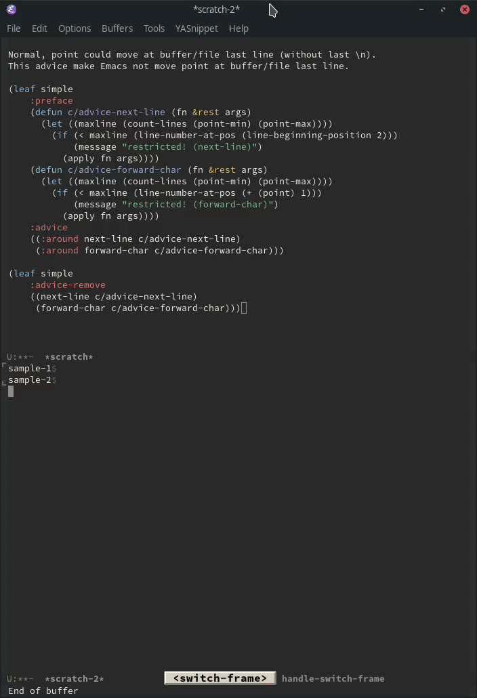
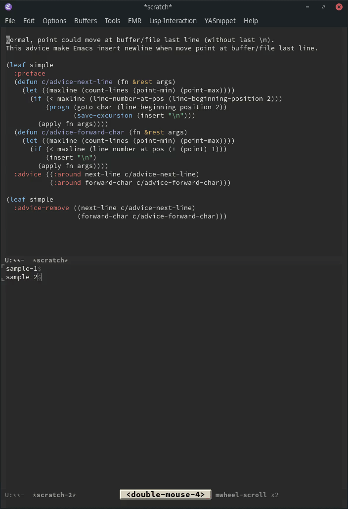

Title: Emacsで最終行にポイントを動かさないようにするアドバイス
Date: 2020-05-23


# Intro

Elispのadviceはとても便利。

<blockquote class="twitter-tweet"><p lang="ja" dir="ltr">でも気をつけないとバグの温床になりますっ！（笑</p>&mdash; Takaaki Ishikawa (@takaxp) <a href="https://twitter.com/takaxp/status/1263646615543275520?ref&#95;src=twsrc%5Etfw">May 22, 2020</a></blockquote> <script async src="https://platform.twitter.com/widgets.js" charset="utf-8"></script>


# 末尾にポイントを移動しない

Emacs-jpのスレッドで次のような質問があった。

> こんにちは！
> 2 行のファイルがあったとき、 3 行目にカーソル移動できないようにしたいです
> 何か方法は無いでしょうか

このような細かい挙動はアドバイスで簡単に実現できる。

```emacs-lisp
(leaf simple
  :preface
  (defun c/advice-next-line (fn &rest args)
    (let ((maxline (count-lines (point-min) (point-max))))
      (if (< maxline (line-number-at-pos (line-beginning-position 2)))
          (message "restricted! (next-line)")
        (apply fn args))))
  (defun c/advice-forward-char (fn &rest args)
    (let ((maxline (count-lines (point-min) (point-max))))
      (if (< maxline (line-number-at-pos (+ (point) 1)))
          (message "restricted! (forward-char)")
        (apply fn args))))
  :advice ((:around next-line c/advice-next-line)
           (:around forward-char c/advice-forward-char)))

(leaf simple
  :advice-remove ((next-line c/advice-next-line)
                  (forward-char c/advice-forward-char)))
```




# 末尾にポイントを移動しようとしたら改行する

さらに、仕様を変えて、「最終行以上にポイントを動かそうとしたときに、自動で改行を入れる」ことも簡単に実現できる。

```emacs-lisp
(leaf simple
  :preface
  (defun c/advice-next-line (fn &rest args)
    (let ((maxline (count-lines (point-min) (point-max))))
      (if (< maxline (line-number-at-pos (line-beginning-position 2)))
          (progn (goto-char (line-beginning-position 2))
                 (save-excursion (insert "\n")))
        (apply fn args))))
  (defun c/advice-forward-char (fn &rest args)
    (let ((maxline (count-lines (point-min) (point-max))))
      (if (< maxline (line-number-at-pos (+ (point) 1)))
          (insert "\n")
        (apply fn args))))
  :advice ((:around next-line c/advice-next-line)
           (:around forward-char c/advice-forward-char)))

(leaf simple
  :advice-remove ((next-line c/advice-next-line)
                  (forward-char c/advice-forward-char)))
```



これらのアドバイスで「ファイル末尾に必ず改行がある」ことを強制できる。


# まとめ

ただ、今回の要求については「ファイル保存時に改行がない場合、末尾改行を付加する」というオプションがあり、私はこれを使っている。

```emacs-lisp
(leaf files
  :custom `((require-final-newline . t)))
```

とはいえ、このようなオプションがないときElispのアドバイスはとても便利。

細かい挙動がストレスになることもあるので、簡単にカスタマイズできるEmacsは良いエディタ。

