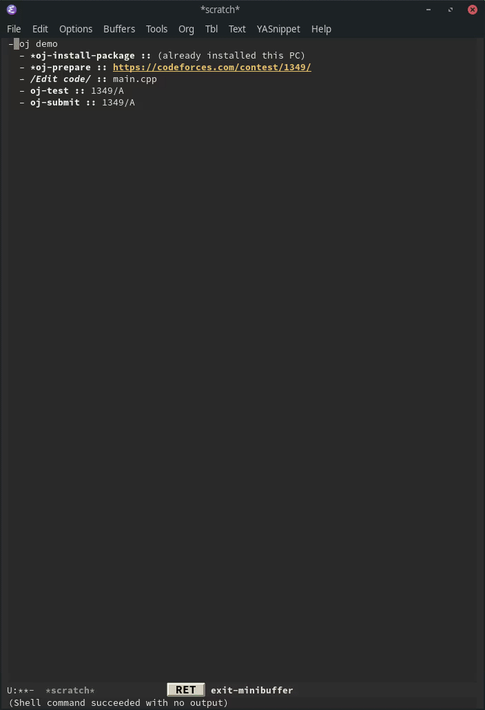

Title: Emacsで競技プログラミング | ojのラッパーパッケージを書いた話
Date: 2020-05-24


# Intro

ちょっとEmacsで競技プログラミングをしてみようかと思いました。

どうやら[oj](https://github.com/online-judge-tools/oj)、[oj-template](https://github.com/online-judge-tools/template-generator)という便利なツールがあるようなので、Emacsから簡単に実行できるよう[oj.el](https://github.com/conao3/oj.el)というパッケージを作成しました。

<div class="github-card"><a href="https://github.com/conao3/oj.el"><svg viewBox="0 0 16 16" aria-hidden="true"><path d="M6.766 11.328c-2.063-.25-3.516-1.734-3.516-3.656 0-.781.281-1.625.75-2.188-.203-.515-.172-1.609.063-2.062.625-.078 1.468.25 1.968.703.594-.187 1.219-.281 1.985-.281.765 0 1.39.094 1.953.265.484-.437 1.344-.765 1.969-.687.218.422.25 1.515.046 2.047.5.593.766 1.39.766 2.203 0 1.922-1.453 3.375-3.547 3.64.531.344.89 1.094.89 1.954v1.625c0 .468.391.734.86.547C13.781 14.359 16 11.53 16 8.03 16 3.61 12.406 0 7.984 0 3.563 0 0 3.61 0 8.031a7.88 7.88 0 0 0 5.172 7.422c.422.156.828-.125.828-.547v-1.25c-.219.094-.5.156-.75.156-1.031 0-1.64-.562-2.078-1.609-.172-.422-.36-.672-.719-.719-.187-.015-.25-.093-.25-.187 0-.188.313-.328.625-.328.453 0 .844.281 1.25.86.313.452.64.655 1.031.655s.641-.14 1-.5c.266-.265.47-.5.657-.656"/></svg><span class="github-card-text"><span class="github-card-name">conao3/<strong>oj.el</strong></span><span class="github-card-description">Competitive programming tools client for AtCoder, Codeforces</span></span></a></div>


# oj, oj-template

[oj](https://github.com/online-judge-tools/oj)は多数のオンラインジャッジに対応しているCLIツールです。

オンラインジャッジによって実装されている機能に制限はありますが、サンプルケースのダウンロード、テスト、提出、ランダムインプットの生成などの機能があります。


さらに[oj-template](https://github.com/online-judge-tools/template-generator)は入出力サンプルからそれっぽいcppとpythonファイルを生成してくれます。

また、 `oj-prepare` はコンテストURLを指定すると、そのコンテストの全ての問題について `oj download` と `oj-template` をしてくれます。

コンテスト中は時間との戦いなので、これらのコマンドによる時短は大きなものになると思います。


# oj.el

[oj.el](https://github.com/conao3/oj.el)は先般の `oj`, `oj-template` をEmacsから実行できるようにしたものです。

```emacs-lisp
(leaf oj
  :ensure t
  :custom ((oj-compiler-c . "clang")
           (oj-compiler-python . "pypy")
           (oj-default-online-judge . "atcoder")))
```



単に関数にバインドしただけでなく、多少の改善を入れています。

例えば `oj` はダウンロードするためにURL全体を指定する必要がありますが、 `oj-default-online-judge` で設定されているオンラインジャッジを既定のものと考え、入力を省略できるようにしています。
(CLIツールとしての[方針](https://online-judge-tools.readthedocs.io/en/master/introduction.ja.html#id7)と干渉するものではなく、エディタの拡張としての求められる機能として盛りこんだものです。)

例えば `atcoder` デフォルトに設定されている状況で、 `M-x oj-prepare` に `abc167` を入力すると下記コマンドが実行されます。

```shell
oj-template https://atcoder.jp/contests/abc167
```

さらに、 `abc167/a` と入力すると下記コマンドが実行されます。

```shell
oj-template https://atcoder.jp/contests/abc167/tasks/abc167_a
```

このように推測できる部分については、より推測するように実装しています。

詳しい使い方については[README](https://github.com/conao3/oj.el#usage)を参照して下さい。
基本的に `oj-install-package`, `oj-prepare`, `oj-test`, `oj-submit` の順にコマンドを実行すればいい感じに動くはずです。


# まとめ

ojをEmacsから使いやすくするラッパーパッケージを書きました。

こういう方向のパッケージもお手軽で良いですね。

