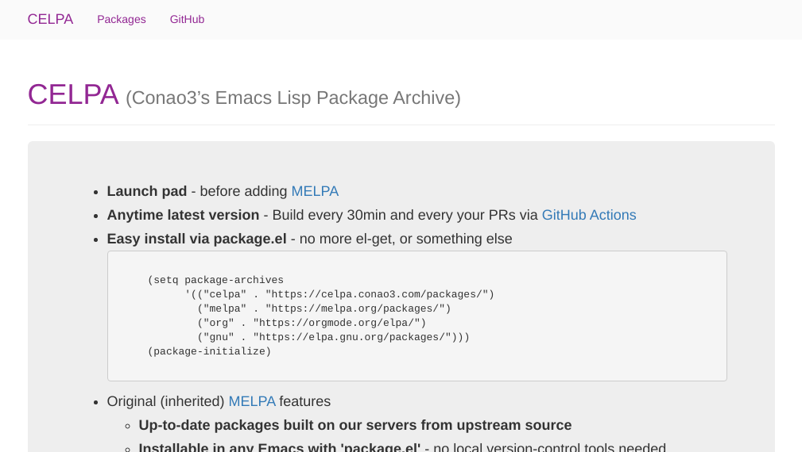

Title: CELPA (Conao3's Emacs Lisp Package Archive) をデプロイした話
Date: 2020-05-24


# Intro

[MELPA](https://github.com/melpa/melpa/pull/6892)のレビューが遅い。

MELPAのメンテナの方には感謝してしきれないが、実際のところ、レシピ追加PRを出して2週間から3週間音沙汰ないまま放置されたり、先方のレビューを反映して修正しても、そこから2週間、3週間待たされることがままあり、ストレスを抱えていました。

私はあまりinit.elを大きくしたくなく、ある程度の大きさになるとパッケージで切りだして `(leaf hoge)` で簡単にアクティベートしたいと考えているため、MELPAに入れてもらえないと `el-get` で取ってこないといけませんでした。

ここでさらに問題があり、 `el-get` は `package` との相性が悪く、微妙な評価タイミングの違いがとても重要になります。

init.elを自分で全てコントロールしていたとしても、おまじないの部分が増えるし、[leaf-manager](https://github.com/conao3/leaf-manager.el)で自動管理している場合は原理的に不可能でした。

そのためMELPAっぽく、さらにレシピの追加を自分でコントロールできるアーカイブが必要となり、今回、[celpa.conao3.com](https://celpa.conao3.com/)をデプロイしました。




# MELPAの仕組み

[MELPA](https://melpa.org/#/)は単に利用するもので、自分でMELPAを作りたい場合、どこから手をつけたら良いか分かりませんでした。

ただ、takaxpさんが[wikiを翻訳](https://qiita.com/takaxp/items/ede36da846099d2e5cf2)して下さっており、この通り進めればなんとかなりました。

もちろんwiki([Custom Melpa Archive](https://github.com/melpa/melpa/wiki/Custom-Melpa-Archive), [Melpa and package build](https://github.com/melpa/melpa/wiki/melpa-and-package-build))も参照しました。


# MELPAソースの修正


## レシピの削除

MELPAのクローンを作ろうとしているわけではないので、MELPAに既に登録されているレシピは必要ありません。
[全部削除](https://github.com/conao3/celpa/commit/0308bcf9157cd9ba07c55edfb32e006783d15cf7)してしまいます。


## レシピの追加

欲しいパッケージのレシピを[おもむろに追加](https://github.com/conao3/celpa/commit/b1793475d891874f855068046cd8dffa54152877)します。もちろんMELPAの形式と一緒のものです。


## サーバーの用意

いい感じのサーバーとドメインを用意し、rsyncでよしなに同期できるようにします。
その話については「[Archのrsyncで転送できないときに確認すること](https://s.conao3.com/blog/2020/55bf86)」に書きました。


## index.htmlの修正

いい感じに[index.html](https://github.com/conao3/celpa/blob/master/html/index.html)を修正します。
おそらくjsonが足らない(CELPAではダウンロード数の記録はしてない)らしく、MELPAに付属しているjavascriptが動きません。

適当にjsを書いたり、リンクを修正したりします。


## GitHub Actionsの設定ファイル追加

GitHub Actionsで30分ごとにビルドが走るようにします。

```yaml
name: Main workflow
on:
  push:
    branches:
      - master
  pull_request:
    branches:
      - master
  schedule:
    - cron: '*/30 * * * *'

jobs:
  build:
    runs-on: ubuntu-latest
    strategy:
      matrix:
        emacs_version:
          - '26.3'
    steps:
      - uses: actions/checkout@v1
      - uses: actions/cache@v1
        with:
          path: working
          key: ${{ runner.os }}-working
      - uses: actions/setup-python@v1.1.1
      - uses: purcell/setup-emacs@master
        with:
          version: ${{ matrix.emacs_version }}
      - uses: conao3/setup-cask@master

      - name: Build
        run: |
          git status
          make add-package-build-remote
          make pull-package-build
          make
      - name: Install SSH key
        if: github.ref == 'refs/heads/master'
        uses: shimataro/ssh-key-action@v1
        with:
          private-key: ${{ secrets.SSH_KEY }}
          public-key: ${{ secrets.SSH_KEY_PUBLIC }}
          known-hosts: ${{ secrets.KNOWN_HOSTS }}

      - name: Deploy
        if: github.ref == 'refs/heads/master'
        run: |
          rsync -av -e 'ssh' --delete --exclude=.git --exclude=working ./ conao3@conao3.sakura.ne.jp::www/celpa/
```


# まとめ

振り返ってみるとMELPAをCELPAとして動かせるように修正するのは簡単でした。

やはりミスが許されず、時間がかかるのは秘密鍵/権限回りで、その部分で半分以上の時間を費しました。

レシピを直接pushできるというのはMELPAを使っていた頃には考えられない快適さです。

ぜひみなさんもオレオレMELPAをデプロイして、package.elだけでパッケージを管理できるようにしましょう!

