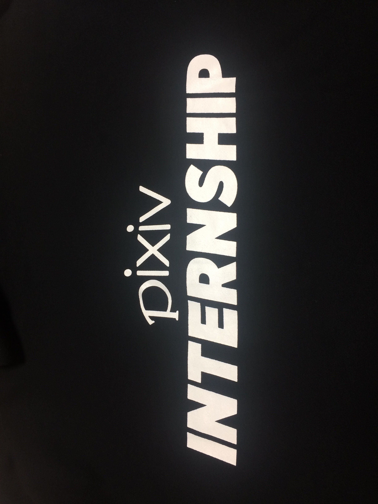
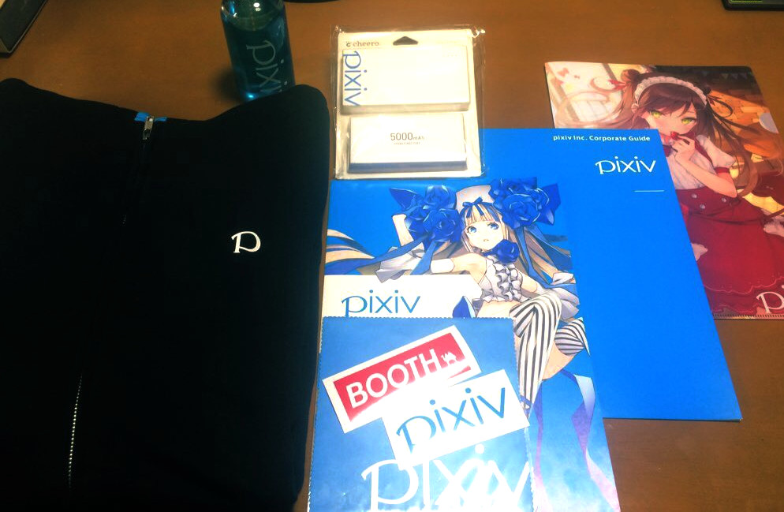

Title: ピクシブ夏インターンシップ「PIXIV SUMMER BOOT CAMP 2020」体験記
Date: 2020-09-24

# はじめに

ピクシブさんのインターンシップ「[PIXIV SUMMER BOOT CAMP 2020](https://www.pixiv.co.jp/news/recruit/article/10019/)」へ参加してきました!

期間は8日間という短い期間でしたが、短い期間ながら、とても濃い経験が出来たと思います。

インターン最終日に発表した資料はこちら。

# 感想

アウトプットはピクシブ百科事典のオレオレフレームワークからPSR-7/15/17ベースのPHPへ(一部のクラスだが)移行したこと。
触らせて頂いたgitレポジトリのヒストリーだと、cvsからgitへ移行した最初のコミットが9年前、dispatcherやrouter、index.phpには多少手が入ることはあっても抜本的に手が入るのはこれが初めてでした。

最終発表ではこの「9年前」ということに対して、「いやもっと前。。。」というコメントもあったので、長らく「いつか改善したいなぁ」とピクシブのエンジニアさんが思っていたところを作業でき、そのコードに貢献できたのはとても嬉しいことでした。
技術的なことと、その変更をしているときに詰まったところなどは発表資料を参照して頂ければと。

メンターをして頂いたtadsanさんからのコメントです。
インターンで取り組んだ課題の背景などもスレッドで投稿されています。

<blockquote class="twitter-tweet">
ピクシブ百科事典のPSR-7/15/17化が圧倒的進捗しました💪 <a href="https://t.co/bhrbCcIgLe">https://t.co/bhrbCcIgLe</a>
&mdash; ぞぬ頃し半分子 (@tadsan) <a href="https://twitter.com/tadsan/status/1306904083576401921?ref_src=twsrc%5Etfw">September 18, 2020</a></blockquote> 

ノベルティもたくさん頂きました。
現地で参加できれば、このパーカーを着て作業していたらしいですが。。とても残念!

世界的な疫病の拡大により、インターンに係る全ての作業はリモートで行なわれ、初めてのインターンではあるものの不思議な感覚でした。。

そもそも広島からのリモートでのインターン参加を認めて下さったこと、さらにはインターネットの不調により急遽モバイルルータを手配して頂くなど、手厚いサポートを頂きました。

このピクシブのインターンで「圧倒的猛者」になれました!! 本当にありがとうございました!

