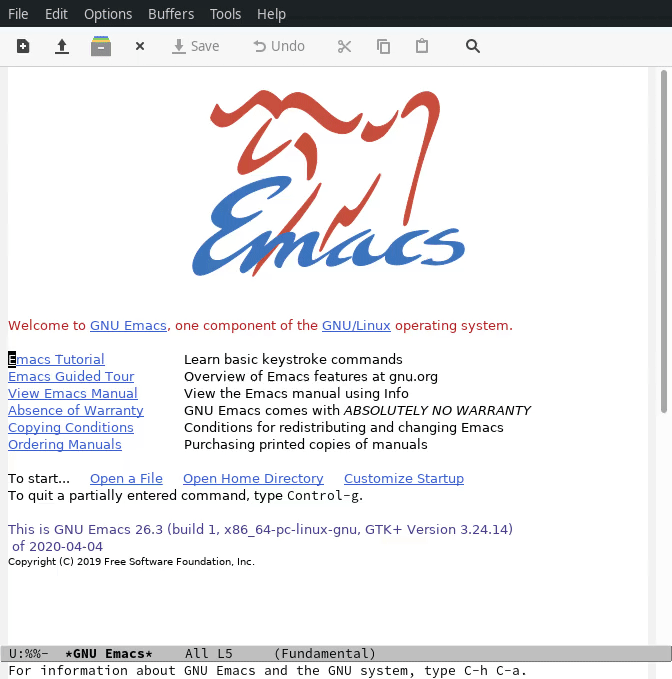
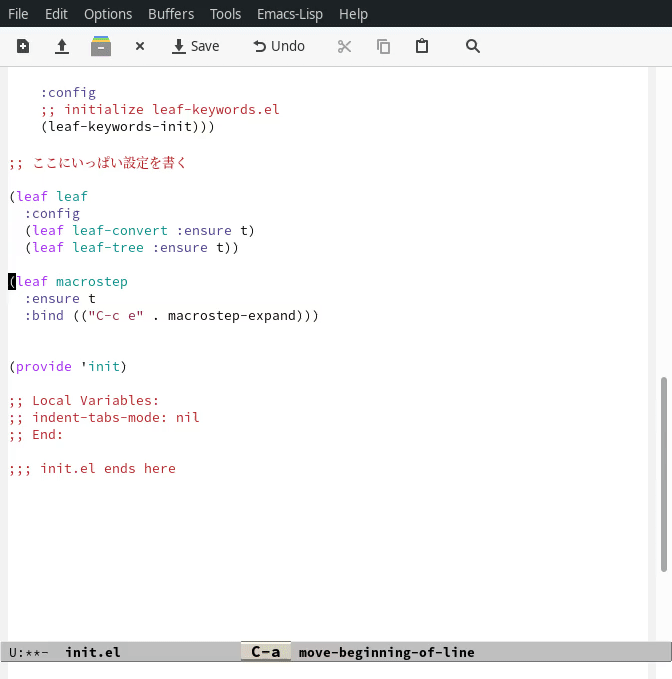
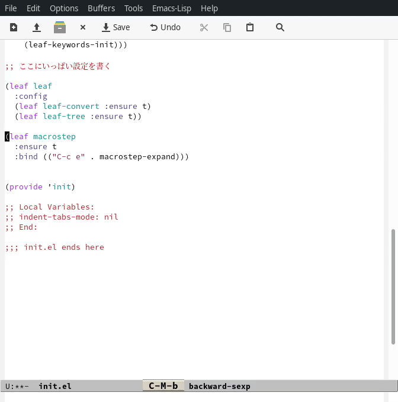
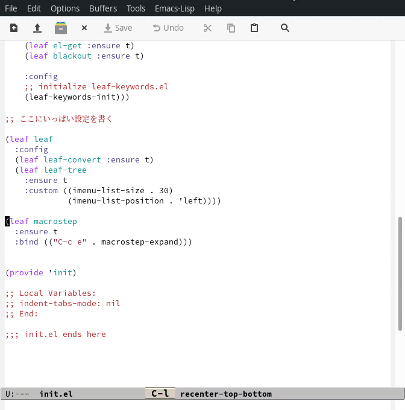
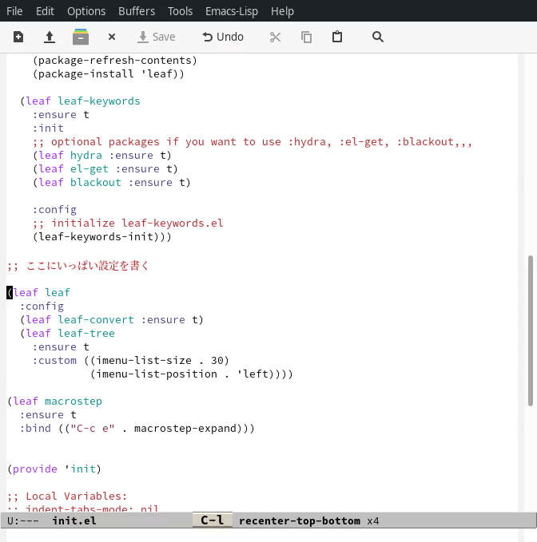
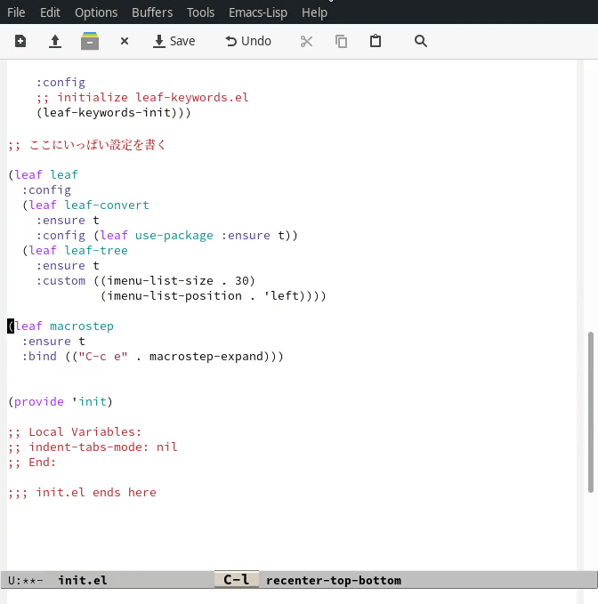
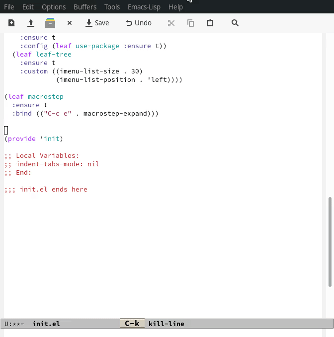
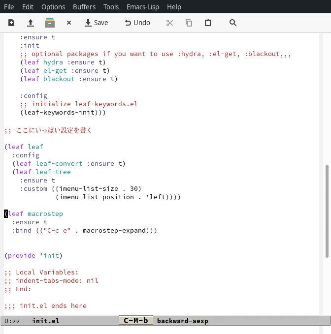
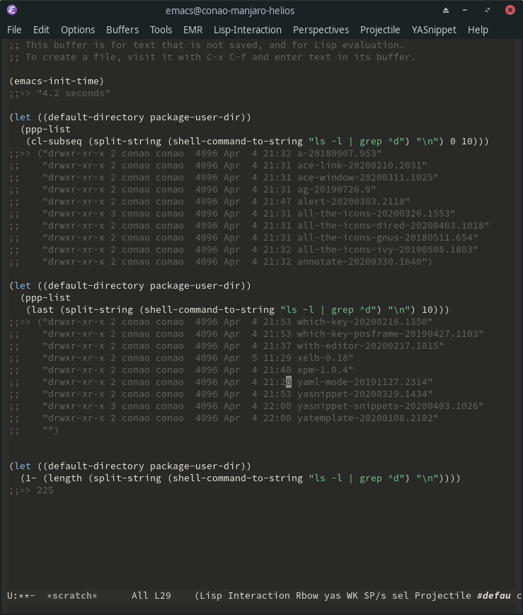

Title: Emacs入門から始めるleaf.el入門
Date: 2020-04-16


# 背景

[leaf.el](https://github.com/conao3/leaf.el)の日本語情報は比較的充実していると思いますが、やはり多少の背後情報が必要です。Emacsの設定はどのファイルで行なうのか、マクロとは、バイトコンパイルとは、、、
leafが設定の簡略化をしてくれるとはいえ、基本的なEmacsのしくみについて知っておく必要があります。

この記事では初期状態のEmacsからleaf.elの導入と利用までを解説します。この記事を読んだ後なら、下記のleafの記事をスムーズに読むことができ、Emacsの動作をあなたの好きなようにカスタマイズできるようになると思います。

-   公式ドキュメント: [conao3/leaf.el](https://github.com/conao3/leaf.el)
-   プレリリース記事: [use-packageからの移行のすゝめ - leaf.elでバージョン安全なinit.elを書く](https://s.conao3.com/blog/2018/8aa938)
-   リリース記事: [[正式リリース]leaf.elで雑然としたEmacs設定ファイル「init.el」をクリーンにする](https://s.conao3.com/blog/2019/2b6cbf)
-   2019年アップデート記事: [[2019年アップデート] leaf.elで雑然としたEmacs設定ファイル「init.el」をクリーンにする](https://s.conao3.com/blog/2019/3279ec)

また、leafも一定の知名度を得てきたようで、レポジトリは[記念すべき100スター](https://github.com/conao3/leaf.el)を達成し、[MELPAでは3万ダウンロード](https://melpa.org/#/?q=conao3&sort=downloads&asc=false)を達成しました!

気に入ってもらえればレポジトリのスターとleafのダウンロードをしていただければ泣いて喜びます!

<div class="github-card" data-repo="conao3/leaf.el"><a href="https://github.com/conao3/leaf.el"><span class="github-card-name"><svg class="github-card-mark" viewBox="0 0 16 16" aria-hidden="true"><path d="M6.766 11.328c-2.063-.25-3.516-1.734-3.516-3.656 0-.781.281-1.625.75-2.188-.203-.515-.172-1.609.063-2.062.625-.078 1.468.25 1.968.703.594-.187 1.219-.281 1.985-.281.765 0 1.39.094 1.953.265.484-.437 1.344-.765 1.969-.687.218.422.25 1.515.046 2.047.5.593.766 1.39.766 2.203 0 1.922-1.453 3.375-3.547 3.64.531.344.89 1.094.89 1.954v1.625c0 .468.391.734.86.547C13.781 14.359 16 11.53 16 8.03 16 3.61 12.406 0 7.984 0 3.563 0 0 3.61 0 8.031a7.88 7.88 0 0 0 5.172 7.422c.422.156.828-.125.828-.547v-1.25c-.219.094-.5.156-.75.156-1.031 0-1.64-.562-2.078-1.609-.172-.422-.36-.672-.719-.719-.187-.015-.25-.093-.25-.187 0-.188.313-.328.625-.328.453 0 .844.281 1.25.86.313.452.64.655 1.031.655s.641-.14 1-.5c.266-.265.47-.5.657-.656"/></svg><span>conao3/<strong>leaf.el</strong></span></span><span class="github-card-description">Flexible, declarative, and modern init.el package configuration</span><span class="github-card-footer"><span class="github-card-language"><span class="github-card-language-color" style="background-color: #c065db"></span>Emacs Lisp</span><span class="github-card-star"><svg viewBox="0 0 16 16" aria-hidden="true"><path d="M8 .25a.75.75 0 0 1 .673.418l1.882 3.815 4.21.612a.75.75 0 0 1 .416 1.279l-3.046 2.97.719 4.192a.751.751 0 0 1-1.088.791L8 12.347l-3.766 1.98a.75.75 0 0 1-1.088-.79l.72-4.194L.818 6.374a.75.75 0 0 1 .416-1.28l4.21-.611L7.327.668A.75.75 0 0 1 8 .25Z"/></svg><span>Star</span><span class="github-card-star-count" hidden></span></span></span></a></div>


# Emacsのインストール

まずEmacs-26.3をどうにかしてインストールします。もしEmacs-22とかいう化石を使っている場合はすぐEmacs-26.3に移行してください。(自戒)

leaf.elは24.4から動きますが、とても便利な[leaf-convert.el](https://github.com/conao3/leaf-convert.el)はEmacs-26.1を要求します。

Emacs-26.1とEmacs-26.2はELPAからのダウンロードに問題があります。結局Emacs-26.3を使うしか選択肢がありません。

各OSでのインストール方法は他の記事に譲り、下のような出力が得られたら次に進みます。

```shell
$ emacs --version
GNU Emacs 26.3
Copyright (C) 2019 Free Software Foundation, Inc.
GNU Emacs comes with ABSOLUTELY NO WARRANTY.
You may redistribute copies of GNU Emacs
under the terms of the GNU General Public License.
For more information about these matters, see the file named COPYING.
```

もし `M-x leaf-available-keywords` と記事に書かれていたときにどういう意味か分からない場合は、ここでEmacsに慣れておいた方が良いかもしれません。少し鬼軍曹<span class="footnote"><sup><button type="button" id="fnr.1" class="footref" popovertarget="fnr.1-body">1</button></sup><span class="footnote-body" id="fnr.1-body" popover>: 実際に[鬼軍曹.elというパッケージがあり](https://qiita.com/zonkyy/items/c090d0733ec6ccab4724)、インストールすることで軍曹の指導を受けることができる。</span></span>な気はありますが、「[Emacs教習所に行ってきた(チートシート付き) - Qiita](https://qiita.com/namn1125/items/5cd6a9cbbf17fb85c740)」が参考になるかもしれません。


# Emacs設定ファイル


## init.elの作成

Emacsの設定ファイルは `~/.emacs.d/init.el` です。既にディレクトリがある場合は `~/.emacs.d/` を `~/.emacs.d.old` などにリネームした上で新しくディレクトリを作成してください。 `~/.emacs.d/init.el` にファイルを作成し、その先頭にleafの[インストールコード](https://github.com/conao3/leaf.el#install)を貼り付けます<span class="footnote"><sup><button type="button" id="fnr.2" class="footref" popovertarget="fnr.2-body">2</button></sup><span class="footnote-body" id="fnr.2-body" popover>: leafのインストールコードには書いてませんが、別途 `user-emacs-directory` の設定を加えました。理由はコメントのような起動方法ができるからです。参考ブログ: [Emacsでお試しinit.elの指針 - peccu.hatenablog](http://peccu.hatenablog.com/entry/20130218/trial_init)</span></span>。

なお、現在では `leaf` のimenuインテグレーションのおかげでファイル分割しないinit.el管理がトレンドです。

```emacs-lisp
;;; init.el --- My init.el  -*- lexical-binding: t; -*-

;; Copyright (C) 2020  Naoya Yamashita

;; Author: Naoya Yamashita <conao3@gmail.com>

;; This program is free software: you can redistribute it and/or modify
;; it under the terms of the GNU General Public License as published by
;; the Free Software Foundation, either version 3 of the License, or
;; (at your option) any later version.

;; This program is distributed in the hope that it will be useful,
;; but WITHOUT ANY WARRANTY; without even the implied warranty of
;; MERCHANTABILITY or FITNESS FOR A PARTICULAR PURPOSE.  See the
;; GNU General Public License for more details.

;; You should have received a copy of the GNU General Public License
;; along with this program.  If not, see <http://www.gnu.org/licenses/>.

;;; Commentary:

;; My init.el.

;;; Code:

;; this enables this running method
;;   emacs -q -l ~/.debug.emacs.d/{{pkg}}/init.el
(eval-and-compile
  (when (or load-file-name byte-compile-current-file)
    (setq user-emacs-directory
          (expand-file-name
           (file-name-directory (or load-file-name byte-compile-current-file))))))

(eval-and-compile
  (customize-set-variable
   'package-archives '(("org"   . "https://orgmode.org/elpa/")
                       ("melpa" . "https://melpa.org/packages/")
                       ("gnu"   . "https://elpa.gnu.org/packages/")))
  (package-initialize)
  (unless (package-installed-p 'leaf)
    (package-refresh-contents)
    (package-install 'leaf))

  (leaf leaf-keywords
    :ensure t
    :init
    ;; optional packages if you want to use :hydra, :el-get, :blackout,,,
    (leaf hydra :ensure t)
    (leaf el-get :ensure t)
    (leaf blackout :ensure t)

    :config
    ;; initialize leaf-keywords.el
    (leaf-keywords-init)))

;; ここにいっぱい設定を書く

(provide 'init)

;; Local Variables:
;; indent-tabs-mode: nil
;; End:

;;; init.el ends here
```


## init.elのバイトコンパイル

init.elのバイトコンパイルは以下のように行ないます。バイトコンパイルによる実行速度への寄与は少ないですが、コンパイラのワーニング(未定義変数の参照、未定義関数の評価など)を受け取るためにもバイトコンパイルをした方が良いです。ただ、バイトコンパイルした `.elc` とバイトコンパイル前の `.el` は `.elc` の方が優先度が高いので、init.elを編集した後は必ずバイトコンパイルを忘れないようにしましょう。

初回にはleafやhydraのインストールが入るのでログが大量に流れます。

コンパイラのワーニングが見づらいようでしたら、もう一度実行することをお勧めします。出力がなければ正常終了であり、ワーニングなしでバイトコンパイルできたことを示します。

```shell
$ cd .emacs.d
$ emacs --batch -f batch-byte-compile init.el
Importing package-keyring.gpg...
Importing package-keyring.gpg...done
Contacting host: orgmode.org:443
Contacting host: orgmode.org:443
Contacting host: melpa.org:443
Contacting host: elpa.gnu.org:443
Package refresh done
Setting ‘package-selected-packages’ temporarily since "emacs -q" would overwrite customizations
Setting ‘package-selected-packages’ temporarily since "emacs -q" would overwrite customizations
Contacting host: melpa.org:443
Generating autoloads for leaf.el...
Generating autoloads for leaf.el...done
Wrote /home/conao/.emacs.d/elpa/leaf-20200415.417/leaf-autoloads.el
...
Wrote /home/conao/.emacs.d/elpa/blackout-20200404.1550/blackout-autoloads.el
Checking /home/conao/.emacs.d/elpa/blackout-20200404.1550...
Compiling /home/conao/.emacs.d/elpa/blackout-20200404.1550/blackout-autoloads.el...
Compiling /home/conao/.emacs.d/elpa/blackout-20200404.1550/blackout-pkg.el...
Compiling /home/conao/.emacs.d/elpa/blackout-20200404.1550/blackout.el...
Done (Total of 1 file compiled, 2 skipped)

$ emacs --batch -f batch-byte-compile init.el
```


## Emacsの起動

コマンドラインからEmacsを起動します。

```shell
emacs
```

`M-x leaf-available-keywords` を実行して、 `leaf` の使えるキーワードを表示できるはずです。




# 便利パッケージのインストール

leaf.elを使うにあたって、相性の良いパッケージがいくつかあります。早速leafを使ってインストールしてみましょう。

-   [leaf-keywords](https://github.com/conao3/leaf-keywords.el) (インストール済)
    -   [el-get](https://github.com/dimitri/el-get) (インストール済)
    -   [blackout](https://github.com/raxod502/blackout) (インストール済)
-   [leaf-convert](https://github.com/conao3/leaf-convert.el)
-   [leaf-tree](https://github.com/conao3/leaf-tree.el)
-   [macrostep](https://github.com/joddie/macrostep)

先程の `;; ここにいっぱい設定を書く` の場所に以下の設定を書きます。

```emacs-lisp
(leaf leaf
  :config
  (leaf leaf-convert :ensure t)
  (leaf leaf-tree
    :ensure t
    :custom ((imenu-list-size . 30)
             (imenu-list-position . 'left))))

(leaf macrostep
  :ensure t
  :bind (("C-c e" . macrostep-expand)))
```

迷子防止のために今回だけinit.elの全文を貼ります。一緒のコードになりましたでしょうか？

```emacs-lisp
;;; init.el --- My init.el  -*- lexical-binding: t; -*-

;; Copyright (C) 2020  Naoya Yamashita

;; Author: Naoya Yamashita <conao3@gmail.com>

;; This program is free software: you can redistribute it and/or modify
;; it under the terms of the GNU General Public License as published by
;; the Free Software Foundation, either version 3 of the License, or
;; (at your option) any later version.

;; This program is distributed in the hope that it will be useful,
;; but WITHOUT ANY WARRANTY; without even the implied warranty of
;; MERCHANTABILITY or FITNESS FOR A PARTICULAR PURPOSE.  See the
;; GNU General Public License for more details.

;; You should have received a copy of the GNU General Public License
;; along with this program.  If not, see <http://www.gnu.org/licenses/>.

;;; Commentary:

;; My init.el.

;;; Code:

;; this enables this running method
;;   emacs -q -l ~/.debug.emacs.d/{{pkg}}/init.el
(eval-and-compile
  (when (or load-file-name byte-compile-current-file)
    (setq user-emacs-directory
          (expand-file-name
           (file-name-directory (or load-file-name byte-compile-current-file))))))

(eval-and-compile
  (customize-set-variable
   'package-archives '(("org"   . "https://orgmode.org/elpa/")
                       ("melpa" . "https://melpa.org/packages/")
                       ("gnu"   . "https://elpa.gnu.org/packages/")))
  (package-initialize)
  (unless (package-installed-p 'leaf)
    (package-refresh-contents)
    (package-install 'leaf))

  (leaf leaf-keywords
    :ensure t
    :init
    ;; optional packages if you want to use :hydra, :el-get, :blackout,,,
    (leaf hydra :ensure t)
    (leaf el-get :ensure t)
    (leaf blackout :ensure t)

    :config
    ;; initialize leaf-keywords.el
    (leaf-keywords-init)))

;; ここにいっぱい設定を書く

(leaf leaf
  :config
  (leaf leaf-convert :ensure t)
  (leaf leaf-tree
    :ensure t
    :custom ((imenu-list-size . 30)
             (imenu-list-position . 'left))))

(leaf macrostep
  :ensure t
  :bind (("C-c e" . macrostep-expand)))


(provide 'init)

;; Local Variables:
;; indent-tabs-mode: nil
;; End:

;;; init.el ends here
```

編集後にはバイトコンパイルを忘れないでください。バイトコンパイルが終わったらEmacsを再起動します。


## leaf-convert

leaf-convertはプレーンなElispやuse-packageからleafへの変換機能を提供します。目玉機能は2つです。

-   `M-x leaf-convert-replace-pop`, `M-x leaf-convert-replace-region`
    
    選択したS式をleafブロックに変換し、 `M-x leaf-convert-replace-pop` は別バッファーに表示します。 `M-x leaf-convert-replace-region` は変換したleafブロックで置換します。
    
    leafの第1引数は `prog1` の第1引数に渡すことで指定できます。gifではひとつのS式しか選択していませんが、複数S式を同時に選択して変換することも可能です。
    
    

-   `M-x leaf-convert-insert-template`
    
    `package.el` が持っている情報からよさげなleafブロックを生成し、挿入します。ただ、自動生成された `:after` キーワードと引数については削除した方が事故が少ないかもしれません。
    
    


## leaf-tree

leaf.elで書かれたinit.elを開き、 `M-x leaf-tree-mode` を実行することでクリックできるサイドバーを表示します。サイドバーはリアルタイムに更新され、現在のポインターがあるアイテムがハイライトされます。

サイドバーのアイテムをクリックすると、そのleafブロックにジャンプします。




## macrostep

leafに限らず、マクロを1ステップごとに展開することができます。

標準キーバインディングでは、展開したいS式で `C-c e` すると `macro-step-mode` という特殊なモードになります。バッファは読み取り専用となり、 `n` と `p` でさらに展開するS式を選び、 `e` を押すと展開されます。 `c` を押すと展開を元に巻き戻すことができます。 `C-g` で `macro-step-mode` から抜けることができます。

この `macrostep` による確認はleafで何かうまくいかないときに最初に取る行動です。leafに何を入力したら、どんなS式が生成されるかを意識するのは重要です。

leafは単なるマクロであり、雑多で典型的なS式を自動生成するためのパッケージにすぎないからです。




# 実践的なあれこれ


## 変数の変更について

パッケージで公開されている変数の変更には、全ての場合について `setq` ではなく `custom-set-variables` で設定するべきです。ネットを検索すると以下の記事があり、公開順から「結局、setqを使う方が良い選択だ」となってしまっています。

-   [defcustomで定義された変数はcustom-set-variablesで変更すべき？ - 2012-01-04](https://memo.sugyan.com/entry/20120104/1325604433)
-   [defcustomで定義された変数はsetqではなくcustom-set-variablesで設定すべき理由 - 2013-11-03](http://kawamuray.hatenablog.com/entry/2013/11/03/180543)
-   [custom-set-variablesは使わない方が良いかもしれない - 2013-12-30](https://abicky.net/2013/12/30/184239/)

しかし時代は変わりました。「ユーザーが変更できる変数」はほとんどの場合で `defcustom` で宣言され、 `defvar` で宣言されたものは「パッケージの内部変数である」という慣習を多くのパッケージ開発者が守っています。

`require` 前に値をセットしておくことでパッケージの動作が変更されるのは悪い設計であり、そのような設計を現在あえて採用するパッケージはありません。

また、実際には `custom-set-variables` での変更は最終的に `set` を実行するので `defvar` で宣言された変数も問題なく変更できます。

ということで常に `custom-set-variables` を使うべきであり、leafでは `:setq` ではなく、 `:custom` を使うほうが良いということになります。

問題はcustomがinit.elに次のようなダンプを出力する点です。このダンプにより、leafの `:custom` で管理している場合、2箇所を修正する必要が生じます。

```emacs-lisp
(custom-set-variables
 ;; custom-set-variables was added by Custom.
 ;; If you edit it by hand, you could mess it up, so be careful.
 ;; Your init file should contain only one such instance.
 ;; If there is more than one, they won't work right.
 '(ag-highligh-search t t)
 '(ag-reuse-buffers t t)
 '(ag-reuse-window t t)
 ;;...
 )
```

この動作については `custom-file` という変数を変えれば出力先を変更でき、そのファイルを `load` しないことで単に無視することができます。

そのため、次のような設定を書いておくことはleafの全ユーザーに勧められます。

```emacs-lisp
(leaf cus-edit
  :doc "tools for customizing Emacs and Lisp packages"
  :tag "builtin" "faces" "help"
  :custom `((custom-file . ,(locate-user-emacs-file "custom.el"))))
```

なお、動的な値をleafで設定するには上記のようにバッククオートとカンマを使うことによって実現します。


## パッケージインストーラについて

基本的に `M-x leaf-convert-insert-template` の出力を参考にします。MELPAかELPAに存在するパッケージは自動的に `:ensure t` が展開されます。 `:ensure` はpackage.elを使用してパッケージをインストールする設定です。

存在しないパッケージの場合は、 `:el-get {user}/{repo}` が展開されるので、 **GitHubにある場合** 、 `{user}` を調べて置換するだけで設定が完了します。例えば、point-undoは `emacsmirror/point-undo` にあるので、 `emacsmirror` を追加するだけで大丈夫です。

しかし、 **GitLabにある場合** 、きちんとリストにしてgitのurlを指定する必要があります。これはleafの使い方ではなく、どちらかというとel-getの使い方です。




## とりあえず:config

leafには与えられたS式をそのまま展開するキーワードがあり、 `:preface`, `:init`, `:config` の3種類が用意されています。それぞれ以下の場所に展開されます

-   `:preface` は `:if`, `:when`, `:unless` の前
-   `:init` は `:if`, `:when`, `:unless` と `:require` の間
-   `:config` は `:require` の後

3種類ありますが、基本的には `:config` を使用します。 `:config` のS式はそのまま展開されるので、最初にleafを使う際はとりあえず `:config` に書いておくのは良い方針だと思います。

なお、leaf-convertはleafからleafへの変換も可能なので、変換してみると、よりよいキーワードを使ったleafに変換してくれる可能性もあります。

`:custom` で `nil` を設定する設定の変換結果は、ただのリストになってしまい、手で直す必要がありました。これは難しい問題ですが、将来的に解決したい問題ではあります。




## leaf-convertについて

leaf-convertを手に入れたおかげで、use-packageの設定例があればleafに変換できるようになりました。例えば[Emacsモダン化計画 -かわEmacs編- - コードが読みやすいテーマ](https://qiita.com/Ladicle/items/feb5f9dce9adf89652cf#%E3%82%B3%E3%83%BC%E3%83%89%E3%81%8C%E8%AA%AD%E3%81%BF%E3%82%84%E3%81%99%E3%81%84%E3%83%86%E3%83%BC%E3%83%9E----doom-emacs-themesdoom-dracula)を参考にして、下記のuse-package設定例があるとします。

```emacs-lisp
(use-package doom-themes
  :custom
  (doom-themes-enable-italic t)
  (doom-themes-enable-bold t)
  :custom-face
  (doom-modeline-bar ((t (:background "#6272a4"))))
  :config
  (load-theme 'doom-dracula t)
  (doom-themes-neotree-config)
  (doom-themes-org-config))
```

この場合、コード貼り付け、範囲選択、 `M-x leaf-convert-region-replace` を実行することでleafに変換できます。 `use-package` を一度展開する必要があるので、 `use-package` をインストールする必要があることに注意する必要があります。

ここで注目したいのは、これまでleaf移行で鬼門となっていた `:custom` や `:custom-face` の引数の微妙な違いをleaf-convertに任せることができるようになった点です。

ただ、 `:custom-face` の変換結果の `quote` は見た目を気にすると、手で直す必要があります。これも難しい問題ですが、将来的に解決したいです。




# まとめ

空のinit.elを作るところからleafの入門記事を書きました。leafを使うことによってEmacsのパッケージ設定を簡潔に宣言的に行うことができ、init.elの簡略化を実現できます。

また高速化についてはあまり意識していなかったのですが、実際のところleafに移行したことで高速化したことが複数人から報告があります。

-   > use-package.elからleaf.elに移行したらEmacsの起動時間が半分になった。移行時に多少のリファクタを含むから、単純な移行による改善ではないけれでも。しかし、こんな早くなるか？？？はて
    > 
    > — よんた (@keita44\_f4) [November 20, 2019](https://twitter.com/keita44_f4/status/1197064768999153666?ref_src=twsrc%5Etfw)
    
    -   [use-package.elからleaf.elに移行した](https://qiita.com/keita44_f4/items/5cb5cfb78edd4244fa8b#%E8%89%AF%E3%81%8B%E3%81%A3%E3%81%9F-2)
        
        > -   移行しただけでEmacsの起動時間が半分になった
        >     -   use-package.elでは:defer tで遅延読み込みの指定がいるが、 leaf.elではデフォルトで遅延読み込みなのも効いていそう
        >     -   use-package.elは起動時間の統計をとるなどリッチな機能を持っており、 そもそも遅いのも効いていそう
        >     -   詳細な原因調査はしていない
        >     -   な に も し て な い の に Emacs が は や く な り ま し た

-   [私の.emacs.dをelpaをgit管理下に入れる気の狂った管理方法からleafに移行させました](https://www.ncaq.net/2020/03/16/18/57/27/#%E8%B5%B7%E5%8B%95%E3%81%8C%E6%97%A9%E3%81%8F%E3%81%AA%E3%81%A3%E3%81%9F%E6%B0%97%E3%81%8C%E3%81%97%E3%81%BE%E3%81%99)
    
    > 起動が早くなった気がします
    > init-loaderをやめたからなのかわかりませんが,何故か起動が早くなった気がします.

参考として私のinit.elを読み込んだ場合、223パッケージ(elpaディレクトリには `archive` と `gnupg` ディレクトリがあるのを忘れていた)インストールされたEmacsを4.2秒で起動できています。HDDの環境なので、測定には悪条件ですが5秒未満なら十分に耐えられます。



これはleafが `prog1` に展開されて、use-packageのように `require` を標準では展開しないからだと思われます。

use-packageが作られた当時はきちんとautoloadをパッケージ開発者が書いていなかったので `require` に展開することが求められていましたが、現代では善いパッケージ作法が広く知られているので問題はありません。

---

最後にpatreonの宣伝をします。

私はleaf.elやleaf-keywords、leaf-tree、leaf-convertといったleaf関連のEmacsパッケージ、他にもseml-modeやpppといったEmacsパッケージを書いています。作成した全てのパッケージと管理を手伝っているパッケージとリンクについては[Emacswikiのページ](https://www.emacswiki.org/emacs/Conao3)、アクティビティに関しては[GitHubのユーザーページ](https://github.com/conao3)を参照して頂ければと思います。


支援を頂くことで、これまでよりも気軽にオライリーの本をポチることができ、バイトの時間を減らしコーディングの時間を増やすことができます。

また、去年から先週までpatreonになることのメリットが全くなかった;;のですが、さすがに申し訳なくなってしまったので、これまでGitHubの[conao3/dotfiles](https://github.com/conao3/dotfiles)で公開していたdotfilesをプライベートに設定し、patreon限定でダウンロードできるようにしました。

ぜひ下記URLからご支援いただければと思います。よろしくお願いします!

<https://www.patreon.com/conao3>


# Footnotes

<sup><a id="fn.1" href="#fnr.1">1</a></sup> : 実際に[鬼軍曹.elというパッケージがあり](https://qiita.com/zonkyy/items/c090d0733ec6ccab4724)、インストールすることで軍曹の指導を受けることができる。

<sup><a id="fn.2" href="#fnr.2">2</a></sup> : leafのインストールコードには書いてませんが、別途 `user-emacs-directory` の設定を加えました。理由はコメントのような起動方法ができるからです。参考ブログ: [Emacsでお試しinit.elの指針 - peccu.hatenablog](http://peccu.hatenablog.com/entry/20130218/trial_init)
