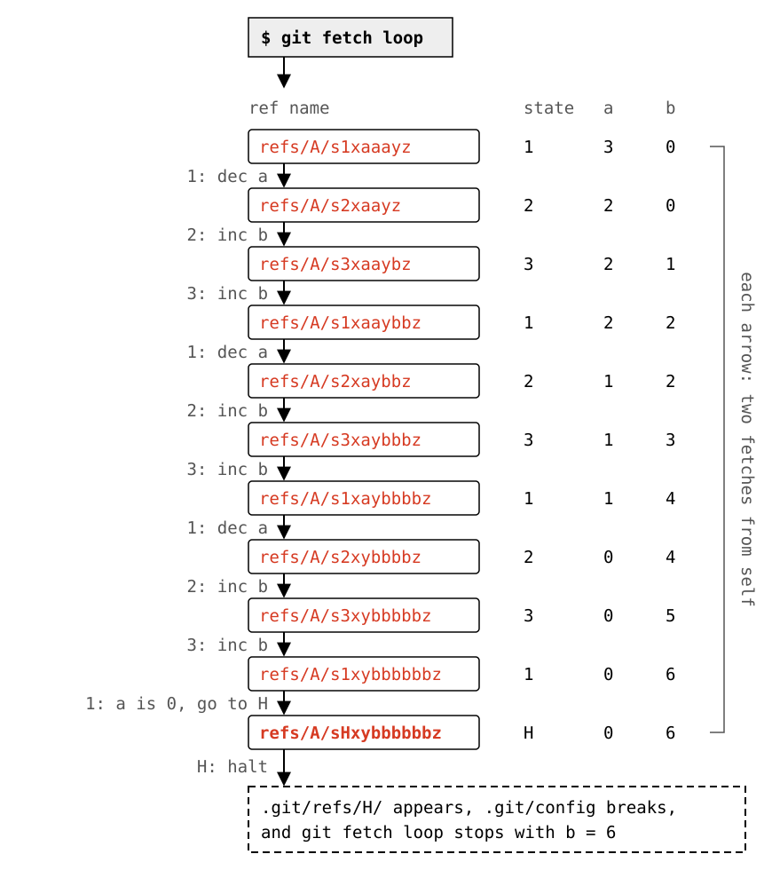
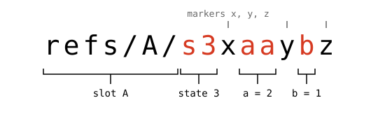
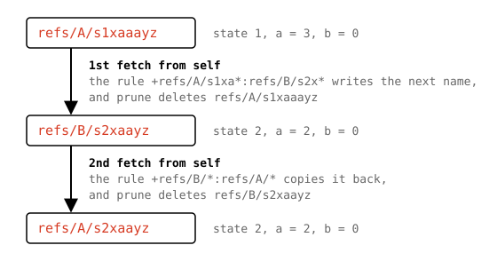
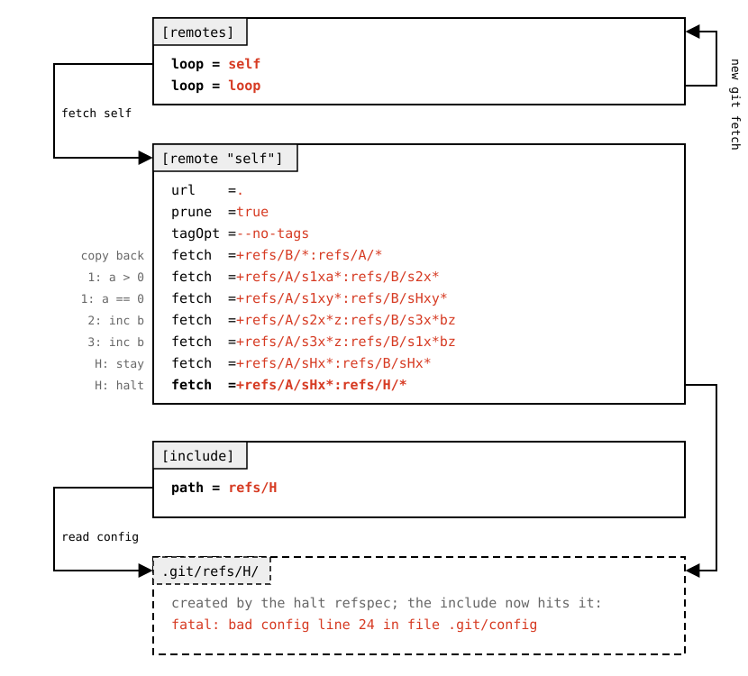

Title: git fetchはチューリング完全
Date: 2026-11-27 20:30
Updated: 2026-11-27 20:30
Draft: true
Original: /blog/2026/1e0718
Tags: git security ai-agent release minsky-git


`git fetch` はチューリング完全で、次の1行はそれで動くプログラムです。

```console
$ git fetch loop
```

Gitはこれを、fetchのrefspecとremoteのグループと1つのincludeを書いた `.git/config` から動かします。
`git fetch` は1つのrefの名前を何度も付け替えて計算が終わると止まり、設定を選べばチューリングマシンが計算できるものを何でも計算できます。

2026年10月にNicolas Seriotさんが、curl 8.12から8.16は設定ファイルで2カウンタのミンスキーマシンを動かせたことを記事 [How curl was accidentally Turing-complete for nine months](https://seriot.ch/computation/curl.html) で示しました。
Gitは自分の設定で同じことをして、その途中でhookもaliasも起動しません。

この仕組みはClaude Opus 5.5が見つけたもので、その経緯は最後の節に書きました。
コードは [conao3/minsky-git](https://github.com/conao3/minsky-git) にあり、 `git-minsky` が小さなプログラムをリポジトリにコンパイルすると、素のGitがそのリポジトリを実行します。

<div class="github-card" data-repo="conao3/minsky-git"><a href="https://github.com/conao3/minsky-git"><span class="github-card-name"><svg class="github-card-mark" viewBox="0 0 16 16" aria-hidden="true"><path d="M6.766 11.328c-2.063-.25-3.516-1.734-3.516-3.656 0-.781.281-1.625.75-2.188-.203-.515-.172-1.609.063-2.062.625-.078 1.468.25 1.968.703.594-.187 1.219-.281 1.985-.281.765 0 1.39.094 1.953.265.484-.437 1.344-.765 1.969-.687.218.422.25 1.515.046 2.047.5.593.766 1.39.766 2.203 0 1.922-1.453 3.375-3.547 3.64.531.344.89 1.094.89 1.954v1.625c0 .468.391.734.86.547C13.781 14.359 16 11.53 16 8.03 16 3.61 12.406 0 7.984 0 3.563 0 0 3.61 0 8.031a7.88 7.88 0 0 0 5.172 7.422c.422.156.828-.125.828-.547v-1.25c-.219.094-.5.156-.75.156-1.031 0-1.64-.562-2.078-1.609-.172-.422-.36-.672-.719-.719-.187-.015-.25-.093-.25-.187 0-.188.313-.328.625-.328.453 0 .844.281 1.25.86.313.452.64.655 1.031.655s.641-.14 1-.5c.266-.265.47-.5.657-.656"/></svg><span>conao3/<strong>minsky-git</strong></span></span><span class="github-card-description">A two-counter Minsky machine that runs on git fetch refspecs</span><span class="github-card-footer"><span class="github-card-language"><span class="github-card-language-color" style="background-color: #89e051"></span>Shell</span><span class="github-card-star"><svg viewBox="0 0 16 16" aria-hidden="true"><path d="M8 .25a.75.75 0 0 1 .673.418l1.882 3.815 4.21.612a.75.75 0 0 1 .416 1.279l-3.046 2.97.719 4.192a.751.751 0 0 1-1.088.791L8 12.347l-3.766 1.98a.75.75 0 0 1-1.088-.79l.72-4.194L.818 6.374a.75.75 0 0 1 .416-1.28l4.21-.611L7.327.668A.75.75 0 0 1 8 .25Z"/></svg><span>Star</span><span class="github-card-star-count" hidden></span></span></span></a></div>


# 全体像

Gitはありふれた4つの機能を、計算機の4つの部品として使います。

<table border="2" cellspacing="0" cellpadding="6" rules="groups" frame="hsides">


<colgroup>
<col  class="org-left" />

<col  class="org-left" />
</colgroup>
<thead>
<tr>
<th scope="col" class="org-left">計算機の部品</th>
<th scope="col" class="org-left">Gitの機能</th>
</tr>
</thead>
<tbody>
<tr>
<td class="org-left">メモリ</td>
<td class="org-left">1つのrefの名前</td>
</tr>

<tr>
<td class="org-left">命令</td>
<td class="org-left">refの名前をパターンで付け替えるfetchのrefspec</td>
</tr>

<tr>
<td class="org-left">クロック</td>
<td class="org-left">自分自身を含むremoteのグループで、 <code>git fetch</code> が自分を起動し直す</td>
</tr>

<tr>
<td class="org-left">停止</td>
<td class="org-left">ディレクトリが現れると <code>.git/config</code> を壊すinclude</td>
</tr>
</tbody>
</table>

次の図は `a = 3` を2倍して `b` に入れるプログラムを最後まで動かした様子です。
箱はそれぞれ1ステップ後のrefの名前で、右の列はそのrefの名前を今の命令と2つのカウンタに読み解いたものです。

ステップごとにrefの名前が変わり、 `halt` に着くとGitは自分の設定を読めなくなってfetchが止まります。



図が動かしているのは2カウンタのミンスキーマシンで、この種の機械はどんなチューリングマシンでも模倣できることをMinskyが証明しています。


# 作る機械

2カウンタのミンスキーマシンは0以上の整数を持つ2つのカウンタ `a` 、 `b` と、番号の付いた3種類の命令の列でできています。

-   `inc r next` はカウンタ `r` に1を足して命令 `next` に進みます。
-   `dec r next zero` は `r` が正なら1を引いて `next` に進み、そうでなければ `zero` に進みます。
-   `halt` で止まります。

`examples/double.prog` は図のプログラムで、命令1は `a` から1を引き、命令2と3は `b` に2を足します。
`a` が0になると機械は止まります。

```text
1 dec a 2 H
2 inc b 3
3 inc b 1
H halt
```

この機械にはGit自身の動作だけを使い、ほかのプログラムを起動するものは使わないというルールを1つ決めました。
Gitはhook、 `!` で始まるalias、cleanとsmudgeのフィルタ、diffのドライバ、 `core.editor` 、 `core.pager` 、credential helperからプログラムを起動できますが、この機械はどれも使いません。


# 1つのrefの名前をメモリにする

機械の状態はすべて1つのrefの名前に入れます。



`refs/A/s3xaaybz` は命令 `3` で `a = 2` 、 `b = 1` の状態を表します。
カウンタはそれぞれ2つの印のあいだに文字を1進法で並べ、 `x` と `y` のあいだが `a` 、 `y` と `z` のあいだが `b` です。

カウンタが空だと2つの印が隣り合い、 `refs/A/s1xaaayz` は `b = 0` の状態です。
refはどれも同じ空のcommitを指していて機械はその名前だけを読み、後で説明する2回のfetchのステップがこの `A` の部分を使います。


# refspecを書き換え規則として命令にする

リポジトリにはURLが `.` 、つまりリポジトリ自身を指す `self` というremoteがあります。
`+refs/A/s1x*:refs/B/s2xa*` のようなglobのrefspecがrefの名前に当てはまると、 `*` に当たった部分を残して前後の決まった文字列を置き換えます。
カウンタマシンはカウンタの両端のどちらかで1文字を足すか消して命令の番号を変えるだけなので、この置き換えで足ります。

<table border="2" cellspacing="0" cellpadding="6" rules="groups" frame="hsides">


<colgroup>
<col  class="org-left" />

<col  class="org-left" />
</colgroup>
<thead>
<tr>
<th scope="col" class="org-left">命令</th>
<th scope="col" class="org-left">refspec</th>
</tr>
</thead>
<tbody>
<tr>
<td class="org-left"><code>1 inc a 2</code></td>
<td class="org-left"><code>+refs/A/s1x*:refs/B/s2xa*</code></td>
</tr>

<tr>
<td class="org-left"><code>1 inc b 2</code></td>
<td class="org-left"><code>+refs/A/s1x*z:refs/B/s2x*bz</code></td>
</tr>

<tr>
<td class="org-left"><code>1 dec a 2 3</code></td>
<td class="org-left"><code>+refs/A/s1xa*:refs/B/s2x*</code> と <code>+refs/A/s1xy*:refs/B/s3xy*</code></td>
</tr>

<tr>
<td class="org-left"><code>1 dec b 2 3</code></td>
<td class="org-left"><code>+refs/A/s1x*bz:refs/B/s2x*z</code> と <code>+refs/A/s1x*yz:refs/B/s3x*yz</code></td>
</tr>
</tbody>
</table>

0かどうかはパターンの一致で判定でき、 `refs/A/s1xa*` は `a` が正のときに当てはまり、 `refs/A/s1xy*` は `a` が0のときに当てはまります。


# 1ステップに2回のfetchを使う

命令のrefspecは `refs/A` から読んで `refs/B` に書き、 `self` にはもう1つ `+refs/B/*:refs/A/*` のrefspecがあって `remote.self.prune = true` も設定してあります。

`self` からのfetchはfetchの前にあったrefを見てすべての書き込み先に書きます。
どの元からも作られなかった書き込み先のrefはpruneで消えるので、refは1回目のfetchで `refs/B` に移り、次のfetchで `refs/A` に戻ります。



機械の1ステップは `self` からの2回のfetchで、最初の図の矢印1本に当たります。


# 自分を含むremoteのグループをクロックにする

Gitは `git fetch <group>` でremoteのグループをまとめてfetchでき、グループには自分自身を入れられます。

```conf
[remotes]
        loop = self
        loop = loop
```

`git fetch loop` は `self` をfetchしてから、グループ `loop` のための新しい `git fetch` のプロセスを起動します。
新しいプロセスも同じことをするので、プログラムが止まるまでこのプロセスの連なりがクロックを刻み、シェルから `git fetch loop` を1回打てばプログラムは最後まで動きます。


# 壊れたincludeで止める

設定の最後の行は `include.path = refs/H` で、Gitはこのパスを `.git/` からの相対パスとして解決し、存在しないincludeのファイルはエラーにせずに読み飛ばします。

`halt` の命令はもう1つ `refs/H/<counters>` のrefを書き、filesのrefバックエンドはそのrefを保存するために `.git/refs/H` のディレクトリを作ります。
するとGitは `.git/config` を読めなくなり、次の入れ子の `git fetch` がエラーで止まって、親のプロセスも順に終わります。


# プログラムの全体

`git-minsky` は `double.prog` を次の `.git/config` にコンパイルし、左の灰色のラベルはそれぞれのrefspecがどの命令を実装しているかを示します。



`a = 3` で動かし、自分のGitの設定が実験に入らないように環境変数を2つ設定しました。

```console
$ export GIT_CONFIG_GLOBAL=/dev/null GIT_CONFIG_NOSYSTEM=1
$ bin/git-minsky machine create-repository \
    --repository-path /tmp/m --program file://examples/double.prog --counter-a 3
{"RepositoryPath":"/tmp/m","Ref":"refs/A/s1xaaayz","RefspecCount":7}
$ git -C /tmp/m fetch loop
Fetching self
From .
 - [deleted]         (none)          -> refs/A/s1xaaayz
 * [new ref]         refs/A/s1xaaayz -> refs/B/s2xaayz
Fetching loop
Fetching self
From .
 - [deleted]         (none)         -> refs/B/s2xaayz
 * [new ref]         refs/B/s2xaayz -> refs/A/s2xaayz
...
warning: unable to access '.git/refs/H': Is a directory
fatal: bad config line 24 in file .git/config
error: could not fetch loop
...
$ bin/git-minsky machine describe-state --repository-path /tmp/m
{"State":"H","CounterA":0,"CounterB":6,"Halted":true}
```

fetchのログはそのまま実行のトレースになり、 `[new ref]` の行がそれぞれ1回の付け替えを記録していて、その `refs/A` の名前は最初の図の箱と一致します。


# 限界

curlの仕組みと同じく、この機械は資源に上限が無ければチューリング完全ですが、実際の計算機には次の制約があります。

-   1ステップごとに `git fetch` のプロセスの入れ子が2段深くなります。私のLinuxのマシンでは、止まらないプログラムが3分で1,812回fetchしたあと、 `unable to fork` と `Argument list too long` で落ちました。
-   filesのrefバックエンドはrefを1つのファイルとして保存するので、refの名前は255バイトまでになり、 `a + b` は250くらいを超えられません。reftableのバックエンドならこの上限はありませんが、止める仕掛けにはfilesのバックエンドが要ります。
-   ローカルのURLでは、Gitは `/bin/sh -c` を通して `git-upload-pack` を起動します。そのシェルは `git-upload-pack` という1つのコマンドを、Gitの外のプロセスとして動かします。


# セキュリティへの影響

プログラムは `.git/config` にあり、 `git clone` はこのファイルを持ってこないのでリモートのリポジトリからは仕込めず、セキュリティへの影響は無いと見ています。
リモートが送るのはrefとobjectで、その名前をどう扱うかは手元のrefspecが決めます。

`.git/config` に書き込める人は、 [git(1)のSECURITYの節](https://git-scm.com/docs/git#_security) にあるとおり、 `core.hooksPath` や `!` で始まるaliasでどんなコマンドでも動かせます。
最悪の場合でもこの仕組みは計算機を入れ子の `git fetch` のプロセスで埋めるだけで、設定を書いた人はシェルのループでも同じことができます。


# Claude Opus 5.5が見つけた経緯

Claude Codeに、curlがチューリング完全だったような話がほかにもあるかを日本語で聞くと、Opus 5.5はsedやsendmail.cfからMagic: The GatheringやGNU findまで、よく知られた例の一覧を返しました。
続けて、ネットの人はこういう話が大好きなので新しい例を見つけてほしいと頼み、少しあとに探索にはエージェントを使うよう付け足しました。
依頼はこの2つのメッセージだけでした。

Opus 5.5はまず身近なツール数十個を、curlが持っていた3つの性質で振り分けました。
ツールは書き換えられる状態と分岐する方法と繰り返す方法の3つをシェルを使わずに備えている必要があり、ほとんどのツールは3つめで落ちました。

ssh\_configはincludeの深さに上限があり、Prometheusのrelabelは規則を1回ずつしか動かさず、Terraformは自分を呼ぶmoduleを受け付けません。
tmuxは3つとも満たしましたが、 [willhbrさんが2024年にチューリング完全だと証明していた](https://willhbr.net/2024/03/15/making-a-compiler-to-prove-tmux-is-turing-complete/) ので、Opus 5.5は候補から外しました。

Opus 5.5は残った2つの候補にそれぞれエージェントを1つずつ割り当てました。

-   Webサーバーのrewriteの規則。Apacheの `[N]` の [フラグ](https://httpd.apache.org/docs/current/rewrite/flags.html#flag_n) は書き換えのたびに規則の集まりを最初からやり直すので、規則は文字列書き換え系になります。同じエージェントがnginxも受け持ちました。
-   Git。設定にはincludeと条件があり、refspecはrefの名前を付け替えます。

Opus 5.5は3つめのエージェントにそれ以外を受け持たせ、候補をもっと挙げて同じように振り分けてからいちばん良いものを作るよう指示しました。
3つのエージェントはどれも同じルールに従い、シェルを呼ぶ機能や埋め込みのスクリプト言語は使わずにツール自身の機能を使い、作ったものを実際に動かしました。

Gitのエージェントはまず目につく部品を試し、どれも書き換えられる状態かループか、その両方を欠いていることを確かめました。

-   `include.path` と `includeIf` は設定を読むだけで書き換えられず、Gitは [includeの深さ10](https://github.com/git/git/blob/v2.52.0/config.c#L135) で止まります。
-   `!` の無いaliasは1つのGitのコマンドに展開され、Gitはaliasのループを検出します。
-   `git rebase -i` のtodoリストは前に進むだけで、後ろに戻れません。 `label` と `reset` は `HEAD` を動かしてもリストの位置は動かさず、競合でrebaseが止まるので、リストは分岐できません。
-   リビジョンの書き方、 `%(if)` を使った `for-each-ref --format` 、mailmapは、状態を読むだけで書けません。

fetchのrefspecを使うとGitは名前を読んでパターンで書き換えて書き戻せて、remoteのグループで繰り返せます。
エージェントは始めてから14分ほどで、動く2カウンタのミンスキーマシンと、測った再帰の上限と、 `/bin/sh` についての注意を報告しました。

ほかの2つのエージェントも報告を返しました。
Apacheの `mod_rewrite` でも動きましたが、s3lphさんが2020年にそれで2進の加算器を作っていました。

nginxは [10回書き換えると止まり](https://nginx.org/en/docs/http/ngx_http_rewrite_module.html) 、この上限はビルドし直さないと変えられません。
3つめのエージェントはImageMagickに1回の `magick` のコマンドでRule 110を計算させ、GNU unitsが再帰的な定義を受け付けないことを確かめました。

これらが新しいかどうかを聞くと、Opus 5.5は探し直してmod\_rewriteの加算器のような先行例を報告しました。
Gitの仕組みの先行例は見つかりませんでしたが、検索では見落としもあるので、先行する例を知っていたら教えてください。

Opus 5.5は `git-minsky` とそのテストとこの記事の最初の下書きも書きました。
記事のコマンドの出力はどれも実際に動かしたものをそのまま貼っています。

