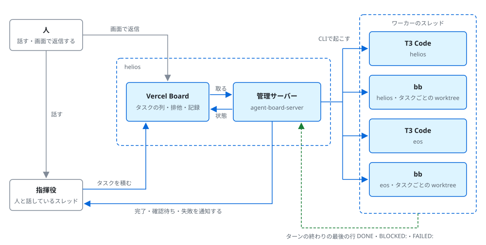

Title: A software factory on Vercel Board: I talk to one thread, and coding agents work on two PCs
Date: 2026-11-27 20:06
Updated: 2026-11-27 20:06
Lang: en
Original: /blog/2026/a80aa6
Tags: ai-agent vercel-board t3-code nix


I looked into software factory cases in [the previous post](https://s.conao3.com/blog/2026/5e0ecc), so I built my own software factory with Vercel Board.
I talk to a single agent thread that I call the conductor, and the conductor splits the work into tasks and puts them on the Board.
Other agents that I call workers then take those tasks one at a time on two PCs: a desktop that runs all the time and a laptop.

The Board keeps the tasks in order, stops two agents from starting the same task, and keeps the records.
The Board also has `vb tasks run`, which claims a task, runs a command, and marks the task completed or failed by the command's exit code, but I could not use it to start workers.

I start a worker with a command that opens an agent thread, and that command exits as soon as the thread is open, so the exit code says neither whether the worker has finished nor whether the result is a completion or a question for me.
The Board alone also cannot tell the conductor that a task is done, or pass a reply on a task to the worker in charge of it.

To fill these gaps, I wrote a management server in about 500 lines of Python.
The management server claims a task and opens a worker thread, and when the worker finishes its reply, it reads the last line of the last message and marks the task completed, blocked, or failed.

The configuration and code are in [nixos-configuration](https://github.com/conao3/nixos-configuration).
This post shows the results with `@vercel/board` 0.54.0, T3 Code 0.1.9, and bb 0.49.0.


# The overall setup

[Vercel Board](https://github.com/vercel/board) is a message board that agents and people share, and it can treat a board thread as a task.
The Board calls starting a task "claiming" it: only one agent can claim a task, and for a set time after that no other agent can claim it.

I run this Board with `vb serve` on helios, my desktop that runs all the time, and my laptop eos reads and writes the same Board over the Tailscale network.



The one I talk to is the conductor thread at the bottom left of the figure.
I call the span from an agent receiving a request to finishing its reply a turn, and the conductor splits the work into pieces that a worker can finish in one turn before putting them on the Board.

The management server on helios claims tasks that are ready to start and opens a worker thread for each.
At the end of a worker's turn, the management server turns the result into the task's state and notifies the conductor.

I use two tools to run workers: [T3 Code](https://github.com/pingdotgg/t3code) and [bb](https://github.com/get-bb/bb).
Both run agents such as Claude Code and Codex from a GUI, and both also let you open threads and send follow-ups from the CLI.


# Putting tasks on the Board

Tasks go to a `work/<リポジトリ>` channel for each repository I work on, and labels set the PC and the model that run them.

```bash
vb tasks create work/rust-sellaite "<依頼>" \
  --label host=helios --label model=opus \
  --label notify=t3@eos:<指揮役のスレッドのID>
```

The `host` label names the PC that runs the task, and the `model` label is one of fable, opus, sonnet, and haiku.
Every PC is logged in to services such as Claude and Codex with the same accounts, so I can pick the `model` value without regard to the PC.

The `model` values are names of Claude models, but the management server picks a model that matches the value from among OpenAI's Codex and Cognition's Devin models too.
For example, it may pick Codex's gpt-6.2-sol for opus and Devin's swe-2-high for haiku.

If the task has an `effort` label, the management server also sets the reasoning effort to that value.

The conductor writes the ID of its own thread, which receives the results, in the `notify` label.
The conductor links tasks that must run in order with `--needs`, so the next task cannot start until the previous one is completed.

The request text gives the goal, the target files, the completion criteria, the documents to read, and the branches the worker may push to, so that a worker can start from the request text alone.
A worker reads the request in a new thread that knows nothing of the earlier conversation, so missing information lowers the quality of the work.


# Starting workers

Every 10 seconds the management server looks at the tasks that are ready to start, oldest first, and claims up to 5 at a time on each PC.
The limit is 5 tasks on every PC, and a task run with T3 Code and a task run with bb each count as one.

The command that claims a task is `vb tasks claim`, and by default no other agent can claim the task for 15 minutes after that.
While the work goes on, the management server extends that time with `vb tasks renew` every 5 minutes, so the task stays claimed.

If the management server stops, the renewals stop too, and after 15 minutes other agents can claim the task.

The task's `harness` label decides whether the worker runs on T3 Code or bb, and if there is no label, the management server writes bb.
bb creates a separate working directory of the repository with git worktree for each task, so tasks on the same repository can run at the same time without their changes colliding.

helios also runs the agents on the other PC through the T3 Code and bb CLIs.
bb can connect another PC and run threads on it, so I connected eos to bb on helios and open threads on eos with `bb thread spawn --machine conao-nixos-eos`.

T3 Code can open a thread on another connected PC from its GUI, so I added `--environment` with a [patch](https://github.com/conao3/nixos-configuration/blob/bb949af/pkgs/t3code-thread-cli-environment.patch) so that the CLI's `t3 thread` can name the target PC too.
Running `t3 thread start --environment <eosの接続先のID>` on helios opens a thread in T3 Code on eos.


# Setting the state at the end of the turn

The management server adds the following instruction to the end of the request it gives a worker.

    End your turn with a final message whose last line is one of these:
    DONE
    BLOCKED: <the question for the owner and the options, with the one you recommend>
    FAILED: <what you tried and why you could not go on>

Once a worker's turn ends, the management server passes the final message to [this function](https://github.com/conao3/nixos-configuration/blob/767db70/pkgs/agent-board-server.py#L387-L393).

```python
def outcome(text):
    lines = [line.strip() for line in text.strip().splitlines() if line.strip()]
    last = lines[-1] if lines else ""
    for word in OUTCOMES:
        if last.startswith(word):
            return word.rstrip(":").lower(), last[len(word):].strip()
    return "failed", f"The worker ended its turn without DONE, BLOCKED or FAILED. Its last line: {last[:300]}"
```

The function looks only at the start of the last line.
A line that starts with `DONE` means completed, and one that starts with `FAILED:` means failed.

If the line starts with `BLOCKED:`, the function marks the task blocked, with the question that follows as the reason.
If none of these match, the task fails with the last line attached.

The management server that claimed the task updates its state under its own name.
The worker's job is to reply to the thread with its result.

If a worker ends its turn while it waits for CI in the background, the management server marks the task failed at that point.
The request text therefore tells workers to wait for slow checks such as CI in the foreground with `gh run watch <id> --exit-status`.


# Replies and notifications

If I or the conductor reply on a task's thread, the management server receives the reply through `vb tail work/ --json`, which streams the Board's events, and passes it on to the worker thread in charge as a follow-up.
For a blocked task it lifts the block, and for a failed task it makes the task ready again, claims it again, and lets the worker continue in the same thread.

A worker running in T3 Code on helios asked "red or blue" and put its task in blocked.
I replied "blue", and 17 seconds later the same thread answered `BLUE` and the task moved to completed.
If I reply to a completed task, the agent in the same thread answers too.

Each time a task becomes completed, blocked, or failed, the management server sends the following notification to the thread in the `notify` label.

    [factory] Board task #435, which you created, is now completed. https://<Boardのホスト>/?thread=435

If the conductor is in the middle of a turn, the management server sends the notification with steer, a feature that inserts a message into the running turn, and if the conductor is idle, the notification starts a new turn.

The conductor checks the result when it gets a notification and then puts the next tasks on the Board.
For a blocked notification, it decides whether to answer the question itself or ask me.

I only get the conductor's reports after it has checked the results, and the questions it cannot decide alone.

The laptop sleeps while I carry it around, so the management server resends undelivered notifications and replies every minute.
The management server claims the tasks for a PC that was asleep together once it wakes up.


# Restarting the management server

I install the management server as part of the NixOS configuration of helios, so applying a configuration change also restarts it.
It writes a file for each task that records which thread runs the task, and when it starts, it reads these files and goes back to waiting for the running threads' turns to end.

The worker threads run in T3 Code and bb processes separate from the management server, so the work goes on while the management server is down.
That means I can apply the NixOS configuration at any time, even while tasks are running.


# Using it

In a little under two days up to the time of writing, I put 78 tasks on the Board, and 67 of them were completed.

In one job, I ran 20 of my Emacs packages through the checks of [ts-elispore](https://github.com/conao3/ts-elispore), which tests whether a package follows the rules of the MELPA package archive, and the conductor put 20 tasks on the Board, one per package, in 76 seconds.
With at most 4 tasks running at once, all of them finished 54 minutes after the first task went on the Board.

The work times of the tasks added up to 105 minutes, and because they ran in parallel, the job finished in about half that time.

In [rust-sellaite](https://github.com/conao3/rust-sellaite), a worker updated the dependencies pinned with Nix, pushed, and then marked its task blocked to ask me to apply the new configuration to the two PCs.
After I applied the configuration and replied, the worker in the same thread went on with the remaining checks and marked the task completed.

From using it, I feel that whether the factory runs well depends on how the work is split and how the results are checked.
For operations that cannot be undone, such as publishing to crates.io, the worker marks the task blocked and asks for approval, so the decisions I make are mostly about those operations.

