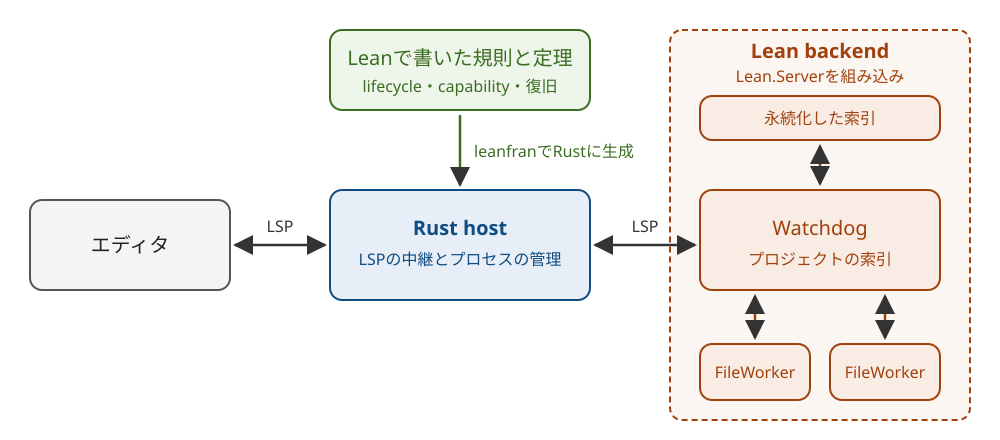
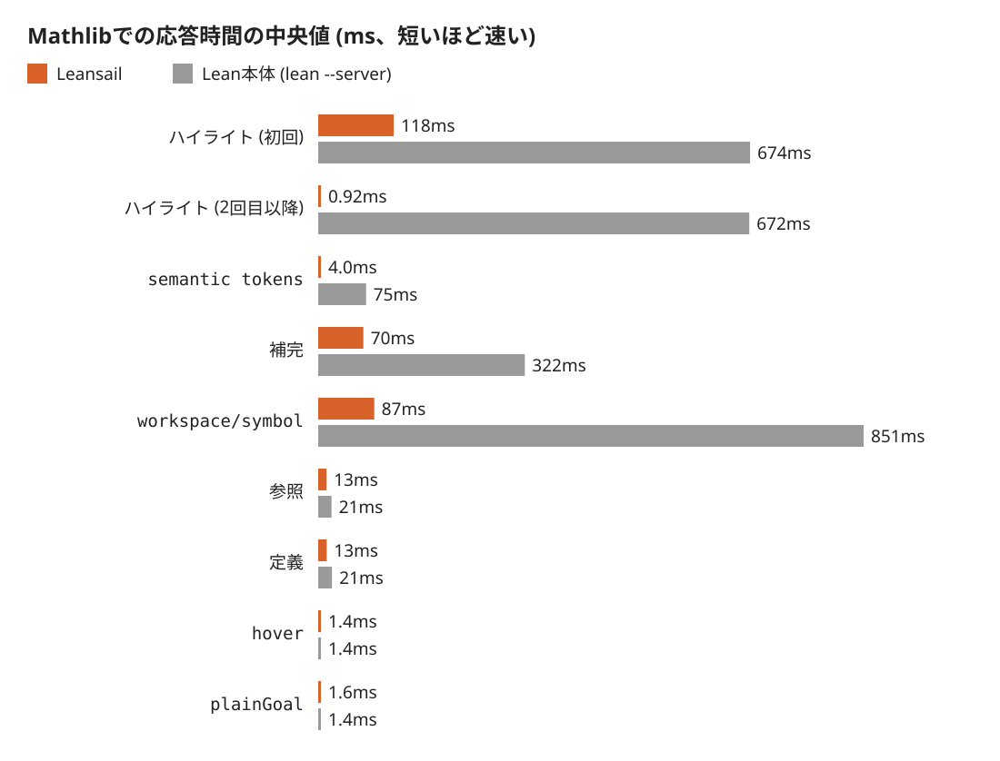

Title: Lean本体と応答が同じで最大730倍速い言語サーバーLeansailを作った
Date: 2026-11-17 14:45
Updated: 2026-11-17 14:45
Tags: lean rust lsp mathlib performance formal-verification release rust-leansail lean-leanfran rust-lsp-touchstone


Leanの言語サーバーLeansailを作りました。
Lean本体の言語サーバー `Lean.Server` をそのまま組み込んで、Mathlibで計測して遅いと分かった処理だけを直しています。
本体が扱う59種類のメッセージと、Mathlibの3つのファイルへの8種類の要求で応答を比べ、中身が本体と一致することを確かめました。

いちばん差が出たのは、カーソルを置いた識別子の出現箇所を強調表示するハイライトで、LSPの[textDocument/documentHighlight](https://microsoft.github.io/language-server-protocol/specifications/lsp/3.17/specification/#textDocument_documentHighlight)の要求にあたります。
本体は[この要求のたびに文書内の参照索引を作り直していて](https://github.com/leanprover/lean4/blob/v4.35.0/src/Lean/Server/FileWorker/RequestHandling.lean#L270)、Mathlibの78KBのファイルでは1回に672 msかかりましたが、Leansailは同じバージョンの文書で作った索引を使い回すので、2回目からは0.92 msと本体の約730倍の速さで返ります。

ほかにも、初回のハイライトは5.7倍、補完は4.6倍、 `workspace/symbol` は9.7倍速くなりました。
直した処理はすべてLeanで書いた部分にあり、Rustで書いた部分はエディタとのあいだの中継と、Leanで証明した規則の実行だけです。

リポジトリは[conao3/rust-leansail](https://github.com/conao3/rust-leansail)で、ライセンスはApache-2.0です。
この記事はLean 4.35.0とLeansail 0.1.0で動かした結果をもとに書いています。

<div class="github-card" data-repo="conao3/rust-leansail"><a href="https://github.com/conao3/rust-leansail"><span class="github-card-name"><svg class="github-card-mark" viewBox="0 0 16 16" aria-hidden="true"><path d="M6.766 11.328c-2.063-.25-3.516-1.734-3.516-3.656 0-.781.281-1.625.75-2.188-.203-.515-.172-1.609.063-2.062.625-.078 1.468.25 1.968.703.594-.187 1.219-.281 1.985-.281.765 0 1.39.094 1.953.265.484-.437 1.344-.765 1.969-.687.218.422.25 1.515.046 2.047.5.593.766 1.39.766 2.203 0 1.922-1.453 3.375-3.547 3.64.531.344.89 1.094.89 1.954v1.625c0 .468.391.734.86.547C13.781 14.359 16 11.53 16 8.03 16 3.61 12.406 0 7.984 0 3.563 0 0 3.61 0 8.031a7.88 7.88 0 0 0 5.172 7.422c.422.156.828-.125.828-.547v-1.25c-.219.094-.5.156-.75.156-1.031 0-1.64-.562-2.078-1.609-.172-.422-.36-.672-.719-.719-.187-.015-.25-.093-.25-.187 0-.188.313-.328.625-.328.453 0 .844.281 1.25.86.313.452.64.655 1.031.655s.641-.14 1-.5c.266-.265.47-.5.657-.656"/></svg><span>conao3/<strong>rust-leansail</strong></span></span><span class="github-card-description">A Lean language server with a Rust host and Lean-verified lifecycle rules</span><span class="github-card-footer"><span class="github-card-language"><span class="github-card-language-color" style="background-color: #dea584"></span>Rust</span><span class="github-card-star"><svg viewBox="0 0 16 16" aria-hidden="true"><path d="M8 .25a.75.75 0 0 1 .673.418l1.882 3.815 4.21.612a.75.75 0 0 1 .416 1.279l-3.046 2.97.719 4.192a.751.751 0 0 1-1.088.791L8 12.347l-3.766 1.98a.75.75 0 0 1-1.088-.79l.72-4.194L.818 6.374a.75.75 0 0 1 .416-1.28l4.21-.611L7.327.668A.75.75 0 0 1 8 .25Z"/></svg><span>Star</span><span class="github-card-star-count" hidden></span></span></span></a></div>


# 構成

Leansailは、Rustで書いたhostと、Leanで書いたbackendの2つのプロセスで動きます。



hostはエディタとLSPで話して、受け取ったメッセージをbackendへ中継します。
backendは[Lean.Server](https://github.com/leanprover/lean4/tree/master/src/Lean/Server)を組み込んだ実行ファイルで、本体と同じく、Watchdogがプロジェクト全体の索引を持ち、開いたファイルごとにFileWorkerを起動して解析させます。

hover、ゴールの表示、Widgetなど、Leanの言語サーバーの機能は本体の実装をそのまま使っています。

hostが自分で判断するのは、メッセージを中継してよいかどうかです。
その規則はLeanで書いて証明し、[leanfran](https://s.conao3.com/blog/2026/23d62c)でRustの関数にしていて、初期化の前後や終了の後に届いたリクエストの扱い、クライアントが対応を宣言していない要求の止め方、FileWorkerが落ちたときの立て直し方をこの規則で決めています。


# 使い方

Lean 4.35.0のプロジェクトのルートで次のコマンドを実行すると、標準入出力で話す言語サーバーが起動します。
Nixのパッケージには、backendと対応するLeanも入っています。

```shell
nix run github:conao3/rust-leansail -- server run-server
```

`leansail` をPATHに置いた場合、EmacsのEglotでは次のように設定します。
依存ライブラリを使うプロジェクトでは、コマンドを `lake env leansail server run-server` にします。

```emacs-lisp
(require 'eglot)
(define-derived-mode leansail-lean-mode prog-mode "Lean")
(add-to-list 'auto-mode-alist '("\\.lean\\'" . leansail-lean-mode))
(add-to-list 'eglot-server-programs
             '(leansail-lean-mode . ("leansail" "server" "run-server")))
(add-hook 'leansail-lean-mode-hook #'eglot-ensure)
(add-hook 'kill-emacs-hook #'eglot-shutdown-all)
```

Neovimの設定とゴールを表示するコマンドは[README](https://github.com/conao3/rust-leansail#editor-setup)にあります。


# 本体と同じ応答を返すことの確かめ方

速くしても応答が変わっては使えないので、同じLean 4.35.0の `lean --server` とLeansailを並べて起動し、同じ操作の結果を比べる検査を用意しました。

-   本体が扱う59種類のメッセージについて、応答を比べます。内訳は、リクエスト34件、クライアントからの通知10件、サーバーからのリクエスト3件と通知2件、Widgetの呼び出し10件です。解析の途中に届く通知の回数と順序は実行のたびに変わるので、最後の状態で比べます。
-   編集の途中で取り消されたリクエストと、編集で古くなったリクエストに、それぞれ `-32800` と `-32801` の[エラー](https://microsoft.github.io/language-server-protocol/specifications/lsp/3.17/specification/#errorCodes)が返ることを確かめます。
-   FileWorkerのプロセスを止めて、次のリクエストで同じ内容から立ち直ることを確かめます。
-   EmacsのEglotとNeovimの組み込みのLSPを画面なしで起動し、診断、hover、定義へのジャンプ、補完、ゴールの表示、閉じて開き直す操作の結果を本体と比べます。

通信が仕様どおりかは、以前作った[lsp-touchstone](https://s.conao3.com/blog/2026/ccc5ed)で検査しています。
最初に検査したときに、本体のbackendが、クライアントが対応を宣言していない[workspace/semanticTokens/refresh](https://microsoft.github.io/language-server-protocol/specifications/lsp/3.17/specification/#semanticTokens_refreshRequest)などのリクエストを送っていたので、Leansailではhostがこのリクエストをクライアントへ送らず、backendには代わりに `null` を返すようにしました。

これらの検査はすべてCIで回しています。


# Leanで書いた規則

クライアントの宣言に応じてサーバーからの要求を通すかどうかは[次のように書いていて](https://github.com/conao3/rust-leansail/blob/67d191376c7025d718c3c0f902d05056a184cc60/src/capabilities.rs#L8-L40)、 `refreshCapability` の定義とほかの定理は省きました。

```lean
inductive Decision where
  | forward | acknowledge | unsupported
  deriving DecidableEq, Repr

def decide (method : String) (declared registrationsAllowed : Bool) : Decision :=
  if method == "client/registerCapability" then
    if registrationsAllowed then .forward else .unsupported
  else
    match refreshCapability method with
    | some _ => if declared then .forward else .acknowledge
    | none => .forward

theorem refresh_requires_support (declared registrationsAllowed : Bool) :
    (decide "workspace/semanticTokens/refresh" declared registrationsAllowed = .forward ↔ declared = true) ∧
    (decide "workspace/inlayHint/refresh" declared registrationsAllowed = .forward ↔ declared = true) ∧
    (decide "workspace/codeLens/refresh" declared registrationsAllowed = .forward ↔ declared = true) ∧
    (decide "workspace/inlineValue/refresh" declared registrationsAllowed = .forward ↔ declared = true) ∧
    (decide "workspace/diagnostic/refresh" declared registrationsAllowed = .forward ↔ declared = true) ∧
    (decide "workspace/foldingRange/refresh" declared registrationsAllowed = .forward ↔ declared = true) := by
  cases declared <;> simp [decide, refreshCapability]
```

`refresh_requires_support` は、クライアントが対応を宣言したときだけ、refreshの要求をクライアントへ通すことを示しています。
このコードはRustのソースの `leanfran::lean!` の中に書いていて、ビルドのときにLeanが証明を検査し、leanfranがRustの関数にします。

lifecycle、取り消しと古いリクエストの判定、FileWorkerの立て直しも同じ形で書いていて、定理は29件あります。
このうち3件は変数のない命題で、決まった入力での結果を検査しています。
hostはJSONを読んで宣言の有無を取り出し、この関数の結果に従って中継しています。


# Mathlibで計測して分かったこと

計測には、Mathlib v4.35.0の3つのファイルを開いて編集する手順を使いました。
いちばん大きいのは78KBの `IntegralEqImproper.lean` で、ほかの2つは `FiniteDimension.lean` と、397個のファイルをimportする `Mathlib/Tactic.lean` です。

6コアのマシンで、ほかのプロセスの負荷が低い回だけを各条件5回ずつ採用しました。

まず言語サーバーがどこに時間を使っているかをperfで調べてみたところ、CPU時間の78.7%はFileWorker、17.7%はWatchdogで、Rustのhostは0.15%でした。
FileWorkerの時間の多くは証明の検査と型クラスの推論で、中継をRustで速くしても縮む時間はほとんどないので、言語サーバーが自分で計算している部分を探して直すことにしました。

次の図と表は、 `IntegralEqImproper.lean` で本体とLeansailを同じ回の計測の中で交互に動かして測った中央値です。



<table border="2" cellspacing="0" cellpadding="6" rules="groups" frame="hsides">


<colgroup>
<col  class="org-left" />

<col  class="org-left" />

<col  class="org-left" />

<col  class="org-left" />
</colgroup>
<thead>
<tr>
<th scope="col" class="org-left">処理</th>
<th scope="col" class="org-left">本体</th>
<th scope="col" class="org-left">Leansail</th>
<th scope="col" class="org-left">比</th>
</tr>
</thead>
<tbody>
<tr>
<td class="org-left">ハイライト (初回)</td>
<td class="org-left">674 ms</td>
<td class="org-left">118 ms</td>
<td class="org-left">5.7倍</td>
</tr>

<tr>
<td class="org-left">ハイライト (2回目以降)</td>
<td class="org-left">672 ms</td>
<td class="org-left">0.92 ms</td>
<td class="org-left">730倍</td>
</tr>

<tr>
<td class="org-left">semantic tokens (2回目以降)</td>
<td class="org-left">75 ms</td>
<td class="org-left">4.0 ms</td>
<td class="org-left">19倍</td>
</tr>

<tr>
<td class="org-left">補完 (2回目以降)</td>
<td class="org-left">322 ms</td>
<td class="org-left">70 ms</td>
<td class="org-left">4.6倍</td>
</tr>

<tr>
<td class="org-left"><code>workspace/symbol</code></td>
<td class="org-left">851 ms</td>
<td class="org-left">87 ms</td>
<td class="org-left">9.7倍</td>
</tr>

<tr>
<td class="org-left">参照</td>
<td class="org-left">21 ms</td>
<td class="org-left">13 ms</td>
<td class="org-left">1.6倍</td>
</tr>

<tr>
<td class="org-left">定義</td>
<td class="org-left">21 ms</td>
<td class="org-left">13 ms</td>
<td class="org-left">1.6倍</td>
</tr>

<tr>
<td class="org-left">hover</td>
<td class="org-left">1.4 ms</td>
<td class="org-left">1.4 ms</td>
<td class="org-left">0.94倍</td>
</tr>

<tr>
<td class="org-left"><code>plainGoal</code></td>
<td class="org-left">1.4 ms</td>
<td class="org-left">1.6 ms</td>
<td class="org-left">0.92倍</td>
</tr>

<tr>
<td class="org-left">プロジェクトの索引の準備</td>
<td class="org-left">21.4 秒</td>
<td class="org-left">5.5 秒</td>
<td class="org-left">3.9倍</td>
</tr>

<tr>
<td class="org-left">3つの文書を解析した直後のメモリ</td>
<td class="org-left">3596 MiB</td>
<td class="org-left">2526 MiB</td>
<td class="org-left">1.4倍</td>
</tr>
</tbody>
</table>

hoverと `plainGoal` は本体より0.1 msほど遅くなっていて、メモリは全プロセスのPSSの合計です。

-   ハイライトは、[importしたモジュールの名前の配列を識別子ごとに作り直していました](https://github.com/leanprover/lean4/blob/v4.35.0/src/Lean/Server/References.lean#L234-L237)。配列を作らずに直接引くようにし、同じバージョンの文書では作った索引を使い回します。
-   semantic tokensは、同じバージョンの文書に対して作った応答を使い回します。
-   補完は、importした定数の中から候補を探した結果を、名前空間と `open` が同じあいだ使い回します。
-   `workspace/symbol` と索引は、MathlibとLeanの約1万2千個の `.ilean` から毎回作っていた索引を保存し、次の起動では読み込むだけにしました。

配列を作らずに引いたハイライトの索引が本体の索引と等しいことと、補完と `workspace/symbol` で使い回す結果が毎回計算した結果と等しいことは、Leanの定理で示しています。
同じバージョンの文書でハイライトの索引とsemantic tokensの応答を使い回すところと、保存した索引を読み込むところは定理の対象の外にあり、本体との応答の比較で確かめています。
応答の中身は、3つのファイルの8種類のリクエストのどれでも本体と一致しました。

ファイルを開いてから最初の診断が出るまでは、本体が6.9秒、Leansailが7.0秒とほとんど差がありませんが、ここはLakeの準備、import、ファイルの解析にかかる時間で、言語サーバーの外にあります。

計測を重ねても、Rustに移すと速くなる処理は見つかりませんでした。
FileWorkerの管理をRustに移す案も考えたのですが、3つのファイルを同時に解析させて測ってみると効果が小さかったので、見送りました。

計測の条件、全部の表、再現の手順は[docs/mathlib-benchmark.md](https://github.com/conao3/rust-leansail/blob/master/docs/mathlib-benchmark.md)にあります。

