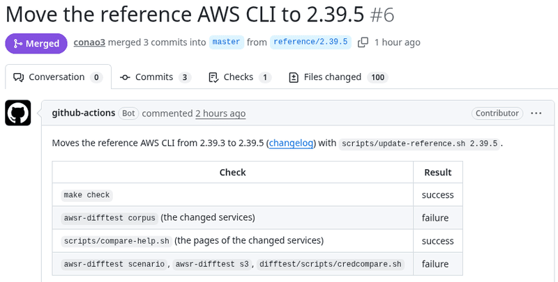
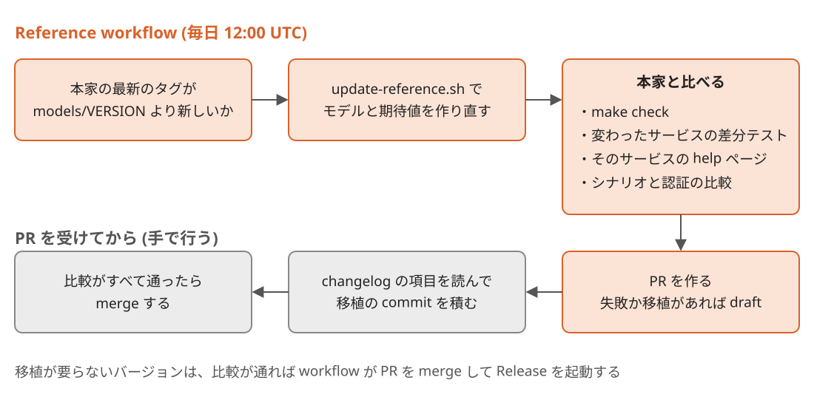

Title: Keeping awsr in sync with new AWS CLI v2 releases through a daily GitHub Actions workflow
Date: 2026-11-28 08:26
Updated: 2026-11-28 08:26
Draft: true
Lang: en
Original: /blog/2026/7fe084
Tags: rust aws aws-cli github-actions nix ci differential-testing rust-awscli


`awsr`, the Rust CLI from [my previous post](https://s.conao3.com/blog/2026/87e5cb), returns output byte for byte identical to the AWS CLI v2, so to keep returning the same output, `awsr` has to move to each new AWS CLI version as it comes out.

The AWS CLI [released 20 times](https://github.com/aws/aws-cli/tags) in the 36 days from 2026-09-30 to 2026-11-05, with a new version almost every weekday, so I set up GitHub Actions to run this update every day.
For each new version, the workflow makes the change that bumps the version, compares `awsr` with the AWS CLI, and opens a PR with the results.

<div class="github-card" data-repo="conao3/rust-awscli"><a href="https://github.com/conao3/rust-awscli"><span class="github-card-name"><svg class="github-card-mark" viewBox="0 0 16 16" aria-hidden="true"><path d="M6.766 11.328c-2.063-.25-3.516-1.734-3.516-3.656 0-.781.281-1.625.75-2.188-.203-.515-.172-1.609.063-2.062.625-.078 1.468.25 1.968.703.594-.187 1.219-.281 1.985-.281.765 0 1.39.094 1.953.265.484-.437 1.344-.765 1.969-.687.218.422.25 1.515.046 2.047.5.593.766 1.39.766 2.203 0 1.922-1.453 3.375-3.547 3.64.531.344.89 1.094.89 1.954v1.625c0 .468.391.734.86.547C13.781 14.359 16 11.53 16 8.03 16 3.61 12.406 0 7.984 0 3.563 0 0 3.61 0 8.031a7.88 7.88 0 0 0 5.172 7.422c.422.156.828-.125.828-.547v-1.25c-.219.094-.5.156-.75.156-1.031 0-1.64-.562-2.078-1.609-.172-.422-.36-.672-.719-.719-.187-.015-.25-.093-.25-.187 0-.188.313-.328.625-.328.453 0 .844.281 1.25.86.313.452.64.655 1.031.655s.641-.14 1-.5c.266-.265.47-.5.657-.656"/></svg><span>conao3/<strong>rust-awscli</strong></span></span><span class="github-card-description">A fast, output-compatible Rust reimplementation of the AWS CLI v2</span><span class="github-card-footer"><span class="github-card-language"><span class="github-card-language-color" style="background-color: #dea584"></span>Rust</span><span class="github-card-star"><svg viewBox="0 0 16 16" aria-hidden="true"><path d="M8 .25a.75.75 0 0 1 .673.418l1.882 3.815 4.21.612a.75.75 0 0 1 .416 1.279l-3.046 2.97.719 4.192a.751.751 0 0 1-1.088.791L8 12.347l-3.766 1.98a.75.75 0 0 1-1.088-.79l.72-4.194L.818 6.374a.75.75 0 0 1 .416-1.28l4.21-.611L7.327.668A.75.75 0 0 1 8 .25Z"/></svg><span>Star</span><span class="github-card-star-count" hidden></span></span></span></a></div>

The image below shows the [PR that the workflow created](https://github.com/conao3/rust-awscli/pull/6) when 2.39.5 came out, with a table of the comparison results before I ported anything.




# What changes when you bump the version

`awsr` follows one fixed AWS CLI version.
I write that version number in `models/VERSION`, and `flake.nix` pulls in the AWS CLI source and the official Linux installer of the same version with Nix.
Bumping the AWS CLI version therefore changes three things:

-   botocore models: the service and operation definitions that `awsr` embeds in its binary.
-   Expected test values: the command table, the hashes of the argument tables, the help documents, and the waiter descriptions, which I generate from the AWS CLI models and source.
-   AWS CLI code changes: changes to commands with their own logic and to authentication. In the AWS CLI [changelog](https://github.com/aws/aws-cli/blob/2.39.5/CHANGELOG.rst), these are the entries other than `api-change`, such as `enhancement` and `bugfix`.

A script can regenerate the models and expected values from the AWS CLI, but I have to port code changes to Rust.


# The version bump script

[`scripts/update-reference.sh`](https://github.com/conao3/rust-awscli/blob/master/scripts/update-reference.sh) regenerates the models and expected values.

```console
$ scripts/update-reference.sh 2.39.5
```

The script runs these steps in order:

1.  Fetch the hashes of the AWS CLI source and installer with `nix-prefetch-url`, and update the version and hashes in `flake.nix`.
2.  Enter the devShell of the new version, re-import the models with `scripts/vendor-models.sh`, and set the three data crates that hold the models to the AWS CLI version.
3.  Regenerate the command table, the hashes of the argument tables, the help documents, and the waiter descriptions from the AWS CLI source.
4.  Format the code with `nix fmt`.

Before I relied on the scripts that generate the expected values, I ran them on the 2.39.3 source from before the update and checked that they reproduced the committed expected values.


# The daily workflow

The [`Reference` workflow](https://github.com/conao3/rust-awscli/blob/master/.github/workflows/reference.yml) looks up the latest AWS CLI tag every day at 12:00 UTC.
If it finds a version newer than `models/VERSION`, it bumps the version with the script above and runs these four checks:

-   `make check`: runs fmt, clippy, and the tests.
-   [Differential tests](https://github.com/conao3/rust-awscli/tree/master/difftest): run every operation of the services whose models changed in both `awsr` and the AWS CLI, and compare the output and the requests.
-   Help comparison: on the help pages of the services whose models changed, replace the name `awsr` with `aws` and compare byte for byte. On pages where the longer name moved the line wrapping, compare with the wrapping removed.
-   Scenario and authentication comparison: compare hand-written scenarios, scenarios for the `s3` commands, and authentication commands such as `configure` and `sso login`.

After the checks, the workflow pushes the `reference/<version>` branch and opens a PR with the results table.
The PR body also lists the AWS CLI changelog entries other than `api-change`.
If any check fails, or if `scripts/classify-reference-changes.sh` finds files to port in the diff of the AWS CLI source, the workflow marks the PR as a draft.
If nothing needs porting and all checks pass, the workflow merges the PR and starts the `Release` workflow as well.




# Comparing only the services that changed

A differential test run over all services compares more than 230,000 combinations against the AWS CLI, and without a cache of AWS CLI results it took about 100 minutes on my 14-core PC.
The `ubuntu-latest` runner that GitHub Actions gives public repositories has [4 cores](https://docs.github.com/en/actions/reference/runners/github-hosted-runners#standard-github-hosted-runners-for-public-repositories), so I can't run the full set every day.

The daily comparison covers only the services whose models changed.
From 2.39.3 to 2.39.5, the models of 34 services changed, and their operations came to 48,504 combinations.

The [run](https://github.com/conao3/rust-awscli/actions/runs/42182624705) that bumped `awsr` to 2.39.5 took about 71 minutes in total: about 44 minutes for the differential tests including the release build, and about 18 minutes for comparing 4,189 help pages.


# What I ported in 2.39.5

The PR from 2.39.3 to 2.39.5 is [conao3/rust-awscli#6](https://github.com/conao3/rust-awscli/pull/6), and the [changelog](https://github.com/aws/aws-cli/blob/2.39.5/CHANGELOG.rst) of 2.39.4 and 2.39.5 had nine entries other than `api-change`.
I ported these four of them to `awsr`:

-   Stop sending Bearer authentication tokens to endpoints other than HTTPS.
-   Accept `--tags` on `s3 cp`, `s3 mv`, and `s3 sync` for transfers from local files to S3.
-   Count a transfer that fails with `PreconditionFailed` as a skipped existing file only if the transfer has `--no-overwrite`.
-   Set the permissions of the config file that `deploy install` writes to 600.

The AWS CLI `s3` commands have two transfer implementations, classic in Python and crt on the AWS Common Runtime (CRT), and you pick one with [the preferred\_transfer\_client setting](https://docs.aws.amazon.com/cli/latest/topic/s3-config.html#preferred-transfer-client).
The other five entries cover the CRT transfer client and `aws update` on Windows.
`awsr` implements only the classic transfer client and has no `update` command yet, so those five need no porting.

The differential tests for `account-access-runtime`, a service added in 2.39.5, caught the Bearer authentication change.
24 cases for this service didn't match: the AWS CLI stopped with `Bearer authorization requires an HTTPS endpoint.`, while `awsr` sent the request.

If I merged this change into master first, a different service that uses Bearer authentication would stop matching the 2.39.3 AWS CLI, so I port changes that depend on the AWS CLI version inside the version bump PR.
I merged master into the PR branch, added the porting commits on top, and merged the PR after all comparisons passed on my machine.

The existing scenarios can't compare `--tags`, so I added six `s3` scenarios.
If I take out the tagging code in `awsr` for a moment, the four upload scenarios among the six fail, so the scenarios do compare the tags.


# A difference that showed up only on the runner

In the [run](https://github.com/conao3/rust-awscli/actions/runs/42182624705) that created the 2.39.5 PR, three `deploy install` and `deploy uninstall` scenarios failed, while the same scenarios matched on my PC.

`deploy install` refuses to run on EC2 instances, and it asks the metadata service at `169.254.169.254` to find out whether it runs on EC2.
[GitHub Actions runners](https://docs.github.com/en/actions/concepts/runners/github-hosted-runners#cloud-hosts-used-by-github-hosted-runners) run on Azure or AWS, and the [Azure metadata service](https://learn.microsoft.com/en-us/azure/virtual-machines/instance-metadata-service#security-and-authentication) uses the same address, but it rejects requests without the `Metadata: true` header.

The AWS CLI [sends an HTTP GET with Python's urlopen](https://github.com/aws/aws-cli/blob/2.39.5/awscli/customizations/codedeploy/utils.py#L105-L121) and concludes it isn't on EC2 when it gets an error response.
`awsr` only checked whether a TCP connection succeeded, so on a runner where something answered at this address, it concluded it was on EC2.

I changed `awsr` to [send an HTTP GET](https://github.com/conao3/rust-awscli/commit/3b5e3b9) too and to treat the host as EC2 only when the response status is below 400.

To test this on my machine, I started a server that returns 400 or 200 at `169.254.169.254` inside a user namespace made with `unshare -rnm`, and replaced `/etc/lsb-release` with Ubuntu's.
With either status, the AWS CLI and `awsr` print the same output.

