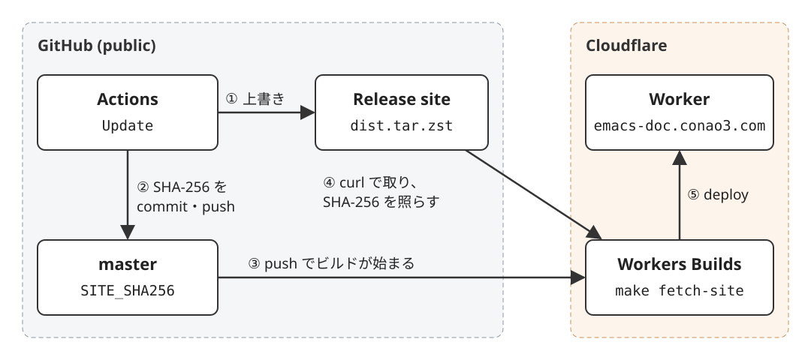

Title: APIトークンを持たずにGitHub ActionsのビルドをCloudflare Workersへデプロイする
Date: 2026-11-04 20:32


GNU Emacsのマニュアルを日本語に機械翻訳したサイト<https://emacs-doc.conao3.com>を、Cloudflare Workersで公開しています。
リポジトリは[conao3/emacs-doc](https://github.com/conao3/emacs-doc) (public) です。
このサイトはGitHubにもCloudflareにもAPIトークンを置かずにデプロイしています。
ビルドはGitHub Actionsで行い、生成物はGitHubのReleaseの添付ファイルとして置きます。
デプロイはCloudflareのWorkers Buildsが、その添付ファイルを取って行います。
この記事では、この構成とその性質を紹介します。




# よくある方法はトークンをSecretsに置く

GitHub ActionsからWorkersへデプロイする方法は、Cloudflareの公式の手順 ([GitHub Actions](https://developers.cloudflare.com/workers/ci-cd/external-cicd/github-actions/)) に書かれています。
この手順では、 `CLOUDFLARE_API_TOKEN` と `CLOUDFLARE_ACCOUNT_ID` をリポジトリのSecretsに置き、 `cloudflare/wrangler-action` に渡します。
po4aで文書を翻訳してサイトを作る[Netatalk/netatalk.io](https://github.com/Netatalk/netatalk.io)も、同じようにトークンをSecretsに置いてデプロイしています。

GitHubのOIDCを使えば、クラウドによってはトークンを置かずに済みます。
しかし、CloudflareはGitHubのOIDCを受け付けません。


# Workers Buildsではemacs-docをビルドできない

Workers BuildsはCloudflareのGit連携の機能です。
GitHubのリポジトリとつなぐと、監視するブランチへのpushのたびに、Cloudflare側でbuild commandとdeploy command (既定は `npx wrangler deploy`) を実行します。
GitHub側にCloudflareのトークンを置く必要はありません。

ただし、emacs-docのサイトはWorkers Buildsの環境ではビルドできません。
emacs-docのビルドでは、Texinfoのマニュアルを `makeinfo --html` でHTMLにし、po4aで訳を差し込みます。
Workers Buildsのビルドイメージ ([Build image](https://developers.cloudflare.com/workers/ci-cd/builds/build-image/)) はUbuntu 24.04で、NodeやPythonは入っていますが、texinfo・po4a・gettextは入っていません。
また、1回のビルドは20分までです ([Limits & pricing](https://developers.cloudflare.com/workers/ci-cd/builds/limits-and-pricing/))。
emacs-docでは、 `make pot` と `make site` だけでそれぞれ約5分かかります。


# ビルドとデプロイを分ける

そこで、ビルドはGitHub Actions、デプロイはWorkers Buildsに分けました。
2つをつなぐのは、固定の名前のリリース `site` の添付ファイル `dist.tar.zst` と、そのSHA-256を書いたファイル `SITE_SHA256` です。


## 1. Actionsがサイトを作ってReleaseに上げる

Actionsの `Update` ワークフローは手動 (`workflow_dispatch`) で回します。
サイトを `dist/` に作ったあと、 `make package` でtarにします。

```makefile
package:
        mkdir -p build
        tar --sort=name --mtime=@0 --owner=0 --group=0 --numeric-owner --pax-option=delete=atime,delete=ctime \
          -C $(DIST_DIR) -cf build/dist.tar .
        zstd -q -19 -f --rm -o $(SITE_ARCHIVE) build/dist.tar
        sha256sum $(SITE_ARCHIVE) | cut -d" " -f1 > SITE_SHA256
```

tarのオプションは同じファイルから同じバイト列を作るためのものです。
ファイルを名前の順に並べ、更新時刻と所有者・グループを0に固定し、paxヘッダーからアクセス時刻 (atime) と状態の変更時刻 (ctime) を外します。
手元で作ったtarとActionsで作ったtarのSHA-256は一致しました。

できたtarで、リリース `site` の添付ファイルを上書きします。

```yaml
- name: Upload the site to the release
  env:
    GH_TOKEN: ${{ github.token }}
  run: |
    gh release view site >/dev/null 2>&1 || gh release create site --title site \
      --notes "The site deployed by Workers Builds (make fetch-site)." --latest=false
    gh release upload site build/dist.tar.zst --clobber
```

ワークフローの権限は `contents: write` で、Actionsが自動で発行する `GITHUB_TOKEN` だけで足ります。


## 2. SHA-256をmasterにcommitする

続けて、 `SITE_SHA256` をmasterにcommitしてpushします。
tarの中身が前回と同じなら `SITE_SHA256` も変わらないので、commitは作りません。
次のステップはPOファイルの扱いを省いて抜粋したものです。

```yaml
- name: Commit the catalogs and the checksum of the site
  run: |
    git config user.name "github-actions[bot]"
    git config user.email "41898282+github-actions[bot]@users.noreply.github.com"
    git add EMACS_REVISION SITE_SHA256 po/*.ja.po
    if ! git diff --cached --quiet; then
      git commit -m "Update the site for Emacs $(cut -c1-10 EMACS_REVISION)"
      git push
    fi
```


## 3. Workers Buildsがtarを取ってデプロイする

Worker `emacs-doc` はWorkers BuildsでGitHubのmasterとつないでいます。
build commandは `make fetch-site` 、deploy commandは `npx wrangler deploy` です。

```makefile
SITE_URL := https://github.com/conao3/emacs-doc/releases/download/site/dist.tar.zst

fetch-site:
        mkdir -p build
        curl -fsSL --retry 3 -o $(SITE_ARCHIVE) $(SITE_URL)
        echo "$$(cat SITE_SHA256)  $(SITE_ARCHIVE)" | sha256sum --check
        rm -rf $(DIST_DIR)
        mkdir $(DIST_DIR)
        tar --zstd -xf $(SITE_ARCHIVE) -C $(DIST_DIR)
```

publicのリポジトリのReleaseの添付ファイルは、認証なしのcurlで取れます。
取ったtarを `sha256sum --check` で `SITE_SHA256` と照らし、 `dist/` に展開します。
`wrangler.jsonc` の `assets.directory` が `./dist` なので、 `npx wrangler deploy` は `dist/` をWorkerの静的アセットとして上げます。
curl、sha256sum、tar、zstdはどれもビルドイメージに入っているコマンドなので、Workers Buildsの環境で動きます。
デプロイが終わると、GitHubのcommitに `Workers Builds: emacs-doc` のcheck runが付きます。


# この構成の性質

-   GitHubのSecretsは空で、CloudflareのAPIトークンをどこにも置きません。Actionsが使うのは `GITHUB_TOKEN` だけです。
-   生成物をgitの履歴に入れません。サイトは2,240ファイルで、tarにすると49 MB、zstdで圧縮すると4.7 MBになります。サイトについて履歴に入るのは、64文字のSHA-256だけです。
-   tarは同じファイルから同じバイト列になります。サイトの中身が変わらなければ `SITE_SHA256` も変わらず、Actionsはcommitを作らないので、デプロイも走りません。
-   READMEの修正など、 `SITE_SHA256` を変えないpushでもWorkers Buildsは動きます。このときは同じtarを取って、同じサイトをデプロイし直します。
-   `SITE_SHA256` とReleaseのtarが食い違うと、 `sha256sum --check` が失敗してbuild commandも失敗します。このときdeploy commandは実行されないので、公開中のサイトは前のままです。公開されるのは、 `SITE_SHA256` と一致したtarだけです。

一方で、Releaseに置くtarは常に最新の1つだけです。
古いcommitをデプロイし直そうとしても、そのcommitの `SITE_SHA256` は今のtarと合わないので、ビルドが失敗します。
同じ理由で、Actionsがtarを上げてから `SITE_SHA256` をpushするまでの間に別のpushがあると、そのビルドも失敗します。
元に戻すには、元の状態でサイトを作り直して上げるしかありません。


# 似た構成の実例

トークンを置かずにActionsの生成物を公開する実例は、GitHub Pagesに多くあります。
`actions/upload-pages-artifact` で生成物をartifactに上げ、 `actions/deploy-pages` が `id-token: write` のOIDCで公開する構成です。
po4aで訳したFreeBSDの文書を公開する[fierceX/freebsd-doc-cn](https://github.com/fierceX/freebsd-doc-cn)や、makeinfoでマニュアルを作る[r0man/beads.el](https://github.com/r0man/beads.el)がこの形です。

Releaseの添付ファイルをWorkers Buildsが取ってデプロイする構成は、GitHubのコード検索とWeb検索では実例が見つかりませんでした。


# おわりに

Workers Buildsの環境でビルドできないサイトでも、ビルドをActionsに任せ、生成物をpublicのReleaseに置けば、トークンを持たずにWorkersへデプロイできます。
ビルドとデプロイの間をSHA-256でつないでいるので、公開されるのはmasterの `SITE_SHA256` と一致したtarだけです。
Workersの静的アセットで配りたいけれど、CloudflareのトークンをGitHubに置きたくないときに使えます。

