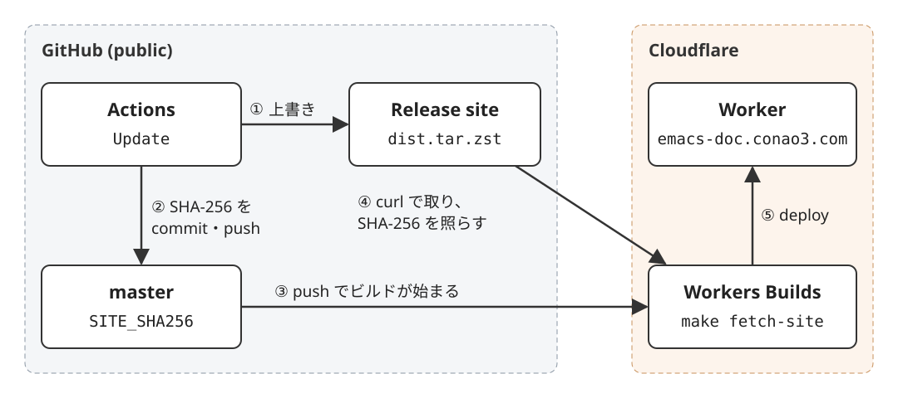

Title: APIトークンを持たずにGitHub ActionsのビルドをCloudflare Workersへデプロイする
Date: 2026-11-04 20:32
Updated: 2026-11-27 21:45
Tags: github-actions cloudflare ci deployment security emacs-doc


GNU Emacsのマニュアルを日本語に機械翻訳したサイト <https://emacs-doc.conao3.com> をCloudflare Workersで公開していて、リポジトリの [conao3/emacs-doc](https://github.com/conao3/emacs-doc) はpublicにしています。

このサイトは、CloudflareのAPIトークンを自分で発行せず、GitHubにも置かずにデプロイしています。
ビルドはGitHub Actionsで行って生成物をGitHubのReleaseの添付ファイルとして置き、デプロイはCloudflareのWorkers Buildsがその添付ファイルを取って行う、という構成で、この記事ではその作りと性質を紹介します。




# よくある方法はトークンをSecretsに置く

GitHub ActionsからWorkersへデプロイする方法はCloudflareの公式の手順 [GitHub Actions](https://developers.cloudflare.com/workers/ci-cd/external-cicd/github-actions/) に書かれています。
この手順では、 `CLOUDFLARE_API_TOKEN` と `CLOUDFLARE_ACCOUNT_ID` をリポジトリのSecretsに置き、 `cloudflare/wrangler-action` に渡します。

po4aで文書を翻訳してサイトを作る [Netatalk/netatalk.io](https://github.com/Netatalk/netatalk.io/blob/5adab47738ae78f88b6f301e0d11ceb4674256d0/.github/workflows/deploy.yml#L73-L77) も、同じようにトークンをSecretsに置いてCloudflare Pagesへデプロイしています。

GitHubのOIDCを使えば、クラウドによってはトークンを置かずに済みます。
しかし、CloudflareはGitHubのOIDCを受け付けません。


# Workers Buildsではemacs-docをビルドできない

Workers BuildsはCloudflareのGit連携の機能で、GitHubのリポジトリをつなぐと、監視するブランチへpushされるたびにCloudflare側でbuild commandとdeploy commandを実行してくれます。
deploy commandの既定は `npx wrangler deploy` なので、GitHub側にCloudflareのトークンは要りません。

ただ、emacs-docのサイトはWorkers Buildsの環境ではビルドできません。
emacs-docのビルドでは、Texinfoのマニュアルを `makeinfo --html` でHTMLにし、po4aで訳を差し込みます。

ところがWorkers Buildsのビルドイメージ [Build image](https://developers.cloudflare.com/workers/ci-cd/builds/build-image/) はUbuntu 24.04で、NodeやPythonは入っていてもtexinfo・po4a・gettextは入っていません。
それに [Limits & pricing](https://developers.cloudflare.com/workers/ci-cd/builds/limits-and-pricing/) のとおり1回のビルドは20分までで、emacs-docでは `make pot` と `make site` だけでもそれぞれ約5分かかります。


# ビルドとデプロイを分ける

そこで、ビルドはGitHub Actions、デプロイはWorkers Buildsに分けることにしました。
Actionsは名前を固定したリリース `site` に添付ファイル `dist.tar.zst` を上げ、Workers BuildsはそのSHA-256を書いたファイル `SITE_SHA256` と照合してデプロイします。


## 1. Actionsがサイトを作ってReleaseに上げる

Actionsの [Updateワークフロー](https://github.com/conao3/emacs-doc/blob/39891ed7e2a199be41cf987eefea8e9d96bc3d9d/.github/workflows/update.yml) は `workflow_dispatch` で手動で回していて、サイトを `dist/` に作ったあと [make package](https://github.com/conao3/emacs-doc/blob/39891ed7e2a199be41cf987eefea8e9d96bc3d9d/Makefile#L57-L72) でtarにします。

```makefile
package:
        mkdir -p build
        tar --sort=name --mtime=@0 --owner=0 --group=0 --numeric-owner --pax-option=delete=atime,delete=ctime \
          -C $(DIST_DIR) -cf build/dist.tar .
        zstd -q -19 -f --rm -o $(SITE_ARCHIVE) build/dist.tar
        sha256sum $(SITE_ARCHIVE) | cut -d" " -f1 > SITE_SHA256
```

tarのオプションは、同じ内容のファイルから同じバイト列を作るためのものです。
ファイルを名前の順に並べ、更新時刻と所有者・グループを0に固定し、paxヘッダーからアクセス時刻のatimeと状態の変更時刻のctimeを外しているので、手元で作ったtarとActionsで作ったtarのSHA-256は一致しました。

続いて、できたtarでリリース `site` の添付ファイルを上書きします。

```yaml
- name: Upload the site to the release
  env:
    GH_TOKEN: ${{ github.token }}
  run: |
    gh release view site >/dev/null 2>&1 || gh release create site --title site \
      --notes "The site deployed by Workers Builds (make fetch-site)." --latest=false
    gh release upload site build/dist.tar.zst --clobber
```

ワークフローの権限は `contents: write` で、Actionsが自動で発行する `GITHUB_TOKEN` だけで足ります。


## 2. SHA-256をmasterにcommitする

続けて `EMACS_REVISION` と `SITE_SHA256` とPOファイルをmasterにcommitしてpushしますが、3つのファイルのどれもmasterから変わっていなければcommitを作りません。
次のステップは、POファイルの扱いを省いて抜粋したものです。

```yaml
- name: Commit the catalogs and the checksum of the site
  run: |
    git config user.name "github-actions[bot]"
    git config user.email "41898282+github-actions[bot]@users.noreply.github.com"
    git add EMACS_REVISION SITE_SHA256 po/*.ja.po
    if ! git diff --cached --quiet; then
      git commit -m "Update the site for Emacs $(cut -c1-10 EMACS_REVISION)"
      git push
    fi
```


## 3. Workers Buildsがtarを取ってデプロイする

Workers BuildsでWorker `emacs-doc` をGitHubのmasterにつなぎ、build commandを `make fetch-site` 、deploy commandを `npx wrangler deploy` にしています。

```makefile
SITE_URL := https://github.com/conao3/emacs-doc/releases/download/site/dist.tar.zst

fetch-site:
        mkdir -p build
        curl -fsSL --retry 3 -o $(SITE_ARCHIVE) $(SITE_URL)
        echo "$$(cat SITE_SHA256)  $(SITE_ARCHIVE)" | sha256sum --check
        rm -rf $(DIST_DIR)
        mkdir $(DIST_DIR)
        tar --zstd -xf $(SITE_ARCHIVE) -C $(DIST_DIR)
```

リポジトリがpublicなのでReleaseの添付ファイルは認証なしのcurlで取れて、取ったtarを `sha256sum --check` で `SITE_SHA256` と照合してから `dist/` に展開します。
curl、sha256sum、tar、zstdはどれもビルドイメージに入っているので、このbuild commandはWorkers Buildsの環境でも動きます。

deploy commandでは、 `wrangler.jsonc` の `assets.directory` が `./dist` なので、 `npx wrangler deploy` が `dist/` をWorkerの静的アセットとして上げます。
デプロイが終わると、GitHubのcommitに `Workers Builds: emacs-doc` のcheck runが付きます。


# この構成の性質

-   CloudflareのAPIトークンを自分で発行せず、GitHubのSecretsは空です。Workers Buildsが使うトークンは [Cloudflareが自動で作って](https://developers.cloudflare.com/workers/ci-cd/builds/configuration/#api-token)Cloudflareの中に持ち、Actionsが使うのは `GITHUB_TOKEN` だけです。
-   生成物をgitの履歴に入れません。サイトは2,240ファイルで、tarにすると49 MB、zstdで圧縮すると4.7 MBですが、サイトについて履歴に入るのは64文字のSHA-256だけです。
-   tarは同じ内容のファイルから同じバイト列になるので、サイトの中身が変わらなければ `SITE_SHA256` も変わりません。 `EMACS_REVISION` とPOファイルも変わらなければ、Actionsがcommitを作らないのでデプロイも走りません。
-   READMEの修正など、 `SITE_SHA256` を変えないpushでもWorkers Buildsは動きますが、このときは同じtarを取って同じサイトをデプロイし直すだけです。
-   `SITE_SHA256` とReleaseのtarが食い違うと、 `sha256sum --check` が失敗してbuild commandも失敗します。deploy commandは実行されないので公開中のサイトは前のままで、公開されるのは `SITE_SHA256` と一致したtarに限られます。

一方で、この構成ではReleaseのtarが常に最新の1つだけなので、古いcommitからビルドしても前のバージョンのサイトをデプロイし直せません。
Workers Buildsはそのcommitの `SITE_SHA256` が今のtarと違えば照合で失敗し、同じなら今のtarをデプロイします。

同じ理由で、Actionsがtarを上げてから `SITE_SHA256` をpushするまでの間に別のpushがあると、そのビルドも失敗します。

以前のバージョンに戻したいときは、そのバージョンの状態でサイトを作り直して上げることになります。


# 似た構成の実例

トークンを置かずにActionsの生成物を公開する実例はGitHub Pagesに多くあって、 `actions/upload-pages-artifact` で生成物をartifactに上げ、 `actions/deploy-pages` が `id-token: write` のOIDCで公開する構成です。
makeinfoでマニュアルを作る [r0man/beads.el](https://github.com/r0man/beads.el/blob/bf1c50da9b3365ff9d878b4559eb55e994cbdf61/.github/workflows/pages.yml#L86-L100) がこの形です。
po4aで訳したFreeBSDの文書を公開する [fierceX/freebsd-doc-cn](https://github.com/fierceX/freebsd-doc-cn/blob/3b54ea4da3ef11f51eb23a988d84f8bba821c580/.github/workflows/build.yml#L95-L104) は、 `GITHUB_TOKEN` で生成物をブランチ `bsd-doc` へpushする形で、こちらもトークンを置いていません。

一方、Releaseの添付ファイルをWorkers Buildsが取ってデプロイする構成の実例は、GitHubのコード検索とWeb検索では見つかりませんでした。


# おわりに

Workers Buildsの環境でビルドできないサイトでも、ビルドをActionsに任せて生成物をpublicのReleaseに置けば、トークンを持たずにWorkersへデプロイできます。
Workers BuildsがReleaseのtarをmasterの `SITE_SHA256` と照合するので、公開されるのは一致したtarだけです。

Workersの静的アセットで配りたいけれど、CloudflareのトークンをGitHubに置きたくない、というときに使えます。

