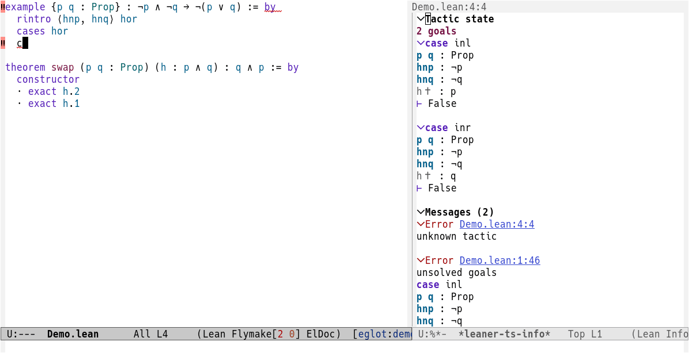
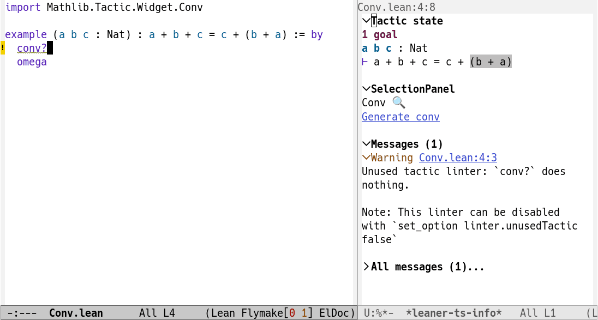

Title: EmacsでVS Codeと同じLean 4のinfoviewを使えるleaner-ts-modeを作った
Date: 2026-11-28 01:07
Updated: 2026-11-28 01:07
Draft: true
Tags: emacs emacs-lisp lean lsp mathlib tree-sitter release leaner-ts-mode-el


EmacsでLean 4を書くためのメジャーモードleaner-ts-modeを作り、VS Codeの拡張と同じinfoviewをEmacsのバッファに出せるようにしました。
ゴールやメッセージから部分式の型、trace、 `conv?` や `rw??` のwidgetまでを、JavaScriptを動かさずにEmacsの文字と画像で描きます。

リポジトリは [conao3/leaner-ts-mode.el](https://github.com/conao3/leaner-ts-mode.el) で、ライセンスは [GPL-3.0](https://github.com/conao3/leaner-ts-mode.el/blob/1965c77/LICENSE) です。
この記事ではmasterの [1965c77](https://github.com/conao3/leaner-ts-mode.el/commit/1965c77) と、Emacs 31.1とLean 4.35.0を使いました。

<div class="github-card" data-repo="conao3/leaner-ts-mode.el"><a href="https://github.com/conao3/leaner-ts-mode.el"><span class="github-card-name"><svg class="github-card-mark" viewBox="0 0 16 16" aria-hidden="true"><path d="M6.766 11.328c-2.063-.25-3.516-1.734-3.516-3.656 0-.781.281-1.625.75-2.188-.203-.515-.172-1.609.063-2.062.625-.078 1.468.25 1.968.703.594-.187 1.219-.281 1.985-.281.765 0 1.39.094 1.953.265.484-.437 1.344-.765 1.969-.687.218.422.25 1.515.046 2.047.5.593.766 1.39.766 2.203 0 1.922-1.453 3.375-3.547 3.64.531.344.89 1.094.89 1.954v1.625c0 .468.391.734.86.547C13.781 14.359 16 11.53 16 8.03 16 3.61 12.406 0 7.984 0 3.563 0 0 3.61 0 8.031a7.88 7.88 0 0 0 5.172 7.422c.422.156.828-.125.828-.547v-1.25c-.219.094-.5.156-.75.156-1.031 0-1.64-.562-2.078-1.609-.172-.422-.36-.672-.719-.719-.187-.015-.25-.093-.25-.187 0-.188.313-.328.625-.328.453 0 .844.281 1.25.86.313.452.64.655 1.031.655s.641-.14 1-.5c.266-.265.47-.5.657-.656"/></svg><span>conao3/<strong>leaner-ts-mode.el</strong></span></span><span class="github-card-description">Lean 4 major mode using tree-sitter</span><span class="github-card-footer"><span class="github-card-language"><span class="github-card-language-color" style="background-color: #c065db"></span>Emacs Lisp</span><span class="github-card-star"><svg viewBox="0 0 16 16" aria-hidden="true"><path d="M8 .25a.75.75 0 0 1 .673.418l1.882 3.815 4.21.612a.75.75 0 0 1 .416 1.279l-3.046 2.97.719 4.192a.751.751 0 0 1-1.088.791L8 12.347l-3.766 1.98a.75.75 0 0 1-1.088-.79l.72-4.194L.818 6.374a.75.75 0 0 1 .416-1.28l4.21-.611L7.327.668A.75.75 0 0 1 8 .25Z"/></svg><span>Star</span><span class="github-card-star-count" hidden></span></span></span></a></div>


# leaner-ts-modeでできること



左がLeanのファイルで、右のinfoviewはカーソルの位置の証明の状態とメッセージを出す画面です。
Leanで証明を書くときはこの画面を見ながら次のタクティクを決めます。

leaner-ts-modeはinfoviewの項目を [VS Codeの拡張のinfoview](https://github.com/leanprover/vscode-lean4/blob/9ac77ca57bf7b7ee5907269142a5bef979aa15bf/vscode-lean4/manual/manual.md#L259-L372) と同じ分け方にしているほか、次のことができます。

-   tree-sitterで色を付け、字下げ、宣言の移動、ImenuとOutlineを使う。
-   `\alpha` のような略記で記号を入れる。
-   Eglotか `lsp-mode` でLeanの言語サーバーとつなぐ。


# leaner-ts-modeを入れる

leaner-ts-modeはEmacs 30.1以上で動き、構文の解析にtree-sitterの文法の [tree-sitter-lean-flat](https://github.com/lua-vr/tree-sitter-lean-flat) を使います。
入れると `.lean` のファイルを開いたときにleaner-ts-modeになり、初めて使う前に `M-x leaner-ts-install-grammar` でgitとCのコンパイラを使って文法をビルドして入れます。

言語サーバーにEglotを使うときは、leafで次の式を書くと、Leanのファイルを開いたときにEglotで言語サーバーが起動します。

```emacs-lisp
(leaf leaner-ts-mode
  :vc (:url "https://github.com/conao3/leaner-ts-mode.el")
  :hook (leaner-ts-mode-hook . leaner-ts-eglot-ensure))
```

Emacs 30ではGNU ELPAからEglot 1.20以上を入れておきます。

`lsp-mode` を使うときは、ファイルを開いたときと `C-c C-g` でinfoviewを開いたときの言語サーバーの起動の両方を `leaner-ts-lsp-mode-ensure` にします。

```emacs-lisp
(leaf leaner-ts-mode
  :vc (:url "https://github.com/conao3/leaner-ts-mode.el")
  :custom ((leaner-ts-infoview-start-function . #'leaner-ts-lsp-mode-ensure))
  :hook (leaner-ts-mode-hook . leaner-ts-lsp-mode-ensure))
```

空の `user-emacs-directory` を使うEmacs 31.1にMELPAからleafを入れて2つの式をそれぞれ評価すると、どちらでも `M-x leaner-ts-install-grammar` で文法が入り、Leanのファイルを開くとleaner-ts-modeになって言語サーバーにつながりました。

言語サーバーを手で起動するときは、Eglotなら `C-c C-e` 、 `lsp-mode` なら `M-x leaner-ts-lsp-mode-ensure` を使います。
infoviewは `C-c C-g` で開きます。


# infoviewでゴールとメッセージを見る

Tactic stateにはゴールの数とゴールごとの `case` の見出しが出て、各ゴールには仮定と `⊢` の後の命題が並びます。
Expected typeには項の中で期待される型が、Messagesにはカーソルの行のエラーや警告が出ます。

All messagesにはファイル全体のメッセージがカーソルに近い順に並びます。
見出しはOutlineで畳めて、表示を更新してもそのまま残ります。

仮定や命題の中の項にカーソルを置くと、その部分式全体に色を付けてElDocに `And p q : Prop` のような式と型と説明を出し、 `RET` でその項の定義に飛べます。
メッセージの見出しの `Demo.lean:4:4` のようなボタンでは、そのメッセージが出たソースの場所に飛べます。

`exact?` や `simp?` が出す提案には `[apply]` のボタンが付き、押すと元のタクティクが提案に置き換わります。

traceの付いたメッセージの上で `s` を押して検索すると、一致した箇所に色を付けて、一致を含むtraceを開きます。


# widgetで次のタクティクを作る



widgetはLeanのコードがinfoviewに足す画面です。
Mathlibにはゴールの部分式を選ぶと次に打つタクティクを作ってくれるwidgetがあり、画像はLean 4.35.0向けのMathlibのv4.35.0で撮った `conv?` です。

ゴールの `(b + a)` にカーソルを置いて `m` を押すと、その部分式が選ばれてパネルに `Generate conv` のリンクが出ます。
リンクを押すと `conv?` が次のタクティクに置き換わり、 `skip` が選ばれた状態になります。

```lean4
conv =>
  enter [2, 2]
  skip
```

`rw??` でも部分式を選ぶと書き換えの候補が並び、候補を押すと `rw [Nat.add_comm a b]` のようなタクティクが入ります。

部分式は `S-mouse-1` でも選べて、 `U` で選択を外せます。

`#html` で出したHTMLもinfoviewに描き、SVGはGUIのEmacsでは画像として出します。


# JavaScriptを動かさずにwidgetを描く仕組み

VS Codeのinfoviewはwebのページなので、widgetのJavaScriptを読み込んで描きます。
leaner-ts-modeはJavaScriptを動かさない代わりに、widgetがLeanの言語サーバーに問い合わせる処理をEmacs Lispで行い、返ってきたHTMLをEmacsで描いています。

infoviewの中身はLeanの言語サーバーのRPCで届き、 `$/lean/rpc/connect` でセッションを張って `$/lean/rpc/call` で `Lean.Widget.getInteractiveGoals` などの関数を呼ぶ仕組みです。
関数の一覧はLeanの [ProtocolOverview.lean](https://github.com/leanprover/lean4/blob/v4.35.0/src/Lean/Server/ProtocolOverview.lean#L422-L511) にあり、そのうちの `Lean.Widget.getWidgets` はカーソルの位置に出すwidgetを返します。

Mathlibの [conv?のwidget](https://github.com/leanprover-community/mathlib4/blob/v4.35.0/Mathlib/Tactic/Widget/Conv.lean#L263-L272) は、JavaScriptの雛形にLeanのRPCの関数名を書き込んだモジュールを作るProofWidgetsの [mk\_rpc\_widget%](https://github.com/leanprover-community/ProofWidgets4/blob/df72b022e558978a1c50264cfc4d7fec86fa8e04/ProofWidgets/Component/OfRpcMethod.lean#L63-L90) で作られています。
そこでleaner-ts-modeは `Lean.Widget.getWidgetSource` で取ったwidgetのJavaScriptから関数名を探し、選んだ部分式を渡して呼び出します。

返ってくるのはProofWidgetsのHTMLの木なので、段落やリストや太字を文字で、SVGを画像で描き、ソースを書き換えるリンクをボタンにしています。


# Eglotでもlsp-modeでも同じinfoviewを使う

infoviewはEglotにも `lsp-mode` にも依存しない作りにしているので、どちらでつないでも同じinfoviewが出ます。

