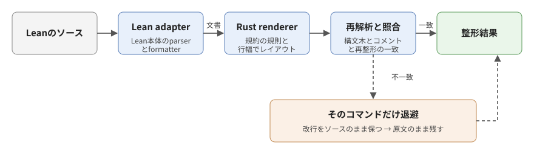
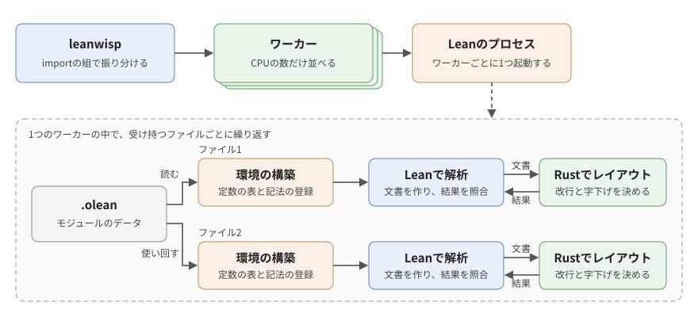

Title: leanwisp: a Lean 4 formatter that reads your code with Lean's own parser
Date: 2026-11-27 19:28
Updated: 2026-11-27 19:28
Draft: true
Lang: en
Original: /blog/2026/d60a7d
Tags: lean rust mathlib parser release rust-leanwisp


I wrote leanwisp, a code formatter for Lean 4.
It reads your code with Lean's own parser and lays out the document that Lean's formatter builds in the shape I chose from the Lean standard library and Mathlib style guides.

leanwisp parses the formatted result with Lean again and checks, command by command, that the syntax tree and the comments match the original and that a second pass changes nothing.
I ran it on 31 files from Mathlib, and every file still compiled after formatting, with Mathlib's own style linter reporting 0 warnings before and after.

The repository is [conao3/rust-leanwisp](https://github.com/conao3/rust-leanwisp), under the Apache-2.0 license.
I got the results in this post with Lean 4.35.0 and leanwisp 0.3.0.

<div class="github-card" data-repo="conao3/rust-leanwisp"><a href="https://github.com/conao3/rust-leanwisp"><span class="github-card-name"><svg class="github-card-mark" viewBox="0 0 16 16" aria-hidden="true"><path d="M6.766 11.328c-2.063-.25-3.516-1.734-3.516-3.656 0-.781.281-1.625.75-2.188-.203-.515-.172-1.609.063-2.062.625-.078 1.468.25 1.968.703.594-.187 1.219-.281 1.985-.281.765 0 1.39.094 1.953.265.484-.437 1.344-.765 1.969-.687.218.422.25 1.515.046 2.047.5.593.766 1.39.766 2.203 0 1.922-1.453 3.375-3.547 3.64.531.344.89 1.094.89 1.954v1.625c0 .468.391.734.86.547C13.781 14.359 16 11.53 16 8.03 16 3.61 12.406 0 7.984 0 3.563 0 0 3.61 0 8.031a7.88 7.88 0 0 0 5.172 7.422c.422.156.828-.125.828-.547v-1.25c-.219.094-.5.156-.75.156-1.031 0-1.64-.562-2.078-1.609-.172-.422-.36-.672-.719-.719-.187-.015-.25-.093-.25-.187 0-.188.313-.328.625-.328.453 0 .844.281 1.25.86.313.452.64.655 1.031.655s.641-.14 1-.5c.266-.265.47-.5.657-.656"/></svg><span>conao3/<strong>rust-leanwisp</strong></span></span><span class="github-card-description">A parser-aware Lean 4 source formatter with a Rust layout engine</span><span class="github-card-footer"><span class="github-card-language"><span class="github-card-language-color" style="background-color: #dea584"></span>Rust</span><span class="github-card-star"><svg viewBox="0 0 16 16" aria-hidden="true"><path d="M8 .25a.75.75 0 0 1 .673.418l1.882 3.815 4.21.612a.75.75 0 0 1 .416 1.279l-3.046 2.97.719 4.192a.751.751 0 0 1-1.088.791L8 12.347l-3.766 1.98a.75.75 0 0 1-1.088-.79l.72-4.194L.818 6.374a.75.75 0 0 1 .416-1.28l4.21-.611L7.327.668A.75.75 0 0 1 8 .25Z"/></svg><span>Star</span><span class="github-card-star-count" hidden></span></span></span></a></div>


# A formatting example

Here is an example with messy spaces and line breaks.

```lean
@[simp]
theorem double_eq(n:Nat):2*n=n+n:=by
     omega
structure Point where
  x : Nat
  y : Nat
instance:Add Point where add a b:={x:=a.x+b.x,y:=a.y+b.y}
def sumTo (n : Nat) : Nat := Id.run do
    let mut acc := 0
    for i in [0:n+1] do
        acc := acc + i
    return acc
```

`leanwisp source format-source` turns it into this.

```lean
@[simp] theorem double_eq (n : Nat) : 2 * n = n + n := by omega
structure Point where
  x : Nat
  y : Nat
instance : Add Point where
  add a b := { x := a.x + b.x, y := a.y + b.y }
def sumTo (n : Nat) : Nat := Id.run do
  let mut acc := 0
  for i in [0:n + 1] do
    acc := acc + i
  return acc
```

leanwisp put spaces around `:` and the operators, and the theorem fits on one line, so it shares that line with its attribute.
The `instance` field moved to the line after `where`, and the `do` block sits two columns in from the start of the declaration.

For a command that passes the checks, the syntax and the line width alone decide the output, so different line breaks in the input give the same result.
The input still decides two things: whether declarations have zero or one blank line between them, and the output for commands that fail the checks I describe later.


# Why leanwisp uses Lean's own parser

A Lean file can add new notation, and code later in the file can use notation added with `notation`, `syntax`, or `macro` right away.
Modules you `import` can add notation too.

Mathlib's authors write most of its code in such notation, so a separate parser with a fixed grammar misreads that code.

leanwisp reads one command at a time with Lean's own parser.
It elaborates only the commands that add notation, so Lean can read the following commands with that notation, and it doesn't run proofs or `#eval`.

```lean
infixl:65 " +++ " => Nat.add
#eval (3: Nat)+++4
```

In this example, leanwisp loads the notation on the first line before it formats the second, which becomes `#eval (3 : Nat) +++ 4`.



Two layers do the formatting: a Lean adapter and a Rust renderer.
The adapter, written in Lean, calls the formatter that Lean registers for each syntax and builds a document of line-break candidates and indentation, and the Rust renderer lays that document out to fit the line width.


# The layout I chose from the style guides

If you lay out the document from Lean's formatter as it is, some places differ from the code in Mathlib; for example, the document always breaks the line after `:=`, even in a short definition.
leanwisp replaces line-break candidates in the document to follow Lean's [standard library style guide](https://github.com/leanprover/lean4/blob/master/doc/std/style.md) and the [Mathlib style guide](https://mathlib.org/contribute/style.html) before it lays the document out.

-   A line holds [at most 100 characters](https://mathlib.org/contribute/style.html#line-length).
-   When a declaration's signature doesn't fit, `:` goes at the end of the line and [the continuation lines get 4 columns of indentation](https://mathlib.org/contribute/style.html#structuring-definitions-and-theorems).
-   The body goes on the `:=` line when it fits, and on the next line with 2 columns of indentation when it doesn't.
-   `by` and `do` go at the end of the line, and the block sits 2 columns in from the start of the declaration.
-   The [fields of an instance](https://mathlib.org/contribute/style.html#instances) in `instance ... where` go one per line on the following lines.

I picked one style for each place where both guides allow either.
An attribute goes on the same line when the whole declaration fits on one line and on its own line otherwise, and leanwisp keeps zero or one blank line between declarations and turns two or more into one.


# Checks that keep formatting from breaking code

Indentation and line breaks change meaning in Lean, so moving one line break can make Lean read the code as a different term or fail to parse it.

leanwisp parses the formatted result with Lean again and checks that the syntax tree matches the original, that the comments match the original in content and order, and that formatting again gives the same result.

If any check fails, leanwisp finds the command that doesn't match and first tries keeping the original line breaks while it fixes the spaces and indentation inside each line.
If that still fails, it leaves that one command as it was and keeps the rest of the file formatted.

For syntax that has no formatter in Lean, leanwisp also leaves the command as it was.

```lean
syntax "twice! " term : term
macro_rules
  | `(twice! $x) => `($x + $x)
def four:Nat:=twice! 2
```

Lean has no formatter for the `$x` inside `macro_rules`, so the `macro_rules` command stays as it was, and leanwisp formats the following `def four` into `def four : Nat :` twice! 2=.
For each kept command, leanwisp prints the line number and the reason.

```text
Twice.lean:2: kept source: Unknown constant `term.pseudo.antiquot`
```


# Results on Mathlib

From [Mathlib at 56a0058](https://github.com/leanprover-community/mathlib4/tree/56a005855ea17e0b0958f73ec801ae140b0a1679), I picked the main `Basic` files and the smallest and the median-sized file from each of 10 areas, 31 files with 9,998 lines in total, and formatted them.
I compiled the files before and after formatting with Mathlib's style linters turned on.

<table border="2" cellspacing="0" cellpadding="6" rules="groups" frame="hsides">


<colgroup>
<col  class="org-left" />

<col  class="org-left" />
</colgroup>
<thead>
<tr>
<th scope="col" class="org-left">Check</th>
<th scope="col" class="org-left">Result</th>
</tr>
</thead>
<tbody>
<tr>
<td class="org-left">Compiles after formatting</td>
<td class="org-left">31/31</td>
</tr>

<tr>
<td class="org-left">Unchanged by a second pass</td>
<td class="org-left">31/31</td>
</tr>

<tr>
<td class="org-left">Style linter warnings</td>
<td class="org-left">0 before, 0 after</td>
</tr>

<tr>
<td class="org-left">Changed lines</td>
<td class="org-left">3,351 of 9,998</td>
</tr>

<tr>
<td class="org-left">Commands not put in the leanwisp layout</td>
<td class="org-left">10 in 7 files</td>
</tr>

<tr>
<td class="org-left">Formatting time</td>
<td class="org-left">6.9 seconds for 31 files on 6 cores</td>
</tr>
</tbody>
</table>

Most changed lines went from another style that the guides allow to the one leanwisp picked, for example a signature that fits on one line put on one line, a short tactic block joined to the `by` line, or two blank lines in a row turned into one.

Of the 10 commands that leanwisp didn't put in its layout, 3 use syntax that has no formatter in Lean.
In the other 7, the leanwisp layout either failed to parse or changed the syntax tree.
For 3 of them leanwisp kept the original line breaks and fixed only the spaces and indentation, and it left the other 4 as they were.

Under the same conditions, [lean-fmt](https://github.com/jcreinhold/lean-fmt), a formatter for Lean 4.35.0, took 33.3 seconds on the same 31 files.
leanwisp caches the result for unchanged files, so its second run finished in 0.09 seconds.

The repository's [Mathlib evaluation record](https://github.com/conao3/rust-leanwisp/blob/master/docs/mathlib-evaluation.md) has the procedure, the result for each file, and the diffs.


# Where the formatting time goes



Given several files with `--paths`, leanwisp starts one worker per CPU and sends files that `import` the same modules to the same worker.
Each worker starts one Lean process and formats its files in turn.

For each file, the Lean process first builds an environment from the file's `import` lines, with the table of constants from the imported modules and the registered notation and formatters.
The process reads each `.olean` file, which holds a module's data, the first time it needs it, and reuses it for the next files.

With the environment ready, Lean parses the file and builds the document, Rust lays it out to the line width, and Lean parses the result again to compare it with the original.


This chart shows how each of 6 workers spent its time while formatting the 31 Mathlib files, and this run took 6.5 seconds in total.
Of the 39.0 seconds across the 6 workers, building environments took 22.8 seconds, parsing and comparing in Lean took 11.1 seconds, layout and comparing in Rust took 2.7 seconds, and starting Lean processes took 1.2 seconds.

The other 1.1 seconds is time that workers which had finished spent waiting for the rest.

Building environments takes long because Mathlib's modules are large; for example, `NumberTheory/ModularForms/LevelOne.lean` imports more than 330,000 constants.

Building that file's environment from scratch takes about 0.5 seconds to read the `.olean` files, about 0.4 seconds for the constant table, and about 0.5 seconds for the notation and other registrations.
Lean gets its notation from the modules you `import`, so leanwisp needs this environment before it can start formatting.


# How to use leanwisp

With Nix, you can run it straight from the repository.

```sh
nix run github:conao3/rust-leanwisp -- \
  source format-source --file Example.lean --write
```

`check-source` exits with code 254 when formatting would change a file, so you can use it in CI, and when you pass a directory to `--paths`, leanwisp formats every `.lean` file in it.

From your editor, you can call it as a filter that formats standard input and writes the result to standard output.

```sh
leanwisp --output text source format-source --source file:///dev/stdin
```

For a file with `import` lines, leanwisp looks for a Lake project in the parent directories and loads that project's modules to format the file.
Build those modules with `lake build` first.

You can set the line width with `line-width` in the project's `leanwisp.toml`, and you can keep a range out of formatting by putting it between `-- leanwisp: off` and `-- leanwisp: on` lines.


# What the checks don't cover

A matching syntax tree doesn't guarantee that elaboration gives the same result, so formatting can change the meaning of a macro whose behavior depends on source positions.

I checked 31 files of Mathlib and haven't run leanwisp on the rest.
leanwisp supports Lean 4.35.0.

