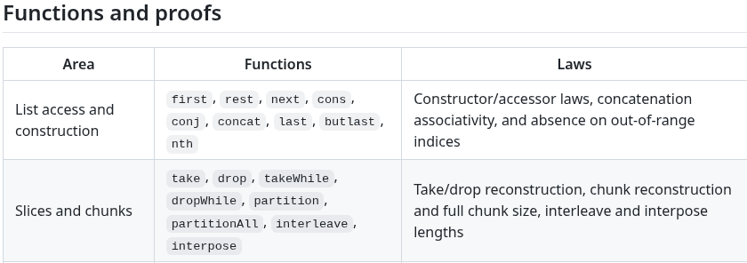

Title: leanclove: use 46 clojure.core functions in Lean 4, with theorems you can reuse in your proofs
Date: 2026-11-27 23:02
Updated: 2026-11-27 23:02
Draft: true
Lang: en
Original: /blog/2026/c55cad
Tags: lean clojure formal-verification standard-library release lean-leanclove


I made leanclove, a Lean 4 library that gives you 46 clojure.core functions such as `partition-all` and `frequencies`.
The functions work on Lean lists, `Option`, and `HashMap`, and the library proves theorems about them: joining the chunks from `partitionAll` gives back the original list, and the count from `frequencies` equals the number of occurrences.

The repository is [conao3/lean-leanclove](https://github.com/conao3/lean-leanclove), under the Apache-2.0 license, and it depends on nothing beyond the Lean standard library.
This post uses Lean 4.35.0 and commit [9312d6c](https://github.com/conao3/lean-leanclove/tree/9312d6c8ac058383d0fae6ffda2d2942e1906e50), the head of main when I wrote it.

Your own proofs can call these theorems, so when you prove a property of a Lean program you can use the laws of `partition-all` or `group-by` without proving them again.
I have also written about Clojure in [I checked Clojure's core with Lean and differential testing and found unreported bugs in HAMT and vector-of](https://s.conao3.com/blog/2026/e4f733) and [A Clojure core cheat sheet in math notation](https://s.conao3.com/blog/2026/315a71).

<div class="github-card" data-repo="conao3/lean-leanclove"><a href="https://github.com/conao3/lean-leanclove"><span class="github-card-name"><svg class="github-card-mark" viewBox="0 0 16 16" aria-hidden="true"><path d="M6.766 11.328c-2.063-.25-3.516-1.734-3.516-3.656 0-.781.281-1.625.75-2.188-.203-.515-.172-1.609.063-2.062.625-.078 1.468.25 1.968.703.594-.187 1.219-.281 1.985-.281.765 0 1.39.094 1.953.265.484-.437 1.344-.765 1.969-.687.218.422.25 1.515.046 2.047.5.593.766 1.39.766 2.203 0 1.922-1.453 3.375-3.547 3.64.531.344.89 1.094.89 1.954v1.625c0 .468.391.734.86.547C13.781 14.359 16 11.53 16 8.03 16 3.61 12.406 0 7.984 0 3.563 0 0 3.61 0 8.031a7.88 7.88 0 0 0 5.172 7.422c.422.156.828-.125.828-.547v-1.25c-.219.094-.5.156-.75.156-1.031 0-1.64-.562-2.078-1.609-.172-.422-.36-.672-.719-.719-.187-.015-.25-.093-.25-.187 0-.188.313-.328.625-.328.453 0 .844.281 1.25.86.313.452.64.655 1.031.655s.641-.14 1-.5c.266-.265.47-.5.657-.656"/></svg><span>conao3/<strong>lean-leanclove</strong></span></span><span class="github-card-description">clojure.core functions for Lean 4, with proofs</span><span class="github-card-footer"><span class="github-card-language"><span class="github-card-language-color"></span>Lean</span><span class="github-card-star"><svg viewBox="0 0 16 16" aria-hidden="true"><path d="M8 .25a.75.75 0 0 1 .673.418l1.882 3.815 4.21.612a.75.75 0 0 1 .416 1.279l-3.046 2.97.719 4.192a.751.751 0 0 1-1.088.791L8 12.347l-3.766 1.98a.75.75 0 0 1-1.088-.79l.72-4.194L.818 6.374a.75.75 0 0 1 .416-1.28l4.21-.611L7.327.668A.75.75 0 0 1 8 .25Z"/></svg><span>Star</span><span class="github-card-star-count" hidden></span></span></span></a></div>


# Install leanclove

Add these lines to the `lakefile.toml` of a Lean 4.35.0 project.

```toml
[[require]]
name = "leanclove"
git = "https://github.com/conao3/lean-leanclove.git"
rev = "main"
```

Run `lake update leanclove`, and `import LeanClove` loads the library.
The functions live in the `LeanClove` namespace, and the names follow Lean conventions, so Clojure's `partition-all` becomes `partitionAll`.

Run `lake build`, and each `#eval` below prints the value in its comment.

```lean
import LeanClove

#eval LeanClove.partitionAll 2 [1, 2, 3, 4, 5]  -- [[1, 2], [3, 4], [5]]
#eval LeanClove.reductions (· + ·) 0 [1, 2, 3]  -- [0, 1, 3, 6]
#eval LeanClove.get (LeanClove.frequencies ["a", "b", "a"]) "a"  -- some 2
#eval LeanClove.iterate 4 (· * 2) 1  -- [1, 2, 4, 8]
```


# Use the theorems in your own proofs

I write a function `batches` that splits a list of words into chunks of three, and prove two properties of it.

```lean
import LeanClove
open LeanClove

def batches (xs : List String) : List (List String) := partitionAll 3 xs

theorem batches_flatten (xs : List String) : (batches xs).flatten = xs :=
  flatten_partitionAll 3 xs (by decide)

theorem frequencies_eq_sum (xs : List String) (w : String) :
    (get (frequencies xs) w).getD 0 =
      ((batches xs).map fun b => b.countP (· == w)).sum := by
  rw [getD_frequencies, ← List.countP_flatten, batches_flatten]
```

`batches_flatten` says that joining the chunks gives back the original list, and its proof is one line that applies `flatten_partitionAll`.
`flatten_partitionAll` requires a chunk size greater than 0, and the theorem fails without that hypothesis because `partitionAll 0` returns an empty list.

`frequencies_eq_sum` says that counting a word with `frequencies` over the whole list gives the same number as counting it in each chunk and adding the results.
The proof combines `getD_frequencies`, which says that the count from `frequencies` equals the number of occurrences, with `batches_flatten`, and `lake build` passes.


# The properties leanclove proves

The README table sorts the functions into six areas and lists the laws proved in each.



The library exports 50 theorems: 10 close with `rfl`, 25 restate lemmas from the Lean standard library, and 6 close in a few lines of tactics.
I proved the other 9 inside leanclove with induction and similar arguments: `flatten_partitionAll`, `length_interleave`, `nodup_distinct`, `dedupe_sublist`, `length_iterate`, `get_selectKeys`, `getD_groupBy`, `getD_frequencies`, and `sum_frequencies`.

```lean
theorem nodup_distinct [BEq α] [LawfulBEq α] (xs : List α) : (distinct xs).Nodup

theorem getD_groupBy [LawfulBEq κ] (f : α → κ) (xs : List α) (key : κ) :
    (get (groupBy f xs) key).getD [] = xs.filter fun x => f x == key

theorem getD_frequencies [LawfulBEq α] (xs : List α) (key : α) :
    (get (frequencies xs) key).getD 0 = xs.countP (fun x => x == key)

theorem sum_frequencies [LawfulBEq α] (xs : List α) :
    ((frequencies xs).toList.map Prod.snd).sum = xs.length
```

In the cheat sheet, I wrote the result of `distinct` with the condition "a\_i ≠ a\_j for every j < i", the value of `group-by` with "(f a\_i) = y", and the value of `frequencies` with "cnt\_i is how many times a\_i occurs".
leanclove's `getD_groupBy` and `getD_frequencies` prove the same relations as the `group-by` and `frequencies` rows, and `getD_groupBy` also says that each group keeps the order of the original list.

For `distinct`, `nodup_distinct` proves that the result has no duplicates and `mem_distinct` proves that it has the same elements as the input, and the theorems leave out which occurrence it keeps and in what order.


# Differences from Clojure

leanclove's functions have Lean types and compute the whole result list when you call them.
They are typed, eager analogues of the Clojure functions, and a function with the same name can return a different result.

I ran the same computations in Clojure 1.12.7 and in leanclove and got the results in this table.

<table border="2" cellspacing="0" cellpadding="6" rules="groups" frame="hsides">


<colgroup>
<col  class="org-left" />

<col  class="org-left" />

<col  class="org-left" />

<col  class="org-left" />
</colgroup>
<thead>
<tr>
<th scope="col" class="org-left">Clojure</th>
<th scope="col" class="org-left">Result in Clojure 1.12.7</th>
<th scope="col" class="org-left">leanclove</th>
<th scope="col" class="org-left">Result in leanclove</th>
</tr>
</thead>
<tbody>
<tr>
<td class="org-left"><code>(take 3 (partition-all 0 [1 2]))</code></td>
<td class="org-left"><code>(() () ())</code></td>
<td class="org-left"><code>partitionAll 0 [1, 2]</code></td>
<td class="org-left"><code>[]</code></td>
</tr>

<tr>
<td class="org-left"><code>(some (constantly false) [0])</code></td>
<td class="org-left"><code>nil</code></td>
<td class="org-left"><code>LeanClove.some (fun _ =&gt; Option.some false) [0]</code></td>
<td class="org-left"><code>some false</code></td>
</tr>

<tr>
<td class="org-left"><code>(conj [2 3] 1)</code></td>
<td class="org-left"><code>[2 3 1]</code></td>
<td class="org-left"><code>conj [2, 3] 1</code></td>
<td class="org-left"><code>[1, 2, 3]</code></td>
</tr>

<tr>
<td class="org-left"><code>(take 4 (iterate #(* 2 %) 1))</code></td>
<td class="org-left"><code>(1 2 4 8)</code></td>
<td class="org-left"><code>iterate 4 (· * 2) 1</code></td>
<td class="org-left"><code>[1, 2, 4, 8]</code></td>
</tr>
</tbody>
</table>

With a size of 0, Clojure's `partition-all` returns an endless sequence of empty chunks, and leanclove returns an empty list.

leanclove's `some` takes a function that returns an `Option`, and it returns `Option.some false` as a found value.
Clojure's `some` treats an element whose result is `false` as a miss and moves on to the next element, so the two give different results.

leanclove's `conj` adds to the front of the list, which matches `conj` on a Clojure list and reverses the order you get from `conj` on a vector.
leanclove's functions return lists, so `iterate` cannot build an infinite sequence and takes the count as its first argument.

All the theorems in this post are about leanclove's Lean definitions, and I have neither proved nor tested that they return the same results as Clojure's implementation.

In the post where I checked Clojure's core with Lean and differential testing, I copied small functions from Clojure's Java layer into Lean.
leanclove takes the names and ideas of clojure.core and writes them as Lean functions, and it does not model Clojure's implementation.

