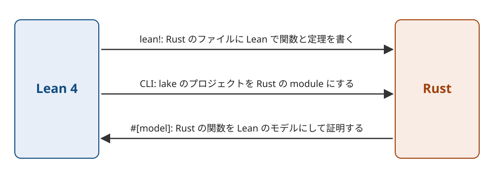

Title: lean-rs: call Lean 4 functions from Rust, and prove Rust functions in Lean
Date: 2026-11-27 18:40
Updated: 2026-11-27 18:40
Lang: en
Original: /blog/2026/b43a06
Tags: lean rust formal-verification code-generation property-based-testing cargo release lean-rs


I wrote lean-rs, a library that lets you call functions written and proved in Lean 4 from Rust.
It also works in the other direction, so you can prove properties of Rust functions in Lean.

The repository is [conao3/lean-rs](https://github.com/conao3/lean-rs), under Apache-2.0.
The crate is on crates.io as `lean-rust`, and this post shows results from version 0.2.1.
lean-rs is now the Rust backend of [leanfran](https://s.conao3.com/blog/2026/21ebbd), in [langs/Rust/ of conao3/lean-leanfran](https://github.com/conao3/lean-leanfran/tree/master/langs/Rust), with the crate name `leanfran`.

lean-rs compiles the intermediate representation of the Lean compiler to Rust source, so cargo alone builds the generated Rust, with no Lean toolchain and no Lean C runtime.
[lean-clj](https://s.conao3.com/blog/2026/311be4), which I introduced earlier, calls Lean functions from Clojure, and lean-rs brings the same mechanism to Rust.

<div class="github-card" data-repo="conao3/lean-rs"><a href="https://github.com/conao3/lean-rs"><span class="github-card-name"><svg class="github-card-mark" viewBox="0 0 16 16" aria-hidden="true"><path d="M6.766 11.328c-2.063-.25-3.516-1.734-3.516-3.656 0-.781.281-1.625.75-2.188-.203-.515-.172-1.609.063-2.062.625-.078 1.468.25 1.968.703.594-.187 1.219-.281 1.985-.281.765 0 1.39.094 1.953.265.484-.437 1.344-.765 1.969-.687.218.422.25 1.515.046 2.047.5.593.766 1.39.766 2.203 0 1.922-1.453 3.375-3.547 3.64.531.344.89 1.094.89 1.954v1.625c0 .468.391.734.86.547C13.781 14.359 16 11.53 16 8.03 16 3.61 12.406 0 7.984 0 3.563 0 0 3.61 0 8.031a7.88 7.88 0 0 0 5.172 7.422c.422.156.828-.125.828-.547v-1.25c-.219.094-.5.156-.75.156-1.031 0-1.64-.562-2.078-1.609-.172-.422-.36-.672-.719-.719-.187-.015-.25-.093-.25-.187 0-.188.313-.328.625-.328.453 0 .844.281 1.25.86.313.452.64.655 1.031.655s.641-.14 1-.5c.266-.265.47-.5.657-.656"/></svg><span>conao3/<strong>lean-rs</strong></span></span><span class="github-card-description">Lean 4 to Rust: run Lean functions from Rust, embed Lean in Rust with lean!, and verify Rust functions in Lean on top of Aeneas</span><span class="github-card-footer"><span class="github-card-language"><span class="github-card-language-color" style="background-color: #dea584"></span>Rust</span><span class="github-card-star"><svg viewBox="0 0 16 16" aria-hidden="true"><path d="M8 .25a.75.75 0 0 1 .673.418l1.882 3.815 4.21.612a.75.75 0 0 1 .416 1.279l-3.046 2.97.719 4.192a.751.751 0 0 1-1.088.791L8 12.347l-3.766 1.98a.75.75 0 0 1-1.088-.79l.72-4.194L.818 6.374a.75.75 0 0 1 .416-1.28l4.21-.611L7.327.668A.75.75 0 0 1 8 .25Z"/></svg><span>Star</span><span class="github-card-star-count" hidden></span></span></span></a></div>


# Three ways to use it

lean-rs supports three uses.



1.  Write functions and theorems in Lean inside a Rust file with the `lean!` macro, and call them from Rust.
2.  Compile an existing project of lake, the Lean build tool, to a set of Rust modules with the CLI.
3.  Translate a Rust function into Lean with `#[lean_rust::model]` and `cargo lean-rust`, and prove its properties.

The first two go from Lean to Rust, and the third goes from Rust to Lean.


# Write Rust functions in Lean

First, add two crates to `Cargo.toml`, and call `lean-rust-build` from `build.rs`.

```toml
[dependencies]
lean-rust = "0.2.1"

[build-dependencies]
lean-rust-build = "0.2.1"
```

```rust
// build.rs
fn main() {
    lean_rust_build::Builder::new().compile().unwrap();
}
```

The first build needs `lake` from Lean 4.35.0 and the `lean-rust` CLI on your `PATH`.
You install `lake` with elan, the Lean toolchain installer, and the CLI with nix.

```console
$ nix profile install github:conao3/lean-leanfran/v0.2.1#lean-rust
```

Inside a `lean!` block, you write the Lean source as a string.

```rust
lean_rust::lean! {
    pub mod arith;
    r#"
    def double (n : Nat) : Nat := n + n

    theorem double_eq (n : Nat) : double n = 2 * n := by
      unfold double; omega

    structure Account where
      owner : String
      balance : Nat
    deriving DecidableEq

    def deposit (a : Account) (n : Nat) : Account :=
      { a with balance := a.balance + n }
    "#
}

fn main() {
    println!("{}", arith::double(21u64.into()));
    let a = arith::Account { owner: "ann".to_string(), balance: 10u64.into() };
    println!("{:?}", arith::deposit(a, 5u64.into()));
}
```

`double_eq` unfolds the definition of `double` and proves the equation with [omega](https://lean-lang.org/doc/reference/latest/Tactic-Proofs/Tactic-Reference/#omega), a tactic that solves linear arithmetic over natural numbers and integers.

When you run `cargo build`, the build script writes the block out as Lean source and runs `lake build` to check the proof of the theorem, and if the check passes, the functions in the block become Rust functions in the module `arith`.
Lean's `Nat` becomes the arbitrary-precision `lean_rust::Nat`, and the structure `Account` becomes a Rust struct.

```console
$ cargo run -q
42
Account { owner: "ann", balance: 15 }
```

A failing proof stops the build, so if you change the right-hand side of the theorem to `3 * n` and build, you get this error.

```text
warning: demo@0.1.0: src/main.rs:7:22: error: omega could not prove the goal:
warning: demo@0.1.0:   a possible counterexample may satisfy the constraints
warning: demo@0.1.0:     a ≥ 1
warning: demo@0.1.0:   where
warning: demo@0.1.0:    a := ↑n
error: failed to run custom build command for `demo v0.1.0 (/path/to/demo)`
```

`src/main.rs:7:22` is where `omega` appears, because lean-rs maps the line and column that Lean reports to a position in the Rust file.

lean-rs saves the generated Rust code in `.lean-rust/cache/`, and as long as the block stays the same, later builds use it without calling Lean.
If you commit this cache, the crate builds in CI without Lean, and on the machines of users who fetch it from crates.io.

The `lean!` macro only includes the generated file with `include!`, so Lean doesn't run when rust-analyzer expands the macro.

Lean types map to Rust types as follows.

<table border="2" cellspacing="0" cellpadding="6" rules="groups" frame="hsides">


<colgroup>
<col  class="org-left" />

<col  class="org-left" />
</colgroup>
<thead>
<tr>
<th scope="col" class="org-left">Lean</th>
<th scope="col" class="org-left">Rust</th>
</tr>
</thead>
<tbody>
<tr>
<td class="org-left"><code>Nat</code>, <code>Int</code></td>
<td class="org-left">arbitrary-precision <code>lean_rust::Nat</code>, <code>lean_rust::Int</code></td>
</tr>

<tr>
<td class="org-left"><code>UInt8</code> to <code>UInt64</code>, <code>Int8</code> to <code>Int64</code></td>
<td class="org-left"><code>u8</code> to <code>u64</code>, <code>i8</code> to <code>i64</code></td>
</tr>

<tr>
<td class="org-left"><code>String</code></td>
<td class="org-left"><code>String</code></td>
</tr>

<tr>
<td class="org-left"><code>List α</code>, <code>Array α</code></td>
<td class="org-left"><code>Vec&lt;T&gt;</code></td>
</tr>

<tr>
<td class="org-left"><code>Option α</code>, <code>Except ε α</code></td>
<td class="org-left"><code>Option&lt;T&gt;</code>, <code>Result&lt;T, E&gt;</code></td>
</tr>

<tr>
<td class="org-left">structure, inductive</td>
<td class="org-left">generated <code>struct</code>, <code>enum</code></td>
</tr>

<tr>
<td class="org-left"><code>IO α</code></td>
<td class="org-left"><code>std::io::Result&lt;T&gt;</code></td>
</tr>
</tbody>
</table>

For a function with type parameters, you list the types in the block, as in `rust_instances largest [Nat, String]`, and it becomes a generic Rust function, but Rust can call it only at the types you listed.


# Compile a lake project to Rust modules

The CLI compiles Lean code written as a lake project to Rust modules.
The [roman-numerals](https://github.com/conao3/lean-leanfran/tree/v0.2.1/samples/roman-numerals) sample writes functions in Lean that convert between integers and Roman numerals, and also proves in Lean that turning any number from 1 to 999 into a Roman numeral and back gives the original number.

```lean
def toRoman (n : Nat) : String := toRomanAux (n + 13) numerals n

def fromRoman (s : String) : Option Nat :=
  if s.isEmpty then none else fromRomanAux s.toList

theorem roundtrip : ∀ n, n < 1000 → fromRoman (toRoman n) = if n = 0 then none else some n := by
  decide +kernel
```

[decide](https://lean-lang.org/doc/reference/latest/Tactic-Proofs/Tactic-Reference/#decide) is a tactic that checks a proposition by computing whether it holds.
Here the Lean kernel computes each of the 1,000 cases of `n` from 0 to 999, so the theorem says nothing about numbers of 1,000 or more.

`project generate` checks the proofs with `lake build`, then writes a Rust file for each module.

```console
$ lean-rust project generate --lake-dir lean --output-dir src/generated
```

Each public Lean function becomes a Rust function with its name in snake\_case.

```rust
mod generated;
use generated::roman;

fn main() {
    assert_eq!(roman::to_roman(1994u64.into()), "MCMXCIV");
    assert_eq!(roman::from_roman("MMXXVI"), Some(2026u64.into()));
    assert_eq!(roman::from_roman("hello"), None);
}
```

The files in `src/generated/` are plain Rust source, so if you commit them, the users of your crate don't need Lean.


# Prove Rust functions in Lean

The third use writes the implementation in Rust and proves its properties in Lean.
The translation from Rust to Lean uses [Charon](https://github.com/AeneasVerif/charon) and [Aeneas](https://github.com/AeneasVerif/aeneas), where Charon extracts the intermediate representation of a function from rustc and Aeneas translates it into a Lean function.

This post calls the Lean function from this translation the model.
The proofs are about the model, and whether the model computes the same thing as the Rust function depends on Charon and Aeneas translating correctly.

As an example, take `max_u32`, which returns the larger of two `u32` values, and prove that it equals `max` from the spec and that the result is at least as large as both arguments.

You write the specification to prove as Lean functions in a `lean!` block, and this post calls them the spec.
The spec uses the types of the Aeneas model, so the type for `u32` is `Std.U32`.

```rust
lean_rust::lean! {
    #[lean(imports = ["Aeneas"])]
    pub mod bits;
    r#"
    open Aeneas Aeneas.Std

    def max (a b : Std.U32) : Std.U32 := if a.val ≤ b.val then b else a

    def max_bound (a b r : Std.U32) : Bool := decide (a.val ≤ r.val ∧ b.val ≤ r.val)
    "#
}

#[lean_rust::model(refines = bits::max, ensures(bound = bits::max_bound))]
pub fn max_u32(a: u32, b: u32) -> u32 {
    if a <= b { b } else { a }
}
```

`refines = bits::max` claims that `max_u32` returns the same value as `bits::max` for every input, and `ensures(bound = bits::max_bound)` claims that the result satisfies `max_bound`.
The attribute arguments refer to the spec by its Rust path, so a wrong name or argument type is a compile error.

`cargo lean-rust extract` builds the model with Charon and Aeneas and writes out, for each claim, the Lean proposition to prove, which lean-rs calls an obligation.
You write the proofs of the obligations in Lean, in `lean/Proofs/` of the crate.

```lean
theorem max_u32.proof.refines : max_u32.obligation.refines := by
  intro a b
  unfold max_u32 _root_.bits.max
  by_cases h : a.val ≤ b.val <;> simp [UScalar.le_equiv, h]
```

`cargo lean-rust check` checks the proofs and records the state of each obligation in `lean-rust.lock`, and `cargo lean-rust status` lists those states.
The [verified-rust](https://github.com/conao3/lean-leanfran/tree/v0.2.1/samples/verified-rust) sample proves every obligation, including a loop that counts bits and an insertion sort.

```console
$ cargo lean-rust status
crate::bits::popcount_fast
  refines  proved    axioms: Classical.choice, Quot.sound, propext
crate::bits::max_u32
  refines  proved    axioms: Quot.sound, propext
  bound    proved    axioms: Classical.choice, Quot.sound, propext
crate::sort::insert_sorted
  sorted  proved    axioms: Classical.choice, Quot.sound, propext
  perm    proved    axioms: Classical.choice, Quot.sound, propext
```

After `axioms:` come the axioms that the proof uses, and the three standard axioms of Lean are Classical.choice, Quot.sound, and propext.
An obligation whose proof you skip with `sorry` shows `sorry` in place of `proved`, and one that uses an axiom outside the standard three shows `axioms`.


## Everyday builds need neither Lean nor nightly Rust

Charon runs on a fixed version of nightly Rust, but only `cargo lean-rust extract` calls Charon, so the everyday `cargo build` runs on stable Rust.
During that build, the build script compares `lean-rust.lock` with the current source to check whether a function has changed since `cargo lean-rust extract` built the model, so if you change `<=` to `<` in `max_u32` and build, you get a warning that the proofs are stale.

```text
warning: verified-rust@0.1.0: lean-rust: crate::bits::max_u32: 2 obligations are stale (crate::bits::max_u32 changed since `cargo lean-rust extract`)
```

If you write `require = "proved"` under `[package.metadata.lean-rust]` in `Cargo.toml`, the build fails while any obligation is unproved.
The environment variable `LEAN_RUST_REQUIRE=proved` does the same, so use it when you want to require proofs only in CI.


## Find mistakes with tests before writing proofs

`#[lean_rust::model]` generates a test that calls the Rust function and the spec on inputs from proptest and compares the results.
The spec is the Lean function compiled to Rust, so the tests and the proofs use the same definition.

For example, if you change `max_u32` to return the smaller value and run `cargo test`, it fails like this.

```text
Test failed: the function returned 0, and the spec bits::max returned 1 at samples/verified-rust/src/bits.rs:17.
minimal failing input: __args = (
    0,
    1,
)
```

The message shows the value that the function returned, the value that the spec returned, and the smallest input where they differ.


## Call the proved Rust implementation from Lean

In Lean, if you put `@[csimp]` on a theorem that two functions are equal, the compiler can replace calls to one with calls to the other.
So I made `cargo lean-rust check` write out this `@[csimp]` lemma once the proof of `refines` passes, except for functions with `requires`, which states preconditions on the arguments.

lean-rs uses this lemma to replace `bits::max` from the spec with the Rust `max_u32`, so when Lean code calls `max`, the Rust function runs.
You can write a readable spec in Lean and a fast implementation in Rust, prove that they are equal, and then swap one for the other.


# How it works

The Rust that lean-rs generates is a direct transcription of the C code from the Lean C backend, and the runtime crate `lean-rust-runtime` implements the object layout and reference counting in Rust in the same form as [lean.h](https://github.com/leanprover/lean4/blob/v4.35.0/src/include/lean/lean.h).
The generated code updates a value whose reference count is 1 in place instead of copying it, so operations such as `Array` updates perform as they do in the C backend.

The generated code for `deposit` also has a branch that checks with [lean\_is\_exclusive](https://github.com/leanprover/lean4/blob/v4.35.0/src/include/lean/lean.h#L759) whether the reference count of `Account` is 1, and if it is, updates the same object.

```rust
x_3 = rt::lean_ctor_get(x_1, 0);
x_4 = rt::lean_ctor_get(x_1, 1);
x_12 = (!rt::lean_is_exclusive(x_1)) as u8;
```

The C backend writes the points where branches meet and self tail calls in a function with `goto`, and Rust has no `goto`, so lean-rs puts the body of the function in a `match` inside a `loop`.
It sets the number of the target basic block and runs `continue` in place of each `goto`.

Another way to call Lean functions from Rust is to link the output of the C backend with the Lean runtime and call it through FFI.
[lean-sys](https://crates.io/crates/lean-sys) and similar crates take this way and need the Lean toolchain both to build and to run, while lean-rs reimplements the runtime in Rust, so it links no C library and runs on Rust crates alone.

The internal functions of the generated code are `unsafe`, and the public functions are safe functions that take and return Rust values.

`IO` covers the same ground as the C runtime, including files, directories, environment variables, and child processes, and an OS error becomes an `IO.Error` with the same message as in the C runtime.

Tests check that the Rust from lean-rs prints the same output as the program that the Lean C backend builds.
I wrote Lean code that uses integers, floating-point numbers, strings, lists, arrays, closures, and `IO` on files and child processes, and CI runs it through both lean-rs and the C backend and checks that standard output and standard error match to the character.
The Lean proofs cover the Lean definitions only, and whether the generated Rust computes the same thing depends on the lean-rs translation and runtime being correct.


# What lean-rs does not do

-   Reference counting isn't atomic.
-   `Task` doesn't start a separate thread, and runs synchronously where you create it.
-   The runtime builds only on Linux and macOS.
-   `#[lean_rust::model]` verifies only Rust that Aeneas can handle. It can't verify functions with `unsafe`, interior mutability, or concurrency.
-   When two modules use the same Lean type, you get two separate Rust types. To share a type, connect the blocks with `uses`.


# Wrapping up

[samples/steps](https://github.com/conao3/lean-leanfran/tree/v0.2.1/samples/steps) has a 17-step sample that lets you try the features one at a time, from a first `lean!` block to verifying a generic function.

I welcome issues and pull requests.

