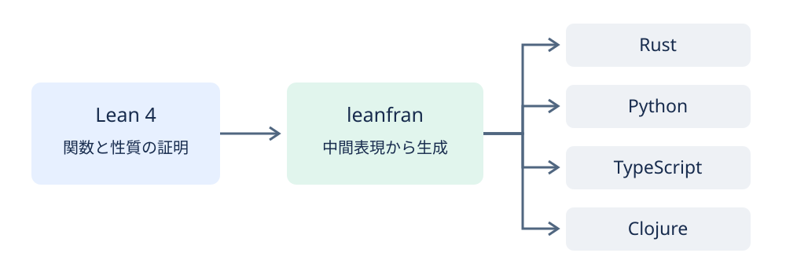

Title: leanfran: call Lean 4 functions from Rust, Python, TypeScript and Clojure, and prove their functions in Lean
Date: 2026-11-27 19:13
Updated: 2026-11-27 19:13
Draft: true
Lang: en
Original: /blog/2026/23d62c
Tags: lean rust python typescript clojure formal-verification code-generation release lean-leanfran


I built leanfran, which lets you call functions written and proved in Lean 4 from Rust, Python, TypeScript, and Clojure.
It also works the other way: it translates functions written in each of those languages into Lean so you can prove their properties, so you can both build implementations proved in Lean into your application and verify in Lean the implementations you write in your usual language.

To generate code from Lean, leanfran reads the compiler's intermediate representation and builds a library for each language, and the generated code runs on that language's runtime with leanfran's runtime library.

The repository is [conao3/lean-leanfran](https://github.com/conao3/lean-leanfran), under the Apache-2.0 license.
This post covers the features of v0.6.0.

<div class="github-card" data-repo="conao3/lean-leanfran"><a href="https://github.com/conao3/lean-leanfran"><span class="github-card-name"><svg class="github-card-mark" viewBox="0 0 16 16" aria-hidden="true"><path d="M6.766 11.328c-2.063-.25-3.516-1.734-3.516-3.656 0-.781.281-1.625.75-2.188-.203-.515-.172-1.609.063-2.062.625-.078 1.468.25 1.968.703.594-.187 1.219-.281 1.985-.281.765 0 1.39.094 1.953.265.484-.437 1.344-.765 1.969-.687.218.422.25 1.515.046 2.047.5.593.766 1.39.766 2.203 0 1.922-1.453 3.375-3.547 3.64.531.344.89 1.094.89 1.954v1.625c0 .468.391.734.86.547C13.781 14.359 16 11.53 16 8.03 16 3.61 12.406 0 7.984 0 3.563 0 0 3.61 0 8.031a7.88 7.88 0 0 0 5.172 7.422c.422.156.828-.125.828-.547v-1.25c-.219.094-.5.156-.75.156-1.031 0-1.64-.562-2.078-1.609-.172-.422-.36-.672-.719-.719-.187-.015-.25-.093-.25-.187 0-.188.313-.328.625-.328.453 0 .844.281 1.25.86.313.452.64.655 1.031.655s.641-.14 1-.5c.266-.265.47-.5.657-.656"/></svg><span>conao3/<strong>lean-leanfran</strong></span></span><span class="github-card-description">Write and prove functions in Lean 4, run them as Rust, Python, TypeScript and Clojure</span><span class="github-card-footer"><span class="github-card-language"><span class="github-card-language-color"></span>Lean</span><span class="github-card-star"><svg viewBox="0 0 16 16" aria-hidden="true"><path d="M8 .25a.75.75 0 0 1 .673.418l1.882 3.815 4.21.612a.75.75 0 0 1 .416 1.279l-3.046 2.97.719 4.192a.751.751 0 0 1-1.088.791L8 12.347l-3.766 1.98a.75.75 0 0 1-1.088-.79l.72-4.194L.818 6.374a.75.75 0 0 1 .416-1.28l4.21-.611L7.327.668A.75.75 0 0 1 8 .25Z"/></svg><span>Star</span><span class="github-card-star-count" hidden></span></span></span></a></div>




# Using proved functions in an application

Lean is a language in which you write functions and prove their properties; for example, you can write a function that doubles its argument and a theorem that the result is always twice the argument like this.

```lean
def double (n : Nat) : Nat := n + n

theorem double_eq (n : Nat) : double n = 2 * n := by
  unfold double
  omega
```

`Nat` is the type of integers 0 and above.
`double_eq` states that the equation holds for every `n` , and Lean checks the proof to confirm that the equation holds for every natural number.

When I use this function in an application, I want to use the proved implementation as it is.
If I rewrite the function in another language, I have to check again that the rewrite and the Lean function compute the same thing, so leanfran generates source in the application's language from the Lean function.

I have in mind writing functions such as date and money calculations, sorting data, and state transitions in Lean, and writing the UI and the HTTP handling in the language you usually use.


# Supported languages

leanfran supports Rust, Python, TypeScript, and Clojure, and for each language it can generate code from Lean and translate that language's functions into Lean to verify them.
Each package is on that language's registry.

<table border="2" cellspacing="0" cellpadding="6" rules="groups" frame="hsides">


<colgroup>
<col  class="org-left" />

<col  class="org-left" />

<col  class="org-left" />
</colgroup>
<thead>
<tr>
<th scope="col" class="org-left">Language</th>
<th scope="col" class="org-left">Package</th>
<th scope="col" class="org-left">Source and usage</th>
</tr>
</thead>
<tbody>
<tr>
<td class="org-left">Rust</td>
<td class="org-left"><a href="https://crates.io/crates/leanfran">leanfran</a></td>
<td class="org-left"><a href="https://github.com/conao3/lean-leanfran/tree/master/langs/Rust">langs/Rust/</a></td>
</tr>

<tr>
<td class="org-left">Python</td>
<td class="org-left"><a href="https://pypi.org/project/leanfran/">leanfran</a></td>
<td class="org-left"><a href="https://github.com/conao3/lean-leanfran/tree/master/langs/Python">langs/Python/</a></td>
</tr>

<tr>
<td class="org-left">TypeScript</td>
<td class="org-left"><a href="https://www.npmjs.com/package/leanfran">leanfran</a></td>
<td class="org-left"><a href="https://github.com/conao3/lean-leanfran/tree/master/langs/TypeScript">langs/TypeScript/</a></td>
</tr>

<tr>
<td class="org-left">Clojure</td>
<td class="org-left"><a href="https://clojars.org/io.github.conao3/leanfran">io.github.conao3/leanfran</a></td>
<td class="org-left"><a href="https://github.com/conao3/lean-leanfran/tree/master/langs/Clojure">langs/Clojure/</a></td>
</tr>
</tbody>
</table>

Every backend uses Lean 4.35.0, and all of them are released with the same version number.
Each backend can load Lean code from a separate file or embed it in the source of the target language.

In TypeScript, for example, saving the following code as `src/arith.ts` embeds the function and theorem from above.

```typescript
import { lean } from "leanfran"
import * as arith from "./_lean/arith.ts"

export const arithBlock = lean(
  "arith",
  String.raw`
def double (n : Nat) : Nat := n + n

theorem double_eq (n : Nat) : double n = 2 * n := by
  unfold double
  omega
`,
)

console.log(arith.double(21n))
```

When you run `leanfran sync` , Lean checks the theorem and leanfran generates the function in `_lean/arith.ts` ; after that you can call the generated function from TypeScript, and this example prints `42n` .
The setup steps are in the [TypeScript README](https://github.com/conao3/lean-leanfran/blob/master/langs/TypeScript/README.md#install), and an example with structures is in the [guide to types and schemas](https://github.com/conao3/lean-leanfran/blob/master/docs/typescript-guide.md#structures-inductive-types-and-standard-schema).


# Types and input validation

leanfran converts not only the computation but also the arguments and return values into forms the target language can handle: from Lean structures and inductive types, each backend generates the types it exposes and the conversion code.

In TypeScript, it generates TypeScript types and a Standard Schema compatible schema from the Lean types, so you can pass that schema to Hono's validator to check HTTP requests, and the other way around, you can turn a schema you already have, such as a zod schema, into a Lean structure and use its constraints as premises of a proof.
In Python, you can handle the data as pydantic models.

There are concrete examples in [the TypeScript pricing-api](https://github.com/conao3/lean-leanfran/tree/master/langs/TypeScript/samples/pricing-api) and [the Python pricing-api](https://github.com/conao3/lean-leanfran/tree/master/langs/Python/samples/pricing-api).

Input validation here means checking the values the application receives to confirm that they meet the conditions the Lean proofs assume; for example, if you use a proof that assumes the lower bound is at most the upper bound, values from outside must meet that condition too.


# Verifying functions written in your usual language

In the other direction, you can compare functions written in Rust and the other languages with a Lean specification: leanfran translates functions within the supported subset into Lean, and you prove theorems about the translation.

In Rust, functions marked with `#[leanfran::model]` are translated into Lean models with [Charon](https://github.com/AeneasVerif/charon) and [Aeneas](https://github.com/AeneasVerif/aeneas).
Charon extracts the Rust compiler's intermediate representation, and Aeneas translates it into Lean functions.
In the example below, `Std.U32` , `step*` , and `scalar_tac` are a type and tactics that Aeneas provides.
The next example is a function that doubles its input and returns `u32::MAX` when the result would exceed the limit, taken from the [10-ensures sample](https://github.com/conao3/lean-leanfran/tree/master/langs/Rust/samples/steps/10-ensures).

```rust
#[leanfran::model(ensures(ge = double::ge))]
pub fn saturating_double(x: u32) -> u32 {
    if x > u32::MAX / 2 {
        u32::MAX
    } else {
        x * 2
    }
}
```

`double::ge` is the specification "the return value is at least the input", defined in Lean like this.

```lean
def ge (x r : Std.U32) : Bool := decide (x.val ≤ r.val)
```

Running `cargo leanfran extract` generates a Lean model translated from the Rust function and a proposition stating that it meets the specification, and the sample writes the proof of that proposition in `lean/Proofs/SaturatingDouble.lean` .

```lean
theorem saturating_double.proof.ge : saturating_double.obligation.ge := by
  intro x
  unfold saturating_double _root_.double.ge
  step* <;> simp_all [core.num.U32.MAX, U32.rMax] <;> scalar_tac
```

`cargo leanfran check` checks this proof, which shows that for every input the return value is at least the input, and also that the multiplication that runs does not overflow.
The application runs the function written in Rust as it is, while its properties are verified in Lean.

TypeScript supports verification in the same direction: you mark a function with `model` and give `refines` for agreement with a specification or `ensures` for a condition on the return value.

What you prove here, though, is the function translated into Lean, so to carry the result over to running in the original language, the translation has to preserve meaning and you have to keep the assumptions the translation makes.
For example, when it verifies a TypeScript `number` as an integer, it assumes that the arguments and intermediate values stay within the safe integer range, and the [guide to verifying functions](https://github.com/conao3/lean-leanfran/blob/master/docs/typescript-guide.md#verifying-typescript-functions) describes the supported syntax and the assumptions.


# How the conversion works and what the proofs cover

leanfran reads the intermediate representation that the Lean compiler produces, where the handling of the functions and data needed at run time has already become concrete instructions.
Each backend turns those instructions into code in the target language, and the runtime library handles operations on integers, strings, arrays, and so on, so the generated code runs entirely within that language.

What Lean's theorems guarantee directly are the properties of the functions defined in Lean.
For those properties to hold in the generated code, the backends and runtime libraries must reproduce Lean's computation correctly, so I check this part with tests, including tests that compare the results of the generated code with the results from Lean's C backend.

I have not proved in Lean that leanfran's conversion itself is correct.


# Lean as a lingua franca

I made the name leanfran from lingua franca, a common language.
I want Lean's types and specifications to be a common language shared by several programming languages.

For now, what you can use is generating code from Lean for each language and verifying each language's functions against Lean specifications, and next I am thinking about a way to generate argument and return value conversions from Lean types when, for example, Rust calls a Python function.
These cross-language calls are still only an idea.

If you want to try it, start from the README for your language and run one short function and its proof.
The [step-by-step leanfran samples](https://github.com/conao3/lean-leanfran/tree/master/langs/TypeScript/samples/steps) walk through calling functions, types, input validation, and verifying functions, in that order.

