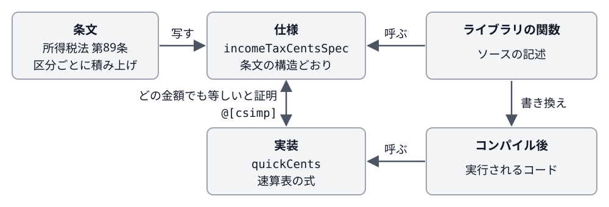

Title: lean-ritsuryo: Japanese statutory deadline and tax calculations in Lean 4, with proofs
Date: 2026-11-28 08:04
Updated: 2026-11-28 08:04
Draft: true
Lang: en
Original: /blog/2026/5499a8
Tags: lean formal-verification cli tax release lean-ritsuryo


I built [lean-ritsuryo](https://github.com/conao3/lean-ritsuryo), a Lean 4 library and CLI that computes the periods and tax amounts set by Japanese law.
Each library function comes with a proof that its result matches a definition transcribed from the statute, and the CLI calls these functions to compute.

The statute fixes the steps for an appeal deadline or an income tax amount.
Some steps are still easy to get wrong by hand, such as moving a deadline past the New Year holidays or the boundaries between tax brackets.
Even when you write the calculation as a program, checking that it follows the statute takes work.

lean-ritsuryo covers period computation under the Civil Code, holiday checks, deadlines such as the appeal period, the amounts of income tax, inheritance tax, consumption tax, delinquency tax, interest tax, and penalty taxes, and the rounding rules for national taxes.
I produced every output below with `ritsuryo` v0.5.0.

<div class="github-card" data-repo="conao3/lean-ritsuryo"><a href="https://github.com/conao3/lean-ritsuryo"><span class="github-card-name"><svg class="github-card-mark" viewBox="0 0 16 16" aria-hidden="true"><path d="M6.766 11.328c-2.063-.25-3.516-1.734-3.516-3.656 0-.781.281-1.625.75-2.188-.203-.515-.172-1.609.063-2.062.625-.078 1.468.25 1.968.703.594-.187 1.219-.281 1.985-.281.765 0 1.39.094 1.953.265.484-.437 1.344-.765 1.969-.687.218.422.25 1.515.046 2.047.5.593.766 1.39.766 2.203 0 1.922-1.453 3.375-3.547 3.64.531.344.89 1.094.89 1.954v1.625c0 .468.391.734.86.547C13.781 14.359 16 11.53 16 8.03 16 3.61 12.406 0 7.984 0 3.563 0 0 3.61 0 8.031a7.88 7.88 0 0 0 5.172 7.422c.422.156.828-.125.828-.547v-1.25c-.219.094-.5.156-.75.156-1.031 0-1.64-.562-2.078-1.609-.172-.422-.36-.672-.719-.719-.187-.015-.25-.093-.25-.187 0-.188.313-.328.625-.328.453 0 .844.281 1.25.86.313.452.64.655 1.031.655s.641-.14 1-.5c.266-.265.47-.5.657-.656"/></svg><span>conao3/<strong>lean-ritsuryo</strong></span></span><span class="github-card-description">Japanese statutory period computations (民法 期間計算, 年齢計算, 祝日) in Lean 4 with proofs on the shipped functions, and the ritsuryo CLI</span><span class="github-card-footer"><span class="github-card-language"><span class="github-card-language-color"></span>Lean</span><span class="github-card-star"><svg viewBox="0 0 16 16" aria-hidden="true"><path d="M8 .25a.75.75 0 0 1 .673.418l1.882 3.815 4.21.612a.75.75 0 0 1 .416 1.279l-3.046 2.97.719 4.192a.751.751 0 0 1-1.088.791L8 12.347l-3.766 1.98a.75.75 0 0 1-1.088-.79l.72-4.194L.818 6.374a.75.75 0 0 1 .416-1.28l4.21-.611L7.327.668A.75.75 0 0 1 8 .25Z"/></svg><span>Star</span><span class="github-card-star-count" hidden></span></span></span></a></div>


# Trying it out

The CLI takes arguments in the same syntax as the AWS CLI.
Every command prints JSON with these keys:

-   `Result`: the result of the calculation
-   `Steps`: intermediate values
-   `Basis`: the provisions behind the calculation
-   `Assumptions`: the readings of the provisions that the calculation assumes


## Appeal period

Let's compute the appeal period when you receive service of a judgment on 2026-12-15.
The two-week period ends on 2026-12-29, but that day falls in the New Year holidays, so under [Article 95(3) of the Code of Civil Procedure](https://laws.e-gov.go.jp/law/408AC0000000109#Mp-Pa_1-Ch_5-Se_3-At_95-Pr_3) the last day moves to 2027-01-04.

```console
$ ritsuryo deadline compute-appeal-deadline --served-date 2026-12-15 \
    | jq '{Result: .Result, RolledOver: [.Steps.RolledOverDays[].Date]}'
{
  "Result": {
    "Deadline": "2027-01-04",
    "Period": "控訴期間",
    "Invariable": true
  },
  "RolledOver": [
    "2026-12-29",
    "2026-12-30",
    "2026-12-31",
    "2027-01-01",
    "2027-01-02",
    "2027-01-03"
  ]
}
```

`RolledOver` lists the days the rollover skipped, and the holiday check uses the Cabinet Office's holiday CSV, whose source and SHA-256 appear in `Data` in the output.


## Income tax

For tax year 2026 with a total taxable income of 7,000,000 yen, income tax comes to 974,000 yen, the same amount you get from 7,000,000 × 23% − 636,000 with the National Tax Agency's [quick calculation table](https://www.nta.go.jp/taxes/shiraberu/taxanswer/shotoku/2260.htm).

```console
$ ritsuryo income-tax compute-tax --tax-year 2026 --taxable-income 7000000 | jq .Result
{
  "IncomeTax": 974000,
  "ReconstructionTax": 20454,
  "DefenseTax": 0,
  "Total": 994454,
  "Payable": 994400
}
```

From tax year 2027 the special income tax for reconstruction is 1.1% and the special income tax for defense is 1%.
Passing `--tax-year 2027` gives a `ReconstructionTax` of 10714 and a `DefenseTax` of 9740.


# Transcribing the statute

lean-ritsuryo writes each calculation as a definition that follows the structure of the provision.
Below, I call such a definition the specification.

Lean can run definitions, but when a provision only states conditions on the result, or when following its steps as written is slow, you can't use the specification to run the calculation.
Whether you can run the specification decides which of three forms the code takes.


## Running the specification as is

Article 95(3) of the Code of Civil Procedure says that when the last day of a period falls on a holiday, the period ends on the next day.
It counts as holidays Sundays, Saturdays, holidays under the Public Holiday Act, January 2 and 3, and December 29 to 31.
The specification that checks for these days is a function that lists the cases of the provision one after another.

```lean
def isHolidaySpec (national : Date → Bool) (d : Date) : Bool :=
  HolidayClass.holds national d .sunday || HolidayClass.holds national d .saturday ||
    HolidayClass.holds national d .nationalHoliday || HolidayClass.holds national d .newYear ||
    HolidayClass.holds national d .yearEnd
```

This function runs fast enough, so the rollover calls the specification as is.
In this case lean-ritsuryo has no implementation apart from the specification.


## A slow specification with a fast implementation

When the specification is slow, lean-ritsuryo adds a fast implementation and proves that it agrees with the specification.
Which of the two the library calls depends on whether the agreement holds for all inputs or only under a condition.


### When the implementation agrees with the specification on all inputs

[Article 89 of the Income Tax Act](https://laws.e-gov.go.jp/law/340AC0000000033#Mp-Pa_2-Ch_3-Se_1-At_89) splits the total taxable income into the brackets of a table, applies each bracket's rate, and takes the sum as the tax, and `incomeTaxCentsSpec`, the specification transcribed from this article, walks the brackets of the rate table one at a time and adds up the tax.
Total taxable income is in yen, and tax and deduction amounts are integers in units of 1/100 yen.

```lean
def table : List Bracket := [
  ⟨some 1950000, 5⟩, ⟨some 3300000, 10⟩, ⟨some 6950000, 20⟩, ⟨some 9000000, 23⟩,
  ⟨some 18000000, 33⟩, ⟨some 40000000, 40⟩, ⟨none, 45⟩]

def incomeTaxCentsSpec (x : Nat) : Nat :=
  progressiveCents table 0 x
```

With the National Tax Agency's quick calculation table, you multiply by the rate and subtract a deduction, and one formula gives the same tax without walking the brackets.

```lean
def quickCents (x : Nat) : Nat :=
  if x ≤ 1950000 then 5 * x
  else if x ≤ 3300000 then 10 * x - 9750000
  else if x ≤ 6950000 then 20 * x - 42750000
  else if x ≤ 9000000 then 23 * x - 63600000
  else if x ≤ 18000000 then 33 * x - 153600000
  else if x ≤ 40000000 then 40 * x - 279600000
  else 45 * x - 479600000
```

So I proved that the specification and the quick calculation formula are equal for every amount, and gave that theorem the `@[csimp]` attribute.
This form is in the [code on master](https://github.com/conao3/lean-ritsuryo/blob/c59558ea1f5a774614a3f1ce663d9525f4e6372f/Ritsuryo/Tax/Income.lean#L71-L72) after v0.5.0, and in v0.5.0 the tax function calls the quick calculation formula directly.

```lean
@[csimp]
theorem incomeTaxCentsSpec_eq_quickCents : @incomeTaxCentsSpec = @quickCents := by
  funext x
  simp only [incomeTaxCentsSpec, table, progressiveCents, quickCents]
  repeat' split
  all_goals omega
```

Given an equation tagged `@[csimp]`, the Lean compiler rewrites each call to the function on the left side into a call to the function on the right side.
The library's tax function calls the specification `incomeTaxCentsSpec` in the source, and the compiled code runs the quick calculation formula.

The inheritance tax rate table uses the same form.



You can see the rewrite in the IR, the intermediate representation that the compiler prints, and here is the IR of `probeIncome`, a function that only returns `incomeTaxCentsSpec x`.

```console
def probeIncome (x_1 : @& tobj) : tobj :=
  let x_2 : tobj := Ritsuryo.Tax.Income.quickCents x_1;
```

The IR calls `quickCents` in place of the specification.
The compiler rewrites a function that calls the specification when it compiles that function, so the `@[csimp]` theorem has to come before that function.


### When the implementation agrees with the specification under a condition

[Article 143 of the Civil Code](https://laws.e-gov.go.jp/law/129AC0000000089#Mp-Pa_1-Ch_6-At_143) says that a period given in weeks, months, or years follows the calendar and ends on the day before the day in the last week, month, or year that corresponds to the starting day, and the specification transcribed from this article finds the corresponding day like this.

```lean
def correspondingDaySpec (start : Date) : Length → Option Date
  | .days n => some (start.addDaysNaive n)
  | .weeks n => some (weekCorrespondingSpec start n)
  | len =>
    let ym := lastMonthSpec start len
    if start.day ≤ ym.daysInMonth then some ⟨ym.year, ym.month, start.day⟩ else none
```

For a period in days, `addDaysNaive` steps to the next day `n` times, and for a period in weeks, `weekCorrespondingSpec` steps one day at a time to find the same day of the week.
For months and years, `lastMonthSpec` also steps one month at a time to find the last month.
In every case the number of steps grows with the number of days or months in the period.

So the implementation converts each date to a day count from a fixed starting date and computes with that.

```lean
def correspondingDays (start : Date) : Length → Option Int
  | .days n => some (start.toDays + n)
  | .weeks n => some (start.toDays + 7 * n)
  | len =>
    let ym := lastMonth start len
    if start.day ≤ ym.daysInMonth then some (toDays ⟨ym.year, ym.month, start.day⟩) else none
```

For days and weeks it adds `n` or `7 * n` to the day count, and for months and years `lastMonth` adds `n` to a running month number to find the last month.

The library's period function `compute` uses this implementation, and theorem PER-1 proves that its result agrees with the specification.

```lean
theorem per1_compute_eq_spec (event : Date) (h : event.Valid) (startAtMidnight : Bool)
    (len : Length) :
    (compute event startAtMidnight len).start = Civil.startDateSpec event startAtMidnight ∧
      (compute event startAtMidnight len).corresponding =
        Civil.correspondingDaySpec (Civil.startDateSpec event startAtMidnight) len ∧
      (compute event startAtMidnight len).expiry = Civil.expirySpec event startAtMidnight len
```

The hypothesis `h : event.Valid` says that the event date `event` exists on the calendar, and PER-1 guarantees agreement only when this hypothesis holds.
`@[csimp]` doesn't accept an equation with a hypothesis like this, so library functions call the implementation directly.
To use `@[csimp]`, you would need a type that holds only real dates and functions that take that type as their argument.


## When the specification states conditions on the result

[Article 142 of the Civil Code](https://laws.e-gov.go.jp/law/129AC0000000089#Mp-Pa_1-Ch_6-At_142) sets the rollover for a period whose last day is a holiday as follows.

> 第百四十二条　期間の末日が日曜日、国民の祝日に関する法律（昭和二十三年法律第百七十八号）に規定する休日その他の休日に当たるときは、その日に取引をしない慣習がある場合に限り、期間は、<strong>その翌日</strong>に満了する。

In my translation, the article says that when the last day of a period falls on a Sunday, a holiday under the Act on National Holidays (Act No. 178 of 1948), or another holiday, the period ends on "the following day," but only where there is a custom of not doing business on that day.

Article 95(3) of the Code of Civil Procedure uses the same wording, "the following day."
Neither says what happens when the following day is also a holiday, so lean-ritsuryo reads both as moving the last day to the first day that isn't a holiday.

This reading gives conditions that the result must meet and no steps to compute it, so the specification can't be a runnable function, and lean-ritsuryo has a single implementation of the rollover.
The implementation advances the day count one day at a time and stops at the first day that isn't a holiday.

```lean
def rolloverDays (isHoliday : Int → Bool) : Nat → Int → Option Int
  | 0, _ => none
  | fuel + 1, z => if isHoliday z then rolloverDays isHoliday fuel (z + 1) else some z
```

`fuel` caps the number of days to check, and the function returns `none` if it finds no such day within the cap.
Theorem ROL-1 proves that the result of this implementation meets these two conditions:

-   The new last day is on or after the original day and isn't a holiday
-   Every day from the original day up to the day before the new last day is a holiday

Most of lean-ritsuryo's theorems take this form and state a property of a single function, for example:

-   The last day of a period is monotone in both the starting point and the length
-   Income tax doesn't decrease as taxable income grows, and neither does taxable income minus income tax
-   The consumption tax from rounding per item and from rounding the total differ by at most the number of items minus one, in yen
-   The statutory shares of inheritance under [Article 900 of the Civil Code](https://laws.e-gov.go.jp/law/129AC0000000089#Mp-Pa_5-Ch_3-Se_2-At_900) add up to 1

The theorems carry IDs such as TAX-1, 35 in all, and 2 of them check the holiday data as follows.
The Lean kernel checks each year from 1955 to 2027 in the Cabinet Office's [holiday CSV](https://www8.cao.go.jp/chosei/shukujitsu/syukujitsu.csv).
It confirms that the days derived from [Article 2 of the Public Holiday Act](https://laws.e-gov.go.jp/law/323AC1000000178#Mp-At_2) match the rows for national holidays, and that the days derived from [Article 3](https://laws.e-gov.go.jp/law/323AC1000000178#Mp-At_3) match the rows labeled 休日 (holiday).
The vernal and autumnal equinox days come from the CSV, and a table lists the dates of Marine Day, Sports Day, and Mountain Day, which a special measures act moved in 2020 and 2021.
The comparison with Article 2 leaves out the rows for holidays given for imperial ceremonies.

Lean checks every theorem during `lake build`, and no proof uses `sorry`, `admit`, or `native_decide`.
`sorry` and `admit` let a proposition pass without a proof, and `native_decide` trusts the result of running compiled code in place of the kernel.


# Errors Lean catches

A test checks results only for the inputs you pick, but a theorem covers all inputs, and Lean checks its proof on every `lake build`.
So an error that your chosen inputs don't reach still fails the build.


## A miscopied tax rate table

As an experiment, I miscopied one deduction in the quick calculation formula and changed the 636,000 yen for the bracket over 6.95 million and up to 9 million yen to 636,500 yen.

```lean
else if x ≤ 9000000 then 23 * x - 63650000
```

The proof that the specification equals the quick calculation formula then fails, and Lean reports an error.

```console
$ lake env lean typo.lean
typo.lean:16:12: error: omega could not prove the goal:
```

The proof splits the amount into the 7 brackets of the rate table and shows with `omega` that the two formulas agree in each bracket.
`omega` is a Lean procedure that decides linear equalities and inequalities over integers.

The only goal left unproved was the bracket over 6.95 million and up to 9 million yen.
In that bracket, adding up by the statute gives `23 * x - 63600000`, and the miscopied `23 * x - 63650000` is off by 500 yen at every amount, so the equation fails.

A test that uses 7 million yen as its example also finds this error.
An error in the bracket over 40 million yen slips past any test without an amount in that bracket, but the proof fails in whichever of the 7 brackets holds the error.

Changing the bracket boundary `x ≤ 6950000` to `x < 6950000` still let the proof pass.
At exactly 6,950,000 yen both the 20% formula and the 23% formula give a tax of 962,500 yen, so the tax stays the same for every amount.


## Rolling over by only one day

If you write "the following day" as a function that moves the day forward only once, a following day that is also a holiday becomes the last day of the period.
The code below uses the Lean kernel to confirm that 2026-12-30, one day after 2026-12-29, is also a holiday under Article 95(3) of the Code of Civil Procedure.

```lean
def court : Date → Bool := RolloverRule.civilProcedure95.isHoliday Holiday.isHoliday

def rolloverOnce (H : Date → Bool) (d : Date) : Date :=
  if H d then Date.ofDays (d.toDays + 1) else d

example : court (rolloverOnce court ⟨2026, 12, 29⟩) = true := by decide +kernel
```

This function breaks the first condition of ROL-1, so you can't prove ROL-1 for it.
A function that rolls over too far, such as one that always moves a holiday forward two days, breaks the second condition and fails the proof as well.


## Periods across a month end

For a period starting on 2025-01-31, one month ends on 2025-02-28 and the next month ends on 2025-03-31, but a two-month period ends on 2025-03-30.
An implementation that computes two months by repeating the one-month calculation twice is off by a day in this example, so you can't prove PER-1 for it.


## Errors Lean can't catch

Lean checks that the implementation agrees with the specification and that the implementation has the properties the theorems state.
If the specification itself misreads the statute, the implementation computes the same misreading and the proofs still pass.

To reduce this kind of error, the specifications follow the structure of the provisions so you can read them side by side with the statute.
The readings of the provisions are in [docs/interpretation.md](https://github.com/conao3/lean-ritsuryo/blob/v0.5.0/docs/interpretation.md), and I also compared the results with the worked examples in the National Tax Agency's Tax Answer pages.


# Running time and binary size

The release build of `ritsuryo` for x86\_64-linux is a single 3.4 MB executable that needs only the C library.
One run takes about 6 ms.

A Lean program can end up as a 140 MB binary, depending on how it imports modules.
lean-ritsuryo uses its own attribute to record the provisions behind each function, and the module that defines this attribute imports `Lean`, so a regular import would link all of `Lean` into the binary.
So lean-ritsuryo loads that module with `meta import` and uses the attribute only at compile time.


# Getting it

The [GitHub releases](https://github.com/conao3/lean-ritsuryo/releases) have archives for x86\_64-linux, aarch64-linux, and aarch64-darwin.

```sh
curl -sSfL https://github.com/conao3/lean-ritsuryo/releases/download/v0.5.0/ritsuryo-x86_64-linux.tar.gz | tar -xz
./ritsuryo --version
# ritsuryo 0.5.0
```

With Nix, you can run it with `nix run github:conao3/lean-ritsuryo -- help`.

The license is Apache-2.0, and the repository is <https://github.com/conao3/lean-ritsuryo>.
If you find a different reading of a provision or an error in a calculation, please tell me in an Issue.

