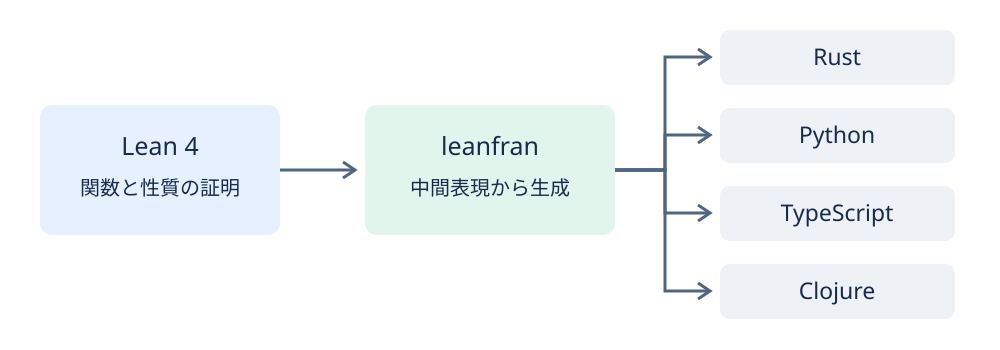

Title: Leanで証明した関数を4つの言語で使うleanfranを作った
Date: 2026-11-13 12:21


Lean 4で書いて証明した関数を、Rust、Python、TypeScript、Clojureから呼べるleanfranを作りました。
Leanのコンパイラの中間表現から各言語のソースを生成し、その言語のライブラリとして使えるようにします。
生成したコードは、各言語の実行環境とleanfranの実行時ライブラリで動きます。
リポジトリは[conao3/lean-leanfran](https://github.com/conao3/lean-leanfran)で、ライセンスはApache-2.0です。
この記事はv0.5.0の機能を紹介します。

<div class="github-card" data-repo="conao3/lean-leanfran"><a href="https://github.com/conao3/lean-leanfran"><span class="github-card-name"><svg class="github-card-mark" viewBox="0 0 16 16" aria-hidden="true"><path d="M6.766 11.328c-2.063-.25-3.516-1.734-3.516-3.656 0-.781.281-1.625.75-2.188-.203-.515-.172-1.609.063-2.062.625-.078 1.468.25 1.968.703.594-.187 1.219-.281 1.985-.281.765 0 1.39.094 1.953.265.484-.437 1.344-.765 1.969-.687.218.422.25 1.515.046 2.047.5.593.766 1.39.766 2.203 0 1.922-1.453 3.375-3.547 3.64.531.344.89 1.094.89 1.954v1.625c0 .468.391.734.86.547C13.781 14.359 16 11.53 16 8.03 16 3.61 12.406 0 7.984 0 3.563 0 0 3.61 0 8.031a7.88 7.88 0 0 0 5.172 7.422c.422.156.828-.125.828-.547v-1.25c-.219.094-.5.156-.75.156-1.031 0-1.64-.562-2.078-1.609-.172-.422-.36-.672-.719-.719-.187-.015-.25-.093-.25-.187 0-.188.313-.328.625-.328.453 0 .844.281 1.25.86.313.452.64.655 1.031.655s.641-.14 1-.5c.266-.265.47-.5.657-.656"/></svg><span>conao3/<strong>lean-leanfran</strong></span></span><span class="github-card-description">Write and prove functions in Lean 4, run them as Rust, Python, TypeScript and Clojure</span><span class="github-card-footer"><span class="github-card-language"><span class="github-card-language-color" style="background-color: #3178c6"></span>TypeScript</span><span class="github-card-star"><svg viewBox="0 0 16 16" aria-hidden="true"><path d="M8 .25a.75.75 0 0 1 .673.418l1.882 3.815 4.21.612a.75.75 0 0 1 .416 1.279l-3.046 2.97.719 4.192a.751.751 0 0 1-1.088.791L8 12.347l-3.766 1.98a.75.75 0 0 1-1.088-.79l.72-4.194L.818 6.374a.75.75 0 0 1 .416-1.28l4.21-.611L7.327.668A.75.75 0 0 1 8 .25Z"/></svg><span>Star</span><span class="github-card-star-count" hidden></span></span></span></a></div>


# 証明した関数をアプリケーションで使う

Leanは関数を書き、その関数の性質を証明できる言語です。
たとえば、引数を2倍する関数と、その結果が常に引数の2倍になるという定理を、次のように書けます。

```lean
def double (n : Nat) : Nat := n + n

theorem double_eq (n : Nat) : double n = 2 * n := by
  unfold double
  omega
```

`Nat` は0以上の整数です。
`double_eq` は、すべての `n` について等式が成り立つことを述べています。
Leanはこの証明を検査し、すべての自然数で等式が成り立つことを確かめます。

アプリケーションでこの関数を使うときも、証明した実装をそのまま使いたいです。
別の言語で関数を書き直すと、その実装とLeanの関数が同じ計算をするかを改めて確かめる必要があります。
leanfranはLeanの関数からアプリケーションの言語のソースを生成します。
日付や金額の計算、データの整列、状態遷移のような関数をLeanで書き、画面やHTTPの処理を普段使っている言語で書く使い方を想定しています。




# 4つの出力先

leanfranには、出力先の言語ごとに4つのバックエンドがあります。
パッケージはそれぞれの言語のレジストリから入れられます。

<table border="2" cellspacing="0" cellpadding="6" rules="groups" frame="hsides">


<colgroup>
<col  class="org-left" />

<col  class="org-left" />

<col  class="org-left" />
</colgroup>
<thead>
<tr>
<th scope="col" class="org-left">言語</th>
<th scope="col" class="org-left">パッケージ</th>
<th scope="col" class="org-left">ソースと使い方</th>
</tr>
</thead>
<tbody>
<tr>
<td class="org-left">Rust</td>
<td class="org-left"><a href="https://crates.io/crates/lean-rust">lean-rust</a></td>
<td class="org-left"><a href="https://github.com/conao3/lean-leanfran/tree/v0.5.0/Rust">Rust/</a></td>
</tr>

<tr>
<td class="org-left">Python</td>
<td class="org-left"><a href="https://pypi.org/project/lean-python/">lean-python</a></td>
<td class="org-left"><a href="https://github.com/conao3/lean-leanfran/tree/v0.5.0/Python">Python/</a></td>
</tr>

<tr>
<td class="org-left">TypeScript</td>
<td class="org-left"><a href="https://www.npmjs.com/package/lean-ts">lean-ts</a></td>
<td class="org-left"><a href="https://github.com/conao3/lean-leanfran/tree/v0.5.0/TypeScript">TypeScript/</a></td>
</tr>

<tr>
<td class="org-left">Clojure</td>
<td class="org-left"><a href="https://clojars.org/io.github.conao3/lean-clj">io.github.conao3/lean-clj</a></td>
<td class="org-left"><a href="https://github.com/conao3/lean-leanfran/tree/v0.5.0/Clojure">Clojure/</a></td>
</tr>
</tbody>
</table>

4つともLean 4.35.0を使い、同じバージョンでリリースしています。
各バックエンドには、Leanのコードを別ファイルから読み込む方法と、利用先の言語のソースに埋め込む方法があります。

TypeScriptでは、先ほどの関数と定理を次のように埋め込めます。
次のコードを `src/arith.ts` に保存します。

```typescript
import { lean } from "lean-ts"
import * as arith from "./_lean/arith.ts"

export const arithBlock = lean(
  "arith",
  String.raw`
def double (n : Nat) : Nat := n + n

theorem double_eq (n : Nat) : double n = 2 * n := by
  unfold double
  omega
`,
)

console.log(arith.double(21n))
```

`lean-ts sync` を実行すると、Leanが定理を検査し、 `_lean/arith.ts` に関数を生成します。
その後は、生成された関数をTypeScriptから呼べます。
この例を動かすと `42n` が出力されます。
導入の手順や構造体を使う例は[lean-tsのREADME](https://github.com/conao3/lean-leanfran/tree/v0.5.0/TypeScript#install)にあります。


# 型と入力の検査

関数の計算だけでなく、引数と戻り値も利用先の言語で扱える形に変換します。
Leanの構造体や帰納型をもとに、各バックエンドが公開する型と変換のコードを生成します。

TypeScriptではLeanの型からTypeScriptの型とStandard Schemaに対応したschemaを生成します。
そのschemaをHonoのバリデータに渡し、HTTPのリクエストを検査できます。
逆に、手元のzodなどのschemaをLeanの構造体にして、制約を証明の前提に使うこともできます。
Pythonではpydanticのモデルとしてデータを扱えます。
具体例は[TypeScriptのpricing-api](https://github.com/conao3/lean-leanfran/tree/v0.5.0/TypeScript/samples/pricing-api)と[Pythonのpricing-api](https://github.com/conao3/lean-leanfran/tree/v0.5.0/Python/samples/pricing-api)にあります。

ここで入力の検査は、アプリケーションが受け取った値を調べ、Lean側の証明が仮定する条件を満たすかを確かめます。
たとえば、下限が上限以下であることを前提にした証明を使うなら、外部から受け取る値にもその条件が必要です。


# 普段の言語で書いた関数の検証

逆向きに、Rustなどで書いた関数をLeanの仕様と比べる使い方もあります。
対応する範囲の関数をLeanに翻訳し、その翻訳について定理を証明します。
TypeScriptでは、関数に `model` を付け、仕様との一致を表す `refines` や、戻り値の条件を表す `ensures` を指定します。

このとき証明する対象はLeanに翻訳した関数です。
元の言語での実行に結び付けるには、翻訳が意味を保つことと、翻訳時の前提を守ることが必要です。
たとえば、TypeScriptの `number` を整数として検証するときは、引数と計算途中の値が安全な整数の範囲に収まることを仮定します。
対応する構文と前提は[関数検証のREADME](https://github.com/conao3/lean-leanfran/tree/v0.5.0/TypeScript#verifying-typescript-functions)に書いています。


# 変換の仕組みと証明の範囲

leanfranはLeanのコンパイラが作った中間表現を読みます。
この段階では実行に要る関数やデータの扱いが具体的な命令になっています。
各バックエンドはその命令を対象言語のコードに変え、整数、文字列、配列などの操作は実行時ライブラリが担います。
生成したコードの実行はその言語の中で完結します。

Leanの定理が直接保証するのは、Leanで定義した関数の性質です。
生成したコードにもその性質が成り立つには、バックエンドと実行時ライブラリがLeanの計算を正しく再現する必要があります。
この部分はテストで確かめています。
LeanのCバックエンドで動かした結果と生成コードの結果を比べるテストも行っています。
leanfran自体の変換の正しさをLeanで証明したわけではありません。


# Leanを共通語にする構想

leanfranという名前は、共通語を表すlingua francaから作りました。
Leanの型と仕様を、複数の言語で使う共通語にしたいと考えています。

現在使えるのは、Leanのコードを各言語へ生成する機能と、各言語の関数をLeanの仕様に照らして検証する機能です。
今後は、たとえばRustからPythonの関数を呼ぶときも、Leanの型から引数と戻り値の変換を生成する仕組みを考えています。
この言語間の呼び出しは構想段階です。

まず試すなら、使っている言語のREADMEから、短い関数と証明を1つ動かしてみてください。
[lean-tsの段階ごとのサンプル](https://github.com/conao3/lean-leanfran/tree/v0.5.0/TypeScript/samples/steps)では、関数の呼び出しから、型、入力の検査、関数の検証まで順に試せます。

