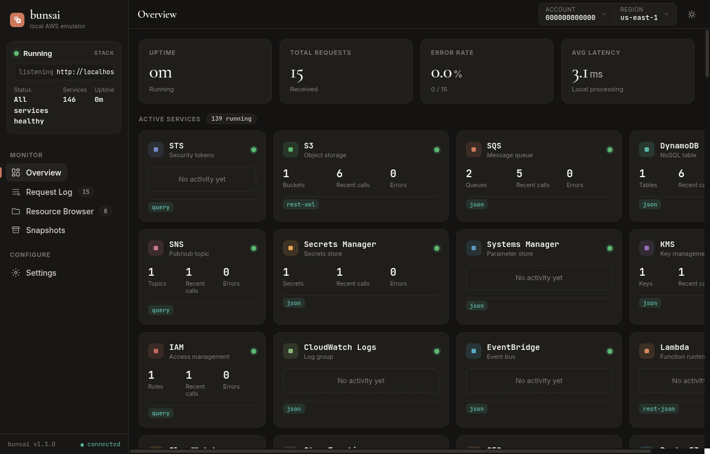
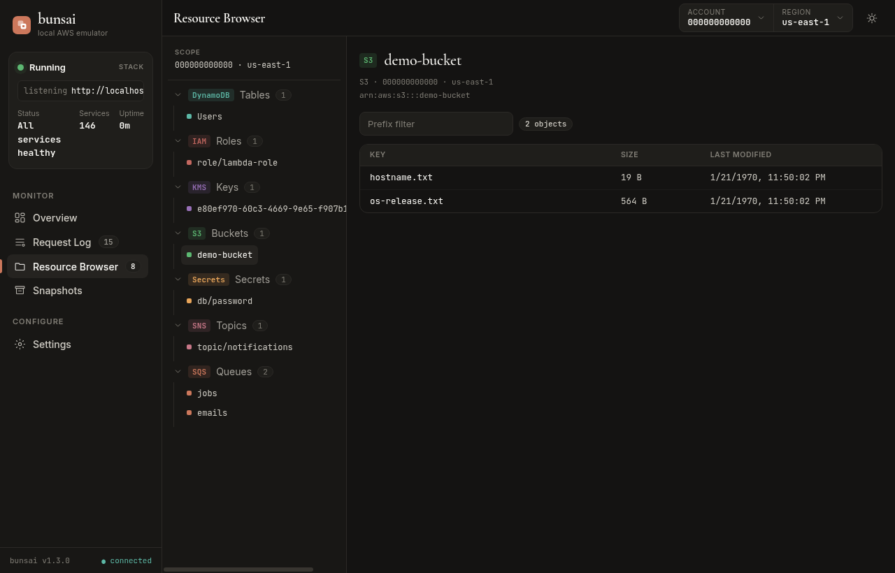
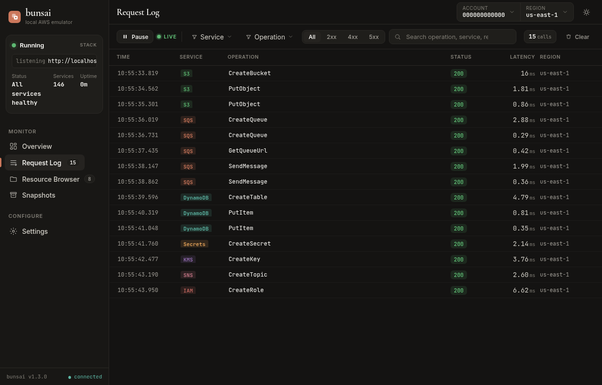

Title: bunsai — Docker不要、単一バイナリのAWSエミュレータをBunで書いた
Date: 2026-06-14
Draft: true


ローカル開発やCIでAWSをモックするとき、長らくLocalStackが定番でした。
Docker daemonを立てて、 `localstack/localstack` を `docker run` して、 `--endpoint-url` をSDKに食わせる、というやつです。

このやり方の不満をBunで全部書き直したのが[bunsai](https://github.com/conao3/bun-bunsai)です。
本記事ではv1.3.0 ( `@conao3/bunsai@1.3.0` )を題材に、何ができて何が違うかを実機で確認しながら紹介します。

<div class="github-card" data-repo="conao3/bun-bunsai"><a href="https://github.com/conao3/bun-bunsai"><span class="github-card-name"><svg class="github-card-mark" viewBox="0 0 16 16" aria-hidden="true"><path d="M6.766 11.328c-2.063-.25-3.516-1.734-3.516-3.656 0-.781.281-1.625.75-2.188-.203-.515-.172-1.609.063-2.062.625-.078 1.468.25 1.968.703.594-.187 1.219-.281 1.985-.281.765 0 1.39.094 1.953.265.484-.437 1.344-.765 1.969-.687.218.422.25 1.515.046 2.047.5.593.766 1.39.766 2.203 0 1.922-1.453 3.375-3.547 3.64.531.344.89 1.094.89 1.954v1.625c0 .468.391.734.86.547C13.781 14.359 16 11.53 16 8.03 16 3.61 12.406 0 7.984 0 3.563 0 0 3.61 0 8.031a7.88 7.88 0 0 0 5.172 7.422c.422.156.828-.125.828-.547v-1.25c-.219.094-.5.156-.75.156-1.031 0-1.64-.562-2.078-1.609-.172-.422-.36-.672-.719-.719-.187-.015-.25-.093-.25-.187 0-.188.313-.328.625-.328.453 0 .844.281 1.25.86.313.452.64.655 1.031.655s.641-.14 1-.5c.266-.265.47-.5.657-.656"/></svg><span>conao3/<strong>bun-bunsai</strong></span></span><span class="github-card-description">Local AWS API emulator built with Bun (LocalStack alternative)</span><span class="github-card-footer"><span class="github-card-language"><span class="github-card-language-color" style="background-color: #3178c6"></span>TypeScript</span><span class="github-card-star"><svg viewBox="0 0 16 16" aria-hidden="true"><path d="M8 .25a.75.75 0 0 1 .673.418l1.882 3.815 4.21.612a.75.75 0 0 1 .416 1.279l-3.046 2.97.719 4.192a.751.751 0 0 1-1.088.791L8 12.347l-3.766 1.98a.75.75 0 0 1-1.088-.79l.72-4.194L.818 6.374a.75.75 0 0 1 .416-1.28l4.21-.611L7.327.668A.75.75 0 0 1 8 .25Z"/></svg><span>Star</span><span class="github-card-star-count" hidden></span></span></span></a></div>


# 何が違うのか

LocalStackと比べた構造的な差は次の3点です。

1.  \*Docker不要・単一バイナリ起動\*。 `bunx @conao3/bunsai` またはGitHub Releasesのlinux-x64 / darwin-arm64バイナリを直接実行できます。コールドスタートは手元で約0.7-1.4秒、RSSは237MB程度。LocalStack 3.8.1の `docker run` は同条件で約3.88秒・404MBでした。
2.  \*Web dashboardがApache-2.0で同梱\*。LocalStackのResource BrowserはPro限定のSaaS ( `app.localstack.cloud` )ですが、bunsaiは `http://localhost:4566/` をブラウザで開くと自前のReact 19製ダッシュボードが立ち上がります。
3.  \*Lambdaを実プロセスで実行\*。Node.jsはBunが直接ハンドラを読み込むので低レイテンシ。Python / Ruby / Java / .NET / Go ( `provided.al*` )はホストにインストールされた言語ランタイムを `Bun.spawn` で起動します。LocalStackがDocker内のLambdaランタイムイメージを別途起動するのに対し、bunsaiは「ホストの `python3` を直接叩く」シンプルな経路です。


# 起動してみる

依存はBunだけです。fresh dirで:

```sh
mkdir bunsai-demo && cd bunsai-demo
bun add @conao3/bunsai@1.3.0
bunx bunsai
# bunsai listening on http://localhost:4566/
#   AWS gateway:    POST/GET http://localhost:4566/ (any signed AWS request)
#   Management API: http://localhost:4566/__bunsai/*
#   Dashboard:      http://localhost:4566/__dashboard/
```

ポートは `4566` の1本だけ。AWS gateway / management API / dashboardが同じoriginに同居していて、SigV4で署名されたリクエストはgatewayへ、 `/__bunsai/*` は管理API、ブラウザでルートを叩くと `/__dashboard/` に302 redirectされます。

AWS CLIから普通に叩けます:

```sh
export AWS_ACCESS_KEY_ID=test AWS_SECRET_ACCESS_KEY=test AWS_DEFAULT_REGION=us-east-1
EU=http://localhost:4566

aws --endpoint-url $EU s3 mb s3://demo-bucket
aws --endpoint-url $EU s3 cp /etc/hostname s3://demo-bucket/hostname.txt
aws --endpoint-url $EU sqs create-queue --queue-name jobs
aws --endpoint-url $EU dynamodb create-table --table-name Users \
    --attribute-definitions AttributeName=id,AttributeType=S \
    --key-schema AttributeName=id,KeyType=HASH \
    --billing-mode PAY_PER_REQUEST
aws --endpoint-url $EU secretsmanager create-secret --name db/password \
    --secret-string '{"user":"admin","pass":"hunter2"}'
aws --endpoint-url $EU kms create-key
aws --endpoint-url $EU sns create-topic --name notifications
```

認証情報は `test` / `test` で構いません(SigV4署名は検証していません)。


# Dashboard

ここからが面白いところで、 `http://localhost:4566/` をブラウザで開くと、いま立てたリソースとリクエストがリアルタイムで見えます。


## Overview



カードは「実際に呼び出した」「リソースを作った」サービス順に並び、 \`\`No activity yet'' のサービスは色味を抑えて表示されます。
左上のステータスサマリで全体のヘルスとUptime、上部にUptime / Total Requests / Error Rate / Avg Latencyの4つのKPIが出ます。


## Resource Browser



サービス横断のリソースツリーで、bucketを開けばオブジェクト一覧、queueを選べばapproximate countとmessage本文が、DynamoDBテーブルを選べば先頭5件のitemが見えます。
状態をブラウザで覗けるのはローカルAWSをやるなら必需品で、これがOSSのbunsaiにそのまま入っているのが大きな差別化軸です。


## Request Log



呼び出された全API callがSSEでライブストリームされ、service / operation / status / latencyで絞り込んだり検索したりできます。
1行クリックすると右ドロワー(または下部パネル、Settingsで切替可)で生ボディ・ヘッダ・パース後パラメータ・レスポンスが見えます。


# 多言語Lambda

LocalStackのCommunity版でもLambdaは動きますが、bunsaiはホスト直叩き方式を採っています。

```sh
# Node.js — Bunが直接ハンドラを実行(低レイテンシ)
cat > index.mjs <<'EOF'
export const handler = async (e) => ({ statusCode: 200, hello: e.name ?? 'world' });
EOF
zip fn.zip index.mjs

aws --endpoint-url $EU lambda create-function --function-name hello \
    --runtime nodejs20.x --role arn:aws:iam::000000000000:role/r \
    --handler index.handler --zip-file fileb://fn.zip

aws --endpoint-url $EU lambda invoke --function-name hello \
    --payload "$(echo -n '{"name":"bunsai"}' | base64)" /tmp/out.json
cat /tmp/out.json
# {"statusCode":200,"hello":"bunsai"}
```

Pythonを試したいなら `python3` がホストにあればOK:

```sh
cat > lambda_function.py <<'EOF'
def lambda_handler(event, context):
    return {"statusCode": 200, "hello": event.get("name", "world")}
EOF
zip py.zip lambda_function.py

aws --endpoint-url $EU lambda create-function --function-name py-fn \
    --runtime python3.13 --role arn:aws:iam::000000000000:role/r \
    --handler lambda_function.lambda_handler --zip-file fileb://py.zip

aws --endpoint-url $EU lambda invoke --function-name py-fn \
    --payload "$(echo -n '{"name":"bunsai"}' | base64)" /tmp/out.json
```

ホストに `python3` が見つからない場合、bunsaiは正規のAWSエラー `Runtime.NotReady` を返します。 `BUNSAI_LAMBDA_PYTHON` / `_RUBY` / `_JAVA` / `_DOTNET` でインタプリタのパスを上書きできます。

<table border="2" cellspacing="0" cellpadding="6" rules="groups" frame="hsides">


<colgroup>
<col  class="org-left" />

<col  class="org-left" />
</colgroup>
<thead>
<tr>
<th scope="col" class="org-left">Runtime</th>
<th scope="col" class="org-left">実行方法</th>
</tr>
</thead>
<tbody>
<tr>
<td class="org-left"><code>nodejs*</code></td>
<td class="org-left">Bunが直接 <code>import()</code></td>
</tr>

<tr>
<td class="org-left"><code>python*</code></td>
<td class="org-left">ホストの <code>python3</code> を <code>Bun.spawn</code></td>
</tr>

<tr>
<td class="org-left"><code>ruby*</code></td>
<td class="org-left">ホストの <code>ruby</code> を <code>Bun.spawn</code></td>
</tr>

<tr>
<td class="org-left"><code>java*</code></td>
<td class="org-left">ホストの <code>java &lt;source&gt;.java</code> を <code>Bun.spawn</code></td>
</tr>

<tr>
<td class="org-left"><code>dotnet*</code></td>
<td class="org-left">ホストの <code>dotnet</code> を <code>Bun.spawn</code></td>
</tr>

<tr>
<td class="org-left"><code>provided.al*</code> / <code>go1.x</code></td>
<td class="org-left">zip内の <code>bootstrap</code> を直接起動 + AWS Runtime APIシム</td>
</tr>
</tbody>
</table>

Docker daemonを立ち上げなくていいので、CI runnerの `setup-python` や `setup-ruby` がそのまま使えます。


# サービスカバレッジ

bunsaiは146サービスをbotocoreのservice-2.jsonから取り込んで実装しています。
LocalStack OSS Community(35サービス)とdiffを取ったところ、 \`\`LocalStackで動くがbunsaiで動かない'' サービスは0でした(v1.2.0で `dynamodbstreams` / `resourcegroupstaggingapi` / `support` / `s3control` / `es` の5サービスを追加してギャップを閉じています)。

<table border="2" cellspacing="0" cellpadding="6" rules="groups" frame="hsides">


<colgroup>
<col  class="org-left" />

<col  class="org-left" />

<col  class="org-left" />
</colgroup>
<thead>
<tr>
<th scope="col" class="org-left">観点</th>
<th scope="col" class="org-left">LocalStack OSS Community</th>
<th scope="col" class="org-left">bunsai</th>
</tr>
</thead>
<tbody>
<tr>
<td class="org-left">サービス数</td>
<td class="org-left">35</td>
<td class="org-left">146</td>
</tr>

<tr>
<td class="org-left">Web Dashboard</td>
<td class="org-left">Pro限定SaaS</td>
<td class="org-left">同梱 (Apache-2.0)</td>
</tr>

<tr>
<td class="org-left">Lambda runtime</td>
<td class="org-left">Docker内のLambdaイメージ</td>
<td class="org-left">ホスト直接実行</td>
</tr>

<tr>
<td class="org-left">起動時間</td>
<td class="org-left">~3.88s (docker run cold)</td>
<td class="org-left">~0.7-1.4s</td>
</tr>

<tr>
<td class="org-left">RSS</td>
<td class="org-left">~404MB</td>
<td class="org-left">~237MB</td>
</tr>

<tr>
<td class="org-left">Docker依存</td>
<td class="org-left">あり</td>
<td class="org-left">なし</td>
</tr>

<tr>
<td class="org-left">配布形態</td>
<td class="org-left">Docker image / pip</td>
<td class="org-left">npm + 単一バイナリ</td>
</tr>
</tbody>
</table>


# スコープ外

bunsaiの差別化のために割り切っている部分も書いておきます。

-   \*SigV4署名は検証しません\*。credential pairは何でも通ります。
-   \*IAMポリシーの評価はしません\*。CRUDだけです。
-   \*Lambdaのメモリ / CPU隔離なし\*。ホストプロセスとして動くので、MemorySizeは記録するだけです。
-   \*rpcv2Cborは未対応\*。AWS SDKがCBORを既定化したら追従予定です。
-   \*event-stream APIは未対応\*(Kinesis `SubscribeToShard` 等)。

これらは「実装してもbunsaiの差別化を毀損する」「LocalStackと併用すれば足りる」ものを意図的に省いた結果です。


# 入手

3経路あります。

```sh
# 1) bunx — Bunがあれば一発で起動
bunx @conao3/bunsai

# 2) npm install してCLI起動
npm install -g @conao3/bunsai
bunsai

# 3) GitHub Releasesの単一バイナリ
curl -fLo bunsai https://github.com/conao3/bun-bunsai/releases/latest/download/bunsai-linux-x64
chmod +x bunsai && ./bunsai
```

ライセンスはApache-2.0、リポジトリは<https://github.com/conao3/bun-bunsai>です。
Issue / PR大歓迎です。

