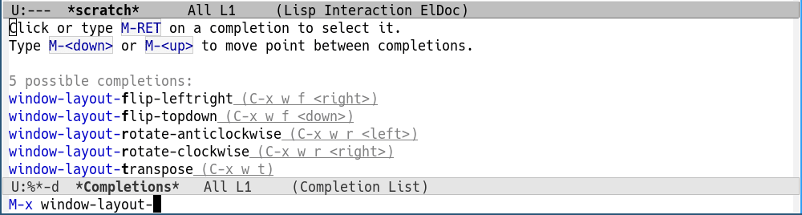
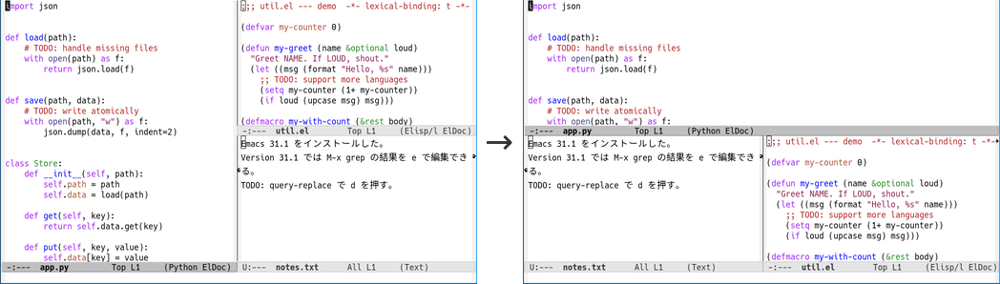
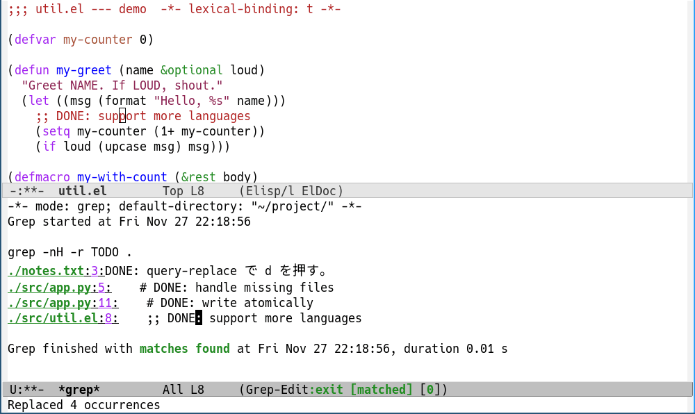
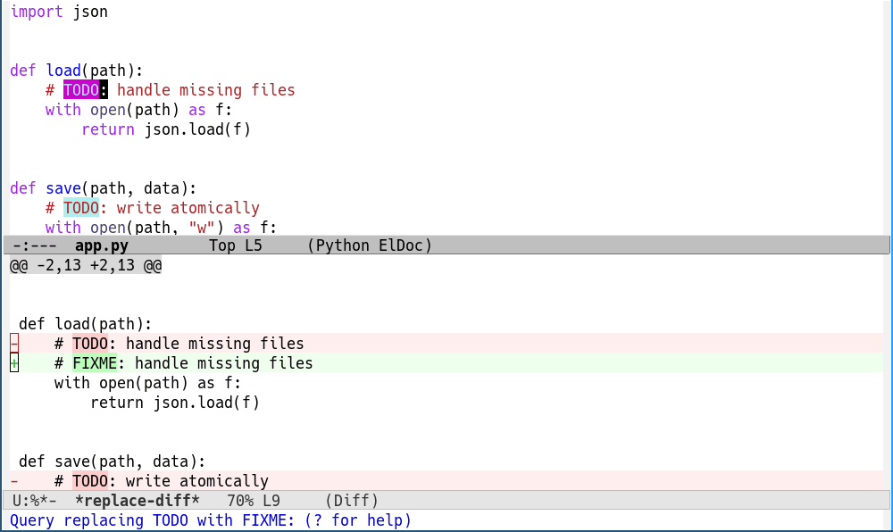
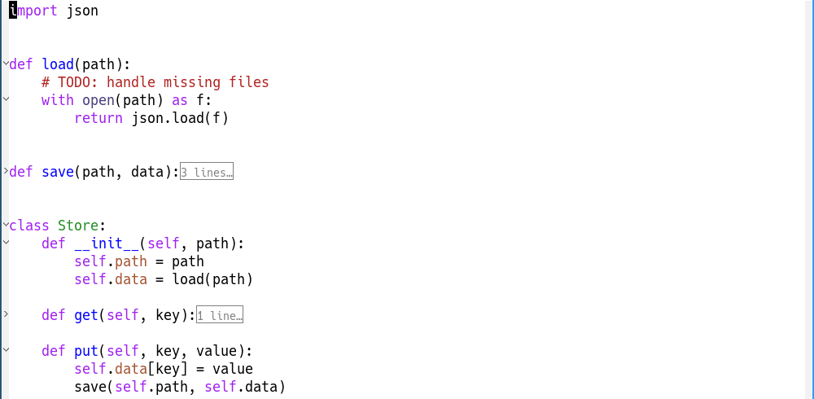
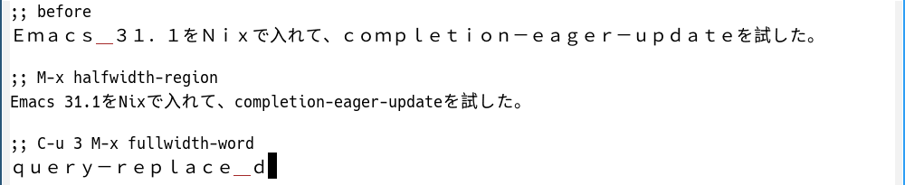
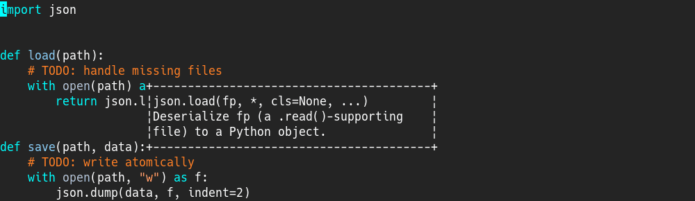

Title: Seven fun new features in Emacs 31, shown in screenshots
Date: 2026-11-27 22:23
Updated: 2026-11-27 22:23
Lang: en
Original: /blog/2026/a0c17f
Tags: emacs release-notes


I picked seven new features from the Emacs 31.1 NEWS that you notice the moment you use them, and this post shows each one in a screenshot.
They cut small chores out of daily editing: completion candidates narrow as you type, and you can edit grep results and send the edits back to the files.

The NEWS lives in [etc/NEWS](https://github.com/emacs-mirror/emacs/blob/emacs-31.1/etc/NEWS) and runs to 4,274 lines.
Instead of listing everything, I chose the features I wanted to try at once and ran them one by one.

I took every screenshot in Emacs 31.1 started with `emacs -Q`, and I include the code for each feature that needs a setting.


# Completion candidates narrow as you type

Set [completion-eager-display](https://github.com/emacs-mirror/emacs/blob/emacs-31.1/etc/NEWS#L175) to `t`, and the `*Completions*` buffer appears as soon as a minibuffer with completion opens.
Set [completion-eager-update](https://github.com/emacs-mirror/emacs/blob/emacs-31.1/etc/NEWS#L185) to `t`, and the candidate list updates with every character you type.

```emacs-lisp
(setopt completion-eager-display t
        completion-eager-update t)
```

Both default to `auto`, which shows or updates the list only when the completion table asks for it.
With both set to `t`, the candidates stay in view without TAB, and `emacs -Q` becomes pleasant to use without Vertico or Icomplete.

The screenshot shows `M-x` after typing `window-layout-`.



The list has narrowed to five commands, each with its key binding.
The next section tries these commands.


# Rotate, flip, and transpose the window layout

Emacs 31.1 adds [commands](https://github.com/emacs-mirror/emacs/blob/emacs-31.1/etc/NEWS#L327) that rearrange the whole window layout of a frame.
They all live under `C-x w`.

<table border="2" cellspacing="0" cellpadding="6" rules="groups" frame="hsides">


<colgroup>
<col  class="org-left" />

<col  class="org-left" />

<col  class="org-left" />
</colgroup>
<thead>
<tr>
<th scope="col" class="org-left">Key</th>
<th scope="col" class="org-left">Command</th>
<th scope="col" class="org-left">Effect</th>
</tr>
</thead>
<tbody>
<tr>
<td class="org-left"><code>C-x w r &lt;right&gt;</code></td>
<td class="org-left"><code>window-layout-rotate-clockwise</code></td>
<td class="org-left">Rotate the layout clockwise</td>
</tr>

<tr>
<td class="org-left"><code>C-x w r &lt;left&gt;</code></td>
<td class="org-left"><code>window-layout-rotate-anticlockwise</code></td>
<td class="org-left">Rotate the layout anticlockwise</td>
</tr>

<tr>
<td class="org-left"><code>C-x w f &lt;down&gt;</code></td>
<td class="org-left"><code>window-layout-flip-topdown</code></td>
<td class="org-left">Flip the layout top to bottom</td>
</tr>

<tr>
<td class="org-left"><code>C-x w f &lt;right&gt;</code></td>
<td class="org-left"><code>window-layout-flip-leftright</code></td>
<td class="org-left">Flip the layout left to right</td>
</tr>

<tr>
<td class="org-left"><code>C-x w t</code></td>
<td class="org-left"><code>window-layout-transpose</code></td>
<td class="org-left">Turn horizontal splits into vertical splits and back</td>
</tr>

<tr>
<td class="org-left"><code>C-x w o &lt;right&gt;</code></td>
<td class="org-left"><code>rotate-windows</code></td>
<td class="org-left">Keep the layout and move each buffer to the next window</td>
</tr>
</tbody>
</table>

I split the frame into one window on the left and two stacked windows on the right, then pressed `C-x w r <right>`.
The left window moved to the top, and the two on the right moved to the bottom.



When you move between a tall screen and a wide one, or want a side-by-side diff stacked instead, you no longer have to rebuild the windows by hand.


# Edit grep results and write the edits back to the files

Press `e` in the `M-x grep` results buffer, and the buffer switches to [Grep Edit mode, where you can edit the result lines](https://github.com/emacs-mirror/emacs/blob/emacs-31.1/etc/NEWS#L2353).
An edit to a line goes into the buffer visiting that file.
Press `C-c C-c` to leave the mode.

In the screenshot, I searched for `TODO`, then used `M-%` on the four result lines to replace `TODO` with `DONE`.



The util.el buffer at the top now has `DONE` too, and its mode line shows `**` for unsaved changes.
The edits stay in the buffers, so you save the files as usual with `C-x s`.

It works like `e` in Occur mode, so you can fix many matches right from the grep results.


# See the diff of a replacement before you make it

Press `d` in the middle of a `M-%` replacement, and the [diff with all replacements applied](https://github.com/emacs-mirror/emacs/blob/emacs-31.1/etc/NEWS#L2203) appears in the `*replace-diff*` buffer.



Here I was replacing `TODO` with `FIXME` in app.py and pressed `d` partway through.
The replacement prompt is still active after the diff appears, so you can carry on with `y` or `!`.

The help from `?` says " `d` to display the diff buffer with all replacements".
When a replacement touches many places, you can check all of them before pressing `y` one match at a time.


# Show fold indicators and hidden line counts

When you fold functions and classes with `hs-minor-mode`, setting [hs-show-indicators](https://github.com/emacs-mirror/emacs/blob/emacs-31.1/etc/NEWS#L1276) to `t` puts open and close indicators at the left edge.
Setting [hs-display-lines-hidden](https://github.com/emacs-mirror/emacs/blob/emacs-31.1/etc/NEWS#L1272) to `t` shows the number of hidden lines next to the ellipsis.

```emacs-lisp
(setopt hs-show-indicators t
        hs-display-lines-hidden t)
(add-hook 'prog-mode-hook #'hs-minor-mode)
```



The folded `save` and `get` have right-pointing indicators with "3 lines" and "1 line", and the open blocks have downward-pointing ones.
A click on an indicator also opens or closes the block.
[hs-cycle](https://github.com/emacs-mirror/emacs/blob/emacs-31.1/etc/NEWS#L1255) cycles through three states: the parent block folded, only the nested blocks folded, and everything open.


# Convert between full-width and half-width characters

[halfwidth-region](https://github.com/emacs-mirror/emacs/blob/emacs-31.1/etc/NEWS#L1437) turns the full-width letters, digits and symbols in the region into ASCII, and `fullwidth-region` does the reverse.
`halfwidth-word` and `fullwidth-word` convert the word after point, and a numeric argument such as `C-u 3` converts that many words.



Running `halfwidth-region` on the full-width sentence in the first example gives the second one, with the letters, digits and the full-width space turned into ASCII.
The third example is `query-replace d` after `C-u 3 M-x fullwidth-word`, and the `-` and the space became full-width as well.

CJK text often mixes in full-width letters and digits, and these commands normalize them without a regular expression.


# Child frames in terminal Emacs

A child frame is a small frame drawn inside its parent frame.
In the GUI, Corfu and Posframe use child frames for completion candidates and pop-ups, and Emacs 31.1 can [create child frames in a terminal](https://github.com/emacs-mirror/emacs/blob/emacs-31.1/etc/NEWS#L117) under `emacs -nw` too.

`(featurep 'tty-child-frames)` tells you whether the terminal supports them.
According to the NEWS, recent versions of Posframe and Corfu use child frames on a terminal when they are available.
To show tooltips as child frames on a terminal, turn on `tty-tip-mode`.

The screenshot shows `emacs -nw` running in foot after I evaluated this code.

```emacs-lisp
(let ((frame (make-frame `((parent-frame . ,(selected-frame))
                           (left . 22) (top . 6)
                           (width . 40) (height . 3)
                           (minibuffer . nil)))))
  (with-current-buffer (get-buffer-create "*doc*")
    (insert "json.load(fp, *, cls=None, ...)\n"
            "Deserialize fp (a .read()-supporting\n"
            "file) to a Python object.")
    (setq mode-line-format nil)
    (goto-char (point-min)))
  (set-window-buffer (frame-root-window frame) "*doc*"))
```



The child frame sits on top of the code with a line border, and it hides only the code under it.
With Emacs 31.1 and a recent Corfu on the remote host, completion candidates pop up even in `emacs -nw` over SSH.


# Other changes worth a look

-   [xterm-mouse-mode](https://github.com/emacs-mirror/emacs/blob/emacs-31.1/etc/NEWS#L46) is on by default in compatible terminals, so the mouse works in `emacs -nw`.
-   With [kill-region-dwim](https://github.com/emacs-mirror/emacs/blob/emacs-31.1/etc/NEWS#L814) set, `C-w` kills the previous word when no region is active.
-   [C-h u](https://github.com/emacs-mirror/emacs/blob/emacs-31.1/etc/NEWS#L653) runs `apropos-user-option` to search user options.
-   [treesit-auto-install-grammar](https://github.com/emacs-mirror/emacs/blob/emacs-31.1/etc/NEWS#L1064) controls whether a tree-sitter mode installs a missing grammar library when it starts.
-   [newcomers-presets](https://github.com/emacs-mirror/emacs/blob/emacs-31.1/etc/NEWS#L3481) is a theme that collects settings for new users that are too invasive to turn on by default.


# New features from Emacs 27 to 31

I wrote one post in the same format for each Emacs release from 27 to 31.

-   [Seven fun new features in Emacs 30, shown in screenshots](https://s.conao3.com/blog/2026/516114)
-   [Seven fun new features in Emacs 29, shown in screenshots](https://s.conao3.com/blog/2026/9e936f)
-   [Seven fun new features in Emacs 28, shown in screenshots](https://s.conao3.com/blog/2026/5e8afb)
-   [Seven fun new features in Emacs 27, shown in screenshots](https://s.conao3.com/blog/2026/5265b1)

