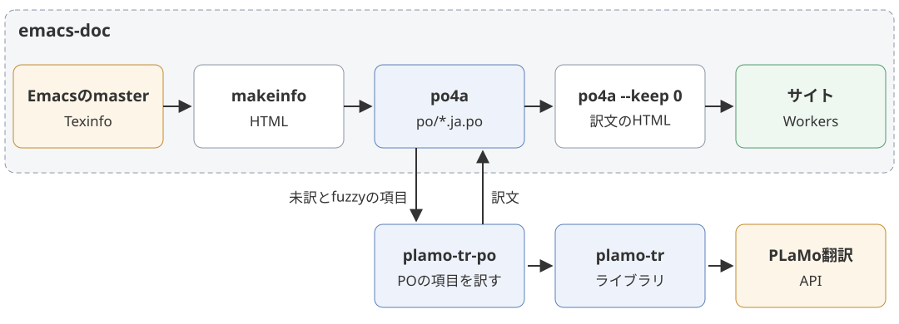
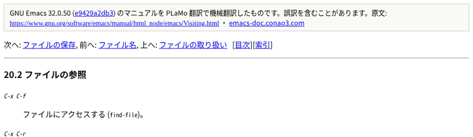

Title: PLaMo翻訳でEmacsのマニュアルを日本語に訳すplamo-trとplamo-tr-poとemacs-docを作った
Date: 2026-11-27 23:03
Updated: 2026-11-27 23:03
Draft: true
Tags: emacs rust cli llm translation gettext release rust-plamo-tr rust-plamo-tr-po emacs-doc


PLaMo翻訳をコマンドラインから呼ぶ `plamo-tr` とgettextのPOファイルをPLaMo翻訳で訳す `plamo-tr-po` を作り、この2つでGNU Emacsのマニュアルを日本語に機械翻訳したサイト<https://emacs-doc.conao3.com>を公開しました。

`plamo-tr` が文章を訳し、 `plamo-tr-po` がPOファイルの項目を `plamo-tr` で訳して、emacs-docがEmacsのマニュアルからPOファイルを作って訳文のHTMLを組み立てます。
このように3つに分けたので、Emacsのマニュアルが更新されたときは変わった段落だけを訳し直せます。

リポジトリは[conao3/rust-plamo-tr](https://github.com/conao3/rust-plamo-tr)と[conao3/rust-plamo-tr-po](https://github.com/conao3/rust-plamo-tr-po)と[conao3/emacs-doc](https://github.com/conao3/emacs-doc)で、2つのコマンドのライセンスはApache-2.0です。
emacs-docはマニュアルとその訳を原文と同じGFDL 1.3以降で、スクリプトと設定をApache-2.0で配布しています。

どれも個人で作った非公式のツールで、Preferred NetworksやFree Software Foundationとは関係がありません。



<div class="github-card" data-repo="conao3/rust-plamo-tr"><a href="https://github.com/conao3/rust-plamo-tr"><span class="github-card-name"><svg class="github-card-mark" viewBox="0 0 16 16" aria-hidden="true"><path d="M6.766 11.328c-2.063-.25-3.516-1.734-3.516-3.656 0-.781.281-1.625.75-2.188-.203-.515-.172-1.609.063-2.062.625-.078 1.468.25 1.968.703.594-.187 1.219-.281 1.985-.281.765 0 1.39.094 1.953.265.484-.437 1.344-.765 1.969-.687.218.422.25 1.515.046 2.047.5.593.766 1.39.766 2.203 0 1.922-1.453 3.375-3.547 3.64.531.344.89 1.094.89 1.954v1.625c0 .468.391.734.86.547C13.781 14.359 16 11.53 16 8.03 16 3.61 12.406 0 7.984 0 3.563 0 0 3.61 0 8.031a7.88 7.88 0 0 0 5.172 7.422c.422.156.828-.125.828-.547v-1.25c-.219.094-.5.156-.75.156-1.031 0-1.64-.562-2.078-1.609-.172-.422-.36-.672-.719-.719-.187-.015-.25-.093-.25-.187 0-.188.313-.328.625-.328.453 0 .844.281 1.25.86.313.452.64.655 1.031.655s.641-.14 1-.5c.266-.265.47-.5.657-.656"/></svg><span>conao3/<strong>rust-plamo-tr</strong></span></span><span class="github-card-description">Translate text from the command line with PLaMo Translate (unofficial)</span><span class="github-card-footer"><span class="github-card-language"><span class="github-card-language-color" style="background-color: #dea584"></span>Rust</span><span class="github-card-star"><svg viewBox="0 0 16 16" aria-hidden="true"><path d="M8 .25a.75.75 0 0 1 .673.418l1.882 3.815 4.21.612a.75.75 0 0 1 .416 1.279l-3.046 2.97.719 4.192a.751.751 0 0 1-1.088.791L8 12.347l-3.766 1.98a.75.75 0 0 1-1.088-.79l.72-4.194L.818 6.374a.75.75 0 0 1 .416-1.28l4.21-.611L7.327.668A.75.75 0 0 1 8 .25Z"/></svg><span>Star</span><span class="github-card-star-count" hidden></span></span></span></a></div>

<div class="github-card" data-repo="conao3/rust-plamo-tr-po"><a href="https://github.com/conao3/rust-plamo-tr-po"><span class="github-card-name"><svg class="github-card-mark" viewBox="0 0 16 16" aria-hidden="true"><path d="M6.766 11.328c-2.063-.25-3.516-1.734-3.516-3.656 0-.781.281-1.625.75-2.188-.203-.515-.172-1.609.063-2.062.625-.078 1.468.25 1.968.703.594-.187 1.219-.281 1.985-.281.765 0 1.39.094 1.953.265.484-.437 1.344-.765 1.969-.687.218.422.25 1.515.046 2.047.5.593.766 1.39.766 2.203 0 1.922-1.453 3.375-3.547 3.64.531.344.89 1.094.89 1.954v1.625c0 .468.391.734.86.547C13.781 14.359 16 11.53 16 8.03 16 3.61 12.406 0 7.984 0 3.563 0 0 3.61 0 8.031a7.88 7.88 0 0 0 5.172 7.422c.422.156.828-.125.828-.547v-1.25c-.219.094-.5.156-.75.156-1.031 0-1.64-.562-2.078-1.609-.172-.422-.36-.672-.719-.719-.187-.015-.25-.093-.25-.187 0-.188.313-.328.625-.328.453 0 .844.281 1.25.86.313.452.64.655 1.031.655s.641-.14 1-.5c.266-.265.47-.5.657-.656"/></svg><span>conao3/<strong>rust-plamo-tr-po</strong></span></span><span class="github-card-description">Translate gettext PO files with PLaMo Translate (unofficial)</span><span class="github-card-footer"><span class="github-card-language"><span class="github-card-language-color" style="background-color: #dea584"></span>Rust</span><span class="github-card-star"><svg viewBox="0 0 16 16" aria-hidden="true"><path d="M8 .25a.75.75 0 0 1 .673.418l1.882 3.815 4.21.612a.75.75 0 0 1 .416 1.279l-3.046 2.97.719 4.192a.751.751 0 0 1-1.088.791L8 12.347l-3.766 1.98a.75.75 0 0 1-1.088-.79l.72-4.194L.818 6.374a.75.75 0 0 1 .416-1.28l4.21-.611L7.327.668A.75.75 0 0 1 8 .25Z"/></svg><span>Star</span><span class="github-card-star-count" hidden></span></span></span></a></div>

<div class="github-card" data-repo="conao3/emacs-doc"><a href="https://github.com/conao3/emacs-doc"><span class="github-card-name"><svg class="github-card-mark" viewBox="0 0 16 16" aria-hidden="true"><path d="M6.766 11.328c-2.063-.25-3.516-1.734-3.516-3.656 0-.781.281-1.625.75-2.188-.203-.515-.172-1.609.063-2.062.625-.078 1.468.25 1.968.703.594-.187 1.219-.281 1.985-.281.765 0 1.39.094 1.953.265.484-.437 1.344-.765 1.969-.687.218.422.25 1.515.046 2.047.5.593.766 1.39.766 2.203 0 1.922-1.453 3.375-3.547 3.64.531.344.89 1.094.89 1.954v1.625c0 .468.391.734.86.547C13.781 14.359 16 11.53 16 8.03 16 3.61 12.406 0 7.984 0 3.563 0 0 3.61 0 8.031a7.88 7.88 0 0 0 5.172 7.422c.422.156.828-.125.828-.547v-1.25c-.219.094-.5.156-.75.156-1.031 0-1.64-.562-2.078-1.609-.172-.422-.36-.672-.719-.719-.187-.015-.25-.093-.25-.187 0-.188.313-.328.625-.328.453 0 .844.281 1.25.86.313.452.64.655 1.031.655s.641-.14 1-.5c.266-.265.47-.5.657-.656"/></svg><span>conao3/<strong>emacs-doc</strong></span></span><span class="github-card-description">Japanese machine translation of the GNU Emacs manuals with PLaMo Translate, served at emacs-doc.conao3.com</span><span class="github-card-footer"><span class="github-card-language"><span class="github-card-language-color" style="background-color: #89e051"></span>Shell</span><span class="github-card-star"><svg viewBox="0 0 16 16" aria-hidden="true"><path d="M8 .25a.75.75 0 0 1 .673.418l1.882 3.815 4.21.612a.75.75 0 0 1 .416 1.279l-3.046 2.97.719 4.192a.751.751 0 0 1-1.088.791L8 12.347l-3.766 1.98a.75.75 0 0 1-1.088-.79l.72-4.194L.818 6.374a.75.75 0 0 1 .416-1.28l4.21-.611L7.327.668A.75.75 0 0 1 8 .25Z"/></svg><span>Star</span><span class="github-card-star-count" hidden></span></span></span></a></div>


# PLaMo翻訳をコマンドラインから呼ぶplamo-tr

`plamo-tr` は[PLaMo翻訳](https://translate.preferredai.jp/)のブラウザ拡張と同じAPIを呼んで、訳文をJSONで出力するコマンドです。
Nixがあればインストールせずに実行できます。

```console
$ nix run github:conao3/rust-plamo-tr -- text translate-text \
    --text "Emacs is the extensible, customizable, self-documenting real-time display editor."
{
  "TranslatedText": "Emacsは、拡張可能でカスタマイズでき、自己文書化されたリアルタイム表示エディタです。",
  "SourceLanguageCode": null,
  "TargetLanguageCode": "ja"
}
```

訳文の言語を指定しなければ日本語の文は英語に訳し、それ以外の言語の文は日本語に訳します。
標準入力から読むときは `--text file:///dev/stdin` と書き、訳文だけが欲しいときは出力のJSONを `jq` に渡します。

```console
$ echo "Emacsのマニュアルを日本語で読めるようにしました。" \
    | plamo-tr text translate-text --text file:///dev/stdin | jq -r .TranslatedText
I've made the Emacs manual available in Japanese.
```

ログインにはPLaMo翻訳のWebアプリにログインしたブラウザから取り出したrefresh tokenを使うので、取り出し方と保存する場所を[READMEのLogin](https://github.com/conao3/rust-plamo-tr#login)に書いています。
訳した文字数はプランのブラウザ拡張の枠に数えられます。

コマンドの形は手元でPLaMo 3 Translateを動かす[plamo-tr-local](../../../../../../../../../../blog/2026/33d2c2)と同じで、どちらも `text translate-text` に名前付きの引数を渡します。

`plamo-tr` はRustのライブラリとしても使えて、 `plamo-tr-po` はこのライブラリの上に作りました。
`Translator::translate_batch` は複数の文章を1回のリクエストで送ってHTMLのタグを保ったまま訳し、長く動かしているあいだもIDトークンを更新し直します。


# POファイルを訳すplamo-tr-po

gettextのPOファイルは原文の `msgid` と訳文の `msgstr` の組を項目として並べたファイルで、原文が変わると `msgmerge` がその項目に `fuzzy` のフラグを付けて訳し直しが要ることを示します。
`plamo-tr-po` は未訳の項目と前に機械翻訳した `fuzzy` の項目をPLaMo翻訳で訳して、POファイルをその場で書き換えます。

試しに、Emacsのマニュアルに似せた段落2つとコードブロック1つの項目を `msgstr` が空のまま並べた `sample.ja.po` を作って、 `plamo-tr-po` で訳してみました。

```console
$ export PLAMO_AUTH_FILE=~/.config/plamo-tr/auth.json
$ plamo-tr-po po-file translate-po-files --source-language en --format html \
    --skip-context "<(pre|style|script)>" --po-files sample.ja.po
2 distinct msgids in 2 entries to translate; 1 entries skipped by --skip-context; 0 fuzzy entries with a human translation left as is
{
  "PoFiles": [
    "sample.ja.po"
  ],
  "DryRun": false,
  "PendingMsgidCount": 2,
  "PendingEntryCount": 2,
  "SkippedEntryCount": 1,
  "HumanFuzzyEntryCount": 0,
  "TranslatedMsgidCount": 2,
  "RejectedMsgidCount": 0
}
```

`sample.ja.po` の3つの項目は次のようになりました。

```po
# Machine-translated by PLaMo Translate.
#. type: Content of: <html><body><p>
#: build/html/emacs/Visiting.html
msgid "To visit a file, type <kbd class=\"kbd\">C-x C-f</kbd> (<code class=\"code\">find-file</code>) and use the minibuffer to enter the name of the desired file."
msgstr "ファイルにアクセスするには、<kbd class=\"kbd\">C-x C-f</kbd> (<code class=\"code\">find-file</code>) と入力し、ミニバッファを使用して目的のファイル名を入力してください。"

# Machine-translated by PLaMo Translate.
#. type: Content of: <html><body><p>
#: build/html/emacs/Saving.html
msgid "<kbd class=\"kbd\">C-x C-s</kbd> saves the current buffer in its visited file."
msgstr "<kbd class=\"kbd\">C-x C-s</kbd> は、現在のバッファを訪問済みファイルに保存します。"

#. type: Content of: <html><body><pre>
#: build/html/emacs/Visiting.html
#, no-wrap
msgid "C-x C-f test.emacs <kbd class=\"key\">RET</kbd>\n"
msgstr ""
```

訳した項目には `# Machine-translated by PLaMo Translate.` のコメントが付き、 `<kbd>` と `<code>` の中身は英語のままです。
`--format html` を付けると `code` や `kbd` などの要素を `<x-N/>` の形の文字列に置き換えて送り、訳文が返ってきてから元に戻すからです。

そのほかのタグの組が原文と変わった訳は捨ててその項目だけを1件ずつ訳し直し、それでも変わるときは未訳のまま残します。
`<pre>` から取り出した3つ目の項目は `#.` のコメントが `--skip-context` の正規表現に合ったので訳していません。


# 原文が変わった項目と手で直した訳

`fuzzy` になった項目のうち `plamo-tr-po` が訳し直すのは `# Machine-translated by PLaMo Translate.` のコメントがあるものだけです。
コメントの無い `fuzzy` の項目は人が書いた訳なので、書き換えずに人の確認を待ちます。

次の `update.ja.po` には原文が変わった項目が2つあり、1つ目は機械翻訳の訳を、2つ目は手で書いた訳を持っています。
`#|` の行は `msgmerge --previous` が残した前の原文です。

```po
# Machine-translated by PLaMo Translate.
#. type: Content of: <html><body><p>
#: build/html/emacs/Saving.html
#, fuzzy
#| msgid "<kbd class=\"kbd\">C-x C-s</kbd> saves the current buffer."
msgid "<kbd class=\"kbd\">C-x C-s</kbd> saves the current buffer in its visited file."
msgstr "<kbd class=\"kbd\">C-x C-s</kbd> は現在のバッファを保存します。"

#. type: Content of: <html><body><p>
#: build/html/emacs/Saving.html
#, fuzzy
#| msgid "<kbd class=\"kbd\">C-x s</kbd> saves any buffers."
msgid "<kbd class=\"kbd\">C-x s</kbd> saves any or all modified buffers."
msgstr "<kbd class=\"kbd\">C-x s</kbd> でバッファを保存します。"
```

```console
$ plamo-tr-po po-file translate-po-files --source-language en --format html \
    --po-files update.ja.po > /dev/null
1 distinct msgids in 1 entries to translate; 0 entries skipped by --skip-context; 1 fuzzy entries with a human translation left as is
```

訳し直したのは1つ目の項目だけで、 `fuzzy` のフラグと前の原文の行が消えています。
手で書いた2つ目の項目は `fuzzy` のまま残りました。

```po
# Machine-translated by PLaMo Translate.
#. type: Content of: <html><body><p>
#: build/html/emacs/Saving.html
msgid "<kbd class=\"kbd\">C-x C-s</kbd> saves the current buffer in its visited file."
msgstr "<kbd class=\"kbd\">C-x C-s</kbd> は、現在のバッファを訪問済みファイルに保存します。"

#. type: Content of: <html><body><p>
#: build/html/emacs/Saving.html
#, fuzzy
#| msgid "<kbd class=\"kbd\">C-x s</kbd> saves any buffers."
msgid "<kbd class=\"kbd\">C-x s</kbd> saves any or all modified buffers."
msgstr "<kbd class=\"kbd\">C-x s</kbd> でバッファを保存します。"
```

機械翻訳の訳を手で直したときは、その項目のコメントの行を消しておくと `plamo-tr-po` がその訳を書き換えません。


# Emacsのマニュアルを日本語に訳すemacs-doc

emacs-docは[Emacs](https://github.com/emacs-mirror/emacs)のmasterブランチにあるマニュアルを日本語に訳して、<https://emacs-doc.conao3.com>で公開しています。
訳しているのはGNU Emacs ManualとGNU Emacs Lisp Reference ManualとAn Introduction to Programming in Emacs Lispの3冊です。

どのページにも機械翻訳であることとgnu.orgの原文のページへのリンクを載せています。



emacs-docは文書の段落をPOファイルに取り出して訳文の文書を作り直す[po4a](https://po4a.org/)でマニュアルを扱っています。
サイトは `make` のターゲットを次の順に実行して作ります。

1.  `make fetch-latest` でEmacsのmasterの `doc` ディレクトリを取り出し、そのcommitを `EMACS_REVISION` に書きます。
2.  `make html` で `makeinfo --html` がマニュアルを、ノードごとのページと1冊を1ページにまとめたページの2通りのHTMLにします。
3.  `make pot` でpo4aがHTMLの段落を `po/<マニュアル>.ja.po` に取り出し、 `msgmerge --previous` で前のPOファイルと合わせます。原文が変わった段落は `fuzzy` に、新しい段落は未訳になります。
4.  `make translate` で `plamo-tr-po` が未訳の項目と機械翻訳の `fuzzy` の項目を訳します。
5.  `make site` でpo4aが `--keep 0` で訳文のHTMLを書き出し、各ページに原文へのリンクを足します。訳の無い段落は英語のまま表示されます。

この記事を書いた時点ではEmacsの[e9429a2db3](https://github.com/emacs-mirror/emacs/commit/e9429a2db33d5ef8c1195956d80639a1ae490435)のマニュアルを訳していて、 `make stats` で数えた項目の数は次のとおりです。

```console
$ make -s stats
emacs: 38083 translated messages, 4 fuzzy translations, 491 untranslated messages.
elisp: 52191 translated messages, 6 fuzzy translations, 2377 untranslated messages.
eintr: 6808 translated messages, 1 fuzzy translation, 784 untranslated messages.
```

未訳の項目のうちemacsの445件とelispの2,278件とeintrの769件は `<pre>` などから取り出したコードの項目で、 `--skip-context` で訳さないようにしています。
残りの未訳はemacsが46件、elispが99件、eintrが15件です。

GitHub Actionsの `Update` のworkflowを手で起動すると、Emacsのmasterを取り込んでPOファイルを合わせてサイトを作り直します。
新しい段落と原文が変わった段落は手元で `make translate` を実行してPOファイルをpushし、 `Update` をもう一度起動するまで英語のまま表示されます。

デプロイはCloudflareのWorkers Buildsがmasterへのpushのたびに行うので、リポジトリにはCloudflareのAPIトークンを置いていません。
仕組みは[APIトークンを持たずにGitHub ActionsのビルドをCloudflare Workersへデプロイする](../../../../../../../../../../blog/2026/12e5f6)の記事に書きました。


# おわりに

`plamo-tr` で文章を訳し、 `plamo-tr-po` でPOファイルの項目を訳して、emacs-docでマニュアルとPOファイルを行き来するように分けたので、Emacsのmasterが進んでも変わった段落だけをPLaMo翻訳に送れます。
訳を手で直した項目は `plamo-tr-po` が書き換えないので、機械翻訳の訳を少しずつ人の訳に置き換えていけます。

