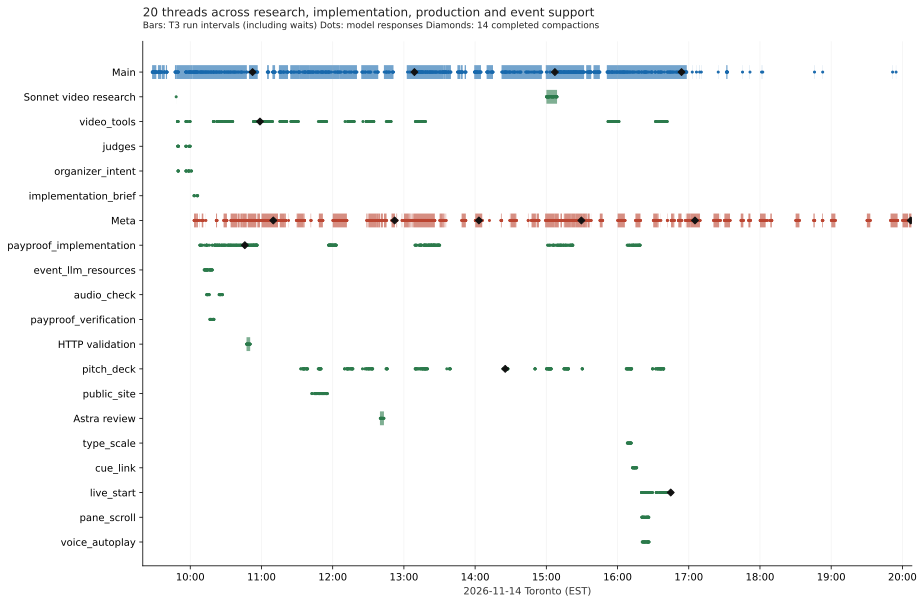
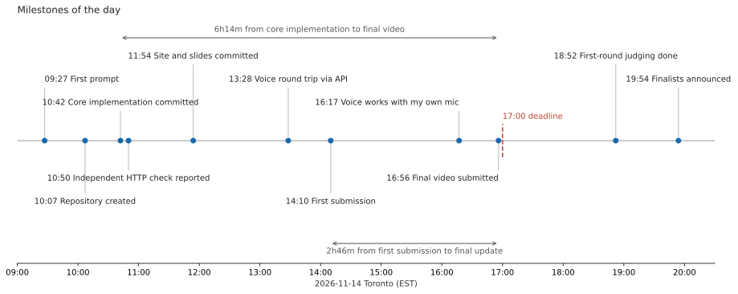
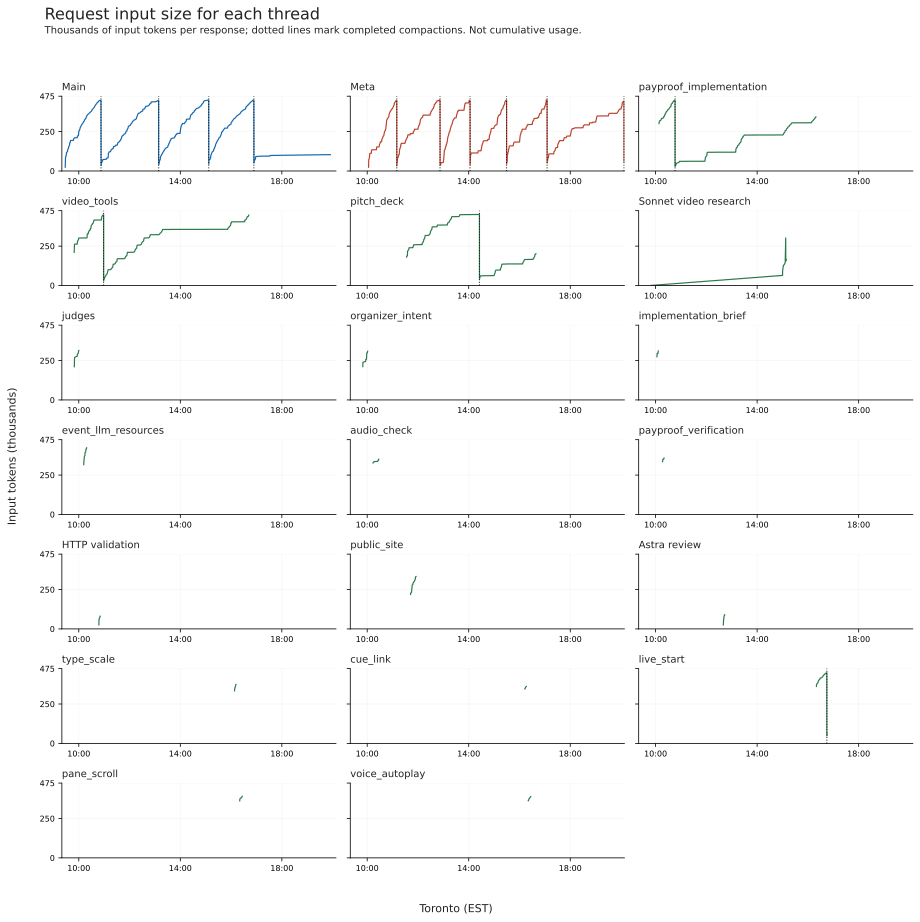
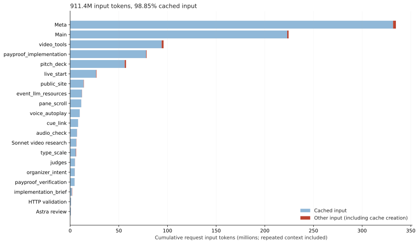

Title: A day at a MongoDB hackathon with 20 AI threads
Date: 2026-11-14 20:15
Updated: 2026-11-14 20:15
Lang: en
Original: /blog/2026/bd0d48
Tags: mongodb t3-code ai-agent hackathon claude-code ts-payproof

I joined the MongoDB hackathon in Toronto as a solo participant.
I ran several AI agents in T3 Code and built PayProof, an invoice processing app, along with its video, website and presentation materials.
Twenty threads took part in the work, and they completed 14 compactions.
A compaction is when the agent replaces a long conversation history with a summary and continues from a smaller input.

The core implementation landed about 35 minutes after the first commit.
After that, I kept polishing the app and the intro video, adding small features and fixing bugs along the way.
For the presentation, I also took time to learn to explain the product in my own words and to practice the demo.
I took two problems home for next time: how to get instructions to an agent in the middle of its work, and how to get it back to the original task after an interruption.
I handed the work to AI all day and kept the decisions for myself.

I did not make it to the finalist pitches, but I had a great time.
In this post I look back on the day through my conversation history with the agents and the Git commits.

<a href="https://x.com/conao_3/status/2121788103505703299"><strong>conao3</strong>@conao_3<svg class="tweet-card-logo" viewBox="0 0 24 24" aria-hidden="true"><path d="M18.244 2.25h3.308l-7.227 8.26 8.502 11.24H16.17l-5.214-6.817L4.99 21.75H1.68l7.73-8.835L1.254 2.25H8.08l4.713 6.231zm-1.161 17.52h1.833L7.084 4.126H5.117z"/></svg>The most exciting hackathon! Thanks mongoDB!I'll post a recap blog soon!<time class="tweet-card-time" datetime="2026-11-14T21:11:19-0500">2026-11-14 21:11</time></a>

<a href="https://github.com/conao3/ts-payproof"><svg class="github-card-mark" viewBox="0 0 16 16" aria-hidden="true"><path d="M6.766 11.328c-2.063-.25-3.516-1.734-3.516-3.656 0-.781.281-1.625.75-2.188-.203-.515-.172-1.609.063-2.062.625-.078 1.468.25 1.968.703.594-.187 1.219-.281 1.985-.281.765 0 1.39.094 1.953.265.484-.437 1.344-.765 1.969-.687.218.422.25 1.515.046 2.047.5.593.766 1.39.766 2.203 0 1.922-1.453 3.375-3.547 3.64.531.344.89 1.094.89 1.954v1.625c0 .468.391.734.86.547C13.781 14.359 16 11.53 16 8.03 16 3.61 12.406 0 7.984 0 3.563 0 0 3.61 0 8.031a7.88 7.88 0 0 0 5.172 7.422c.422.156.828-.125.828-.547v-1.25c-.219.094-.5.156-.75.156-1.031 0-1.64-.562-2.078-1.609-.172-.422-.36-.672-.719-.719-.187-.015-.25-.093-.25-.187 0-.188.313-.328.625-.328.453 0 .844.281 1.25.86.313.452.64.655 1.031.655s.641-.14 1-.5c.266-.265.47-.5.657-.656"/></svg>conao3/<strong>ts-payproof</strong>Auditable invoice agent for Canadian construction businesses. Built for Agents in Context Toronto.TypeScript<svg viewBox="0 0 16 16" aria-hidden="true"><path d="M8 .25a.75.75 0 0 1 .673.418l1.882 3.815 4.21.612a.75.75 0 0 1 .416 1.279l-3.046 2.97.719 4.192a.751.751 0 0 1-1.088.791L8 12.347l-3.766 1.98a.75.75 0 0 1-1.088-.79l.72-4.194L.818 6.374a.75.75 0 0 1 .416-1.28l4.21-.611L7.327.668A.75.75 0 0 1 8 .25Z"/></svg>Star</a>

# The event and what I built

The event was [Agents in Context Toronto: a MongoDB Hackathon](https://cerebralvalley.ai/e/mongodb-toronto-hackathon), held in Toronto on November 14, 2026.
Participants built AI agents that carry out business work with [MongoDB Atlas](https://www.mongodb.com/products/platform/atlas-database), and the [participant guide](https://cerebralvalley.ai/e/mongodb-toronto-hackathon/details) listed three problem statements: Agents You Can Audit, Memory You Can Govern, and Finish the Job.
The participant guide shows a login screen when you are not logged in to Cerebral Valley.
I chose Agents You Can Audit.
Teams could have one to four members, and we had seven hours from the 10:00 opening to the 17:00 submission deadline.
A submission was a public repository, a one-minute demo video and a short project description.

I wanted a concrete social problem that people in Canada care about, so I had an agent research candidates and settled on payment redirection fraud.
In an [announcement from the Canadian Anti-Fraud Centre](https://antifraudcentre-centreantifraude.ca/news-nouvelles/2026/2026-05-13-eng.htm), the centre reports recovering about 3.5 million Canadian dollars linked to one such fraud, so the problem causes real, large losses.
The recommended defense is to confirm changes independently through a trusted contact.

PayProof forces this confirmation step on an agent that reads invoice emails and processes them all the way to payment.
If we let agents handle critical work like payments, I think they have to follow the same procedure as a human clerk.
The target users are small and medium construction and contracting businesses in Canada.

When the bank account the agent reads from an invoice differs from the account on file, PayProof holds the payment and requires approval from a different person.
That person confirms through the contact on file, approves the amount and the account, and only then does the payment go ahead.
If the amount or the account changes after approval, the approval no longer counts.
PayProof stores permissions, accounts on file, invoice versions, approvals and the action history in the Atlas Sandbox that the organizers provided, and I mocked the human business check and the payment system for the demo.

Later in the day I added speech recognition and text-to-speech from [ElevenLabs](https://elevenlabs.io/).
You can ask by voice "Why is this payment held?", and PayProof answers with reasons grounded in the Atlas records.

I published the [project site](https://conao3.github.io/ts-payproof/), the [slides](https://conao3.github.io/ts-payproof/slides/), the [cue sheet for my phone](https://conao3.github.io/ts-payproof/cue/) and the [one-minute video I submitted](https://www.youtube.com/watch?v=QneL7pynr7k).
The source code is licensed under Apache-2.0.

<a href="https://www.youtube.com/watch?v=QneL7pynr7k"><svg class="youtube-card-play" viewBox="0 0 68 48" aria-hidden="true"><path class="youtube-card-play-bg" d="M66.52 7.74c-.78-2.93-2.49-5.41-5.42-6.19C55.79.13 34 0 34 0S12.21.13 6.9 1.55c-2.93.78-4.63 3.26-5.42 6.19C.06 13.05 0 24 0 24s.06 10.95 1.48 16.26c.78 2.93 2.49 5.41 5.42 6.19C12.21 47.87 34 48 34 48s21.79-.13 27.1-1.55c2.93-.78 4.64-3.26 5.42-6.19C67.94 34.95 68 24 68 24s-.06-10.95-1.48-16.26z"/><path fill="#fff" d="M45 24 27 14v20z"/></svg>PayProof | Verify bank changes before invoice payments | MongoDB Toronto Hackathon</a>

You can also see the submission on its [official project page](https://cerebralvalley.ai/e/mongodb-toronto-hackathon/hackathon/gallery?project=1).

# My setup in T3 Code

[T3 Code](https://t3.codes) is an app I have been using lately to drive coding agents.
It runs Claude Code, Codex, OpenCode and other agents that I am already logged in to, all from one screen.
It is [open source](https://github.com/pingdotgg/t3code), well made, and handles many sessions in one window.
I did most of the work in a conversation between me and one thread I call Main.
Main launched worker threads for implementation, video and other tasks, and pulled their results together.
Meta was a conversation I added later.
It watched the conversation between Main and me from the outside and brought in a meta-level view of how to run the project.
Meta also organized information from the organizers and passed it to Main when needed.

<table border="2" cellspacing="0" cellpadding="6" rules="groups" frame="hsides">

<colgroup>
<col  class="org-left" />

<col  class="org-left" />
</colgroup>
<thead>
<tr>
<th scope="col" class="org-left">Thread</th>
<th scope="col" class="org-left">Main job</th>
</tr>
</thead>
<tbody>
<tr>
<td class="org-left">Meta</td>
<td class="org-left">Watch my conversation with Main and suggest how to run the project. Organize information from the organizers and pass it to Main when needed</td>
</tr>

<tr>
<td class="org-left">Main</td>
<td class="org-left">Decide the direction of the project with me, assign tasks to workers, gather the results, publish and submit them</td>
</tr>

<tr>
<td class="org-left">Workers</td>
<td class="org-left">Implementation, independent verification, video, slides, website and individual usability fixes that Main asked for</td>
</tr>
</tbody>
</table>

I created Meta around 10:03, and my first message to it was: "Communication with the agents is not quite working. I want a setup that takes reports from several input channels, quickly sorts out what matters, and makes decisions."
The final count includes Main, Meta and 18 worker threads.

<a href="https://x.com/conao_3/status/2121637194242892170"><strong>conao3</strong>@conao_3<svg class="tweet-card-logo" viewBox="0 0 24 24" aria-hidden="true"><path d="M18.244 2.25h3.308l-7.227 8.26 8.502 11.24H16.17l-5.214-6.817L4.99 21.75H1.68l7.73-8.835L1.254 2.25H8.08l4.713 6.231zm-1.161 17.52h1.833L7.084 4.126H5.117z"/></svg>ハーネス作り込んでないけどt3-codeのおかげで結構自立動作してくれてるな<time class="tweet-card-time" datetime="2026-11-14T11:11:39-0500">2026-11-14 11:11</time></a>

Bars show the run intervals that T3 Code recorded, dots show model responses, and black diamonds show completed compactions.
The bars include time spent waiting for tools and reports, so a bar's length is not the model's compute time.
The row names in the figures are thread names: payproof\_implementation is the implementation worker, video\_tools the video worker, pitch\_deck the slides worker, live\_start the live start state worker, and voice\_autoplay the audio autoplay worker.

# How the day went

## 9:27 Preparation and choosing a topic

My first message of the day was "Let's get ready for today's event."
According to the organizers, all code had to be written during the event, but we could plan and design before it.
I felt a little late, and hurried to pick a topic and design the product's features.
The participant guide said development started at 10:45, but at 9:25 the organizers answered that we could start writing code right away.
I decided to create the repository after the 10:00 opening, and started by going through the rules and submission requirements with an agent.

<a href="https://x.com/conao_3/status/2121609435038531999"><strong>conao3</strong>@conao_3<svg class="tweet-card-logo" viewBox="0 0 24 24" aria-hidden="true"><path d="M18.244 2.25h3.308l-7.227 8.26 8.502 11.24H16.17l-5.214-6.817L4.99 21.75H1.68l7.73-8.835L1.254 2.25H8.08l4.713 6.231zm-1.161 17.52h1.833L7.084 4.126H5.117z"/></svg>Hackathon day in Toronto! #MongoDB #Hackathon<time class="tweet-card-time" datetime="2026-11-14T09:21:21-0500">2026-11-14 09:21</time></a>

At 9:47 I asked for research on tools that can make the one-minute submission video from plain text.
In parallel, the agents looked into video tools and the kind of projects the organizers wanted.
I mostly used GPT-6.1 Sol, and later brought in GPT-6 Astra only to review the deliverables.

At 9:57 I told the agent: "We should pick a concrete problem. I want a problem that people in Canada care about."
Two minutes later, at 9:59, it came back with public cases of payment redirection fraud and a plan to handle them with a hold, confirm and approve flow.
The [first commit](https://github.com/conao3/ts-payproof/commit/6d16d7e) at 10:07 created the PayProof repository.
I like Rust, but I chose TypeScript as the implementation language because it suited an event with so little time.

At this point the split of roles was set: Main made decisions and integrated the work, and workers handled implementation, verification and video.
All threads shared one working tree, so two workers editing the same file would collide.
When Main launched a worker, it also told the worker which files it could change and where to report.

## 10:07 The trouble with Steer

The first thing that bothered me was how Steer behaves.
T3 Code lets you send more input while an agent is running, and sending it so that it interrupts the current work is called a [Steer](https://github.com/pingdotgg/t3code/blob/main/docs/user/composer.md#send-while-the-agent-is-working), but in my experience the agent sometimes answered the extra question and then dropped the original request.
That morning several messages were waiting in Main's queue, so at 10:07 I asked Meta how to use Steer.
Meta told me to add a note asking the agent to resume its original task after answering, and at 10:10 it sent that rule to Main as well.

Then I tried steering Meta itself, and the same thing happened.
At that time Meta was checking how many people had joined the event.
The event's page on [Luma](https://luma.com/), an event listing service, showed 15 people, but the venue had far more.
In the middle of that check, I asked Meta about an announcement at the venue, and Meta answered that question and ended its turn without finishing the headcount.
At 11:15 I said, "Look into the headcount and report back. Steering really does make it forget."

Meta checked again, found 400 registrations on the Cerebral Valley event page, and reported back.

So a request that is still in the conversation does not guarantee that the unfinished work continues.
One fix I thought of was to keep as little work as possible in the foreground and offload most of it to workers, so that I could interrupt at any time.
Building that into the harness in the middle of a hackathon would be a bad move, though, so I left T3 Code as it was and changed how I used it.
Even so, the agents sometimes failed to return to their original task later in the day.

## 10:30 Core implementation and setting up information gathering

At 10:42 the [core implementation of invoice approval and mock payments](https://github.com/conao3/ts-payproof/commit/ecd1029) was committed.
That was 34 minutes and 55 seconds after the first commit.
I wrote the implementation plan that same morning, and the repository started empty.
That said, the app as a whole was not done, and I could not demo it yet.

A verification worker, separate from the implementation worker, had found two problems in the work-in-progress code.
In the first, adding spaces around an invoice number let the same invoice slip past the duplicate check.
In the second, processing with a disabled agent left the invoice stuck in the extracting state, and it could not be retried.
It seems Main passed both to the implementation worker on its own, and the worker fixed them and added tests.

Main also asked another worker, given only a narrow handoff, to run an independent check that made real HTTP calls.
The 10:50 report confirmed that the server rejected spoofed permissions, self-approval, reads from another tenant, and stale approvals after an amount change.
When payment requests arrived at the same time, the mock ledger recorded only one payment, and the receipt matched the approval.

This split helped me avoid calling the work finished just because the implementation worker said it worked.
The check covered HTTP only, though.
Problems with font size, video controls, the microphone and the phone layout remained, and I found them later when I used the app myself.

While Main pushed the implementation forward, Meta followed what was happening outside the code.
At 10:30 it summarized the submission requirements and the services offered from the opening talk of about 19 minutes, and passed the summary to Main.

At 10:33 I offloaded to Meta the job of checking email, Luma and other sources, which I had been doing myself.
I asked it to check these sources every 30 minutes, every 15 minutes in the last two hours before the deadline, and to pass only new information to Main.
With checks this frequent, having the agent read every page each time would burn context, so I had it write a dedicated script that cheaply tells whether anything changed.
I also asked Meta to look at the sources directly once an hour without the script, and to fix the script whenever it found something the script had missed, so the same miss would not happen again.
By 10:39 Meta had scheduled 25 checks running until 21:00.

At 10:50 Meta said it wanted to ask the organizers directly about the conditions for the generative LLM credits, and showed me a message for the #questions channel on Discord.
The message began with a marker saying an AI wrote it.
I had Meta check that nobody had already asked the same question, and approved the post at 10:56.
The organizers answered at 11:37, and at 12:11 Meta passed the answer to Main as input for its decisions.

<a href="https://x.com/conao_3/status/2121632169579958378"><strong>conao3</strong>@conao_3<svg class="tweet-card-logo" viewBox="0 0 24 24" aria-hidden="true"><path d="M18.244 2.25h3.308l-7.227 8.26 8.502 11.24H16.17l-5.214-6.817L4.99 21.75H1.68l7.73-8.835L1.254 2.25H8.08l4.713 6.231zm-1.161 17.52h1.833L7.084 4.126H5.117z"/></svg>実装はLLMがやるから人間は軽食を食べるだけである。がんばえー<time class="tweet-card-time" datetime="2026-11-14T10:51:41-0500">2026-11-14 10:51</time></a>

## The 11:00 hour: the video and the website

The video uses [Remotion](https://www.remotion.dev/) to combine screen recordings, diagrams, captions and background music.
At first I considered burning the captions into the video, but at 10:31 I asked for something else: "Instead of subtitles, it may be better to set aside a dedicated caption area on the screen. Let's show Toronto the BIIM style."
The BIIM style is a layout common in explainer videos on Niconico, a Japanese video site.
It fixes a demo on the left, a diagram on the right and a caption area at the bottom, and keeps each caption on screen for a long time.

<a href="https://x.com/conao_3/status/2121628054669717985"><strong>conao3</strong>@conao_3<svg class="tweet-card-logo" viewBox="0 0 24 24" aria-hidden="true"><path d="M18.244 2.25h3.308l-7.227 8.26 8.502 11.24H16.17l-5.214-6.817L4.99 21.75H1.68l7.73-8.835L1.254 2.25H8.08l4.713 6.231zm-1.161 17.52h1.833L7.084 4.126H5.117z"/></svg>I will introduce BIIM bro style to toronto bros!<time class="tweet-card-time" datetime="2026-11-14T10:35:20-0500">2026-11-14 10:35</time></a>

While the video took shape, I could not tell when it would move to the next scene, so I asked for a progress bar in the explanation panel on the right.
I also asked the agent to show the timing with the bar and the layout instead of labels with seconds.
The video worker produced the footage, Main checked the content, and I gave notes on readability and how well it got the message across.

At 11:40 I told Main to publish the project site and the repository, and at 11:54 the [site and slides with screenshots](https://github.com/conao3/ts-payproof/commit/def5ebf) were committed.
After that, I asked for polish so the concept would come across within one minute: explain the problem through public cases, write the main claim of each slide in large type, and end with the Summary.

Meta kept gathering information in the meantime.
At 11:32 it found an email from the organizers saying the ElevenLabs coupons were available, and passed it to Main.

By 12:39 the site, six slides, video v6 and the script were ready, so I had Astra, the top-tier model, review them.
It found no serious problems and reported one issue: the note at the end of the video listing what was mocked was too small.

## 12:53 The architecture diagram and voice

Development was moving fast, so at 12:53 I stopped for a moment and asked Meta to lay out the big picture.
Main was in the middle of implementation, so I gave the task to Meta to keep Main working and to keep talk unrelated to the code out of Main's context.

> Summarize the background, the big picture and the selling points of this product in Japanese. It came together so fast that I can't keep up.

I was the one presenting, so I had to be able to explain the product in my own words.
Reading the summary, I realized that the big picture was hard to grasp because there was no architecture diagram, so at 12:58 I had an agent draw how the AI, the humans, the PayProof server, Atlas and the mock payment API relate to each other.
I thought the judges should see this diagram too, so at 13:04 I asked for it on the Summary of the slides and the video, and for a more detailed version on the project site, which has no length limit.

At that point I judged that understanding who decides what and where each piece of data lives mattered more than adding code.

In the 13:00 hour I talked with the agents about the ElevenLabs special prize.
We looked for a way to make PayProof more attractive with ElevenLabs within the time left, and decided to add a feature to ask by voice why a payment is held.
Meta took on getting the ElevenLabs coupon itself, and asked Main to start building the voice feature in parallel without waiting.
After applying the coupon to the account, Meta created a voice API key at 13:25 and handed it to Main.

The [voice query feature](https://github.com/conao3/ts-payproof/commit/cab34a5) landed at 13:23, and at 13:28 a worker reported that the whole path worked, from speech recognition through an answer from Atlas and the LLM to speech output.
The worker also confirmed, in a test that fed in a synthesized spoken question, that the invoice and the mock ledger stayed unchanged.

## 14:10 The first submission

The official deadline was 17:00, and our internal target was 16:00.
At 13:45 an agent uploaded the first video to YouTube, and at 13:47 I asked, "Can we submit now and overwrite it later?"

Meta checked how to edit a submission after sending it, and Main filled in the form.
I reviewed the answers, approved the click on Submit as a separate step, and saw the submitted status at 14:10.
That was 2 hours and 50 minutes before the official deadline.

Submitting did not mean I was ready to present.
At 14:21 I asked Meta, "Main says it has nothing left to do. Is that true?"
In fact, my microphone, switching between the app and the slides, the three-minute demo, and a fallback to the video if the live demo failed were all still open.

The submitted status is an easy-to-read sign that the work is done.
Whether I was ready to present was something I had to check on its own.
That day I had to keep these two apart again and again.

## 14:59 Preparing the live demo

At 14:59 I told Meta about the presentation format that the organizers had clarified.
At 14:32 they had answered on Discord, "Confirming yes, you will submit a 1 min demo video and you'll have 3 mins to present to the judges", but that did not tell me whether we could show the one-minute video to the judges on top of the three minutes.
Until then I had planned to spend the three minutes on slides.
The slides included screencasts, and I thought they showed well enough how the product worked, but I decided I should operate the product live in front of the judges.

If I spent all three minutes on the demo, though, I could not explain the problem PayProof solves.
The judges had to understand the background within the three minutes either way, so I decided to play the one-minute video whether or not it got its own slot.
If it did not, I would play it in the first minute and shrink the live demo to the remaining two.
The video explains everything on its own, background included, so I removed every background slide and cut the deck to three: the video, the demo, and the Summary slide with the architecture diagram.
I asked for a male voice to narrate the video, and planned to end the live demo by returning to the Summary slide.

The narration uses the en-US-Grant voice of Microsoft MAI-Voice-2.1-Flash.

At 15:11 I asked Meta to check again whether the submission made a clear case against each scoring criterion.
The first-round weights were Technical Demo 35%, Implementation Difficulty 30%, Creativity 15% and Impact Potential 20%.
The agents spelled out that an approval is tied to one specific payment and that a change cancels it, in the Summary and the submission description as well as in the code.
They also showed that the server checks the permissions and the current invoice version again.

From around 15:20 I also set up the demo laptop with the agents.
[Screenkey](https://www.thregr.org/~wavexx/software/screenkey/) shows the keys and shortcuts I type at the bottom of the screen, and [highlight-pointer](https://github.com/swillner/highlight-pointer) draws a yellow circle around the cursor that turns red while I click.
I also enlarged the cursor itself to 72 px.
I wanted the audience to follow with their eyes where I clicked and what I typed, on top of what I said.
So the AI and I prepared the demo laptop as well as the app and the script.

While preparing for rehearsal, I saw on screen that an agent was putting the demo cue sheet into an A4 PDF.
I had not asked for it, and I thought it was a thoughtful move, but I do not have an iPad with me right now and an A4 PDF is hard to use, so at 15:33 I asked for a version I could read on my iPhone.
I could have kept a PDF, but HTML is the easiest format for both AI and humans to work with, so I had the agents make an HTML page and publish it with the project site.

At 15:36 an agent published the [cue sheet for the iPhone](https://github.com/conao3/ts-payproof/commit/c7253df).
The page has the English script in large type, Japanese notes on what to operate, and buttons to step through the demo.
While I operate the laptop, I can check the next move on the phone in my hand.
The architecture diagram on the project site broke on the iPhone, and the agents fixed that after I reported it.

At 16:06 I said, "I'm going to keep adding requests, so give each one to a separate agent."
Main gave font size, links to the cue sheet, scrolling in the left and right panes, audio autoplay and the demo's starting state each to a separate worker.
Every time I touched the app during this hour, I found another problem.
I should have left this kind of quality check to the AI as well, and set up the agents to check the real screens and devices before I ran into the problems myself.

Rehearsals changed the data, so at 16:29 I asked for a [reset script](https://github.com/conao3/ts-payproof/commit/ea16e0f) that quickly brings the demo back to its starting point.
Instead of deleting data, the agent made the script create a new invoice while keeping the history, and open two windows signed in as different users.
That was enough for the demo, so I took it as it was.

The video went through v9, v10 and v11.
For each version, I checked and approved the video and the upload details, and then an agent uploaded it to YouTube as unlisted and replaced the video URL in the submission.
The replacement with the final v11 finished at 16:56, four minutes before the deadline.
I made the first submission early, and the last update still ran right up to the deadline.

At 16:51, just before the deadline, Main started a compaction and could not take instructions for about two and a half minutes.
Those minutes made me nervous.
In hindsight, Main should not have handled the YouTube uploads in the browser itself.
That job uses many tokens for what it delivers, so I should have given uploads to a separate worker and kept Main free to take instructions at any time.

## The 17:00 hour: first-round judging

From what the staff said at the venue and the posts on Discord, I learned that the judging rooms had no TV, that we would demo on our own laptops, and that each team had three minutes of demo and two minutes of Q&A.

After submitting, I rehearsed and adjusted which features to show and in what order so the story would flow.
After the 17:00 deadline I changed only the order of the demo and my cue sheet, and did not touch the app code.
The final live demo had five steps: the hold, a spoken question, the independent check and approval, the mock payment, and the Summary.
Right after the hold I asked out loud, "Why is this payment held?", and I left the scene where an amount change cancels an old approval to the video.
I kept updating the cue sheet on my iPhone up to the presentation, adding a closing script for the architecture diagram and a last line saying I built the app with Atlas and ElevenLabs.

At 17:02 Meta found and shared the official deadline and a notice saying "listen for your team name to be called for first-round judging".
I could not hear the call, though.
On top of that, I had only approved the plan for registering and left the registration itself to the agents.
I had entered PayProof, the project name, as the team name on the submission form, but I did not register that it was our team name, and I did not know it until I asked Meta at 17:26.
In the end, Meta's scheduled check at 18:00 caught an email from 17:42 that called us to the judging room.
Even in the rush of not knowing when we would be called, Meta kept checking every source on schedule and caught an email I had not even thought of checking.
I think it did its job well as a companion for the contest.
Checking every 30 minutes, though, leaves a delay before anyone notices an urgent notice.
Catching urgent notices faster, and not only adding more sources, is a problem I still need to solve.

At 18:52 I reported that our judging was over.
At 19:54 I checked the six finalist teams from a photo of the screen at the venue.
PayProof was not among them.

I listened to the six finalist pitches and compared their problems and solutions.
This table is what I caught at the venue, so see each team's project page for the exact details.

<table border="2" cellspacing="0" cellpadding="6" rules="groups" frame="hsides">

<colgroup>
<col  class="org-left" />

<col  class="org-left" />

<col  class="org-left" />
</colgroup>
<thead>
<tr>
<th scope="col" class="org-left">Team</th>
<th scope="col" class="org-left">Problem</th>
<th scope="col" class="org-left">Solution</th>
</tr>
</thead>
<tbody>
<tr>
<td class="org-left"><a href="https://cerebralvalley.ai/e/mongodb-toronto-hackathon/hackathon/gallery/25">suture</a></td>
<td class="org-left">When an agent investigating and fixing an incident stops partway, it should not start over</td>
<td class="org-left">Look up past fixes with Atlas Vector Search and carry the work through to a fix PR and CI. Save the work state and resume from it</td>
</tr>

<tr>
<td class="org-left"><a href="https://cerebralvalley.ai/e/mongodb-toronto-hackathon/hackathon/gallery/6">Musory</a></td>
<td class="org-left">Background music in a store does not match the customers' taste</td>
<td class="org-left">Collect customer requests in Atlas and generate music on the spot</td>
</tr>

<tr>
<td class="org-left"><a href="https://cerebralvalley.ai/e/mongodb-toronto-hackathon/hackathon/gallery/98">Day One</a></td>
<td class="org-left">Setting up a development environment for a new hire takes time</td>
<td class="org-left">Install dependencies and run tests in a container for each new hire, and search past failures for help</td>
</tr>

<tr>
<td class="org-left"><a href="https://cerebralvalley.ai/e/mongodb-toronto-hackathon/hackathon/gallery/52">Legacy Siege</a></td>
<td class="org-left">Attacks on legacy systems, and failures on the side that repairs them</td>
<td class="org-left">Run multiple agents as attackers and repairers, and store their experience in Atlas for the next round</td>
</tr>

<tr>
<td class="org-left"><a href="https://cerebralvalley.ai/e/mongodb-toronto-hackathon/hackathon/gallery/39">Phylax Tower</a></td>
<td class="org-left">In air traffic control, instructions to aircraft and ground vehicles can conflict</td>
<td class="org-left">Monitor radio traffic, warn about conflicts and stop them</td>
</tr>

<tr>
<td class="org-left"><a href="https://cerebralvalley.ai/e/mongodb-toronto-hackathon/hackathon/gallery/3">One Lesson</a></td>
<td class="org-left">Keeping track of who taught a robot what, and under which rules, when robots share what they learned</td>
<td class="org-left">Record the teacher and the version, roll back, and refuse dangerous instructions</td>
</tr>
</tbody>
</table>

About half of the six teams kept experience or work state in Atlas and used it for the next decision or to resume work.
PayProof stopped at forcing an approval procedure on the agent, and I think it needed one more step to reach the finals.

## 20:54 Results

At the results announcement from 20:54, Legacy Siege took first place, suture second and Musory third.

ElevenLabs judges its special prize separately and will announce it on Discord later.
Only the top three overall were decided that evening, and the special prize is still pending.

# Looking back

## The role of Meta

Main handled implementation, reports from workers, the video and the submission, and Meta handled the organizers' announcements and my questions.
Meta watched two email accounts, the event page, the guide and the submission form.
I also had Meta follow what I told Main.
I changed direction in both Main and Meta, so Meta had to track those changes along with the news from the organizers.

Meta read everything I said in full, and from the agents' long reports it picked out only the progress and blockers it needed.
I gave Meta the job of finishing its own research and delivering to Main only the information that would change Main's next decision.
At 10:48 I gave Meta this instruction in my own words as well: do the meta-level information work on its own, and do not ask Main to research things.

In the end, adding Meta was a good call.
Meta caught news from the organizers and deadline notices and passed them to Main, so Main stayed focused on the code and the deliverables until the end.
On the other hand, Meta carried a large context of its own and sometimes reacted too late to urgent notices, so I should design the way to collect information and the way to receive urgent messages separately.

## Waiting on instructions, and Steer

In T3 Code, when you send an instruction while an agent is running, you choose between adding it to the queue as a normal prompt and sending it as a Steer that interrupts the current work.
A queued instruction waits until the current work ends, so the agent does not act on it right away.
At the venue, new announcements and problems that only showed up in use kept coming, and I often wanted to give direction on the spot and get a response right away.

A Steer, on the other hand, drops a completely different context into the LLM in the middle of its work, and that hurts the result.
And as I described above, the agent often forgot what it had been doing.
Even when I kept the unfinished items in a file, the agent did not reliably go back to the original task.
I also had to spend effort checking whether the original work was still going or had stopped because of the new instruction.

Taking input right away, acting on it, and returning to the original task after answering a side question are three separate problems.
Next time I plan to offload more of Main's foreground work to workers, so that Main can take an interruption at any time from the start.
When I have time outside a hackathon, I want to build support for this into the harness.

## The information-gathering script

For the scheduled checks, a dedicated script fetches only the differences.
The agent reads the content only when something changed, which saves context.
The script checked every 30 minutes, and every 15 minutes in the two hours before the deadline.
The direct check once an hour was there to catch what the script missed.
I had told Meta in advance that whenever it found a miss, it should fix the script in that same round and add a test that reproduces the miss.
In other words, the information-gathering setup repaired itself without my help, a form of self-healing.

The script tracked separately whether it could read the content, whether the content changed, whether it was important news, and whether it reached Main.
It marked an item as checked only after delivering it or deciding Main already knew it.
A failed fetch never counted as "no updates".
The check also caught email threads where only the latest message had been opened.

The setup had a real cost.
When I added it up later, Meta's total input was larger than Main's.
The thread that filtered the information also carried a huge context.

## Reports from the AI and checks on real devices

The agents recorded HTTP checks, automated browser runs, playback checks while logged out, and checks with my microphone and iPhone as separate results.
"We sent synthesized speech to the API" and "I spoke into the venue laptop and heard the answer" are different results.
An automated run that finishes in under a minute does not show that I can run the demo in three minutes while explaining it.
Writing down how far each check went mattered as much as having a separate worker do the checking.

After the first submission, at 14:10, the organizers sent an email: “Action needed: your demo video for "PayProof" is private”.
I had meant to make the one-minute video unlisted, but it was fully private, and the organizers could not watch it.
Meta found this email in its 14:30 check and told Main.
After I changed the video to unlisted, Meta also passed Main a request to check every deliverable in a logged-out browser.
From then on, Main checked that each update to the submission could be viewed while logged out.

## What I decided

In the second half of the day, I asked one by one for things I needed to present: the big-picture summary, the architecture diagram, an English script at CEFR B1 level, and the cue sheet for my iPhone.
What I kept deciding in the second half was less what to build and more what I needed to understand, what to show, and for how many seconds.

I checked and approved everything before it went out to an outside service.
The AI did the preparation and the checks, and I made the call to publish.
PayProof itself is an app about human confirmation and approval of a specific payment.
The app I was building and my work with the AI that built it faced similar problems.

## How the time went

Between the core implementation commit and the final video replacement, 6 hours and 14 minutes passed.
In that time the agents added the voice feature and fixed bugs.
Still, most of the conversation went to how to present, how to operate the demo, preparing explanations, and checking what we published and submitted.
The span from the first submission to the last update alone was 2 hours and 46 minutes.

The implementation went fast, so I could put the remaining time into preparing the presentation.
Next time I want agents to check each feature on the real screen as soon as it is built, and I want to decide early what to explain and how.
I plan to treat "the feature works", "people can view what we published" and "I can demo it myself" as separate milestones.

# Compactions over time

This figure plots the input token count recorded for each response in the 20 threads.
I wanted to see how context usage changed over time, so the figure uses the input size of each response, not the cumulative total.
Dotted lines mark completed compactions recorded in T3.

In Main, the input was about 448,000 tokens just before the first compaction and dropped to about 35,000 in the next response.
It grew again from there, and Main finished four compactions that day.
Meta had six, and the implementation, video, slides and live start state workers had one each, for 14 in total.

What surprised me was how large the first input was, even for small workers created later.
The audio autoplay worker, for example, started with an input of about 362,000 tokens in its first response.
A worker that started by inheriting its parent's conversation did not get a smaller context just because the work was split.
The HTTP check and the Astra review, which got a narrowed request, started from small inputs.

To keep working across many compactions, I had to keep the current version, each worker's scope, the completion criteria, the evidence and the decisions waiting on me outside the conversation.
Still, having records does not guarantee the work continues.
The headcount check is an example.

## Cumulative input tokens

The 20 threads used 911,434,135 input tokens in total.
Of those, 900,964,689 tokens, about 98.85%, were cached input.
Output was 1,638,098 tokens.

This total counts the same context every time it was sent again, so the agents did not read about 900 million tokens of new information.
Input other than cache reads was about 10.47 million tokens.

By input, Meta used about 335 million tokens, Main about 224 million, the video worker about 95.97 million, the implementation worker about 78.52 million, and the slides worker about 57.41 million.
Meta, which kept taking news from the organizers and my questions, used the most.

# How I recorded and counted

I built the timeline by cross-checking T3 Code conversations and run records, the agents' native logs, the organizers' announcements I saved that day, and the Git history.
The work logs and usage numbers cover the day up to 20:08, and I checked the results and the project list against my notes at the venue and the official project gallery.
I counted 20 threads, Main, Meta and their descendants, and did not include the tokens I used to write this post.
By 20:08 the public PayProof repository had 41 commits, of which the 5 after 17:00 touched only the cue sheet page, and my private working notes had 148 commits.
The private side holds research notes, copies of the organizers' announcements, the information-gathering scripts and similar files, and all app code is in the public repository.

I removed duplicate usage records by their per-response IDs.
I did not count history a child inherited from its parent as new work by the child, and I counted compactions from each thread's T3 run records.
I also did not add the reasoning breakdown on top of the output tokens, since output tokens already include it.

I also published the [time and usage data](../../../../resources/public/img/bd0d48-hackathon-data.json) behind the figures and the [script that draws them](https://github.com/conao3/blog-stasis-src/blob/master/bin/hackathon-20261114-plots.py).

# Wrapping up

The app was only part of what I made with AI that day.
I also prepared the explanations and diagrams for the presentation, the cue sheet on my iPhone and the setup of the demo laptop.
With the fast implementation and the work it took to get my instructions through, I think it was a day where I got a full taste of working with AI.

I did not make it to the finalist pitches, but I had fun.

