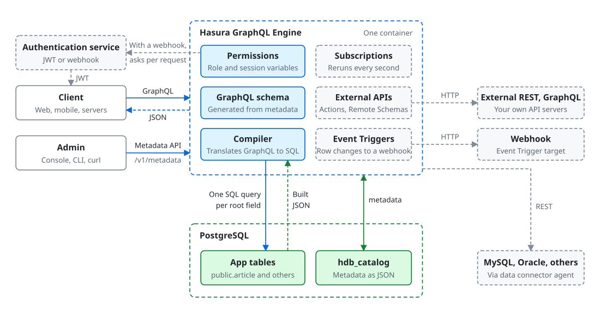
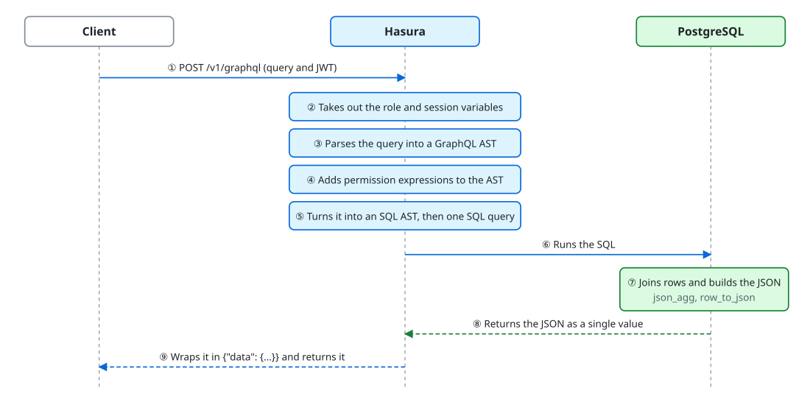
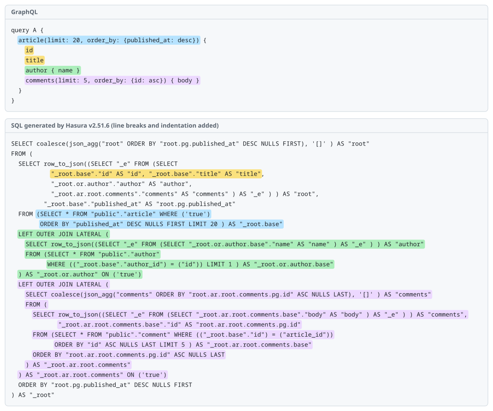
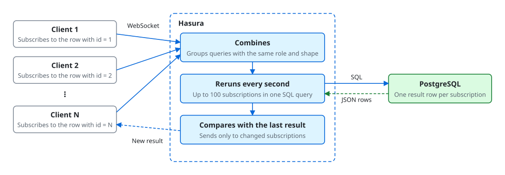

Title: How Hasura compiles a GraphQL query into one SQL query for PostgreSQL
Date: 2026-11-27 19:38
Updated: 2026-11-27 19:38
Lang: en
Original: /blog/2026/360ae9
Tags: hasura graphql postgresql performance


Hasura is a server that builds a GraphQL API from PostgreSQL tables.
I like it and use it, but until now I hadn't looked into how Hasura generates SQL.

Looking into it, I found that Hasura is a compiler with no resolvers: it builds a GraphQL schema from the definitions of tables, relationships, and permissions, and turns each incoming query into one SQL query.
PostgreSQL receives that SQL and does all the work of fetching rows, joining them, and building the JSON.

The SQL is long, so I also measured its speed.
Queries that fetch one page of data finished in the same time as hand-written SQL, and only a nested query that fetches tens of thousands of parents and children at once took about twice as long as the hand-written SQL.

This post covers v2 of the Hasura GraphQL Engine, and Hasura v2.51.6 connected to PostgreSQL 17.11 generated all the SQL shown here.


# Architecture



Every setup runs the Hasura container and PostgreSQL, and every request goes through permission checks, GraphQL schema generation, and translation from GraphQL to SQL (the blue parts of the diagram).

The metadata decides the shape of the API.
The metadata defines the tables to expose, the relationships between tables, and the permissions for each role, and when you register it from the Console, the CLI, or the Metadata API, Hasura stores it as JSON in a PostgreSQL schema called `hdb_catalog`.
According to the [official documentation](https://hasura.io/docs/2.0/getting-started/how-it-works/index/#tracking-tables--schema-generation), when you register one table, Hasura creates its type and fields to query it, fetch a row by primary key, aggregate, insert, update, delete, and subscribe.

The parts with dotted lines in the diagram run only when you configure them.
[Authentication](https://hasura.io/docs/2.0/auth/overview/) happens outside Hasura, and Hasura receives the role and session variables through a JWT or a webhook.
Actions and Remote Schemas add external APIs to the schema, and Event Triggers send row changes to a webhook.
Hasura connects to MySQL, Oracle, and other databases through a service called a [data connector agent](https://hasura.io/docs/2.0/databases/data-connectors/).


# The path of one query



For each query a client sends, Hasura builds the SQL in steps ② to ⑤ of the diagram.
Hasura's [design document](https://github.com/hasura/graphql-engine/blob/master/architecture/live-queries.md) describes these steps: ② takes out the role and session variables, ③ parses the query into a GraphQL AST, ④ adds each role's permission expressions to the AST, and ⑤ turns that AST into an SQL AST and then into an SQL string.

Hasura runs one SQL query per root field, so a query with one root field becomes one SQL query.
PostgreSQL returns the result JSON as a single value, and Hasura wraps it in `data` to build the response.
For a query that fetches 2,000 authors with their articles and comments, the SQL result was 8,423,123 bytes and the HTTP response was 8,423,143 bytes, and the 20-byte difference was `data` and the field name at the start and end of the response.

A server whose resolvers fetch data field by field runs one child SQL query for each parent row, which is the N+1 problem.
The design document describes the [idea of compiling the whole query into one SQL query](https://github.com/hasura/graphql-engine/blob/master/architecture/live-queries.md#idea-1-compile-a-graphql-query-to-a-single-sql-query) like this:

> Part of Hasura is a transpiler that uses the metadata of mapping information for the data models to the GraphQL schema to “compile” GraphQL queries to the SQL queries to fetch data from the database.
> 
> GraphQL query → GraphQL AST → SQL AST → SQL
> 
> This gets rid of the N+1 query problem and allows the database to optimise data-fetching now that it can see the entire query.

The N+1 problem goes away, and the database can optimize the query because it sees all of it.


# How GraphQL maps to SQL

To test this, I created three tables: authors, articles, and comments.
I sent a query that fetches the 20 newest articles by publication date, with each author's name and the first 5 comments, to the [Explain API](https://hasura.io/docs/2.0/api-reference/explain/), which returns the SQL that Hasura generates.
In the next figure, the query I sent is at the top and the SQL that came back is at the bottom, and I added the line breaks and indentation to the SQL.



Each level of nesting in GraphQL becomes one subquery in SQL.
`LATERAL` joins the subqueries.
A subquery marked `LATERAL` can use columns of the row on its left in its conditions, and it produces a result for each row on the left.

-   The blue `article` and its arguments become a subquery that narrows the articles table with `ORDER BY` and `LIMIT 20`.
-   The yellow `id` and `title` are the columns passed to `row_to_json`.
-   The green `author` is a relationship from one article to one author, and it becomes a subquery with `LEFT OUTER JOIN LATERAL` and `LIMIT 1`.
-   The purple `comments` is a relationship from one article to many comments, and `json_agg` inside `LEFT OUTER JOIN LATERAL` turns the comment rows into an array.

The value of the outermost `json_agg`, which has no color, is the array in the response.


# Permissions

A permission defines, for each role, an expression that decides which rows the role can see.
As a test, I gave a role named `user` a permission to see only the articles the user wrote and the comments on those articles, and the condition on articles was that `author_id` equals the session variable `X-Hasura-User-Id`.

I sent the same query to the Explain API as a request with the role `user` and `X-Hasura-User-Id` set to 42, and the subquery for articles changed like this:

```sql
FROM (SELECT * FROM "public"."article"
      WHERE (("public"."article"."author_id") = (('42')::integer))
      ORDER BY "published_at" DESC NULLS FIRST LIMIT 20 ) AS "_root.base"
```

The permission expression is in the place where the first SQL, generated with the admin role, had `WHERE ('true')`.
The subquery for comments gained the permission expression for comments as an `EXISTS`.
The part to look at is `("__be_0_article"."author_id") = (('42')::integer)` on line 5, which checks that the author of the comment's article is 42.

```sql
FROM (SELECT * FROM "public"."comment"
      WHERE ((("_root.base"."id") = ("article_id"))
        AND (EXISTS (SELECT 1 FROM "public"."article" AS "__be_0_article"
          WHERE (((("__be_0_article"."id") = ("public"."comment"."article_id")) AND ('true'))
            AND (('true') AND (((("__be_0_article"."author_id") = (('42')::integer))
              AND ('true')) AND ('true')))) )))
      ORDER BY "id" ASC NULLS LAST LIMIT 5 ) AS "_root.ar.root.comments.base"
```

Hasura puts a permission expression into each subquery that reads a table, and when I counted articles with this role, it saw 20 of the 200,000.


# Subscriptions



Subscriptions run on the same mechanism of compiling to one SQL query.
This section covers the kind of Hasura subscription called a live query, and according to the [official documentation](https://hasura.io/docs/2.0/subscriptions/postgres/livequery/execution/), Hasura reruns each subscribed query at a fixed interval (1 second by default) and sends a new result only to the subscriptions whose result changed since the last run.
Hasura also [combines up to 100 subscriptions into one SQL query](https://hasura.io/docs/2.0/subscriptions/postgres/livequery/execution/#subscription-multiplexing) when they have the same role and shape and differ only in their variables.

I sent the Explain API a query that subscribes to one article with its id as a variable and got the following SQL (the `...` lines are parts I left out).

```sql
SELECT "__subs"."result_id" , "__fld_resp"."root" AS "result"
FROM UNNEST(($1)::uuid[], ($2)::json[]) AS "__subs"("result_id", "result_vars")
LEFT OUTER JOIN LATERAL (
  ...
      FROM (SELECT * FROM "public"."article"
            WHERE (("public"."article"."id") =
                   ((("__subs"."result_vars"#>>ARRAY['query', 'id']))::integer)) ) AS "_root.base"
  ...
) AS "__fld_resp" ON ('true')
```

`$1` is an array of subscription IDs and `$2` is an array of each subscription's variables, `UNNEST` turns the two into a table with one row per subscription, and the query inside `LATERAL` narrows the articles with each row's variables, so the results also come back one per row.


# How fast the single SQL query is

The generated SQL is long, so I measured whether it runs slower than hand-written SQL.
The data was 10,000 authors, 200,000 articles, and 1,000,000 comments, with indexes on the foreign key columns, the role was admin, and Hasura and PostgreSQL ran in Docker containers limited to 2 CPU cores each.

I measured these three queries:

-   A is the query from "How GraphQL maps to SQL", which fetches 20 articles with their authors and 5 comments each.
-   B fetches 50,000 articles with their authors.
-   C fetches 2,000 authors with their 40,000 articles nested inside and the 200,000 comments on those articles nested inside the articles.

I wrote hand-written SQL with JOINs and `json_build_object` that returns the same data, ran each SQL query 15 times with psql, and put the median times in the following table.

<table border="2" cellspacing="0" cellpadding="6" rules="groups" frame="hsides">


<colgroup>
<col  class="org-left" />

<col  class="org-left" />

<col  class="org-left" />

<col  class="org-left" />
</colgroup>
<thead>
<tr>
<th scope="col" class="org-left">Query</th>
<th scope="col" class="org-left">Response size</th>
<th scope="col" class="org-left">Hasura's SQL</th>
<th scope="col" class="org-left">Hand-written SQL</th>
</tr>
</thead>
<tbody>
<tr>
<td class="org-left">A</td>
<td class="org-left">4.8KB</td>
<td class="org-left">1.7ms</td>
<td class="org-left">1.5ms</td>
</tr>

<tr>
<td class="org-left">B</td>
<td class="org-left">3.4MB</td>
<td class="org-left">71.7ms</td>
<td class="org-left">81.4ms</td>
</tr>

<tr>
<td class="org-left">C</td>
<td class="org-left">8.4MB</td>
<td class="org-left">689ms</td>
<td class="org-left">358ms</td>
</tr>
</tbody>
</table>

The difference for A is 0.2ms and the ranges of the 15 runs overlap, Hasura's SQL finished faster for B, and only C took about twice as long as the hand-written SQL.

C is slow because PostgreSQL ran the relationship subqueries once for each parent row.
These lines from the `EXPLAIN (ANALYZE)` of C, with the costs and times removed, show that PostgreSQL read the articles table 2,000 times and the comments table 40,000 times (`loops` is the number of runs).

```text
->  Aggregate  (rows=1 loops=2000)
      ->  Nested Loop Left Join  (rows=20 loops=2000)
            ->  Bitmap Heap Scan on article  (rows=20 loops=2000)
            ->  Aggregate  (rows=1 loops=40000)
                  ->  Bitmap Heap Scan on comment  (rows=5 loops=40000)
```

For the hand-written SQL, PostgreSQL joined the three tables with Hash Joins and read the comments table only once.

A bulk fetch like C gets faster when you drop the nesting and use three root fields side by side.

```graphql
query D {
  author(limit: 2000, order_by: {id: asc}) { id name }
  article(where: {author_id: {_lte: 2000}}) { id title author_id }
  comment(where: {article: {author_id: {_lte: 2000}}}) { article_id body }
}
```

A relationship in the `where` of `comment` becomes an `EXISTS` subquery in SQL, and PostgreSQL chose a Hash Join for it.
The client builds the nesting from `author_id` and `article_id`.
This works only when you can also write the condition that selects the parents in the children's `where`, and in this data the author ids run in order from 1, so the condition `author_id` of 2000 or less selected the same authors as `limit: 2000`, which selects the first 2,000.

You can also register the hand-written SQL in Hasura as a [Native Query](https://hasura.io/docs/2.0/schema/postgres/native-queries/), but then the articles and comments come back as one field of type `json`, and GraphQL can't select the fields inside it.

Here are the median times of 15 runs, sending each query to Hasura over HTTP:

<table border="2" cellspacing="0" cellpadding="6" rules="groups" frame="hsides">


<colgroup>
<col  class="org-left" />

<col  class="org-left" />

<col  class="org-left" />
</colgroup>
<thead>
<tr>
<th scope="col" class="org-left">Approach</th>
<th scope="col" class="org-left">Time</th>
<th scope="col" class="org-left">Response size</th>
</tr>
</thead>
<tbody>
<tr>
<td class="org-left">Nested</td>
<td class="org-left">699ms</td>
<td class="org-left">8.4MB</td>
</tr>

<tr>
<td class="org-left">Separate root fields</td>
<td class="org-left">280ms</td>
<td class="org-left">12.5MB</td>
</tr>

<tr>
<td class="org-left">Native Query</td>
<td class="org-left">375ms</td>
<td class="org-left">9.1MB</td>
</tr>
</tbody>
</table>

For page-sized queries that feed a screen, the length of the generated SQL had no effect on speed, so I think the queries worth rewriting are the ones that fetch tens of thousands of parents and children at once, such as exports and aggregations.


# How to find out

Queries with permission expressions and subscriptions both ended up as one SQL query, so when you can't tell what Hasura does, you can find out by reading the SQL that the Explain API returns.

