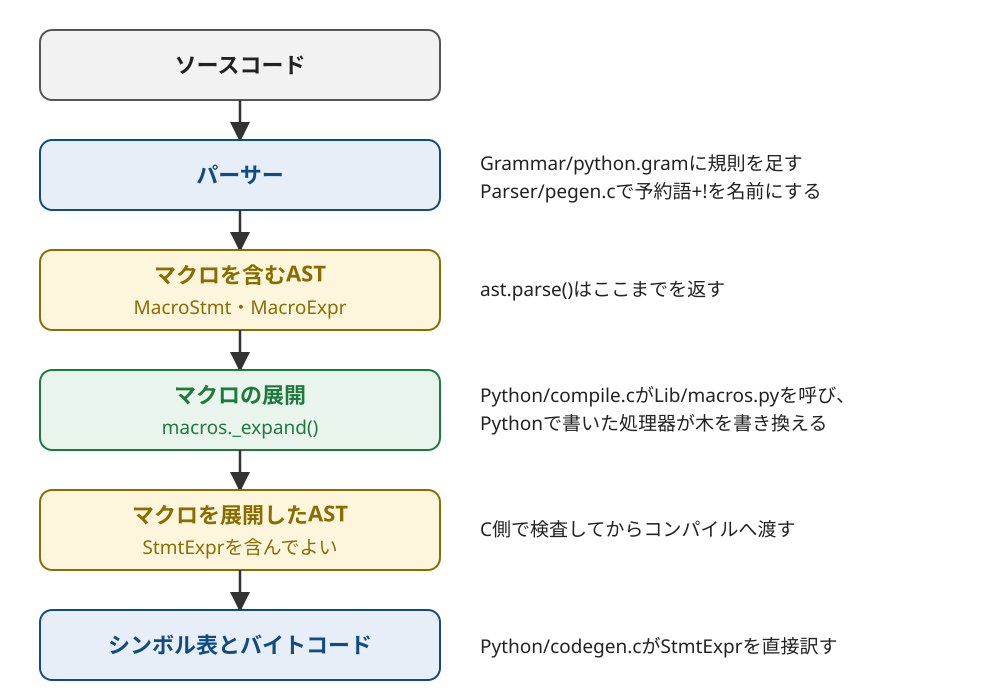

Title: cpython-pep638: PEP 638 syntactic macros for Python, implemented in CPython 3.15.2
Date: 2026-11-28 09:02
Updated: 2026-11-28 09:02
Draft: true
Lang: en
Original: /blog/2026/f4154e
Tags: python cpython pep macro ast compiler release cpython-pep638


[PEP 638](https://peps.python.org/pep-0638/) proposes syntactic macros for Python.
You write a macro in the form `name!`, and at compile time a function written in Python expands it and rewrites the AST.

I implemented this PEP in CPython 3.15.2.
I added rules to the parser and one layer that hands the AST to a Python function before compilation, and with those two changes macros run in CPython itself.

The repository is [conao3/cpython-pep638](https://github.com/conao3/cpython-pep638), and it stacks the implementation commits on the [v3.15.2](https://github.com/python/cpython/tree/v3.15.2) tag of python/cpython.
It derives from CPython, so it uses the same license, the PSF License Version 2, but it is my own experiment and has no connection to the CPython project.

<div class="github-card" data-repo="conao3/cpython-pep638"><a href="https://github.com/conao3/cpython-pep638"><span class="github-card-name"><svg class="github-card-mark" viewBox="0 0 16 16" aria-hidden="true"><path d="M6.766 11.328c-2.063-.25-3.516-1.734-3.516-3.656 0-.781.281-1.625.75-2.188-.203-.515-.172-1.609.063-2.062.625-.078 1.468.25 1.968.703.594-.187 1.219-.281 1.985-.281.765 0 1.39.094 1.953.265.484-.437 1.344-.765 1.969-.687.218.422.25 1.515.046 2.047.5.593.766 1.39.766 2.203 0 1.922-1.453 3.375-3.547 3.64.531.344.89 1.094.89 1.954v1.625c0 .468.391.734.86.547C13.781 14.359 16 11.53 16 8.03 16 3.61 12.406 0 7.984 0 3.563 0 0 3.61 0 8.031a7.88 7.88 0 0 0 5.172 7.422c.422.156.828-.125.828-.547v-1.25c-.219.094-.5.156-.75.156-1.031 0-1.64-.562-2.078-1.609-.172-.422-.36-.672-.719-.719-.187-.015-.25-.093-.25-.187 0-.188.313-.328.625-.328.453 0 .844.281 1.25.86.313.452.64.655 1.031.655s.641-.14 1-.5c.266-.265.47-.5.657-.656"/></svg><span>conao3/<strong>cpython-pep638</strong></span></span><span class="github-card-description">CPython 3.15.2 with PEP 638 syntactic macros</span><span class="github-card-footer"><span class="github-card-language"><span class="github-card-language-color"></span>Python</span><span class="github-card-star"><svg viewBox="0 0 16 16" aria-hidden="true"><path d="M8 .25a.75.75 0 0 1 .673.418l1.882 3.815 4.21.612a.75.75 0 0 1 .416 1.279l-3.046 2.97.719 4.192a.751.751 0 0 1-1.088.791L8 12.347l-3.766 1.98a.75.75 0 0 1-1.088-.79l.72-4.194L.818 6.374a.75.75 0 0 1 .416-1.28l4.21-.611L7.327.668A.75.75 0 0 1 8 .25Z"/></svg><span>Star</span><span class="github-card-star-count" hidden></span></span></span></a></div>


# Writing and using a macro

A macro processor is a Python function that you mark with a decorator from the `macros` module.
It receives the AST of the macro and returns the AST that replaces it.

```python
# mymacros.py
import ast
import macros

@macros.macro_processor(macros.STMT_MACRO, 1, "finally")
def try_(node, finally_):
    return ast.Try(body=node.body, handlers=[], orelse=[],
                   finalbody=finally_.body)

@macros.macro_processor(macros.EXPR_MACRO, 1)
def quote(node):
    return ast.Constant(ast.unparse(node.args[0]))
```

`try_` is a statement macro that takes the `finally!:` clause after it as its second argument, and `quote` is an expression macro that turns its argument expression into a source string.

In the code that uses the macros, `from!` imports the processors.

```python
# main.py
from! mymacros import try_
from! mymacros import quote

def read(log):
    try_!:
        return quote!(a + b * c)
    finally!:
        log.append("closed")

log = []
print(read(log), log)
```

I run this with the `python` built from this repository.

```console
$ ./python main.py
a + b * c ['closed']
```

`quote!(a + b * c)` became the string `'a + b * c'`, and `try_!` became a `try` statement with a `finally` clause.
Neither `a` nor `b` is defined, but the macro replaces the expression with a string before Python can evaluate it, so you get no error.


# Macro syntax

A macro name is an identifier followed by `!` with no space between them, and a keyword followed by `!`, such as `from!` or `finally!`, is also a macro name.

[Statement macros](https://peps.python.org/pep-0638/#statement-form) take this form.

```text
name! [引数] [import NAME] [as NAME] [: ブロック]
```

An expression macro takes the form `name!(引数)`, but [the statement form takes precedence at the start of a line](https://peps.python.org/pep-0638/#resolving-ambiguity).
Inside an f-string, I kept the `!` in `f"{x!r}"` as the conversion specifier.

There are three [kinds of macro processors](https://peps.python.org/pep-0638/#defining-macro-processors).

-   **`STMT_MACRO`:** A statement macro. It receives the indented block as `body`.
-   **`SIBLING_MACRO`:** A statement macro without a block. It receives the next statement in the same block as `body`.
-   **`EXPR_MACRO`:** An expression macro.

If you use a macro you haven't imported, compilation fails with a `SyntaxError`.

```console
$ cat undefined.py
print(quote!(a + b))
$ ./python undefined.py
  File "/path/to/undefined.py", line 1
    print(quote!(a + b))
          ^^^^^^^^^^^^^
SyntaxError: macro quote! is not defined
```


# The layer that expands macros

CPython parses the source into an AST and builds the symbol table and the bytecode from that AST, so I put macro expansion at the point where the compiler starts turning the AST into bytecode.



The parser keeps each macro in the tree as an `ast.MacroStmt` or `ast.MacroExpr` node, and the compiler walks the tree in C to look for macros.
If it finds one, it converts the tree into Python objects and passes them to `macros._expand()`, which calls the processors from the outermost macro inward and expands the trees those processors return as well.

The compiler converts the expanded tree back into C structs, validates it, and passes it on to the symbol table and bytecode generation.

Expansion runs on every compilation, so macros work through `import`, `exec()`, and `compile()` alike, and since `ast.parse()` returns the tree before expansion, you can inspect the macro nodes as the parser left them.

```console
$ ./python -c 'import ast; print(ast.dump(ast.parse("quote!(a)").body[0]))'
MacroStmt(name='quote', args=[Name(id='a')])
```

`quote!(a)` sits at the start of the line, so the parser reads it as a statement macro.

A layer in front of the parser decides how to treat keywords.
CPython's parser receives `finally` as a keyword token and can't read `finally!` as a name, so when the next character is `!`, I made that layer skip the keyword check and keep the token as a name.

If `!=` follows, as in `x!=y`, the parser reads it as the comparison operator.


# StmtExpr: running a statement inside an expression

Some expression macros need to run a statement before they compute their value.
The [PEP](https://peps.python.org/pep-0638/#ast-extensions) defines a `stmt_expr` node for this, and this implementation provides it as `ast.StmtExpr(stmt, value)`, which runs `stmt`, then evaluates `value` and uses that as the value of the expression.

> A new AST node called `stmt_expr` will be added, combining a statement and an expression. This new ast node will be a subtype of `expr`, but include a statement to allow side effects. It will be compiled to bytecode by compiling the statement, then compiling the value.

As a test, I write `debug!`, which prints an expression and its value and then returns the value.

```python
# mymacros.py に足す
@macros.macro_processor(macros.EXPR_MACRO, 1)
def debug(node):
    tmp = f"$$debug_{node.lineno}_{node.col_offset}"
    label = ast.unparse(node.args[0]) + " ="
    show = ast.If(ast.Constant(True), [
        ast.Assign([ast.Name(tmp, ast.Store())], node.args[0]),
        ast.Expr(ast.Call(ast.Name("print", ast.Load()),
                          [ast.Constant(label), ast.Name(tmp, ast.Load())],
                          [])),
    ], [])
    return ast.StmtExpr(show, ast.Name(tmp, ast.Load()))
```

For the `debug!` on line 3 of `debug.py`, the variable name becomes `$$debug_3_11`.
This follows [the naming that the PEP recommends to avoid collisions](https://peps.python.org/pep-0638/#hygiene-and-debugging), and you can't write such a name in source code, so it can't clash with your variables.

> -   All generated variable names should start with a `$`
> -   Purely artificial variable names should start `$$mname` where `mname` is the name of the macro.
> -   Variables derived from real variables should start `$vname` where `vname` is the name of the variable.
> -   All variable names should include the line number and the column offset, separated by an underscore.

```python
# debug.py
from! mymacros import debug

squares = [debug!(x * x) for x in range(3)]
print(squares)
print(True or debug!(1 / 0))
```

```console
$ ./python debug.py
x * x = 0
x * x = 1
x * x = 4
[0, 1, 4]
True
```

Python evaluates `debug!` where it sits, both inside the comprehension and on the right of `or`, and it skips the right side of `True or ...`, so `1 / 0` doesn't run and stop the program.
The compiler translates `StmtExpr` into bytecode itself, so the statement runs where you place the macro, in Python's evaluation order.

If a `break`, `continue`, or `return` inside `stmt` leaves the `StmtExpr`, control jumps out in the middle of an expression and leaves values on the stack, so the compiler rejects such a tree with a `SyntaxError`.

```python
# escape.py
import ast

tree = ast.parse("for x in y:\n    f(E)\n")
call = tree.body[0].body[0].value
call.args[0] = ast.StmtExpr(ast.Break(), ast.Constant(None))
ast.fix_missing_locations(tree)
compile(tree, "<ast>", "exec")
```

```console
$ ./python escape.py
Traceback (most recent call last):
  File "/path/to/escape.py", line 7, in <module>
    compile(tree, "<ast>", "exec")
    ~~~~~~~^^^^^^^^^^^^^^^^^^^^^^^
  File "<ast>", line 2
SyntaxError: 'break', 'continue' and 'return' cannot leave a statement expression
```


# Differences from the PEP

This implementation differs from the text of the PEP in these ways.

-   The AST class names follow CPython's naming: `MacroStmt`, `MacroExpr`, and `StmtExpr`.
-   The parser reads the block of a statement macro as Python statements. A line such as `"red" = 1` in the PEP's [bijection! example](https://peps.python.org/pep-0638/#compile-time-checked-data-structures) is a syntax error.
-   The [PEP](https://peps.python.org/pep-0638/#lexical-analysis) specifies the macro name as a single `MACRO_NAME` token, but `tokenize` returns it as two tokens, `NAME` and `!`.
-   The [PEP](https://peps.python.org/pep-0638/#defining-macro-processors) defines the `version` of a processor as the number that lets Python rebuild cached bytecode correctly. This implementation checks that `version` is an integer, but it doesn't rebuild cached bytecode when you change a processor.

The `bijection!` example in the PEP looks like this.

```python
bijection! color_to_code, code_to_color:
    "red" = 1
    "blue" = 2
    "green" = 3
```


# Trying it

You build it the same way as CPython, and with Nix, `nix develop nixpkgs#python315` gives you everything the build needs.

```console
$ git clone https://github.com/conao3/cpython-pep638
$ cd cpython-pep638
$ ./configure --with-pydebug
$ make -j
$ ./python -m test test_macros
```

All 32 tests in `test_macros` pass, and the full CPython test suite passes as well, except for one test in `test_profiling` that checks the executable name of a child process and fails in the Nix environment.

The [Where the implementation lives](https://github.com/conao3/cpython-pep638#where-the-implementation-lives) section of the repository README lists what I added and where.

