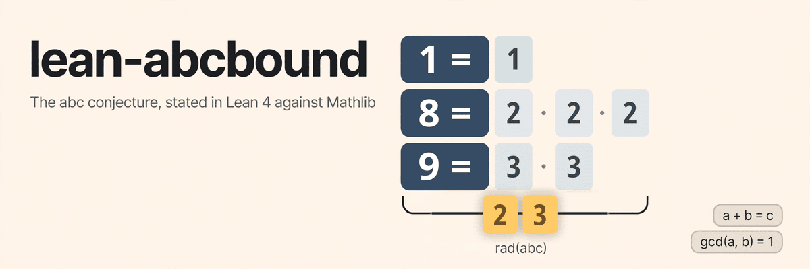

Title: lean-abcbound: the open abc conjecture stated in Lean 4 against Mathlib, with theorems that check the statement
Date: 2026-11-27 22:57
Updated: 2026-11-27 22:57
Draft: true
Lang: en
Original: /blog/2026/2f5c9f
Tags: lean mathlib formal-verification abc-conjecture release lean-abcbound


The abc conjecture is an open problem in number theory, and I made [lean-abcbound](https://github.com/conao3/lean-abcbound) to state it as a proposition in Lean 4 against Mathlib and to check with theorems that the proposition says what we intend.
Since the conjecture is still open, lean-abcbound holds the proposition `Abc.ABCConjecture` and theorems about how that proposition is written.

Lean's kernel checks only that a proof is a proof of the proposition it claims, so whether the proposition matches the conjecture is something people decide by reading it.
The theorems in lean-abcbound show that the proposition becomes false when you drop one of its hypotheses and that it is equivalent to the conjecture written in other forms, and they are the material for that decision.

The license is Apache-2.0, and the repository uses Lean v4.35.0 and Mathlib v4.35.0.
The code and output in this post come from [8ed08da](https://github.com/conao3/lean-abcbound/commit/8ed08da1fac8268b64014e155874b91263acbad3), the master branch at the time of writing.

<div class="github-card" data-repo="conao3/lean-abcbound"><a href="https://github.com/conao3/lean-abcbound"><span class="github-card-name"><svg class="github-card-mark" viewBox="0 0 16 16" aria-hidden="true"><path d="M6.766 11.328c-2.063-.25-3.516-1.734-3.516-3.656 0-.781.281-1.625.75-2.188-.203-.515-.172-1.609.063-2.062.625-.078 1.468.25 1.968.703.594-.187 1.219-.281 1.985-.281.765 0 1.39.094 1.953.265.484-.437 1.344-.765 1.969-.687.218.422.25 1.515.046 2.047.5.593.766 1.39.766 2.203 0 1.922-1.453 3.375-3.547 3.64.531.344.89 1.094.89 1.954v1.625c0 .468.391.734.86.547C13.781 14.359 16 11.53 16 8.03 16 3.61 12.406 0 7.984 0 3.563 0 0 3.61 0 8.031a7.88 7.88 0 0 0 5.172 7.422c.422.156.828-.125.828-.547v-1.25c-.219.094-.5.156-.75.156-1.031 0-1.64-.562-2.078-1.609-.172-.422-.36-.672-.719-.719-.187-.015-.25-.093-.25-.187 0-.188.313-.328.625-.328.453 0 .844.281 1.25.86.313.452.64.655 1.031.655s.641-.14 1-.5c.266-.265.47-.5.657-.656"/></svg><span>conao3/<strong>lean-abcbound</strong></span></span><span class="github-card-description">The abc conjecture stated in Lean 4 against Mathlib</span><span class="github-card-footer"><span class="github-card-language"><span class="github-card-language-color"></span>Lean</span><span class="github-card-star"><svg viewBox="0 0 16 16" aria-hidden="true"><path d="M8 .25a.75.75 0 0 1 .673.418l1.882 3.815 4.21.612a.75.75 0 0 1 .416 1.279l-3.046 2.97.719 4.192a.751.751 0 0 1-1.088.791L8 12.347l-3.766 1.98a.75.75 0 0 1-1.088-.79l.72-4.194L.818 6.374a.75.75 0 0 1 .416-1.28l4.21-.611L7.327.668A.75.75 0 0 1 8 .25Z"/></svg><span>Star</span><span class="github-card-star-count" hidden></span></span></span></a></div>


# The statement of the abc conjecture

For a positive integer <span class="math" data-tex="bg=="></span>, <span class="math" data-tex="XG1hdGhybXtyYWR9KG4p"></span> is the product of the distinct primes that divide <span class="math" data-tex="bg=="></span>.
The abc conjecture compares <span class="math" data-tex="Yw=="></span> with <span class="math" data-tex="XG1hdGhybXtyYWR9KGFiYyk="></span> for coprime positive integers with <span class="math" data-tex="YSArIGIgPSBj"></span>, and for <span class="math" data-tex="MSArIDggPSA5"></span> we get <span class="math" data-tex="YWJjID0gNzIgPSAyXjMgXGNkb3QgM14y"></span>, so <span class="math" data-tex="XG1hdGhybXtyYWR9KDcyKSA9IDIgXGNkb3QgMyA9IDY="></span> and <span class="math" data-tex="YyA9IDk="></span> is larger.



There are infinitely many triples like this one where <span class="math" data-tex="Yw=="></span> is larger than <span class="math" data-tex="XG1hdGhybXtyYWR9KGFiYyk="></span>.
The conjecture says that for every <span class="math" data-tex="XHZhcmVwc2lsb24gPiAw"></span> there is a constant <span class="math" data-tex="Sw=="></span> such that <span class="math" data-tex="YyA8IEsgXGNkb3QgXG1hdGhybXtyYWR9KGFiYyleezErXHZhcmVwc2lsb259"></span> holds for every triple, and lean-abcbound writes this statement in [Abc/Statement.lean](https://github.com/conao3/lean-abcbound/blob/8ed08da1fac8268b64014e155874b91263acbad3/Abc/Statement.lean#L12-L18) as follows.

```lean
def rad (n : ℕ) : ℕ := ∏ p ∈ n.primeFactors, p

def ABCConjecture : Prop :=
  ∀ ε : ℝ, 0 < ε → ∃ K : ℝ, ∀ a b c : ℕ, 0 < a → 0 < b → a.Coprime b → a + b = c →
    (c : ℝ) < K * (rad (a * b * c) : ℝ) ^ (1 + ε)
```

`ABCConjecture` is a proposition (a `Prop`) defined with `def`.
The file imports Mathlib alone.


# Theorems that check the proposition says what we intend

The theorems that check how the proposition is written are in [Abc/Sanity.lean](https://github.com/conao3/lean-abcbound/blob/8ed08da1fac8268b64014e155874b91263acbad3/Abc/Sanity.lean) and [Abc/Equivalent.lean](https://github.com/conao3/lean-abcbound/blob/8ed08da1fac8268b64014e155874b91263acbad3/Abc/Equivalent.lean), and each of them says something about how the proposition is written and leaves the truth of the conjecture open.


## Dropping the coprimality hypothesis makes it false

The theorem that negates `ABCConjecture` with only the `a.Coprime b` hypothesis removed is [not\_bound\_without\_coprime](https://github.com/conao3/lean-abcbound/blob/8ed08da1fac8268b64014e155874b91263acbad3/Abc/Sanity.lean#L21-L25).

```lean
theorem not_bound_without_coprime :
    ¬ ∀ ε : ℝ, 0 < ε → ∃ K : ℝ, ∀ a b c : ℕ, 0 < a → 0 < b → a + b = c →
      (c : ℝ) < K * (rad (a * b * c) : ℝ) ^ (1 + ε)
```

Every triple <span class="math" data-tex="Ml5uICsgMl5uID0gMl57bisxfQ=="></span> has <span class="math" data-tex="XG1hdGhybXtyYWR9KGFiYykgPSAy"></span>, so <span class="math" data-tex="Yw=="></span> can grow without bound, and the inequality fails for every <span class="math" data-tex="Sw=="></span>.

If I had left out the coprimality hypothesis when writing the proposition, it would have been a proposition whose negation Lean can prove.
This theorem shows that the hypothesis changes what the proposition means.


## Equivalence with the conjecture written in other forms

The abc conjecture can be written in several forms, and DeepMind's [formal-conjectures](https://github.com/google-deepmind/formal-conjectures/blob/f606af160664c5a10952e9a957b100a1cd45bbeb/FormalConjectures/Wikipedia/ABC.lean#L68-L75) writes it in `abc.variants.lt_constant_mul` with the hypotheses that <span class="math" data-tex="YyA+IDA="></span> and that every two of <span class="math" data-tex="YQ=="></span>, <span class="math" data-tex="Yg=="></span>, <span class="math" data-tex="Yw=="></span> are coprime.
lean-abcbound copies these hypotheses into `ABCConjecturePairwise` and shows in [abcConjecture\_iff\_pairwise](https://github.com/conao3/lean-abcbound/blob/8ed08da1fac8268b64014e155874b91263acbad3/Abc/Equivalent.lean#L44) that it is equivalent to `ABCConjecture`.

lean-abcbound does not import formal-conjectures, so I compared the hypotheses by reading the two files side by side.
The other theorem, [abcConjecture\_iff\_finite](https://github.com/conao3/lean-abcbound/blob/8ed08da1fac8268b64014e155874b91263acbad3/Abc/Equivalent.lean#L107-L108), shows that `ABCConjecture` is equivalent to `ABCConjectureFinite`, the form that says for every <span class="math" data-tex="XHZhcmVwc2lsb24gPiAw"></span> only finitely many coprime triples satisfy <span class="math" data-tex="XG1hdGhybXtyYWR9KGFiYyleezErXHZhcmVwc2lsb259IDwgYw=="></span>.

```lean
theorem abcConjecture_iff_pairwise : ABCConjecture ↔ ABCConjecturePairwise
theorem abcConjecture_iff_finite : ABCConjecture ↔ ABCConjectureFinite
```

Both theorems connect forms of the conjecture without proving any of them, so if any one of the three forms holds, the other two hold as well.


## The definition of rad and concrete values

`rad_eq_radical` shows that `rad` agrees with Mathlib's `UniqueFactorizationMonoid.radical` on the natural numbers.
Concrete values such as <span class="math" data-tex="XG1hdGhybXtyYWR9KDEyKSA9IDY="></span> and <span class="math" data-tex="XG1hdGhybXtyYWR9KDEgXGNkb3QgOCBcY2RvdCA5KSA9IDY="></span> are checks that the kernel computes with `decide +kernel`, and the repository keeps them apart from the universally quantified theorems.


# Checking it in Lean

Put the following `Demo.lean` at the root of the repository and pass it to `lake env lean`, and Lean prints the value of `rad 72`, the type of the proposition, and the axioms a theorem depends on.
The last line confirms that there is no theorem named `Abc.abc`.

```lean
import Abc

#eval Abc.rad 72
#check Abc.ABCConjecture
#print axioms Abc.not_bound_without_coprime
#check Abc.abc
```

```console
$ nix develop --command lake env lean Demo.lean
6
Abc.ABCConjecture : Prop
'Abc.not_bound_without_coprime' depends on axioms: [propext, Classical.choice, Quot.sound]
Demo.lean:6:7: error(lean.unknownIdentifier): Unknown identifier `Abc.abc`
```

`Abc.abc` is the name reserved for a proof of the conjecture.
The repository counts the conjecture as proved when this theorem is in the library and its `#print axioms` output lists `propext`, `Classical.choice`, and `Quot.sound` only.


# The axiom audit

[Audit.lean](https://github.com/conao3/lean-abcbound/blob/8ed08da1fac8268b64014e155874b91263acbad3/Audit.lean) runs `#print axioms` on every theorem in the library, and `audit.expected` holds its output.
`make check` formats the flake, downloads the prebuilt Mathlib, runs `lake build`, and then compares this output with `audit.expected`.

```console
$ nix develop --command make check
nix fmt -- --ci
traversed 22 files
emitted 1 files for processing
formatted 1 files (0 changed) in 1.06s
lake exe cache get
Current branch: HEAD
Using cache from origin: (some leanprover-community/mathlib4)
No files to download
Already decompressed 9031 file(s)
lake build
⚠ [9047/9052] Replayed Abc.Statement
warning: Abc/Statement.lean: imports `Mathlib` from package `mathlib`, which is designed for use with the module system; consider adding `module` to the start of this file
Build completed successfully (9052 jobs).
lake env lean Audit.lean | diff -u audit.expected -
```

The final `diff` printed nothing, so the audit output matches `audit.expected`.
A `sorry` left in a proof would add `sorryAx` to the `#print axioms` output and make the comparison fail.
CI runs the same comparison, which confirms that each of the 17 theorems depends on those three axioms only.


# Toward a proof

[docs/roadmap.md](https://github.com/conao3/lean-abcbound/blob/8ed08da1fac8268b64014e155874b91263acbad3/docs/roadmap.md) lists the next theorems that can be worked on inside this repository with Mathlib alone.
Two examples are that the inequality fails for every <span class="math" data-tex="Sw=="></span> once the exponent <span class="math" data-tex="MSArIFx2YXJlcHNpbG9u"></span> is replaced by 1, and that the conjecture implies <span class="math" data-tex="eF5uICsgeV5uID0gel5u"></span> has no coprime positive solutions for all large <span class="math" data-tex="bg=="></span>.
Each of them has only a planned argument so far and is not yet a theorem.

The repository is at <https://github.com/conao3/lean-abcbound>.
Issues and PRs are welcome.

