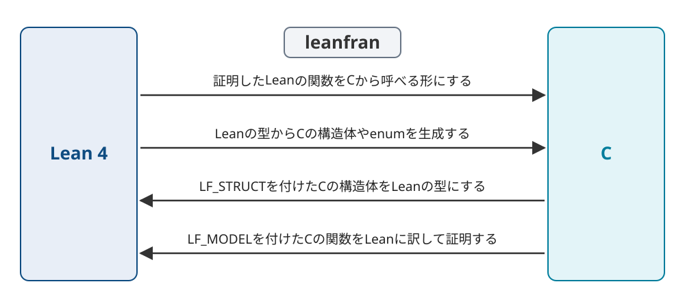

Title: Lean 4で証明した関数をCから呼べて、Cの関数をLeanに訳して証明できるleanfranのC版を作った
Date: 2026-11-27 09:54
Updated: 2026-11-27 09:54
Draft: true
Tags: lean c formal-verification code-generation release lean-leanfran


Lean 4で書いて証明した関数をCから呼べるようにするleanfranのC版を作りました。
Cで書いた関数をLeanに翻訳して、翻訳した定義が仕様を満たすことも証明できます。

LeanからCへの向きではLeanコンパイラが出力するCにleanfranが公開ヘッダーと値の変換を加えます。
逆向きではClangがCの構文を木として表したJSONを出力し、その抽象構文木からleanfranがLeanの定義を作ります。

リポジトリは [conao3/lean-leanfranのlangs/C](https://github.com/conao3/lean-leanfran/tree/95f3161cfd5cf8c1d0f0d2812c6e7bd1a48173d9/langs/C) で、ライセンスは [Apache-2.0](https://github.com/conao3/lean-leanfran/blob/95f3161cfd5cf8c1d0f0d2812c6e7bd1a48173d9/LICENSE) です。
Nixでビルドできて、この記事ではmasterの [95f3161](https://github.com/conao3/lean-leanfran/commit/95f3161cfd5cf8c1d0f0d2812c6e7bd1a48173d9) からビルドしたleanfran-c 0.13.3とLean 4.35.0を使いました。

ほかの言語での使い方は [leanfranの紹介記事](https://s.conao3.com/blog/2026/23d62c) と [PHP版の記事](https://s.conao3.com/blog/2026/ec8faf)、 [Go版の記事](https://s.conao3.com/blog/2026/ad14a8) に書いています。

<div class="github-card" data-repo="conao3/lean-leanfran"><a href="https://github.com/conao3/lean-leanfran"><span class="github-card-name"><svg class="github-card-mark" viewBox="0 0 16 16" aria-hidden="true"><path d="M6.766 11.328c-2.063-.25-3.516-1.734-3.516-3.656 0-.781.281-1.625.75-2.188-.203-.515-.172-1.609.063-2.062.625-.078 1.468.25 1.968.703.594-.187 1.219-.281 1.985-.281.765 0 1.39.094 1.953.265.484-.437 1.344-.765 1.969-.687.218.422.25 1.515.046 2.047.5.593.766 1.39.766 2.203 0 1.922-1.453 3.375-3.547 3.64.531.344.89 1.094.89 1.954v1.625c0 .468.391.734.86.547C13.781 14.359 16 11.53 16 8.03 16 3.61 12.406 0 7.984 0 3.563 0 0 3.61 0 8.031a7.88 7.88 0 0 0 5.172 7.422c.422.156.828-.125.828-.547v-1.25c-.219.094-.5.156-.75.156-1.031 0-1.64-.562-2.078-1.609-.172-.422-.36-.672-.719-.719-.187-.015-.25-.093-.25-.187 0-.188.313-.328.625-.328.453 0 .844.281 1.25.86.313.452.64.655 1.031.655s.641-.14 1-.5c.266-.265.47-.5.657-.656"/></svg><span>conao3/<strong>lean-leanfran</strong></span></span><span class="github-card-description">Write functions and proofs in Lean 4 and generate Rust, Python, TypeScript, Clojure, PHP, Go and C code from them</span><span class="github-card-footer"><span class="github-card-language"><span class="github-card-language-color"></span>Lean</span><span class="github-card-star"><svg viewBox="0 0 16 16" aria-hidden="true"><path d="M8 .25a.75.75 0 0 1 .673.418l1.882 3.815 4.21.612a.75.75 0 0 1 .416 1.279l-3.046 2.97.719 4.192a.751.751 0 0 1-1.088.791L8 12.347l-3.766 1.98a.75.75 0 0 1-1.088-.79l.72-4.194L.818 6.374a.75.75 0 0 1 .416-1.28l4.21-.611L7.327.668A.75.75 0 0 1 8 .25Z"/></svg><span>Star</span><span class="github-card-star-count" hidden></span></span></span></a></div>


# Lean 4とCの間でできること



-   Leanで書いた関数と定理をまとめてビルドして、生成したヘッダーとライブラリを使ってCから関数を呼ぶ。
-   Leanの構造体や帰納型をCの構造体やenum、tag付きunionとして受け渡す。
-   Cの構造体に `LF_STRUCT` を付けてLeanの構造体として使う。
-   Cの関数に `LF_MODEL` を付けてLeanに翻訳し、翻訳した定義が仕様を満たすことをLeanで証明する。


# CのプロジェクトにLeanを書く

leanfranのリポジトリで `nix build .#c` を実行して `result/bin` をPATHに加えます。
NixOSでは同じリポジトリの `nix develop .#c` に入るとLeanとClangも使えます。

新しいCのプロジェクトを作り、そのルートに `leanfran.toml` を置きます。
この設定で `src/` 以下のCファイルを読みます。

```toml
sources = ["src/**/*.c"]
```

`src/shipping.c` のコメントに送料を計算するLeanの関数を書きます。
重量が1000以下なら送料が300になることを定理にして、同じファイルの `main` から生成した関数を呼んでみます。

```c
/* leanfran:lean shipping
def shippingFee (weight : UInt32) : UInt32 :=
  if weight ≤ 1000 then 300 else 600

theorem shippingFee_light (w : UInt32) (h : w ≤ 1000) :
    shippingFee w = 300 := by simp [shippingFee, h]
*/
#include "shipping.h"
#include <inttypes.h>
#include <stdio.h>

int main(void) {
    uint32_t fee;
    if (shipping_init(NULL) != LF_OK ||
        shipping_shipping_fee(1000, &fee, NULL) != LF_OK) {
        return 1;
    }
    printf("%" PRIu32 "\n", fee);
    return 0;
}
```

`leanfran-c sync` はコメントの中のLeanをビルドします。
定理の証明に失敗すると書き出しも止まり、ビルドが通ると `shipping.h` と静的ライブラリが生成されるので、pkg-configでリンクに必要な設定を取ってCをコンパイルします。

```sh
leanfran-c sync
cc -std=c11 src/shipping.c $(pkg-config --cflags --libs leanfran/leanfran.pc) \
  -o shipping-demo
./shipping-demo
```

`sync` の末尾とプログラムの出力はこうなりました。

    synced 1 Lean blocks
    300

Cの `main` では最初に `shipping_init` でLeanのランタイムを初期化します。
生成した関数は処理の成否を戻り値で知らせ、成功したときは計算結果を `fee` に書き込みます。

すでにLeanのライブラリがある場合は [Cガイドのgenerateとbuild](https://github.com/conao3/lean-leanfran/blob/95f3161cfd5cf8c1d0f0d2812c6e7bd1a48173d9/docs/c-guide.md#generate-and-build) のように、 `leanfran-c generate` で公開する関数を選んで `leanfran-c build` でライブラリを作れます。
Cのプロジェクトで使う `leanfran-c status` は生成物や証明が入力に対して最新かを確かめます。


# LeanとCの間で型を受け渡す

`UInt32` はCの `uint32_t` になり、Leanの構造体ではデータを持つフィールドがCの構造体のフィールドになります。
構造体の証明フィールドに書いた条件はCから渡した値をLeanの値に変換するときに検査します。

帰納型では選択肢をコンストラクタとして定義できます。
各コンストラクタが名前だけを持つ型はCの `enum` になり、値を持つコンストラクタがあればどの選択肢かを表す `tag` とその値を格納する `union` を持つ構造体になります。

逆にCで定義した構造体をLeanから使うときは `LF_STRUCT` に取り込むLeanブロックの名前を渡します。
たとえば注文の個数のフィールドに `LF_FIELD("ge=1")` を付けると、leanfranはLeanの構造体に個数が1以上であることを表す証明フィールドを加えます。

型の対応とC側のメモリの扱いは [Cガイドの公開型の節](https://github.com/conao3/lean-leanfran/blob/95f3161cfd5cf8c1d0f0d2812c6e7bd1a48173d9/docs/c-guide.md#public-types) に、Cの構造体を取り込む例は [LF\_STRUCTの節](https://github.com/conao3/lean-leanfran/blob/95f3161cfd5cf8c1d0f0d2812c6e7bd1a48173d9/docs/c-guide.md#use-c-structs-in-lean) に載せています。


# Cの関数をLeanに翻訳して証明する

今度は新しいCのプロジェクトに同じ `leanfran.toml` を置き、 `src/clamp.c` に値を上下限の間に収める関数を書きます。
下限より小さければ下限を、上限より大きければ上限を返して、それ以外では入力をそのまま返す関数です。

Leanブロックの `spec` に期待する戻り値を書き、 `ordered` で下限が上限以下という前提を表します。
`LF_MODEL` の `refines` に仕様の名前を指定し、 `requires` に前提の名前を指定します。

```c
/* leanfran:lean clamp
def spec (lo hi x : Int32) : Int32 :=
  if x < lo then lo else if hi < x then hi else x

def ordered (lo hi _x : Int32) : Bool := lo ≤ hi
*/
#include "leanfran.h"

LF_MODEL("refines=spec", "requires=ordered")
int32_t clamp(int32_t lo, int32_t hi, int32_t x) {
    if (x < lo)
        return lo;
    if (hi < x)
        return hi;
    return x;
}
```

証明を書く前にCの戻り値とLeanで計算した仕様の値を比べます。
`sync` が生成するテストはUBSanを有効にしてCをコンパイルし、前提を満たす境界値とシード付きの乱数を使って2つの値を比較します。

```sh
leanfran-c sync
make -f leanfran/leanfran.mk leanfran-model-test
```

109件の入力でCの戻り値と仕様の値が一致しました。

    clamp.clamp: 109 inputs passed (seed 1)

上限を返す条件を `if (hi < x && hi < x - 1)` にして境界を1つずらし、もう一度 `sync` してテストを実行してみます。
上限が `-1` で入力が `0` のときは上限を返すはずですが、変更した実装が入力をそのまま返したため不一致になりました。

    clamp.clamp [refines]: mismatch (seed 1, run 20)
      input: lo=-1, hi=-1, x=0
      expected: -1, got: 0

上限の条件を元に戻して `lean/Proofs/Clamp.lean` に証明を書きます。
`LeanCModel.clamp` は `check` のときに生成されるモジュールで、翻訳した関数と証明すべき命題が入ります。

```lean
import LeanCModel.clamp

namespace LeanCModel.clamp

theorem clamp.proof.refines : clamp.obligation.refines := by
  intro lo hi x _
  simp only [clamp, spec, Id.run]
  split <;> (try split) <;> rfl

end LeanCModel.clamp
```

`clamp.obligation.refines` は `ordered` が成り立つすべての引数で、翻訳した `clamp` が `spec` と同じ値を返すという命題です。
証明では両方の定義を展開して、入力が下限を下回るか上限を超えるかで場合分けし、どの場合も結果が一致することを示しています。

```sh
leanfran-c check --require proved
```

`check` はClangの抽象構文木を使って `clamp` をLeanに訳し、書いた証明をLeanのカーネルで検査します。
`--require proved` を付けると証明すべき命題がすべて `proved` のときだけ成功します。

    clamp.clamp [refines]: proved
    up to date

`leanfran-c status` でも `up to date` と `proved` を確認できました。


# 証明が保証する範囲

`proved` は翻訳したLeanの定義が書いた前提のもとで仕様を満たすことを示します。
符号付き整数のオーバーフローやゼロ除算、配列の範囲外アクセスは翻訳した定義の失敗として表すので、その定義の成功を示す証明ではそうした失敗に至らないことも示します。

Cの呼び出しにこの結果を当てはめるには [Cガイドの呼び出し側の条件](https://github.com/conao3/lean-leanfran/blob/95f3161cfd5cf8c1d0f0d2812c6e7bd1a48173d9/docs/c-guide.md#c-subset-and-proof-scope) を守ります。
この例の前提は `lo <= hi` です。

構造体を渡すときはフィールドの条件を満たす値を、生成したenumを渡すときは列挙子に対応する値を使います。

配列を渡すときは読み取れる要素数を長さとして渡し、出力先は入力配列と重ならない領域を指すようにします。
コンパイルには翻訳時にClangが読んだマクロとターゲットと浮動小数点の設定を使います。

この証明をCの実行結果に当てはめるときは、Clangが出す抽象構文木とleanfranの翻訳器、Cの演算を表すLeanの定義とCコンパイラを信頼します。
証明の検査はLeanのカーネルに任せ、Leanブロックに書く仕様と前提が意図を表していることは書き手が確かめます。

Leanから生成した関数を呼ぶ向きでも定理はLeanの定義について成り立ち、Cでの実行では生成時の変換とLeanのランタイムを信頼します。


# おわりに

CのプロジェクトでLeanの関数を使いたいときはコメントに定義と定理を書いて `sync` し、Cの関数を調べたいときは `LF_MODEL` を付けて仕様をLeanに書けます。
後者では仕様との比較をテストで試してから、翻訳した定義について前提を満たすすべての入力を対象にした証明を書けます。

導入手順は [Cガイド](https://github.com/conao3/lean-leanfran/blob/95f3161cfd5cf8c1d0f0d2812c6e7bd1a48173d9/docs/c-guide.md#set-up-the-compiler) に、動かせる例は [langs/C/samples](https://github.com/conao3/lean-leanfran/tree/95f3161cfd5cf8c1d0f0d2812c6e7bd1a48173d9/langs/C/samples) に置いています。

