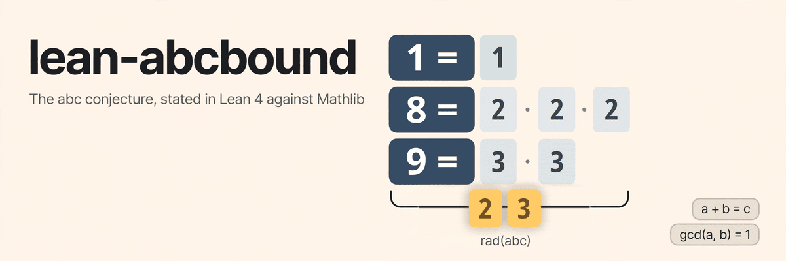

Title: 未解決のabc予想をLean 4とMathlibで命題として書き、その書き方を定理で確かめるlean-abcboundを作った
Date: 2026-11-27 22:57
Updated: 2026-11-27 22:57
Draft: true
Tags: lean mathlib formal-verification abc-conjecture release lean-abcbound


abc予想は整数論の未解決の予想で、その主張をLean 4とMathlibで命題として書き、命題が意図どおりの主張になっているかを定理で確かめる [lean-abcbound](https://github.com/conao3/lean-abcbound) を作りました。
予想そのものはまだ証明されていないので、lean-abcboundにあるのは予想の命題 `Abc.ABCConjecture` と、命題の書き方について述べた定理です。

Leanのカーネルが確かめるのは証明が命題の証明になっていることだけなので、命題が予想を正しく写しているかは人が読んで判断します。
lean-abcboundの定理は、命題から互いに素の仮定を外すと偽になることと、命題が別の書き方の命題と同値になることを示していて、この判断の材料になります。

ライセンスはApache-2.0で、LeanとMathlibはどちらもv4.35.0を使います。
この記事のコードと出力は、この記事を書いた時点のmasterの [8ed08da](https://github.com/conao3/lean-abcbound/commit/8ed08da1fac8268b64014e155874b91263acbad3) のものです。

<div class="github-card" data-repo="conao3/lean-abcbound"><a href="https://github.com/conao3/lean-abcbound"><span class="github-card-name"><svg class="github-card-mark" viewBox="0 0 16 16" aria-hidden="true"><path d="M6.766 11.328c-2.063-.25-3.516-1.734-3.516-3.656 0-.781.281-1.625.75-2.188-.203-.515-.172-1.609.063-2.062.625-.078 1.468.25 1.968.703.594-.187 1.219-.281 1.985-.281.765 0 1.39.094 1.953.265.484-.437 1.344-.765 1.969-.687.218.422.25 1.515.046 2.047.5.593.766 1.39.766 2.203 0 1.922-1.453 3.375-3.547 3.64.531.344.89 1.094.89 1.954v1.625c0 .468.391.734.86.547C13.781 14.359 16 11.53 16 8.03 16 3.61 12.406 0 7.984 0 3.563 0 0 3.61 0 8.031a7.88 7.88 0 0 0 5.172 7.422c.422.156.828-.125.828-.547v-1.25c-.219.094-.5.156-.75.156-1.031 0-1.64-.562-2.078-1.609-.172-.422-.36-.672-.719-.719-.187-.015-.25-.093-.25-.187 0-.188.313-.328.625-.328.453 0 .844.281 1.25.86.313.452.64.655 1.031.655s.641-.14 1-.5c.266-.265.47-.5.657-.656"/></svg><span>conao3/<strong>lean-abcbound</strong></span></span><span class="github-card-description">The abc conjecture stated in Lean 4 against Mathlib</span><span class="github-card-footer"><span class="github-card-language"><span class="github-card-language-color"></span>Lean</span><span class="github-card-star"><svg viewBox="0 0 16 16" aria-hidden="true"><path d="M8 .25a.75.75 0 0 1 .673.418l1.882 3.815 4.21.612a.75.75 0 0 1 .416 1.279l-3.046 2.97.719 4.192a.751.751 0 0 1-1.088.791L8 12.347l-3.766 1.98a.75.75 0 0 1-1.088-.79l.72-4.194L.818 6.374a.75.75 0 0 1 .416-1.28l4.21-.611L7.327.668A.75.75 0 0 1 8 .25Z"/></svg><span>Star</span><span class="github-card-star-count" hidden></span></span></span></a></div>


# abc予想の主張

正の整数 <span class="math" data-tex="bg=="></span> を割り切る素数を1回ずつ掛けた数を <span class="math" data-tex="XG1hdGhybXtyYWR9KG4p"></span> と書きます。
abc予想は <span class="math" data-tex="YSArIGIgPSBj"></span> を満たす互いに素な正の整数について <span class="math" data-tex="Yw=="></span> と <span class="math" data-tex="XG1hdGhybXtyYWR9KGFiYyk="></span> の大きさを比べる予想で、たとえば <span class="math" data-tex="MSArIDggPSA5"></span> では <span class="math" data-tex="YWJjID0gNzIgPSAyXjMgXGNkb3QgM14y"></span> なので <span class="math" data-tex="XG1hdGhybXtyYWR9KDcyKSA9IDIgXGNkb3QgMyA9IDY="></span> になり、 <span class="math" data-tex="YyA9IDk="></span> のほうが大きくなります。



どんな <span class="math" data-tex="XHZhcmVwc2lsb24gPiAw"></span> にも定数 <span class="math" data-tex="Sw=="></span> があってすべての組で <span class="math" data-tex="YyA8IEsgXGNkb3QgXG1hdGhybXtyYWR9KGFiYyleezErXHZhcmVwc2lsb259"></span> が成り立つというのが予想の主張で、lean-abcboundでは [Abc/Statement.lean](https://github.com/conao3/lean-abcbound/blob/8ed08da1fac8268b64014e155874b91263acbad3/Abc/Statement.lean#L12-L18) に次のように書いています。

```lean
def rad (n : ℕ) : ℕ := ∏ p ∈ n.primeFactors, p

def ABCConjecture : Prop :=
  ∀ ε : ℝ, 0 < ε → ∃ K : ℝ, ∀ a b c : ℕ, 0 < a → 0 < b → a.Coprime b → a + b = c →
    (c : ℝ) < K * (rad (a * b * c) : ℝ) ^ (1 + ε)
```

`ABCConjecture` は `def` で定義した命題 ( `Prop` ) です。
このファイルはMathlibだけをimportしています。


# 命題が意図どおりかを確かめる定理

命題の書き方を確かめる定理は [Abc/Sanity.lean](https://github.com/conao3/lean-abcbound/blob/8ed08da1fac8268b64014e155874b91263acbad3/Abc/Sanity.lean) と [Abc/Equivalent.lean](https://github.com/conao3/lean-abcbound/blob/8ed08da1fac8268b64014e155874b91263acbad3/Abc/Equivalent.lean) にあり、どの定理も予想が正しいかどうかには触れず命題の書き方について述べています。


## 互いに素の仮定を外すと偽になる

`ABCConjecture` から `a.Coprime b` の仮定だけを外した命題を否定する定理が [not\_bound\_without\_coprime](https://github.com/conao3/lean-abcbound/blob/8ed08da1fac8268b64014e155874b91263acbad3/Abc/Sanity.lean#L21-L25) です。

```lean
theorem not_bound_without_coprime :
    ¬ ∀ ε : ℝ, 0 < ε → ∃ K : ℝ, ∀ a b c : ℕ, 0 < a → 0 < b → a + b = c →
      (c : ℝ) < K * (rad (a * b * c) : ℝ) ^ (1 + ε)
```

<span class="math" data-tex="Ml5uICsgMl5uID0gMl57bisxfQ=="></span> の組は <span class="math" data-tex="XG1hdGhybXtyYWR9KGFiYyk="></span> がどれも2なので、 <span class="math" data-tex="Yw=="></span> をいくらでも大きくできて、どの <span class="math" data-tex="Sw=="></span> でも不等式が成り立たなくなります。

命題を書くときに互いに素の仮定を書き漏らしていたら、偽であることが証明できる命題になっていました。
この定理は仮定が命題の意味を左右していることを示しています。


## 別の書き方の命題と同値になる

abc予想にはいくつかの書き方があり、DeepMindの [formal-conjectures](https://github.com/google-deepmind/formal-conjectures/blob/f606af160664c5a10952e9a957b100a1cd45bbeb/FormalConjectures/Wikipedia/ABC.lean#L68-L75) は `abc.variants.lt_constant_mul` で <span class="math" data-tex="YyA+IDA="></span> と <span class="math" data-tex="YQ=="></span> 、 <span class="math" data-tex="Yg=="></span> 、 <span class="math" data-tex="Yw=="></span> がどの2つも互いに素であることを仮定にした形で書いています。
lean-abcboundはこの仮定の形を `ABCConjecturePairwise` に写し、 [abcConjecture\_iff\_pairwise](https://github.com/conao3/lean-abcbound/blob/8ed08da1fac8268b64014e155874b91263acbad3/Abc/Equivalent.lean#L44) で `ABCConjecture` と同値であることを示しています。

仮定の形が同じことは、formal-conjecturesをimportせずに2つのファイルを並べて読んで確かめています。
もう1つの [abcConjecture\_iff\_finite](https://github.com/conao3/lean-abcbound/blob/8ed08da1fac8268b64014e155874b91263acbad3/Abc/Equivalent.lean#L107-L108) は、どの <span class="math" data-tex="XHZhcmVwc2lsb24gPiAw"></span> でも <span class="math" data-tex="XG1hdGhybXtyYWR9KGFiYyleezErXHZhcmVwc2lsb259IDwgYw=="></span> となる互いに素な組が有限個しかないという形の `ABCConjectureFinite` と `ABCConjecture` が同値であることを示しています。

```lean
theorem abcConjecture_iff_pairwise : ABCConjecture ↔ ABCConjecturePairwise
theorem abcConjecture_iff_finite : ABCConjecture ↔ ABCConjectureFinite
```

どちらの定理も予想そのものは証明せずに予想の書き方どうしを結んでいるので、3つの形のどれか1つが成り立てば残りの2つも成り立ちます。


## radの定義と具体的な値

`rad_eq_radical` は、 `rad` が自然数の上でMathlibの `UniqueFactorizationMonoid.radical` と一致することを示しています。
また <span class="math" data-tex="XG1hdGhybXtyYWR9KDEyKSA9IDY="></span> や <span class="math" data-tex="XG1hdGhybXtyYWR9KDEgXGNkb3QgOCBcY2RvdCA5KSA9IDY="></span> のような具体的な値については、全称の定理とは別に `decide +kernel` でカーネルに計算させて確かめる検査を置いています。


# Leanで確かめる

リポジトリの直下に次の `Demo.lean` を置いて `lake env lean` に渡すと、 `rad 72` の値と命題の型、定理が使う公理を表示します。
最後の行では `Abc.abc` という名前の定理が無いことを確かめられます。

```lean
import Abc

#eval Abc.rad 72
#check Abc.ABCConjecture
#print axioms Abc.not_bound_without_coprime
#check Abc.abc
```

```console
$ nix develop --command lake env lean Demo.lean
6
Abc.ABCConjecture : Prop
'Abc.not_bound_without_coprime' depends on axioms: [propext, Classical.choice, Quot.sound]
Demo.lean:6:7: error(lean.unknownIdentifier): Unknown identifier `Abc.abc`
```

`Abc.abc` は予想の証明につける予定の名前です。
リポジトリでは、この定理がライブラリに入り、 `#print axioms` が `propext` と `Classical.choice` と `Quot.sound` の3つだけを返したときに予想を証明したとみなすと決めています。


# 公理の監査

[Audit.lean](https://github.com/conao3/lean-abcbound/blob/8ed08da1fac8268b64014e155874b91263acbad3/Audit.lean) はライブラリのすべての定理と検査に `#print axioms` を並べたファイルで、その出力を `audit.expected` に置いています。
`make check` はflakeの整形とMathlibのキャッシュの取得、 `lake build` を行ったあと、この出力を `audit.expected` と比べます。

```console
$ nix develop --command make check
nix fmt -- --ci
traversed 22 files
emitted 1 files for processing
formatted 1 files (0 changed) in 1.06s
lake exe cache get
Current branch: HEAD
Using cache from origin: (some leanprover-community/mathlib4)
No files to download
Already decompressed 9031 file(s)
lake build
⚠ [9047/9052] Replayed Abc.Statement
warning: Abc/Statement.lean: imports `Mathlib` from package `mathlib`, which is designed for use with the module system; consider adding `module` to the start of this file
Build completed successfully (9052 jobs).
lake env lean Audit.lean | diff -u audit.expected -
```

最後の `diff` が何も出力せずに終わっているので、監査の出力は `audit.expected` と一致しています。

証明の途中に `sorry` が残っていると `#print axioms` の出力に `sorryAx` が出て比較が失敗します。
監査に並ぶ17個 (定理14個と具体的な値の検査3個) がどれも3つの公理だけに依存していることを、この比較でCIでも確かめています。


# 証明に向けて

[docs/roadmap.md](https://github.com/conao3/lean-abcbound/blob/8ed08da1fac8268b64014e155874b91263acbad3/docs/roadmap.md) には、このリポジトリの中でMathlibだけを使って進められる次の定理を並べています。

指数の <span class="math" data-tex="MSArIFx2YXJlcHNpbG9u"></span> を1にするとどの <span class="math" data-tex="Sw=="></span> でも不等式が成り立たなくなることや、予想から十分大きな <span class="math" data-tex="bg=="></span> で <span class="math" data-tex="eF5uICsgeV5uID0gel5u"></span> に互いに素な正の解が無いことが導けることがその例です。
これらはどれも証明の方針を書いただけで、まだ定理にはなっていません。

リポジトリは <https://github.com/conao3/lean-abcbound> です。
Issue / PR大歓迎です。

