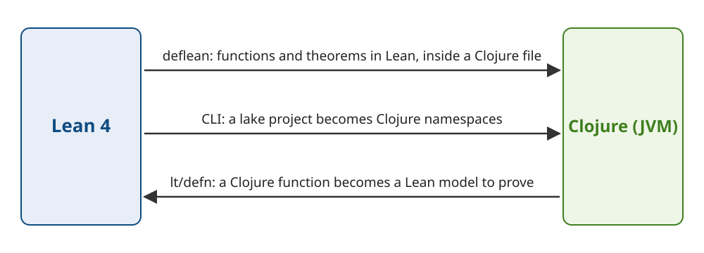

Title: lean-clj: call Lean 4 functions from Clojure, and prove Clojure functions in Lean
Date: 2026-11-05 20:05
Lang: en


I wrote lean-clj, a library that lets you call functions written and proved in Lean 4 from Clojure, and prove properties of Clojure functions in Lean.
The repository is [conao3/lean-clj](https://github.com/conao3/lean-clj), under Apache-2.0.
You can get it from Clojars as `io.github.conao3/lean-clj`, and this post uses version 0.3.0.

lean-clj compiles the intermediate representation (IR) of the Lean compiler to Clojure source.
The JVM runs the same program that Lean's C backend builds, with types and proofs erased.

<div class="github-card" data-repo="conao3/lean-clj"><a href="https://github.com/conao3/lean-clj"><span class="github-card-name"><svg class="github-card-mark" viewBox="0 0 16 16" aria-hidden="true"><path d="M6.766 11.328c-2.063-.25-3.516-1.734-3.516-3.656 0-.781.281-1.625.75-2.188-.203-.515-.172-1.609.063-2.062.625-.078 1.468.25 1.968.703.594-.187 1.219-.281 1.985-.281.765 0 1.39.094 1.953.265.484-.437 1.344-.765 1.969-.687.218.422.25 1.515.046 2.047.5.593.766 1.39.766 2.203 0 1.922-1.453 3.375-3.547 3.64.531.344.89 1.094.89 1.954v1.625c0 .468.391.734.86.547C13.781 14.359 16 11.53 16 8.03 16 3.61 12.406 0 7.984 0 3.563 0 0 3.61 0 8.031a7.88 7.88 0 0 0 5.172 7.422c.422.156.828-.125.828-.547v-1.25c-.219.094-.5.156-.75.156-1.031 0-1.64-.562-2.078-1.609-.172-.422-.36-.672-.719-.719-.187-.015-.25-.093-.25-.187 0-.188.313-.328.625-.328.453 0 .844.281 1.25.86.313.452.64.655 1.031.655s.641-.14 1-.5c.266-.265.47-.5.657-.656"/></svg><span>conao3/<strong>lean-clj</strong></span></span><span class="github-card-description">Lean 4 IR to Clojure backend and Lean embedded in Clojure via S-expressions</span><span class="github-card-footer"><span class="github-card-language"><span class="github-card-language-color"></span>Clojure</span><span class="github-card-star"><svg viewBox="0 0 16 16" aria-hidden="true"><path d="M8 .25a.75.75 0 0 1 .673.418l1.882 3.815 4.21.612a.75.75 0 0 1 .416 1.279l-3.046 2.97.719 4.192a.751.751 0 0 1-1.088.791L8 12.347l-3.766 1.98a.75.75 0 0 1-1.088-.79l.72-4.194L.818 6.374a.75.75 0 0 1 .416-1.28l4.21-.611L7.327.668A.75.75 0 0 1 8 .25Z"/></svg><span>Star</span><span class="github-card-star-count" hidden></span></span></span></a></div>


# Three ways to use it

lean-clj supports three uses.



1.  Write functions and theorems in Lean inside a Clojure file, and call the functions from Clojure (`deflean`).
2.  Compile an existing Lean project (a lake project) to a set of Clojure namespaces (the CLI).
3.  Translate a function written in Clojure into a Lean model, and prove its properties in Lean (`lean-clj.typed`).

The first two go from Lean to Clojure, and the third goes from Clojure to Lean.
Each section below gives an example, in the same order.


# Write in Lean, call from Clojure

Add lean-clj to `deps.edn`:

```clojure
{:deps {io.github.conao3/lean-clj {:mvn/version "0.3.0"}}}
```

To expand a `deflean` block for the first time, you need Lean 4.35.0 (`lean` and `lake`) and the `lean-clj` CLI on your `PATH`.
Install the CLI with nix:

```console
$ nix profile install github:conao3/lean-clj/v0.3.0
```

Inside `deflean`, you write Lean syntax as S-expressions:

```clojure
(ns demo.core
  (:refer-clojure :exclude [double])
  (:require [lean-clj.core :refer [deflean]]))

(deflean arith
  (def double [n Nat] Nat
    (+ n n))

  (theorem double_eq [n Nat] (= (double n) (* 2 n))
    (by (unfold double) omega))

  (structure Account [owner String balance Nat])

  (def deposit [a Account n Nat] Account
    (with a {:balance (+ (.balance a) n)})))
```

`def` defines a function, `theorem` states a theorem, and `(by ...)` holds its proof.
The proof of `double_eq` unfolds `double` and then closes the goal with `omega`, the tactic for linear arithmetic over natural numbers and integers.
When the namespace loads, lean-clj turns the block into Lean source, runs `lake build`, and checks the proofs.
If the check passes, lean-clj defines the functions of the block as Clojure functions in the namespace.
You pass and receive a structure as a map with keyword keys.

```clojure
(double 21)                                ;=> 42
(deposit {:owner "ann" :balance 10} 5)     ;=> {:owner "ann", :balance 15}
```

If a proof fails, the namespace does not compile.
Change the theorem to `(* 3 n)`, and you get this error:

```text
Syntax error macroexpanding deflean at (demo/wrong.clj:5:1).
lean-clj: Lean rejected deflean arith
error: demo/wrong.clj:9: deflean arith:3:75: omega could not prove the goal:
a possible counterexample may satisfy the constraints
  a ≥ 1
where
 a := ↑n

Lean source of the block:
   1 | def double (n : Nat) : Nat := (n + n)
   2 |
   3 | theorem double_eq (n : Nat) : ((double n) = (3 * n)) := (by unfold double; omega)
```

The error gives the Clojure file and line (`demo/wrong.clj:9`) and shows the Lean source that lean-clj generated from the block.

For syntax that the S-expressions do not cover, you can pass Lean source as a string with `(lean "...")`.
The [word-count](https://github.com/conao3/lean-clj/tree/master/samples/word-count) sample uses it to write a function in `do` notation.
lean-clj stores the generated Clojure code in `.lean-clj/cache/`.
As long as the block does not change, later expansions read the cache and skip Lean.
If you commit the cache, the code runs on machines without Lean.


# Compile a Lean project to Clojure namespaces

The CLI compiles the Lean code of a lake project to Clojure namespaces.
The [roman-numerals](https://github.com/conao3/lean-clj/tree/master/samples/roman-numerals) sample converts numbers to and from Roman numerals in Lean, and proves that converting a number from 1 to 999 and back returns the same number.

```lean
def toRoman (n : Nat) : String := toRomanAux (n + 13) numerals n

def fromRoman (s : String) : Option Nat :=
  if s.isEmpty then none else fromRomanAux s.toList

theorem roundtrip : ∀ n, n < 1000 → fromRoman (toRoman n) = if n = 0 then none else some n := by
  decide +kernel
```

After `lake build` checks the proofs, the CLI compiles the module to a namespace:

```console
$ lean-clj module generate-namespace --module-name Roman --namespace roman.core \
    --search-path lean/.lake/build/lib/lean --output-file src/roman/core.clj
```

The CLI turns each public function into a Clojure function with a kebab-case name.
An `Option` turns into the wrapped value or `nil`.

```clojure
(require '[roman.core :as roman])

(roman/to-roman 1994)        ;=> "MCMXCIV"
(roman/from-roman "MMXXVI")  ;=> 2026
(roman/from-roman "hello")   ;=> nil
```

The generated `src/roman/core.clj` is an ordinary Clojure file.
If you commit it, the code that uses it runs without Lean.
`lean-clj project generate` compiles all the modules of a project at once.


# Write in Clojure, prove in Lean

In the third use, you write the implementation in Clojure.
The next example takes a Clojure function that computes the sum from 0 to n in closed form, and proves that it equals a Lean specification that follows the recursive definition of the sum.

```clojure
(ns demo.sum
  (:require [lean-clj.core :refer [deflean]]
            [lean-clj.typed :as lt]))

(lt/defn sum-to-fast [n Nat] Nat
  (quot (* n (inc n)) 2))

(deflean sums
  (clojure sum-to-fast)

  (def sum-to [n Nat] Nat
    (match n
      0 0
      (+ k 1) (+ (sum-to k) (+ k 1))))

  (theorem two-sum-to [n Nat] (= (* 2 (sum-to n)) (* n (+ n 1)))
    (by (on-all (induction n) (simp only [sum-to Nat.mul_add Nat.add_mul] at *) omega)))

  (theorem sum-to-fast-eq [n Nat] (= (sum-to-fast n) (sum-to n))
    (by (simp only [sum-to-fast Clj.quot_nat Clj.mul_nat Clj.inc_nat])
        "have := twoSumTo n"
        omega))

  (theorem ^{:attrs [csimp]} sum-to-eq [] (= (the (-> Nat Nat) sum-to) sum-to-fast)
    (by (funext n) (exact (.symm (sum-to-fast-eq n))))))
```

`lt/defn` defines an ordinary Clojure function and records the Lean types of its parameters and result on the var.
Inside the block, `(clojure sum-to-fast)` translates the function into a Lean definition, which this post calls the function's model.
`Clj`, a Lean library that ships with lean-clj, provides models of `clojure.core` functions such as `quot` and `inc`.

The `@[csimp]` attribute on `sum-to-eq` lets Lean replace `sum-to` with `sum-to-fast` when it compiles a call.
Lean permits the replacement because you proved that the two are equal.
As a result, a call of `sum-to` from Clojure runs the Clojure `sum-to-fast` instead of the recursion.

```clojure
(sum-to 1000000)  ;=> 500000500000
```

lean-ritsuryo, which I introduced in [a post in Japanese](https://s.conao3.com/blog/2026/5499a8), relates implementations to specifications in several ways, and lean-clj applies the same ways to implementations in Clojure.
Each relation has a sample:

<table border="2" cellspacing="0" cellpadding="6" rules="groups" frame="hsides">


<colgroup>
<col  class="org-left" />

<col  class="org-left" />

<col  class="org-left" />
</colgroup>
<thead>
<tr>
<th scope="col" class="org-left">How the implementation relates to the specification</th>
<th scope="col" class="org-left">How to write it in lean-clj</th>
<th scope="col" class="org-left">Sample</th>
</tr>
</thead>
<tbody>
<tr>
<td class="org-left">The specification runs as it is</td>
<td class="org-left">Call the <code>deflean</code> definition</td>
<td class="org-left">todo-cli</td>
</tr>

<tr>
<td class="org-left">A faster implementation equals the specification on every input</td>
<td class="org-left">Prove the equality, and replace with <code>@[csimp]</code></td>
<td class="org-left">verified-clojure (<code>sum-to</code>)</td>
</tr>

<tr>
<td class="org-left">A faster implementation equals it under an assumption</td>
<td class="org-left">Prove it under the assumption; callers that meet it call the implementation</td>
<td class="org-left">sorted-search</td>
</tr>

<tr>
<td class="org-left">The implementation satisfies a property of its result</td>
<td class="org-left">State the property as a theorem and prove it</td>
<td class="org-left">verified-clojure (insertion sort), inventory</td>
</tr>
</tbody>
</table>


## Compare the function with its model on generated inputs

Lean proves theorems about the model.
If the model departs from what Clojure does, you can still prove a theorem that the real function breaks.
`lt/check` calls the real function and its model on the same inputs and compares the results:

```clojure
(lt/check #'sum-to-fast {:seed 1})
;=> {:result true, :pass? true, :num-tests 100, :time-elapsed-ms 7, :seed 1}
```

`lt/check` builds test.check generators from the types of the signature.
If the results differ, it returns the arguments and both values in `:counterexample`.
`lt/defcheck` defines the same check as a `clojure.test` test.
lean-clj's own tests compare the `Clj` models with the `clojure.core` functions the same way, in a table of 156 rows.

A theorem holds for the calls where the Clojure function returns a value.
Calls that throw, such as a `Long` overflow, a division by zero, or an index out of range, fall outside what the models describe.


# Model errors that generated tests found

The comparison tests found several errors in the models.
Some of them let Lean prove theorems that do not hold.


## Truthiness in polymorphic functions

This `member?` checks whether `x` is in a list of elements of any type `α`:

```clojure
(lt/defn member?
  [(implicit α Type) (inst (BEq α)) x α xs (List α)]
  Bool
  (if-let [y (first xs)]
    (or (= x y) (member? x (rest xs)))
    false))
```

Clojure's `if-let` takes the else branch when the bound value is `false` or `nil`.
So on a list of `false`, the function returns `false`:

```clojure
(member? 1 [1])          ;=> true
(member? false [false])  ;=> false
```

The models treated every value of a type variable `α` as truthy.
Values of `Nat` and `String` are always truthy in Clojure, so this is right for most types.
At `α = Bool`, though, `false` is falsy, so the model and the Clojure function give different results.
With that model, you could prove the next theorem, "if `x` is the head, `member?` returns `true`", for every `α`:

```clojure
(theorem member-head [(implicit α Type) (inst (BEq α)) (inst (LawfulBEq α)) (inst (Clj.Truthy α)) x α xs (List α)]
  (= (member? x (cons x xs)) true)
  (by (rw [member?]) simp))
```

At `x = false`, the Clojure function returns `false`, so the theorem does not hold for the real function.

Each type variable of a polymorphic model now comes with a `[Clj.Truthy α]` instance argument, so a test of an `α` value behaves as it does at the caller's type.
The same proof now stops, because it has to show that `x` is truthy:

```text
error: demo/member.clj:15: deflean proofs:3:128: unsolved goals
...
x : α
xs : List α
⊢ Clj.truthy x = true
```

The [generic-search](https://github.com/conao3/lean-clj/tree/master/samples/generic-search) sample writes `member?` with `if-some`, which treats only `nil` as false, and proves the same theorem.


## Other errors

The generated tests also found models that disagreed with these three behaviors of Clojure:

```clojure
(:k {:k nil} 0)                  ;=> nil
(str [12345678901234567890N])    ;=> "[12345678901234567890N]"
(get [0 1] 4294967297)           ;=> 1
```

-   `(:k m default)` returns `nil` when the key is there with the value `nil`. The default applies only when the key is missing. The model returned the default for `nil` too.
-   `str` adds an `N` to a `BigInt` inside a vector. The model did not. The tests found this because the generators also produce integers beyond `Long`.
-   `get` on a vector truncates the index to the low 32 bits of an `int`. `4294967297` is `2^32 + 1`, so the call returns the element at index 1.

Each model now follows what Clojure does.


# What lean-clj does not do

lean-clj has no mode (`^:total`) that also proves that a function never throws, including on `Long` overflow.
Such a mode would have to rewrite every expression as a computation in a type that represents failure, such as `Option`.
If you write that with Lean's `do` notation, the order of evaluation differs from Clojure's:

```lean
def half (n : Nat) : Option Nat :=
  if n % 2 == 0 then some (n / 2) else none

def g (n : Nat) : Option Bool := do
  pure (n == 1 || (← half n) == 0)

#eval g 1  -- none
```

Clojure's `(or (= n 1) ...)` returns `true` without evaluating the right side when `n` is 1.
Lean lifts `(← half n)` out of the expression and runs it first, so `half 1` fails and `g 1` is `none`.
The translation would have to rewrite each expression that skips evaluation, like `and` and `or`, to keep Clojure's order, and I decided it was not worth that cost.

To avoid overflow, use the arbitrary-precision `+'` family.
To find it, pass `:throws :fail` to `lt/check`, which then counts an input that throws as a failure.


# How it works

lean-clj emits Clojure source, not Java source or JVM bytecode.
lean-clj maps Lean's `Array` to Clojure's persistent vector, where updating an element takes O(log n).
`Nat` arithmetic moves to `BigInt` through `+'`, and Lean closures become Clojure values that implement `IFn`.
The JIT optimizes the bytecode anyway, so emitting bytecode directly would gain little speed.

A differential test against Lean's C backend checks the generated Clojure.
The test runs the same functions as an executable that the C backend builds and as generated Clojure, and compares 182 lines of output.
This test found that C prints an infinite float as `inf` and Java as `Infinity`.

The backend also ran into the JVM limit of 64 KB per method.
It expanded each join point of Lean's IR (a merge point inside a function) at every jump to it.
The generated code grew to 36,000 lines, and loading the functions of `Std.Format` failed with "Method code too large!".
Now it expands only the join points with one jump, and turns the others into `letfn`.
Self tail calls become `loop` and `recur`, and mutual recursion runs through `trampoline`, so neither grows the stack.


# Clojure's type and schema libraries

Clojure has schema libraries that check values at run time, such as clojure.spec, malli, and Plumatic Schema.
They describe values with predicates: they have no type variables, their maps are open by default, and their integers do not tell fixed precision from arbitrary precision.
Typed Clojure and clj-kondo's type checking each have their own type language and their own annotations of `clojure.core`.

In lean-clj, you write types in Lean, and lean-clj derives malli schemas, test.check generators, and clj-kondo types from them.
For the structure `Account` in the `deflean` block above, it derives this schema:

```clojure
(require '[lean-clj.types :as t])

(t/malli-schema 'Account)
;=> [:map {:closed true} [:owner :string] [:balance [:and integer? [:>= 0]]]]
```

`Nat` becomes a non-negative integer, and a structure becomes a closed map with the same keys.
You get these from the signatures alone, without writing proofs (the [typed-schemas](https://github.com/conao3/lean-clj/tree/master/samples/typed-schemas) sample).

A related project is whilo's [ansatz](https://github.com/replikativ/ansatz).
ansatz implements Lean's kernel in Java and completes type checking on the JVM.
lean-clj checks with the real Lean, and uses Lean's syntax, its standard library, and existing lake projects as they are.
In exchange, you need the Lean toolchain the first time you expand a `deflean` block.


# Wrapping up

lean-clj is on Clojars as `io.github.conao3/lean-clj`.
The [samples](https://github.com/conao3/lean-clj/tree/master/samples) directory holds a small program for each use.
Start with todo-cli for `deflean`, and with verified-clojure for verifying Clojure functions.
I welcome issues and pull requests.

