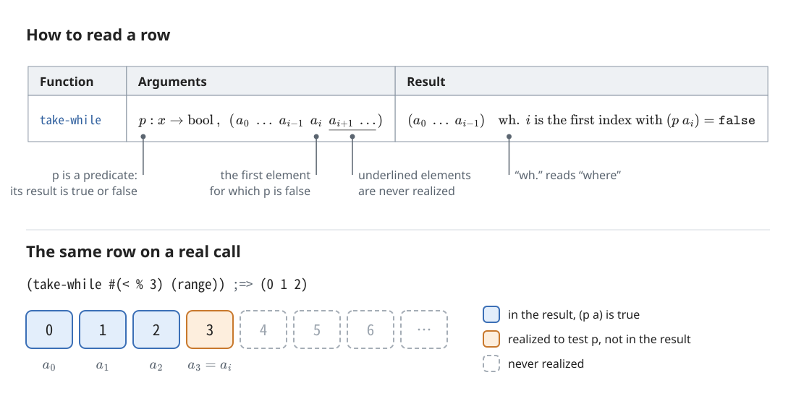

Title: A Clojure core cheat sheet in math notation
Date: 2026-11-25 01:17
Updated: 2026-11-25 01:17
Lang: en
Tags: clojure standard-library

I wrote down 163 functions from `clojure.core` that work on sequences, collections and functions, each as a small formula.
I borrowed the notation from Daniel Keep's [Rust Iterator Cheat Sheet](https://danielkeep.github.io/itercheat_baked.html) (CC BY-SA 4.0) and moved it to Clojure syntax, with seqs, vectors, maps and sets written as Clojure literals and function calls written as lists.
The rows describe Clojure 1.12.7.
A [script](https://github.com/conao3/blog-stasis-src/blob/master/bin/315a71-clojure-cheatsheet.clj) keeps every row next to 333 checks that run the function in Clojure, and it builds the tables only when all of the checks pass.

# Reading the notation

The figure reads the `take-while` row, and then follows the same row through `(take-while #(< % 3) (range))`.

-    is a seq.  and  are input seqs, and a subscript picks one element.
-    is a list,  is a vector,  is a map, and  is a set, as in Clojure source. The list rows of `peek` and `pop` need a real list, and a seq such as the result of `map` throws there.
-    calls  with , as in Clojure source.
-   ,  and  are functions that compute new values, and  is a key function such as the one `sort-by` takes.
-    and  are predicates. A predicate result counts as  when it is anything other than  or .
-    is a comparator, such as `compare` or `>`.
-    says that  takes two arguments, and  and  name the kind of value it returns.  is the accumulated value of a reducing function, and  is its first value.
-    is a transducer, such as `(map inc)`.
-    and  are positions, except in `range`, where they are the start and end values.  is a count that you pass in,  is a step, and  and  are the lengths of the input seqs.
-    is a map,  is a key,  and  are values, and  is a default value.
-    is a function, the same as `(fn [x] (f x))`.  takes any number of arguments.
-   A superscript ! marks a transient, as in .
-    is a permutation of the positions, and "wh." reads "where". Other letters name values that appear in the arguments or that the row defines after "wh.".
-   An underlined element stays unrealized after you call the function and consume every seq in its result. `(take-while p a)` has to look at  to know where to stop, so I underline only the elements after . I measured this on an unchunked lazy seq. Over a vector or a finite `range`, many lazy functions such as `map` and `filter` compute 32 results at a time, because vectors and finite ranges give chunked seqs.
-   A check in the Lazy column means the function returns a lazy seq, which computes its elements when you ask for them.
-   A check in the xf column means the function returns a [transducer](https://clojure.org/reference/transducers) when you call it without the collection, as in `(map inc)`.
-   The function name links to its entry in the [clojure.core API reference](https://clojure.github.io/clojure/clojure.core-api.html).

# How I grouped the functions

The [official Clojure cheat sheet](https://clojure.org/api/cheatsheet) groups its "Seq in, Seq out" functions under headings such as "Get shorter", "Get longer", "Head-items", "Tail-items" and "'Change'".
Some functions sit under two of those headings, such as `filter`, which appears under "Get shorter" and "'Change'".

I grouped each function by how the elements of its result relate to the elements of its input, so each function appears once.

-   Selecting: every result element is an input element, in the input order.
-   Transforming: the result elements are values that  computes from the input elements.
-   Combining: the result adds elements to a seq, or joins several seqs or nested collections into one seq.
-   Reordering: the result has the same elements in another order.
-   Splitting: the result holds the input elements in groups.
-   Reducing: the result is one value.
-   Collecting: the result is a vector, a set, a map, or the collection you pass to `into`.

Rich Hickey described the argument order of `clojure.core` in [a mailing list thread](https://groups.google.com/g/clojure/c/iyyNyWs53dc) in 2008:

> Sequence functions take their sources last and collection functions take their primary operand (collection) first.

Most functions in the groups above are sequence functions, so the seq comes last and they work with `->>`.
`nth`, `nthrest` and `nthnext` take the seq first, and `max-key` and `min-key` take values instead of a seq.
The functions that read or update a vector, map or set take it first and work with `->`.
After them come the functions that build collections, test what kind of collection a value is, work on transients, and compare values.

# Making a seq

These functions make a seq from nothing, from a value or from a collection.
Without a transducer, `sequence` only turns its argument into a seq, so a vector gives a chunked seq and a lazy seq comes back as it is.

<table>
<thead><tr><th>Function</th><th>Arguments</th><th>Result</th><th>Lazy</th><th>xf</th></tr></thead>
<tbody>
<tr><td rowspan="2"><a href="https://clojure.github.io/clojure/clojure.core-api.html#clojure.core/seq"><code style="white-space: nowrap">seq</code></a></td><td></td><td></td><td rowspan="2"></td><td rowspan="2"></td></tr>
<tr><td></td><td></td></tr>
<tr><td rowspan="3"><a href="https://clojure.github.io/clojure/clojure.core-api.html#clojure.core/sequence"><code style="white-space: nowrap">sequence</code></a></td><td></td><td></td><td></td><td rowspan="3"></td></tr>
<tr><td></td><td></td><td></td></tr>
<tr><td>, </td><td></td><td>✓</td></tr>
<tr><td><a href="https://clojure.github.io/clojure/clojure.core-api.html#clojure.core/list*"><code style="white-space: nowrap">list*</code></a></td><td>, , </td><td></td><td></td><td></td></tr>
<tr><td rowspan="2"><a href="https://clojure.github.io/clojure/clojure.core-api.html#clojure.core/re-seq"><code style="white-space: nowrap">re-seq</code></a></td><td>, </td><td></td><td rowspan="2">✓</td><td rowspan="2"></td></tr>
<tr><td>, </td><td></td></tr>
<tr><td rowspan="3"><a href="https://clojure.github.io/clojure/clojure.core-api.html#clojure.core/subseq"><code style="white-space: nowrap">subseq</code></a></td><td>, , </td><td></td><td></td><td rowspan="3"></td></tr>
<tr><td>, , </td><td></td><td>✓</td></tr>
<tr><td>, , , , </td><td></td><td>✓</td></tr>
<tr><td rowspan="3"><a href="https://clojure.github.io/clojure/clojure.core-api.html#clojure.core/rsubseq"><code style="white-space: nowrap">rsubseq</code></a></td><td>, , </td><td></td><td></td><td rowspan="3"></td></tr>
<tr><td>, , </td><td></td><td>✓</td></tr>
<tr><td>, , , , </td><td></td><td>✓</td></tr>
<tr><td rowspan="4"><a href="https://clojure.github.io/clojure/clojure.core-api.html#clojure.core/range"><code style="white-space: nowrap">range</code></a></td><td></td><td></td><td rowspan="4">✓</td><td rowspan="4"></td></tr>
<tr><td></td><td></td></tr>
<tr><td>, </td><td></td></tr>
<tr><td>, , </td><td></td></tr>
<tr><td rowspan="2"><a href="https://clojure.github.io/clojure/clojure.core-api.html#clojure.core/repeat"><code style="white-space: nowrap">repeat</code></a></td><td></td><td></td><td rowspan="2">✓</td><td rowspan="2"></td></tr>
<tr><td>, </td><td></td></tr>
<tr><td rowspan="2"><a href="https://clojure.github.io/clojure/clojure.core-api.html#clojure.core/repeatedly"><code style="white-space: nowrap">repeatedly</code></a></td><td></td><td></td><td rowspan="2">✓</td><td rowspan="2"></td></tr>
<tr><td>, </td><td></td></tr>
<tr><td><a href="https://clojure.github.io/clojure/clojure.core-api.html#clojure.core/iterate"><code style="white-space: nowrap">iterate</code></a></td><td>, </td><td></td><td>✓</td><td></td></tr>
<tr><td rowspan="2"><a href="https://clojure.github.io/clojure/clojure.core-api.html#clojure.core/keys"><code style="white-space: nowrap">keys</code></a></td><td></td><td></td><td rowspan="2"></td><td rowspan="2"></td></tr>
<tr><td></td><td></td></tr>
<tr><td rowspan="2"><a href="https://clojure.github.io/clojure/clojure.core-api.html#clojure.core/vals"><code style="white-space: nowrap">vals</code></a></td><td></td><td></td><td rowspan="2"></td><td rowspan="2"></td></tr>
<tr><td></td><td></td></tr>
<tr><td rowspan="2"><a href="https://clojure.github.io/clojure/clojure.core-api.html#clojure.core/rseq"><code style="white-space: nowrap">rseq</code></a></td><td></td><td></td><td rowspan="2"></td><td rowspan="2"></td></tr>
<tr><td></td><td></td></tr>
</tbody>
</table>

# Selecting by position

These functions keep or drop elements by counting.
`rest` returns an empty seq when nothing is left, and `next` returns , so `next` has to realize one more element to find out.

<table>
<thead><tr><th>Function</th><th>Arguments</th><th>Result</th><th>Lazy</th><th>xf</th></tr></thead>
<tbody>
<tr><td><a href="https://clojure.github.io/clojure/clojure.core-api.html#clojure.core/take"><code style="white-space: nowrap">take</code></a></td><td>, </td><td></td><td>✓</td><td>✓</td></tr>
<tr><td><a href="https://clojure.github.io/clojure/clojure.core-api.html#clojure.core/drop"><code style="white-space: nowrap">drop</code></a></td><td>, </td><td></td><td>✓</td><td>✓</td></tr>
<tr><td rowspan="2"><a href="https://clojure.github.io/clojure/clojure.core-api.html#clojure.core/take-last"><code style="white-space: nowrap">take-last</code></a></td><td>, </td><td></td><td rowspan="2"></td><td rowspan="2"></td></tr>
<tr><td>, </td><td></td></tr>
<tr><td rowspan="2"><a href="https://clojure.github.io/clojure/clojure.core-api.html#clojure.core/drop-last"><code style="white-space: nowrap">drop-last</code></a></td><td></td><td></td><td rowspan="2">✓</td><td rowspan="2"></td></tr>
<tr><td>, </td><td></td></tr>
<tr><td rowspan="2"><a href="https://clojure.github.io/clojure/clojure.core-api.html#clojure.core/butlast"><code style="white-space: nowrap">butlast</code></a></td><td></td><td></td><td rowspan="2"></td><td rowspan="2"></td></tr>
<tr><td></td><td></td></tr>
<tr><td rowspan="3"><a href="https://clojure.github.io/clojure/clojure.core-api.html#clojure.core/rest"><code style="white-space: nowrap">rest</code></a></td><td></td><td></td><td rowspan="3"></td><td rowspan="3"></td></tr>
<tr><td></td><td></td></tr>
<tr><td></td><td></td></tr>
<tr><td rowspan="3"><a href="https://clojure.github.io/clojure/clojure.core-api.html#clojure.core/next"><code style="white-space: nowrap">next</code></a></td><td></td><td></td><td rowspan="3"></td><td rowspan="3"></td></tr>
<tr><td></td><td></td></tr>
<tr><td></td><td></td></tr>
<tr><td rowspan="2"><a href="https://clojure.github.io/clojure/clojure.core-api.html#clojure.core/nnext"><code style="white-space: nowrap">nnext</code></a></td><td></td><td></td><td rowspan="2"></td><td rowspan="2"></td></tr>
<tr><td></td><td></td></tr>
<tr><td rowspan="2"><a href="https://clojure.github.io/clojure/clojure.core-api.html#clojure.core/nfirst"><code style="white-space: nowrap">nfirst</code></a></td><td></td><td></td><td rowspan="2"></td><td rowspan="2"></td></tr>
<tr><td></td><td></td></tr>
<tr><td rowspan="2"><a href="https://clojure.github.io/clojure/clojure.core-api.html#clojure.core/nthrest"><code style="white-space: nowrap">nthrest</code></a></td><td>, </td><td></td><td rowspan="2"></td><td rowspan="2"></td></tr>
<tr><td>, </td><td></td></tr>
<tr><td rowspan="2"><a href="https://clojure.github.io/clojure/clojure.core-api.html#clojure.core/nthnext"><code style="white-space: nowrap">nthnext</code></a></td><td>, </td><td></td><td rowspan="2"></td><td rowspan="2"></td></tr>
<tr><td>, </td><td></td></tr>
<tr><td><a href="https://clojure.github.io/clojure/clojure.core-api.html#clojure.core/take-nth"><code style="white-space: nowrap">take-nth</code></a></td><td>, </td><td></td><td>✓</td><td>✓</td></tr>
</tbody>
</table>

# Selecting by predicate

These functions keep or drop elements by testing each one, or by comparing it with the elements before it.

<table>
<thead><tr><th>Function</th><th>Arguments</th><th>Result</th><th>Lazy</th><th>xf</th></tr></thead>
<tbody>
<tr><td><a href="https://clojure.github.io/clojure/clojure.core-api.html#clojure.core/filter"><code style="white-space: nowrap">filter</code></a></td><td>, </td><td></td><td>✓</td><td>✓</td></tr>
<tr><td><a href="https://clojure.github.io/clojure/clojure.core-api.html#clojure.core/remove"><code style="white-space: nowrap">remove</code></a></td><td>, </td><td></td><td>✓</td><td>✓</td></tr>
<tr><td><a href="https://clojure.github.io/clojure/clojure.core-api.html#clojure.core/filterv"><code style="white-space: nowrap">filterv</code></a></td><td>, </td><td></td><td></td><td></td></tr>
<tr><td><a href="https://clojure.github.io/clojure/clojure.core-api.html#clojure.core/take-while"><code style="white-space: nowrap">take-while</code></a></td><td>, </td><td></td><td>✓</td><td>✓</td></tr>
<tr><td><a href="https://clojure.github.io/clojure/clojure.core-api.html#clojure.core/drop-while"><code style="white-space: nowrap">drop-while</code></a></td><td>, </td><td></td><td>✓</td><td>✓</td></tr>
<tr><td><a href="https://clojure.github.io/clojure/clojure.core-api.html#clojure.core/distinct"><code style="white-space: nowrap">distinct</code></a></td><td></td><td></td><td>✓</td><td>✓</td></tr>
<tr><td><a href="https://clojure.github.io/clojure/clojure.core-api.html#clojure.core/dedupe"><code style="white-space: nowrap">dedupe</code></a></td><td></td><td></td><td>✓</td><td>✓</td></tr>
<tr><td><a href="https://clojure.github.io/clojure/clojure.core-api.html#clojure.core/random-sample"><code style="white-space: nowrap">random-sample</code></a></td><td>, </td><td></td><td>✓</td><td>✓</td></tr>
</tbody>
</table>

# Transforming

These functions compute new elements from the input elements.
With more than one input seq, `map` stops at the end of the shortest one.

<table>
<thead><tr><th>Function</th><th>Arguments</th><th>Result</th><th>Lazy</th><th>xf</th></tr></thead>
<tbody>
<tr><td rowspan="2"><a href="https://clojure.github.io/clojure/clojure.core-api.html#clojure.core/map"><code style="white-space: nowrap">map</code></a></td><td>, </td><td></td><td rowspan="2">✓</td><td rowspan="2">✓</td></tr>
<tr><td>, , </td><td></td></tr>
<tr><td><a href="https://clojure.github.io/clojure/clojure.core-api.html#clojure.core/mapv"><code style="white-space: nowrap">mapv</code></a></td><td>, </td><td></td><td></td><td></td></tr>
<tr><td><a href="https://clojure.github.io/clojure/clojure.core-api.html#clojure.core/pmap"><code style="white-space: nowrap">pmap</code></a></td><td>, </td><td></td><td>✓</td><td></td></tr>
<tr><td><a href="https://clojure.github.io/clojure/clojure.core-api.html#clojure.core/map-indexed"><code style="white-space: nowrap">map-indexed</code></a></td><td>, </td><td></td><td>✓</td><td>✓</td></tr>
<tr><td><a href="https://clojure.github.io/clojure/clojure.core-api.html#clojure.core/keep"><code style="white-space: nowrap">keep</code></a></td><td>, </td><td></td><td>✓</td><td>✓</td></tr>
<tr><td><a href="https://clojure.github.io/clojure/clojure.core-api.html#clojure.core/keep-indexed"><code style="white-space: nowrap">keep-indexed</code></a></td><td>, </td><td></td><td>✓</td><td>✓</td></tr>
<tr><td><a href="https://clojure.github.io/clojure/clojure.core-api.html#clojure.core/mapcat"><code style="white-space: nowrap">mapcat</code></a></td><td>, </td><td></td><td>✓</td><td>✓</td></tr>
<tr><td rowspan="2"><a href="https://clojure.github.io/clojure/clojure.core-api.html#clojure.core/replace"><code style="white-space: nowrap">replace</code></a></td><td>, </td><td></td><td>✓</td><td rowspan="2">✓</td></tr>
<tr><td>, </td><td></td><td></td></tr>
<tr><td rowspan="2"><a href="https://clojure.github.io/clojure/clojure.core-api.html#clojure.core/reductions"><code style="white-space: nowrap">reductions</code></a></td><td>, </td><td></td><td rowspan="2">✓</td><td rowspan="2"></td></tr>
<tr><td>, , </td><td></td></tr>
</tbody>
</table>

# Combining

`interleave` stops at the end of the shortest seq, and `flatten` replaces each nested sequential collection, such as a vector or a list, with its elements.

<table>
<thead><tr><th>Function</th><th>Arguments</th><th>Result</th><th>Lazy</th><th>xf</th></tr></thead>
<tbody>
<tr><td><a href="https://clojure.github.io/clojure/clojure.core-api.html#clojure.core/cons"><code style="white-space: nowrap">cons</code></a></td><td>, </td><td></td><td></td><td></td></tr>
<tr><td><a href="https://clojure.github.io/clojure/clojure.core-api.html#clojure.core/concat"><code style="white-space: nowrap">concat</code></a></td><td>, , </td><td></td><td>✓</td><td></td></tr>
<tr><td><a href="https://clojure.github.io/clojure/clojure.core-api.html#clojure.core/interleave"><code style="white-space: nowrap">interleave</code></a></td><td>, </td><td></td><td>✓</td><td></td></tr>
<tr><td><a href="https://clojure.github.io/clojure/clojure.core-api.html#clojure.core/interpose"><code style="white-space: nowrap">interpose</code></a></td><td>, </td><td></td><td>✓</td><td>✓</td></tr>
<tr><td><a href="https://clojure.github.io/clojure/clojure.core-api.html#clojure.core/cycle"><code style="white-space: nowrap">cycle</code></a></td><td></td><td></td><td>✓</td><td></td></tr>
<tr><td><a href="https://clojure.github.io/clojure/clojure.core-api.html#clojure.core/flatten"><code style="white-space: nowrap">flatten</code></a></td><td></td><td></td><td>✓</td><td></td></tr>
</tbody>
</table>

# Reordering

`sort` and `sort-by` are stable, so equal elements keep their input order.

<table>
<thead><tr><th>Function</th><th>Arguments</th><th>Result</th><th>Lazy</th><th>xf</th></tr></thead>
<tbody>
<tr><td><a href="https://clojure.github.io/clojure/clojure.core-api.html#clojure.core/reverse"><code style="white-space: nowrap">reverse</code></a></td><td></td><td></td><td></td><td></td></tr>
<tr><td rowspan="2"><a href="https://clojure.github.io/clojure/clojure.core-api.html#clojure.core/sort"><code style="white-space: nowrap">sort</code></a></td><td></td><td></td><td rowspan="2"></td><td rowspan="2"></td></tr>
<tr><td>, </td><td></td></tr>
<tr><td rowspan="2"><a href="https://clojure.github.io/clojure/clojure.core-api.html#clojure.core/sort-by"><code style="white-space: nowrap">sort-by</code></a></td><td>, </td><td></td><td rowspan="2"></td><td rowspan="2"></td></tr>
<tr><td>, , </td><td></td></tr>
<tr><td><a href="https://clojure.github.io/clojure/clojure.core-api.html#clojure.core/shuffle"><code style="white-space: nowrap">shuffle</code></a></td><td></td><td></td><td></td><td></td></tr>
</tbody>
</table>

# Splitting

`partition` and its relatives return a seq of groups, and `split-at`, `split-with` and `splitv-at` return a vector of two parts.

<table>
<thead><tr><th>Function</th><th>Arguments</th><th>Result</th><th>Lazy</th><th>xf</th></tr></thead>
<tbody>
<tr><td rowspan="2"><a href="https://clojure.github.io/clojure/clojure.core-api.html#clojure.core/partition"><code style="white-space: nowrap">partition</code></a></td><td>, </td><td></td><td rowspan="2">✓</td><td rowspan="2"></td></tr>
<tr><td>, , </td><td></td></tr>
<tr><td><a href="https://clojure.github.io/clojure/clojure.core-api.html#clojure.core/partition-all"><code style="white-space: nowrap">partition-all</code></a></td><td>, </td><td></td><td>✓</td><td>✓</td></tr>
<tr><td><a href="https://clojure.github.io/clojure/clojure.core-api.html#clojure.core/partition-by"><code style="white-space: nowrap">partition-by</code></a></td><td>, </td><td></td><td>✓</td><td>✓</td></tr>
<tr><td><a href="https://clojure.github.io/clojure/clojure.core-api.html#clojure.core/split-at"><code style="white-space: nowrap">split-at</code></a></td><td>, </td><td></td><td></td><td></td></tr>
<tr><td><a href="https://clojure.github.io/clojure/clojure.core-api.html#clojure.core/split-with"><code style="white-space: nowrap">split-with</code></a></td><td>, </td><td></td><td></td><td></td></tr>
<tr><td><a href="https://clojure.github.io/clojure/clojure.core-api.html#clojure.core/partitionv"><code style="white-space: nowrap">partitionv</code></a></td><td>, </td><td></td><td>✓</td><td></td></tr>
<tr><td><a href="https://clojure.github.io/clojure/clojure.core-api.html#clojure.core/partitionv-all"><code style="white-space: nowrap">partitionv-all</code></a></td><td>, </td><td></td><td>✓</td><td>✓</td></tr>
<tr><td><a href="https://clojure.github.io/clojure/clojure.core-api.html#clojure.core/splitv-at"><code style="white-space: nowrap">splitv-at</code></a></td><td>, </td><td></td><td></td><td></td></tr>
</tbody>
</table>

# Reducing to a value

These functions consume a seq and return one value.
`some`, `every?`, `not-every?` and `not-any?` stop at the first element that decides the answer.
`transduce` calls  with one argument at the end, and `completing` adds that arity to a two-argument function.

<table>
<thead><tr><th>Function</th><th>Arguments</th><th>Result</th><th>Lazy</th><th>xf</th></tr></thead>
<tbody>
<tr><td rowspan="5"><a href="https://clojure.github.io/clojure/clojure.core-api.html#clojure.core/reduce"><code style="white-space: nowrap">reduce</code></a></td><td>, </td><td></td><td rowspan="5"></td><td rowspan="5"></td></tr>
<tr><td>, </td><td></td></tr>
<tr><td>, </td><td></td></tr>
<tr><td>, , </td><td></td></tr>
<tr><td>, , </td><td></td></tr>
<tr><td><a href="https://clojure.github.io/clojure/clojure.core-api.html#clojure.core/reduce-kv"><code style="white-space: nowrap">reduce-kv</code></a></td><td>, , </td><td></td><td></td><td></td></tr>
<tr><td><a href="https://clojure.github.io/clojure/clojure.core-api.html#clojure.core/transduce"><code style="white-space: nowrap">transduce</code></a></td><td>, , , </td><td></td><td></td><td></td></tr>
<tr><td rowspan="2"><a href="https://clojure.github.io/clojure/clojure.core-api.html#clojure.core/count"><code style="white-space: nowrap">count</code></a></td><td></td><td></td><td rowspan="2"></td><td rowspan="2"></td></tr>
<tr><td></td><td></td></tr>
<tr><td rowspan="2"><a href="https://clojure.github.io/clojure/clojure.core-api.html#clojure.core/first"><code style="white-space: nowrap">first</code></a></td><td></td><td></td><td rowspan="2"></td><td rowspan="2"></td></tr>
<tr><td></td><td></td></tr>
<tr><td rowspan="2"><a href="https://clojure.github.io/clojure/clojure.core-api.html#clojure.core/second"><code style="white-space: nowrap">second</code></a></td><td></td><td></td><td rowspan="2"></td><td rowspan="2"></td></tr>
<tr><td></td><td></td></tr>
<tr><td rowspan="2"><a href="https://clojure.github.io/clojure/clojure.core-api.html#clojure.core/fnext"><code style="white-space: nowrap">fnext</code></a></td><td></td><td></td><td rowspan="2"></td><td rowspan="2"></td></tr>
<tr><td></td><td></td></tr>
<tr><td rowspan="2"><a href="https://clojure.github.io/clojure/clojure.core-api.html#clojure.core/when-first"><code style="white-space: nowrap">when-first</code></a></td><td>, </td><td></td><td rowspan="2"></td><td rowspan="2"></td></tr>
<tr><td>, </td><td></td></tr>
<tr><td rowspan="2"><a href="https://clojure.github.io/clojure/clojure.core-api.html#clojure.core/last"><code style="white-space: nowrap">last</code></a></td><td></td><td></td><td rowspan="2"></td><td rowspan="2"></td></tr>
<tr><td></td><td></td></tr>
<tr><td rowspan="3"><a href="https://clojure.github.io/clojure/clojure.core-api.html#clojure.core/nth"><code style="white-space: nowrap">nth</code></a></td><td>, </td><td></td><td rowspan="3"></td><td rowspan="3"></td></tr>
<tr><td>, </td><td></td></tr>
<tr><td>, , </td><td></td></tr>
<tr><td><a href="https://clojure.github.io/clojure/clojure.core-api.html#clojure.core/ffirst"><code style="white-space: nowrap">ffirst</code></a></td><td></td><td></td><td></td><td></td></tr>
<tr><td><a href="https://clojure.github.io/clojure/clojure.core-api.html#clojure.core/rand-nth"><code style="white-space: nowrap">rand-nth</code></a></td><td></td><td></td><td></td><td></td></tr>
<tr><td><a href="https://clojure.github.io/clojure/clojure.core-api.html#clojure.core/some"><code style="white-space: nowrap">some</code></a></td><td>, </td><td></td><td></td><td></td></tr>
<tr><td><a href="https://clojure.github.io/clojure/clojure.core-api.html#clojure.core/every?"><code style="white-space: nowrap">every?</code></a></td><td>, </td><td></td><td></td><td></td></tr>
<tr><td><a href="https://clojure.github.io/clojure/clojure.core-api.html#clojure.core/not-every?"><code style="white-space: nowrap">not-every?</code></a></td><td>, </td><td></td><td></td><td></td></tr>
<tr><td><a href="https://clojure.github.io/clojure/clojure.core-api.html#clojure.core/not-any?"><code style="white-space: nowrap">not-any?</code></a></td><td>, </td><td></td><td></td><td></td></tr>
<tr><td rowspan="2"><a href="https://clojure.github.io/clojure/clojure.core-api.html#clojure.core/empty?"><code style="white-space: nowrap">empty?</code></a></td><td></td><td></td><td rowspan="2"></td><td rowspan="2"></td></tr>
<tr><td></td><td></td></tr>
<tr><td rowspan="2"><a href="https://clojure.github.io/clojure/clojure.core-api.html#clojure.core/not-empty"><code style="white-space: nowrap">not-empty</code></a></td><td></td><td></td><td rowspan="2"></td><td rowspan="2"></td></tr>
<tr><td></td><td></td></tr>
<tr><td><a href="https://clojure.github.io/clojure/clojure.core-api.html#clojure.core/distinct?"><code style="white-space: nowrap">distinct?</code></a></td><td>, , </td><td></td><td></td><td></td></tr>
<tr><td><a href="https://clojure.github.io/clojure/clojure.core-api.html#clojure.core/max-key"><code style="white-space: nowrap">max-key</code></a></td><td>, , , </td><td></td><td></td><td></td></tr>
<tr><td><a href="https://clojure.github.io/clojure/clojure.core-api.html#clojure.core/min-key"><code style="white-space: nowrap">min-key</code></a></td><td>, , , </td><td></td><td></td><td></td></tr>
</tbody>
</table>

# Collecting into a collection

The result is a vector, a set or a map that holds the elements of the seq, or the collection you pass to `into` with the elements added.

<table>
<thead><tr><th>Function</th><th>Arguments</th><th>Result</th><th>Lazy</th><th>xf</th></tr></thead>
<tbody>
<tr><td rowspan="4"><a href="https://clojure.github.io/clojure/clojure.core-api.html#clojure.core/into"><code style="white-space: nowrap">into</code></a></td><td>, </td><td></td><td rowspan="4"></td><td rowspan="4"></td></tr>
<tr><td>, </td><td></td></tr>
<tr><td>, </td><td></td></tr>
<tr><td>, , </td><td></td></tr>
<tr><td><a href="https://clojure.github.io/clojure/clojure.core-api.html#clojure.core/vec"><code style="white-space: nowrap">vec</code></a></td><td></td><td></td><td></td><td></td></tr>
<tr><td><a href="https://clojure.github.io/clojure/clojure.core-api.html#clojure.core/set"><code style="white-space: nowrap">set</code></a></td><td></td><td></td><td></td><td></td></tr>
<tr><td><a href="https://clojure.github.io/clojure/clojure.core-api.html#clojure.core/zipmap"><code style="white-space: nowrap">zipmap</code></a></td><td>, </td><td></td><td></td><td></td></tr>
<tr><td><a href="https://clojure.github.io/clojure/clojure.core-api.html#clojure.core/frequencies"><code style="white-space: nowrap">frequencies</code></a></td><td></td><td></td><td></td><td></td></tr>
<tr><td><a href="https://clojure.github.io/clojure/clojure.core-api.html#clojure.core/group-by"><code style="white-space: nowrap">group-by</code></a></td><td>, </td><td></td><td></td><td></td></tr>
</tbody>
</table>

# Collections

These functions take the collection first.
`conj` adds at the end of a vector and at the front of a list.
`assoc`, `dissoc`, `conj`, `merge` and `empty` keep the type of their first argument, such as a sorted map, and `select-keys`, `update-keys` and `update-vals` return a plain map.

<table>
<thead><tr><th>Function</th><th>Arguments</th><th>Result</th><th>Lazy</th><th>xf</th></tr></thead>
<tbody>
<tr><td rowspan="5"><a href="https://clojure.github.io/clojure/clojure.core-api.html#clojure.core/conj"><code style="white-space: nowrap">conj</code></a></td><td>, </td><td></td><td rowspan="5"></td><td rowspan="5"></td></tr>
<tr><td>, </td><td></td></tr>
<tr><td>, </td><td></td></tr>
<tr><td>, </td><td></td></tr>
<tr><td>, </td><td></td></tr>
<tr><td><a href="https://clojure.github.io/clojure/clojure.core-api.html#clojure.core/disj"><code style="white-space: nowrap">disj</code></a></td><td>, </td><td></td><td></td><td></td></tr>
<tr><td rowspan="2"><a href="https://clojure.github.io/clojure/clojure.core-api.html#clojure.core/assoc"><code style="white-space: nowrap">assoc</code></a></td><td>, , </td><td></td><td rowspan="2"></td><td rowspan="2"></td></tr>
<tr><td>, , </td><td></td></tr>
<tr><td><a href="https://clojure.github.io/clojure/clojure.core-api.html#clojure.core/dissoc"><code style="white-space: nowrap">dissoc</code></a></td><td>, </td><td></td><td></td><td></td></tr>
<tr><td rowspan="4"><a href="https://clojure.github.io/clojure/clojure.core-api.html#clojure.core/get"><code style="white-space: nowrap">get</code></a></td><td>, </td><td></td><td rowspan="4"></td><td rowspan="4"></td></tr>
<tr><td>, </td><td></td></tr>
<tr><td>, , </td><td></td></tr>
<tr><td>, </td><td></td></tr>
<tr><td><a href="https://clojure.github.io/clojure/clojure.core-api.html#clojure.core/get-in"><code style="white-space: nowrap">get-in</code></a></td><td>, </td><td></td><td></td><td></td></tr>
<tr><td><a href="https://clojure.github.io/clojure/clojure.core-api.html#clojure.core/assoc-in"><code style="white-space: nowrap">assoc-in</code></a></td><td>, , </td><td></td><td></td><td></td></tr>
<tr><td rowspan="2"><a href="https://clojure.github.io/clojure/clojure.core-api.html#clojure.core/update"><code style="white-space: nowrap">update</code></a></td><td>, , </td><td></td><td rowspan="2"></td><td rowspan="2"></td></tr>
<tr><td>, , , , </td><td></td></tr>
<tr><td><a href="https://clojure.github.io/clojure/clojure.core-api.html#clojure.core/update-in"><code style="white-space: nowrap">update-in</code></a></td><td>, , </td><td></td><td></td><td></td></tr>
<tr><td><a href="https://clojure.github.io/clojure/clojure.core-api.html#clojure.core/update-keys"><code style="white-space: nowrap">update-keys</code></a></td><td>, </td><td></td><td></td><td></td></tr>
<tr><td><a href="https://clojure.github.io/clojure/clojure.core-api.html#clojure.core/update-vals"><code style="white-space: nowrap">update-vals</code></a></td><td>, </td><td></td><td></td><td></td></tr>
<tr><td><a href="https://clojure.github.io/clojure/clojure.core-api.html#clojure.core/merge"><code style="white-space: nowrap">merge</code></a></td><td>, , </td><td></td><td></td><td></td></tr>
<tr><td><a href="https://clojure.github.io/clojure/clojure.core-api.html#clojure.core/merge-with"><code style="white-space: nowrap">merge-with</code></a></td><td>, , </td><td></td><td></td><td></td></tr>
<tr><td><a href="https://clojure.github.io/clojure/clojure.core-api.html#clojure.core/select-keys"><code style="white-space: nowrap">select-keys</code></a></td><td>, </td><td></td><td></td><td></td></tr>
<tr><td rowspan="2"><a href="https://clojure.github.io/clojure/clojure.core-api.html#clojure.core/contains?"><code style="white-space: nowrap">contains?</code></a></td><td>, </td><td></td><td rowspan="2"></td><td rowspan="2"></td></tr>
<tr><td>, </td><td></td></tr>
<tr><td rowspan="2"><a href="https://clojure.github.io/clojure/clojure.core-api.html#clojure.core/find"><code style="white-space: nowrap">find</code></a></td><td>, </td><td></td><td rowspan="2"></td><td rowspan="2"></td></tr>
<tr><td>, </td><td></td></tr>
<tr><td><a href="https://clojure.github.io/clojure/clojure.core-api.html#clojure.core/key"><code style="white-space: nowrap">key</code></a></td><td></td><td></td><td></td><td></td></tr>
<tr><td><a href="https://clojure.github.io/clojure/clojure.core-api.html#clojure.core/val"><code style="white-space: nowrap">val</code></a></td><td></td><td></td><td></td><td></td></tr>
<tr><td rowspan="3"><a href="https://clojure.github.io/clojure/clojure.core-api.html#clojure.core/peek"><code style="white-space: nowrap">peek</code></a></td><td></td><td></td><td rowspan="3"></td><td rowspan="3"></td></tr>
<tr><td></td><td></td></tr>
<tr><td></td><td></td></tr>
<tr><td rowspan="4"><a href="https://clojure.github.io/clojure/clojure.core-api.html#clojure.core/pop"><code style="white-space: nowrap">pop</code></a></td><td></td><td></td><td rowspan="4"></td><td rowspan="4"></td></tr>
<tr><td></td><td></td></tr>
<tr><td></td><td></td></tr>
<tr><td></td><td></td></tr>
<tr><td rowspan="2"><a href="https://clojure.github.io/clojure/clojure.core-api.html#clojure.core/subvec"><code style="white-space: nowrap">subvec</code></a></td><td>, , </td><td></td><td rowspan="2"></td><td rowspan="2"></td></tr>
<tr><td>, </td><td></td></tr>
<tr><td rowspan="2"><a href="https://clojure.github.io/clojure/clojure.core-api.html#clojure.core/empty"><code style="white-space: nowrap">empty</code></a></td><td></td><td></td><td rowspan="2"></td><td rowspan="2"></td></tr>
<tr><td></td><td></td></tr>
</tbody>
</table>

# Constructing collections

These functions build a collection from the values you pass.
`array-map` keeps the keys in the given order until you `assoc` more keys onto a map that has more than 8 entries, which turns it into a hash map.
The sorted variants keep their keys ordered by `compare` or by the comparator you pass.

<table>
<thead><tr><th>Function</th><th>Arguments</th><th>Result</th><th>Lazy</th><th>xf</th></tr></thead>
<tbody>
<tr><td><a href="https://clojure.github.io/clojure/clojure.core-api.html#clojure.core/list"><code style="white-space: nowrap">list</code></a></td><td>, , </td><td></td><td></td><td></td></tr>
<tr><td><a href="https://clojure.github.io/clojure/clojure.core-api.html#clojure.core/vector"><code style="white-space: nowrap">vector</code></a></td><td>, , </td><td></td><td></td><td></td></tr>
<tr><td><a href="https://clojure.github.io/clojure/clojure.core-api.html#clojure.core/vector-of"><code style="white-space: nowrap">vector-of</code></a></td><td>, , </td><td></td><td></td><td></td></tr>
<tr><td><a href="https://clojure.github.io/clojure/clojure.core-api.html#clojure.core/hash-map"><code style="white-space: nowrap">hash-map</code></a></td><td>, , , , </td><td></td><td></td><td></td></tr>
<tr><td><a href="https://clojure.github.io/clojure/clojure.core-api.html#clojure.core/array-map"><code style="white-space: nowrap">array-map</code></a></td><td>, , , , </td><td></td><td></td><td></td></tr>
<tr><td><a href="https://clojure.github.io/clojure/clojure.core-api.html#clojure.core/sorted-map"><code style="white-space: nowrap">sorted-map</code></a></td><td>, , , , </td><td></td><td></td><td></td></tr>
<tr><td><a href="https://clojure.github.io/clojure/clojure.core-api.html#clojure.core/sorted-map-by"><code style="white-space: nowrap">sorted-map-by</code></a></td><td>, , , , , </td><td></td><td></td><td></td></tr>
<tr><td><a href="https://clojure.github.io/clojure/clojure.core-api.html#clojure.core/hash-set"><code style="white-space: nowrap">hash-set</code></a></td><td>, , </td><td></td><td></td><td></td></tr>
<tr><td><a href="https://clojure.github.io/clojure/clojure.core-api.html#clojure.core/sorted-set"><code style="white-space: nowrap">sorted-set</code></a></td><td>, , </td><td></td><td></td><td></td></tr>
<tr><td><a href="https://clojure.github.io/clojure/clojure.core-api.html#clojure.core/sorted-set-by"><code style="white-space: nowrap">sorted-set-by</code></a></td><td>, , , </td><td></td><td></td><td></td></tr>
</tbody>
</table>

# Predicates on collections

Each predicate tells you what kind of collection a value is.
A Clojure map entry is a vector of a key and a value, so `vector?`, `sequential?` and `indexed?` return true for it.

<table>
<thead><tr><th>Function</th><th>Arguments</th><th>Result</th><th>Lazy</th><th>xf</th></tr></thead>
<tbody>
<tr><td><a href="https://clojure.github.io/clojure/clojure.core-api.html#clojure.core/coll?"><code style="white-space: nowrap">coll?</code></a></td><td></td><td></td><td></td><td></td></tr>
<tr><td><a href="https://clojure.github.io/clojure/clojure.core-api.html#clojure.core/seq?"><code style="white-space: nowrap">seq?</code></a></td><td></td><td></td><td></td><td></td></tr>
<tr><td><a href="https://clojure.github.io/clojure/clojure.core-api.html#clojure.core/seqable?"><code style="white-space: nowrap">seqable?</code></a></td><td></td><td></td><td></td><td></td></tr>
<tr><td><a href="https://clojure.github.io/clojure/clojure.core-api.html#clojure.core/sequential?"><code style="white-space: nowrap">sequential?</code></a></td><td></td><td></td><td></td><td></td></tr>
<tr><td><a href="https://clojure.github.io/clojure/clojure.core-api.html#clojure.core/associative?"><code style="white-space: nowrap">associative?</code></a></td><td></td><td></td><td></td><td></td></tr>
<tr><td><a href="https://clojure.github.io/clojure/clojure.core-api.html#clojure.core/counted?"><code style="white-space: nowrap">counted?</code></a></td><td></td><td></td><td></td><td></td></tr>
<tr><td><a href="https://clojure.github.io/clojure/clojure.core-api.html#clojure.core/reversible?"><code style="white-space: nowrap">reversible?</code></a></td><td></td><td></td><td></td><td></td></tr>
<tr><td><a href="https://clojure.github.io/clojure/clojure.core-api.html#clojure.core/sorted?"><code style="white-space: nowrap">sorted?</code></a></td><td></td><td></td><td></td><td></td></tr>
<tr><td><a href="https://clojure.github.io/clojure/clojure.core-api.html#clojure.core/indexed?"><code style="white-space: nowrap">indexed?</code></a></td><td></td><td></td><td></td><td></td></tr>
<tr><td><a href="https://clojure.github.io/clojure/clojure.core-api.html#clojure.core/list?"><code style="white-space: nowrap">list?</code></a></td><td></td><td></td><td></td><td></td></tr>
<tr><td><a href="https://clojure.github.io/clojure/clojure.core-api.html#clojure.core/vector?"><code style="white-space: nowrap">vector?</code></a></td><td></td><td></td><td></td><td></td></tr>
<tr><td><a href="https://clojure.github.io/clojure/clojure.core-api.html#clojure.core/map?"><code style="white-space: nowrap">map?</code></a></td><td></td><td></td><td></td><td></td></tr>
<tr><td><a href="https://clojure.github.io/clojure/clojure.core-api.html#clojure.core/set?"><code style="white-space: nowrap">set?</code></a></td><td></td><td></td><td></td><td></td></tr>
<tr><td><a href="https://clojure.github.io/clojure/clojure.core-api.html#clojure.core/map-entry?"><code style="white-space: nowrap">map-entry?</code></a></td><td></td><td></td><td></td><td></td></tr>
</tbody>
</table>

# Transients

A [transient](https://clojure.org/reference/transients) is a version of a vector, hash map or hash set that you make in constant time, change with the functions that end in `!`, and turn back into a persistent collection.
Each of those functions returns the updated transient, and you keep using that return value.
Sorted collections and lists have no transient version.

<table>
<thead><tr><th>Function</th><th>Arguments</th><th>Result</th><th>Lazy</th><th>xf</th></tr></thead>
<tbody>
<tr><td rowspan="3"><a href="https://clojure.github.io/clojure/clojure.core-api.html#clojure.core/transient"><code style="white-space: nowrap">transient</code></a></td><td></td><td></td><td rowspan="3"></td><td rowspan="3"></td></tr>
<tr><td></td><td></td></tr>
<tr><td></td><td></td></tr>
<tr><td><a href="https://clojure.github.io/clojure/clojure.core-api.html#clojure.core/persistent!"><code style="white-space: nowrap">persistent!</code></a></td><td></td><td></td><td></td><td></td></tr>
<tr><td><a href="https://clojure.github.io/clojure/clojure.core-api.html#clojure.core/conj!"><code style="white-space: nowrap">conj!</code></a></td><td>, </td><td></td><td></td><td></td></tr>
<tr><td rowspan="2"><a href="https://clojure.github.io/clojure/clojure.core-api.html#clojure.core/assoc!"><code style="white-space: nowrap">assoc!</code></a></td><td>, , </td><td></td><td rowspan="2"></td><td rowspan="2"></td></tr>
<tr><td>, , </td><td></td></tr>
<tr><td><a href="https://clojure.github.io/clojure/clojure.core-api.html#clojure.core/dissoc!"><code style="white-space: nowrap">dissoc!</code></a></td><td>, </td><td></td><td></td><td></td></tr>
<tr><td><a href="https://clojure.github.io/clojure/clojure.core-api.html#clojure.core/disj!"><code style="white-space: nowrap">disj!</code></a></td><td>, </td><td></td><td></td><td></td></tr>
<tr><td><a href="https://clojure.github.io/clojure/clojure.core-api.html#clojure.core/pop!"><code style="white-space: nowrap">pop!</code></a></td><td></td><td></td><td></td><td></td></tr>
</tbody>
</table>

# Comparing and testing values

`=` compares values, so a vector and a list with the same elements are equal, and `identical?` compares objects.
`(= 1 1.0)` is false, because integers and floating-point numbers are never `=` to each other; `(== 1 1.0)` compares them as numbers.
`compare` is the default order of `sort` and the sorted collections.
It orders numbers by value across types, so `(compare 1 1.0)` is 0, and it orders vectors by length first and then element by element.
Lists, sets and maps do not implement `Comparable`, and `compare` throws on them.

<table>
<thead><tr><th>Function</th><th>Arguments</th><th>Result</th><th>Lazy</th><th>xf</th></tr></thead>
<tbody>
<tr><td><a href="https://clojure.github.io/clojure/clojure.core-api.html#clojure.core/="><code style="white-space: nowrap">=</code></a></td><td>, , </td><td></td><td></td><td></td></tr>
<tr><td><a href="https://clojure.github.io/clojure/clojure.core-api.html#clojure.core/not="><code style="white-space: nowrap">not=</code></a></td><td>, , </td><td></td><td></td><td></td></tr>
<tr><td><a href="https://clojure.github.io/clojure/clojure.core-api.html#clojure.core/identical?"><code style="white-space: nowrap">identical?</code></a></td><td>, </td><td></td><td></td><td></td></tr>
<tr><td><a href="https://clojure.github.io/clojure/clojure.core-api.html#clojure.core/compare"><code style="white-space: nowrap">compare</code></a></td><td>, </td><td></td><td></td><td></td></tr>
<tr><td rowspan="2"><a href="https://clojure.github.io/clojure/clojure.core-api.html#clojure.core/nil?"><code style="white-space: nowrap">nil?</code></a></td><td></td><td></td><td rowspan="2"></td><td rowspan="2"></td></tr>
<tr><td></td><td></td></tr>
<tr><td rowspan="2"><a href="https://clojure.github.io/clojure/clojure.core-api.html#clojure.core/some?"><code style="white-space: nowrap">some?</code></a></td><td></td><td></td><td rowspan="2"></td><td rowspan="2"></td></tr>
<tr><td></td><td></td></tr>
<tr><td rowspan="2"><a href="https://clojure.github.io/clojure/clojure.core-api.html#clojure.core/true?"><code style="white-space: nowrap">true?</code></a></td><td></td><td></td><td rowspan="2"></td><td rowspan="2"></td></tr>
<tr><td></td><td></td></tr>
<tr><td rowspan="2"><a href="https://clojure.github.io/clojure/clojure.core-api.html#clojure.core/false?"><code style="white-space: nowrap">false?</code></a></td><td></td><td></td><td rowspan="2"></td><td rowspan="2"></td></tr>
<tr><td></td><td></td></tr>
<tr><td rowspan="2"><a href="https://clojure.github.io/clojure/clojure.core-api.html#clojure.core/not"><code style="white-space: nowrap">not</code></a></td><td></td><td></td><td rowspan="2"></td><td rowspan="2"></td></tr>
<tr><td></td><td></td></tr>
<tr><td><a href="https://clojure.github.io/clojure/clojure.core-api.html#clojure.core/instance?"><code style="white-space: nowrap">instance?</code></a></td><td>, </td><td></td><td></td><td></td></tr>
<tr><td><a href="https://clojure.github.io/clojure/clojure.core-api.html#clojure.core/record?"><code style="white-space: nowrap">record?</code></a></td><td></td><td></td><td></td><td></td></tr>
</tbody>
</table>

# Functions

Each function here builds, calls or wraps functions.

<table>
<thead><tr><th>Function</th><th>Arguments</th><th>Result</th><th>Lazy</th><th>xf</th></tr></thead>
<tbody>
<tr><td><a href="https://clojure.github.io/clojure/clojure.core-api.html#clojure.core/identity"><code style="white-space: nowrap">identity</code></a></td><td></td><td></td><td></td><td></td></tr>
<tr><td><a href="https://clojure.github.io/clojure/clojure.core-api.html#clojure.core/constantly"><code style="white-space: nowrap">constantly</code></a></td><td></td><td></td><td></td><td></td></tr>
<tr><td rowspan="2"><a href="https://clojure.github.io/clojure/clojure.core-api.html#clojure.core/comp"><code style="white-space: nowrap">comp</code></a></td><td>, , </td><td></td><td rowspan="2"></td><td rowspan="2"></td></tr>
<tr><td></td><td></td></tr>
<tr><td><a href="https://clojure.github.io/clojure/clojure.core-api.html#clojure.core/partial"><code style="white-space: nowrap">partial</code></a></td><td>, , </td><td></td><td></td><td></td></tr>
<tr><td><a href="https://clojure.github.io/clojure/clojure.core-api.html#clojure.core/apply"><code style="white-space: nowrap">apply</code></a></td><td>, , , </td><td></td><td></td><td></td></tr>
<tr><td><a href="https://clojure.github.io/clojure/clojure.core-api.html#clojure.core/complement"><code style="white-space: nowrap">complement</code></a></td><td></td><td></td><td></td><td></td></tr>
<tr><td><a href="https://clojure.github.io/clojure/clojure.core-api.html#clojure.core/juxt"><code style="white-space: nowrap">juxt</code></a></td><td>, , </td><td></td><td></td><td></td></tr>
<tr><td><a href="https://clojure.github.io/clojure/clojure.core-api.html#clojure.core/fnil"><code style="white-space: nowrap">fnil</code></a></td><td>, </td><td></td><td></td><td></td></tr>
<tr><td><a href="https://clojure.github.io/clojure/clojure.core-api.html#clojure.core/every-pred"><code style="white-space: nowrap">every-pred</code></a></td><td>, , </td><td></td><td></td><td></td></tr>
<tr><td><a href="https://clojure.github.io/clojure/clojure.core-api.html#clojure.core/some-fn"><code style="white-space: nowrap">some-fn</code></a></td><td>, , </td><td></td><td></td><td></td></tr>
<tr><td><a href="https://clojure.github.io/clojure/clojure.core-api.html#clojure.core/trampoline"><code style="white-space: nowrap">trampoline</code></a></td><td>, , </td><td></td><td></td><td></td></tr>
<tr><td><a href="https://clojure.github.io/clojure/clojure.core-api.html#clojure.core/memoize"><code style="white-space: nowrap">memoize</code></a></td><td></td><td></td><td></td><td></td></tr>
</tbody>
</table>

# Related functions without a formula

These functions control when Clojure realizes a seq, run side effects, or help you write transducers, so I describe them in words.

<table border="2" cellspacing="0" cellpadding="6" rules="groups" frame="hsides">

<colgroup>
<col  class="org-left" />

<col  class="org-left" />
</colgroup>
<thead>
<tr>
<th scope="col" class="org-left">Function</th>
<th scope="col" class="org-left">What it does</th>
</tr>
</thead>
<tbody>
<tr>
<td class="org-left"><code>doall</code></td>
<td class="org-left">Realizes a lazy seq and returns it.</td>
</tr>

<tr>
<td class="org-left"><code>dorun</code></td>
<td class="org-left">Realizes a lazy seq for its side effects and returns <code>nil</code>.</td>
</tr>

<tr>
<td class="org-left"><code>run!</code></td>
<td class="org-left">Calls a function on each element for its side effects and returns <code>nil</code>.</td>
</tr>

<tr>
<td class="org-left"><code>doseq</code></td>
<td class="org-left">A macro that runs a body for each element, with the bindings of <code>for</code>.</td>
</tr>

<tr>
<td class="org-left"><code>for</code></td>
<td class="org-left">A macro for list comprehension that returns a lazy seq.</td>
</tr>

<tr>
<td class="org-left"><code>realized?</code></td>
<td class="org-left">Tells whether a lazy seq, delay, future or promise already has its value.</td>
</tr>

<tr>
<td class="org-left"><code>lazy-seq</code></td>
<td class="org-left">A macro that makes a lazy seq from a body that returns a seq.</td>
</tr>

<tr>
<td class="org-left"><code>lazy-cat</code></td>
<td class="org-left">A macro version of <code>concat</code> that evaluates each collection expression only when needed.</td>
</tr>

<tr>
<td class="org-left"><code>iteration</code></td>
<td class="org-left">Makes a seqable and reducible value from repeated calls to a step function, such as fetching pages of an API.</td>
</tr>

<tr>
<td class="org-left"><code>tree-seq</code></td>
<td class="org-left">Walks a tree depth first and returns the nodes as a lazy seq.</td>
</tr>

<tr>
<td class="org-left"><code>eduction</code></td>
<td class="org-left">Applies transducers to a collection each time you reduce or iterate it.</td>
</tr>

<tr>
<td class="org-left"><code>cat</code></td>
<td class="org-left">A transducer that concatenates the collections it receives.</td>
</tr>

<tr>
<td class="org-left"><code>halt-when</code></td>
<td class="org-left">Returns a transducer that stops the reduction at the first input that satisfies a predicate.</td>
</tr>

<tr>
<td class="org-left"><code>completing</code></td>
<td class="org-left">Adds a completion arity to a reducing function, for use with <code>transduce</code>.</td>
</tr>

<tr>
<td class="org-left"><code>reduced</code></td>
<td class="org-left">Wraps a value so that <code>reduce</code> stops and returns it.</td>
</tr>

<tr>
<td class="org-left"><code>bounded-count</code></td>
<td class="org-left">Counts the elements of a seq, stopping after a given number.</td>
</tr>

<tr>
<td class="org-left"><code>reduced?</code></td>
<td class="org-left">Tells whether a value is wrapped by <code>reduced</code>.</td>
</tr>

<tr>
<td class="org-left"><code>unreduced</code></td>
<td class="org-left">Takes the value out of a <code>reduced</code> wrapper, and returns other values as they are.</td>
</tr>

<tr>
<td class="org-left"><code>ensure-reduced</code></td>
<td class="org-left">Wraps a value with <code>reduced</code> unless it is wrapped already.</td>
</tr>

<tr>
<td class="org-left"><code>seque</code></td>
<td class="org-left">Makes a queued seq that realizes another seq in the background, up to n items ahead of the consumer.</td>
</tr>

<tr>
<td class="org-left"><code>iterator-seq</code></td>
<td class="org-left">Makes a seq from a <code>java.util.Iterator</code>.</td>
</tr>

<tr>
<td class="org-left"><code>enumeration-seq</code></td>
<td class="org-left">Makes a seq from a <code>java.util.Enumeration</code>.</td>
</tr>

<tr>
<td class="org-left"><code>line-seq</code></td>
<td class="org-left">Makes a lazy seq of the lines read from a <code>java.io.BufferedReader</code>.</td>
</tr>

<tr>
<td class="org-left"><code>file-seq</code></td>
<td class="org-left">Walks a directory tree and returns its <code>java.io.File</code> objects as a lazy seq.</td>
</tr>

<tr>
<td class="org-left"><code>xml-seq</code></td>
<td class="org-left">Walks a tree parsed by <code>clojure.xml/parse</code> and returns its elements and text nodes as a lazy seq.</td>
</tr>

<tr>
<td class="org-left"><code>resultset-seq</code></td>
<td class="org-left">Makes a lazy seq of maps from the rows of a <code>java.sql.ResultSet</code>.</td>
</tr>

<tr>
<td class="org-left"><code>to-array</code></td>
<td class="org-left">Copies a collection into a Java <code>Object[]</code>.</td>
</tr>

<tr>
<td class="org-left"><code>to-array-2d</code></td>
<td class="org-left">Copies a collection of collections into a Java <code>Object[][]</code>.</td>
</tr>

<tr>
<td class="org-left"><code>into-array</code></td>
<td class="org-left">Copies a seq into a Java array of a given element type, or of the first element's type.</td>
</tr>

<tr>
<td class="org-left"><code>deref</code></td>
<td class="org-left">Reads the value of a reference such as an atom, a delay, a future or a promise; <code>@x</code> is short for it.</td>
</tr>

<tr>
<td class="org-left"><code>bean</code></td>
<td class="org-left">Makes a read-only map view of a Java object from its JavaBean properties.</td>
</tr>
</tbody>
</table>

I left out the rest of `clojure.core`, which includes numbers, strings, concurrency, namespaces, macros for control flow and the other parts of Java interop.

