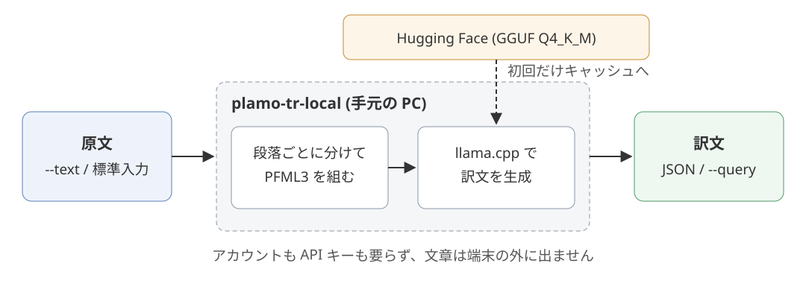
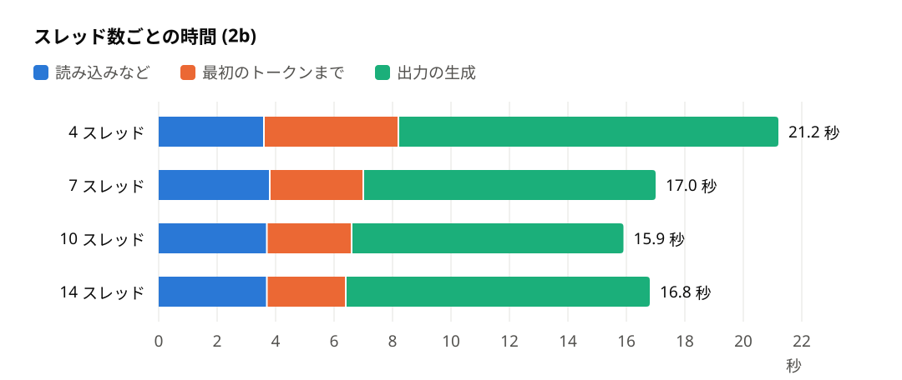
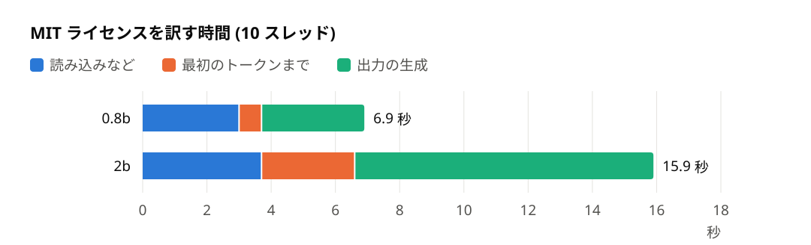

Title: PLaMo 3 Translateを手元で動かしてパイプで訳すCLI plamo-tr-localを作った
Date: 2026-11-05 02:00


Preferred Networks (PFN) の翻訳特化LLMであるPLaMo 3 Translateの重みが、2026-11-05に公開されました。
このモデルを手元のPCで動かして、シェルのパイプで文章を訳すコマンド `plamo-tr-local` を作りました。
リポジトリは[conao3/rust-plamo-tr-local](https://github.com/conao3/rust-plamo-tr-local) (public) で、ライセンスはApache-2.0です。
記事の中の訳文の例はすべてPLaMo 3 Translateの生成物です。



<div class="github-card" data-repo="conao3/rust-plamo-tr-local"><a href="https://github.com/conao3/rust-plamo-tr-local"><span class="github-card-name"><svg class="github-card-mark" viewBox="0 0 16 16" aria-hidden="true"><path d="M6.766 11.328c-2.063-.25-3.516-1.734-3.516-3.656 0-.781.281-1.625.75-2.188-.203-.515-.172-1.609.063-2.062.625-.078 1.468.25 1.968.703.594-.187 1.219-.281 1.985-.281.765 0 1.39.094 1.953.265.484-.437 1.344-.765 1.969-.687.218.422.25 1.515.046 2.047.5.593.766 1.39.766 2.203 0 1.922-1.453 3.375-3.547 3.64.531.344.89 1.094.89 1.954v1.625c0 .468.391.734.86.547C13.781 14.359 16 11.53 16 8.03 16 3.61 12.406 0 7.984 0 3.563 0 0 3.61 0 8.031a7.88 7.88 0 0 0 5.172 7.422c.422.156.828-.125.828-.547v-1.25c-.219.094-.5.156-.75.156-1.031 0-1.64-.562-2.078-1.609-.172-.422-.36-.672-.719-.719-.187-.015-.25-.093-.25-.187 0-.188.313-.328.625-.328.453 0 .844.281 1.25.86.313.452.64.655 1.031.655s.641-.14 1-.5c.266-.265.47-.5.657-.656"/></svg><span>conao3/<strong>rust-plamo-tr-local</strong></span></span><span class="github-card-description">Translate text from the command line with PLaMo 3 Translate running on your machine</span><span class="github-card-footer"><span class="github-card-language"><span class="github-card-language-color" style="background-color: #dea584"></span>Rust</span><span class="github-card-star"><svg viewBox="0 0 16 16" aria-hidden="true"><path d="M8 .25a.75.75 0 0 1 .673.418l1.882 3.815 4.21.612a.75.75 0 0 1 .416 1.279l-3.046 2.97.719 4.192a.751.751 0 0 1-1.088.791L8 12.347l-3.766 1.98a.75.75 0 0 1-1.088-.79l.72-4.194L.818 6.374a.75.75 0 0 1 .416-1.28l4.21-.611L7.327.668A.75.75 0 0 1 8 .25Z"/></svg><span>Star</span><span class="github-card-star-count" hidden></span></span></span></a></div>


# きっかけ

PLaMo 3 Translateは0.8B・2B・8B・31Bの4つの大きさで公開され、llama.cpp向けのGGUFやMLX向けの量子化版もそろっています ([PFNのテックブログ](https://www.preferred.jp/ja/blog/tech/plamo-3-translate-weight-release))。
ただし、重みをダウンロードしただけでは訳せません。
PFML3という形式でプロンプトを組み、llama.cppなどでモデルを動かす手間があるので、文章を少し訳したいときには使いにくいです。

作ろうと思ったのは、kat0hさんの[ポスト](https://x.com/kat0h/status/2118173128207851727)を見たからです。
kat0hさんは、Claudeの日本語の言い回しが嫌で、Claudeの応答を手元のPLaMoを通して表示するスクリプトを用意したそうです。
手元の翻訳モデルをパイプの1段として使えれば、こうした使い方をすぐに試せます。


# 使い方

Nixがあれば、インストールせずに実行できます。

```console
$ nix run github:conao3/rust-plamo-tr-local -- text translate-text --text 今日はいい天気ですね。
```

Cargoでもインストールできます。
Cargoはビルドの途中でllama.cppをコンパイルするので、CMakeとC++ コンパイラとlibclangが要ります。

```console
$ cargo install --git https://github.com/conao3/rust-plamo-tr-local
```

初回の実行で、Hugging Faceの `pfnet/plamo-3-translate-<大きさ>-GGUF` からQ4\_K\_MのGGUFをキャッシュ (Linuxでは `~/.cache/plamo-tr-local` ) へ自動でダウンロードします。
アカウントもAPIキーも要らず、訳す文章は端末の外に出ません。

訳文の言語を指定しなければ、日本語の文は英語に、それ以外の言語の文は日本語に訳します。
既定の出力はJSONです。

```console
$ plamo-tr-local text translate-text --text 今日はいい天気ですね。
{
  "TranslatedText": "The weather is nice today, isn't it?",
  "SourceLanguageCode": null,
  "TargetLanguageCode": "en"
}
```

標準入力から読むときは `--text` を省きます。
訳文だけを取り出すときは、出力のJSONを `jq` に渡します。

```console
$ echo "Since it's raining today, I think I'll relax at home and read a book." \
    | plamo-tr-local text translate-text | jq -r .TranslatedText
今日は雨だから、家でゆっくり本を読んでいようと思う。
```

`--glossary` で語の訳を決め、 `--writing-style` で日本語の常体 (`plain`) と敬体 (`polite`) を選べます。

```console
$ plamo-tr-local text translate-text --text "Filter tasks by owner." \
    --glossary Source=owner,Target=担当者 --writing-style polite | jq -r .TranslatedText
担当者でタスクを絞り込みます。
```

ほかに、周りの段落やページの種類を伝える `--context` と、モデルの大きさを選ぶ `--model-size` があります。
`--model-size` には `0.8b` ・ `2b` ・ `8b` ・ `31b` を指定でき、既定は `2b` です。
小さいモデルほど速く訳し、大きいモデルほど訳の質が上がります。


# AWS CLI型のコマンド体系

コマンド体系はAWS CLI型にしました。
`<コマンド> <サブコマンド>` の後に、名前付きの引数を並べます。


# PFML3のプロンプトを組む

PLaMo 3 Translateへ渡すプロンプトの形式はPFML3です。
`<|plamo:tag|>` で始まる節を並べ、データセットの種類、参考文脈、用語集、原文、訳文の言語と文体を書きます。
`plamo-tr-local` はGGUFのリポジトリに付く `chat_template.jinja` と同じ形で、引数からこの文字列を組み立てます。
たとえば、参考文脈 "A task list" と用語集owner → 担当者 を付けて "Filter by owner." を日本語の敬体に訳すときのプロンプトは次のとおりです。
実際は1行の文字列で、ここでは読みやすいように節ごとに改行しています。

    <|plamo:tag|>dataset<|plamo:msg|>translation
    <|plamo:tag|>context<|plamo:msg|>A task list
    <|plamo:tag|>glossary<|plamo:index|>owner<|plamo:item|>担当者
    <|plamo:tag|>input<|plamo:msg|>Filter by owner.
    <|plamo:tag|>output<|plamo:key|>lang<|plamo:val|>ja<|plamo:key|>form<|plamo:val|>polite<|plamo:msg|>

`input` の節に原文の言語 (`lang`) を書かなければ、モデルが原文の言語を判定します。
モデルは最後の `<|plamo:msg|>` に続けて訳文を生成し、 `plamo-tr-local` は `<|plamo:tag|>` などの区切りのトークンが出たところで生成を止めます。
トークンの選び方はgreedy (毎回もっとも確率の高いトークンを選ぶ) です。
原文に `<|plamo:` を含む文字列があると、プロンプトの区切りと見分けられません。
そのとき `plamo-tr-local` は、終了コード254で終了します。


# 長い文は段落ごとに訳す

モデルカードによると、モデルが一度に扱えるのは入力と出力を合わせて32,768トークンまでです。
`plamo-tr-local` は長い文を空行で段落に分け、4,096トークン以下になるように段落をまとめて1回ずつ訳します。
1つの段落が4,096トークンを超えるときは、行ごとに分けます。
訳した結果は元の文と同じ空行と改行でつなぎ直します。


# 作るときに当たったこと


## llama-cpp-2のリビジョンの固定

Rustからllama.cppを呼ぶのには、[llama-cpp-rs](https://github.com/utilityai/llama-cpp-rs)の `llama-cpp-2` クレートを使っています。
ところが、crates.ioの0.1.161に同梱されたllama.cppでは、モデルの読み込みが `unknown tokenizer: 'plamo3'` で失敗しました。
そこで、llama.cpp v0.8.0を取り込んだllama-cpp-rsのgitのリビジョンに固定しました。

```toml
[dependencies.llama-cpp-2]
git = "https://github.com/utilityai/llama-cpp-rs"
rev = "0364f5da1c6a6ee37f507031f116ce4a09b28594"
version = "0.1.162"
```

Nixでビルドするときは、gitから取る依存の中身を固定するために、 `flake.nix` の `cargoLock.outputHashes` にハッシュを書きます。

```nix
cargoLock = {
  lockFile = ./Cargo.lock;
  outputHashes."llama-cpp-2-0.1.162" = "sha256-7jI4+6tJ6s69ojMeqUbDHbbUfmlMbnecpvWrTM7iLEM=";
};
```


## AVX2を使うビルド

llama-cpp-sys-2 (`llama-cpp-2` が使うllama.cppのバインディング) は、llama.cppのCPU向けの命令セットをRustのtarget featureから決めます。
Rustのx86\_64の既定はSSE2までなので、そのままビルドするとllama.cppもAVX2を使わず、3〜4倍遅くなりました。
そこで、 `.cargo/config.toml` でx86\_64 Linuxのtarget CPUを `x86-64-v3` にしました。
`x86-64-v3` はAVX2を含む水準で、IntelはHaswell以降、AMDはExcavator以降のCPUが当てはまります。

```toml
[target.x86_64-unknown-linux-gnu]
rustflags = ["-C", "target-cpu=x86-64-v3"]
```


## スレッド数の既定

手元のIntel Core Ultra 5 225Uは、性能重視のPコアと省電力のEコアが混ざったCPUで、論理CPUは14個です。
次の節と同じMITライセンスの訳を、2bのモデルでスレッド数を変えて測りました。
4スレッドは1回、ほかは3回以上測った中央値です。

<table border="2" cellspacing="0" cellpadding="6" rules="groups" frame="hsides">


<colgroup>
<col  class="org-right" />

<col  class="org-left" />

<col  class="org-left" />

<col  class="org-left" />
</colgroup>
<thead>
<tr>
<th scope="col" class="org-right">スレッド数</th>
<th scope="col" class="org-left">最初のトークンまで</th>
<th scope="col" class="org-left">出力 (214トークン)</th>
<th scope="col" class="org-left">全体</th>
</tr>
</thead>
<tbody>
<tr>
<td class="org-right">4</td>
<td class="org-left">4.6秒</td>
<td class="org-left">13.0秒</td>
<td class="org-left">21.2秒</td>
</tr>

<tr>
<td class="org-right">7</td>
<td class="org-left">3.2秒</td>
<td class="org-left">10.0秒</td>
<td class="org-left">17.0秒</td>
</tr>

<tr>
<td class="org-right">10</td>
<td class="org-left">2.9秒</td>
<td class="org-left">9.3秒</td>
<td class="org-left">15.9秒</td>
</tr>

<tr>
<td class="org-right">14</td>
<td class="org-left">2.7秒</td>
<td class="org-left">10.4秒</td>
<td class="org-left">16.8秒</td>
</tr>
</tbody>
</table>



入力を読むのは14スレッドがもっとも速く、出力の生成は10スレッドがもっとも速くなりました。
8・9・11・12スレッドも測りましたが、出力の生成は10スレッドより遅くなりました。
14スレッドでは、出力の生成が7スレッドより遅くなりました。
そこで、スレッド数の既定を論理CPUの3/4 (手元では10) にしました。
環境変数 `PLAMO_TR_LOCAL_THREADS` で変えられます。


# 速さ

MITライセンスの本文 (英語169語、252トークンのプロンプト) を日本語に訳す時間を、Intel Core Ultra 5 225UのCPUだけで測りました。
スレッド数は既定の10で、どの値も3回以上測った中央値です。
各段階の時間は `--debug` が出す値です。

```console
$ plamo-tr-local text translate-text --text file://LICENSE | jq -r .TranslatedText
```

<table border="2" cellspacing="0" cellpadding="6" rules="groups" frame="hsides">


<colgroup>
<col  class="org-left" />

<col  class="org-left" />

<col  class="org-left" />

<col  class="org-left" />

<col  class="org-left" />
</colgroup>
<thead>
<tr>
<th scope="col" class="org-left">モデル</th>
<th scope="col" class="org-left">読み込み</th>
<th scope="col" class="org-left">最初のトークンまで</th>
<th scope="col" class="org-left">出力の速さ</th>
<th scope="col" class="org-left">全体</th>
</tr>
</thead>
<tbody>
<tr>
<td class="org-left">0.8b</td>
<td class="org-left">2.8秒</td>
<td class="org-left">0.7秒</td>
<td class="org-left">71トークン/秒</td>
<td class="org-left">6.9秒</td>
</tr>

<tr>
<td class="org-left">2b</td>
<td class="org-left">3.4秒</td>
<td class="org-left">2.9秒</td>
<td class="org-left">23トークン/秒</td>
<td class="org-left">15.9秒</td>
</tr>
</tbody>
</table>



「最初のトークンまで」はモデルを読み込んだあと、プロンプトを読んで最初のトークンを出すまでの時間です。
グラフの「読み込みなど」は、全体から「最初のトークンまで」と出力の生成の時間を引いた残りで、モデルの読み込みを含みます。
訳文は0.8bが229トークン、2bが214トークンでした。
2bの訳文は次のとおりです。

> MITライセンス
> 
> Copyright (c) &lt;year&gt; &lt;copyright holders&gt;
> 
> 本ソフトウェアおよび関連ドキュメントファイル（以下「本ソフトウェア」）の複製を取得したすべての者に対し、以下の条件に従い、本ソフトウェアを制限なく取り扱う（本ソフトウェアの使用、複製、改変、結合、公開、頒布、サブライセンス、および／または販売を行う権利、ならびに本ソフトウェアを提供された者が同様の行為を行うことを許可する権利を含むが、これらに限定されない）ことを、無償で許諾する。
> 
> 上記の著作権表示および本許諾表示は、本ソフトウェアのすべての複製物または実質的な部分に含まれなければならない。
> 
> 本ソフトウェアは「現状のまま」提供され、明示的か黙示的かを問わず、商品性、特定目的への適合性、および非侵害性に関する保証を含むがこれらに限定されない、いかなる種類の保証も伴わない。いかなる場合においても、著作者または著作権者は、契約上の行為、不法行為、またはその他の事由を問わず、本ソフトウェアに起因し、または本ソフトウェアの使用もしくはその他の取り扱いに関連して生じたいかなる請求、損害、またはその他の責任についても、一切の責任を負わないものとする。

モデルの読み込みはコマンドを呼ぶたびにかかり、0.8bでは全体の4割を占めます。
Claudeの答えを段落ごとに流して訳すような使い方では、この読み込みの時間が段落の数だけ積み重なります。
モデルを読み込んだまま入力を待つ常駐の形にするのが、次の課題です。


# 文体の指定で試したこと

PLaMo 3 Translateで指定できる文体 (`form`) は、常体 (`plain`) と敬体 (`polite`) の2つです。
お嬢様言葉や関西弁に訳せるかを試しました。
llama.cppの `llama-server` で2Bと8BのGGUF (Q4\_K\_M) を動かし、temperatureを0にして、次の指定を試しました。

-   訳文の言語 (`lang`) に `お嬢様言葉` ・ `関西弁` ・ `Japanese (Kansai dialect)` を入れると、原文の日本語をそのまま返しました。
-   `form` に `お嬢様言葉` ・ `ojousama` ・ `kansai` を入れると、常体で訳しました。
-   参考文脈 (`context`) に「お嬢様言葉で訳す」と書くと、ふつうの口調で訳しました。
-   お嬢様言葉の対訳の履歴を2組、原文の前に置くと、ふつうの口調で訳しました。

2Bと8Bのどちらでも、お嬢様言葉や関西弁の訳文は出ませんでした。

一方、日本語から日本語へ `form=polite` を付けて訳すと、常体の文を敬体に書き換えられました (2B)。

    今日は雨だから家で本読むわ。
    → 今日は雨だから家で本を読みます。

`plamo-tr-local` は原文と訳文に同じ言語を指定すると止まるので、この書き換えは `llama-server` で試しただけです。


# ライセンス

`plamo-tr-local` のライセンスはApache-2.0です。
`plamo-tr-local` がダウンロードするモデルのライセンスはPFNのPLaMoコミュニティライセンス ([本文](https://huggingface.co/pfnet/plamo-3-translate-8b/raw/main/LICENSE/ja)) で、要点は次のとおりです。

-   私的な利用と非商用の利用は無償です。
-   商用の利用はPLaMo商用利用登録フォームで登録したうえで、直近の事業年度の売上が10億円以下である間は無償です。
-   生成した訳文を公表するときは、PLaMoの生成物であることを明示します。
-   モデルや派生モデル、生成物を第三者に提供するときは「Built with PLaMo」と表示します。 `plamo-tr-local` のREADMEにもこの表示を書いています。

使う前に、ライセンスの本文を読んでください。


# おわりに

文章を端末の外に出さずに訳したいときに使ってください。

