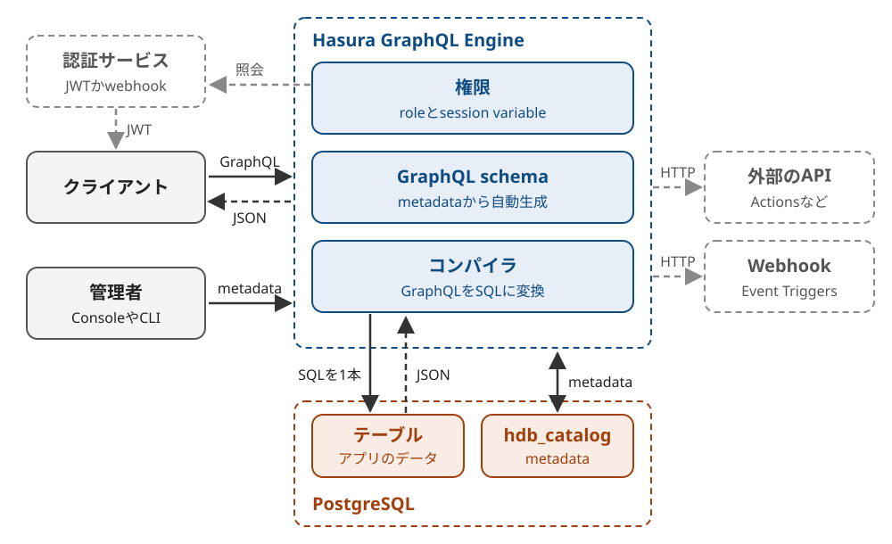
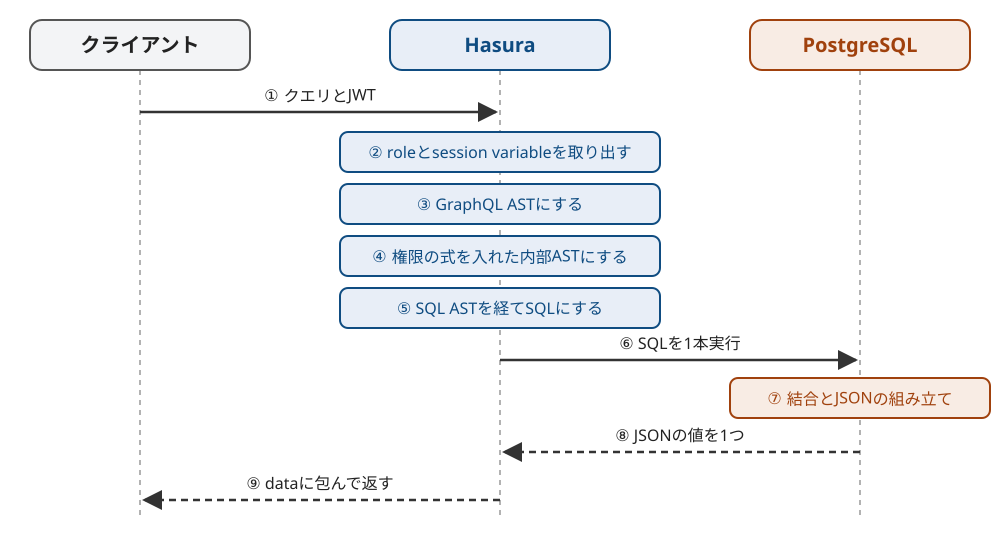
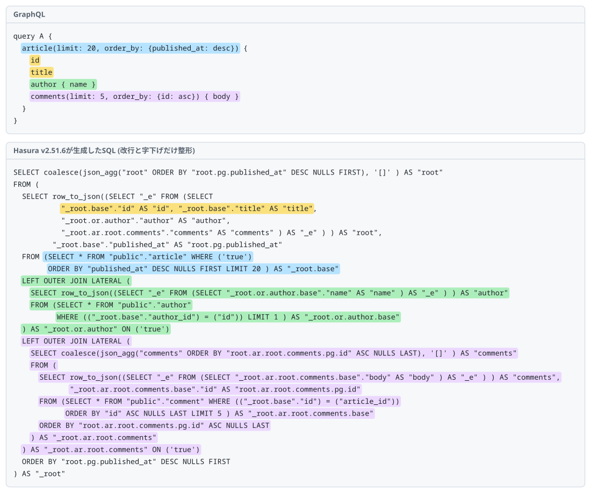
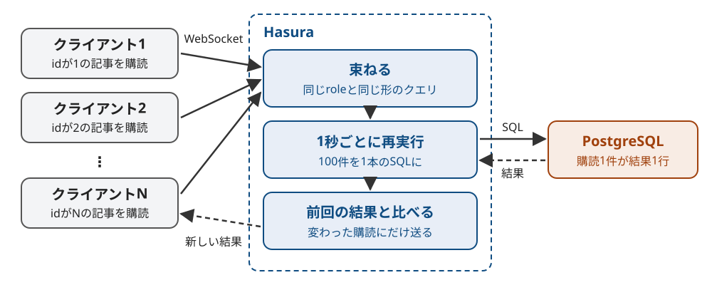

Title: HasuraがGraphQLのクエリを1本のSQLにする仕組み
Date: 2026-11-17 02:18
Draft: true
Tags: hasura graphql postgresql


HasuraはPostgreSQLのテーブルからGraphQLのAPIを作るサーバーで、気に入って使っています。
ただ、テーブルを登録するだけでAPIができる理由を、これまで調べたことがありませんでした。

調べると、Hasuraはresolverを持たないコンパイラでした。
テーブルとrelationshipと権限の定義からGraphQLのschemaを作り、届いたクエリを1本のSQLに変換します。
行の取得も結合もJSONの組み立ても、そのSQLを受け取ったPostgreSQLが行います。

この記事はHasura GraphQL Engineのv2を対象にしています。
載せたSQLは、PostgreSQL 17.11に接続したv2.51.6が実際に生成したものです。


# 構成



どの構成でも動くのは、HasuraのコンテナとPostgreSQLの2つです。
権限の判定、GraphQLのschemaの生成、GraphQLからSQLへの変換は、どのリクエストでも動きます。
図では青い部品です。

APIの形を決めるのはmetadataです。
metadataは、公開するテーブル、テーブルのあいだのrelationship、roleごとの権限の定義で、ConsoleやCLI、Metadata APIから登録します。
HasuraがmetadataをJSONで保存するのはPostgreSQLの `hdb_catalog` というschemaです。
[公式のドキュメント](https://hasura.io/docs/2.0/getting-started/how-it-works/index/)によると、テーブルを1つ登録すると、Hasuraはその型を作ります。
検索、主キーでの取得、集計、追加、更新、削除、購読のフィールドも作ります。

図の点線の部品が動くのは設定したときだけです。
[認証](https://hasura.io/docs/2.0/auth/overview/)はHasuraの外で行います。
HasuraはJWTかwebhookでroleとsession variableを受け取ります。
ActionsとRemote Schemasは外部のAPIをschemaに加える機能で、Event Triggersは行の変更をwebhookに送る機能です。
HasuraはMySQLやOracleなどには、[data connector agent](https://hasura.io/docs/2.0/databases/data-connectors/)というサービスを経由してつなぎます。


# クエリ1件の流れ



クライアントがクエリを送ると、Hasuraは図の②から⑤の順でSQLを作ります。
②から⑤の段階は、Hasuraの[設計の文書](https://github.com/hasura/graphql-engine/blob/master/architecture/live-queries.md)に書かれています。
②でroleとsession variableを取り出し、③でクエリをGraphQLのASTにします。
④でroleごとの権限の式をASTに入れます。
⑤では、そのASTをSQLのASTに変えてからSQLの文字列にします。

Hasuraが実行するSQLはroot fieldごとに1本で、クエリのroot fieldが1つならSQLも1本です。
PostgreSQLは結果のJSONを1つの値で返し、Hasuraはそれを `data` に包んで応答にします。
著者2,000人を記事とコメントごと取るクエリでは、SQLの結果が8,423,123バイト、HTTPの応答が8,423,143バイトでした。
差の20バイトは、応答の先頭と末尾に付く `data` とフィールド名の分です。

resolverがフィールドごとにデータを取る作りでは、親の行の数だけ子のSQLを実行するN+1問題が起きます。
設計の文書は、クエリ全体を1本のSQLにすればN+1問題がなくなり、データベースが全体を見て最適化できると書いています。


# GraphQLとSQLの対応

検証するため、著者、記事、コメントの3つのテーブルを作りました。
公開日の新しい順に記事を20件取り、著者の名前とコメントの先頭5件を付けるクエリを、[Explain API](https://hasura.io/docs/2.0/api-reference/explain/)に送りました。
Explain APIは、Hasuraが生成するSQLを返すAPIです。
次の図は、上が送ったクエリ、下が返ってきたSQLで、SQLの改行と字下げは私が足しました。



GraphQLの入れ子1段が、SQLでは副問い合わせ1つになっています。

-   青の `article` と引数は、記事のテーブルを `ORDER BY` と `LIMIT 20` で絞る副問い合わせになります。
-   黄の `id` と `title` は、 `row_to_json` に渡す列です。
-   緑の `author` は記事1件に著者1人のrelationshipで、 `LEFT OUTER JOIN LATERAL` と `LIMIT 1` の副問い合わせになります。
-   紫の `comments` は記事1件にコメント複数のrelationshipで、 `LEFT OUTER JOIN LATERAL` の中の `json_agg` がコメントの行を配列にします。

色を付けていない一番外側の `json_agg` の値が応答の配列です。


# 権限

権限では、roleごとに見せる行の条件を式で定義します。
`user` というroleに、自分が著者の記事と、その記事のコメントだけを見せる権限を付けました。
記事の条件は、 `author_id` がsession variableの `X-Hasura-User-Id` と等しいことです。

roleが `user` で `X-Hasura-User-Id` が42のリクエストとして、同じクエリをExplain APIに送りました。
記事の副問い合わせは次のように変わりました。

```sql
FROM (SELECT * FROM "public"."article"
      WHERE (("public"."article"."author_id") = (('42')::integer))
      ORDER BY "published_at" DESC NULLS FIRST LIMIT 20 ) AS "_root.base"
```

adminのroleで生成した最初のSQLでは `WHERE ('true')` だった場所に、権限の式が入っています。
コメントの副問い合わせには、コメントの権限の式が `EXISTS` で加わりました。

```sql
FROM (SELECT * FROM "public"."comment"
      WHERE ((("_root.base"."id") = ("article_id"))
        AND (EXISTS (SELECT 1 FROM "public"."article" AS "__be_0_article"
          WHERE (((("__be_0_article"."id") = ("public"."comment"."article_id")) AND ('true'))
            AND (('true') AND (((("__be_0_article"."author_id") = (('42')::integer))
              AND ('true')) AND ('true')))) )))
      ORDER BY "id" ASC NULLS LAST LIMIT 5 ) AS "_root.ar.root.comments.base"
```

権限の式は、テーブルを参照する副問い合わせごとに入ります。
このroleで記事を数えると、20万件のうち20件でした。


# 購読



subscriptionも1本のSQLにする同じ仕組みで動きます。
ここで説明するのは、Hasuraのsubscriptionのうちlive queryと呼ばれる方式です。
[公式のドキュメント](https://hasura.io/docs/2.0/subscriptions/postgres/livequery/execution/)によると、Hasuraは購読されたクエリを一定の間隔で再実行し、結果が前回から変わった購読にだけ新しい結果を送ります。
間隔の既定値は1秒です。
Hasuraはroleと形が同じで変数だけが違う購読を、100件まで1本のSQLにまとめます。

idを変数にして記事を1件購読するクエリをExplain APIに送ると、次のSQLになりました。
`...` の行は省いたところです。

```sql
SELECT "__subs"."result_id" , "__fld_resp"."root" AS "result"
FROM UNNEST(($1)::uuid[], ($2)::json[]) AS "__subs"("result_id", "result_vars")
LEFT OUTER JOIN LATERAL (
  ...
      FROM (SELECT * FROM "public"."article"
            WHERE (("public"."article"."id") =
                   ((("__subs"."result_vars"#>>ARRAY['query', 'id']))::integer)) ) AS "_root.base"
  ...
) AS "__fld_resp" ON ('true')
```

`$1` は購読のIDの配列、 `$2` は購読ごとの変数の配列です。
`UNNEST` がこの2つを購読1件につき1行の表にし、 `LATERAL` の中のクエリが行ごとの変数で記事を絞ります。
結果もその行ごとに返ります。


# 調べ方

権限の式を入れたクエリも、購読も、最後は1本のSQLになっていました。
Hasuraの動きで分からないところは、Explain APIが返すSQLを読むと確かめられます。

