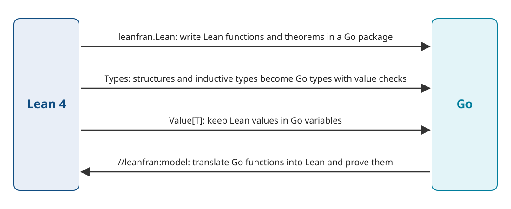
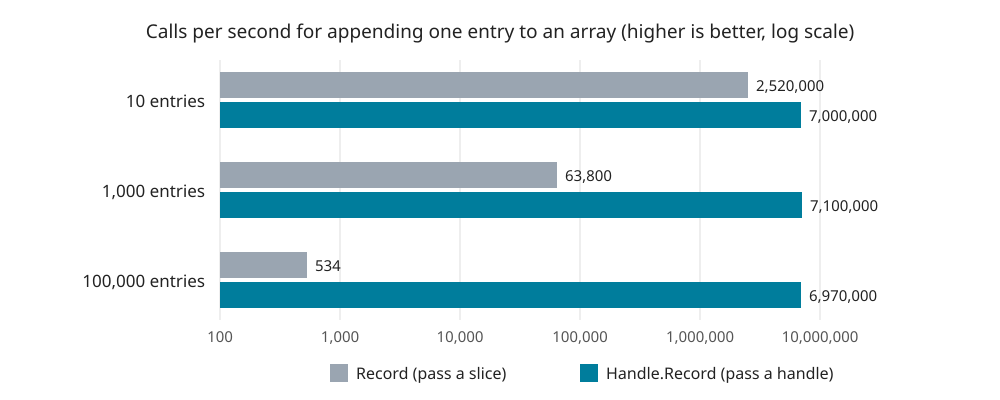

Title: leanfran for Go: call Lean 4 functions from Go, and prove Go functions in Lean
Date: 2026-11-27 20:22
Updated: 2026-11-27 20:22
Lang: en
Original: /blog/2026/ad14a8
Tags: lean go formal-verification code-generation release lean-leanfran


I built the Go version of leanfran, which lets you call functions written and proved in Lean 4 from Go packages.
In the other direction, you can translate functions written in Go into Lean and prove their properties in Lean.

A Lean structure becomes a Go struct that checks its field conditions when you create a value, and inductive types for enumerations and case splits become Go types too.

The repository is [langs/Go/ in conao3/lean-leanfran](https://github.com/conao3/lean-leanfran/tree/v0.13.2/langs/Go), under the Apache-2.0 license.
I publish the Go module as [github.com/conao3/leanfran-go](https://pkg.go.dev/github.com/conao3/leanfran-go@v0.13.2), and this post uses the results of running version 0.13.2.

leanfran converts the intermediate representation of the Lean compiler into Go.
The generated Go runs with only this module and the Go standard library, so you need neither Lean nor cgo at run time.

[The post that introduced leanfran](https://s.conao3.com/blog/2026/21ebbd) covers Rust, Python, TypeScript, and Clojure, and [the PHP post](https://s.conao3.com/blog/2026/88e5f5) covers PHP.
The Go version ships from the same repository at the same version.

<div class="github-card" data-repo="conao3/lean-leanfran"><a href="https://github.com/conao3/lean-leanfran"><span class="github-card-name"><svg class="github-card-mark" viewBox="0 0 16 16" aria-hidden="true"><path d="M6.766 11.328c-2.063-.25-3.516-1.734-3.516-3.656 0-.781.281-1.625.75-2.188-.203-.515-.172-1.609.063-2.062.625-.078 1.468.25 1.968.703.594-.187 1.219-.281 1.985-.281.765 0 1.39.094 1.953.265.484-.437 1.344-.765 1.969-.687.218.422.25 1.515.046 2.047.5.593.766 1.39.766 2.203 0 1.922-1.453 3.375-3.547 3.64.531.344.89 1.094.89 1.954v1.625c0 .468.391.734.86.547C13.781 14.359 16 11.53 16 8.03 16 3.61 12.406 0 7.984 0 3.563 0 0 3.61 0 8.031a7.88 7.88 0 0 0 5.172 7.422c.422.156.828-.125.828-.547v-1.25c-.219.094-.5.156-.75.156-1.031 0-1.64-.562-2.078-1.609-.172-.422-.36-.672-.719-.719-.187-.015-.25-.093-.25-.187 0-.188.313-.328.625-.328.453 0 .844.281 1.25.86.313.452.64.655 1.031.655s.641-.14 1-.5c.266-.265.47-.5.657-.656"/></svg><span>conao3/<strong>lean-leanfran</strong></span></span><span class="github-card-description">Write and prove functions in Lean 4, run them as Rust, Python, TypeScript, Clojure, PHP and Go</span><span class="github-card-footer"><span class="github-card-language"><span class="github-card-language-color"></span>Lean</span><span class="github-card-star"><svg viewBox="0 0 16 16" aria-hidden="true"><path d="M8 .25a.75.75 0 0 1 .673.418l1.882 3.815 4.21.612a.75.75 0 0 1 .416 1.279l-3.046 2.97.719 4.192a.751.751 0 0 1-1.088.791L8 12.347l-3.766 1.98a.75.75 0 0 1-1.088-.79l.72-4.194L.818 6.374a.75.75 0 0 1 .416-1.28l4.21-.611L7.327.668A.75.75 0 0 1 8 .25Z"/></svg><span>Star</span><span class="github-card-star-count" hidden></span></span></span></a></div>


# Four ways to use it

There are four ways to use leanfran from Go.



1.  Write Lean functions and theorems as the argument of `leanfran.Lean(...)` in a Go package, and call the functions that `go tool leanfran sync` generates from Go.
2.  Use Lean structures and inductive types as Go types that come with value checks and JSON conversion.
3.  Keep Lean values in Go variables with `leanfran.Value[T]`, and pass them to the next call without converting them.
4.  Add `//leanfran:model` to a function written in Go to translate it into Lean, and check the Lean theorems that prove its properties with `go tool leanfran check`.

1 to 3 go from Lean to Go, and 4 goes from Go to Lean.


# Writing Lean in a Go package

Install `leanfran-go`, the CLI that converts Lean code, with nix, and add the leanfran-go package and the command you call with `go tool` to your application's module.

```console
$ nix profile install github:conao3/lean-leanfran/v0.13.2#go
$ go mod init example.com/shop
$ go get github.com/conao3/leanfran-go@v0.13.2
$ go get -tool github.com/conao3/leanfran-go/cmd/leanfran@v0.13.2
```

You need Go 1.26 or later.
Generating code and checking proofs also need `lean` and `lake` from Lean 4.35.0 on your `PATH`.

Write the following package in `pricing/pricing.go`.

```go
package pricing

import "github.com/conao3/leanfran-go"

var _ = leanfran.Lean(`
structure Range where
  lo : Nat
  hi : Nat
  ok : lo ≤ hi

def width (r : Range) : Nat := r.hi - r.lo

theorem width_le (r : Range) : width r ≤ r.hi := by
  unfold width
  omega
`)
```

You write the Lean source as a raw string in `leanfran.Lean(...)`, and this post calls the Lean code you pass to `leanfran.Lean(...)` a block.
Each package holds one block.

The `ok` field of `Range` states that `lo ≤ hi` holds.
`width_le` is a theorem that the width is at most the upper bound.

The caller, `main.go`, creates a value with the generated `NewRange` and passes it to `pricing.Width`.

```go
package main

import (
        "fmt"
        "log"
        "math/big"

        "example.com/shop/pricing"
)

func main() {
        r, err := pricing.NewRange(big.NewInt(2), big.NewInt(5))
        if err != nil {
                log.Fatal(err)
        }
        width, err := pricing.Width(r)
        if err != nil {
                log.Fatal(err)
        }
        fmt.Println(width)
}
```

Run `go tool leanfran sync`, and Lean checks the theorem and leanfran generates Go.
From then on, you can build and run the program with Go alone.

```console
$ go tool leanfran sync
leanfran: 1 block checked and generated
$ go run .
3
```

`sync` writes `leanfran.json`, which records the hash of the block, and the generated Go files to the directory that holds `pricing.go`.
If you commit these files to the repository, CI can run `go tool leanfran status` without Lean to check that they are up to date.

If you change the theorem to `width r ≤ r.lo`, the proof fails and generation stops there.

```console
$ go tool leanfran sync 2>&1 | sed "s|$PWD/||"
leanfran: lake build: exit status 1
✖ [4/6] Building LeanGoEmbed.B6578616d706c652e636f6d2f73686f702f70726963696e67 (263ms)
pricing/pricing.go:15:3: error: (lean block example.com/shop/pricing, Lean 11:2) omega could not prove the goal:
a possible counterexample may satisfy the constraints
  b ≥ 0
  a ≥ 0
  a - b ≤ 0
  2*a - b ≤ -1
where
 a := ↑r.lo
 b := ↑r.hi
Some required targets logged failures:
- LeanGoEmbed.B6578616d706c652e636f6d2f73686f702f70726963696e67
error: build failed
```

The error starts with the line and column in the Go file, followed by the line and column of the Lean code inside the block.
A failed generation leaves the Go that leanfran generated before in place, so `go run .` still prints `3`.


# Lean types become Go types

`Range` becomes a Go struct, and `lo` and `hi` become its fields `Lo` and `Hi` of type `*big.Int`.
`ok` becomes a check of `lo ≤ hi` when you create a value.

The following `cmd/rangecheck/main.go` creates a value from JSON, passes input that breaks the condition to `NewRange`, and then prints the JSON Schema.

```go
package main

import (
        "encoding/json"
        "fmt"
        "log"
        "math/big"

        "example.com/shop/pricing"
)

func main() {
        var r pricing.Range
        if err := json.Unmarshal([]byte(`{"lo":1,"hi":4}`), &r); err != nil {
                log.Fatal(err)
        }
        fmt.Println(r.Hi)

        _, err := pricing.NewRange(big.NewInt(5), big.NewInt(2))
        fmt.Println(err)

        schema, err := r.JSONSchema("draft-2020-12")
        if err != nil {
                log.Fatal(err)
        }
        out, _ := json.MarshalIndent(schema, "", "  ")
        fmt.Println(string(out))
}
```

```console
$ go run ./cmd/rangecheck
4
Range.ok: lo ≤ hi
{
  "$schema": "https://json-schema.org/draft/2020-12/schema",
  "additionalProperties": false,
  "properties": {
    "hi": {
      "minimum": 0,
      "type": "integer"
    },
    "lo": {
      "minimum": 0,
      "type": "integer"
    }
  },
  "required": [
    "lo",
    "hi"
  ],
  "type": "object"
}
```

`NewRange` decides `lo ≤ hi` with code compiled from Lean, so when you pass a `lo` greater than `hi`, it returns a `*leanfran.ValidationError`.
JSON Schema can't express `lo ≤ hi` across two fields, so the schema only states that each `Nat` is 0 or more.

`json.Unmarshal` and `Validate` check the same condition as `NewRange`.
The generated functions also check their arguments when they receive them, so passing a value built with a struct literal to `pricing.Width` returns a `*leanfran.ValidationError` as well.


# Keeping Lean values in Go

On each call, a generated function converts its arguments to Lean's representation and its return value to a Go value.
If you pass a large value again and again, this conversion takes up most of the run time.

`leanfran.Value[T]` is a handle that holds one reference to a Lean value.
With handles, you can keep Lean values in Go variables without converting them.

In `ledger/ledger.go`, write `record`, which appends one amount to an array, and `count`, which returns the number of entries.

```go
package ledger

import "github.com/conao3/leanfran-go"

var _ = leanfran.Lean(`
def record (xs : Array UInt64) (x : UInt64) : Array UInt64 := xs.push x

def count (xs : Array UInt64) : Nat := xs.size

theorem count_record (xs : Array UInt64) (x : UInt64) :
    count (record xs x) = count xs + 1 := by
  simp [count, record]
`)
```

Along with `Record`, which takes a `[]uint64`, `sync` generates `Handle.Record`, which takes a handle and returns a handle.
To convert between Go values and handles, use the methods of the generated `ledger.Value`, such as `ledger.Value.NewArrayUInt64` and `ledger.Value.ReadNat`.

The following `cmd/ledger/main.go` turns the first two entries from a Go slice into a handle, and then adds the next two entries to the handle `entries`.
`record` and `count` don't check their arguments and can't fail on the Lean side, so the generated functions don't return an `error`.

```go
package main

import (
        "fmt"

        "example.com/shop/ledger"
)

func main() {
        entries := ledger.Value.NewArrayUInt64([]uint64{1200, 800})
        defer func() { entries.Close() }()

        for _, amount := range []uint64{300, 50} {
                x := ledger.Value.NewUInt64(amount)
                entries = ledger.Handle.Record(entries.Take(), x.Take())
        }

        n := ledger.Handle.Count(entries.Borrow())
        defer n.Close()
        fmt.Println(ledger.Value.ReadNat(n))
        fmt.Println(ledger.Value.ReadArrayUInt64(entries))
}
```

```console
$ go tool leanfran sync
leanfran: 2 blocks checked and generated
$ go run ./cmd/ledger
4
[1200 800 300 50]
```

Pass `entries.Borrow()` or `entries.Take()` as the argument.
Use `Borrow` when you keep using `entries` after the call, and `Take` when you hand the reference over to Lean and are done with that handle.

No other reference points to the array you pass with `Take`, so Lean's `Array.push` adds the entry in place without copying the array.

`Value.ReadNat` and `Value.ReadArrayUInt64` are the methods that convert the contents of a handle to Go values.
Call `Close` on a handle you are done with to release its reference.
Go's GC doesn't release this reference, so call `Close` on each handle you didn't pass with `Take`.

I measured appending one entry to arrays of 10, 1,000, and 100,000 entries on Linux/amd64 with an Intel Core i5-8400 and Go 1.27.3.
I passed the same slice to `Record` on each call, and kept passing `Handle.Record` a handle that I built from an array of the same size, with `Take`.

The figure and the table show calls per second, computed from the median of 11 runs pinned to one CPU, and higher is better.



<table border="2" cellspacing="0" cellpadding="6" rules="groups" frame="hsides">


<colgroup>
<col  class="org-left" />

<col  class="org-left" />

<col  class="org-left" />
</colgroup>
<thead>
<tr>
<th scope="col" class="org-left">Array size</th>
<th scope="col" class="org-left"><code>Record</code> (calls/s)</th>
<th scope="col" class="org-left"><code>Handle.Record</code> (calls/s)</th>
</tr>
</thead>
<tbody>
<tr>
<td class="org-left">10</td>
<td class="org-left">2,520,000</td>
<td class="org-left">7,000,000</td>
</tr>

<tr>
<td class="org-left">1,000</td>
<td class="org-left">63,800</td>
<td class="org-left">7,100,000</td>
</tr>

<tr>
<td class="org-left">100,000</td>
<td class="org-left">534</td>
<td class="org-left">6,970,000</td>
</tr>
</tbody>
</table>

`Record` gets slower as the array grows, while `Handle.Record` stays between 6.97 and 7.10 million calls per second at all three sizes.

Each handle belongs to a region, and the leanfran-go runtime runs operations on handles in the same region one at a time.
The handles in the examples so far belong to the default region, and each process has one default region.
If you create a region with `leanfran.NewRegion()` and create handles inside that region's `WithValues`, multiple goroutines can operate on handles in different regions at the same time.

[The value-server sample](https://github.com/conao3/lean-leanfran/tree/v0.13.2/langs/Go/samples/value-server) shows a server that keeps its state in a handle and replaces it with a handle for the next state on each request.


# Proving Go functions in Lean

For the other direction, write `Clamp`, which keeps a value within a range, in Go, and tie it to a Lean specification with `//leanfran:model`.

```go
package calc

import "github.com/conao3/leanfran-go"

var _ = leanfran.Lean(`
def clampSpec (x lo hi : Int64) : Int64 := max lo (min hi x)
def ordered (_x lo hi : Int64) : Bool := decide (lo ≤ hi)
def inRange (_x lo hi r : Int64) : Bool := decide (lo ≤ r) && decide (r ≤ hi)
`)

//leanfran:model refines=clampSpec requires=ordered ensures=in_range:inRange
func Clamp(x, lo, hi int64) int64 {
        if x < lo {
                return lo
        }
        if x > hi {
                return hi
        }
        return x
}
```

`refines` names a Lean function that returns the same value as the implementation, `requires` names the precondition on the inputs, and `ensures` names the condition the return value satisfies.
In this example, the proof obligations are that `Clamp` returns the same value as `clampSpec` when `lo ≤ hi`, and that the return value is at least `lo` and at most `hi`.

`go tool leanfran check` reads the Go syntax tree and types, translates the function into a Lean function, and states the obligations as propositions with names such as `Clamp.obligation.refines`.
The proofs go in `lean/Proofs/` next to `go.mod`, and here I take [the proof from the verified-clamp sample](https://github.com/conao3/lean-leanfran/blob/v0.13.2/langs/Go/samples/verified-clamp/lean/Proofs/Clamp.lean) and change only the module name to match this package.

```lean
import LeanGoModel.B6578616d706c652e636f6d2f73686f702f63616c63

open LeanGoEmbed.B6578616d706c652e636f6d2f73686f702f63616c63
namespace LeanGoModel.B6578616d706c652e636f6d2f73686f702f63616c63

theorem Clamp.proof.refines : Clamp.obligation.refines := by
  intro x lo hi h
  simp only [ordered, decide_eq_true_eq] at h
  simp only [Clamp, clampSpec, Id.run, pure, Pure.pure, Int64.min_def, Int64.max_def,
    decide_eq_true_eq]
  repeat' split
  all_goals simp_all only [Int64.lt_iff_toInt_lt, Int64.le_iff_toInt_le, ← Int64.toInt_inj] <;> omega

theorem Clamp.proof.in_range : Clamp.obligation.in_range := by
  intro x lo hi h
  simp only [ordered, decide_eq_true_eq] at h
  simp only [Clamp, inRange, Id.run, pure, Pure.pure, Bool.and_eq_true, decide_eq_true_eq]
  split <;> try split
  all_goals simp_all only [Int64.lt_iff_toInt_lt, Int64.le_iff_toInt_le]
  all_goals constructor <;> first | exact True.intro | omega

end LeanGoModel.B6578616d706c652e636f6d2f73686f702f63616c63
```

The part of the module name after `B` is the Go import path `example.com/shop/calc`, with each UTF-8 byte written in hexadecimal.

```console
$ go tool leanfran check --require proved
leanfran: 3 blocks checked and generated
example.com/shop/calc.Clamp [in_range]: proved
example.com/shop/calc.Clamp [refines]: proved
```

With `--require proved`, the exit code is 1 if any obligation is not `proved`.
`proved` means that the theorem's type matches the obligation and that the proof doesn't rely on `sorry`, which skips a proof, or on axioms outside Lean's standard ones.

`check` writes the result of each obligation to `leanfran.lock` next to `go.mod`, so if you commit that file too, `go tool leanfran status` can check without Lean that the proof results are up to date.

You can also compare the Go implementation with the Lean specification in a test with random inputs, and this test runs without Lean.
`sync` generates `leanfran_model_test.go` in each package that has `//leanfran:model`, so you run the test with `go test`.

```console
$ go test ./calc/
ok  	example.com/shop/calc	0.003s
```

The generated test builds inputs from random numbers with a fixed seed and from boundary values such as 0 and the largest integer, and collects 200 inputs that satisfy `requires`.
For each input, it compares the return value of Go's `Clamp` with the value of `ClampSpec`, the function that leanfran generates from `clampSpec`.

Now change the second `if` in the implementation so that it returns `hi - 1` when `x` is at least `hi`.

```go
if x >= hi {
        return hi - 1
}
```

Both proofs fail, so `check` prints Lean's errors to standard error and sets the status of each obligation to `failed`.

```console
$ go tool leanfran check --require proved 2>/dev/null
leanfran: 3 blocks checked and generated
example.com/shop/calc.Clamp [in_range]: failed
example.com/shop/calc.Clamp [refines]: failed
```

The random test that `go test` runs also finds a counterexample, an input where all three arguments are 0.

```console
$ go test ./calc/
--- FAIL: TestLeanfranModels (0.00s)
    --- FAIL: TestLeanfranModels/Clamp (0.00s)
        leanfran_model_test.go:12: Clamp: refines: got []interface {}{-1}, want []interface {}{0} (seed=1, input=[]interface {}{0, 0, 0})
FAIL
FAIL	example.com/shop/calc	0.002s
FAIL
```


# What the proofs guarantee

The Lean theorems guarantee properties of the functions written in Lean and of the Lean models translated from Go.
For those properties to hold when the generated Go or the original Go runs, the generator and the runtime that convert Lean to Go, the translator that turns Go into Lean, and the model of Go's operations must be correct, so I check these four parts with tests.

I check the translator with tests that compare the results of running hand-written Go with the results of compiling the translated model with Lean's standard C backend and running it.
For the model of operations, tests compare code generated from the model with Go's operations at boundary values, and also check that each failure in the model matches a `panic` in Go.

I check the generator and the runtime that convert Lean to Go with tests that compare the results of the generated Go with those of Lean's C backend.

At the time of writing, I have tried 1,769,817 numeric operations built from boundary values and random numbers on Linux/amd64.
Of those, 1,764,071 results match the C backend byte for byte.

The remaining 5,746 come from functions that return floating-point numbers, and their differences stay within a tolerance set for each function.
`Float.cos` differs the most, by 88 times the gap between adjacent floating-point numbers.

In the translation from Go to Lean, leanfran maps Go integers to Lean integers of the same width, and `int` and `uint` to `Int64` and `UInt64`.
Division by zero, out-of-range indexes, and `panic` become values that represent failure in the model.

leanfran can translate a subset of Go: `if`, `switch`, `for`, slice indexing and `append`, and structs.

Functions that use pointers, maps, channels, goroutines, methods, generics, `defer`, or input and output are out of scope.
The full list of supported syntax is in [the Go guide](https://github.com/conao3/lean-leanfran/blob/v0.13.2/docs/go-guide.md#go-subset-and-proof-scope).


# Wrapping up

Besides the examples in this post, [the Go samples](https://github.com/conao3/lean-leanfran/tree/v0.13.2/langs/Go/samples) include verified-nibble, which proves that a bit mask gives the same result as a remainder.
There are also embed-models, which shares a Go struct between two packages, and greet-cli, which runs a Lean `IO` function as a Go command.

The setup steps are in [the Go README](https://github.com/conao3/lean-leanfran/blob/v0.13.2/langs/Go/README.md), and the details of the type mapping and the CLI are in [the Go guide](https://github.com/conao3/lean-leanfran/blob/v0.13.2/docs/go-guide.md).

