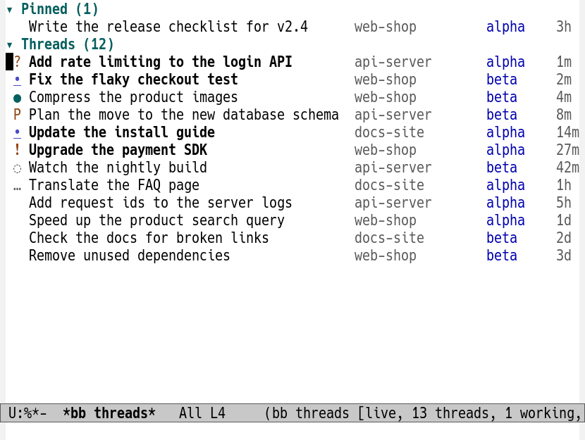
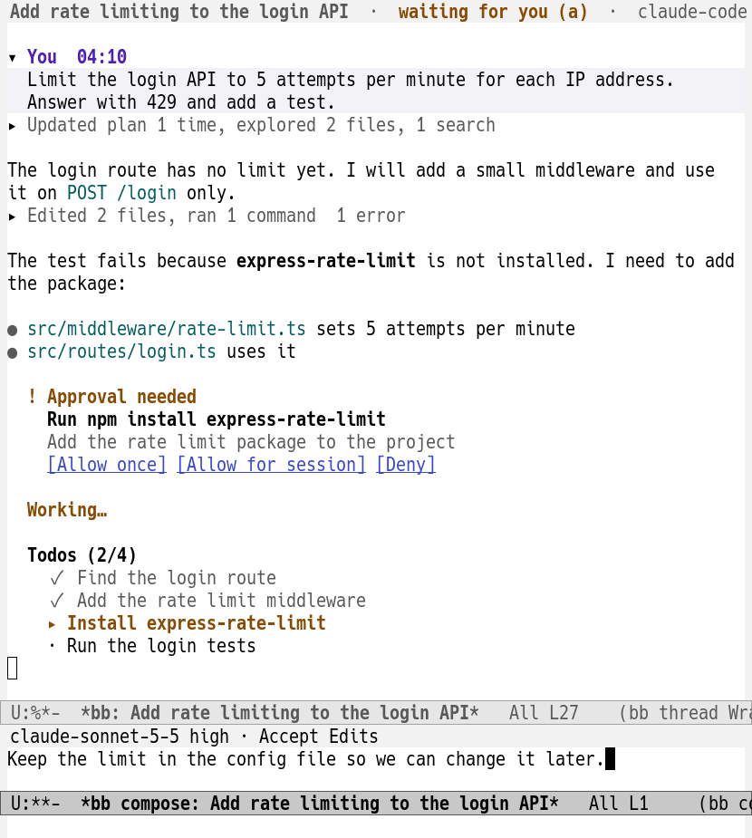
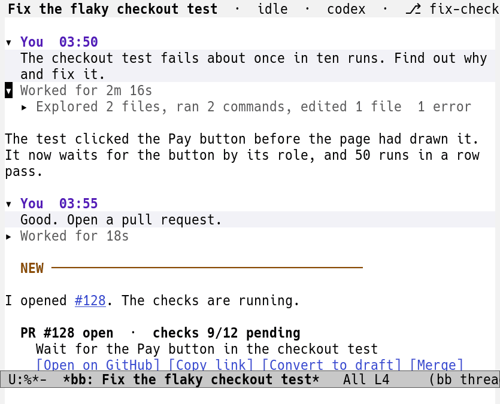
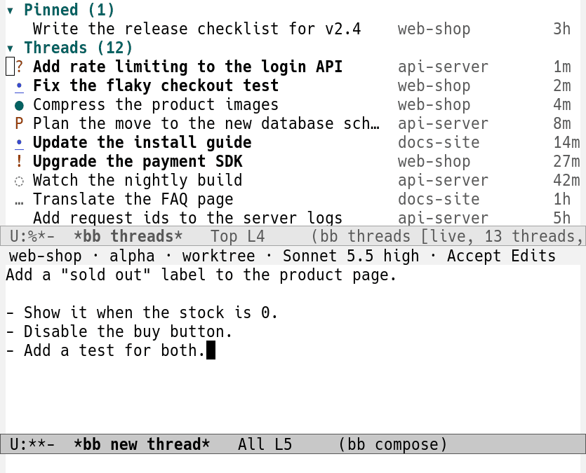

Title: bb-agent.el: Claude Code and Codex threads in Emacs, the way the bb GUI shows them
Date: 2026-11-28 04:25
Updated: 2026-11-28 04:25
Lang: en
Original: /blog/2026/b3e7d9
Tags: emacs emacs-lisp ai-agent claude-code codex bb vow-el release bb-agent-el ts-bb-events


I made bb-agent.el, an Emacs package that drives bb, the tool that runs Claude Code and Codex as threads, the way bb's own GUI does.
You get the thread list, a conversation that grows as the agent works, buttons for approvals and questions, and a composer where you pick the model and the permission mode, all in Emacs buffers.

bb-agent.el calls bb's CLI for every action, and it learns about changes on the server through [bb-events](https://github.com/conao3/ts-bb-events), another tool I wrote.
The threads run on the bb server, so they keep running after you close Emacs, and you can open the same threads in the bb desktop app or a browser.

The repository is [conao3/bb-agent.el](https://github.com/conao3/bb-agent.el), under the [GPL-3.0](https://github.com/conao3/bb-agent.el/blob/v0.1.0/LICENSE).
For this post I used [bb-agent.el 0.1.0](https://github.com/conao3/bb-agent.el/releases/tag/v0.1.0), bb 0.49.0 and bb-events 0.4.0.

<div class="github-card" data-repo="conao3/bb-agent.el"><a href="https://github.com/conao3/bb-agent.el"><span class="github-card-name"><svg class="github-card-mark" viewBox="0 0 16 16" aria-hidden="true"><path d="M6.766 11.328c-2.063-.25-3.516-1.734-3.516-3.656 0-.781.281-1.625.75-2.188-.203-.515-.172-1.609.063-2.062.625-.078 1.468.25 1.968.703.594-.187 1.219-.281 1.985-.281.765 0 1.39.094 1.953.265.484-.437 1.344-.765 1.969-.687.218.422.25 1.515.046 2.047.5.593.766 1.39.766 2.203 0 1.922-1.453 3.375-3.547 3.64.531.344.89 1.094.89 1.954v1.625c0 .468.391.734.86.547C13.781 14.359 16 11.53 16 8.03 16 3.61 12.406 0 7.984 0 3.563 0 0 3.61 0 8.031a7.88 7.88 0 0 0 5.172 7.422c.422.156.828-.125.828-.547v-1.25c-.219.094-.5.156-.75.156-1.031 0-1.64-.562-2.078-1.609-.172-.422-.36-.672-.719-.719-.187-.015-.25-.093-.25-.187 0-.188.313-.328.625-.328.453 0 .844.281 1.25.86.313.452.64.655 1.031.655s.641-.14 1-.5c.266-.265.47-.5.657-.656"/></svg><span>conao3/<strong>bb-agent.el</strong></span></span><span class="github-card-description">Emacs frontend that follows and drives bb agent threads</span><span class="github-card-footer"><span class="github-card-language"><span class="github-card-language-color" style="background-color: #c065db"></span>Emacs Lisp</span><span class="github-card-star"><svg viewBox="0 0 16 16" aria-hidden="true"><path d="M8 .25a.75.75 0 0 1 .673.418l1.882 3.815 4.21.612a.75.75 0 0 1 .416 1.279l-3.046 2.97.719 4.192a.751.751 0 0 1-1.088.791L8 12.347l-3.766 1.98a.75.75 0 0 1-1.088-.79l.72-4.194L.818 6.374a.75.75 0 0 1 .416-1.28l4.21-.611L7.327.668A.75.75 0 0 1 8 .25Z"/></svg><span>Star</span><span class="github-card-star-count" hidden></span></span></span></a></div>


# What bb is

bb runs coding agents such as Claude Code and Codex in units called threads.
bb's [README](https://github.com/get-bb/bb/blob/b0ddaad731565d7e4de68d824120d802fc78f7d5/README.md?plain=1#L17-L19) describes it like this:

> Every surface — the desktop app, web app, CLI, and HTTP API — is a first-class way to drive bb. Work runs in threads you can follow live, steer at any point, or hand off to another agent.

Besides the desktop app and the browser UI, bb has the `bb` CLI, and every command of it can print JSON.
So I use bb as a component without a screen, and I build the screen in Emacs.


# What bb-agent.el does



`M-x bb-agent` lists the threads on the bb server.
I took the screenshots with a script that returns made-up data in place of the bb CLI and bb-events.

-   See the thread list and its state changes as they happen.
-   Open a thread and watch the agent's replies and command output arrive.
-   Answer approvals, questions and plans with buttons.
-   Pick the model, reasoning level, permission mode, plan mode and attachments, and send a follow-up or start a new thread.


# Installing bb-agent.el

bb-agent.el needs Emacs 31.1 and [vow](https://s.conao3.com/blog/2026/7d9eba), my library for asynchronous code.
You also need the `bb` CLI connected to a bb server, and bb-events.

You can install bb-events with Nix.

```sh
nix profile add github:conao3/ts-bb-events
```

With leaf, these forms install vow and bb-agent.el.

```emacs-lisp
(leaf vow
  :vc (:url "https://github.com/conao3/vow.el"))

(leaf bb-agent
  :vc (:url "https://github.com/conao3/bb-agent.el"))
```

I installed leaf from MELPA into Emacs 31.1 with an empty `user-emacs-directory`, evaluated the two forms, and checked that `bb-agent` loads.
If `bb` on your `PATH` is Clojure's babashka, set `bb-agent-cli-command` to the path of bb's CLI.


# The thread list

The mark at the start of each row shows the thread's state, in the same priority order as the sidebar of the bb GUI.
`?` means the thread waits for an approval or an answer, `●` means it works, `•` means unread, and `!` means an unread error.

`N` jumps to the next thread that waits for you, and `a` answers its approval from the list.
Mark several threads with `m` to pin or archive them at once.

You can group the list by project, by machine, or by sections you name yourself.
The GUI moves a thread into a section and sets its parent by drag and drop, and bb-agent.el does both with the `>` and `<` keys.


# The thread buffer



When you open a thread, the work between your request and the agent's reply folds into one line such as `Edited 2 files, ran 1 command`.
I read the GUI's [source](https://github.com/get-bb/bb/blob/b0ddaad731565d7e4de68d824120d802fc78f7d5/packages/thread-view/src/timeline-view.ts) and matched its grouping and word order.

`TAB` unfolds that line, and you can see the files the agent read, the commands it ran and their output.
While the agent works, its text and the command output appear in the order they arrive.

A command approval shows up as a card, and you answer it by pressing a button such as `[Allow once]` with `RET`.
While the agent keeps a todo list, a card shows its progress too.


# Collapsing finished turns



A turn runs from the moment the agent takes a request until it finishes its reply.
The bb GUI has a per-provider setting for Claude Code and Codex that either lists the work of a finished turn row by row or folds it into one `Worked for` line.

bb-agent.el reads that setting with `bb settings completed-turns` and shows finished turns the way the GUI does.

The screenshot shows a Codex thread with both turns folded into `Worked for`, and I unfolded the first one with `TAB`.

A `NEW` line marks the replies that arrived since you last read the thread.
The card below it shows the state of the thread's pull request, with buttons.


# The composer



The composer is a buffer that opens below the thread, and `C-c C-c` sends what you wrote.
If the agent is still working, your message goes into the queue and becomes the next turn, as in the GUI.

The header shows the model, the reasoning level and the permission mode, and `C-c C-m` and `C-c C-p` change them.
`@` completes paths in the thread's working directory, `/` at the start of a line completes commands, and `/handoff` hands the thread off to a new thread.

The screenshot shows the composer of a new thread, opened with `+` in the list, where you also pick the project, the machine and how to set up the working tree.


# Building the GUI on the CLI and bb-events

For each action, such as starting a thread, sending a follow-up or answering an approval, bb-agent.el runs the `bb` CLI with `--json` asynchronously.
The CLI returns a result and exits on each call, so with the CLI alone you would have to call it again and again to keep the list and the conversation current.

The bb desktop app gets a notice over a WebSocket connection to the server whenever a thread changes.
bb's documentation does not cover that WebSocket connection, so I wrote bb-events, a CLI that keeps printing those notices as JSON lines.

The list fetches the threads again on each line from `bb-events changes follow-changes`, and the thread buffer adds items for each event that `bb-events threads follow-events` prints.
I proposed the same feature for the bb CLI in [get-bb/bb#8300](https://github.com/get-bb/bb/issues/8300).


# How close it is to the GUI

I connected Emacs to a real bb server, pressed the keys and buttons, and checked bb-agent.el's features on both the server state and the Emacs screen.
I also put the same threads next to the bb web UI and checked that the number of folded rows and their headings match.

I wrote the actions that change state, such as merging a pull request and updating bb itself, but I have not run them against the real server.
My Claude Code and Codex did not use their planning tools, so I checked the todo card only with tests.

bb-agent.el has no side chat, and it cannot stop just one of several background tasks.

When the server builds the display data for the GUI, it adds headings such as "Listed files in ." from the kind of command.
Those headings are not part of the events, so bb-agent.el does not show them.

