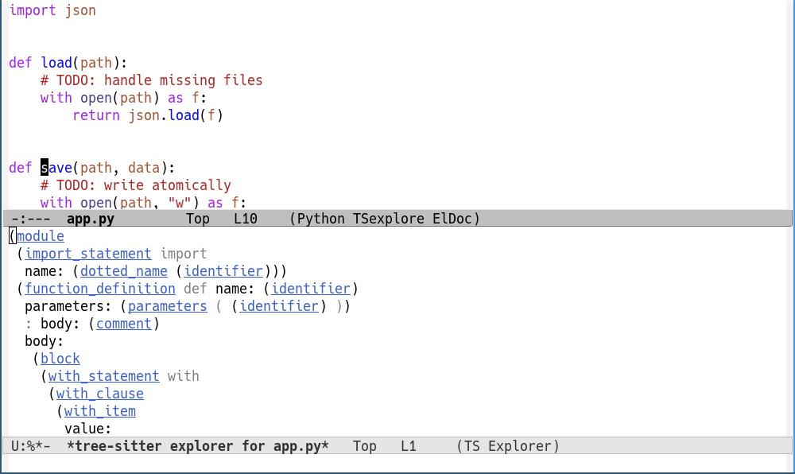
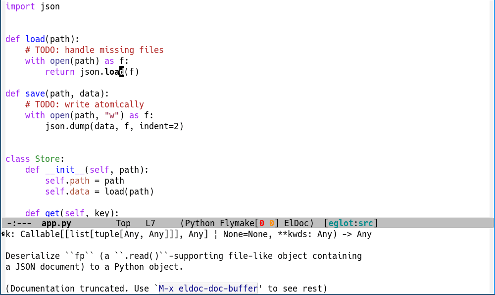
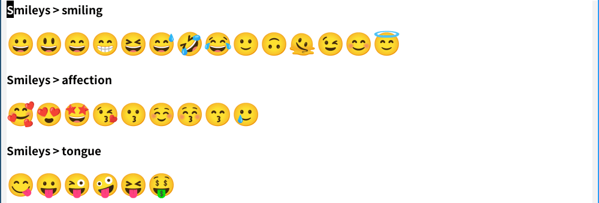
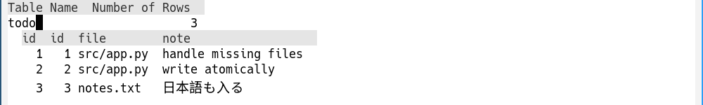
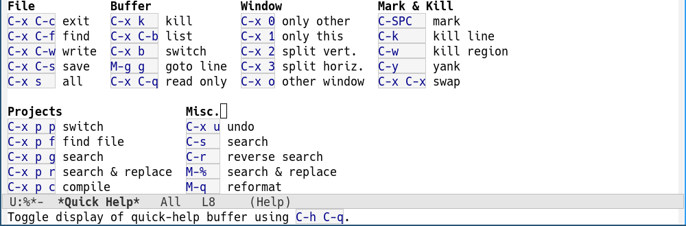
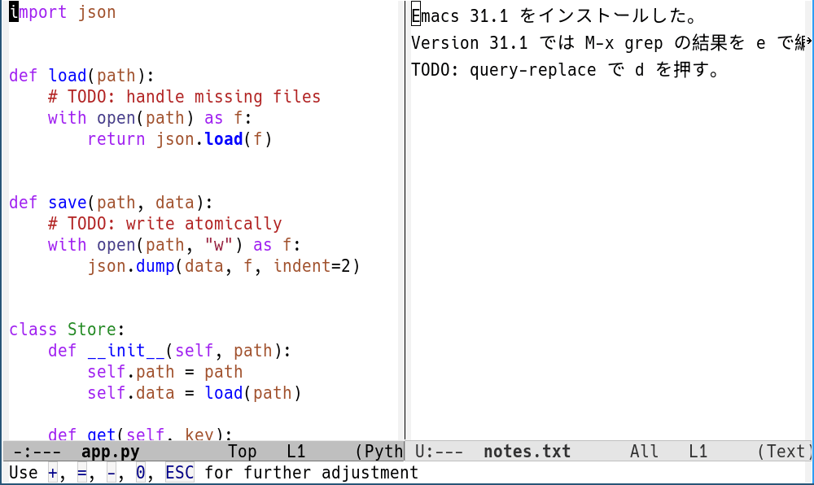

Title: Emacs 29の新機能から、動かして楽しいものを7つ画面つきで紹介する
Date: 2026-11-27 22:50
Updated: 2026-11-27 22:50
Tags: emacs release-notes


Emacs 29のNEWSから動かしてすぐに違いが分かる新機能を7つ選び、Emacs 29.4の実際の画面と一緒に紹介します。
tree-sitterに対応し、Eglotとuse-packageが本体に入った版なのでまずこの3つを動かし、そのあとに絵文字の一覧やSQLiteのブラウザのような小さな楽しみを並べました。

NEWSは [etc/NEWS.29](https://github.com/emacs-mirror/emacs/blob/emacs-31.1/etc/NEWS.29) にあり、4,395行あります。
画面はすべて `emacs -Q` で起動したEmacs 29.4で撮っていて、設定が要るものはその式を添えています。


# tree-sitterで構文木を見ながら色を付ける

Emacs 29は [tree-sitterのライブラリと一緒にビルドできて](https://github.com/emacs-mirror/emacs/blob/emacs-31.1/etc/NEWS.29#L96) 、 `python-ts-mode` のような [tree-sitterを使うメジャーモード](https://github.com/emacs-mirror/emacs/blob/emacs-31.1/etc/NEWS.29#L2976) が入りました。
このモードは構文解析の結果を使って色を付けたり字下げしたりするので、関数の引数のように正規表現では拾いにくいものにも色が付きます。

言語ごとの文法のライブラリは別に要ります。
`M-x treesit-install-language-grammar` で取ってきてビルドするか `treesit-extra-load-path` に置いたライブラリを読ませます。

```emacs-lisp
(setopt treesit-font-lock-level 4)
(add-to-list 'major-mode-remap-alist '(python-mode . python-ts-mode))
```



上が `python-ts-mode` で開いたapp.pyで `path` のような引数にも色が付いています。
下は `M-x treesit-explore-mode` で出した構文木で、 `module` の下に `function_definition` や `parameters` が並んでいます。


# Eglotで言語サーバーにつなぐ

LSPのクライアントの [Eglot](https://github.com/emacs-mirror/emacs/blob/emacs-31.1/etc/NEWS.29#L2918) が本体に入り、言語サーバーがあれば補完やドキュメントの表示やエラーの検出を言語サーバーの情報で行えます。
Pythonのファイルで `M-x eglot` を実行すると `pylsp` のような言語サーバーを探して起動します。

```emacs-lisp
(add-hook 'python-base-mode-hook #'eglot-ensure)
```



モードラインに `[eglot:src]` が出ていて、 `json.load` の上にポイントを置くと言語サーバーが返した引数の型と説明がエコーエリアに出ています。


# use-packageで設定をまとめる

パッケージの設定をまとめて書くマクロの [use-package](https://github.com/emacs-mirror/emacs/blob/emacs-31.1/etc/NEWS.29#L2929) も本体に入ったので、use-packageを別に入れなくても `init.el` を `use-package` で書けます。

```emacs-lisp
(use-package dired
  :custom (dired-listing-switches "-alh")
  :bind ("C-c d" . dired-jump))
```

この式を評価すると `dired-listing-switches` が `"-alh"` になり、 `C-c d` に `dired-jump` が割り当てられます。


# 絵文字を一覧から選ぶ

絵文字を入れるコマンドが [C-x 8 e](https://github.com/emacs-mirror/emacs/blob/emacs-31.1/etc/NEWS.29#L954) の下にまとまり、 `C-x 8 e l` の `emoji-list` は絵文字を分類ごとに並べたバッファを出して選んだ絵文字を元のバッファに入れます。



ほかに名前で探す `C-x 8 e s` があります。
分類をたどって選ぶ `C-x 8 e e` や最近使った絵文字から選ぶ `C-x 8 e r` もあります。


# SQLiteのファイルを開いて表を見る

EmacsからSQLiteを扱う関数が入り、 [sqlite-mode-open-file](https://github.com/emacs-mirror/emacs/blob/emacs-31.1/etc/NEWS.29#L802) でデータベースのファイルを開けます。
表の一覧が出て表の行で `RET` を押すとその表の行が並びます。



画面は `sqlite-open` と `sqlite-execute` で作った `todo` の表を開いたところで、日本語の値もそのまま出ています。


# よく使うキーの早見表を出す

[help-quick](https://github.com/emacs-mirror/emacs/blob/emacs-31.1/etc/NEWS.29#L1062) はよく使うキーを並べた早見表を画面の下に出し、 `C-h C-q` で表示と非表示を切り替えます。
早見表にはファイルやバッファやウィンドウやマークやプロジェクトのキーが並んでいます。



Emacsを使い始めた人の隣に出しておくと、 `C-x 0` と `C-x 1` の違いのような最初に迷うキーをその場で確かめられます。


# 全部のバッファの文字を一度に大きくする

`C-x C-+` は今のバッファだけの文字を大きくしますが、 [C-x C-M-+](https://github.com/emacs-mirror/emacs/blob/emacs-31.1/etc/NEWS.29#L643) はすべてのバッファとモードラインとエコーエリアの文字も大きくします。
`C-x C-M--` で小さくして `C-x C-M-0` で元に戻します。



左右のウィンドウに別のバッファを開いて `C-x C-M-+` を押すと両方の本文とモードラインが同じだけ大きくなりました。
画面を共有して説明するときに、全部の文字をまとめて大きくできます。


# ほかに目についたもの

-   [duplicate-line](https://github.com/emacs-mirror/emacs/blob/emacs-31.1/etc/NEWS.29#L681) は今の行を複製し、 `duplicate-dwim` はリージョンがあればリージョンを複製します。
-   [pixel-scroll-precision-mode](https://github.com/emacs-mirror/emacs/blob/emacs-31.1/etc/NEWS.29#L894) を有効にすると、マウスのホイールやタッチパッドでピクセル単位でスクロールできます。


# Emacs 27から31までの新機能

Emacs 27から31までのNEWSを、1つの版ごとに同じ形で紹介しています。

-   [Emacs 31の新機能から、動かして楽しいものを7つ画面つきで紹介する](https://s.conao3.com/blog/2026/a0c17f)
-   [Emacs 30の新機能から、動かして楽しいものを7つ画面つきで紹介する](https://s.conao3.com/blog/2026/771a69)
-   [Emacs 28の新機能から、動かして楽しいものを7つ画面つきで紹介する](https://s.conao3.com/blog/2026/664e4a)
-   [Emacs 27の新機能から、動かして楽しいものを7つ画面つきで紹介する](https://s.conao3.com/blog/2026/92689a)

