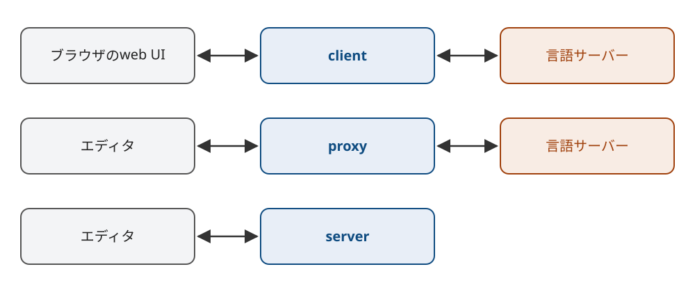
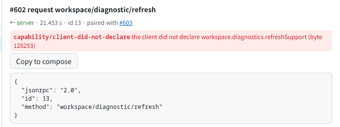

Title: lsp-touchstone: a strict LSP client and server, with parts proved in Lean 4, that finds spec violations in editors and rust-analyzer
Date: 2026-11-27 18:50
Updated: 2026-11-27 18:50
Lang: en
Original: /blog/2026/ccc5ed
Tags: lean rust lsp formal-verification testing release rust-lsp-touchstone


Editors and language servers talk to each other over the Language Server Protocol, or LSP for short.
I use many editors and language servers, and each of them seemed to miss small details of the spec, but LSP has no official conformance test, and I found tools that check parts of a server but none that check a client.

So I built a client and a server that follow the spec strictly, and they judge whether the messages they exchange follow the spec.
I wrote the three parts of the checks where a calculation is easy to get wrong in Lean 4, proved their properties, and turned them into Rust with [lean-rs](https://s.conao3.com/blog/2026/1ff994).
When I connected it to five editors and rust-analyzer, lsp-mode, Neovim, VS Code, and rust-analyzer did things the spec forbids, and eglot and Helix did things that people read the spec differently on.

The tool is lsp-touchstone, the repository is [conao3/rust-lsp-touchstone](https://github.com/conao3/rust-lsp-touchstone), and the license is Apache-2.0.
The results in this post come from version 0.1.0.

<div class="github-card" data-repo="conao3/rust-lsp-touchstone"><a href="https://github.com/conao3/rust-lsp-touchstone"><span class="github-card-name"><svg class="github-card-mark" viewBox="0 0 16 16" aria-hidden="true"><path d="M6.766 11.328c-2.063-.25-3.516-1.734-3.516-3.656 0-.781.281-1.625.75-2.188-.203-.515-.172-1.609.063-2.062.625-.078 1.468.25 1.968.703.594-.187 1.219-.281 1.985-.281.765 0 1.39.094 1.953.265.484-.437 1.344-.765 1.969-.687.218.422.25 1.515.046 2.047.5.593.766 1.39.766 2.203 0 1.922-1.453 3.375-3.547 3.64.531.344.89 1.094.89 1.954v1.625c0 .468.391.734.86.547C13.781 14.359 16 11.53 16 8.03 16 3.61 12.406 0 7.984 0 3.563 0 0 3.61 0 8.031a7.88 7.88 0 0 0 5.172 7.422c.422.156.828-.125.828-.547v-1.25c-.219.094-.5.156-.75.156-1.031 0-1.64-.562-2.078-1.609-.172-.422-.36-.672-.719-.719-.187-.015-.25-.093-.25-.187 0-.188.313-.328.625-.328.453 0 .844.281 1.25.86.313.452.64.655 1.031.655s.641-.14 1-.5c.266-.265.47-.5.657-.656"/></svg><span>conao3/<strong>rust-lsp-touchstone</strong></span></span><span class="github-card-description">A strict LSP client, server and checking proxy for testing Language Server Protocol implementations</span><span class="github-card-footer"><span class="github-card-language"><span class="github-card-language-color" style="background-color: #dea584"></span>Rust</span><span class="github-card-star"><svg viewBox="0 0 16 16" aria-hidden="true"><path d="M8 .25a.75.75 0 0 1 .673.418l1.882 3.815 4.21.612a.75.75 0 0 1 .416 1.279l-3.046 2.97.719 4.192a.751.751 0 0 1-1.088.791L8 12.347l-3.766 1.98a.75.75 0 0 1-1.088-.79l.72-4.194L.818 6.374a.75.75 0 0 1 .416-1.28l4.21-.611L7.327.668A.75.75 0 0 1 8 .25Z"/></svg><span>Star</span><span class="github-card-star-count" hidden></span></span></span></a></div>


# What I built

lsp-touchstone runs in three modes.



-   client starts a language server from a web UI in the browser, and you send requests and notifications by hand.
-   proxy sits between the editor and the language server, and checks every message as it relays it.
-   server runs as the editor's language server, and sends the requests and notifications that the spec gives a server, one after another.

All three modes use the same checks.
A capability is a feature that the client or the server declares at initialization as one it can handle.
lsp-touchstone reads the types for the checks, and the capability that each method belongs to, from [metaModel.json](https://microsoft.github.io/language-server-protocol/specifications/lsp/3.18/specification/#metaModel), the meta model of the LSP 3.18 spec.
There are 80 kinds of findings, listed in [docs/rules.md](https://github.com/conao3/rust-lsp-touchstone/blob/89ca481/docs/rules.md), and a finding is an error when the spec forbids the behavior, and a warning when the spec allows it but implementations read it differently.


# The parts proved in Lean

If the checker is wrong, you can't trust its findings either, so I wrote the three parts where a calculation is easy to get wrong in Lean and proved their properties.

-   LSP gives a position as a line and a character offset, and the two sides agree at initialization on whether to count characters in UTF-8, UTF-16, or UTF-32 units. `😀` counts as 1 in UTF-32, 2 in UTF-16, and 4 in UTF-8. For the conversions between units, I proved that a round trip gives back the original position, and that the conversion can tell when a position points into the middle of a character.
-   The calculation that applies a change from `didChange` to the local copy of the document by replacing a range. I proved that the text before and after the range stays, that the new string goes in at that position, and that the length comes out as expected.
-   The transitions of the progress state. The server sends progress as `begin`, some number of `report`, and `end`, in that order.

Here is the progress part, without the definitions of the types `TokenState` and `ProgressKind` and the other theorems.
When you build, Lean checks the proofs of the code in `lean!`, and lean-rs turns the code into Rust functions.

```rust
lean_rust::lean! {
    pub mod proved;
    r#"
    def step : TokenState → ProgressKind → Option TokenState
      | .created, .begin => some .begun
      | .begun, .report => some .begun
      | .begun, .finish => some .ended
      | _, _ => none

    theorem ended_accepts_nothing (k : ProgressKind) : step .ended k = none := by
      cases k <;> rfl
    "#
}
```

`ended_accepts_nothing` states that the state after `end` accepts no kind of progress.
The proxy calls this `step` on every progress notification, and reports a violation when it returns `none`.


# Spec violations I found

`make check-editors` drives eglot, lsp-mode, Neovim, Helix, and VS Code with no human input.
It connects each editor to the lsp-touchstone server, and separately to rust-analyzer through the proxy, then runs hover, completion, go to definition, typing one line, an edit from a code action, save, and exit, in that order.
The editors and rust-analyzer come from nixpkgs, at these versions.

-   Emacs 31.1, eglot 1.24.31, lsp-mode 20261020.1728
-   Neovim 0.12.6
-   Helix 25.07.1
-   `vscode-languageclient` 11.0.0, the client library of VS Code. I ran it in VSCodium 1.143.17183, which builds VS Code from source and distributes it.
-   rust-analyzer 2026-11-02


## Shutdown

In LSP, the client sends `shutdown`, waits for the response, and then sends `exit`.
The [spec](https://microsoft.github.io/language-server-protocol/specifications/lsp/3.18/specification/#shutdown) says that once the client has sent `shutdown`, it must not send any request or notification other than `exit`.

> Clients must not send any requests or notifications other than `exit` to a server to which they have sent a shutdown request. Clients should also wait with sending the `exit` notification until they have received a response from the `shutdown` request.

The six implementations each step out of this sequence in a different way, and the findings for eglot and Helix are warnings, while those for the other four are errors.
"In some runs" marks behavior that showed up in only some of several runs.

-   eglot sends `exit` with `"params": {}`. The [exit notification in the spec](https://microsoft.github.io/language-server-protocol/specifications/lsp/3.18/specification/#exit) has no params, so lsp-touchstone reports a warning.
-   lsp-mode ends the server process without sending `exit`, and in some runs sends `exit` with `"params": null`. [JSON-RPC 2.0](https://www.jsonrpc.org/specification#parameter_structures) says "If present, parameters for the rpc call MUST be provided as a Structured value. Either by-position through an Array or by-name through an Object.", and `null` doesn't meet that rule.
-   Neovim, connected to rust-analyzer, sends a `textDocument/semanticTokens` request after `shutdown` in some runs.
-   The VS Code client sends `$/cancelRequest` after `shutdown` in some runs.
-   Helix ends the server process before `exit` arrives in some runs.
-   rust-analyzer answers `shutdown` and exits while requests from the client are still unanswered.


## Undeclared capabilities

In LSP, the client and the server declare the features they can handle as capabilities in `initialize`, so if you send a request for a feature the other side hasn't declared, the other side may not handle it.

If you start rust-analyzer from the client web UI, initialize it, and open one file, you get this finding.



rust-analyzer sends a `workspace/diagnostic/refresh` request, but the [spec](https://microsoft.github.io/language-server-protocol/specifications/lsp/3.18/specification/#diagnostic_refresh) ties this request to the client capability `workspace.diagnostics.refreshSupport`, and the lsp-touchstone client doesn't declare it.

rust-analyzer sent this request with each of the five editors, and none of the five declare `refreshSupport`, yet eglot, lsp-mode, Neovim, and VS Code answered with success, `"result": null`.
Helix answered with a "method not found" error, and rust-analyzer kept running.


## Other behavior

-   rust-analyzer can start sending progress on a token before it receives the response to [window/workDoneProgress/create](https://microsoft.github.io/language-server-protocol/specifications/lsp/3.18/specification/#window_workDoneProgress_create). The spec forbids progress on that token when the response is an error, so a server that sends without waiting breaks the spec whenever an error comes back.
-   When Emacs renames the file to the backup `main.rs~` on the first save, lsp-mode sends `workspace/willRenameFiles` to the server.
-   The server picks the unit for counting positions from the ones the client offers, preferring `utf-32`, then `utf-8`, then `utf-16`. With eglot, lsp-mode, Neovim, and Helix it picks `utf-32`, and the VS Code client offers only `utf-16`.


## What worked

The server sends an edit to the editor with `workspace/applyEdit` from a code action, rebuilds the document from the `didChange` notifications that the editor sends back, and checks that the result matches the document with the edit applied.
All five editors applied this edit right.

When a feature shows its result on screen, like applying an edit, users notice at once if it goes wrong, but every violation I found happened while the editor was closing, or in exchanges that show nothing on screen.
Real editors and language servers keep going when they receive a message that breaks the spec, so the side that broke it gets no signal back, and I think finding those violations takes a peer that reports each one.


# How to use it

You give the editor the command that starts the proxy as its language server command, so with eglot you write this.

```elisp
(add-to-list 'eglot-server-programs
             '(rust-ts-mode . ("lsp-touchstone" "proxy" "run-proxy"
                               "--web-ui-port" "4318"
                               "--server-command-args" "rust-analyzer")))
```

After `--server-command-args`, write the command of the real language server, and with `--web-ui-port`, lsp-touchstone prints to standard error the URL of a web UI that shows the traffic as it happens.
[docs/editors.md](https://github.com/conao3/rust-lsp-touchstone/blob/master/docs/editors.md) has the settings for lsp-mode, Neovim, Helix, and VS Code, and the detailed results for each editor.

