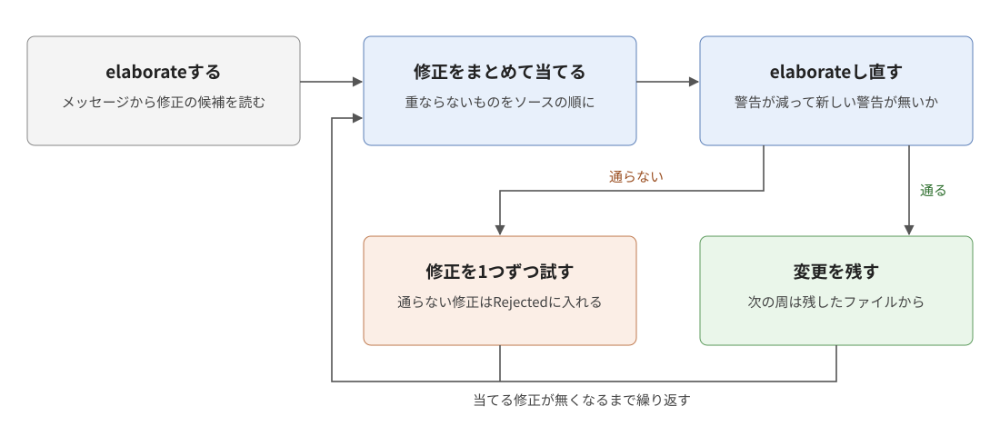

Title: Lean 4の警告についた修正をまとめて当てて、警告が減るものだけを残すlinterのLeankeelを作った
Date: 2026-11-27 22:58
Updated: 2026-11-27 22:58
Draft: true
Tags: lean rust linter formal-verification code-generation release rust-leankeel lean-leanfran lean-leanassay mathlib


Lean 4の警告についている修正の候補を、コマンドラインからまとめて当てるlinterのLeankeelを作りました。
Leanとlinterの警告には、使っていない変数なら `_y` 、非推奨の名前なら置き換え先の名前のように直し方が付いています。

Leankeelはそれを集めてファイルに当てたあと、ファイルをelaborateし直して、警告が減って新しい警告が出ていないときだけ変更を残します。

Mathlibの全8,624ファイルを、tacticの証明の中の使っていない変数も警告にする設定で測ったところ、使っていない変数の修正2,198件のうち97.91%にあたる2,152件を当てて、残りの46件は戻していました。

リポジトリは[conao3/rust-leankeel](https://github.com/conao3/rust-leankeel)で、ライセンスはApache-2.0です。
この記事の結果はLean 4.35.0とLeankeel 0.1.0のコミット `b55c84a` で動かしたものです。

<div class="github-card" data-repo="conao3/rust-leankeel"><a href="https://github.com/conao3/rust-leankeel"><span class="github-card-name"><svg class="github-card-mark" viewBox="0 0 16 16" aria-hidden="true"><path d="M6.766 11.328c-2.063-.25-3.516-1.734-3.516-3.656 0-.781.281-1.625.75-2.188-.203-.515-.172-1.609.063-2.062.625-.078 1.468.25 1.968.703.594-.187 1.219-.281 1.985-.281.765 0 1.39.094 1.953.265.484-.437 1.344-.765 1.969-.687.218.422.25 1.515.046 2.047.5.593.766 1.39.766 2.203 0 1.922-1.453 3.375-3.547 3.64.531.344.89 1.094.89 1.954v1.625c0 .468.391.734.86.547C13.781 14.359 16 11.53 16 8.03 16 3.61 12.406 0 7.984 0 3.563 0 0 3.61 0 8.031a7.88 7.88 0 0 0 5.172 7.422c.422.156.828-.125.828-.547v-1.25c-.219.094-.5.156-.75.156-1.031 0-1.64-.562-2.078-1.609-.172-.422-.36-.672-.719-.719-.187-.015-.25-.093-.25-.187 0-.188.313-.328.625-.328.453 0 .844.281 1.25.86.313.452.64.655 1.031.655s.641-.14 1-.5c.266-.265.47-.5.657-.656"/></svg><span>conao3/<strong>rust-leankeel</strong></span></span><span class="github-card-description">A Lean 4 linter that applies Lean's own suggested fixes and verifies every change</span><span class="github-card-footer"><span class="github-card-language"><span class="github-card-language-color" style="background-color: #dea584"></span>Rust</span><span class="github-card-star"><svg viewBox="0 0 16 16" aria-hidden="true"><path d="M8 .25a.75.75 0 0 1 .673.418l1.882 3.815 4.21.612a.75.75 0 0 1 .416 1.279l-3.046 2.97.719 4.192a.751.751 0 0 1-1.088.791L8 12.347l-3.766 1.98a.75.75 0 0 1-1.088-.79l.72-4.194L.818 6.374a.75.75 0 0 1 .416-1.28l4.21-.611L7.327.668A.75.75 0 0 1 8 .25Z"/></svg><span>Star</span><span class="github-card-star-count" hidden></span></span></span></a></div>


# 警告を出して直す

リポジトリの `tests/fixtures/Sample.lean` には警告が3つ出るファイルが入っています。

```lean
def unusedArg (x y : Nat) : Nat :=
  x + 1

@[deprecated Nat.add_comm (since := "2026-01-01")]
theorem oldAddComm (a b : Nat) : a + b = b + a := Nat.add_comm a b

example (a b : Nat) : a + b = b + a := oldAddComm a b

example (xs : List Nat) : xs ++ [] = xs := by
  simp [List.append_nil, Nat.add_comm]
```

`check-source` で警告を出してみます。

```sh
nix run github:conao3/rust-leankeel -- --output text \
  source check-source --file Sample.lean
```

```text
Sample.lean:1:17: warn [linter.unusedVariables] Variable name `y` is not explicitly referenced.
Sample.lean:7:39: warn [Lean.Linter.deprecatedAttr] `oldAddComm` has been deprecated: Use `Nat.add_comm` instead
Sample.lean:10:25: warn [linter.unusedSimpArgs] This simp argument is unused: Nat.add_comm
```

上から、使っていない引数 `y` 、非推奨にした `oldAddComm` の使用、 `simp` に渡したのに使われていない `Nat.add_comm` の警告です。
角括弧の中はLeanがメッセージに付けている種類の名前で、Leankeelはこれをそのまま規則の名前にしています。

`fix-source` に `--write` を付けると、修正を当ててファイルを書き換えます。
出力はJSONなので、ここでは `jq` で件数だけを出しています。

```sh
nix run github:conao3/rust-leankeel -- \
  source fix-source --file Sample.lean --write | jq -c .Summary
```

```text
{"Applied":3,"Deny":0,"Fixable":0,"Rejected":0,"Warn":0}
```

3件の修正を当てて、残った警告は0件でした。
書き換えたファイルの差分は次のとおりで、どれもLeanが警告に付けていた直し方のとおりです。

```diff
-def unusedArg (x y : Nat) : Nat :=
+def unusedArg (x _y : Nat) : Nat :=
   x + 1

 @[deprecated Nat.add_comm (since := "2026-01-01")]
 theorem oldAddComm (a b : Nat) : a + b = b + a := Nat.add_comm a b

-example (a b : Nat) : a + b = b + a := oldAddComm a b
+example (a b : Nat) : a + b = b + a := Nat.add_comm a b

 example (xs : List Nat) : xs ++ [] = xs := by
-  simp [List.append_nil, Nat.add_comm]
+  simp [List.append_nil]
```


# elaborateし直して確かめる



Leankeelはまずファイルをelaborateして、各メッセージに埋め込まれた修正の候補を読みます。
選んだ規則の修正のうち、範囲の重ならないものをソースの順にまとめて当てて、もう一度elaborateします。

警告の数が減っていて、出ている警告がどれも前からあったものなら、その変更を残します。
直す前と後の警告は規則と重大度とメッセージの文で比べていて、修正の候補の文は比べません。

まとめて当てて通らなかったときは修正を1つずつ試し、それでも通らない修正は `Rejected` に入れて二度と試しません。

当てる修正が無くなるまでこれを繰り返すので、1つの `simp` に使っていない引数が2つあるときのように範囲が重なる修正も、1周に1つずつ当たります。

たとえば次のようなファイルでは修正が戻されます。

```lean
def area (width height : Nat) : Nat :=
  width * width

example : area 3 (height := 4) = 9 := rfl

example (xs : List Nat) : (xs ++ []).length = xs.length := by
  simp?
```

`area` の本体は `height` を使っていないので警告が出るのですが、4行目は `(height := 4)` と名前を付けて引数を渡しています。

`simp?` のように自分の書き換えを提案するtacticの修正には `lean.tryThis` という規則が付きます。
この規則は既定では当てないので、 `--rules` で選びます。

```sh
nix run github:conao3/rust-leankeel -- --output text \
  source fix-source --file Named.lean \
  --rules linter.unusedVariables lean.tryThis
```

```text
def area (width height : Nat) : Nat :=
  width * width

example : area 3 (height := 4) = 9 := rfl

example (xs : List Nat) : (xs ++ []).length = xs.length := by
  simp only [List.append_nil]
Named.lean:1:16: warn [linter.unusedVariables] Variable name `height` is not explicitly referenced.
```

`--output text` では直したあとのファイルと、残った警告が出ます。

`simp?` が提案した `simp only [List.append_nil]` は当たって、 `height` の警告は残りました。
`height` を `_height` にすると4行目が `` Invalid argument name `height` for function `area` `` のエラーになり、比べる警告にはエラーも入るので、Leankeelはこの修正を戻しています。

JSONの出力では `Rejected` に理由が付きます。

```sh
nix run github:conao3/rust-leankeel -- \
  source fix-source --file Named.lean \
  --rules linter.unusedVariables lean.tryThis \
  | jq -c '.Rejected[] | {Title, Reason}'
```

```text
{"Title":"Try this: _height","Reason":"the file gains a diagnostic or keeps as many as before when this fix is applied"}
```


# 規則とレベル

規則はLeanがメッセージに付けている種類なので、ライブラリのlinterやプロジェクトが自分で定義したlinterの警告も、Leankeelが知らなくても規則として扱えます。
種類の無いメッセージは `lean.error` 、 `lean.warning` 、 `lean.info` になります。

既定のレベルを持つ規則は `rule list-rules` で出せます。

```sh
nix run github:conao3/rust-leankeel -- --output table \
  rule list-rules | cut -f1-4 | column -t -s $'\t'
```

```text
Rule                        DefaultLevel  Fix      LeanOption
linter.unusedVariables      warn          default  linter.unusedVariables
linter.unusedSimpArgs       warn          default  linter.unusedSimpArgs
linter.unnecessarySimpa     warn          default  linter.unnecessarySimpa
Lean.Linter.deprecatedAttr  warn          default  linter.deprecated
hasSorry                    warn          none     -
lean.tryThis                warn          opt-in   -
lean.error                  deny          none     -
lean.warning                warn          none     -
lean.info                   allow         none     -
```

`fix-source` は `--rules` を指定しなくても `Fix` が `default` の規則を直し、 `opt-in` の規則は `--rules` か設定で選んだときだけ直します。

エラーはいつも `deny` で、ほかの規則のレベルは親ディレクトリをたどって見つかる `leankeel.toml` で変えられます。
`sorry` の残った定理で止めたいときは `hasSorry` を `deny` にします。

```toml
[rules]
hasSorry = "deny"
```

```sh
printf 'theorem one_eq_one : 1 = 1 := sorry\n' > Todo.lean
nix run github:conao3/rust-leankeel -- --output text \
  source check-source --file Todo.lean
echo $?
```

```text
Todo.lean:1:8: deny [hasSorry] declaration uses `sorry`
254
```

`deny` の警告が1つでもあると終了コードが254になるので、CIに入れればそこで止まります。

Lakeのプロジェクトの中ではそのプロジェクトのimportと `leanOptions` でelaborateします。
リポジトリの `tests/fixtures/project` は `lakefile.toml` でdocstringの無い定義を警告する `linter.missingDocs` を有効にしているので、その警告も規則として出ます。

```toml
[leanOptions]
weak.linter.missingDocs = true
```

```sh
cd tests/fixtures/project
nix run github:conao3/rust-leankeel -- --output text \
  source check-source --paths .
```

```text
./Keel/Basic.lean:7:4: warn [linter.missingDocs] missing doc string for public def depth
./Keel/Use.lean:4:15: warn [linter.unusedVariables] Variable name `m` is not explicitly referenced.
./Keel/Use.lean:4:33: warn [Lean.Linter.deprecatedAttr] `Keel.depth` has been deprecated: Use `Keel.draft` instead
```


# Mathlibで測った

リポジトリの `scripts/mathlib/` は、Mathlib v4.35.0のすべての `Mathlib/**/*.lean` に `--write` なしで `fix-source` を実行して、当てた修正と戻した修正を数えます。
Mathlibはビルドで警告を出さないように保たれているので、Mathlibのビルドと同じ設定では8,624ファイルのどれにも警告がありませんでした。

そこで `linter.unusedVariables.analyzeTactics` を有効にして、tacticの証明の中の使っていない変数も警告にして測りました。
この設定では1,007ファイルで `linter.unusedVariables` の修正が2,198件出て、そのうち2,152件を当てて46件を戻しています。

戻した46件は当てると新しい警告が出るか警告の数が減らなかったものなので、34ファイルに警告のまま残っています。
[計測の結果](https://github.com/conao3/rust-leankeel/blob/b55c84a/results/mathlib/analyze-tactics/summary.md)と[Mathlibの設定のままの結果](https://github.com/conao3/rust-leankeel/blob/b55c84a/results/mathlib/default/summary.md)はリポジトリに置いてあります。


# Leanで証明した判定

当てる修正や残す変更の選び方と、規則のレベルや終了コードの決め方は、Leanの定義と定理としてRustのソースの `leanfran::lean!` の中に書いています。
ビルドのときにLeanが証明を検査して[leanfran](https://s.conao3.com/blog/2026/23d62c)がRustの関数にします。

変更を残すかどうかは次の `accept` で決めていて、ここではほかの2つの定理を省いています。

```lean
def noNew (before after : List String) : Bool :=
  after.all fun key => after.count key ≤ before.count key

def accept (before after : List String) : Bool :=
  after.length < before.length && noNew before after

theorem accept_shrinks (before after : List String) (h : accept before after = true) :
    after.length < before.length := by
  simp [accept] at h
  exact h.1

theorem accept_no_new (before after : List String) (h : accept before after = true) (key : String) :
    after.count key ≤ before.count key := by
  simp [accept, noNew] at h
  by_cases hk : key ∈ after
  · exact h.2 key hk
  · simp [List.count_eq_zero_of_not_mem hk]
```

`before` と `after` は直す前と後の警告の一覧で、警告1件を規則と重大度とメッセージの文をつないだ文字列にしています。

`accept_no_new` は残した変更ではどの警告も前より多く出ていないことを示しています。
ほかにも次の性質を証明しました。

-   残すソースの範囲はどれもファイルの中にあって、ソースの順に重ならずに並ぶ。
-   残すバイト数と消すバイト数を足すと、ファイルのバイト数になる。
-   挿入する編集は選んだ編集とちょうど同じになる。
-   戻した修正の範囲は当てた編集の分だけずれ、当てた編集が範囲に重なった修正は戻した一覧から外れる。
-   エラーはいつも `deny` で、 `allow` の規則は直さない。
-   終了コードが0になるのは、 `deny` の警告が1つも無いときだけ。

定理は全部で25件あり、Rustから呼んでいる7つの関数は[leanassay](https://s.conao3.com/blog/2026/51d6b7)で監査しています。
`make check` は定理が触れていない箇所があるときと、出力を変える書き換えを定理が弾けなかったとき、仮定が満たされない定理があるときに失敗します。

Leanのfrontendを動かしてメッセージを取り出す `native/Main.lean` のadapterと、Rustの側でファイルを読み書きして警告を文字列にする部分、それにleanfranの変換は証明の外にあります。


# 確かめているファイルの外

確かめるのは直しているファイルだけです。
上の `height` を `_height` にする修正は、 `(height := 4)` で呼んでいるのがほかのファイルだけなら当たってしまうので、直したあとはプロジェクトをビルドします。

Leankeelは自分ではチェックを足さず、elaborateの間にLeanが出すメッセージだけを扱います。
Mathlibの `#lint` のような環境のlinterや、テキストを見るstyle linter、 `lake shake` はそれぞれのコマンドで動かします。

独自の規則を持つフォーマッタとlinterには[lean-fmt](https://github.com/jcreinhold/lean-fmt)があります。
Mathlibの `scripts/fix_deprecations.py` と `scripts/fix_unused_simp_args.py` はビルドのログの警告の文からソースを書き換えます。

対応しているのはLean 4.35.0です。

