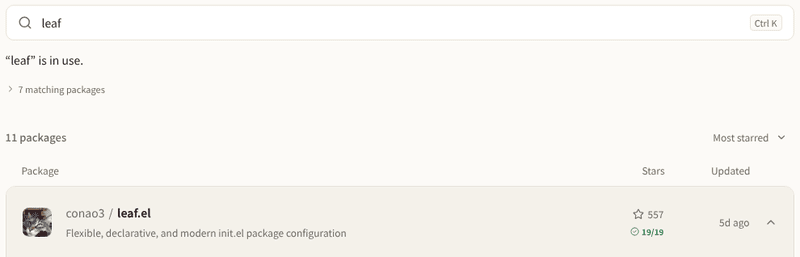
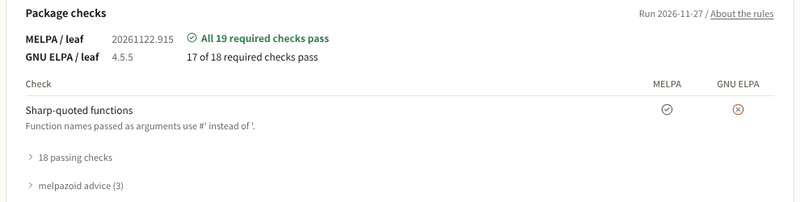

Title: Elispore: search Emacs packages from MELPA, GNU ELPA and GitHub in one search box
Date: 2026-11-27 23:23
Updated: 2026-11-27 23:23
Draft: true
Lang: en
Original: /blog/2026/bed0c7
Tags: emacs emacs-lisp melpa package-management release ts-elispore


I built Elispore, a site where one search box finds Emacs packages from MELPA, GNU ELPA and NonGNU ELPA, and packages that only live on GitHub.
When you type a package name, it tells you whether the name is taken, and when you open a row in the results, you get a leaf or use-package form to install the package and the results of checks against MELPA's rules.

The site runs at [elispore.conao3.com](https://elispore.conao3.com) and lists 6,889 packages as of this writing.
GitHub Actions rebuilds its catalog of packages every day.

The repository is [conao3/ts-elispore](https://github.com/conao3/ts-elispore), under the [Apache-2.0](https://github.com/conao3/ts-elispore/blob/b456119/LICENSE) license.
For this post I used [b456119](https://github.com/conao3/ts-elispore/commit/b456119) on master and the catalog rebuilt on 2026-11-27.

<div class="github-card" data-repo="conao3/ts-elispore"><a href="https://github.com/conao3/ts-elispore"><span class="github-card-name"><svg class="github-card-mark" viewBox="0 0 16 16" aria-hidden="true"><path d="M6.766 11.328c-2.063-.25-3.516-1.734-3.516-3.656 0-.781.281-1.625.75-2.188-.203-.515-.172-1.609.063-2.062.625-.078 1.468.25 1.968.703.594-.187 1.219-.281 1.985-.281.765 0 1.39.094 1.953.265.484-.437 1.344-.765 1.969-.687.218.422.25 1.515.046 2.047.5.593.766 1.39.766 2.203 0 1.922-1.453 3.375-3.547 3.64.531.344.89 1.094.89 1.954v1.625c0 .468.391.734.86.547C13.781 14.359 16 11.53 16 8.03 16 3.61 12.406 0 7.984 0 3.563 0 0 3.61 0 8.031a7.88 7.88 0 0 0 5.172 7.422c.422.156.828-.125.828-.547v-1.25c-.219.094-.5.156-.75.156-1.031 0-1.64-.562-2.078-1.609-.172-.422-.36-.672-.719-.719-.187-.015-.25-.093-.25-.187 0-.188.313-.328.625-.328.453 0 .844.281 1.25.86.313.452.64.655 1.031.655s.641-.14 1-.5c.266-.265.47-.5.657-.656"/></svg><span>conao3/<strong>ts-elispore</strong></span></span><span class="github-card-description">Find Emacs packages hosted on GitHub</span><span class="github-card-footer"><span class="github-card-language"><span class="github-card-language-color" style="background-color: #3178c6"></span>TypeScript</span><span class="github-card-star"><svg viewBox="0 0 16 16" aria-hidden="true"><path d="M8 .25a.75.75 0 0 1 .673.418l1.882 3.815 4.21.612a.75.75 0 0 1 .416 1.279l-3.046 2.97.719 4.192a.751.751 0 0 1-1.088.791L8 12.347l-3.766 1.98a.75.75 0 0 1-1.088-.79l.72-4.194L.818 6.374a.75.75 0 0 1 .416-1.28l4.21-.611L7.327.668A.75.75 0 0 1 8 .25Z"/></svg><span>Star</span><span class="github-card-star-count" hidden></span></span></span></a></div>


# What you can do with Elispore

-   Search Emacs packages from MELPA, GNU ELPA, NonGNU ELPA and GitHub in one search box.
-   Narrow the results with qualifiers such as `user:minad` and `stars:>=1000`.
-   Check whether a package name is taken in the catalog.
-   Copy a leaf or use-package form that installs the package from its Git repository with `:vc`.
-   See the results of checks against 22 required rules that follow MELPA's guidelines.


# Finding Emacs packages without waiting for MELPA's review

To add a new package to MELPA, you send its recipe in a pull request, and MELPA's maintainers look at the package and review it.
The [pull request template](https://github.com/melpa/melpa/blob/c906d3e4d5e04766a3656feffb2bcde941c4d25b/.github/PULL_REQUEST_TEMPLATE.md?plain=1#L34) has this item on its checklist:

> I understand the package must have been maintained in a public repository for 1 month or more

For packages written with AI, [CONTRIBUTING.org](https://github.com/melpa/melpa/blob/c906d3e4d5e04766a3656feffb2bcde941c4d25b/CONTRIBUTING.org?plain=1#L92-L95) asks for this:

> Using AI to assist in writing your packages is not prohibited, but the human author must be the **first** and **most thorough** reviewer of any such output.

AI lets people write packages faster, so I think a process where people review each package by hand will fall behind.
I built Elispore so that machines check the rules a machine can check, and so that you can find a package on GitHub and install it from there.

Emacs Lisp has a single namespace, so the MELPA list also helped people check whether a package name was taken.
Elispore lets you check names against packages that exist only on GitHub as well.


# Searching Emacs packages by name



When you type `leaf` in the search box, Elispore says that a package named `leaf` exists and that 7 packages are named `leaf` or start with `leaf-`.
It checks the name against the whole catalog, whatever filters you have selected.

Below that, the 11 packages whose name, description or topics match the query appear.
The leaf.el row shows 557 GitHub stars and 19/19, which means it passed all 19 required rules that apply.

The search box also takes qualifiers such as `source:gnu-elpa`, `user:minad`, `topic:completion`, `license:gpl-3.0`, `pushed:>=2026-01-01` and `stars:>=1000`, and the filters you select on the left appear in the query too.
The query goes into the URL as `?q=`, so you can share a filtered result by its URL, for example `user:minad stars:>=1000`, which lists minad's org-modern, vertico, consult and corfu.


# Copying a leaf or use-package form

When you open a row, you see the license, the date of the last push and the sources that list the package, next to a form that installs it.
The form starts in leaf style, and the button at the top right of the code block switches it to use-package.

For a package that exists only on GitHub, the form puts the repository URL in `:vc`.
The row for [vow](https://s.conao3.com/blog/2026/aeda19) shows this form:

```emacs-lisp
(leaf vow
  :vc (:url "https://github.com/conao3/vow.el"))
```

For a package with a MELPA recipe, the form includes the recipe's branch and the Lisp directory that Elispore confirmed in the repository.
magit keeps its Lisp files in `lisp/`, so its form has `:lisp-dir`.

```emacs-lisp
(leaf magit
  :vc (:url "https://github.com/magit/magit" :lisp-dir "lisp"))
```

leaf's `:vc` keyword installs a package from its Git repository with [package-vc](https://www.gnu.org/software/emacs/manual/html_node/emacs/Fetching-Package-Sources.html), which arrived in Emacs 29.
As of this writing, the leaf on MELPA supports it: I installed leaf from MELPA into Emacs 31.1 with an empty `user-emacs-directory`, evaluated these two forms, and loaded vow and magit.

use-package has `:vc` from Emacs 30.
For a package in GNU ELPA or NonGNU ELPA, the ELPA switch gives you a form with `:ensure t`.


# Checking packages against MELPA's rules



An open row also shows the results of the package checks.

The rules come from MELPA's [CONTRIBUTING.org](https://github.com/melpa/melpa/blob/c906d3e4d5e04766a3656feffb2bcde941c4d25b/CONTRIBUTING.org), the [Emacs Lisp conventions](https://www.gnu.org/software/emacs/manual/html_node/elisp/Tips.html) that CONTRIBUTING.org asks packages to follow, and [melpazoid](https://github.com/riscy/melpazoid), which people use to check packages before they submit them to MELPA.
Each rule quotes the source text it comes from.

The 22 required rules make up a package's score, and they check, for example, that `<package>.el` exists, that every file enables `lexical-binding` on its first line, and that every file ends with a `;;; <file>.el ends here` line.
Elispore lists melpazoid's other 84 checks as advice, and they do not count toward the score.

The [list of rules](https://elispore.conao3.com/about/#package-checks-about) on the site explains each rule with its quotes.
The checks only read the package files and do not run them in Emacs, so they leave out byte compilation, checkdoc and package-lint.

Elispore checks a package once for each source that lists it.
For leaf, the MELPA version 20261122.915 passes all 19 rules, and the GNU ELPA version 4.5.5 fails the rule about passing function names with `#'`.

Elispore runs three rules only on GitHub repositories and one rule only on MELPA versions, so the count is out of 19 for MELPA and out of 18 for GNU ELPA.

The checker is a command written in Rust, and I defined its required rules in Lean and turned them into Rust code with [leanfran](https://s.conao3.com/blog/2026/21ebbd).
To check GitHub repositories on your machine, pass it a file with one `owner/repo` per line.

```sh
$ printf 'conao3/leaf.el\nconao3/flylint.el\n' > repos.txt
$ nix run github:conao3/ts-elispore#checker -- \
    --source github --github-list repos.txt --output checks.json | head -n 1
Packages: 2; errors: 0; cached: 0; downloaded: 2
$ jq '.results | map_values(.failed)' checks.json
{
  "github/conao3/flylint.el": [
    "provide",
    "footer"
  ],
  "github/conao3/leaf.el": [
    "mz-have-you-done-the-paperwork-to"
  ]
}
```

flylint fails two required rules because its test helper file `flylint-tests-flylint.el` has no `provide` and its last line reads `;;; flylint-tests.el ends here`.

The leaf.el repository on GitHub passes all the required rules.
It is a GNU ELPA package whose copyright belongs to the FSF, so its copyright notice gets melpazoid's advice "Have you done the paperwork to assign this copyright?"

In the [software factory I built on Vercel Board](https://s.conao3.com/blog/2026/048a8b), I ran 20 of my Emacs packages through these checks as 20 tasks, one per package.


# Emacs packages in the catalog

Elispore rebuilds the catalog every day from GitHub search, MELPA, GNU ELPA and NonGNU ELPA.
It leaves out forks, collections of configuration files and awesome lists, and keeps only repositories with an `.el` file at the root or in `lisp/`.

From GitHub search it reads up to 400 Emacs Lisp repositories with 20 or more stars, most starred first.
It also reads up to 200 repositories with the `emacs-package` topic and up to 200 Emacs Lisp repositories pushed after 2026-01-01, and adds repositories with a few other topics.

To get your own package into the catalog when it is not on MELPA, put an `.el` file at the root or in `lisp/` of a public repository that is not a fork, and add the `emacs-package` topic to the repository.
The `emacs-package` search reads only the 200 most starred repositories, so the topic alone may not get your package listed.

