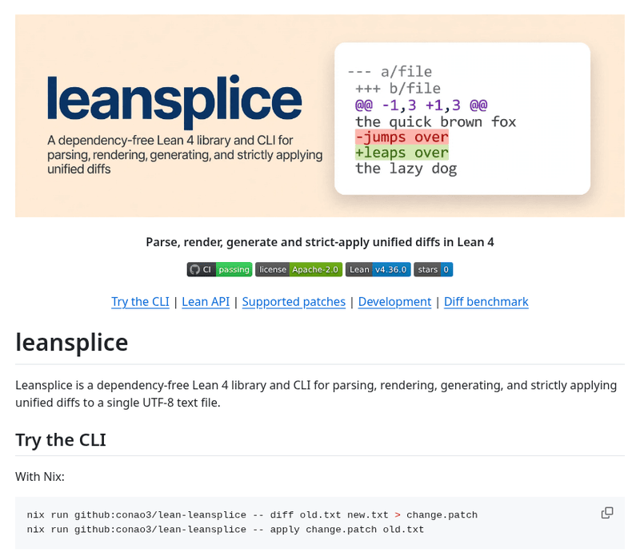

Title: leansplice: generate unified diffs in Lean 4 and apply patches only at their stated line numbers
Date: 2026-11-27 23:07
Updated: 2026-11-27 23:07
Draft: true
Lang: en
Original: /blog/2026/cecb99
Tags: lean diff git differential-testing release lean-leansplice


I built leansplice, a Lean 4 library and CLI that generates unified diffs and applies a patch only at the line numbers the patch states.
`git apply` searches for a hunk in a file whose lines have shifted and applies it where it finds it, while leansplice rejects a patch whose line numbers and content do not match, and prints no patched text.

The repository is [conao3/lean-leansplice](https://github.com/conao3/lean-leansplice), and its license is Apache-2.0.
It uses only the standard library of Lean 4.36.0.

I wrote this post against commit [86bef90](https://github.com/conao3/lean-leansplice/commit/86bef90837c08a8fcf5662e7015e5cbfbcc7acbb) on the main branch.

<div class="github-card" data-repo="conao3/lean-leansplice"><a href="https://github.com/conao3/lean-leansplice"><span class="github-card-name"><svg class="github-card-mark" viewBox="0 0 16 16" aria-hidden="true"><path d="M6.766 11.328c-2.063-.25-3.516-1.734-3.516-3.656 0-.781.281-1.625.75-2.188-.203-.515-.172-1.609.063-2.062.625-.078 1.468.25 1.968.703.594-.187 1.219-.281 1.985-.281.765 0 1.39.094 1.953.265.484-.437 1.344-.765 1.969-.687.218.422.25 1.515.046 2.047.5.593.766 1.39.766 2.203 0 1.922-1.453 3.375-3.547 3.64.531.344.89 1.094.89 1.954v1.625c0 .468.391.734.86.547C13.781 14.359 16 11.53 16 8.03 16 3.61 12.406 0 7.984 0 3.563 0 0 3.61 0 8.031a7.88 7.88 0 0 0 5.172 7.422c.422.156.828-.125.828-.547v-1.25c-.219.094-.5.156-.75.156-1.031 0-1.64-.562-2.078-1.609-.172-.422-.36-.672-.719-.719-.187-.015-.25-.093-.25-.187 0-.188.313-.328.625-.328.453 0 .844.281 1.25.86.313.452.64.655 1.031.655s.641-.14 1-.5c.266-.265.47-.5.657-.656"/></svg><span>conao3/<strong>lean-leansplice</strong></span></span><span class="github-card-description">Unified diff parse, render, strict apply and diff generation for Lean 4</span><span class="github-card-footer"><span class="github-card-language"><span class="github-card-language-color"></span>Lean</span><span class="github-card-star"><svg viewBox="0 0 16 16" aria-hidden="true"><path d="M8 .25a.75.75 0 0 1 .673.418l1.882 3.815 4.21.612a.75.75 0 0 1 .416 1.279l-3.046 2.97.719 4.192a.751.751 0 0 1-1.088.791L8 12.347l-3.766 1.98a.75.75 0 0 1-1.088-.79l.72-4.194L.818 6.374a.75.75 0 0 1 .416-1.28l4.21-.611L7.327.668A.75.75 0 0 1 8 .25Z"/></svg><span>Star</span><span class="github-card-star-count" hidden></span></span></span></a></div>


# Create a diff and apply it with the CLI

You can run the CLI with Nix, and the top of the README shows a `nix run` example.



Put leansplice on your `PATH` with `nix shell`, and create a patch from two files.

```console
$ nix shell github:conao3/lean-leansplice
$ printf 'apple\nbanana\ncherry\n' > old.txt
$ printf 'apple\nblueberry\ncherry\n' > new.txt
$ leansplice diff old.txt new.txt > change.patch
$ cat change.patch
--- a/file
+++ b/file
@@ -1,3 +1,3 @@
 apple
-banana
+blueberry
 cherry
```

`diff` labels the files `a/file` and `b/file` whatever their names are, and adds three lines of context before and after each change.
`apply` takes a patch and the original file, writes the patched text to standard output, and leaves the original file unchanged.

```console
$ leansplice apply change.patch old.txt
apple
blueberry
cherry
```


# leansplice rejects a patch whose lines have shifted

Make a patch that changes `6` to `six` in a file with the lines 1 to 10, and apply it to a copy with a `0` line added at the top.

```console
$ seq 1 10 > a.txt
$ sed 's/^6$/six/' a.txt > b.txt
$ leansplice diff a.txt b.txt > six.patch
$ cat six.patch
--- a/file
+++ b/file
@@ -3,7 +3,7 @@
 3
 4
 5
-6
+six
 7
 8
 9
$ { echo 0; cat a.txt; } > file
$ leansplice apply six.patch file; echo $?
leansplice: hunk 1: source line 3 does not match
1
```

In the hunk, line 3 is `3`, but line 3 of the file is `2`, so leansplice exits with status 1.
Given the same patch, `git apply` finds the hunk one line further down and applies it there.

```console
$ git apply -v six.patch
Checking patch file...
Hunk #1 succeeded at 4 (offset 1 line).
Applied patch file cleanly.
```

leansplice's [apply](https://github.com/conao3/lean-leansplice/blob/86bef90837c08a8fcf5662e7015e5cbfbcc7acbb/Leansplice.lean#L210-L255) checks the old and new line numbers of each hunk, the content of the context and removed lines, and whether each of those lines ends with a newline, and returns an error if any of them differs.
leansplice matches a hunk only at the position written in the patch, so it ignores the same run of lines elsewhere in the file.


# Use it as a Lean library

To use leansplice from a Lake project, add it to `lakefile.toml` and use Lean 4.36.0, the same version as leansplice.

```toml
[[require]]
name = "leansplice"
git = "https://github.com/conao3/lean-leansplice.git"
rev = "main"
```

The example creates a patch with `Leansplice.diff`, turns it into a string with `render`, reads it back with `parse`, and applies it with `apply`.

```lean
import Leansplice

def patchText := Leansplice.render (Leansplice.diff "old\n" "new\n")

def result : Except Leansplice.Error String := do
  let patch ← Leansplice.parse patchText
  Leansplice.apply patch "old\n"

#eval result -- Except.ok "new\n"
```

`lake build` prints `Except.ok "new\n"` as the result of `#eval`.
The library works on strings without touching files, and returns the patched string or a `Leansplice.Error`.

`diff` merges nearby changes into one hunk, and its optional arguments `oldFile`, `newFile` and `context` set the labels and the number of context lines.


# Supported patches

leansplice handles a patch to a single text file and reads these forms.

-   `---` and `+++` headers with unified hunks, also when Git lines such as `diff --git` come before them.
-   A tab-separated timestamp after the file name, which it strips.
-   A range that omits the count when the count is one, such as `@@ -1 +1 @@`.
-   Git's `\ No newline at end of file` marker, and CRs inside lines.
-   Git creation and deletion patches against `/dev/null`, applied to empty text or producing empty text.

Binary, multi-file, rename and mode-only patches are out of scope, and leansplice has no hunk search or 3-way merge.


# Check both directions against Git

`make check` runs `lake build` and `lake test`, then [scripts/git-differential.sh](https://github.com/conao3/lean-leansplice/blob/86bef90837c08a8fcf5662e7015e5cbfbcc7acbb/scripts/git-differential.sh).
The script applies patches made by `git diff --no-index` with leansplice and patches made by leansplice with `git apply`, and compares each result with the expected file using `cmp`.

```console
$ nix develop --command make check 2>&1 | grep -E '^(Leansplice|Git|CLI)'
Leansplice golden and round-trip tests passed.
Git interoperability: replacement
Git interoperability: both-no-final-lf
Git interoperability: add-final-lf
Git interoperability: remove-final-lf
Git interoperability: unterminated-context
Git interoperability: blank-and-unicode
Git interoperability: crlf
Git interoperability: multiple-hunks
Git interoperability: empty-source
Git interoperability: empty-target
Git interoperability: creation and deletion headers
CLI reports stdout failure: diff
CLI reports stdout failure: apply
```

The cases cover a one-line replacement, adding or removing the final newline, blank lines and Unicode characters, CRLF, multiple hunks, and creating a file from empty and deleting it to empty.

The tests in [Tests.lean](https://github.com/conao3/lean-leansplice/blob/86bef90837c08a8fcf5662e7015e5cbfbcc7acbb/Tests.lean) compare function results with expected values, and for 80 pairs of random texts they pass the `diff` patch through `render` and `parse`, apply it, and check that the result is the new text.
I check leansplice's behavior with these tests and the Git differential test.


# How diff builds a patch

The [editScript](https://github.com/conao3/lean-leansplice/blob/86bef90837c08a8fcf5662e7015e5cbfbcc7acbb/Leansplice.lean#L351-L387) function, which `diff` uses, drops the lines that match at the start and end of the two texts and searches the remaining lines for a shortest edit script with Myers' algorithm.
When insertions and deletions together exceed 64 lines, it stops the search, pairs occurrences of each line in order from the start, and keeps the longest chain of pairs that stays in order on both sides.

The fallback for more than 64 lines avoids comparing repeated lines again and again, but it can produce a larger patch than a shortest edit script.
The tests check that patches from either method turn the original text into the new text when you apply them with `apply`.

Issues and PRs are welcome.

