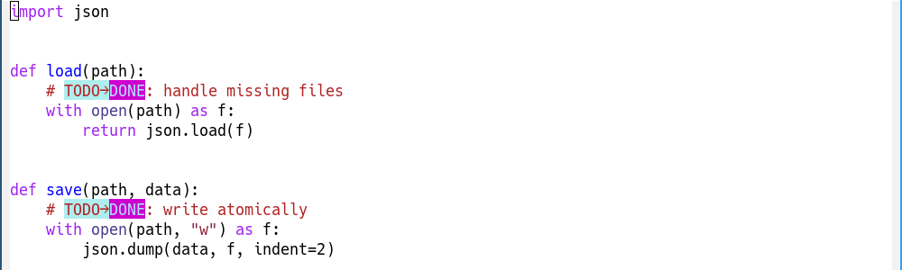
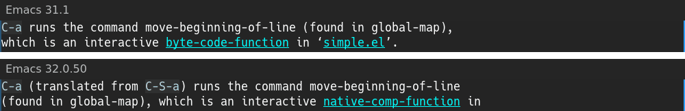
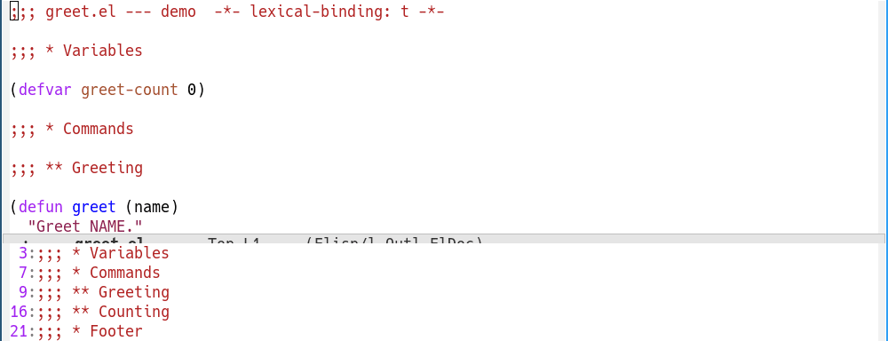
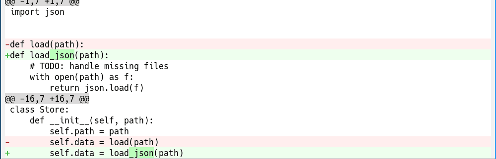

Title: Fun new features in the Emacs development version, shown in screenshots
Date: 2026-11-27 23:30
Updated: 2026-11-27 23:51
Lang: en
Original: /blog/2026/d711ab
Tags: emacs release-notes


I picked new features from the NEWS of the Emacs development version (master, which will become Emacs 32) that you notice the moment you use them, and this post shows each one in a screenshot.
The highlights are regexp matching in time proportional to the input length, and a preview while you type a replacement.

The development NEWS grows in [etc/NEWS](https://github.com/emacs-mirror/emacs/blob/caf462d7415cdd1ba4bcf23df69be3455165accc/etc/NEWS) on master, and at [caf462d](https://github.com/emacs-mirror/emacs/commit/caf462d7415cdd1ba4bcf23df69be3455165accc) (2026-11-26), the commit I used, it runs to 871 lines.
The Emacs 31.1 NEWS has 4,274 lines, so master is about a fifth of the way there.

I will add to this post as new features land on master, and when Emacs 32.1 comes out I will retitle it as the Emacs 32 post.


# The version I tried

I built master with `emacs-git` from nix-community's [emacs-overlay](https://github.com/nix-community/emacs-overlay).

```sh
nix build github:nix-community/emacs-overlay/ff3361a80b6e0f5a51ddf6e43525125d5a3a7f97#emacs-git
```

`emacs --version` prints `GNU Emacs 32.0.50`, and `emacs-repository-version` is caf462d.
I took every screenshot in Emacs started with `emacs -Q`, and I include the code for each feature that needs a setting.


# Regexps match in time proportional to the input

The [regexp engine now matches in linear time](https://github.com/emacs-mirror/emacs/blob/caf462d7415cdd1ba4bcf23df69be3455165accc/etc/NEWS#L704).
The old engine backtracks, so a regexp with many ways to match could take exponential time and make Emacs look frozen.

I timed a regexp that repeats `a` or `aa` and then expects `b`, against strings of `a` only.

```emacs-lisp
;;; regex-bench.el  -*- lexical-binding: t -*-
(dolist (n '(24 28 32 36))
  (let* ((s (make-string n ?a))
         (start (float-time)))
    (string-match "\\(?:a\\|aa\\)*b" s)
    (message "%2d chars: %8.3f s" n (- (float-time) start))))
```

```sh
$ emacs --batch -Q -l regex-bench.el    # Emacs 31.1
24 chars:    0.018 s
28 chars:    0.123 s
32 chars:    0.885 s
36 chars:    5.902 s
$ emacs --batch -Q -l regex-bench.el    # Emacs 32.0.50 (caf462d)
24 chars:    0.000 s
28 chars:    0.000 s
32 chars:    0.000 s
36 chars:    0.000 s
```

In Emacs 31.1 every four more characters cost about seven times as much, and 36 characters took almost 6 seconds.
The development version finished every length in under a millisecond.
The NEWS lists exceptions: regexps with backreferences or `\{N,M\}` repetition can still take exponential time.


# Preview a replacement while you type it

Set [query-replace-show-preview](https://github.com/emacs-mirror/emacs/blob/caf462d7415cdd1ba4bcf23df69be3455165accc/etc/NEWS#L209), and while you type the replacement for `M-%`, the matches visible in the window show how they will look after the replacement.

```emacs-lisp
(setopt query-replace-show-preview 'both)
```



Here I typed `M-% TODO RET` and then `DONE`, and both `TODO` comments show `TODO→DONE`.
`both` shows the match and the replacement side by side, and `replacement-only` shows the replacement alone.

You see what will change, in place, before the replacement starts.


# Tell keys such as `C-S-a` apart in a terminal

When your terminal emulator supports the [Kitty Keyboard Protocol](https://github.com/emacs-mirror/emacs/blob/caf462d7415cdd1ba4bcf23df69be3455165accc/etc/NEWS#L64), `emacs -nw` reads keys through it.
Key chords that only the GUI could tell apart become separate keys in a terminal too.

I ran `emacs -nw` in foot, typed `C-h k`, and pressed `C-S-a` in both versions.



Emacs 31.1 receives `C-S-a` as `C-a`.
The development version receives `C-S-a` as it is, as the GUI does, and then translates it to `C-a`.
Bind a command to `C-S-a`, and you can use both keys in a terminal.


# Fold comment headings with Outline and list them

Set [outline-use-comment-regexp](https://github.com/emacs-mirror/emacs/blob/caf462d7415cdd1ba4bcf23df69be3455165accc/etc/NEWS#L406) to `t`, and `outline-minor-mode` treats lines that start with a comment, such as `;;; *` and `;;; **`, as headings.
The number of stars sets the heading level.

```emacs-lisp
(setopt outline-use-comment-regexp t)
(add-hook 'emacs-lisp-mode-hook #'outline-minor-mode)
```

[outline-find-headings](https://github.com/emacs-mirror/emacs/blob/caf462d7415cdd1ba4bcf23df69be3455165accc/etc/NEWS#L418) lists every heading of the buffer in an Xref buffer.



The top window is an Emacs Lisp file, and the bottom one is the heading list from `outline-find-headings`.
Pick a line in the list to jump to that heading.


# Rename an identifier and check the diff before applying it

[refactor](https://github.com/emacs-mirror/emacs/blob/caf462d7415cdd1ba4bcf23df69be3455165accc/etc/NEWS#L667) is a library that runs refactorings such as renaming an identifier or extracting a function with the same commands in any language.
It was extracted from Eglot, and Eglot hands the language server's refactorings to it.

I connected Eglot to `pylsp` in a Python file and typed `M-x refactor-rename RET load_json RET` on the function `load`.
With `refactor-confirmation` set to `diff`, the changes do not apply right away and show up as a diff in the `*refactor changes*` buffer.

```emacs-lisp
(setopt refactor-confirmation 'diff)
```



The definition `def load` and the call `load(path)` become `load_json`, and `json.load(f)` keeps its name because the language server knows it is a different function.
After checking the diff, `C-c C-a` applies one hunk and `C-c RET a` applies them all.


# Convert between numbers and Roman numerals

[number-to-roman and roman-to-number](https://github.com/emacs-mirror/emacs/blob/caf462d7415cdd1ba4bcf23df69be3455165accc/etc/NEWS#L819) are now autoloaded functions you can call from anywhere.

```emacs-lisp
;;; roman.el  -*- lexical-binding: t -*-
(message "%s" (number-to-roman 2026))
(message "%s" (roman-to-number "XXXII"))
```

```sh
$ emacs --batch -Q -l roman.el
MMXXVI
32
```


# Other changes worth a look

-   [canvas](https://github.com/emacs-mirror/emacs/blob/caf462d7415cdd1ba4bcf23df69be3455165accc/etc/NEWS#L731) images are made for fast redraws: you rewrite the pixel data and call `canvas-refresh`. In the caf462d build, neither the X11 nor the pgtk version drew the colors I passed in, so I will add a section once that works.
-   [uuid](https://github.com/emacs-mirror/emacs/blob/caf462d7415cdd1ba4bcf23df69be3455165accc/etc/NEWS#L660) is a library that generates and parses UUIDs.
-   Emacs supports [Unicode 18.0](https://github.com/emacs-mirror/emacs/blob/caf462d7415cdd1ba4bcf23df69be3455165accc/etc/NEWS#L42).


# New features from Emacs 27 to the development version

I wrote one post in the same format for each Emacs release from 27 to the development version.

-   [Seven fun new features in Emacs 31, shown in screenshots](https://s.conao3.com/blog/2026/26ed0f)
-   [Seven fun new features in Emacs 30, shown in screenshots](https://s.conao3.com/blog/2026/516114)
-   [Seven fun new features in Emacs 29, shown in screenshots](https://s.conao3.com/blog/2026/9e936f)
-   [Seven fun new features in Emacs 28, shown in screenshots](https://s.conao3.com/blog/2026/5e8afb)
-   [Seven fun new features in Emacs 27, shown in screenshots](https://s.conao3.com/blog/2026/5265b1)

