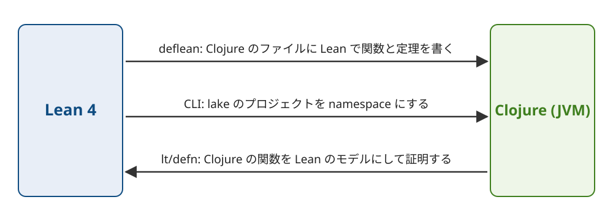

Title: Lean 4で証明した関数をClojureから呼べるlean-cljを作った
Date: 2026-11-05 20:05


Lean 4で書いて証明した関数をClojureから呼び、Clojureで書いた関数の性質をLeanで証明するためのライブラリとしてlean-cljを作りました。
リポジトリは[conao3/lean-clj](https://github.com/conao3/lean-clj)で、ライセンスはApache-2.0です。
Clojarsに `io.github.conao3/lean-clj` として公開していて、この記事は0.3.0をもとに書いています。

lean-cljはLeanのコンパイラの中間表現 (IR) をClojureのソースに変換します。
JVMの上では、LeanのC backendがビルドするのと同じプログラムから型と証明を消したものが動きます。

<div class="github-card" data-repo="conao3/lean-clj"><a href="https://github.com/conao3/lean-clj"><span class="github-card-name"><svg class="github-card-mark" viewBox="0 0 16 16" aria-hidden="true"><path d="M6.766 11.328c-2.063-.25-3.516-1.734-3.516-3.656 0-.781.281-1.625.75-2.188-.203-.515-.172-1.609.063-2.062.625-.078 1.468.25 1.968.703.594-.187 1.219-.281 1.985-.281.765 0 1.39.094 1.953.265.484-.437 1.344-.765 1.969-.687.218.422.25 1.515.046 2.047.5.593.766 1.39.766 2.203 0 1.922-1.453 3.375-3.547 3.64.531.344.89 1.094.89 1.954v1.625c0 .468.391.734.86.547C13.781 14.359 16 11.53 16 8.03 16 3.61 12.406 0 7.984 0 3.563 0 0 3.61 0 8.031a7.88 7.88 0 0 0 5.172 7.422c.422.156.828-.125.828-.547v-1.25c-.219.094-.5.156-.75.156-1.031 0-1.64-.562-2.078-1.609-.172-.422-.36-.672-.719-.719-.187-.015-.25-.093-.25-.187 0-.188.313-.328.625-.328.453 0 .844.281 1.25.86.313.452.64.655 1.031.655s.641-.14 1-.5c.266-.265.47-.5.657-.656"/></svg><span>conao3/<strong>lean-clj</strong></span></span><span class="github-card-description">Lean 4 IR to Clojure backend and Lean embedded in Clojure via S-expressions</span><span class="github-card-footer"><span class="github-card-language"><span class="github-card-language-color"></span>Clojure</span><span class="github-card-star"><svg viewBox="0 0 16 16" aria-hidden="true"><path d="M8 .25a.75.75 0 0 1 .673.418l1.882 3.815 4.21.612a.75.75 0 0 1 .416 1.279l-3.046 2.97.719 4.192a.751.751 0 0 1-1.088.791L8 12.347l-3.766 1.98a.75.75 0 0 1-1.088-.79l.72-4.194L.818 6.374a.75.75 0 0 1 .416-1.28l4.21-.611L7.327.668A.75.75 0 0 1 8 .25Z"/></svg><span>Star</span><span class="github-card-star-count" hidden></span></span></span></a></div>


# 3つの使い方

lean-cljには次の3つの使い方があります。



1.  Clojureのファイルの中にLeanで関数と定理を書き、Clojureから呼ぶ ( `deflean` )。
2.  既存のLeanのプロジェクト (lakeのプロジェクト) を、Clojureのnamespaceの集まりに変換する (CLI)。
3.  Clojureで書いた関数をLeanのモデルに変換し、その性質をLeanで証明する ( `lean-clj.typed` )。

1と2はLeanからClojureへの向き、3はClojureからLeanへの向きです。
以下、この順に例を挙げます。


# Leanで書いてClojureから呼ぶ

`deps.edn` にlean-cljを追加します。

```clojure
{:deps {io.github.conao3/lean-clj {:mvn/version "0.3.0"}}}
```

`deflean` のブロックを最初に展開するときは、Lean 4.35.0 ( `lean` と `lake` ) と `lean-clj` のCLIが `PATH` に要ります。
CLIはnixでインストールできます。

```console
$ nix profile install github:conao3/lean-clj/v0.3.0
```

`deflean` の本体にはLeanの構文をS式にしたものを書きます。

```clojure
(ns demo.core
  (:refer-clojure :exclude [double])
  (:require [lean-clj.core :refer [deflean]]))

(deflean arith
  (def double [n Nat] Nat
    (+ n n))

  (theorem double_eq [n Nat] (= (double n) (* 2 n))
    (by (unfold double) omega))

  (structure Account [owner String balance Nat])

  (def deposit [a Account n Nat] Account
    (with a {:balance (+ (.balance a) n)})))
```

`def` で関数を、 `theorem` で定理を定義し、 `(by ...)` の中に証明を書きます。
`double_eq` では、 `double` の定義を展開してから、自然数と整数の線形算術を解くタクティク `omega` で等式を示しています。
namespaceを読み込むと、lean-cljはブロックをLeanのソースに変換して `lake build` を実行し、証明まで検査します。
検査が通ると、ブロックの関数がそのnamespaceのClojureの関数になります。
structureの値はkeywordをkeyに持つmapとして受け渡します。

```clojure
(double 21)                                ;=> 42
(deposit {:owner "ann" :balance 10} 5)     ;=> {:owner "ann", :balance 15}
```

証明が通らないと、namespaceのコンパイルが止まります。
定理の右辺を `(* 3 n)` に書き換えてnamespaceを読み込むと、次のエラーになります。

```text
Syntax error macroexpanding deflean at (demo/wrong.clj:5:1).
lean-clj: Lean rejected deflean arith
error: demo/wrong.clj:9: deflean arith:3:75: omega could not prove the goal:
a possible counterexample may satisfy the constraints
  a ≥ 1
where
 a := ↑n

Lean source of the block:
   1 | def double (n : Nat) : Nat := (n + n)
   2 |
   3 | theorem double_eq (n : Nat) : ((double n) = (3 * n)) := (by unfold double; omega)
```

エラーのメッセージにはClojureのファイルと行 ( `demo/wrong.clj:9` ) と、ブロックから作ったLeanのソースが含まれます。

S式で書けない構文は `(lean "...")` でLeanのソースを文字列のまま混ぜて書けます。
サンプルの[word-count](https://github.com/conao3/lean-clj/tree/master/samples/word-count)は、 `do` 記法の関数をこの形で書いています。
生成したClojureのコードは `.lean-clj/cache/` に保存されます。
ブロックを変えなければ、2回目からはLeanを呼ばずにキャッシュから展開するので、キャッシュをリポジトリに入れておけばLeanの無い環境でも動きます。


# LeanのプロジェクトをClojureのnamespaceにする

lakeのプロジェクトとして書いたLeanのコードも、CLIでClojureのnamespaceに変換できます。
サンプルの[roman-numerals](https://github.com/conao3/lean-clj/tree/master/samples/roman-numerals)は、整数とローマ数字の変換をLeanで書き、1〜999の数をローマ数字にして戻すと元の数になることを証明しています。

```lean
def toRoman (n : Nat) : String := toRomanAux (n + 13) numerals n

def fromRoman (s : String) : Option Nat :=
  if s.isEmpty then none else fromRomanAux s.toList

theorem roundtrip : ∀ n, n < 1000 → fromRoman (toRoman n) = if n = 0 then none else some n := by
  decide +kernel
```

`lake build` で証明を検査したあと、CLIでmoduleをnamespaceに変換します。

```console
$ lean-clj module generate-namespace --module-name Roman --namespace roman.core \
    --search-path lean/.lake/build/lib/lean --output-file src/roman/core.clj
```

公開している関数は名前をkebab-caseにしたClojureの関数になります。
`Option` の値は `some` の中身か `nil` になります。

```clojure
(require '[roman.core :as roman])

(roman/to-roman 1994)        ;=> "MCMXCIV"
(roman/from-roman "MMXXVI")  ;=> 2026
(roman/from-roman "hello")   ;=> nil
```

生成した `src/roman/core.clj` は普通のClojureのファイルなので、リポジトリにcommitすれば、使う側にLeanは要りません。
プロジェクトのmoduleをまとめて変換するときは `lean-clj project generate` を使います。


# Clojureで書いてLeanで証明する

3つ目の使い方では、実装をClojureで書きます。
次の例では、0からnまでの和を閉じた式で計算するClojureの関数が、和の定義どおりに再帰するLeanの仕様と等しいことを証明します。

```clojure
(ns demo.sum
  (:require [lean-clj.core :refer [deflean]]
            [lean-clj.typed :as lt]))

(lt/defn sum-to-fast [n Nat] Nat
  (quot (* n (inc n)) 2))

(deflean sums
  (clojure sum-to-fast)

  (def sum-to [n Nat] Nat
    (match n
      0 0
      (+ k 1) (+ (sum-to k) (+ k 1))))

  (theorem two-sum-to [n Nat] (= (* 2 (sum-to n)) (* n (+ n 1)))
    (by (on-all (induction n) (simp only [sum-to Nat.mul_add Nat.add_mul] at *) omega)))

  (theorem sum-to-fast-eq [n Nat] (= (sum-to-fast n) (sum-to n))
    (by (simp only [sum-to-fast Clj.quot_nat Clj.mul_nat Clj.inc_nat])
        "have := twoSumTo n"
        omega))

  (theorem ^{:attrs [csimp]} sum-to-eq [] (= (the (-> Nat Nat) sum-to) sum-to-fast)
    (by (funext n) (exact (.symm (sum-to-fast-eq n))))))
```

`lt/defn` は普通のClojureの関数を定義し、引数と戻り値のLeanの型 (signature) をvarに記録します。
ブロックの中の `(clojure sum-to-fast)` は、その関数をLeanの定義に変換します。
この記事では、変換したLeanの定義をモデルと呼びます。
`quot` や `inc` のような `clojure.core` の関数のモデルは、lean-cljに同梱したLeanのライブラリ `Clj` にあります。

`sum-to-eq` に付けた `@[csimp]` は、 `sum-to` をコンパイルするときに `sum-to-fast` へ置き換えることをLeanに許す属性です。
置き換えてよい根拠は、2つの関数が等しいという証明です。
そのため、Clojureから `sum-to` を呼ぶと、再帰ではなくClojureの `sum-to-fast` が実行されます。

```clojure
(sum-to 1000000)  ;=> 500000500000
```

この形は[Leanで書く証明付きの日付と税計算](https://s.conao3.com/blog/2026/5499a8)で紹介したlean-ritsuryoの書き方を、Clojureの実装に当てはめたものです。
実装と仕様の関係ごとに、次のサンプルがあります。

<table border="2" cellspacing="0" cellpadding="6" rules="groups" frame="hsides">


<colgroup>
<col  class="org-left" />

<col  class="org-left" />

<col  class="org-left" />
</colgroup>
<thead>
<tr>
<th scope="col" class="org-left">実装と仕様の関係</th>
<th scope="col" class="org-left">lean-cljでの書き方</th>
<th scope="col" class="org-left">サンプル</th>
</tr>
</thead>
<tbody>
<tr>
<td class="org-left">仕様をそのまま実行する</td>
<td class="org-left"><code>deflean</code> の定義を呼ぶ</td>
<td class="org-left">todo-cli</td>
</tr>

<tr>
<td class="org-left">速い実装がすべての入力で仕様と一致する</td>
<td class="org-left">等しいことを証明し、 <code>@[csimp]</code> で置き換える</td>
<td class="org-left">verified-clojure ( <code>sum-to</code> )</td>
</tr>

<tr>
<td class="org-left">速い実装が仮定のもとで仕様と一致する</td>
<td class="org-left">仮定付きで証明し、仮定を満たす呼び出し側が実装を呼ぶ</td>
<td class="org-left">sorted-search</td>
</tr>

<tr>
<td class="org-left">実装が結果の条件を満たす</td>
<td class="org-left">条件を定理にして証明する</td>
<td class="org-left">verified-clojure (挿入ソート)、inventory</td>
</tr>
</tbody>
</table>


## 本物の関数とモデルを生成テストで比べる

証明が示すのはモデルの性質です。
モデルの挙動がClojureの関数と食い違っていれば、本物の関数では成り立たない定理も証明できてしまいます。
そこで、 `lt/check` を使って本物の関数とモデルを同じ入力で呼び、結果を比べます。

```clojure
(lt/check #'sum-to-fast {:seed 1})
;=> {:result true, :pass? true, :num-tests 100, :time-elapsed-ms 7, :seed 1}
```

`lt/check` はsignatureから、テストの入力を作るtest.checkのgeneratorを生成します。
結果が食い違ったときは、引数と両方の戻り値を `:counterexample` に入れて返します。
`lt/defcheck` を使うと、同じ検査を `clojure.test` のテストとして定義できます。
lean-cljのテストでも、 `Clj` のモデルを `clojure.core` の関数と生成テストで照合していて、照合の表は156行あります。

定理はClojureの関数が値を返す呼び出しについて成り立ちます。
`Long` のoverflow、0での除算、範囲外のindexのように例外を投げる呼び出しは、モデルの対象外です。


# 生成テストで見つかったモデルの誤り

照合の生成テストで、モデルの誤りがいくつも見つかりました。
誤りの一部は、本物の関数では成り立たない定理を証明できるものでした。


## 多相の関数の真偽

次の `member?` は、任意の型 `α` のリスト `xs` に `x` があるかを調べます。

```clojure
(lt/defn member?
  [(implicit α Type) (inst (BEq α)) x α xs (List α)]
  Bool
  (if-let [y (first xs)]
    (or (= x y) (member? x (rest xs)))
    false))
```

Clojureの `if-let` は、束縛した値が `false` か `nil` のときにelseの分岐を取ります。
そのため、 `false` だけのリストで `false` を探すと `false` を返します。

```clojure
(member? 1 [1])          ;=> true
(member? false [false])  ;=> false
```

以前のモデルは、型の変数 `α` の値を真偽の判定で常に真として扱っていました。
`Nat` や `String` の値はClojureでも常に真なので、多くの型ではこの扱いで結果がClojureと同じになります。
しかし `α = Bool` のときは `false` が偽になるので、モデルとClojureの関数の結果が食い違います。
このモデルでは、「先頭に `x` があれば `member?` は `true` を返す」という次の定理が、すべての `α` について証明できました。

```clojure
(theorem member-head [(implicit α Type) (inst (BEq α)) (inst (LawfulBEq α)) (inst (Clj.Truthy α)) x α xs (List α)]
  (= (member? x (cons x xs)) true)
  (by (rw [member?]) simp))
```

`x = false` のとき、Clojureの関数は `false` を返すので、この定理は本物の関数では成り立ちません。

いまのモデルは、型の変数ごとに `[Clj.Truthy α]` というinstanceを引数に取り、 `α` に入る具体的な型のinstanceで値の真偽を決めます。
同じ定理を証明しようとすると、 `x` が真であることを示すゴールが残り、証明が失敗します。

```text
error: demo/member.clj:15: deflean proofs:3:128: unsolved goals
...
x : α
xs : List α
⊢ Clj.truthy x = true
```

サンプルの[generic-search](https://github.com/conao3/lean-clj/tree/master/samples/generic-search)は、 `nil` だけを偽とする `if-some` で `member?` を書き、同じ定理を証明しています。


## そのほかの誤り

ほかにも、生成テストで次の3つのClojureの挙動がモデルと食い違いました。

```clojure
(:k {:k nil} 0)                  ;=> nil
(str [12345678901234567890N])    ;=> "[12345678901234567890N]"
(get [0 1] 4294967297)           ;=> 1
```

-   `(:k m default)` は、keyがあって値が `nil` なら `nil` を返します。defaultを返すのはkeyが無いときだけです。モデルは `nil` のときにもdefaultを返していました。
-   `str` はvectorの中の `BigInt` に `N` を付けます。モデルは `N` を付けていませんでした。generatorは `Long` に収まらない整数も作るので、この違いが見つかりました。
-   vectorの `get` は、indexを `int` の下位32 bitに切り詰めます。 `4294967297` は `2^32 + 1` なので、index 1の要素を返します。

どれも、モデルをClojureの挙動に合わせて直しました。


# 作らなかったもの

`Long` のoverflowまで含めて、関数が例外を投げないことも証明するモード ( `^:total` ) は作りませんでした。
このモードでは、式全体を `Option` のような例外を表す型の計算として書き直す必要があります。
この書き直しをLeanの `do` 記法で行うと、評価の順序がClojureと食い違います。

```lean
def half (n : Nat) : Option Nat :=
  if n % 2 == 0 then some (n / 2) else none

def g (n : Nat) : Option Bool := do
  pure (n == 1 || (← half n) == 0)

#eval g 1  -- none
```

Clojureの `(or (= n 1) ...)` は、 `n` が1なら右辺を評価せずに `true` を返します。
Leanは `(← half n)` を式の外へ出して先に実行するので、右辺の `half 1` が失敗し、 `g 1` は `none` になります。
`and` や `or` のように途中で評価をやめる式を、すべてClojureと同じ順序で書き直す必要があり、このモードは変換の手間に見合わないと判断しました。

overflowを避けるには任意精度の `+'` の系列を使い、見つけるには `lt/check` に `:throws :fail` を渡して、例外を投げる入力を失敗として数えます。


# 仕組み

生成するコードの形式には、JavaのソースやJVMのバイトコードではなくClojureのソースを選びました。
Leanの `Array` はClojureの永続ベクタと意味が合い、要素の更新がO(log n) で済みます。
`Nat` の計算は `+'` で `BigInt` に切り替わり、Leanのクロージャは `IFn` を実装したClojureの値にできます。
JITがバイトコードを最適化するので、バイトコードを直接生成しても速さの利点は小さいと考えました。

実行時に動くのはJVMだけです。
Leanが動くのは `deflean` のブロックを展開するときと、CLIでモジュールを変換するときだけで、実行時はLeanのCのruntimeの代わりに、その関数をClojureで書き直したruntimeを使います。
LeanのプロセスもFFIも別のヒープもないので、2つのruntimeのあいだで状態を共有する場面はありません。
Clojureと生成したコードのあいだで受け渡す値はどれもimmutableです。
Leanの可変な状態はClojureの仕組みで動きます。 `IO.Ref` はatom、 `Task` はfuture、 `Thunk` はdelayになり、標準出力は `*out*` に書くので `binding` で差し替えられます。

生成したClojureが正しいことは、LeanのC backendとの差分テストで確かめています。
同じテスト用の関数を、C backendがビルドした実行ファイルと、生成したClojureの両方で実行し、出力の182行を比べます。
浮動小数点数の無限大を、Cは `inf` 、Javaは `Infinity` と表示する違いも、このテストで見つかりました。

生成したコードが、JVMの1メソッドあたり64KBという上限を超えたこともありました。
LeanのIRのjoin point (関数の中で複数の分岐が合流する先) を呼び出し箇所ごとに展開していたため、生成したコードが36,000行に膨らみ、 `Std.Format` の関数の読み込みが「Method code too large!」で失敗しました。
いまは呼び出しが1か所のjoin pointだけを展開し、2か所以上のものは `letfn` にしています。
自己末尾呼び出しは `loop` と `recur` に、相互再帰は `trampoline` にして、スタックを積まずに実行します。


# Clojureの型のライブラリとの関係

Clojureには、clojure.spec、malli、Plumatic Schemaのように、値を実行時に検査するスキーマのライブラリがあります。
これらは値を検査する述語を組み合わせて書く仕組みで、型の変数を持たず、mapは既定で開いていて、整数の固定精度と任意精度を区別しません。
Typed Clojureとclj-kondoの型検査は、それぞれ独自の型の言語と、 `clojure.core` の関数の型の注釈を持っています。

lean-cljでは型をLeanで書き、その型からmalliのスキーマ、test.checkのgenerator、clj-kondoの型を生成します。
`deflean` で定義したstructure `Account` からは、次のmalliのスキーマができます。

```clojure
(require '[lean-clj.types :as t])

(t/malli-schema 'Account)
;=> [:map {:closed true} [:owner :string] [:balance [:and integer? [:>= 0]]]]
```

`Nat` は0以上の整数に、structureは同じkeyを持つ閉じたmapになります。
証明を書かなくても、signatureからこれらを使えます (サンプルの[typed-schemas](https://github.com/conao3/lean-clj/tree/master/samples/typed-schemas))。

近い領域のプロジェクトに、whiloさんの[ansatz](https://github.com/replikativ/ansatz)があります。
ansatzはLeanのカーネルをJavaで実装し、JVMだけで型の検査を済ませます。
lean-cljは本物のLeanで検査し、Leanの構文と標準ライブラリ、既存のlakeのプロジェクトをそのまま使います。
その代わり、 `deflean` の初回の展開にはLeanのtoolchainが要ります。


# おわりに

lean-cljはClojarsの `io.github.conao3/lean-clj` から入手できます。
[samples](https://github.com/conao3/lean-clj/tree/master/samples)には使い方ごとの小さなサンプルがあり、 `deflean` はtodo-cliから、Clojureの関数の検証はverified-clojureから読むのがおすすめです。
Issue / PR大歓迎です。

