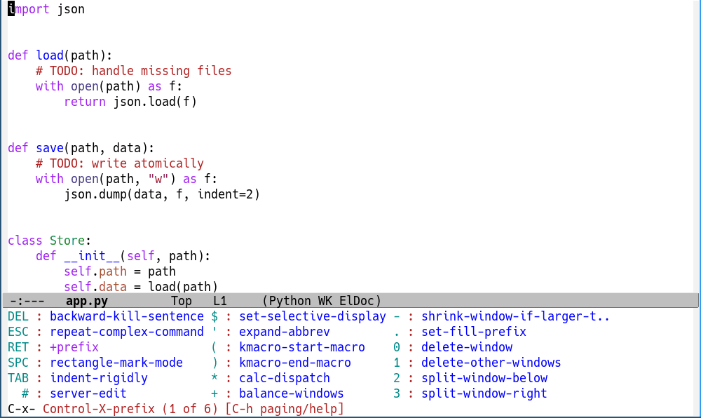
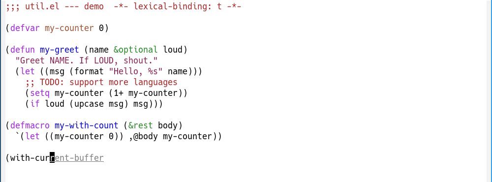
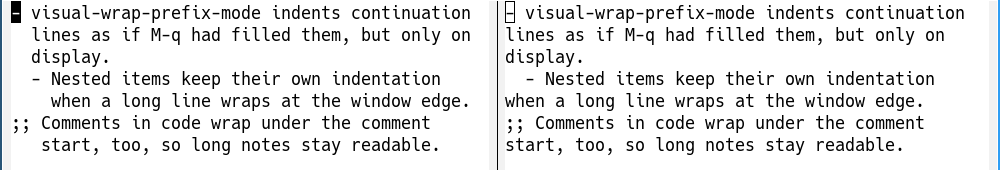
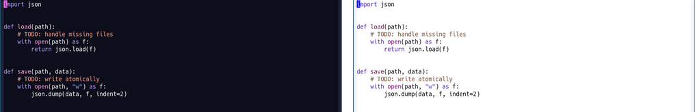
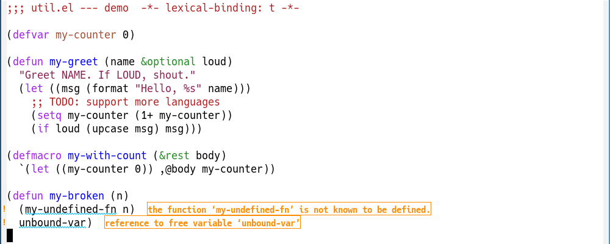
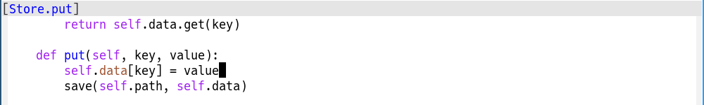
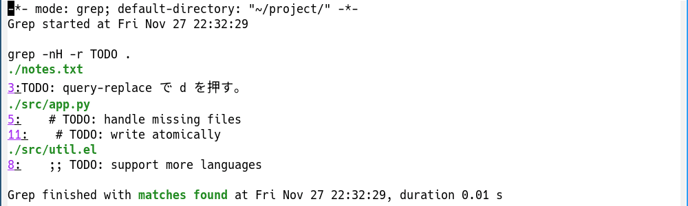

Title: Seven fun new features in Emacs 30, shown in screenshots
Date: 2026-11-27 22:40
Updated: 2026-11-27 22:40
Draft: true
Lang: en
Original: /blog/2026/771a69
Tags: emacs release-notes


I picked seven new features from the Emacs 30 NEWS that you notice the moment you use them, and this post shows each one in a screenshot of Emacs 30.2.
Most of them work without installing a package, such as which-key, now part of Emacs, and `completion-preview-mode`, which shows a faint completion while you type.

The NEWS lives in [etc/NEWS.30](https://github.com/emacs-mirror/emacs/blob/emacs-31.1/etc/NEWS.30) and runs to 2,859 lines.
I took every screenshot in Emacs 30.2 started with `emacs -Q`, and I include the code for each feature that needs a setting.


# List the keys that can follow a prefix with which-key

[which-key](https://github.com/emacs-mirror/emacs/blob/emacs-31.1/etc/NEWS.30#L1927) has moved from GNU ELPA into Emacs.
Turn on `which-key-mode`, press a prefix key such as `C-x`, and wait a moment: the minibuffer grows into a table of the keys and commands that can follow.

```emacs-lisp
(which-key-mode 1)
```



The keys after `C-x` do not fit on one screen, so the table has 6 pages.
Press `C-h` to see how to turn the pages.

When you forget the key for a command, press the prefix, wait, and find the command by name.


# See a faint completion as you type

With [completion-preview-mode](https://github.com/emacs-mirror/emacs/blob/emacs-31.1/etc/NEWS.30#L1935) on, a completion for the symbol you are typing appears in faint text after the cursor.
TAB accepts it, and `M-i` completes up to the longest common prefix of the candidates.

```emacs-lisp
(global-completion-preview-mode 1)
```



The preview appears once you have typed three characters of a symbol.
In the screenshot I typed `(with-cur` in an Emacs Lisp buffer, and the rest, `rent-buffer`, shows in faint text.


# Indent wrapped lines as if `M-q` had filled them

[visual-wrap-prefix-mode](https://github.com/emacs-mirror/emacs/blob/emacs-31.1/etc/NEWS.30#L607), the adaptive-wrap package from GNU ELPA brought into Emacs, indents each continuation line to match the line it continues.
Unlike `M-q`, it changes only the display and leaves the buffer text alone.

```emacs-lisp
(add-hook 'text-mode-hook #'visual-line-mode)
(add-hook 'text-mode-hook #'visual-wrap-prefix-mode)
```



The left buffer has `visual-wrap-prefix-mode` on, and the right buffer holds the same text with the mode off.
On the left, wrapped bullet items line up after the bullet, and the wrapped comment lines up after the comment starter.


# Eight Modus themes

Emacs 28 shipped the light `modus-operandi` and the dark `modus-vivendi`, and Emacs 30 [adds six more](https://github.com/emacs-mirror/emacs/blob/emacs-31.1/etc/NEWS.30#L1968).
Each comes in a light and a dark version: `-tinted` for easier reading, `-deuteranopia` for red-green color deficiency, and `-tritanopia` for blue-yellow color deficiency.

```emacs-lisp
(load-theme 'modus-vivendi-tinted t)
```



The left shot is `modus-vivendi-tinted` and the right shot is `modus-operandi-deuteranopia`.
You switch between all eight with `load-theme`.


# Show Flymake diagnostics at the end of the line

Set [flymake-show-diagnostics-at-end-of-line](https://github.com/emacs-mirror/emacs/blob/emacs-31.1/etc/NEWS.30#L1477) to `t`, and Flymake puts each diagnostic in a box at the end of its line.
You read the message where it is, without hovering the mouse or opening another buffer.

```emacs-lisp
(setopt flymake-show-diagnostics-at-end-of-line t)
```



I wrote `my-broken`, which uses an undefined function and an undefined variable, in an Emacs Lisp file and turned on `flymake-mode`.
The byte-compiler warnings appear at the end of two lines, and the mode line shows a warning count of 2.

In Emacs 30, the Emacs Lisp backend runs only in files covered by [trusted-content](https://github.com/emacs-mirror/emacs/blob/emacs-31.1/etc/NEWS.30#L194).
To try it, mark the files you trust, for example with `(setopt trusted-content :all)`.


# Show the current function in the header line

Set [which-func-display](https://github.com/emacs-mirror/emacs/blob/emacs-31.1/etc/NEWS.30#L1208) to `header`, and `which-function-mode` shows the name of the function at point in the header line at the top of the window.
The default, `mode`, shows it in the mode line, and `mode-and-header` shows it in both.

```emacs-lisp
(setopt which-func-display 'header)
(which-function-mode 1)
```



Point is inside the method `put` of the Python class `Store`, and the header line reads `Store.put` even though the `class Store:` line has scrolled off the screen.
When you scroll through a long method, the header line still tells you which function you are in.


# Group grep results by file

Set [grep-use-headings](https://github.com/emacs-mirror/emacs/blob/emacs-31.1/etc/NEWS.30#L864) to `t`, and `M-x grep` groups its results by file, with the matching lines under a heading for each file name.
It looks like `--heading` in `git grep` and `rg`.

```emacs-lisp
(setopt grep-use-headings t)
```



Line numbers and matching lines sit under the green file names, so a file with many matches no longer repeats its name on every line.


# Other changes worth a look

-   [Native compilation](https://github.com/emacs-mirror/emacs/blob/emacs-31.1/etc/NEWS.30#L25) is on by default in `configure` when libgccjit is available.
-   [replace-regexp-as-diff](https://github.com/emacs-mirror/emacs/blob/emacs-31.1/etc/NEWS.30#L641) shows a regexp replacement as a diff, which you can then apply as a patch.
-   With [kill-ring-deindent-mode](https://github.com/emacs-mirror/emacs/blob/emacs-31.1/etc/NEWS.30#L620) on, copying indented code removes the leading indentation before the text goes into the kill ring.
-   Mode line items placed after [mode-line-format-right-align](https://github.com/emacs-mirror/emacs/blob/emacs-31.1/etc/NEWS.30#L233) are aligned to the right.

