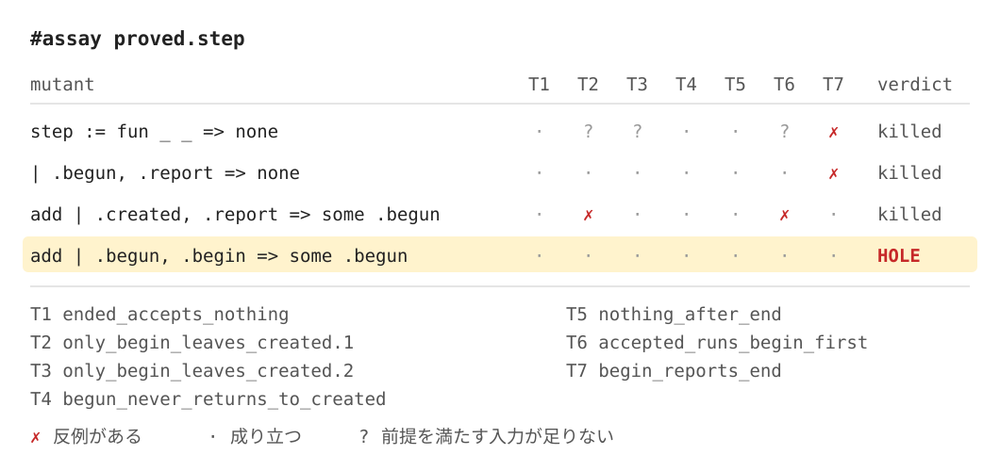

Title: おい、 LeanでMutation Test をやれ。証明品質を、測るために
Date: 2026-11-17 12:43
Tags: lean formal-verification testing release lean-leanassay rust-lsp-touchstone lean-leanfran rust-leanwisp rust-leansail rust-leankeel rust-leanwake rust-ritsuryo rust-ritsulint


mizchiさんの[おい、 Mutation Test をやれ。テスト品質を、測るために](https://zenn.dev/mizchi/articles/mutation-test-quality)は、AIで上げたカバレッジに安心する前に、コードを書き換えたミュータントを作ってテストが落ちるかを見て、テストの品質を測ろうという記事です。

同じことはLeanの証明にも言えて、証明が通っていても、わざと壊した実装が同じ定理を満たしてしまうなら、その定理は実装について何も保証していないことになります。
AIが証明を書いてくれるようになってきた今、気にするべきなのは証明が通るかどうかより、定理が実装をどこまで縛れているかのほうだと思っています。
実際、JuliaをLeanに写したプロジェクトでは、[「証明済み」の範囲チェック130件のうち128件](https://discourse.julialang.org/t/formalizing-julia-in-lean-and-finding-400-bugs-in-base/140243)が、添字が範囲内だと仮定していただけでした。

Leanは定理も実装も実行できるので、Mutation TestをLeanに持ち込んで、定理に出てくる関数をわざと壊したバージョンでも定理が成り立ってしまうかを、実際に走らせて確かめる道具を作りました。
試しに自分で証明を書いたlsp-touchstoneの定理に当ててみたところ、仕様に反する状態機械やUTF-16の幅を間違えた変換でも、すべての定理が成り立ってしまうことが分かりました。
Leanで書いた関数をRustに変換して使っている自作のツール6つにも当ててみると、2つのツールで合わせて56の穴が見つかったので、定理を足してすべて塞いであります。

作った道具はleanassayで、リポジトリは[conao3/lean-leanassay](https://github.com/conao3/lean-leanassay)、ライセンスはApache-2.0です。
この記事の結果は、Lean 4.35.0とleanassay 0.2.0で動かしたものです。

<div class="github-card" data-repo="conao3/lean-leanassay"><a href="https://github.com/conao3/lean-leanassay"><span class="github-card-name"><svg class="github-card-mark" viewBox="0 0 16 16" aria-hidden="true"><path d="M6.766 11.328c-2.063-.25-3.516-1.734-3.516-3.656 0-.781.281-1.625.75-2.188-.203-.515-.172-1.609.063-2.062.625-.078 1.468.25 1.968.703.594-.187 1.219-.281 1.985-.281.765 0 1.39.094 1.953.265.484-.437 1.344-.765 1.969-.687.218.422.25 1.515.046 2.047.5.593.766 1.39.766 2.203 0 1.922-1.453 3.375-3.547 3.64.531.344.89 1.094.89 1.954v1.625c0 .468.391.734.86.547C13.781 14.359 16 11.53 16 8.03 16 3.61 12.406 0 7.984 0 3.563 0 0 3.61 0 8.031a7.88 7.88 0 0 0 5.172 7.422c.422.156.828-.125.828-.547v-1.25c-.219.094-.5.156-.75.156-1.031 0-1.64-.562-2.078-1.609-.172-.422-.36-.672-.719-.719-.187-.015-.25-.093-.25-.187 0-.188.313-.328.625-.328.453 0 .844.281 1.25.86.313.452.64.655 1.031.655s.641-.14 1-.5c.266-.265.47-.5.657-.656"/></svg><span>conao3/<strong>lean-leanassay</strong></span></span><span class="github-card-description">Check whether your Lean theorems pin down your implementation, by running broken implementations against them</span><span class="github-card-footer"><span class="github-card-language"><span class="github-card-language-color"></span>Lean</span><span class="github-card-star"><svg viewBox="0 0 16 16" aria-hidden="true"><path d="M8 .25a.75.75 0 0 1 .673.418l1.882 3.815 4.21.612a.75.75 0 0 1 .416 1.279l-3.046 2.97.719 4.192a.751.751 0 0 1-1.088.791L8 12.347l-3.766 1.98a.75.75 0 0 1-1.088-.79l.72-4.194L.818 6.374a.75.75 0 0 1 .416-1.28l4.21-.611L7.327.668A.75.75 0 0 1 8 .25Z"/></svg><span>Star</span><span class="github-card-star-count" hidden></span></span></span></a></div>


# 証明が通る壊れた実装

[lsp-touchstone](https://s.conao3.com/blog/2026/ccc5ed)はLSPの通信が仕様どおりかを判定する道具です。
進捗の通知で状態がどう移るかをLeanで書いていて、leanassayを当てる前は6つの定理を証明していました。

```lean
def step : TokenState → ProgressKind → Option TokenState
  | .created, .begin => some .begun
  | .begun, .report => some .begun
  | .begun, .finish => some .ended
  | _, _ => none
```

LSPの進捗は `begin` 、何回かの `report` 、 `end` の順に1回だけ進みます。
コードの `.finish` がLSPの `end` で、 `|` で始まる行の1つずつを腕と呼びます。
ここに `begun` の状態で `begin` を受けて `begun` に留まる腕を1行足してみます。

```lean
| .begun, .begin => some .begun
```

この腕を足しても、6つの定理は元の証明のまま通ってしまいます。
2回目の `begin` を禁じる定理を1つも書いていなかったからで、lsp-touchstoneはこの `step` で違反を判定しているので、この腕が入ると2回目の `begin` を見逃すことになります。

定理はどれも正しいし証明も通っているので、問題は書いていない定理のほうにあります。
そして書いていない定理は、証明をいくら読み返しても見つかりません。


# leanassayがすること

leanassayは、定理に出てくる関数を壊したバージョンを作って、そのバージョンで定理を実行します。
証明は使わずに定理の前提と結論を具体的な入力で計算するので、定理が成り立たない入力が見つかればその壊し方は定理が弾いたことになり、どの入力でも成り立ってしまえば定理に穴があることになります。

mizchiさんの記事は、ユニットテストが実装の品質保証ならミューテーションテストはテストコードの品質保証だと位置づけていて、leanassayはこれを定理に置き換えて、証明した定理が実装をどこまで保証できているかを測ります。

壊し方は2種類あります。

-   関数全体を、明らかに間違った関数に置き換えます。いつも `default` や `none` を返す関数、引数をそのまま返す関数、リストの引数の先頭1つだけを返す関数などです。
-   関数の本体を少しだけ変えます。比較や算術の演算子を替える、数のリテラルを1だけずらす、 `take` と `drop` を入れ替える、パターンマッチの腕の結果を別の腕の結果に替える、どの腕にも書かれていない構築子の組み合わせに腕を足す、 `if` の分岐を入れ替える、といった変え方です。

壊したバージョンが試したすべての入力で元の関数と同じ値を返すなら、それは壊れていないとみなして報告から外し、出力が変わったのに定理を通ってしまったバージョンだけを穴として報告します。
mizchiさんの記事の言葉でいえば、定理が弾いたバージョンがKilled、穴がSurvivedで、報告から外すバージョンは等価ミュータントにあたります。

入力は、乱数の入力で性質を試すLeanのライブラリ[plausible](https://github.com/leanprover-community/plausible)の生成器で作っています。
seedを固定しているので、何回実行しても同じ結果になります。
引数の型の値が少なければすべての組み合わせを試しますし、前提が成り立つ入力がまれな定理では、十分な数になるまで試す入力を増やします。


# 使い方

lakefile.tomlにleanassayを足して、監査したい関数を `#assay` に渡すだけです。

```lean
import Assay
import LspTouchstone.Progress

#assay proved.step
```

leanassayは、渡した関数が出てくる定理と、それを呼ぶ関数が出てくる定理を集めてきます。
定理の結論が `∧` でつながっていれば項ごとに列を分けて、壊したバージョンごとにどの定理が弾いたかを表にします。



図は、出力の表から4行を抜き出して、壊し方の名前を短くしたものです。

`✗` はその定理が成り立たない入力が見つかったこと、 `·` は試した入力で成り立ったこと、 `?` は壊したバージョンでは定理の前提を満たす入力がほとんど見つからず、確かめられなかったことを表しています。
19の壊し方のうち17は少なくとも1つの定理が弾いていて、 `begun` で `begin` を受ける腕を足した2つが穴として残りました。
穴には元の関数と出力が違う入力を添えて警告を出すので、この穴なら `begun` の状態と `begin` の組で出力が違うと出ます。

`set_option assay.failOnHole true` を付けると穴をエラーとして報告するので、このファイルをビルドの対象に入れておけば、穴が残っている間は `lake build` が失敗するようになります。


# lsp-touchstoneに当てた結果

lsp-touchstoneで証明している3つの部分に当ててみました。

<table border="2" cellspacing="0" cellpadding="6" rules="groups" frame="hsides">


<colgroup>
<col  class="org-left" />

<col  class="org-right" />

<col  class="org-right" />

<col  class="org-right" />
</colgroup>
<thead>
<tr>
<th scope="col" class="org-left">部分</th>
<th scope="col" class="org-right">壊し方</th>
<th scope="col" class="org-right">弾いた</th>
<th scope="col" class="org-right">穴</th>
</tr>
</thead>
<tbody>
<tr>
<td class="org-left">進捗の状態の移り方</td>
<td class="org-right">19</td>
<td class="org-right">17</td>
<td class="org-right">2</td>
</tr>

<tr>
<td class="org-left">位置の単位の変換</td>
<td class="org-right">72</td>
<td class="org-right">43</td>
<td class="org-right">15</td>
</tr>

<tr>
<td class="org-left">文書の範囲の置き換え</td>
<td class="org-right">12</td>
<td class="org-right">12</td>
<td class="org-right">0</td>
</tr>
</tbody>
</table>

位置の単位の変換で弾けなかった残りの14は、型が合わずに作れなかったものが12、試した入力で元と同じ値を返したものが1、前提を満たす入力が足りずに確かめられなかったものが1です。

位置の単位の変換では、1文字をUTF-8、UTF-16、UTF-32で何単位と数えるかを `unitWidth` で決めていて、たとえば `😀` はUTF-8では4、UTF-16では2、UTF-32では1と数えます。
ところがこの幅を1以上のまま変えても、4つの定理はすべて成り立ってしまいました。
定理が縛っていたのは幅が1以上であることだけで、UTF-16で2と数える文字がどれかは決めていなかったからです。
実際leanassayは、UTF-16で2と数える境界の比較を `<` から `≤` に替えたバージョンや、UTF-16の幅をいつも1にしたバージョンを穴として報告してきました。

もう1つの穴は、位置が文字の途中を指すときの扱いでした。
定理は「文字の途中を指すと判定したなら、その位置は本当に文字の途中である」とだけ述べていて、「文字の途中を指す位置はかならず文字の途中と判定される」という逆向きの定理がありませんでした。
そのせいで、2文字目より後ろの文字の途中を指す位置を、文字の境界や行末と判定するバージョンもすべての定理を通っていました。

この結果をもとに、lsp-touchstoneに次の3つの定理を足しました。

-   `begun` の状態で受けられるのは `report` と `end` だけ
-   文字の途中を指す位置は、かならず文字の途中と判定される
-   1文字の幅は、UTF-8ではLeanの `Char.utf8Size` と等しく、UTF-16ではUTF-8で4バイトの文字だけが2になり、UTF-32では1になる

定理を足したあとは、進捗の19、位置の72の壊し方のどれも穴として残っていません。
[定理を足したcommit](https://github.com/conao3/rust-lsp-touchstone/commit/f77cc2b)と、足す前と後の[監査の結果](https://github.com/conao3/lean-leanassay/tree/master/AssayTest)はリポジトリに置いてあります。


# 自作のツールに当てた結果

lsp-touchstoneのほかにも、Leanで書いた関数を[leanfran](https://github.com/conao3/lean-leanfran)でRustに変換して使っている自作のツールが6つあります。
Rustから呼んでいる関数に `#assay` を当てて、 `make check` で監査するようにしました。

<table border="2" cellspacing="0" cellpadding="6" rules="groups" frame="hsides">


<colgroup>
<col  class="org-left" />

<col  class="org-right" />

<col  class="org-right" />

<col  class="org-right" />

<col  class="org-right" />
</colgroup>
<thead>
<tr>
<th scope="col" class="org-left">ツール</th>
<th scope="col" class="org-right">関数</th>
<th scope="col" class="org-right">壊し方</th>
<th scope="col" class="org-right">弾いた</th>
<th scope="col" class="org-right">穴</th>
</tr>
</thead>
<tbody>
<tr>
<td class="org-left"><a href="https://github.com/conao3/rust-leanwisp">leanwisp</a> (Leanのフォーマッタ)</td>
<td class="org-right">24</td>
<td class="org-right">155</td>
<td class="org-right">140</td>
<td class="org-right">0</td>
</tr>

<tr>
<td class="org-left"><a href="https://github.com/conao3/rust-leansail">leansail</a> (Leanの言語サーバー)</td>
<td class="org-right">7</td>
<td class="org-right">420</td>
<td class="org-right">385</td>
<td class="org-right">0</td>
</tr>

<tr>
<td class="org-left"><a href="https://github.com/conao3/rust-leankeel">leankeel</a> (Leanのlinter)</td>
<td class="org-right">7</td>
<td class="org-right">40</td>
<td class="org-right">40</td>
<td class="org-right">0</td>
</tr>

<tr>
<td class="org-left"><a href="https://github.com/conao3/rust-leanwake">leanwake</a> (Leanの遅くなった宣言の検出)</td>
<td class="org-right">3</td>
<td class="org-right">10</td>
<td class="org-right">10</td>
<td class="org-right">0</td>
</tr>

<tr>
<td class="org-left"><a href="https://github.com/conao3/rust-ritsuryo">ritsuryo</a> (法令の期間と税額の計算)</td>
<td class="org-right">5</td>
<td class="org-right">14</td>
<td class="org-right">10</td>
<td class="org-right">0</td>
</tr>

<tr>
<td class="org-left"><a href="https://github.com/conao3/rust-ritsulint">ritsulint</a> (法令のlinter)</td>
<td class="org-right">17</td>
<td class="org-right">203</td>
<td class="org-right">137</td>
<td class="org-right">0</td>
</tr>

<tr>
<td class="org-left">合計</td>
<td class="org-right">63</td>
<td class="org-right">842</td>
<td class="org-right">722</td>
<td class="org-right">0</td>
</tr>
</tbody>
</table>

弾いていない分は、型が合わずに作れなかったバージョンと、試した入力で元と同じ値を返したバージョンです。
監査から外した関数もあります。
leanwispのキャッシュのキーを作る `key` は、もとになる `fields` に穴が2つ残っていて、ritsuryoのコマンドの一覧を返す `describe` には定理がありません。

当てる前は、leanwispに17、leansailに39の穴があって、定理が1つも触れていない関数もritsuryoに6つ、leanwispに4つ、leankeelに1つありました。

穴の多くは、上限だけや一方向だけを述べた定理のところに出ていました。
たとえばleanwispの[softblockIndent](https://github.com/conao3/rust-leanwisp/blob/a1902d928cbcf106f0992bec23f9e7d12cc7017f/src/layout.rs#L54)は字下げの幅を `min indent.toNat (base + 2)` で決める関数なのですが、定理は結果がどちらの値も超えないことしか述べていなかったので、いつも0を返すバージョンや `+` を `-` に替えたバージョンも通ってしまいました。
[結果がどちらかの値に等しいという定理](https://github.com/conao3/rust-leanwisp/blob/a1902d928cbcf106f0992bec23f9e7d12cc7017f/src/layout.rs#L87-L90)を足したら、この穴はなくなりました。

leansailでは、言語サーバーの状態の移り方[transition](https://github.com/conao3/rust-leansail/blob/67d191376c7025d718c3c0f902d05056a184cc60/src/lifecycle.rs#L13-L24)に39の穴がありました。
元の定理は「 `running` に移ったなら前の状態はこのどれかである」という含意の形で、前提を満たす入力が63のうち3つしかなく、壊したバージョンの多くを確かめられていませんでした。
そこで `↔` の形に書き直して、移った先の状態ごとにも `↔` の定理を足したところ、39の穴はすべてなくなりました。

どの穴も定理の書き漏らしで、関数の定義のほうを直すことはありませんでした。
mizchiさんの記事は、CIで常に全件を回すよりリファクタリングのための道具として使うことを勧めているのですが、定理を消したり弱めたりしたときに気付けるように、どのツールも `make check` で穴がないことを確かめるようにしました。
たとえばleansailで足した[initializing\_iff\_initialize](https://github.com/conao3/rust-leansail/blob/67d191376c7025d718c3c0f902d05056a184cc60/src/lifecycle.rs#L45-L47)を消すと、29の穴が出てビルドが失敗します。


# 証明が壊れるかで判定する道具との違い

Leanにも、関数を壊して定理の強さを測る道具はすでにあります。
[Mutate.lean](https://github.com/jubnzv/Mutate.lean)は関数の本体を変えて、ファイルの証明が通らなくなるかで判定するもので、Microsoft CCFはこれを使って[Leanのモデルの穴を探しました](https://github.com/microsoft/CCF/pull/8683)。

ただ、証明が壊れるかで判定すると、結果が証明の書き方に左右されてしまいます。
文字の途中を指す位置を文字の境界と判定するバージョンを手で作ると、場合分けした先で `simp` がゴールを閉じてしまって続く手が余るので、[resolve\_splits](https://github.com/conao3/lean-leanassay/blob/ca31e1d3253382db32c8da631910a0fb5d9e76a6/Examples/LspTouchstone/Position.lean#L78-L98)の証明は通らなくなります。
この基準だとこのバージョンは弾かれた扱いになって、逆向きの定理が欠けていることには気付けません。
leanassayは定理の命題そのものを実行するのでこのバージョンが定理を満たすことを見つけられますし、証明をまだ書いていない `sorry` の定理にも使えます。

進捗の状態の移り方でも、Mutate.leanが作る型の合う壊し方は2つで、穴は見つかりませんでした。
leanassayが見つけた穴は腕を足す壊し方によるもので、Mutate.leanはこの壊し方を作らないからです。


# 確かめられないこと

leanassayは、実行できる定理しか確かめられません。
前提と結論が判定できる命題で、引数の型にplausibleの生成器がある必要があり、実数や無限の集合についての定理は実行できない定理として報告します。

また、試すのは入力の標本なので、穴が見つからなくても、試した入力では見つからなかったと言えるだけです。
壊れていないとみなして報告から外すバージョンも、試した入力で元の関数と同じ値を返したというだけのことです。

