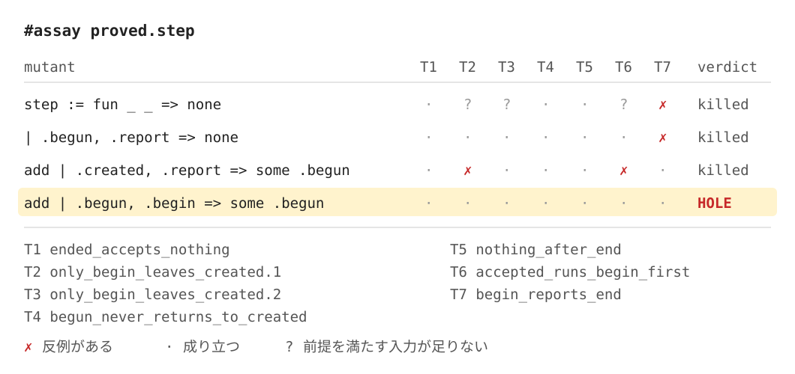

Title: Leanの定理が実装を縛っているかを、壊した実装を走らせて確かめるlean-assayを作った
Date: 2026-11-10 14:35
Draft: true


証明が通っても、壊れた実装が同じ定理を満たすなら、その定理は実装について何も保証していません。
AIが証明を書けるようになり、確かめるべきことは証明が通るかどうかから、定理が実装をどこまで縛っているかに移りました。
JuliaをLeanに写したプロジェクトでは、「証明済み」の範囲チェック130件のうち128件が、添字が範囲内だと仮定しただけでした。

Leanでは定理も実装も実行できます。
そこで、定理に出てくる関数をわざと壊し、壊した版でも定理が成り立つかを実行して確かめる道具を作りました。
自分で証明を書いたlsp-touchstoneの定理に当てて確かめました。
仕様に反する状態機械や、UTF-16の幅を間違えた変換でも、すべての定理が成り立つことが分かりました。

作った道具はlean-assayです。
assayは、金属の純度を確かめる試験のことです。
リポジトリは[conao3/lean-assay](https://github.com/conao3/lean-assay)で、ライセンスはApache-2.0です。
この記事はLean 4.35.0とlean-assay 0.1.0で動かした結果をもとに書いています。

<div class="github-card" data-repo="conao3/lean-assay"><a href="https://github.com/conao3/lean-assay"><span class="github-card-name"><svg class="github-card-mark" viewBox="0 0 16 16" aria-hidden="true"><path d="M6.766 11.328c-2.063-.25-3.516-1.734-3.516-3.656 0-.781.281-1.625.75-2.188-.203-.515-.172-1.609.063-2.062.625-.078 1.468.25 1.968.703.594-.187 1.219-.281 1.985-.281.765 0 1.39.094 1.953.265.484-.437 1.344-.765 1.969-.687.218.422.25 1.515.046 2.047.5.593.766 1.39.766 2.203 0 1.922-1.453 3.375-3.547 3.64.531.344.89 1.094.89 1.954v1.625c0 .468.391.734.86.547C13.781 14.359 16 11.53 16 8.03 16 3.61 12.406 0 7.984 0 3.563 0 0 3.61 0 8.031a7.88 7.88 0 0 0 5.172 7.422c.422.156.828-.125.828-.547v-1.25c-.219.094-.5.156-.75.156-1.031 0-1.64-.562-2.078-1.609-.172-.422-.36-.672-.719-.719-.187-.015-.25-.093-.25-.187 0-.188.313-.328.625-.328.453 0 .844.281 1.25.86.313.452.64.655 1.031.655s.641-.14 1-.5c.266-.265.47-.5.657-.656"/></svg><span>conao3/<strong>lean-assay</strong></span></span><span class="github-card-description">Check whether your Lean theorems pin down your implementation, by running broken implementations against them</span><span class="github-card-footer"><span class="github-card-language"><span class="github-card-language-color"></span>Lean</span><span class="github-card-star"><svg viewBox="0 0 16 16" aria-hidden="true"><path d="M8 .25a.75.75 0 0 1 .673.418l1.882 3.815 4.21.612a.75.75 0 0 1 .416 1.279l-3.046 2.97.719 4.192a.751.751 0 0 1-1.088.791L8 12.347l-3.766 1.98a.75.75 0 0 1-1.088-.79l.72-4.194L.818 6.374a.75.75 0 0 1 .416-1.28l4.21-.611L7.327.668A.75.75 0 0 1 8 .25Z"/></svg><span>Star</span><span class="github-card-star-count" hidden></span></span></span></a></div>


# 証明が通る壊れた実装

[lsp-touchstone](https://s.conao3.com/blog/2026/ccc5ed)は、LSPの通信が仕様どおりかを判定する道具です。
進捗の通知の状態の移り方をLeanで書き、6つの定理を証明しています。

```lean
def step : TokenState → ProgressKind → Option TokenState
  | .created, .begin => some .begun
  | .begun, .report => some .begun
  | .begun, .finish => some .ended
  | _, _ => none
```

LSPの進捗は、 `begin` 、何回かの `report` 、 `end` の順に1回だけ進みます。
ここに、 `begun` の状態で `begin` を受けて `begun` に留まる腕を1行足します。

```lean
| .begun, .begin => some .begun
```

この腕を足しても、6つの定理は元の証明のまま通ります。
2回目の `begin` を禁じる定理が1つもないからです。
lsp-touchstoneはこの `step` で違反を判定するので、この腕が入ると2回目の `begin` を見逃します。

定理はどれも正しく、証明も通っています。
足りないのは、書かれていない定理です。
証明を読み返しても、書かれていない定理は見つかりません。


# lean-assayがすること

lean-assayは、定理に出てくる関数を壊した版を作り、その版で定理を実行して確かめます。
証明は使わず、定理の前提と結論を具体的な入力で計算します。
定理が成り立たない入力が見つかれば、その壊し方は定理が弾いたことになります。
どの入力でも成り立てば、定理に穴があります。

壊し方は2種類あります。

-   関数全体を、明らかに間違った関数に置き換えます。いつも `default` や `none` を返す関数、引数をそのまま返す関数、リストの引数の先頭1つだけを返す関数などです。
-   関数の本体を少しだけ変えます。比較や算術の演算子を替える、数のリテラルを1だけずらす、 `take` と `drop` を入れ替える、パターンマッチの腕の結果を別の腕の結果に替える、どの腕にも書かれていない構築子の組み合わせに腕を足す、 `if` の分岐を入れ替える、といった変え方です。

壊した版が、試したすべての入力で元の関数と同じ値を返すなら、その版は壊れていないとみなして報告から外します。
穴として報告するのは、出力を変えたのに定理を通った版だけです。

入力は[plausible](https://github.com/leanprover-community/plausible)の生成器で作ります。
seedを固定しているので、何回実行しても同じ結果になります。
引数の型の値が少ないときは、すべての組み合わせを試します。
前提が成り立つ入力がまれな定理では、十分な数になるまで試す入力を増やします。


# 使い方

lakefile.tomlにlean-assayを足し、監査したい関数を `#assay` に渡します。

```lean
import Assay
import LspTouchstone.Progress

#assay proved.step
```

lean-assayは、渡した関数が出てくる定理と、それを呼ぶ関数が出てくる定理を集めます。
定理の結論が `∧` でつながっているときは、項ごとに列を分けます。
そのうえで、壊した版ごとに、どの定理が弾いたかを表にします。



`✗` はその定理が成り立たない入力が見つかったこと、 `·` は試した入力で成り立ったことを表します。
`?` は、壊した版では定理の前提を満たす入力がほとんど見つからず、確かめられなかったことを表します。
19の壊し方のうち17は少なくとも1つの定理が弾き、 `begun` で `begin` を受ける腕を足した2つが穴として残りました。
穴には、元の関数と出力が違う入力を添えて警告を出します。

    warning: hole: `step: 19:3: add | .begun, .begin => some .begun` satisfies every theorem;
    it differs from the original on #1 := proved.TokenState.begun, #2 := proved.ProgressKind.begin

`set_option assay.failOnHole true` を付けると、穴をエラーとして報告します。
このファイルをビルドの対象に入れれば、穴が残っている間は `lake build` が失敗します。


# lsp-touchstoneに当てた結果

lsp-touchstoneで証明している3つの部分に当てました。

<table border="2" cellspacing="0" cellpadding="6" rules="groups" frame="hsides">


<colgroup>
<col  class="org-left" />

<col  class="org-right" />

<col  class="org-right" />

<col  class="org-right" />
</colgroup>
<thead>
<tr>
<th scope="col" class="org-left">部分</th>
<th scope="col" class="org-right">壊し方</th>
<th scope="col" class="org-right">弾いた</th>
<th scope="col" class="org-right">穴</th>
</tr>
</thead>
<tbody>
<tr>
<td class="org-left">進捗の状態の移り方</td>
<td class="org-right">19</td>
<td class="org-right">17</td>
<td class="org-right">2</td>
</tr>

<tr>
<td class="org-left">位置の単位の変換</td>
<td class="org-right">72</td>
<td class="org-right">43</td>
<td class="org-right">15</td>
</tr>

<tr>
<td class="org-left">文書の範囲の置き換え</td>
<td class="org-right">12</td>
<td class="org-right">12</td>
<td class="org-right">0</td>
</tr>
</tbody>
</table>

位置の単位の変換では、1文字をUTF-8、UTF-16、UTF-32で何単位と数えるかを `unitWidth` で決めています。
`😀` はUTF-8では4、UTF-16では2、UTF-32では1と数えます。
この幅をどう変えても、4つの定理はすべて成り立ちました。
定理が縛っていたのは幅が1以上であることだけで、UTF-16で2と数える文字がどれかを決めていなかったからです。
lean-assayは、UTF-16で2と数える境界の比較を `<` から `≤` に替えた版や、UTF-16の幅をいつも1にした版を穴として報告しました。

もう1つの穴は、位置が文字の途中を指すときの扱いでした。
文字の途中を指すと判定したならその位置は本当に文字の途中である、とだけ定理は述べていました。
文字の途中を指す位置はかならず文字の途中と判定される、という逆向きの定理がありませんでした。
そのため、2文字目より後ろの文字の途中を指す位置を、文字の境界や行末と判定する版も、すべての定理を通りました。

この結果をもとに、lsp-touchstoneに3つの定理を足しました。

-   `begun` の状態で受けられるのは `report` と `end` だけ
-   文字の途中を指す位置は、かならず文字の途中と判定される
-   1文字の幅は、UTF-8ではLeanの `Char.utf8Size` と等しく、UTF-16ではUTF-8で4バイトの文字だけが2になり、UTF-32では1になる

定理を足したあとは、進捗の19、位置の72の壊し方のどれも穴として残りませんでした。
[定理を足したcommit](https://github.com/conao3/rust-lsp-touchstone/commit/f77cc2b)と、足す前と後の[監査の結果](https://github.com/conao3/lean-assay/tree/master/AssayTest)はリポジトリにあります。


# 証明が壊れるかで判定する道具との違い

Leanには、関数を壊して定理を確かめる道具がすでにあります。
[Mutate.lean](https://github.com/jubnzv/Mutate.lean)は関数の本体を変え、ファイルの証明が通らなくなるかで判定します。
Microsoft CCFは、これを使ってLeanのモデルの穴を探しました。

証明が壊れるかで判定すると、結果が証明の書き方に左右されます。
文字の途中を指す位置を文字の境界と判定する版を手で作ると、 `resolve_splits` の証明は通らなくなります。
場合分けした先で `simp` がゴールを閉じてしまい、続く手が余るからです。
Mutate.leanの判定ではこの版は弾かれたことになり、逆向きの定理が欠けていることは分かりません。
lean-assayは定理の命題そのものを実行するので、この版が定理を満たすことを見つけられます。
証明をまだ書いていない `sorry` の定理にも使えます。

進捗の状態の移り方では、Mutate.leanが作る型の合う壊し方は2つで、穴は見つかりませんでした。
lean-assayの穴は腕を足す壊し方で見つかりました。
Mutate.leanはこの壊し方を作りません。


# 確かめられないこと

lean-assayが確かめられるのは、実行できる定理だけです。
前提と結論が判定できる命題で、引数の型にplausibleの生成器がある必要があります。
実数や無限の集合についての定理は、実行できない定理として報告します。

試すのは入力の標本なので、穴が見つからなかったときに言えるのは、試した入力では見つからなかったことまでです。
壊れていないとみなして報告から外す版も、試した入力で元の関数と同じ値を返したというだけです。

