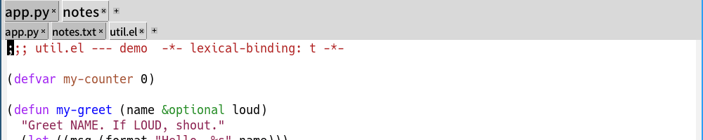
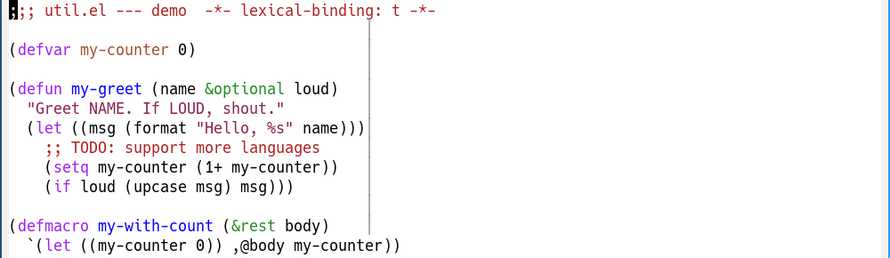
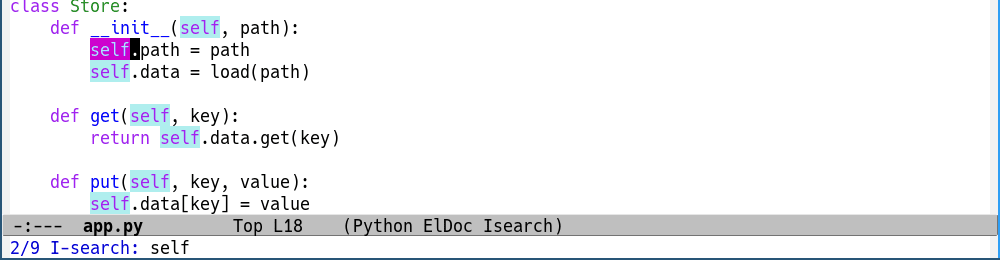
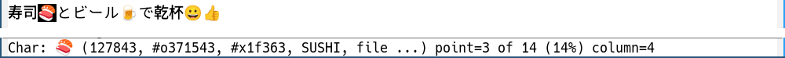
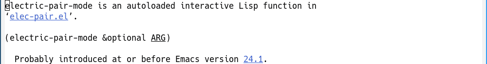
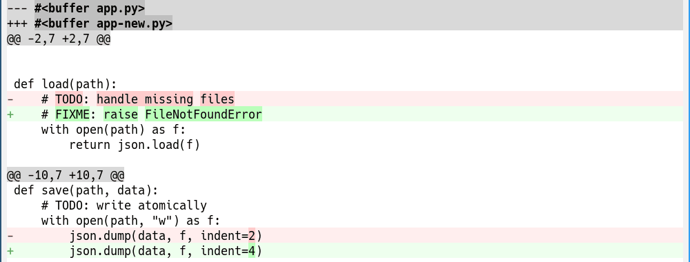
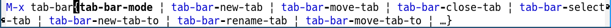

Title: Seven fun new features in Emacs 27, shown in screenshots
Date: 2026-11-27 23:00
Updated: 2026-11-27 23:00
Lang: en
Original: /blog/2026/92689a
Tags: emacs release-notes


I picked seven new features from the Emacs 27 NEWS that you notice the moment you use them, and this post shows each one in a screenshot of Emacs 27.2.
Many of them are still in daily use, such as `tab-bar-mode`, which switches window layouts with tabs, and `isearch-lazy-count`, which shows which match you are on.

The NEWS lives in [etc/NEWS.27](https://github.com/emacs-mirror/emacs/blob/emacs-31.1/etc/NEWS.27) and runs to 3,251 lines.
I took every screenshot in Emacs 27.2 started with `emacs -Q`, and I include the code for each feature that needs a setting.


# Switch window layouts with tabs

[tab-bar-mode](https://github.com/emacs-mirror/emacs/blob/emacs-31.1/etc/NEWS.27#L2336) puts tabs at the top of the frame, and each tab keeps its own window layout.
[global-tab-line-mode](https://github.com/emacs-mirror/emacs/blob/emacs-31.1/etc/NEWS.27#L2364) shows, above each window, the buffers you have opened in that window as tabs.

```emacs-lisp
(tab-bar-mode 1)
(global-tab-line-mode 1)
```



The upper row is the tab bar with two tabs, `app.py` and `notes`, which I named with `tab-rename`.
The lower row is the tab line with the three buffers opened in this window.

The tab bar commands live under `C-x t`: `C-x t 2` opens a new tab, and `C-x t 0` closes the current one.


# Draw a vertical line at the fill column

[display-fill-column-indicator-mode](https://github.com/emacs-mirror/emacs/blob/emacs-31.1/etc/NEWS.27#L526) draws a vertical line at the `fill-column` column.
According to the NEWS, it does what the fill-column-indicator package does, only faster.

```emacs-lisp
(add-hook 'prog-mode-hook #'display-fill-column-indicator-mode)
```



I set `fill-column` to 40 for the screenshot, and the lines that run past the line stand out.


# Show the match count in Isearch

Set [isearch-lazy-count](https://github.com/emacs-mirror/emacs/blob/emacs-31.1/etc/NEWS.27#L1589) to `t`, and the `C-s` prompt shows the number of the current match and the total number of matches.

```emacs-lisp
(setq isearch-lazy-count t)
```



I searched for `self` in app.py and pressed `C-s` once more, and the prompt shows `2/9`.
With the count in view, you know how many more `C-s` presses are left.


# Show emoji in color and name the character at point

Emacs drawing with Cairo 1.16.0 or later can [display multicolor fonts](https://github.com/emacs-mirror/emacs/blob/emacs-31.1/etc/NEWS.27#L523) such as Noto Color Emoji.
In Emacs 27 you set up the font yourself, so I told Emacs to use Noto Color Emoji for symbol characters.

```emacs-lisp
(set-fontset-font t 'symbol "Noto Color Emoji" nil 'prepend)
(setq what-cursor-show-names t)
```



With [what-cursor-show-names](https://github.com/emacs-mirror/emacs/blob/emacs-31.1/etc/NEWS.27#L341) set to `t`, `C-x =` also shows the name of the character at point.
In the screenshot I pressed `C-x =` on 🍣, and the echo area says `SUSHI`.


# See in Help which version introduced a function

The descriptions from `C-h f` and `C-h v` now give [an estimate of the release that introduced the function or variable](https://github.com/emacs-mirror/emacs/blob/emacs-31.1/etc/NEWS.27#L1549).



The description of `electric-pair-mode` says "Probably introduced at or before Emacs version 24.1.", and 24.1 is a link.
Emacs estimates the version from the old NEWS files, and the word `Probably` at the start of the sentence says so.


# Highlight the changed words inside a diff

`diff-mode` [refines hunks with font-lock](https://github.com/emacs-mirror/emacs/blob/emacs-31.1/etc/NEWS.27#L1050), highlighting the changed words as soon as the diff appears.
[diff-buffers](https://github.com/emacs-mirror/emacs/blob/emacs-31.1/etc/NEWS.27#L1046), which compares two buffers, is new as well.



Here `diff-buffers` compares app.py with an edited copy.
Only the changed words of the comment and the `2` that became `4` after `indent=` get the darker color.


# Use Fido for ido-style minibuffer completion

[fido-mode](https://github.com/emacs-mirror/emacs/blob/emacs-31.1/etc/NEWS.27#L1325), built on Icomplete, works like ido: it lists the candidates in a row in the minibuffer and narrows them as you type.
The name stands for "Fake Ido".

```emacs-lisp
(fido-mode 1)
```



After `M-x tab-bar`, the tab bar commands appear separated by `|`, with `tab-bar-mode` first.
`RET` picks the first candidate.


# New features from Emacs 27 to 31

I wrote one post in the same format for each Emacs release from 27 to 31.

-   [Seven fun new features in Emacs 31, shown in screenshots](https://s.conao3.com/blog/2026/26ed0f)
-   [Seven fun new features in Emacs 30, shown in screenshots](https://s.conao3.com/blog/2026/516114)
-   [Seven fun new features in Emacs 29, shown in screenshots](https://s.conao3.com/blog/2026/9e936f)
-   [Seven fun new features in Emacs 28, shown in screenshots](https://s.conao3.com/blog/2026/5e8afb)

