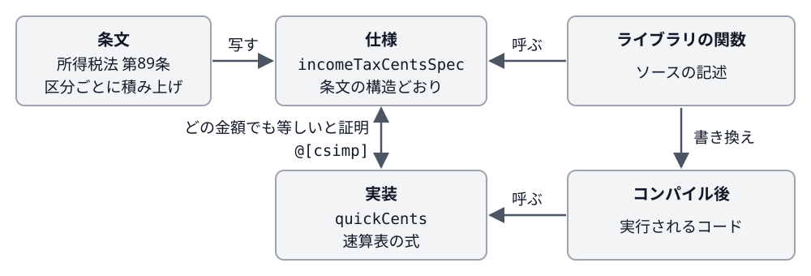

Title: Leanで書く証明付きの日付と税計算
Date: 2026-11-03 04:36
Tags: lean formal-verification cli tax release lean-ritsuryo


控訴期間の末日や所得税の額は条文を読めば計算の手順が決まるのですが、年末年始に当たる末日の繰り下げや税率の区分の境目のように、手で計算すると間違えやすい所があります。
プログラムに書いたとしても、その計算が条文どおりかを確かめるのには手間がかかります。

そこで、日本の法令が定める期間と税額の計算をLean 4で書いたライブラリとCLIの[lean-ritsuryo](https://github.com/conao3/lean-ritsuryo)を作りました。
ライブラリの関数には、条文を写して書いた定義と結果が一致することの証明を付けていて、CLIもこの関数を呼んで計算します。

扱う計算は民法の期間計算、祝日の判定、控訴期間などの期限、所得税、相続税、消費税、延滞税、利子税、加算税の税額と、国税の端数処理です。
以下の出力はどれもv0.5.0の `ritsuryo` で実行した結果です。

<div class="github-card" data-repo="conao3/lean-ritsuryo"><a href="https://github.com/conao3/lean-ritsuryo"><span class="github-card-name"><svg class="github-card-mark" viewBox="0 0 16 16" aria-hidden="true"><path d="M6.766 11.328c-2.063-.25-3.516-1.734-3.516-3.656 0-.781.281-1.625.75-2.188-.203-.515-.172-1.609.063-2.062.625-.078 1.468.25 1.968.703.594-.187 1.219-.281 1.985-.281.765 0 1.39.094 1.953.265.484-.437 1.344-.765 1.969-.687.218.422.25 1.515.046 2.047.5.593.766 1.39.766 2.203 0 1.922-1.453 3.375-3.547 3.64.531.344.89 1.094.89 1.954v1.625c0 .468.391.734.86.547C13.781 14.359 16 11.53 16 8.03 16 3.61 12.406 0 7.984 0 3.563 0 0 3.61 0 8.031a7.88 7.88 0 0 0 5.172 7.422c.422.156.828-.125.828-.547v-1.25c-.219.094-.5.156-.75.156-1.031 0-1.64-.562-2.078-1.609-.172-.422-.36-.672-.719-.719-.187-.015-.25-.093-.25-.187 0-.188.313-.328.625-.328.453 0 .844.281 1.25.86.313.452.64.655 1.031.655s.641-.14 1-.5c.266-.265.47-.5.657-.656"/></svg><span>conao3/<strong>lean-ritsuryo</strong></span></span><span class="github-card-description">Japanese statutory period computations (民法 期間計算, 年齢計算, 祝日) in Lean 4 with proofs on the shipped functions, and the ritsuryo CLI</span><span class="github-card-footer"><span class="github-card-language"><span class="github-card-language-color"></span>Lean</span><span class="github-card-star"><svg viewBox="0 0 16 16" aria-hidden="true"><path d="M8 .25a.75.75 0 0 1 .673.418l1.882 3.815 4.21.612a.75.75 0 0 1 .416 1.279l-3.046 2.97.719 4.192a.751.751 0 0 1-1.088.791L8 12.347l-3.766 1.98a.75.75 0 0 1-1.088-.79l.72-4.194L.818 6.374a.75.75 0 0 1 .416-1.28l4.21-.611L7.327.668A.75.75 0 0 1 8 .25Z"/></svg><span>Star</span><span class="github-card-star-count" hidden></span></span></span></a></div>


# 使ってみる

CLIの引数はAWS CLIと同じ文法で書きます。
どのコマンドもJSONを出力し、次のキーを含みます。

-   `Result`: 計算の結果
-   `Steps`: 途中の値
-   `Basis`: 根拠の条文
-   `Assumptions`: 計算の前提にした条文の読み方


## 控訴期間

2026-12-15に判決の送達を受けたときの控訴期間を計算してみます。
2週間の末日は2026-12-29ですが、この日は年末年始に当たるので、[民事訴訟法 第95条第3項](https://laws.e-gov.go.jp/law/408AC0000000109#Mp-Pa_1-Ch_5-Se_3-At_95-Pr_3)により末日は2027-01-04に繰り下がります。

```console
$ ritsuryo deadline compute-appeal-deadline --served-date 2026-12-15 \
    | jq '{Result: .Result, RolledOver: [.Steps.RolledOverDays[].Date]}'
{
  "Result": {
    "Deadline": "2027-01-04",
    "Period": "控訴期間",
    "Invariable": true
  },
  "RolledOver": [
    "2026-12-29",
    "2026-12-30",
    "2026-12-31",
    "2027-01-01",
    "2027-01-02",
    "2027-01-03"
  ]
}
```

`RolledOver` には繰り下げのときに飛ばした日が並び、祝日の判定には内閣府の祝日CSVを使っていて、その取得元とSHA-256を出力の `Data` に書いています。


## 所得税

2026年分で課税総所得金額が7,000,000円のとき、所得税は974,000円になり、国税庁の[速算表](https://www.nta.go.jp/taxes/shiraberu/taxanswer/shotoku/2260.htm)で7,000,000 × 23% − 636,000と求めた額と同じになります。

```console
$ ritsuryo income-tax compute-tax --tax-year 2026 --taxable-income 7000000 | jq .Result
{
  "IncomeTax": 974000,
  "ReconstructionTax": 20454,
  "DefenseTax": 0,
  "Total": 994454,
  "Payable": 994400
}
```

2027年分からは復興特別所得税が1.1%、防衛特別所得税が1%になるので、 `--tax-year 2027` を渡すと `ReconstructionTax` が10714、 `DefenseTax` が9740になります。


# 条文を写して書く

lean-ritsuryoでは、計算を条文の構造どおりの定義として書いています。
以下ではこの定義を仕様と呼びます。

Leanの定義は実行できるのですが、条文が結果の条件だけを定めているときや、条文どおりの手順では遅いときは、仕様をそのまま実行には使えません。
仕様を実行に使えるかどうかで、書き方は次の3通りに分かれます。


## 仕様をそのまま実行するとき

民事訴訟法 第95条第3項は、期間の末日が休日に当たるときは期間がその翌日に満了すると定めていて、休日は日曜日、土曜日、祝日法の休日、1月2日、1月3日、12月29日から31日までの日です。
これらの日を判定する仕様は、条文の列挙をそのまま並べた関数にしました。

```lean
def isHolidaySpec (national : Date → Bool) (d : Date) : Bool :=
  HolidayClass.holds national d .sunday || HolidayClass.holds national d .saturday ||
    HolidayClass.holds national d .nationalHoliday || HolidayClass.holds national d .newYear ||
    HolidayClass.holds national d .yearEnd
```

この関数は十分に速いので、繰り下げの計算はこの仕様をそのまま呼んでいます。
この場合、仕様のほかに実装は書いていません。


## 仕様の実行が遅く、速い実装を書くとき

仕様の計算が遅いときは、速く計算できる実装を別に書いて、実装が仕様と一致することを証明していて、ライブラリから仕様と実装のどちらを呼ぶかは、一致がすべての入力で成り立つか、条件付きで成り立つかで変わります。


### 実装がすべての入力で仕様と一致するとき

[所得税法 第89条](https://laws.e-gov.go.jp/law/340AC0000000033#Mp-Pa_2-Ch_3-Se_1-At_89)は、課税総所得金額を表の区分に分けてそれぞれに税率を掛け、合計した額を税額とすると定めていて、この条文を写した仕様の `incomeTaxCentsSpec` は税率表の区分を1つずつたどって税額を積み上げます。
課税総所得金額は円で、税額と控除額は百分の一円を1とする整数で表しました。

```lean
def table : List Bracket := [
  ⟨some 1950000, 5⟩, ⟨some 3300000, 10⟩, ⟨some 6950000, 20⟩, ⟨some 9000000, 23⟩,
  ⟨some 18000000, 33⟩, ⟨some 40000000, 40⟩, ⟨none, 45⟩]

def incomeTaxCentsSpec (x : Nat) : Nat :=
  progressiveCents table 0 x
```

ただ、国税庁の速算表のように税率を掛けて控除額を引けば、区分をたどらなくても1本の式で同じ税額を出せます。

```lean
def quickCents (x : Nat) : Nat :=
  if x ≤ 1950000 then 5 * x
  else if x ≤ 3300000 then 10 * x - 9750000
  else if x ≤ 6950000 then 20 * x - 42750000
  else if x ≤ 9000000 then 23 * x - 63600000
  else if x ≤ 18000000 then 33 * x - 153600000
  else if x ≤ 40000000 then 40 * x - 279600000
  else 45 * x - 479600000
```

そこで、仕様と速算表の式がどの金額でも等しいことを証明して、その定理に `@[csimp]` を付けました。
この書き方はv0.5.0のあとの[masterのコード](https://github.com/conao3/lean-ritsuryo/blob/c59558ea1f5a774614a3f1ce663d9525f4e6372f/Ritsuryo/Tax/Income.lean#L71-L72)に入っていて、v0.5.0の税額の関数は速算表の式を直接呼びます。

```lean
@[csimp]
theorem incomeTaxCentsSpec_eq_quickCents : @incomeTaxCentsSpec = @quickCents := by
  funext x
  simp only [incomeTaxCentsSpec, table, progressiveCents, quickCents]
  repeat' split
  all_goals omega
```

`@[csimp]` の付いた等式があると、Leanのコンパイラは左辺の関数を呼ぶ箇所を右辺の関数を呼ぶように書き換えてくれるので、ライブラリの税額の関数はソースでは仕様の `incomeTaxCentsSpec` を呼んでいても、実行されるのは速算表の式になります。

相続税の税率表も同じ形にしています。



書き換えられたことはコンパイラが出力する中間表現のIRで確かめられて、次は `incomeTaxCentsSpec x` を返すだけの関数 `probeIncome` のIRです。

```console
def probeIncome (x_1 : @& tobj) : tobj :=
  let x_2 : tobj := Ritsuryo.Tax.Income.quickCents x_1;
```

IRでは仕様ではなく `quickCents` が呼ばれています。
コンパイラは仕様を呼ぶ関数をコンパイルするときに書き換えるので、 `@[csimp]` の定理はその関数より前に書いておく必要があります。


### 実装が条件付きで仕様と一致するとき

[民法 第143条](https://laws.e-gov.go.jp/law/129AC0000000089#Mp-Pa_1-Ch_6-At_143)は、週、月、年で定めた期間を暦に従って計算し、最後の週、月、年で起算日に応当する日の前日に満了すると定めていて、この条文を写した仕様は応当日を次のように求めます。

```lean
def correspondingDaySpec (start : Date) : Length → Option Date
  | .days n => some (start.addDaysNaive n)
  | .weeks n => some (weekCorrespondingSpec start n)
  | len =>
    let ym := lastMonthSpec start len
    if start.day ≤ ym.daysInMonth then some ⟨ym.year, ym.month, start.day⟩ else none
```

日の期間は `addDaysNaive` で翌日を `n` 回たどり、週の期間は `weekCorrespondingSpec` で翌日をたどりながら同じ曜日の日を探します。
月と年の期間も `lastMonthSpec` が1か月ずつ進めて最後の月を求めるので、どれも計算の回数が期間の日数か月数に比例して増えてしまいます。

そこで実装では、日付を基準日からの通算日に直して計算することにしました。

```lean
def correspondingDays (start : Date) : Length → Option Int
  | .days n => some (start.toDays + n)
  | .weeks n => some (start.toDays + 7 * n)
  | len =>
    let ym := lastMonth start len
    if start.day ≤ ym.daysInMonth then some (toDays ⟨ym.year, ym.month, start.day⟩) else none
```

日と週の期間は通算日に `n` か `7 * n` を足すだけで、月と年の期間も `lastMonth` が月の通し番号に `n` を足して最後の月を求めます。

ライブラリの期間の計算 `compute` はこの実装を使っていて、その結果が仕様と一致することを定理PER-1で証明しています。

```lean
theorem per1_compute_eq_spec (event : Date) (h : event.Valid) (startAtMidnight : Bool)
    (len : Length) :
    (compute event startAtMidnight len).start = Civil.startDateSpec event startAtMidnight ∧
      (compute event startAtMidnight len).corresponding =
        Civil.correspondingDaySpec (Civil.startDateSpec event startAtMidnight) len ∧
      (compute event startAtMidnight len).expiry = Civil.expirySpec event startAtMidnight len
```

仮定の `h : event.Valid` は出来事の日 `event` が実在する日付であることを表していて、PER-1はこの仮定が成り立つときにしか一致を保証しません。
`@[csimp]` はこのような仮定の付いた等式には使えないので、ライブラリの関数からは実装を直接呼んでいて、 `@[csimp]` を使うには実在する日付だけを表す型を作り、関数の引数をその型にする必要があります。


## 仕様が手順ではなく結果の条件を定めるとき

[民法 第142条](https://laws.e-gov.go.jp/law/129AC0000000089#Mp-Pa_1-Ch_6-At_142)は、期間の末日が休日のときの繰り下げを次のように定めています。

> 第百四十二条　期間の末日が日曜日、国民の祝日に関する法律（昭和二十三年法律第百七十八号）に規定する休日その他の休日に当たるときは、その日に取引をしない慣習がある場合に限り、期間は、<strong>その翌日</strong>に満了する。

民事訴訟法 第95条第3項も同じ「その翌日」という書き方で、どちらも翌日も休日のときについては書いていないので、lean-ritsuryoでは休日でない最初の日まで繰り下げると読んでいます。

この読み方が定めているのは計算の手順ではなく結果が満たすべき条件で、仕様が実行できる関数にならないので、繰り下げの実装を1つ書きました。
実装は通算日を1日ずつ進めていき、休日でない日が見つかったところで止まります。

```lean
def rolloverDays (isHoliday : Int → Bool) : Nat → Int → Option Int
  | 0, _ => none
  | fuel + 1, z => if isHoliday z then rolloverDays isHoliday fuel (z + 1) else some z
```

`fuel` は調べる日数の上限で、上限までに休日でない日がなければ `none` を返します。
定理ROL-1では、この実装の結果が次の2つの条件を満たすことを証明しています。

-   繰り下げた日はもとの日以後で休日でない
-   もとの日から繰り下げた日の前日まではすべて休日である

lean-ritsuryoの定理の多くはこの形で、たとえば次のように、1つの関数が満たす性質を述べています。

-   期間の末日は起算点についても長さについても単調である
-   所得税は課税所得が増えると減らず、課税所得から所得税を引いた額も減らない
-   消費税の端数処理を品目ごとにしたときと合計でしたときの税額の差は、品目の数から1を引いた円以下である
-   [民法 第900条](https://laws.e-gov.go.jp/law/129AC0000000089#Mp-Pa_5-Ch_3-Se_2-At_900)の法定相続分の合計は1になる

定理にはTAX-1のようなIDを付けていて、IDは全部で35個あり、そのうち2個は次の祝日のデータの検査です。
祝日については、内閣府の[祝日のCSV](https://www8.cao.go.jp/chosei/shukujitsu/syukujitsu.csv)にある1955年から2027年までの各年で、[祝日法 第2条](https://laws.e-gov.go.jp/law/323AC1000000178#Mp-At_2)から導いた日が国民の祝日の行と一致し、[第3条](https://laws.e-gov.go.jp/law/323AC1000000178#Mp-At_3)から導いた日が「休日」の行と一致することをLeanのカーネルで確かめています。
春分の日と秋分の日はCSVから日付を取り、2020年と2021年に特別措置法で移った海の日、スポーツの日、山の日は日付を表に書いています。
皇室の儀式による休日の行は第2条との比較に入れていません。

定理はすべて `lake build` のときにLeanが検査していて、どの証明も `sorry` 、 `admit` 、 `native_decide` を使っていません。
`sorry` と `admit` は証明を書かずに命題を通す印で、 `native_decide` はカーネルの代わりにコンパイルしたコードの実行結果を信頼する手続きです。


# Leanで防げる誤り

テストは選んだ入力について結果を確かめるだけですが、定理はすべての入力について述べていて、Leanは `lake build` のたびにその証明を検査します。
そのため、選んだ入力に現れない誤りもビルドの時点でエラーになります。


## 税率表の写し間違い

試しに速算表の控除額を1つ写し間違えて、695万円超900万円以下の区分の636,000円を636,500円にしてみました。

```lean
else if x ≤ 9000000 then 23 * x - 63650000
```

すると、仕様と速算表の式が等しいという証明が通らなくなり、Leanがエラーを出します。

```console
$ lake env lean typo.lean
typo.lean:16:12: error: omega could not prove the goal:
```

証明は金額を税率表の7つの区分で場合分けして、区分ごとに2つの式が等しいことを `omega` で示しています。
`omega` は整数の1次式の等式と不等式を判定するLeanの手続きです。

証明できずに残ったのは695万円超900万円以下の区分だけでした。
この区分では条文どおりの積み上げが `23 * x - 63600000` になり、写し間違えた `23 * x - 63650000` とはどの金額でも500円ずれるので、等式が成り立たないわけです。

700万円を例に使うテストでもこの誤りは見つかるものの、4,000万円を超える区分の誤りはその金額を例に入れていないテストでは見つからないのに対し、証明なら7つの区分のどれに誤りがあってもその区分でエラーになります。

一方で、区分の境目の `x ≤ 6950000` を `x < 6950000` に変えても証明は通りましたが、これはちょうど6,950,000円のときに20%の区分の式でも23%の区分の式でも税額が962,500円になり、どの金額でも税額が変わらないからです。


## 繰り下げを1日で止める誤り

「その翌日」を文字どおり1日だけ繰り下げる関数にすると、翌日も休日のときにその休日が期間の末日になってしまいます。
次のコードでは、2026-12-29を1日だけ繰り下げた2026-12-30も民事訴訟法 第95条第3項の休日に当たることを、Leanのカーネルで確かめています。

```lean
def court : Date → Bool := RolloverRule.civilProcedure95.isHoliday Holiday.isHoliday

def rolloverOnce (H : Date → Bool) (d : Date) : Date :=
  if H d then Date.ofDays (d.toDays + 1) else d

example : court (rolloverOnce court ⟨2026, 12, 29⟩) = true := by decide +kernel
```

この関数はROL-1の1つ目の条件を満たさないのでROL-1は証明できませんし、休日なら必ず2日進めるような繰り下げすぎる関数も、2つ目の条件を満たさないので証明できません。


## 月末をまたぐ期間

2025-01-31から始まる期間では、1か月は2025-02-28に満了し、続く1か月は2025-03-31に満了するのですが、2か月の期間は2025-03-30に満了します。
1か月の計算を2回くり返して2か月の期間を求める実装はこの例で1日ずれるので、PER-1を証明できません。


## 防げない誤り

Leanが確かめるのは、実装が仕様と一致することと、実装が定理に書いた性質を満たすことです。
仕様そのものが条文を読み違えていれば、実装も読み違えたとおりに計算して、証明も通ってしまいます。

この誤りを減らすために、仕様は条文の構造どおりに書いて、条文と並べて読み比べられるようにしていて、条文の読み方は[docs/interpretation.md](https://github.com/conao3/lean-ritsuryo/blob/v0.5.0/docs/interpretation.md)に書いたうえで、国税庁のタックスアンサーに載っている計算例とも照らしています。


# 実行時間とバイナリの大きさ

x86\_64-linux向けのリリースの `ritsuryo` は3.4 MBの実行ファイル1つで、ほかに必要なのはCライブラリだけです。
1回の実行は約6 msで終わります。

Leanで書いたプログラムはモジュールの読み込み方によってはバイナリが140 MBになります。
lean-ritsuryoは関数に根拠の条文を記録するために独自の属性を使っていて、この属性を定義するモジュールが `Lean` をimportしているので、通常のimportで読み込むと `Lean` 全体がリンクされてしまいます。
そこでこのモジュールを `meta import` で読み込み、属性をコンパイルのときだけ使うようにしました。


# 入手

[GitHubのリリース](https://github.com/conao3/lean-ritsuryo/releases)に、x86\_64-linux、aarch64-linux、aarch64-darwinのアーカイブがあります。

```sh
curl -sSfL https://github.com/conao3/lean-ritsuryo/releases/download/v0.5.0/ritsuryo-x86_64-linux.tar.gz | tar -xz
./ritsuryo --version
# ritsuryo 0.5.0
```

Nixを使う場合は `nix run github:conao3/lean-ritsuryo -- help` で実行できます。

ライセンスはApache-2.0で、リポジトリは<https://github.com/conao3/lean-ritsuryo>です。
条文の読み方の違いや計算の誤りに気づいたら、Issueで教えてください。

